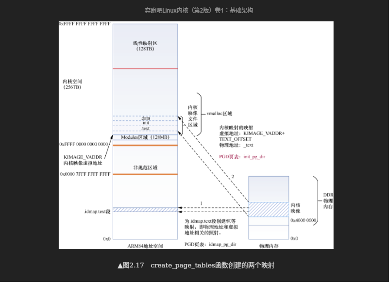
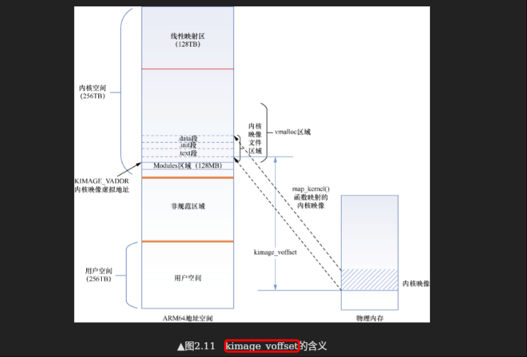

# 内核符号arm64
|符号名称|含义|值|定义|
|-|-|-|-|
|_text|内核镜像起始地址(虚拟地址)||arch/arm64/kernel/vmlinux.lds.S:111 (_text = .;入口声明 ENTRY(_text) 在 lds:19)|
|_head|内核入口第一条指令地址(位于.head.text开头,与_text同地址,System.map中两者均为0xffff800010000000)注意:arm64没有 _start 符号(勿与x86/arm32混淆)!入口标号是 _head,第一条指令为 b primary_entry,UEFI的MZ头/Image头也在这里||arch/arm64/kernel/head.S:65 (_head:)|
|_end|内核镜像结束地址(虚拟地址)||arch/arm64/kernel/vmlinux.lds.S:249 (System.map: 0xffff800011ec0000)|
|__PHYS_OFFSET|内核镜像实际被加载到的物理地址(2MB对齐的加载基址)注意:不是"物理内存(RAM)的起始地址"! adrp	x0, __PHYS_OFFSET 执行后,x0 = 内核镜像实际加载的物理地址(如RAM起始0x80000000、内核加载于0x80200000时,x0=0x80200000);RAM的起始地址是启动后期从DT/UEFI内存映射得出的 memstart_addr,两者通常不同。另外,该宏的链接期数值 = _text - TEXT_OFFSET(与kimage_vaddr数值相同的虚拟地址),从不被当作立即数使用,只作为ADRP标号,运行期按PC相对寻址解析出实际物理地址。阅读:[000.SOURCE_CODE/000.LINUX-5.9/000.LINUX-5.9/arch/arm64/kernel/head.S.copy](../../../../../../000.SOURCE_CODE/000.LINUX-5.9/000.LINUX-5.9/arch/arm64/kernel/head.S.copy) kimage_voffset计算规则(head.S.copy:596,关键行:632) 即可理解|#define __PHYS_OFFSET	(KERNEL_START - TEXT_OFFSET)|arch/arm64/kernel/head.S:39|
|KERNEL_START||#define KERNEL_START		_text|arch/arm64/include/asm/memory.h:131|
|TEXT_OFFSET|内核镜像相对2MB对齐加载基址的字节偏移Makefile注释: "The byte offset of the kernel image in RAM from the start of RAM";与KASLR无关,5.9中无条件设置为0|TEXT_OFFSET := 0x0|arch/arm64/Makefile:136 (export: Makefile:148)|
|init_pg_dir|早期启动的临时内核页表基地址奔跑吧Linux内核（第2版）卷1·基础架构#2．创建内核映像的页表映射(即书中图2.17);paging_init完成后即被释放(mm/mmu.c:1143 memblock_free(__pa_symbol(init_pg_dir),...)),长期使用的内核PGD是swapper_pg_dir||arch/arm64/kernel/vmlinux.lds.S:243 (大小INIT_DIR_SIZE=0x5000/5页,System.map: 0xffff800011eb4000,位于BSS)|
|init_pg_end|init_pg_dir页表区域的结束地址(init_pg_dir+0x5000)||arch/arm64/kernel/vmlinux.lds.S:245|
|idmap_pg_dir|恒等映射页表奔跑吧Linux内核（第2版）卷1·基础架构#2．创建内核映像的页表映射;早期只恒等映射 .idmap.text 段(约0x378字节,lds:264断言其≤4K),MMU开启后装入TTBR0(head.S:809),保证按物理地址执行时不缺页||arch/arm64/kernel/vmlinux.lds.S:140 (大小IDMAP_DIR_SIZE=0x4000/4页,System.map: 0xffff80001154b000)|
|__idmap_text_start|.idmap.text段的起始地址查看000.SOURCE_CODE/000.LINUX-5.9/000.LINUX-5.9/.tmp_System.map就可以知道这段区域有什么:汇编函数,如__enable_mmu||arch/arm64/kernel/vmlinux.lds.S:50 (配对符号__idmap_text_end在 lds:52)|
|kimage_vaddr|内核镜像的虚拟地址|_text - TEXT_OFFSEThead.S中 SYM_DATA 定义: .quad _text - TEXT_OFFSET;由 vmlinux.lds.S 的 _text = KIMAGE_VADDR + TEXT_OFFSET 可知其链接期数值即 KIMAGE_VADDR。注意:"虚拟地址_text - 物理地址_text" 是 kimage_voffset 的公式,不是本符号的值!阅读:[000.SOURCE_CODE/000.LINUX-5.9/000.LINUX-5.9/arch/arm64/kernel/head.S.copy](../../../../../../000.SOURCE_CODE/000.LINUX-5.9/000.LINUX-5.9/arch/arm64/kernel/head.S.copy) kimage_voffset计算规则(head.S.copy:596,关键行:632) 即可理解|arch/arm64/kernel/head.S:476-477 (SYM_DATA kimage_vaddr: .quad _text - TEXT_OFFSET;System.map: 0xffff800010de0000,位于.rodata)|
|KIMAGE_VADDR|内核镜像的虚拟地址|#define KIMAGE_VADDR		(MODULES_END)宏展开后,值: 0xFFFF800010000000(依赖VA_BITS=48、未开KASAN的默认配置)|arch/arm64/include/asm/memory.h:78 (MODULES_END: memory.h:82,MODULES_VADDR: memory.h:83)|
|kimage_voffset|内核映像虚拟地址和物理地址之间的偏移量|虚拟地址_text - 物理地址_text 即 kimage_vaddr - x0(x0来自 adrp x0, __PHYS_OFFSET 运行期解析出的内核镜像实际加载物理地址),从head.S 的 __primary_switched 分析得来|变量定义: arch/arm64/mm/mmu.c:69 (u64 kimage_voffset __ro_after_init);写入处: arch/arm64/kernel/head.S:443-445 (__primary_switched)|
|swapper_pg_dir|长期使用的内核页表PGD基地址(虚拟地址)TTBR1 / init_mm.pgd;与init_pg_dir(早期临时页表,启动后释放)相对||arch/arm64/kernel/vmlinux.lds.S:153 (System.map: 0xffff80001154f000)|

---

### 计算 kimage_voffset 
<pre>
kimage_voffset = kimage_vaddr - __PHYS_OFFSET   
               = _text - TEXT_OFFSET - (KERNEL_START - TEXT_OFFSET) 
               = _text - KERNEL_START 
               = _text - _text = 0 ? 
    绝对不可能!!!,但是问题出现在哪里呢?

    (其实拿链接期常量做减法,结果确实是0: __PHYS_OFFSET 的链接期数值 = KERNEL_START - TEXT_OFFSET (head.S:39) = _text - TEXT_OFFSET,
     与 kimage_vaddr 的链接期数值(head.S:477)完全相同(一个虚拟地址),代数没错;
     错在把 __PHYS_OFFSET 当作数值来用 —— 它几乎从不被当作立即数,唯一用法是作 ADRP 标号,运行期按 PC 相对寻址解析出实际物理地址)

    问题出在 “__PHYS_OFFSET ” 这里,从 <a href="../../../../../../000.SOURCE_CODE/000.LINUX-5.9/000.LINUX-5.9/arch/arm64/kernel/head.S.copy">000.SOURCE_CODE/000.LINUX-5.9/000.LINUX-5.9/arch/arm64/kernel/head.S.copy</a> 中发现,
    
    kimage_voffset = x4 - x0 (head.S:443-445) , 这个x0寄存器存储值时的指令: adrp	x0, __PHYS_OFFSET (head.S:1003,此时MMU已开,但PC仍走TTBR0恒等映射=物理地址,故ADRP按PC相对解析出的是物理地址) , 这表示取的是标签 __PHYS_OFFSET 所在物理页的基地址,即内核镜像实际加载的物理地址 (为什么?参考:<a href="../../../../../../000.SOURCE_CODE/000.LINUX-5.9/000.LINUX-5.9/arch/arm64/kernel/head.S.copy">000.SOURCE_CODE/000.LINUX-5.9/000.LINUX-5.9/arch/arm64/kernel/head.S.copy</a> 函数: __primary_switched,见head.S.copy:596)
    注意:标签是 __PHYS_OFFSET 而非 _text,两者只因 5.9 中 TEXT_OFFSET=0 才重合;若 TEXT_OFFSET≠0(老内核),
    解析出的是2MB对齐的加载基址而非 _text 所在页 —— 这正是 __PHYS_OFFSET 定义中 "- TEXT_OFFSET" 的意义:由 _text 反推2MB对齐的加载基址
    
    而kimage_vaddr = _text - TEXT_OFFSET (head.S:477中定义)
    > 这里的 _text 表示虚拟地址 (为什么? 参考:<a href="../../../../../../000.SOURCE_CODE/000.LINUX-5.9/000.LINUX-5.9/arch/arm64/kernel/head.S.copy">000.SOURCE_CODE/000.LINUX-5.9/000.LINUX-5.9/arch/arm64/kernel/head.S.copy</a> 函数: __primary_switched,见head.S.copy:596)
    
    所以，kimage_voffset = _text的虚拟地址 - _text的物理地址  = kimage_voffset就是内核起始(第一条指令)虚拟地址相对于内核起始(第一条指令)物理地址的偏移量
    > 所以，kimage_voffset 是一个偏移量，且他不等于0！(KASLR 下运行期虚拟地址同样会被随机化,因此必须在运行期计算)

    _text = . = KIMAGE_VADDR + TEXT_OFFSET  (vmlinux.lds.S:111)

    更多内容，参考:<a href="../../../../../../000.SOURCE_CODE/000.LINUX-5.9/000.LINUX-5.9/arch/arm64/kernel/head.S.copy">000.SOURCE_CODE/000.LINUX-5.9/000.LINUX-5.9/arch/arm64/kernel/head.S.copy</a> 函数: __primary_switched,见head.S.copy:596
</pre>

### 图解: kimage_voffset 的诞生 (链接期 vs 运行期)
<pre>
链接期(写死在镜像里的数值):
  _text         = KIMAGE_VADDR + TEXT_OFFSET          (vmlinux.lds.S:111)
                = 0xffff8000_10000000
  kimage_vaddr  = _text - TEXT_OFFSET  = _text        (head.S:477, 位于.rodata)
  __PHYS_OFFSET 宏展开 = _text - TEXT_OFFSET = _text  (head.S:39)
                └── 数值上与 kimage_vaddr 完全相同!
                    所以拿"链接期常量"做减法必然=0 (代数没错,用法错了)

运行期(开机后才确定):
  x4 = kimage_vaddr                             (head.S:443, 链接期值)
  x0 = adrp x0, __PHYS_OFFSET 的结果            (head.S:1003, PC相对寻址)
     = 内核实际加载的物理基址(2MB对齐), 例: 0x00000000_80200000
  kimage_voffset = x4 - x0                      (head.S:444)
     = 0xffff800010000000 - 0x80200000
     = 0xffff7fff_7fe00000                      (此例KASLR关闭)
     [KASLR开启的实测值见 mmu.c:1042 注释: 0xffffaa18dfa00000]

用途: 内核镜像区 VA↔PA 换算   __pa_symbol(x) = x - kimage_voffset
</pre>

> 非常重要! 在 ARM64 Linux 内核启动过程中，**内核镜像可以被加载到物理内存中任意 2MB 对齐的位置（KASLR，对齐要求 MIN_KIMG_ALIGN=SZ_2M，arch/arm64/include/asm/boot.h:20）**，但编译时是基于一个固定的虚拟地址（KIMAGE_VADDR）。
> 注意两点: ① KASLR 下运行期**虚拟地址同样会被随机化**(不只是物理位置)，所以 kimage_voffset 必须在运行期计算; ② TEXT_OFFSET 与 KASLR 无关 —— 5.9 的 arch/arm64/Makefile:136 中无条件 `TEXT_OFFSET := 0x0`(其注释自述为 "The byte offset of the kernel image in RAM from the start of RAM")，老内核中默认值非 0，属历史遗留的镜像放置约定，并非"为了处理 KASLR 而设置"。
> ③ KASLR执行路径: __primary_switched 首次进入时 bl kaslr_early_init(head.S:462,解析FDT取随机偏移) → x23记录偏移后 ret 返回 __primary_switch → 关MMU重建页表/重定位(head.S:975-1004) → 第二次进入 __primary_switched 跳过KASLR → b start_kernel(head.S:472)

---

### 图解: 早期启动主流程 (含寄存器与MMU状态, 行号均指 head.S)
<pre>
bootloader 跳转到内核物理加载地址(2MB对齐), MMU=off, PC=物理地址
   │
   ▼
_head (head.S:65) ── b primary_entry ──▶ primary_entry (head.S:109)
   │  bl preserve_boot_args     → x21 = FDT指针
   │  bl el2_setup              → 回落到 EL1
   │  adrp x23, __PHYS_OFFSET (:112) + and x23, MIN_KIMG_ALIGN-1
   │                            → x23 = 加载地址未按2MB对齐的偏移(默认0)
   │  bl __create_page_tables (:279)
   │     ├─ idmap_pg_dir: 恒等映射 .idmap.text 段 (map_memory :379)
   │     └─ init_pg_dir : VA=KIMAGE_VADDR+TEXT_OFFSET(+x23) → PA=加载基址 (:393)
   │  bl __cpu_setup (proc.S)
   ▼
__primary_switch (head.S:962, 位于.idmap.text!)   MMU仍off, PC=物理地址
   │  adrp x1, init_pg_dir (:968)
   │  bl __enable_mmu (:969, 函数体:800)
   │     TTBR0_EL1 = idmap_pg_dir (:809) ←─ 低地址/恒等映射
   │     TTBR1_EL1 = init_pg_dir  (:811) ←─ 高地址/内核VA映射
   │     MMU开启, ret —— PC仍是物理地址, 走TTBR0恒等映射继续执行!
   │  [RELOCATABLE] bl __relocate_kernel   (按x23应用RELA重定位)
   │  ldr  x8, =__primary_switched (:1002) ← 立即数=虚拟地址
   │  adrp x0, __PHYS_OFFSET (:1003)       ←★ PC=物理地址, PC相对寻址
   │                                          x0 = 内核实际加载物理基址
   │  br x8 ─────────────────────────┐     PC切换到高虚拟地址(走TTBR1)
   ▼                                 │
__primary_switched (head.S:420) ◄────┘   MMU=on, PC=虚拟地址, x0=物理基址
   │  ldr_l x4, kimage_vaddr    (:443) x4 = _text - TEXT_OFFSET (VA)
   │  sub   x4, x4, x0          (:444)
   │  str_l x4, kimage_voffset  (:445) ★ kimage_voffset = VA(_text)-PA(基址)
   │  清BSS; [KASAN] kasan_early_init
   │  [RANDOMIZE_BASE] (:457-468)
   │     x23未随机化? → bl kaslr_early_init (:462, 解析FDT取随机偏移)
   │        ├ 返回0   → KASLR关闭, 直接往下
   │        └ 返回偏移 → x23|=偏移, ret 回__primary_switch
   │                      → 关MMU重建页表/重定位(:975-1004) → 再入此处(跳过KASLR)
   ▼
b start_kernel (head.S:472)
</pre>

### 图解: 地址空间布局 (VA_BITS=48、4K页、无KASAN)
<pre>
虚拟地址                                    物理地址
0xffff8000_00000000 ┬ VA_START=PAGE_OFFSET
                    │  BPF JIT 区  (128MB)
0xffff8000_08000000 ┼ MODULES_VADDR   ← memory.h:83
                    │  modules 区    (128MB)
0xffff8000_10000000 ┼ MODULES_END = KIMAGE_VADDR  ← memory.h:82/78
                    │  = kimage_vaddr = _text(链接期)
                    │  ╔══════════════╗          ╔══════════════╗
                    │  ║   内核镜像    ║ ←块映射→  ║ 内核镜像     ║ ← 2MB对齐
                    │  ║ ~0xec0000大  ║          ║ 加载基址起   ║    (MIN_KIMG_ALIGN)
0xffff8000_11ec0000 ┼ _end             ╚══════════════╝
                    │        ▲
                    └────────┴─ kimage_voffset = _text(VA) - 加载基址(PA)
</pre>

---

分析[arch/arm64/kernel/head.S](./head.S.copy)之后，再看如下的图，就很清晰了:
- 
- 