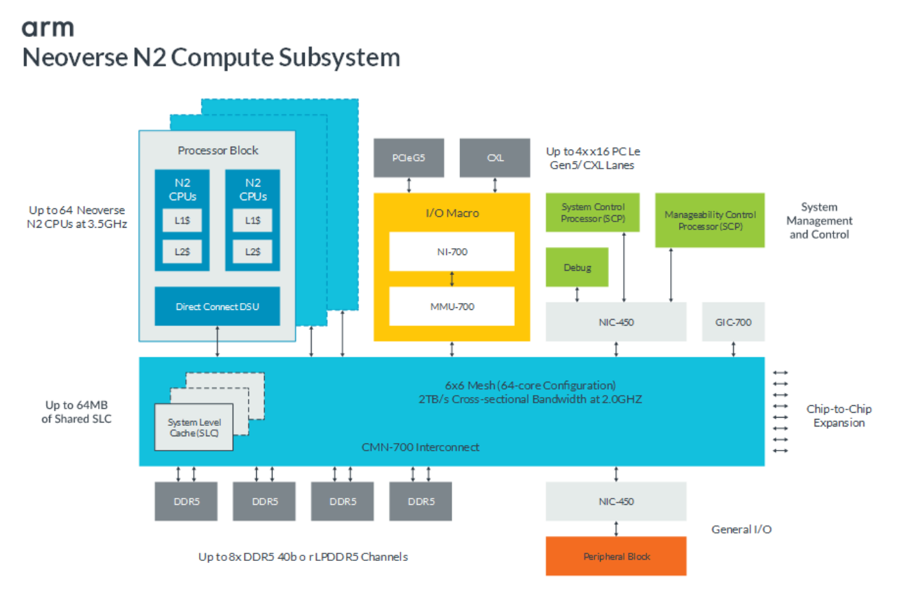

# Arm CSS：计算子系统（Compute Subsystem）是什么

> **一句话定位**：CSS（Compute Subsystems，计算子系统）是 Arm 把「CPU 核心 + 一致性互连 + 内存/I/O + 系统 IP + 平台软件」预先集成、预先验证后打包交付的计算平台——它介于“单个 CPU 核心 IP”与“最终 SoC”之间，是 SoC 的计算主干，而不是整颗芯片。完整定义与逐项解读见第 1–4 节，关键结论速查见第 8 节。
>
> **阅读约定**：关键论断按【协议规定】／【IP 可配置能力】／【具体芯片已实现规格】／【教学假设】标注出处层级；个别论断使用复合标签——【交付承诺】（Arm 官方交付／市场层面的承诺表述）、【协议规定 + 生态分工】（标准规定＋生态实现分工）与【IP 可配置能力 + 交付边界】（IP 能力边界与交付分工的交界表述）；查证不到或资料冲突的内容记「未确认」，集中列于第 6 节；引文均附来源与页码，网页访问日期均为 2026-11-12。

## 导航

- 本目录：[README.md](README.md)
- [002.协议指令集与系统IP分类总览.md](002.协议指令集与系统IP分类总览.md)——互连 IP（CMN／NI／CI／NoC）、AMBA 协议与系统 IP 的完整分类与代际
- [003.AMBA-CHI-C2C架构-Figure1-3.md](003.AMBA-CHI-C2C架构-Figure1-3.md)——CHI C2C 跨芯粒架构分析
- [005.Arm-AGI-CPU架构核验.md](005.Arm-AGI-CPU架构核验.md)——Arm AGI CPU 双芯粒图核验
- 关联索引：[总线 BUS 学习资料索引](../053.总线-BUS/000.总线BUS-学习资料索引.md)（互连层次与术语）；[000.ARM资料库：DynamIQ Shared Unit 笔记](../../007.BOOKs/000.ARM资料库/000.DynamIQ%20Shared%20Unit.md)（cluster 内 DSU/SCU）

## CSS 是什么：导读

**CSS = Compute Subsystems（计算子系统）**。Arm 官方对基础设施线的定义：*"Arm Neoverse Compute Subsystems (CSS) are validated, performance-optimized infrastructure compute platforms built on leading-edge process technology."*（[Arm Neoverse Compute Subsystems 系列页](https://www.arm.com/products/cloud-datacenter/neoverse-compute-subsystems)，访问日期 2026-11-12；完整原句与更多定义见第 1 节）。

层级关系一句话版（完整版见第 4 节）：

```text
CPU 核心 IP (如 Neoverse N2: 每核私有 L1$/L2$, MPAM Requester [R])
  +- Cluster(集群): 核心 xN + DSU(snoop filter/可选 L3; N2 CSS 中为 Direct Connect DSU, 无簇内 L3)
       +- CSS(计算子系统): cluster xN + CMN 网状互连 + SLC + DDR5/PCIe PHY + GIC/MMU/SCP/NIC + 平台软件
            +- SoC(最终芯片): CSS + Peripheral Block + 差异化加速器 + 电源/时钟/封测(+ 可选其他 chiplet 芯粒)
```

图内缩写速览（逐项展开见第 3 节）：L1$/L2$＝一级/二级缓存；DSU＝DynamIQ Shared Unit（簇级共享单元）；SLC＝System Level Cache（系统级缓存，3.4-3）；GIC＝Generic Interrupt Controller（通用中断控制器，3.4-8）；MMU＝Memory Management Unit（内存管理单元，此处指 IOMMU/SMMU，3.4-4）；SCP＝System Control Processor（系统控制处理器，3.4-7）；NIC＝Network Interconnect（网络互连桥，如 NIC-450，3.4-6）；MPAM Requester 的 MPAM＝Memory System Resource Partitioning and Monitoring（3.6）。

- **与传统 CPU IP 授权的区别**：传统模式 Arm 只给核心（如一个 Neoverse N2 核），互连、内存、I/O、系统控制都要 SoC 设计方自己选型集成；CSS 把这条“计算主干”连选型带验证一起交付，SoC 设计方在其上做差异化（外设、加速器、chiplet、封装等）。
- **本文的核心图**：Figure 4-2: Arm Neoverse N2 Compute SubSystem (CSS)，来自 R10 MPAM Hardware Guide PDF 物理页 30，原图与逐项解读见第 3 节。

---

## 1. CSS 定义与交付边界

### 1.1 官方定义原句

**① R10（MPAM Hardware Guide，本地 PDF）§4.4 "Arm Neoverse Compute Subsystems"，物理页 29**——对 N2 CSS 的最精炼官方定义：

> "Arm Neoverse N2 Compute SubSystem (CSS) is an Arm-configured, verified and performance-validated subsystem of up to 64 N2 cores targeting an advanced 5nm process. Neoverse N2 CSS includes selection and configuration of 3rd Party IP (DDR5 memory and PCIe Gen5/CXL I/O), plus SBSA certification and a platform software model."

译：Arm Neoverse N2 CSS 是一个由 **Arm 配置、验证并完成性能验证** 的子系统，最多 64 个 N2 核心，面向先进 5nm 制程；N2 CSS **包含第三方 IP（DDR5 内存与 PCIe Gen5/CXL I/O）的选型与配置**，并附带 **SBSA 认证与平台软件模型**。
出处：[R10《Learn the architecture - Memory System Resource Partitioning and Monitoring (MPAM) Hardware Guide》Document ID 109252_0101_01_en（Version 1.1），§4.4，PDF 物理页 29](../../007.BOOKs/learn_the_architecture_-_memory_system_resource_partitioning_and_monitoring_%28mpam%29_hardware_guide_109252_0101_01_en.pdf#page=29)（PDF 提取文本中 fi 连字按原义转写为 fi，下同）。

**② Arm 官网 Neoverse CSS 系列页**（当前总入口）：

> "Arm Neoverse Compute Subsystems (CSS) are validated, performance-optimized infrastructure compute platforms built on leading-edge process technology."

译：Arm Neoverse CSS 是构建在先进制程上、经过验证、性能优化的基础设施计算平台。
出处：[Neoverse Compute Subsystems (CSS): Fast-Track to Silicon，Arm 官网](https://www.arm.com/products/cloud-datacenter/neoverse-compute-subsystems)，访问日期 2026-11-12。

**③ Arm 官方博客（newsroom）一句话定义**：

> "Neoverse CSS integrates Neoverse CPU cores with interconnect, memory subsystems, and system IP into a coherent, pre-validated compute platform."

译：Neoverse CSS 把 Neoverse CPU 核心、互连、内存子系统与系统 IP 集成为一个一致性、预验证的计算平台。
出处：[What is Arm Neoverse?，Arm Newsroom](https://newsroom.arm.com/blog/what-is-arm-neoverse)，访问日期 2026-11-12。

**④ R4（CSS V3 产品页，中文）**：

> "Neoverse CSS V3 通过将 Arm Neoverse 平台核心、一致性网状互连、内存控制器和系统 IP 集成到预先验证的计算子系统中，简化了基础设施 SoC 的开发。"

出处：[Arm Neoverse CSS V3，Arm 官网中文页（R4）](https://www.arm.com/zh-cn/products/cloud-datacenter/neoverse-compute-subsystems/css-v3)，访问日期 2026-11-12。同页 FAQ："Neoverse CSS V3 是一个基于Arm Neoverse 平台 V3 CPU 构建的预先验证计算子系统，属于 Armv9.2-A 架构系列。"

### 1.2 一种常见说法的逐项核验

一种常见的说法（未经核实）如下，逐项核验：

> "Arm Compute Subsystems（计算子系统，简称 CSS）是 Arm 提供的预集成、预验证、经过物理布局优化的完整计算芯片平台，旨在大幅缩短客户设计定制化 SoC 的周期与风险。与传统仅提供单个 CPU 核心 IP 的模式不同，CSS 将计算核心、缓存、一致性互连总线、系统控制与安全组件打包交付，并针对特定先进制程进行了 PPA（性能、功耗、面积）深度调优。"

| # | 说法原文 | 结论 | 依据与修订建议 |
| --- | --- | --- | --- |
| 1 | 名称 "Arm Compute Subsystems（计算子系统，简称 CSS）" | **成立**（措辞需补产品前缀） | 官方产品名带线别前缀：基础设施线 "Neoverse Compute Subsystems (CSS)"（②），终端线 "Arm Compute Subsystems (CSS) for Client"；"Arm CSS" 是族统称，具体产品为 Neoverse CSS V3/N3/N4、CSS for Client、Lumex CSS 等 |
| 2 | "预集成" | **成立** | newsroom："optimized, integrated, and verified platforms which bring together the key technologies that make up the heart of an SoC"（[Enabling the AI Infrastructure on Arm](https://newsroom.arm.com/news/enabling-ai-infrastructure-on-arm)，2024-02，访问 2026-11-12）；③"integrates … into a coherent, pre-validated compute platform" |
| 3 | "预验证" | **成立** | ①"Arm-configured, verified and performance-validated"（协议／交付承诺层面，R10 物理页 29）；系列页 "validated"；Client 页 "validated and verified production-ready implementations" |
| 4 | "经过物理布局优化的…PPA 深度调优" | **需修订（分产品线）** | Client 线成立：官方明确 *"Arm CSS for Client introduces production-ready, hardened CPU and GPU core implementations optimized on 3nm. These are available on multiple foundries, providing maximum flexibility."*（[Arm Compute Subsystems (CSS) for Client](https://www.arm.com/products/compute-subsystems-for-client)，访问 2026-11-12，2026-11-14 逐字复核）——hardened＝物理实现（硬化）已完成；Neoverse 线：官方措辞为 "validated, performance-optimized … built on leading-edge process technology"（②）与 "performance-validated"（①），未见以 "PPA 深度调优" 作为通用官方承诺；物理实现通常由 Arm 与 foundry／EDA／Arm Total Design 生态按项目协同（[系列页 Arm Total Design 小节](https://www.arm.com/products/cloud-datacenter/neoverse-compute-subsystems)）→ 该半句应改为"性能已验证、面向先进制程优化；Client 线交付 3nm 硬化实现，Neoverse 线物理实现由 Arm 及生态伙伴协同完成"（**部分未确认**，见第 6 节） |
| 5 | "完整计算芯片平台" | **需修订（边界）** | CSS 覆盖的是 SoC 的**计算主干**，不是整颗芯片：内存控制器的 MPAM 支持需向内存控制器供应商获取（R10 物理页 29 原句见 1.3-1）；Peripheral Block（片上外设区）在 CSS 之外（Figure 4-2）；系列页把 Arm 承担的部分明确为 "non-differentiated design and validation tasks"，差异化创新由伙伴完成 → 建议改为"完整的**计算子系统**／计算平台（SoC 的计算主干）" |
| 6 | "与传统仅提供单个 CPU 核心 IP 的模式不同" | **成立** | R4 FAQ："与传统的 IP 核心不同，CSS V3 将计算、内存、I/O 和系统 IP 集成在一个经过验证的设计中"（R4，访问 2026-11-12）；newsroom 博客描述 IP → CSS → 整体芯片的递进路径 |
| 7 | "将计算核心、缓存、一致性互连总线、系统控制与安全组件打包交付" | **大体成立（清单需按产品线精确化）** | N2 CSS 交付清单（R10 §4.4 + Figure 4-2，[物理页 29-30](../../007.BOOKs/learn_the_architecture_-_memory_system_resource_partitioning_and_monitoring_%28mpam%29_hardware_guide_109252_0101_01_en.pdf#page=29)）：N2 核心+DSU、CMN-700 互连+SLC（缓存）、GIC-700、MMU-700、NIC-450、SCP/MCP/Debug（系统控制）、I/O macro（NI-700+MMU-700+PCIe/CXL PHY）、DDR5（第三方选型配置）、SBSA 认证+平台软件模型。"安全组件"未获官方逐项清单（**部分未确认**，见第 6 节） |
| 8 | "旨在大幅缩短客户设计定制化 SoC 的周期与风险" | **成立** | 系列页："Speed the path to production silicon to as fast as 13 months with up to 80 engineering years saved"、"reducing time-to-silicon by up to one year"；R4："提供一个预先验证的计算子系统，可减少集成工作量并降低项目风险" |

### 1.3 SoC 设计方仍需完成的工作

**1. 内存控制器（最明确的一条官方边界）**——R10 物理页 29（§4.3 Use of CBusy 内注记）：

> "Arm does not design or license an MPAM-enabled memory controller. Memory controller MPAM support details will need to be obtained from the relevant memory controller vendor."

译：Arm 不设计也不授权带 MPAM 的内存控制器；内存控制器的 MPAM 支持细节需向相应内存控制器供应商获取。配套：CMN-700 自身不做 MPAM 带宽管理（R10 物理页 23，见 3.6）。→ SoC 设计方必须自选内存控制器并落实其 MPAM 能力。**【IP 可配置能力 + 交付边界】**

**2. 外设块与差异化加速器**——Figure 4-2 中 mesh 下方一路 NIC-450 经 "General I/O" 接到 "Peripheral Block"，该块在 CSS 交付之外；R4 将 "高度可定制内存子系统"、"AI 加速器接入选项" 列为客户可定制项。**【IP 可配置能力】**

**3. SoC 其余集成与差异化**——系列页 AI Summary：*"They accelerate time-to-silicon by offloading non-differentiated design and validation tasks, enabling partners to focus on customization and market-specific innovation."* → Arm 承担"非差异化"的设计与验证，伙伴负责定制与市场差异化。**【交付承诺】**

**4. 物理实现、封装与量产**——系列页 Arm Total Design 小节提供 "preferential access to Arm Neoverse CSS, pre-integrated IP and EDA tools, design services, foundry support, and commercial software and firmware support"；newsroom 把 Total Design 伙伴的工作描述为 *"everything from verifying IP, and customizing firmware, through to building chiplets on the world's most advanced process nodes"*。→ 物理实现由 Arm＋生态按项目分工完成，具体分工随项目而异（**教学假设，部分未确认**，见第 6 节）。

**5. Chiplet 侧实现**——R2（Neoverse S3 System IP 文章，2024-02-22）：*"Standardized Chiplet interfaces with AMBA CHI C2C over UCIe with a defined chiplet development kit…"* → Arm 提供 CHI C2C/UCIe 标准接口与 chiplet 设计套件，实际 PHY、封装（SoaP＝System on a Package，芯粒集成的封装级系统，R2 原文用语）由伙伴／代工生态实现。**【协议规定 + 生态分工】**

**6. 系统级合规与量产认证**——N2 CSS 交付物含 "SBSA certification"（①）；最终整机/整芯片的系统合规与量产认证仍由 SoC 设计方完成（**教学假设，未获官方清单**，见第 6 节）。

## 2. 产品与场景对照

### 2.1 常见产品／场景表述逐项核对

常见的产品场景表述（未经核实）如下，逐项核对：

| 产品／系列 | 常见说法中的应用场景 |
| --- | --- |
| Neoverse CSS V3、Neoverse CSS N3 | 云计算数据中心、AI 基础设施、高性能计算（HPC） |
| Arm CSS for Client | 旗舰智能手机、AI PC、高性能边缘终端 |

| 产品 | 核对结论 | 官方场景（原句） | 关键组件／参数（有出处） | 依据 |
| --- | --- | --- | --- | --- |
| **Neoverse CSS V3** | **场景成立** | 云/数据中心："加快云和数据中心路线图规划"；HPC："为计算密集型 HPC 应用提供持续的性能"；AI：AI 训练与推理、定制加速器集成；另列数据分析、5G、机密计算 | "多达 64 个 Neoverse V3 核心"（每 die）、CMN S3 网状互连、MMU S3（"支持 PCIeG6/CXL3.1 的 I/O 内存管理单元"）、"多达 12 个 DDR5/LPDDR5 内存通道"、"64 条 PCIe Gen5 或 CXL I/O 通道"、UCIe 1.1 与 Arm 芯粒系统架构（CSA）；newsroom："the first Neoverse CSS product for the high-performance V-series portfolio with a 50% performance-per-socket improvement over CSS N2" | R4（访问 2026-11-12）；[newsroom 2024-02](https://newsroom.arm.com/news/enabling-ai-infrastructure-on-arm)；[系列页](https://www.arm.com/products/cloud-datacenter/neoverse-compute-subsystems) |
| **Neoverse CSS N3** | **部分成立，需修订** | 新闻稿确认 CSS N3 存在：*"Arm Neoverse CSS N3, an extension of our leading N-series CSS roadmap, delivering 20% higher performance-per-watt compared to CSS N2"*；N3 核心页场景为 "Optimal performance and power efficiency for hyperscale, telecom, networking, and infrastructure edge devices"，Use cases 列 Cloud and data centers / Cloud computing / Edge computing → **"HPC" 未见于 N3 页正文与 Use cases 场景标注**（页面上 "AI, HPC, & cloud workloads"/"High-performance computing" 字样仅出现在站点导航推广卡片与 Cloud AI 链接中，非 N3 的场景定位；"HPC" 场景表述属于 V3 页），N3 场景应写为云/网络/电信/边缘 | 组件清单未见独立官方详情页：R2 明确 S3 代际 system IP *"form the foundation for our CSS V3 and CSS N3"*（CMN S3/MMU S3/NOC S3）；"可扩展 8 核至 192 核以上"（N3 CPU 页，搭配 Neoverse S3 平台 IP） | [newsroom 2024-02](https://newsroom.arm.com/news/enabling-ai-infrastructure-on-arm)；[Neoverse N3 CPU 页](https://www.arm.com/products/silicon-ip-cpu/neoverse/neoverse-n3)（访问 2026-11-12）；R2。**CSS N3 独立产品页未检索到，见第 6 节** |
| **Arm CSS for Client** | **部分成立，需修订** | 页面 Segments 逐字为 **"Mobile AI" / "Laptops & PCs" / "Gaming"**；旗舰智能手机 ✓（Mobile AI/旗舰手机，Immortalis-G925）、AI PC ✓（Laptops & PCs / AI-powered devices / Windows on Arm 生态）；**"高性能边缘终端"未在页面出现** → 建议改为"旗舰智能手机（移动 AI）、AI PC／笔记本、移动游戏" | 组成：旗舰 Cortex-X925 + Cortex-A725 + Cortex-A520（Armv9.2 集群）、Immortalis-G925 GPU、CoreLink CI-700 互连、CoreLink SMMU-700、Arm Kleidi 软件；*"validated and verified production-ready implementations of new Arm CPUs and GPUs on 3nm process nodes"*；*"production-ready, hardened CPU and GPU core implementations optimized on 3nm. These are available on multiple foundries, providing maximum flexibility."* | [Arm Compute Subsystems (CSS) for Client](https://www.arm.com/products/compute-subsystems-for-client)（访问 2026-11-12） |
| 补充（上述说法未列） | — | 产品族还在扩展：newsroom/官网当前列 **Neoverse CSS N4**（"Configurable from 8 to 128 CPU cores per die"、LPDDR6、PCIe Gen 7）、**Lumex CSS**（Armv9.3-A，"An AI-First Compute Subsystem Platform for the Next Mobile Era"，归入移动线）、**Zena CSS**（官方归类 **Autonomous machines**，原句 "Compute subsystems for autonomous vehicles & robotics"，面向自主机器/汽车与机器人，非移动线） | — | [系列页](https://www.arm.com/products/cloud-datacenter/neoverse-compute-subsystems)、[CSS for Client 页](https://www.arm.com/products/compute-subsystems-for-client)（访问 2026-11-12） |

### 2.2 不同 CSS 产品的共同点

1. **同一个交付公式**：CPU 核心 + 互连 + 内存/IO + 系统 IP + 软件，预集成、预验证后整体交付（newsroom "optimized, integrated, and verified platforms"；③"integrates … into a coherent, pre-validated compute platform"）。
2. **同一个目标**：缩短 time-to-market、降低集成风险、让伙伴聚焦差异化（系列页 "13 months / 80 engineering years saved"；R4 "减少集成工作量并降低项目风险"）。
3. **同一个商业模式边界**：Arm 交付计算主干与验证，差异化（外设、加速器、chiplet、封装、整机）留给 SoC 设计方（1.3）。

### 2.3 不同 CSS 产品的差异

1. **交付形态不同（最重要的差异）**：Neoverse 线以**可配置 IP 子系统**交付，物理实现与 foundry/EDA/Total Design 生态按项目协同；Client 线直接交付 **3nm 硬化的生产级实现**（"Arm CSS for Client introduces production-ready, hardened CPU and GPU core implementations optimized on 3nm. These are available on multiple foundries, providing maximum flexibility."，官方原句见 2.1）。**【交付承诺】**
2. **互连与系统 IP 代际不同**：N2 CSS = CMN-700 + NIC-450 + MMU-700 + GIC-700（Figure 4-2，R10 物理页 30）；V3/N3 = S3 代际（R2："CMN S3 builds on the legacy of CMN-700 IP"、"MMU S3 builds on our industry standard MMU-700 IP"、"NOC S3 is our new Non-coherent interconnect built on NI-700"、"The Neoverse S3 products are our 3rd generation of Neoverse System IP, and they form the foundation for our CSS V3 and CSS N3"）；Client = CoreLink CI-700 + SMMU-700（Client 页）。**【具体芯片已实现规格】**
3. **场景与优化点不同**：V3 面向云/AI/HPC 性能（per-socket 性能），N3 面向网络/电信/边缘能效（per-watt），Client 面向终端 AI 与移动游戏（页面性能对比 +36%/+37%/+59%）。
4. **架构特性支持不同**：S3 代际 *"are the first to support RME"*（R2），V3 支持机密计算（Arm CCA，R4）；Client 集群为 Armv9.2 大小核（X925/A725/A520）。

## 3. Figure 4-2 逐项解读：Arm Neoverse N2 CSS

### 3.1 图表定位核验记录

| 核验项 | 结果 | 核验方式 |
| --- | --- | --- |
| 图号 | **Figure 4-2** | PyMuPDF 提取物理页 30 文本，图题行逐字为 "Figure 4-2: Arm Neoverse N2 Compute SubSystem (CSS)" |
| 图题 | **"Arm Neoverse N2 Compute SubSystem (CSS)"**（图内标题 "Neoverse N2 Compute Subsystem"） | 图题：PyMuPDF 提取 R10 PDF 物理页 30 文本，图题行逐字为 "Figure 4-2: Arm Neoverse N2 Compute SubSystem (CSS)"；图内标题：位图文字不在 PDF 文本层，经渲染图 999.IMGS/MPAM-Fig4-2-N2-CSS-p30-fig.png 目视逐字核对为 "Neoverse N2 Compute Subsystem" |
| 物理页 | **PDF 物理页 30**（该 PDF 共 30 页，图占页 30 主体，图像放置矩形 [85.0, 103.7, 555.3, 417.9] pt） | PyMuPDF `get_image_rects` 实测 |
| 所属章节 | §4.4 "Arm Neoverse Compute Subsystems"（正文在物理页 29，图为该节配图） | 物理页 28-30 文本提取 |

出处链接：[R10 §4.4，PDF 物理页 30](../../007.BOOKs/learn_the_architecture_-_memory_system_resource_partitioning_and_monitoring_%28mpam%29_hardware_guide_109252_0101_01_en.pdf#page=30)；文档版本 Version 1.1（0101-01，2024-10-30，Non-Confidential，见 PDF 物理页 2 Release information）。

### 3.2 原图



*图 1：Figure 4-2 原图（自 PDF 物理页 30 按图像放置矩形裁剪渲染，200 DPI，仅裁切未缩放变形；实际输出 1324x891 px，较放置矩形 470.27x314.20 pt 按 200 DPI 换算的约 1306x873 px 长、宽各多出约 18 px 的少量边界留白，疑为渲染取整/边界扩展所致，宽高比偏差约 0.7%）。出处：[R10《Memory System Resource Partitioning and Monitoring (MPAM) Hardware Guide》109252_0101_01_en §4.4，PDF 物理页 30](../../007.BOOKs/learn_the_architecture_-_memory_system_resource_partitioning_and_monitoring_%28mpam%29_hardware_guide_109252_0101_01_en.pdf#page=30)。整页渲染备用：[999.IMGS/MPAM-Fig4-2-N2-CSS-p30.png](999.IMGS/MPAM-Fig4-2-N2-CSS-p30.png)。渲染工具说明：以 PyMuPDF 1.26.5 按 200 DPI 渲染（与 pdftoppm -r 200 等效）。*

### 3.3 ASCII 重绘（含解释性 CSS 边界与 MPAM 标注）

```text
+--------------------------------------------------------------------------------------------------------+
| Figure 4-2 ASCII 重绘: Arm Neoverse N2 Compute SubSystem (CSS)                                         |
| 外框 = 解释性 CSS 边界(原图无显式边框, 依据 R10 4.4 定义推断);  [R]=MPAM Requester  [M]=MPAM MSC       |
|                                                                                                        |
| +--------------------------------+    +--------------------------+  +--------------------------------+ |
| | Processor Block (xN 可堆叠)    |    | I/O Macro                |  | System Mgmt & Control          | |
| | +--------+  +--------+         |    | [PCIeG5] [CXL] PHY       |  | [SCP] [MCP] [Debug]            | |
| | | N2 CPU |  | N2 CPU |         |    | [3rd-party IP, 选中配置] |  | (系统管理与控制)               | |
| | |L1$  L2$|  |L1$  L2$|         |    | +--------+               |  | +--------+  +--------+         | |
| | +--------+  +--------+         |    | | NI-700 |               |  | |NIC-450 |  |GIC-700 |         | |
| | (每核私有 L1$/L2$ [R])         |    | +--------+               |  | +--------+  +--------+         | |
| | [ Direct Connect DSU ]         |    | +--------+               |  | x2: 一路接系统管理,            | |
| | (直连 CMN: 无簇内 L3,          |    | | MMU-700| [M]           |  | 一路接 General I/O             | |
| |  见 R10 4.4/Direct connect)    |    |                          |  |                                | |
| +--------------------------------+    +--------------------------+  +--------------------------------+ |
|                 |                                  |                      |           |                |
|                 |                                  |                      |           |                |
| +---------------v----------------------------------v----------------------v-----------v---------------+|
| | +------------------------+    CMN-700 Interconnect [M]                                              ||
| | | SLC 系统级缓存         |    6x6 Mesh (64-core 配置)                                               ||
| | | [M] CPBM/CMAX/MSMON    |    2TB/s Cross-sectional BW @2.0GHz                          Chip-to-Chip||
| | +------------------------+    SLC: up to 64MB, 每 HN-F 一片                                         ||
| +---------------v----------------------------------v----------------------v-----------v---------------+|
|         |         |         |         |                     |                                          |
|         |         |         |         |                     |                                          |
|     +---v--+  +---v--+  +---v--+  +---v--+              +---v---+                                      |
|     | DDR5 |  | DDR5 |  | DDR5 |  | DDR5 |              |NIC-450|                                      |
|     +------+  +------+  +------+  +------+              +-------+                                      |
|   Up to 8x DDR5 40b 或 LPDDR5 通道(内存控制器/PHY 为 3rd-party 选中配置)                               |
|                                                   General I/O => Peripheral Block(SoC 设计方, CSS 之外)|
| 注: 内存控制器的 MPAM 带宽控制取决于供应商(Arm 不设计/授权 MPAM 内存控制器, R10 4.3)。                 |
+--------------------------------------------------------------------------------------------------------+
```

*图 2：Figure 4-2 重绘（教学重绘，省略图内 arm logo 与配色）。框线对齐已按显示列宽程序化校验（CJK 按 2 显示列计）。省略项：图中各块的堆叠虚线效果、颜色编码。原图无显式边界框，本图外框为**解释性**边界（依据 §4.4 定义与图中箭头方向推断，属教学标注）。与原图的两点说明：本图为排版紧凑把 GIC-700 画入 System Mgmt & Control 区内，原图中 GIC-700 为独立方块直接挂接 mesh（见 3.4-8）；原图 "Manageability Control Processor (SCP)" 的 "(SCP)" 系原图排印（按职责通常缩写为 MCP），此处逐字保留。*

### 3.4 组件与互连关系逐项解释

| # | 图中组件（原文字样） | 互连关系（依原图） | 说明与证据 |
| --- | --- | --- | --- |
| 1 | **Processor Block**（堆叠 ×N），内含 2× "N2 CPUs"（各含 L1$、L2$）与 "Direct Connect DSU"；左标注 "Up to 64 Neoverse N2 CPUs at 3.5GHz" | 每个 Processor Block 经 DSU 向下接到 CMN-700 mesh（图中双竖线箭头） | N2 核每核私有 L1/L2；"Direct Connect DSU"＝DSU 直连接口配置。R10 物理页 16：*"When DSU-110 or DSU-120 is in Direct connect mode, no L3 cache is present and no MPAM partitioning interface is implemented."*（译：Direct connect 模式下 DSU 无 L3、无 MPAM 分区接口）→ N2 CSS 的共享缓存放在 mesh 上的 SLC，而非簇内 L3；这也与仓库平台笔记（CLAUDE.md）中 Arm AGI CPU "DSU-120 Direct connect" 的用法一致。N2 核是 MPAM-enabled Requester（物理页 29） |
| 2 | **CMN-700 Interconnect**，标注 "6x6 Mesh (64-core Configuration)"、"2TB/s Cross-sectional Bandwidth at 2.0GHZ" | 全图主干：Processor Block、SLC、I/O Macro、DDR5、NIC-450、GIC-700 都挂在其上；右侧 "Chip-to-Chip Expansion" 箭头 | CMN-700＝Neoverse CMN 一致性网状互连（AMBA 5 CHI）；术语与节点模型（RN/HN/SN/XPs、HN-F）详见 [000.ARM资料库：CMN-600 笔记](../../007.BOOKs/000.ARM资料库/003.CMN-600.md) 与 [总线索引](../053.总线-BUS/000.总线BUS-学习资料索引.md)；分类归属见 [002 文档](002.协议指令集与系统IP分类总览.md)。图中 mesh 参数仅在 R10 物理页 30 出现（口径未确认，见第 6 节） |
| 3 | **System Level Cache (SLC)**，左标注 "Up to 64MB of Shared SLC"（堆叠虚线块） | 位于 mesh 带内（每 HN-F 一片 SLC 切片） | R10 物理页 20：*"The CMN-700 System-Level Cache (SLC) is an MPAM-enabled MSC."*；SLC 按 HN-F 分片，MPAM 分区/监控点（3.6） |
| 4 | **I/O Macro**：顶部 PCIeG5、CXL（灰块），内含 NI-700、MMU-700；标注 "Up to 4x x16 PCIe Gen5/CXL Lanes" | I/O Macro 向下接 CMN-700；向上接 PCIe/CXL 外部链路 | NI-700＝NI 系列互连桥；MMU-700＝IOMMU（SMMU），MPAM MSC（物理页 24-25）；PCIeG5/CXL 为第三方选型配置 IP（§4.4 原句 1.1-①） |
| 5 | **DDR5 ×4**，标注 "Up to 8x DDR5 40b or LPDDR5 Channels" | 经四组双箭头挂到 mesh 下沿 | DDR5 内存通道为第三方选型配置（§4.4）；"40b" 含义未确认（第 6 节）；内存控制器侧 MPAM 带宽控制取决于供应商（物理页 29 原句 1.3-1） |
| 6 | **NIC-450 ×2** | 一路在 System Mgmt 区（接 SCP/MCP/Debug 与 mesh），一路在 mesh 下方接 "General I/O" → Peripheral Block | NIC-450＝NIC 系列互连（非一致性/通用互连桥）；分类归属见 [002 文档](002.协议指令集与系统IP分类总览.md) |
| 7 | **System Control Processor (SCP)**、**Manageability Control Processor (SCP)**、**Debug**，右标注 "System Management and Control" | 经 NIC-450 接入 mesh | 系统管理处理器（SCP）负责平台管理（电源/时钟/启动等，图未展开细节；具体固件职责未获本资料逐项说明，见第 6 节） |
| 8 | **GIC-700** | 独立方块接 mesh | 通用中断控制器；MPAM MSC（物理页 26，3.6） |
| 9 | **Chip-to-Chip Expansion**（右侧 8 组箭头） | 从 mesh 右缘引出，跨出图框 | 跨芯片/芯粒扩展接口（对应后来的 CSS 双 socket/chiplet 连接能力；R2：S3 代际以 "AMBA CHI C2C over UCIe" 标准化该能力，见 1.3-5） |
| 10 | **General I/O → Peripheral Block** | mesh 下沿 NIC-450 → General I/O → Peripheral Block（橙色块） | 片上外设区，**在 CSS 交付之外**（SoC 设计方逻辑） |

### 3.5 CSS 边界：框内与框外

**原图没有显式边界框**（原图目视核对：无虚线框/背景分区，见 3.2），以下边界为**解释性结论**（教学标注，依据 R10 §4.4 定义 + 图中箭头方向）：

- **CSS 交付之内（框内）**：N2 核心+Direct Connect DSU（Processor Block）；CMN-700 互连+SLC；GIC-700；MMU-700+NI-700（I/O Macro）；NIC-450；SCP/MCP/Debug；以及**选型配置**的第三方 IP——DDR5 内存通道与 PCIe Gen5/CXL I/O（§4.4 原句 *"includes selection and configuration of 3rd Party IP (DDR5 memory and PCIe Gen5/CXL I/O)"*）＋SBSA 认证与平台软件模型。
- **CSS 之外（框外/箭头对端）**：片外 DDR5/LPDDR5 颗粒；PCIe/CXL 链路对端设备；Chip-to-Chip Expansion 的对端（其他芯粒/socket）；General I/O 所接的 **Peripheral Block**（SoC 设计方外设区）；以及最终 SoC 还需的电源/时钟/模拟、封测、差异化加速器等（1.3）。

### 3.6 MPAM 相关资源的位置与作用

R10 物理页 29 给出 N2 CSS 的官方 MPAM 组件清单：

> "The Arm Neoverse N2 Compute SubSystem (CSS) implements the following MPAM-enabled Requesters and MSCs." —— Neoverse N2 / CMN-700 / GIC-700 / MMU-700

译：N2 CSS 实现以下 MPAM-enabled Requester 与 MSC：Neoverse N2、CMN-700、GIC-700、MMU-700。→ **Figure 4-2 中带 MPAM 能力的恰是这四个块**（图中位置见 3.3 的 [R]/[M] 标注）。逐一说明：

1. **MPAM 信息束如何流动（协议层）**：MPAM 信息束经 **AMBA 5 CHI** 从 Requester 传到各 MSC（R10 §2，物理页 7）。CHI Issue D/E 为 **11 位 MPAM 字段**：PartID 9 位 + PerfMonGroup 1 位 + MPAMNS 1 位（Table 2-1，物理页 7）；CHI Issue F 起为 **12 位**，MPAMSP 2 位取代 MPAMNS（配合 FEAT_RME，物理页 8：*"MPAMSP replaces MPAMNS from CHI Issue F onwards."*）；MPAM 未启用时 PartID 默认 0x0（Table 2-3，物理页 9）。**【协议规定】**
2. **Neoverse N2 核心（Requester，Processor Block 内）**：每核按 FEAT_MPAM 为访存请求打上 PARTID/PMG 标签；系统中 Arm 建议每核至少一个独立 PARTID（物理页 27：*"Arm recommends that at a minimum, a system will support a unique PARTID per core."*，例：64 核系统至少 64 个 PARTID），且全系统 PARTID 位宽应一致（物理页 28）。**【IP 可配置能力】**
3. **CMN-700（MSC，互连+SLC）**：构建时开启 `CHI_MPAM_ENABLE` 后，*"CMN-700 XPs, RN-I/-D, HN-F, HN-I/-T/-D/-P, RA, HA, and SBSX nodes will propagate the MPAM information bundle"*（物理页 19）。SLC 按每 HN-F 一片分片，支持**两种分区接口与一种监控接口**（R10 物理页 20 区分 "Memory-system resource partitioning interfaces" 与 "Memory-system resource usage monitoring interfaces"）：分区接口为 *"Cache-portion partitioning"*（按 way 分组配额，CPBM）与 *"Cache maximum-capacity partitioning"*（容量上限 MPAMCFG_CMAX，粒度 1/2^7≈0.78%，物理页 21-22）；监控接口为 *"Cache-storage usage monitor"*（MSMON_CSU 用量监控，物理页 20、22-23）；注意这些分区特性即使 CHI_MPAM_ENABLE 开启后**默认仍关闭**，需置位 `hnf_slc_mpam_ccap_enable`/`hnf_slc_mpam_cpor_enable`（物理页 20）。CMN-700 **不做带宽管理**：*"The CMN-700 does not implement any of the bandwidth management features of MPAM. Any of the MPAM bandwidth features in the external memory system needs to be supported and performed by the SN-F nodes (memory controllers)."*（物理页 23）——这正是图 2 底注的出处。CMN-700 还输出 MPAM 错误中断 INTREQMPAMERRNS/INTREQMPAMERRS（接 GIC 的 SPI/LPI，物理页 28-29）。**【IP 可配置能力】**
4. **MMU-700（MSC，I/O Macro 内）**：为上游不支持 MPAM 的 Requester 补打 MPAM 信息束（按 StreamID/SubstreamID，STE/CD 配置），并支持自身资源分区：*"TBU MTLB / TCU Configuration Cache Block (CCB) / TCU Walk Cache Block (WCB)"*（物理页 24-25，Figure 3-8 物理页 25；原句 *"The MMU-700 provides MPAM enablement to upstream Requesters that are otherwise be incapable of sending an MPAM information bundle downstream."*，"otherwise be incapable" 原文如此）。**【IP 可配置能力】**
5. **GIC-700（MSC，独立块）**：在 ACE5-Lite manager 接口的取数（ITS 命令队列/表、LPI 配置/挂起表）上附 MPAM 信息束（GITS_PARTIDR／GICR_PARTIDR，仅可配 PARTID/PMG）；MPAM_NS 固定 0b1（仅 Non-secure PARTID 空间）；GIC-700 **内部无可分区资源**（*"it does not include any MPAM partitionable memory resources."*，物理页 26）。**【IP 可配置能力】**
6. **内存控制器（图中 DDR5 通道）**：MPAM 的带宽控制（如 CBusy 反馈按 PARTID 独立给出）需内存控制器支持；*"Arm does not design or license an MPAM-enabled memory controller"*（物理页 29）→ 图中 DDR5 块是第三方选型配置，其 MPAM 能力取决于所选控制器供应商。**【IP 可配置能力 + 交付边界】**
7. **系统级设计约束（§4 章要点）**：MPAM 系统应遵循 BSA/SBSA（"Arm Base System Architecture 1.0C / Arm Server Base System Architecture 7.1"，物理页 27）；多芯片/多 Domain 系统可用 2024 扩展引入的 Domain 机制分离 PARTID 命名空间（§4.2.1，物理页 27-28，Figure 4-1 物理页 28）。

MPAM 信息束流向图（教学重绘，框线对齐已校验）：

```text
+--------------------------------------------------------------------------------------------------------+
| MPAM 信息束在 N2 CSS 中的产生、传播与作用点(R10 2-4 章)                                                |
|                                                                                                        |
| +--------------+                            +--------------+                    +--------------------+ |
| | N2 core [R]  |-- CHI REQ: MPAM 字段 -->   | CMN-700 [M]  |- SN-F 带宽 ->      | 内存控制器 SN-F    | |
| | (FEAT_MPAM)  |                            | (互连/SLC)   |                    | (供应商实现)       | |
| |              |                            | (传播 MPAM)  |                    |                    | |
| +--------------+                            +--------------+                    +--------------------+ |
|                                                                                                        |
| CHI MPAM 字段(R10 2): Issue D/E = 11 位: PartID 9, PerfMonGroup 1, MPAMNS 1                            |
| Issue F = 12 位: MPAMSP 2 位取代 MPAMNS(配合 FEAT_RME); 未启用时默认 PartID=0x0                        |
| CMN-700 [M]: XPs/RN/HN-F/RA/HA/SBSX 传播信息束; HN-F=SLC 切片: CPBM 部分分区,                          |
| CMAX 容量上限, MSMON_CSU 监控(需 CHI_MPAM_ENABLE 且 HN-F 置位启用, 默认关闭)                           |
| MMU-700 [M]: 按 StreamID/SubstreamID(STE/CD) 附 MPAM; 分区 TBU MTLB / TCU CCB/WCB;                     |
| 并为自身不支持 MPAM 的上游 Requester 补字段                                                            |
| GIC-700 [M]: ITS/Redistributor 读请求附 PARTID/PMG(GITS_PARTIDR/GICR_PARTIDR);                         |
| MPAM_NS 固定 0b1(仅 NS 空间); GIC-700 内部无可分区资源; CMN-700 输出 MPAM 错误中断                     |
| 内存控制器: MPAM 带宽控制须由供应商实现; CMN-700 仅在 HN-F 按 PARTID 过滤 SN-F CBusy                   |
+--------------------------------------------------------------------------------------------------------+
```

*图 3：N2 CSS 内 MPAM 信息束流向（教学重绘；[R]=Requester，[M]=MSC；出处均为上文标注的 R10 物理页 7-9、19-23、24-26、27-29）。*

### 3.7 N2 图示的适用范围

- **Figure 4-2 只是 N2 CSS 这一款产品的示例图**。图中所有具体数字——"Up to 64 Neoverse N2 CPUs at 3.5GHz"、"6x6 Mesh (64-core Configuration)"、"2TB/s Cross-sectional Bandwidth at 2.0GHZ"、"Up to 64MB of Shared SLC"、"Up to 8x DDR5 40b or LPDDR5 Channels"、"Up to 4x x16 PCIe Gen5/CXL Lanes"——都是 **N2 CSS（5nm 代际）的配置**（部分口径未确认，见第 6 节），**不得**套用到其他代际。
- 讨论 **V3/N3** 时依据对应产品资料：V3 = Neoverse V3 核 + CMN S3/MMU S3/NOC S3、UCIe 1.1/CSA、12x DDR5/LPDDR5（R4）；N3 = S3 代际为基座（R2）、N3 核心扩展 8-192 核（N3 CPU 页）；两者场景与参数互不相同。
- 讨论 **Client** 时依据 CSS for Client 页：X925/A725/A520 + Immortalis-G925 + CI-700/SMMU-700 + 3nm hardened 实现；与 N2 图的 mesh/SLC 结构**不同**（Client 无 Figure 4-2 对应图，互连为 CoreLink CI-700）。
- R3（[MPAM System Guidance for Infrastructure — Arm Neoverse Compute Subsystems，support.arm.com/documentation/109252/0101](https://support.arm.com/documentation/109252/0101)）与 R10 为同一文档的在线入口（本地 PDF 页眉逐字含 "Document ID: 109252_0101_01_en"），作为 CSS 概念与 MPAM 背景的入口使用。

## 4. CSS 在 SoC 中的位置

```text
+--------------------------------------------------------------------------------------------------------+
| CSS 在 SoC 中的位置(教学重绘, 省略时钟复位/电源/引脚/封装): 最外框=最终 SoC, 内框=Arm CSS              |
|                                                                                                        |
| +-----------------------------------------------------------------------------------------------------+|
| | Arm CSS: Arm 交付的计算子系统(SoC 的计算主干, 含选型配置的 3rd-party 内存/IO IP)                    ||
| |                                                                                                     ||
| | +------------------------------------+ +------------------------------+ +-------------------------+ ||
| | | CPU cluster xN                     | | I/O 子系统                   | | 系统管理                | ||
| | | 核心 IP (N2/V3), DSU 直连          | | NI-700/MMU-700 [M]           | | SCP/MCP, GIC-700 [M]    | ||
| | |------------------------------------| |------------------------------| |-------------------------| ||
| |                   |                                   |                             |               ||
| |                   |                                   |                             |               ||
| | +-----------------v-----------------------------------v-----------------------------v-------------+ ||
| | | CMN 互连: 一致性网状互连 与 SLC(系统级缓存) [M], 片上一致性域                                   | ||
| | | N2 CSS 为 CMN-700 6x6 mesh; V3/N3 为 CMN S3(代际见 2.3)                                         | ||
| | +-------------------------------------------------------------------------------------------------+ ||
| +-----------------------------------------------------------------------------------------------------+|
|         |                   |                           |                     |                        |
|         |                   |                           |                     |                        |
|         v                   v                           v                     v                        |
| DDR5/LPDDR5 片外颗粒    PCIe/CXL 链路对端       其他芯粒/socket(CHI C2C/UCIe, 见 [002])                |
|                                                                             General I/O (SoC 内)       |
|   +-------------------------------------------------------------------------------------------------+  |
|   | SoC 设计方补充(在 CSS 之外): Peripheral Block、差异化加速器、电源/时钟/模拟、封测、             |  |
|   | 安全方案补全与量产(经 General I/O 等接口接入; 分工依据见 1.3)                                   |  |
|   +-------------------------------------------------------------------------------------------------+  |
+--------------------------------------------------------------------------------------------------------+
```

*图 4：CSS 在 SoC 中的位置（教学重绘，框线对齐已按显示列宽校验；省略时钟复位/电源/引脚/封装）。*

**与 [002 分类总览] 的分工**：图中出现的互连/系统 IP（CMN-700、CMN S3、NI-700、NIC-450、CI-700、SMMU-700/MMU-700、GIC-700、NoC-S3）与协议（AMBA CHI、CHI C2C、AXI、UCIe）的**完整分类、代际与连接关系**集中在 [002.协议指令集与系统IP分类总览.md](002.协议指令集与系统IP分类总览.md)；跨芯粒连接的架构分层见 [003.AMBA-CHI-C2C架构-Figure1-3.md](003.AMBA-CHI-C2C架构-Figure1-3.md)。本文档只固定它们在 CSS 内的**角色**：互连+SLC 是 CSS 的一致性主干（MPAM MSC），NI/MMU-700 是 I/O 接入，NIC-450 是管理/通用 I/O 桥，SCP/GIC-700 是平台管理与中断。

**与仓库平台笔记的呼应**：仓库平台约定（CLAUDE.md）中同构主实例 Arm AGI CPU 采用 "DSU-120 Direct connect + CMN 互连"，与本图 N2 CSS 的 "Direct Connect DSU + CMN-700" 是同一集成模式的后代（DSU 直连 + mesh 互连）；具体参数核验见 [005.Arm-AGI-CPU架构核验.md](005.Arm-AGI-CPU架构核验.md)。

## 5. 证据与资料清单

**PDF 资料（页码级引用，均以 PyMuPDF 实测物理页）**

| 编号 | 资料 | 引用位置 |
| --- | --- | --- |
| R10 | [Learn the architecture - Memory System Resource Partitioning and Monitoring (MPAM) Hardware Guide，109252_0101_01_en（Version 1.1，2024-10-30）](../../007.BOOKs/learn_the_architecture_-_memory_system_resource_partitioning_and_monitoring_%28mpam%29_hardware_guide_109252_0101_01_en.pdf) | §2 MPAM 信息束传输 物理页 7-9；§3.1/3.2 DSU-110/120 物理页 10-18（Direct connect 说明 物理页 16）；§3.3 CMN-700 物理页 19-23；§3.4 MMU-700 物理页 24-26；§3.5 GIC-700 物理页 26；§4 系统指导 物理页 27-29；§4.4 N2 CSS 定义与 MPAM 清单 物理页 29；Figure 4-2 物理页 30 |
| R10 相关 | [CMN-600/CMN-700 TRM、DSU TRM 等仓库现有 TRM](../053.总线-BUS/000.总线BUS-学习资料索引.md) | 仅作术语/层次对照，未逐页核验 |

**网页资料（标题、发布方、URL、访问日期均为 2026-11-12）**

| 编号 | 页面 | 用途 |
| --- | --- | --- |
| R3 | [MPAM System Guidance for Infrastructure — Arm Neoverse Compute Subsystems](https://support.arm.com/documentation/109252/0101/MPAM-System-Guidance-for-Infrastructure/Arm-Neoverse-Compute-Subsystems?lang=en)，Arm Support | CSS 概念/MPAM 文档在线入口（页面 JS 渲染未能抓取正文，与 R10 同文档认定依据本地 PDF 页眉，见第 6 节） |
| R4 | [Arm Neoverse CSS V3](https://www.arm.com/zh-cn/products/cloud-datacenter/neoverse-compute-subsystems/css-v3)，Arm 官网 | CSS V3 名称、场景、交付范围、组件与参数 |
| 补1 | [Neoverse Compute Subsystems (CSS): Fast-Track to Silicon](https://www.arm.com/products/cloud-datacenter/neoverse-compute-subsystems)，Arm 官网 | CSS 系列定义句、N4/V3 现役清单、Total Design、13 个月/80 工程年表述 |
| 补2 | [Enabling the AI Infrastructure on Arm](https://newsroom.arm.com/news/enabling-ai-infrastructure-on-arm)，Arm Newsroom（2024-02） | CSS V3/CSS N3 发布语、CSS 定义语（"optimized, integrated, and verified platforms"） |
| 补3 | [What is Arm Neoverse?](https://newsroom.arm.com/blog/what-is-arm-neoverse)，Arm Newsroom | CSS 一句话定义（integrates … pre-validated compute platform） |
| 补4 | [Arm Compute Subsystems (CSS) for Client](https://www.arm.com/products/compute-subsystems-for-client)，Arm 官网 | Client 线组件（X925/A725/A520、Immortalis-G925、CI-700、SMMU-700、3nm hardened）、场景（Mobile AI/Laptops & PCs/Gaming）、Lumex CSS |
| 补5 | [Neoverse N3](https://www.arm.com/products/silicon-ip-cpu/neoverse/neoverse-n3)，Arm 官网 | N3 核心场景（hyperscale/telecom/networking/edge）、8-192 核扩展、2MB L2（页面原句 "With a 2MB L2 cache and advanced ML features, Neoverse N3 offers nearly triple the ML performance compared to Neoverse N2."，未标 per-core；是否每核私有属推断，N2 图示中的 N2 核为每核私有 L1$/L2$ 可作旁证，见 3.4-1） |
| R2 | [Neoverse S3 System IP: A Foundation for Confidential Compute and Multi-chiplet Infrastructure SoCs](https://chiplet-marketplace.com/insights/expert-perspectives/neoverse-s3-system-ip-multi-chiplet-infrastructure-soc)，Chiplet Marketplace（2024-02-22，作者 Mohit Taneja） | S3 代际 system IP 与 CSS V3/N3 的关系、CMN S3/MMU S3/NOC S3 沿革、CHI C2C over UCIe |

**仓库内相关笔记（参考对照）**：[000.ARM资料库：DSU 笔记](../../007.BOOKs/000.ARM资料库/000.DynamIQ%20Shared%20Unit.md)、[CCI-550 笔记](../../007.BOOKs/000.ARM资料库/002.CCI-550.md)、[CMN-600 笔记](../../007.BOOKs/000.ARM资料库/003.CMN-600.md)、[总线索引](../053.总线-BUS/000.总线BUS-学习资料索引.md)；勘误见第 7 节。

**本文配图（位于 999.IMGS/）**：`MPAM-Fig4-2-N2-CSS-p30.png`（整页 200 DPI 渲染，1700x2200）、`MPAM-Fig4-2-N2-CSS-p30-fig.png`（按图像放置矩形裁剪，1324x891，比例保留，含少量边界留白）。

## 6. 未确认项

| # | 未确认项 | 缺失的证据／说明 |
| --- | --- | --- |
| 1 | Figure 4-2 图中数字口径：6x6 Mesh、2TB/s Cross-sectional Bandwidth（单向/双向）、"2.0GHZ"（疑为 GHz 排印）、64MB SLC、8x DDR5 40b（"40b" 具体含义）、4x x16 PCIe Gen5/CXL、3.5GHz | 这些数字**仅见于该产品示意图**（R10 物理页 30），未在规范/TRM 正文复核；2TB/s 的测量口径未定义 |
| 2 | N2 CSS 中 DSU 的具体代际（DSU-110？） | 图中仅写 "Direct Connect DSU"；R10 未指明 N2 CSS 所用 DSU 型号（Direct connect 行为见物理页 16，但型号未证实） |
| 3 | CSS N3 的官方独立产品详情页与完整组件清单 | 2026-11-12 检索时 arm.com CSS 系列页详情产品为 N4/V3，N3 仅作为 Google Axion N4A 等产品基底被提及；N3 组件清单由 R2（S3 代际为基座）+ newsroom 参数推断 |
| 4 | CSS V3 的 PCIe 控制器代际口径 | R4 产品页写 "64 条 PCIe Gen5 或 CXL I/O 通道"，而 R2（S3 代际）写 "Upgraded IO and memory systems for PCIe Gen6, CXL 3.1"；两处口径不一致，需 CSS V3 datasheet 消歧 |
| 5 | 常见说法中 "安全组件打包交付" 的逐项清单；最终整机认证是否由客户自行完成 | 官方资料给出 SBSA 认证随 CSS 交付（R10 §4.4），但"安全组件"未获逐项官方清单；整机认证分工无官方表述（本文按教学假设标注） |
| 6 | 常见说法中 "PPA 深度调优" 在 Neoverse 线的官方程度 | Client 线有官方 "hardened … optimized on 3nm"；Neoverse 线官方为 "performance-optimized/validated"，物理实现分工以项目为准（Total Design 生态），未见统一官方承诺 |
| 7 | R3 网页正文未能提取 | support.arm.com 页面为 JS 渲染，抓取仅返回页头；R3≡R10 的认定依据本地 PDF 每页页眉（Document ID: 109252_0101_01_en） |
| 8 | SCP/MCP 固件职责、Debug 组件细节 | Figure 4-2 仅给名称；R10 未展开 |
| 9 | 网页引句的字句精度 | 引句经抓取工具提取（对 JS 页可能取自渲染文本），引用前请点开原文链接比对 |

## 7. 与仓库既有笔记的勘误与衔接

1. **000.ARM资料库/000.DynamIQ Shared Unit.md**：其中 "多cluster之间的缓存一致性，由 CCI/CMN 来执行维护，没有使用MESI协议" 的表述，与本文一致的部分是"跨簇一致性由 CCI/CMN 承担"；但"没有使用 MESI 协议"过于绝对——AMBA CHI 的 snoop/状态模型与经典 MESI 的确切差异本文未核验（未确认，不下结论），建议以 CHI 规范（IHI0050）核验后修订。
2. **衔接分工**：本文与 [002 分类总览](002.协议指令集与系统IP分类总览.md) 的分工见第 4 节；缓存层级（每核私有 L1/L2 → cluster → SLC/LLC（Last-Level Cache，末级缓存）的共享范围）与 [L2-Cache 学习笔记](../003.高速缓存/010.L2-Cache/README.md) 主题直接相关，宜互链；具体芯片（Arm AGI CPU）参数以 [005](005.Arm-AGI-CPU架构核验.md) 的核验为准。

## 8. 关键结论速查（含证据定位）

| # | 关键结论 | 证据定位 |
| --- | --- | --- |
| 1 | CSS＝预集成/预验证的计算平台＝CPU 核心+互连+内存/IO+系统 IP+软件，是 SoC 计算主干而非整颗芯片 | R10 §4.4 物理页 29（`#page=29`）；[系列页定义句](https://www.arm.com/products/cloud-datacenter/neoverse-compute-subsystems)；[newsroom 定义句](https://newsroom.arm.com/blog/what-is-arm-neoverse)；访问均 2026-11-12 |
| 2 | N2 CSS 官方定义：Arm-configured、verified、performance-validated，up to 64 N2 cores @5nm，含 3rd-party（DDR5/PCIe Gen5/CXL）选型配置+SBSA 认证+平台软件模型 | R10 物理页 29，链接 `…109252_0101_01_en.pdf#page=29` |
| 3 | Figure 4-2 定位：图号/图题/物理页 30 已核验（该 PDF 共 30 页） | R10 物理页 30，链接 `…#page=30`；核验记录见本文 3.1 |
| 4 | Figure 4-2 组件：Processor Block（N2+Direct Connect DSU）／CMN-700 6x6 mesh／SLC 64MB／I/O Macro（NI-700+MMU-700+PCIeG5/CXL PHY）／DDR5×4／NIC-450×2／SCP/MCP/Debug／GIC-700／Chip-to-Chip Expansion／General I/O→Peripheral Block | Figure 4-2 原图（R10 物理页 30）+ 本文 3.4 逐项表；组件证据补强：DSU Direct connect 无 L3（R10 物理页 16）、SLC 每 HN-F 一片（物理页 20） |
| 5 | CSS 边界：Arm 组件+选型第三方 IP 在内；Peripheral Block、片外链路对端、跨芯粒对端、电源/时钟/封测在外（原图无显式边界框→解释性标注） | 本文 3.5；依据 R10 §4.4 物理页 29 与 Figure 4-2 箭头方向 |
| 6 | MPAM：N2 CSS 的 MPAM-enabled Requesters/MSCs＝N2、CMN-700、GIC-700、MMU-700；CHI 载 11/12 位 MPAM 字段；CMN-700 SLC 支持分区+监控但无带宽管理；内存控制器 MPAM 需供应商实现 | R10 物理页 29（清单）、7-9（CHI 字段）、19-23（CMN-700）、24-26（MMU/GIC）、29（内存控制器）；本文 3.6 |
| 7 | 常见说法 8 项核验：6 成立、2 需修订（"完整计算芯片平台"→计算子系统/SoC 计算主干；"PPA 深度调优"→Client 线 3nm hardened 官方成立、Neoverse 线为 performance-optimized 表述） | 本文 1.2 表；Client 线原句见 [CSS for Client 页](https://www.arm.com/products/compute-subsystems-for-client) |
| 8 | 产品场景核对：V3=云/AI/HPC 成立；N3=云/网络/电信/边缘（HPC 需删）；Client=旗舰手机/AI PC/移动游戏（"边缘终端"需删）；产品族已扩至 N4/Lumex/Zena | 本文 2.1 表；依据 R4、[系列页](https://www.arm.com/products/cloud-datacenter/neoverse-compute-subsystems)、[CSS for Client](https://www.arm.com/products/compute-subsystems-for-client)、[newsroom 2024-02](https://newsroom.arm.com/news/enabling-ai-infrastructure-on-arm) |
| 9 | 共同点＝同一交付公式与目标；差异＝交付形态（Neoverse IP 子系统 vs Client 3nm hardened）、系统 IP 代际（CMN-700 代 vs S3 代 vs CI-700）、场景与 RME/CCA 支持 | 本文 2.2/2.3；代际依据 R2（chiplet-marketplace，2024-02-22） |
| 10 | SoC 设计方仍需完成：内存控制器选型（Arm 不授权 MPAM 内存控制器）、Peripheral Block/加速器、差异化创新、物理实现/封装/chiplet 生态分工、整机认证 | R10 物理页 29 与 23；[系列页 Total Design 小节](https://www.arm.com/products/cloud-datacenter/neoverse-compute-subsystems)；[newsroom Total Design 语](https://newsroom.arm.com/news/enabling-ai-infrastructure-on-arm)；本文 1.3 |
| 11 | N2 图示适用范围：Figure 4-2 仅示例 N2 CSS；V3/N3/Client 各依对应资料，不得跨代际套用 | 本文 3.7；R4/R2/CSS for Client 页 |
