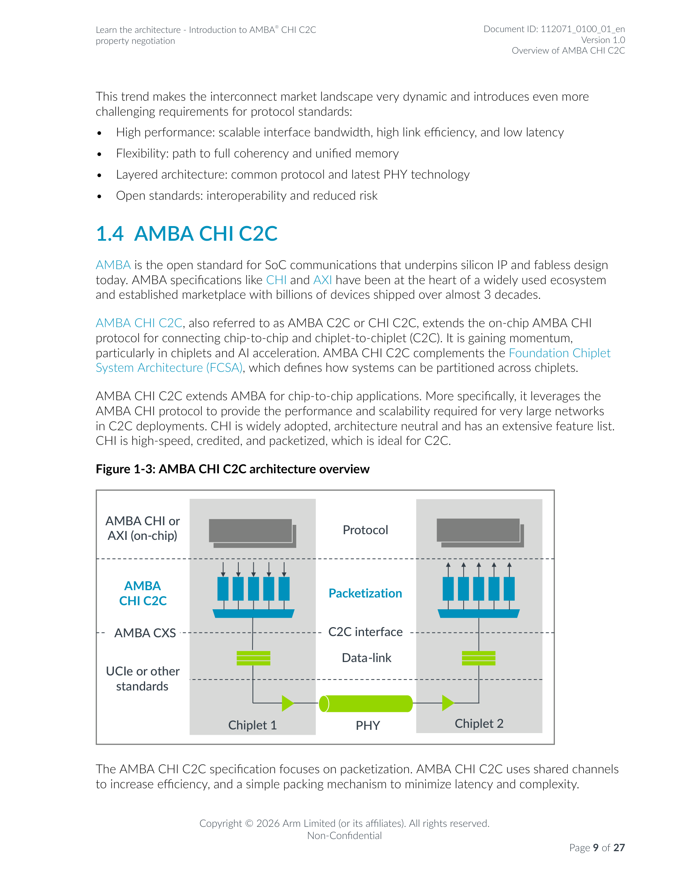

# AMBA CHI C2C 架构（结合 Figure 1-3）

> **定位**：ARM 基座·协议篇。本文结合 R5《Learn the architecture - Introduction to AMBA CHI C2C property negotiation》的 **Figure 1-3: AMBA CHI C2C architecture overview** 展开 AMBA CHI C2C 的组件与边界、分层与职责、一次跨芯粒事务的通信路径与 ASCII 重绘；22 个对象的分类总表见 [002 分类总览](002.协议指令集与系统IP分类总览.md)，应用侧（Figure 5-2 全一致性加速器）见 [004 应用专题](004.全一致性加速器-Figure5-2-应用场景.md)，具体芯片的协议关系判断见 [005 架构核验](005.Arm-AGI-CPU架构核验.md)。

## 导航

| 文档 | 内容 |
| --- | --- |
| [README.md](README.md) | ARM 基座目录入口 |
| [001.Arm-CSS-计算子系统.md](001.Arm-CSS-计算子系统.md) | CSS 计算子系统：定义、交付边界与平台位置（与本文互为"平台—协议"视角） |
| [002.协议指令集与系统IP分类总览.md](002.协议指令集与系统IP分类总览.md) | 22 对象分类总览：协议/指令集扩展/组件/IP 的分类与易混概念对照（本文为其中 CHI C2C / AMBA CXS / UCIe 条目提供分层依据） |
| [004.全一致性加速器-Figure5-2-应用场景.md](004.全一致性加速器-Figure5-2-应用场景.md) | 姊妹篇：Figure 5-2 应用专题（工作负载案例） |
| [005.Arm-AGI-CPU架构核验.md](005.Arm-AGI-CPU架构核验.md) | Arm AGI CPU 双芯粒架构核验（其协议关系判断引用本文 §6 口径） |
| [999.IMGS/](999.IMGS/) | 本目录图库（含 Figure 1-3、Figure 5-2 整页渲染） |

**短导读**：AMBA CHI C2C（简称 CHI C2C / AMBA C2C）是 AMBA CHI 片上协议的"芯到芯"扩展：片上仍是 CHI（或 AXI 非一致子集），跨芯粒时把 CHI 消息打包成固定 256 字节容器，交给可选的 Data-link（CRC+重试）与 PHY（UCIe 或其他标准）传输。规范本身聚焦 Protocol 转换与 Packetization 两层，链路与物理层细节明确不在规范范围内。理解了这个分层，就能看懂 Figure 5-2 里两颗芯粒之间那支"C2C 双向箭头"里到底发生了什么。

## 1. 图表定位与资料版本

**本文结合的图**：

| 图 | 图题（原文逐字） | 位置 | 在本文中的用法 |
| --- | --- | --- | --- |
| Figure 1-3 | "Figure 1-3: AMBA CHI C2C architecture overview" | R5 §1.4 AMBA CHI C2C，PDF 物理页 9（页脚 "Page 9 of 27"）；[原文页 9](../../007.BOOKs/learn_the_architecture_introduction_to_amba_chi_c2c_property_negotiation_112071_0100_01_en.pdf#page=9) | 本文 §2–§5 均以此图展开 |
| Figure 5-2 | "Figure 5-2: Example of advanced heterogeneous compute with a fully coherent accelerator and shared memory" | R5 §5.2 Advanced heterogeneous compute，PDF 物理页 22；[原文页 22](../../007.BOOKs/learn_the_architecture_introduction_to_amba_chi_c2c_property_negotiation_112071_0100_01_en.pdf#page=22) | 本文 §6 引用；分析正文见 [004](004.全一致性加速器-Figure5-2-应用场景.md) |

**资料版本**：

- R5：Document ID 112071_0100_01_en，Issue 0100-01，2026-06-18 初始发布，27 页（R5 物理页 2 Release information）。
- R6：AMBA CHI Chip-to-Chip (C2C) Architecture Specification，ARM IHI 0098，Issue B，2026-03-23 第三次公开发布，291 页（R6 物理页 2 Release information；[R6 p2](../../007.BOOKs/IHI0098B_amba_chi_c2c_architecture_spec.pdf#page=2)）。

## 2. 组件与边界

### 2.1 原图（渲染引用）



*出处：[R5 物理页 9](../../007.BOOKs/learn_the_architecture_introduction_to_amba_chi_c2c_property_negotiation_112071_0100_01_en.pdf#page=9)，Figure 1-3，整页渲染（200 DPI）。*

### 2.2 组件逐项解释

| 图中组件 | 位置 | 角色 | 层面标注 |
| --- | --- | --- | --- |
| Chiplet 1 / Chiplet 2 | 图左右两列（灰色竖带） | 两颗芯粒；CHI C2C 对称分层画在两侧 | 物理划分 |
| Interconnect（每侧一个） | 各芯粒顶部（深灰色块） | 片上一致性互连，运行"AMBA CHI 或 AXI"协议；跨芯粒事务的本侧起点/终点 | 片上 |
| AMBA CHI or AXI (on-chip) | 左侧第一带标注 | 片上协议层：CHI 为全一致性子集；AXI 场景经 IO/非一致子集映射（见 §3.4） | 协议 |
| Protocol | 中列第一带 | CHI C2C 的协议层：on-chip CHI ↔ CHI C2C 协议转换 | CHI C2C 层 |
| Packetization | 中列第二带 | 把五类消息打包进固定 256B 容器 / 对侧拆包 | CHI C2C 层 |
| C2C interface + AMBA CXS | 中部虚线（左右标注 AMBA CXS） | 芯粒边界：打包后消息经该接口交给链路侧；图中虚线即芯片边界 | 接口边界 |
| Data-link | 各芯粒内部（Packetization 之下，左右各一组绿色块）；中列第四带仅为 "Data-link" 文字标签 | 可选链路层：Flit 封装、CRC、重传 | 传输（可选） |
| PHY | 底部横贯两芯粒的圆柱体 | 物理层电气传输；左标注 "UCIe or other standards" 表示可用 UCIe 等标准承载 | 传输（可选） |

**原图文本层备注**：PDF 文本层按 Protocol / Packetization / Data-link / PHY / Interconnect / C2C interface / AMBA CXS / UCIe or other standards / Chiplet 1 / Chiplet 2 / AMBA CHI or AXI (on-chip) 逐项提取，与上表一一对应（提取于 R5 物理页 9）。

### 2.3 从片上通信到跨芯粒通信的边界

- **协议同源**：R5 §1.4（物理页 9）：

  > "AMBA CHI C2C, also referred to as AMBA C2C or CHI C2C, extends the on-chip AMBA CHI protocol for connecting chip-to-chip and chiplet-to-chiplet (C2C)."
  > <sup>（AMBA CHI C2C，亦称 AMBA C2C 或 CHI C2C，扩展片上 AMBA CHI 协议以连接芯片到芯片、芯粒到芯粒。）——[R5 p9](../../007.BOOKs/learn_the_architecture_introduction_to_amba_chi_c2c_property_negotiation_112071_0100_01_en.pdf#page=9)</sup>

  > "Because it transports the same on-chip CHI protocol, it enables the seamless use of architecture features without protocol conversion."
  > <sup>（由于传输的是同一套片上 CHI 协议，架构特性可以无缝使用而无需协议转换。）——[R5 p10](../../007.BOOKs/learn_the_architecture_introduction_to_amba_chi_c2c_property_negotiation_112071_0100_01_en.pdf#page=10)</sup>

  这一句决定了 Figure 1-3 的核心边界画法：**跨芯粒传输的"载荷"仍是片上那套 CHI 协议消息**，变化的是消息的封装与承载方式。

- **规范覆盖边界**：

  > "The AMBA CHI C2C specification focuses on packetization. AMBA CHI C2C uses shared channels to increase efficiency, and a simple packing mechanism to minimize latency and complexity."
  > <sup>（AMBA CHI C2C 规范聚焦打包（packetization）。它使用共享信道提升效率，并用简单的打包机制最小化延迟与复杂度。）——[R5 p9](../../007.BOOKs/learn_the_architecture_introduction_to_amba_chi_c2c_property_negotiation_112071_0100_01_en.pdf#page=9)</sup>

  > "CHI C2C focuses on the packetization of CHI messages, making them suitable to be transported over a chip-to-chip link. The packetization format is optimized for link utilization and latency, while avoiding complex packing and unpacking schemes."
  > <sup>（CHI C2C 聚焦于把 CHI 消息打包，使其适合在芯片间链路上传输。打包格式针对链路利用率与延迟优化，同时避免复杂的打包/解包方案。）——[R6 §B1.1 p20](../../007.BOOKs/IHI0098B_amba_chi_c2c_architecture_spec.pdf#page=20)</sup>

  即：**规范边界 ≈ Protocol 转换 + Packetization（容器、消息类、流控、初始化、属性协商）；Data-link 与 PHY 明确留白给承载标准**（§3.2、§3.3）。

- **芯片边界本身**：Figure 1-3 中 "AMBA CXS" 虚线与 "C2C interface" 标注重合处即芯片边界；R6 对"芯片"的口径更宽：

  > "The C2C extension can also be referred to as Chip(let)-to-Chip(let), as it covers both the board-level connection of multiple chips and the package level connection of multiple dies or chiplets."
  > <sup>（C2C 扩展也可称 Chip(let)-to-Chip(let)，因为它既覆盖多芯片的板级连接，也覆盖封装内多裸片/芯粒连接。）——[R6 §B1.1 p20](../../007.BOOKs/IHI0098B_amba_chi_c2c_architecture_spec.pdf#page=20)</sup>

- **层级大图定位**（R5 §1.3 Figure 1-2，物理页 8）：On-chip (die) — AMBA；Chiplet-to-chiplet (package) — FCSA、AMBA CHI C2C、UCIe；Chip-to-chip ("superchip") — AMBA CHI C2C、NVLink-C2C；Multi-chip (board or node) — PCIe、CXL；Scale-up (pod or rack) — NVLink、UALink。CHI C2C 同时覆盖"封装内芯粒互连"与"板级 superchip 互连"两个层级。

- **与 FCSA 的分工**：

  > "AMBA CHI C2C complements the Foundation Chiplet System Architecture (FCSA), which defines how systems can be partitioned across chiplets."
  > <sup>（AMBA CHI C2C 与基础芯粒系统架构 FCSA 互补，后者定义系统如何跨芯粒划分。）——[R5 p9](../../007.BOOKs/learn_the_architecture_introduction_to_amba_chi_c2c_property_negotiation_112071_0100_01_en.pdf#page=9)</sup>

- **CHI C2C 的三种规范主用例**（R6 §B1.1 p20-21，协议规定）：① Multi-chip Symmetric Multi-Processor (SMP)（图 B1.1/B1.2/B1.3：两芯片、全连接、mesh）；② Multi-chip coherent accelerator attach——"The accelerators can be fully coherent or IO coherent."（p21）；③ Hub-and-spoke（p21）。②即 [004](004.全一致性加速器-Figure5-2-应用场景.md) 应用场景的规范出处。

## 3. 分层与职责

### 3.1 四层职责（R6 §B2.1，协议规定）

R6 §B2.1（物理页 26）：

> "The functional logic between on-chip CHI interface and the chip pins that a message traverses through is divided into multiple functional layers [1]. These layers are referred to as:"
>
> - Protocol layer
> - Packetization layer
> - Link layer
> - Physical layer
>
> <sup>（消息从片上 CHI 接口到芯片管脚之间穿过的功能逻辑分为多层，即：协议层、打包层、链路层、物理层——四层名称在原文中为项目符号列表。）——[R6 §B2.1 p26](../../007.BOOKs/IHI0098B_amba_chi_c2c_architecture_spec.pdf#page=26)</sup>

| 层 | 规范原文职责（摘录） | 中文解释 | 规范是否覆盖 | 可选性 |
| --- | --- | --- | --- | --- |
| Protocol | "The Protocol layer handles protocol conversion between on-chip CHI [1] and CHI C2C. The logic required for the conversion is minimal."（§B2.1.1 p26） | 处理片上 CHI 与 CHI C2C 间的协议转换，转换逻辑极少 | 覆盖 | 必有 |
| Packetization | "…the Packetization layer packs outgoing messages into a fixed size container and unpacks incoming containers into individual messages."（§B2.1.2 p26） | 发送方向把消息装入固定大小容器，接收方向拆包还原 | 覆盖（规范核心，§B3） | 必有 |
| Link | "The Link layer is responsible for handling message transport at a FLow control unIT (Flit) granularity."、"…responsible for optional data integrity and transport error detection and recovery."（§B2.1.3 p26-27） | 以 Flit 为粒度搬运；可选的数据完整性与传输错误检测/恢复（CRC+重试） | **不覆盖细节** | 可选："Link layer and Physical layer presence is expected, but not required, for connecting two chips together."（§B2.1 p26） |
| Physical | "The Physical layer is responsible for providing reliable electrical connectivity between the two chips."（§B2.1.4 p27） | 提供两芯片间可靠电气连接（延迟偏移补偿、链路重训等） | **不覆盖**："The details of the Link layer and Physical layer are outside the scope of this specification."（p27） | 可选（同上） |

链路层缺省时的形态：

> "If the Link layer is not present, the Packetization layer connects directly to the external signals."
> <sup>（若没有链路层，打包层直接连到外部信号。）——[R6 §B2.1.2 p26](../../007.BOOKs/IHI0098B_amba_chi_c2c_architecture_spec.pdf#page=26)</sup>

容器必须给链路层留位（§B2.1.3 p27）："There must be a space in a container for the Link layer to fill the following transport information: …"——冒号后原文为两行项目符号条目：Flit header（Flit 头）、Link reliability（链路可靠性）。

### 3.2 规范覆盖范围小结（协议规定）

CHI C2C 规范（IHI0098B）章节即覆盖范围清单：接口分层与消息类（B2）、打包与容器（B3）、Multi-request（B4）、消息结构（B5）、Node ID 管理（B6）、路由（B7）、流控 credit（B8）、DVM（B9）、RME-DA/CDA 支持（B10）、完整性与加密 IDE（B11）、接口状态管理（B12）、初始化（B13）、属性协商（B14）、软件可见寄存器（B15）。**Link/PHY 细节明确排除**（§B2.1.4 p27 引文见上表）。

### 3.3 AMBA CXS 与 "UCIe or other standards" 的对应关系

Figure 1-3 用三条左侧标注划分责任带：`AMBA CHI or AXI (on-chip)`（Protocol 带）、`AMBA CHI C2C`（Packetization 带）、`AMBA CXS`（C2C interface 虚线）、`UCIe or other standards`（Data-link + PHY 带）。对应关系与规范依据：

1. **AMBA CXS = 打包侧与链路侧之间的接口标注，位于 C2C interface 虚线处**。规范内直接证据是初始化流程中的唤醒握手示例：

   > "An example wake-up handshake using the CXS interface between the Link layer and Protocol layer is shown in Figure B13.1. … The Link layer sends a CXSACTIVEREQ signal to the local Protocol layer. … Once the CXSACTIVEREQ signal is HIGH, the Protocol layer sends a CXSACTIVEACK response."
   > <sup>（图 B13.1 给出了在链路层与协议层之间使用 CXS 接口的唤醒握手示例：链路层向本地协议层发 CXSACTIVEREQ，协议层回 CXSACTIVEACK。）——[R6 §B13.2 p153-154](../../007.BOOKs/IHI0098B_amba_chi_c2c_architecture_spec.pdf#page=154)</sup>

   注意 R6 同时声明："The Link layer to Protocol layer wake-up handshake method is IMPLEMENTATION DEFINED."（p154）——CXS 握手在 R6 里是**示例**而非强制。
2. **UCIe（或 CXL 等）= Data-link + PHY 的承载标准选项**：

   > "AMBA CHI C2C follows a layered approach, so it can be used with transports (data-link and PHY) such as UCIe, other industry standards, or even bespoke solutions. For example, AMBA CHI C2C can be used over a UCIe Streaming interface, which provides link robustness through data-link CRC and retry."
   > <sup>（AMBA CHI C2C 采用分层方法，可搭配 UCIe、其他行业标准乃至定制方案作为传输层（数据链路层与物理层）。例如 CHI C2C 可运行在 UCIe Streaming 接口上，由数据链路层 CRC 与重试提供链路健壮性。）——[R5 p10](../../007.BOOKs/learn_the_architecture_introduction_to_amba_chi_c2c_property_negotiation_112071_0100_01_en.pdf#page=10)</sup>

3. **容器格式直接映射 UCIe/CXL 的 flit 格式**（协议级对应关系的最强规范证据，R6 §B3.1 Table B3.1 p33）：

   | 容器格式 | Payload | Link 头 | Protocol 头 | 规范标注的对应底层格式 |
   | --- | --- | --- | --- | --- |
   | Format X | 240B（12×20B granules） | 6B | 10B | "UCIe 256-byte Latency Optimized Mode with optional bytes." |
   | Format Y | 226B（10×20B + 16B + 10B granules） | 20B | 10B | "CXL 256-byte latency optimized flit format." |
   | Format Z | 228B（11×20B + 8B granules） | 16B | 10B（另有 2B 保留） | "UCIe Non-latency Optimized flit format for CXL.cachemem or Streaming protocol and CXL 256-byte non-latency optimized flit format." |

   出处：[R6 §B3.1 p33](../../007.BOOKs/IHI0098B_amba_chi_c2c_architecture_spec.pdf#page=33)。属性协商中 `Container_Format` 即按 X→Z→Y 顺序择优（R5 §4.4 p19）。
4. **AMBA CXS 的独立规范身份（已证实：IHI 0079）**：R6 附加阅读（p16）只列出 CHI、UCIe、Arm ARM 三份资料，R5/R6 均未给出 CXS 规范编号。Arm 官网 [AMBA specifications 页面](https://www.arm.com/architecture/system-architectures/amba/amba-specifications)（访问日期 2026-11-13）在 AMBA 5 列表中列出 "AMBA CXS Protocol Specification"，且该条目超链接指向 `https://developer.arm.com/documentation/ihi0079/latest`——编号 **IHI 0079** 由官网条目链接直接证实（页面可见文本本身不展示编号，证据在链接目标）。

### 3.4 AXI 片上设计如何接入 CHI C2C（图中 "AMBA CHI or AXI (on-chip)" 的另一半）

> "Existing designs using AMBA AXI on-chip can also benefit from AMBA CHI C2C by using an IO/non-coherent subset of the CHI protocol for their C2C links. The mapping between AXI transactions and this subset is straightforward, which allows for efficient on-chip bridging."
> <sup>（片上使用 AMBA AXI 的既有设计也能受益于 CHI C2C：把 C2C 链路跑在 CHI 的 IO/非一致子集上。AXI 事务到该子集的映射很直接，允许高效的片上桥接。）——[R5 p10](../../007.BOOKs/learn_the_architecture_introduction_to_amba_chi_c2c_property_negotiation_112071_0100_01_en.pdf#page=10)</sup>

最简子集只需少数 opcode（R5 §2.1 p11-12）：ReadNoSnp、ReadOnce*（ReadOnce/ReadOnceCleanInvalid/ReadOnceMakeInvalid 的统称）、WriteNoSnpFull/Ptl/Zero、WriteUniqueFull/Ptl/Zero。而把 Snoop 关掉后的子集与 AXI 的等价性，规范原文是（R5 §5.1 p21）：

> "The Snoop_Transactions property disables snoop transactions and reduces CHI to an I/O-coherent or non-coherent protocol subset. This subset has lower complexity and is equivalent to AMBA AXI."
> <sup>（Snoop_Transactions 属性关闭 snoop 事务，把 CHI 缩减为 IO 一致或非一致协议子集。该子集复杂度更低，等价于 AMBA AXI。）——[R5 p21](../../007.BOOKs/learn_the_architecture_introduction_to_amba_chi_c2c_property_negotiation_112071_0100_01_en.pdf#page=21)</sup>

## 4. 通信路径

### 4.1 一次跨芯粒事务（发送 → 接收）

```text
（图 FIG2：一次从本地互连发起、经 C2C 发送/接收、进入对侧互连的事务路径；
  括号内为规范依据，页码为对应 PDF 物理页）
(1) 本地片上互连发出 CHI 事务（REQ/RSP/DAT/SNP/MISC 五个消息类，R6 §B2.2 p28）
      |
      v
(2) Protocol 层：on-chip CHI 与 CHI C2C 间协议转换，转换逻辑极少（R6 §B2.1.1 p26）
      |
      v   ~~ AMBA CXS / C2C interface（芯片边界，R5 Figure 1-3 中的虚线）~~
(3) Packetization 层：消息打包进固定 256B 容器（共享信道，R6 §B2.3 p29、§B3.1 p33）
      |
      v
(4) Data-link 层：Flit 封装 + CRC 校验 + 重传缓冲（可选层，R6 §B2.1.3 p26-27）
      |
      v
(5) PHY 层：跨芯粒电气传输（UCIe 或其他标准承载；细节不在 CHI C2C 规范内，R6 §B2.1.4 p27）
      |
      v   ============ 跨芯粒链路（C2C link）============
(6) 对侧 PHY 接收 -> Data-link 做 CRC 校验、错误时 Flit 重试（R6 §B2.1.3）
      |
      v
(7) 对侧 Packetization 拆包还原消息 -> Protocol 层还原为 on-chip CHI 消息
      |
      v
(8) 进入对侧片上互连，由对侧完成事务并按原路径返回响应/数据
```

### 4.2 报文（以规范为据）

- **消息类**：CHI 片上五个物理通道对应五个消息类（R6 §B2.2 p28）——REQ（请求）、RSP（响应，不带数据）、SNP（snoop）、DAT（数据）、MISC。"MISC is the C2C-specific message class that is defined to group all messages that do not directly relate to on-chip CHI protocol messages [1]."（MISC 是 C2C 特有消息类，收纳所有与片上 CHI 协议消息无直接关系的消息，如初始化与 credit 授予。）
- **容器**："A container is 256 bytes and comprises Link header bytes, Protocol header bytes and message bytes organized in granules."（容器 256 字节，由链路头、协议头与按 granule 组织的消息字节构成——[R6 §B3.1 p33](../../007.BOOKs/IHI0098B_amba_chi_c2c_architecture_spec.pdf#page=33)）。术语定义（R6 §B1.2 p22）："A container is the smallest fixed size unit in which messages are transferred across an interface."（容器是消息跨接口传输的最小固定大小单元。）
- **共享信道**："A fixed size container is used as the unit of exchange across the C2C interface. The messages to be sent are placed in a container. The container can include multiple messages from the same message class and messages from different message classes."（容器为跨 C2C 接口的交换单元，可混合装同一类或不同类消息；相比每类独立物理信道，通常链路利用率更高——[R6 §B2.3 p29](../../007.BOOKs/IHI0098B_amba_chi_c2c_architecture_spec.pdf#page=29)）。对应 R5 p9 "uses shared channels to increase efficiency"。
- **协议头**（R6 §B3.2 p35-37，目录即字段清单）：含 ChipTgtID、NumHops、MsgStart、ContCredit、ContFormat、MsgCredit、ChipSrcID、ContRollover 等字段——credit 授予、消息起始、格式控制都放进协议头，而不必为每条消息单开握手。
- **多接口聚合**：两芯片间允许 1–16 个 C2C 接口聚合带宽（"The number of interfaces permitted for aggregating traffic between two components is 1 to 16."——[R6 §B2.4 p30](../../007.BOOKs/IHI0098B_amba_chi_c2c_architecture_spec.pdf#page=30)），并规定了事务内/事务间的消息关联（同一事务的 Data/Response 必须走同一接口等）。

### 4.3 握手（初始化与属性协商）

```text
（图 FIG3：C2C 接口初始化序列，依据 R6 §B13.1/§B13.2 p152-154 与 R5 §3.1 p13-14）
(0) 链路复位与初始化开始（Link/PHY 初始化细节规范不提供，R6 §B13.2 p153）
      |
      v
(1) Link 层 -> 本地 Protocol 层: CXSACTIVEREQ, Protocol 层回 CXSACTIVEACK
    （用 CXS 接口唤醒 Protocol 层的示例；实际方法 IMPLEMENTATION DEFINED, R6 §B13.2 p154）
      |
      v
(2) Link 层 -> 本地 Protocol 层: MiscU.LinkStatus（通知初始化完成 + 协商的 Flit 格式）
      |
      v
(3) 双方 Protocol 层互发 MiscU.Activate.ActivateReq / ActivateAck（确认对侧已激活）
      |
      v
(4) 可选: MiscU.Properties(1)/(2) 属性交换（Supported/Advertised/Informed/Negotiated, R5 §3.1 p13）
      |
      v
(5) Protocol 层向对侧发放消息 credit（按消息类独立发放, R6 §B8.2 p106）, 开始协议消息交换
```

- **属性寄存器四件套**（R5 §3.1 p13，Table 3-1）：Supported（硬件出厂能力）→ Advertised（复位后等于 Supported，固件可降级）→ Informed（收到对侧 MiscU.Properties 后记录）→ Negotiated（本地 Advertised 与对侧 Informed 组合的结果）。协商规则示例：布尔属性两侧为真才启用；数值属性取较小值。
- **Transmitter Termination 原则**（R5 §3.2 p14-15）：

  > "A feature that is not supported must not be sent across the C2C interface."
  > <sup>（不支持的特性不得跨越 C2C 接口发送。）——[R5 p15](../../007.BOOKs/learn_the_architecture_introduction_to_amba_chi_c2c_property_negotiation_112071_0100_01_en.pdf#page=15)</sup>

  > "Any modified or terminated transaction must result in a transaction flow that is compliant with the on-chip protocol."
  > <sup>（任何被修改或终止的事务，其 resulting 事务流必须与片上协议兼容。）——[R5 p15](../../007.BOOKs/learn_the_architecture_introduction_to_amba_chi_c2c_property_negotiation_112071_0100_01_en.pdf#page=15)</sup>

- **协商是方向性的**（R5 §3.3 p15）："Property negotiation is directional, with independent negotiation for each transmit and receive path. This enables interfaces to use asymmetric capabilities."（协商按收发两个方向独立进行，允许两侧能力非对称——例如 Host→Device 开 Atomic 而 Device→Host 不用。）

### 4.4 可靠性与流控

- **不丢消息**（R6 §B8.1 p105）：

  > "A message must not be dropped or lost in transport, that is, every message that is sent by a Transmitter must be received and processed by the Receiver."
  > <sup>（消息在传输中不得丢弃或丢失；发送方发出的每条消息都必须被接收方接收并处理。）——[R6 §B8.1 p105](../../007.BOOKs/IHI0098B_amba_chi_c2c_architecture_spec.pdf#page=105)</sup>

- **按消息类独立 credit**（R6 §B8.1 p105）："Separate credits per message class are provided to ensure messages from an individual message class can progress, while other message class messages are back pressured."（每个消息类有独立 credit，保证单个类可推进而不被其他类反压阻塞。）
- **CRC + Flit 重试**：链路层"optional data integrity and transport error detection and recovery… When an error occurs, the Link layer can use a flit retry mechanism to recover from the error."（R6 §B2.1.3 p26-27）；R5 p10 亦把 "link robustness through data-link CRC and retry" 归到 UCIe Streaming 承载一侧（见 §3.3 第 2 条）——即**可靠性机制的位置取决于承载方案**，协议本身要求的是"消息不丢"这一结果。

## 5. ASCII 重绘

```text
（图 FIG1：Figure 1-3 AMBA CHI C2C architecture overview 重绘。保留：两侧芯粒、
  每侧片上互连、Protocol/Packetization/Data-link/PHY 四层带、AMBA CXS=C2C interface
  芯片边界虚线、左侧三条协议带标注。省略：原图配色、五根消息通道竖条的阴影造型、
  PHY 圆柱体形态（以 o======o 示意）；消息类名 [REQ]…[MISC] 为按 R6 §B2.2 补充的
  注解，原图竖条本身不带文字。已用脚本按显示列宽校验对齐。）
+-----------------+-----------------------------+---------------+-----------------------------+
|AMBA CHI or      | +-------------------------+ |Protocol       | +-------------------------+ |
|AXI (on-chip)    | |片上互连 Interconnect    | |               | |片上互连 Interconnect    | |
|                 | |(AMBA CHI 或 AXI 协议)   | |               | |(AMBA CHI 或 AXI 协议)   | |
|                 | +-------------------------+ |               | +-------------------------+ |
+-----------------+-----------------------------+---------------+-----------------------------+
|AMBA CHI         | [REQ][RSP][DAT][SNP][MISC]  |Packetization  | [REQ][RSP][DAT][SNP][MISC]  |
|C2C              |  v     v     v     v     v  |               |  ^     ^     ^     ^     ^  |
|(规范聚焦        |  [打包: 消息 -> 256B 容器]  |               |  [拆包: 256B 容器 -> 消息]  |
|打包)            |  (五类消息共享同一字节流)   |               |  (五类消息共享同一字节流)   |
+--- AMBA CXS --- +--------C2C-interface--------+---------------+-----------------------------+
|UCIe or other    | +-------------------------+ |Data-link      | +-------------------------+ |
|standards        | |Data-link(链路层)        | |(可选)         | |Data-link(链路层)        | |
|                 | |CRC 校验 + Flit 重试     | |               | |CRC 校验 + Flit 重试     | |
|                 | +-------------------------+ |               | +-------------------------+ |
+-----------------+-----------------------------+---------------+-----------------------------+
|                 |             -->             |   o======o    |             <--             |
|                 | (采用 UCIe 或其他标准承载)  |      PHY      | (采用 UCIe 或其他标准承载)  |
+-----------------+-----------------------------+---------------+-----------------------------+
|                 |          Chiplet 1          |               |          Chiplet 2          |
+-----------------+-----------------------------+---------------+-----------------------------+
```

与原图的对照要点：

1. 原图 Chiplet 1 侧竖条箭头向下（发送方向打包入链路），Chiplet 2 侧箭头向上（接收方向拆包还原）——重绘用 v / ^ 保留该方向语义，即原图描述的是"Chiplet 1 发往 Chiplet 2"的一次单向视图。
2. 原图 "AMBA CXS" 虚线与 "C2C interface" 标注位于同一水平线上（Packetization 带与 Data-link 带之间）——重绘将该行合并为 `+--- AMBA CXS ---+--------C2C-interface--------+`。
3. 原图 PHY 画成横贯两芯粒的绿色圆柱体，两芯粒的 Data-link 各以绿色三角箭头接入——重绘以 `o======o` 居中示意。
4. "Data-link (可选)" 与 "(采用 UCIe 或其他标准承载)" 为按 R6 §B2.1 / R5 p10 补充的事实标注（规范规定），非原图文字。

## 6. 分层的应用：Figure 5-2 与芯片核验口径

### 6.1 用 Figure 1-3 分层解释 Figure 5-2

[004](004.全一致性加速器-Figure5-2-应用场景.md) 的 Figure 5-2 中，Host 与 Device 两个芯粒之间的 "C2C <==> C2C" 双向粗箭头，展开后就是本文 Figure 1-3 的完整分层：

- **双向箭头里跑的仍是片上 CHI 消息**（snoop、原子、DVM 等），因为 CHI C2C "transports the same on-chip CHI protocol"（§2.3 引文）——这是"fully coherent 加速器能共享主机内存"的协议前提；
- **双向 ≠ 能力对称**：每个方向的能力由属性协商独立决定（R5 §3.3 p15 方向性协商），Figure 5-2 同页的 Table 5-2 按 Host→Device / Host←Device 两列给出 Snoop/Deferrable_Write/DVM=Yes、Atomic/Stash/Persist/RME/MTE=Optional 的组合（详见 [004 §3](004.全一致性加速器-Figure5-2-应用场景.md)）；
- **打包与拆包对协议透明**：容器格式（X/Y/Z）按两侧支持情况协商（R5 §4.4 p19），对上层 CHI 语义无影响——所以分析工作负载时只需关心消息级行为，不必关心容器细节。

### 6.2 CHI / CHI C2C / UCIe 职责三分：供具体芯片核验引用的口径

按本分层，"CHI / CHI C2C / UCIe" 三者职责可作如下三分（依据均见本文 §3）：

| 层 | 归属 | 规范依据 |
| --- | --- | --- |
| 片上网格内部（如 CMN 互连） | AMBA CHI（IHI 0050 体系） | CHI C2C 是"CHI 的 C2C 扩展"，载荷即片上 CHI（R6 §B1.1 p20；R6 §B2.1.1 p26） |
| 跨芯粒的消息封装 | AMBA CHI C2C（IHI0098）：Protocol 转换 + Packetization 容器 + 流控/初始化/属性协商 | "The AMBA CHI C2C specification focuses on packetization."（R5 p9）；规范章节清单见 §3.2 |
| 跨芯粒的链路承载 | Data-link + PHY：UCIe 或其他标准/定制方案 | "…so it can be used with transports (data-link and PHY) such as UCIe, other industry standards, or even bespoke solutions."（R5 p10） |

由此可得对"UCIe 只是把 AMBA 协议打包搬运到另一颗芯粒的物理高速通道"一类表述的判断口径：**"打包搬运"的主体是 CHI C2C 的 Packetization 层（协议行为），UCIe 提供的是承载它的 Data-link/PHY（且 UCIe 自身也有 CRC/重试等链路功能，R5 p10 / R6 Table B3.1 均把 UCIe flit 格式作为映射对象）**；把它只说成"物理通道"会漏掉其链路层职责，把它说成"打包协议"则会与 CHI C2C 职责重叠。对具体芯片（如 Arm AGI CPU）判断连接方式时应以此为口径并落实到产品证据（见 [005](005.Arm-AGI-CPU架构核验.md)）；本节只提供协议层依据，具体芯片是否采用该连接方式须以产品资料为准。

### 6.3 关联笔记

- [004](004.全一致性加速器-Figure5-2-应用场景.md)：Figure 5-2 应用分析、工作负载案例与 Table 5-2 属性分析。
- [002](002.协议指令集与系统IP分类总览.md)：AMBA CHI / CHI C2C / AMBA CXS / UCIe / AXI 的分类条目以本文 §3 为分层依据。
- [005](005.Arm-AGI-CPU架构核验.md)：§6.2 的三分口径可供其协议关系判断引用。
- [001](001.Arm-CSS-计算子系统.md)：CSS 作为平台交付物与本文协议的关系（平台内互连跑 CHI，跨芯片扩展用 CHI C2C）。

## 7. 证据汇总

| # | 论断 | 出处（文档+章节+物理页） | 关键摘录 |
| --- | --- | --- | --- |
| 1 | Figure 1-3 图号/图题/页码 | R5 §1.4，物理页 9 | "Figure 1-3: AMBA CHI C2C architecture overview" |
| 2 | CHI C2C 定义 | R5 §1.4 p9；R6 §B1 p19 | "extends the on-chip AMBA CHI protocol for connecting chip-to-chip and chiplet-to-chiplet (C2C)" |
| 3 | 规范聚焦打包 | R5 p9；R6 §B1.1 p20 | "The AMBA CHI C2C specification focuses on packetization." |
| 4 | 四层与覆盖边界 | R6 §B2.1 p26-27 | "Link layer and Physical layer presence is expected, but not required…"；"The details of the Link layer and Physical layer are outside the scope of this specification." |
| 5 | Protocol 层职责 | R6 §B2.1.1 p26 | "handles protocol conversion between on-chip CHI and CHI C2C" |
| 6 | Packetization/容器 | R6 §B2.1.2 p26、§B3.1 p33、§B1.2 p22 | "A container is 256 bytes…" |
| 7 | Link 层职责 | R6 §B2.1.3 p26-27 | Flit 粒度、CRC、flit retry |
| 8 | PHY 层职责 | R6 §B2.1.4 p27 | "providing reliable electrical connectivity between the two chips" |
| 9 | CXS 握手示例 | R6 §B13.2 p153-154 | "An example wake-up handshake using the CXS interface between the Link layer and Protocol layer…" |
| 10 | UCIe 承载 | R5 p10 | "…can be used over a UCIe Streaming interface…" |
| 11 | 容器格式映射 UCIe/CXL | R6 §B3.1 Table B3.1 p33 | Format X/Y/Z 行（见 §3.3 表） |
| 12 | 消息类五分 | R6 §B2.2 p28 | REQ/RSP/SNP/DAT/MISC |
| 13 | 共享信道容器 | R6 §B2.3 p29 | "A fixed size container is used as the unit of exchange…" |
| 14 | 多接口 1–16 | R6 §B2.4 p30 | "…1 to 16." |
| 15 | 流控/不丢消息 | R6 §B8.1 p105 | "A message must not be dropped or lost in transport…" |
| 16 | 初始化序列 | R6 §B13.1-13.2 p152-154 | ActivateReq/Ack、MiscU.Properties 流程 |
| 17 | 属性四件套 | R5 §3.1 p13 Table 3-1 | Supported/Advertised/Informed/Negotiated |
| 18 | Transmitter Termination | R5 §3.2 p14-15 | "A feature that is not supported must not be sent across the C2C interface." |
| 19 | Snoop 关闭 → 等价 AXI | R5 §5.1 p21 | "…equivalent to AMBA AXI." |
| 20 | AXI 映射/最小子集 | R5 p10、§2.1 p11-12 | ReadNoSnp/ReadOnce*/WriteNoSnp*/WriteUnique* |
| 21 | 三种主用例 | R6 §B1.1 p20-21 | Multi-chip SMP / coherent accelerator attach / hub-and-spoke |
| 22 | FCSA 互补 | R5 p9 | "AMBA CHI C2C complements the Foundation Chiplet System Architecture (FCSA)…" |
| 23 | 层级大图 | R5 §1.3 Figure 1-2 p8 | die/package/superchip/node/rack 五层级标准图谱 |
| 24 | CXS 独立规范编号 IHI 0079 | Arm 官网 AMBA specifications 页，"AMBA CXS Protocol Specification" 条目超链接指向 developer.arm.com/documentation/ihi0079/latest（访问 2026-11-13） | "AMBA CXS Protocol Specification"（条目链接 → ihi0079/latest） |
| 25 | CHI 片上规范版本 | IHI0050H 标题页（仓库内） | "AMBA CHI Architecture Specification, ARM IHI 0050, Issue H, 17 Sep 2025" |
| 26 | 官网口径：CHI=IHI 0050，IHI 0051 为 AXI-Stream | Arm 官网 AMBA specifications 页（访问 2026-11-13） | "AMBA CHI Architecture Specification" 条目链接 → ihi0050/latest；"AMBA AXI-Stream Protocol Specification" 条目链接 → ihi0051/latest |

## 8. 未确认项

| 项 | 状态 | 说明 |
| --- | --- | --- |
| AMBA CXS 规范编号 | 已证实：IHI 0079 | R5/R6 正文未给出编号；Arm 官网 AMBA specifications 页（访问 2026-11-13）"AMBA CXS Protocol Specification" 条目超链接指向 developer.arm.com/documentation/ihi0079/latest，编号由官网条目链接直接证实 |
| CHI 规范编号：R6 引文 IHI 0051 vs 规范标题页/官网 IHI 0050 | 资料冲突，官方佐证指向"R6 引用笔误" | R6 附加阅读（p16）引 "[1] AMBA CHI Architecture Specification. (ARM IHI 0051)"；仓库内 CHI 规范 Issue H（2025-09-17）标题页为 "ARM IHI 0050"；官网 AMBA specifications 页（访问 2026-11-13）"AMBA CHI Architecture Specification" 条目链接亦指向 ihi0050/latest，而 ihi0051 条目对应 "AMBA AXI-Stream Protocol Specification"。三方证据中两方（规范标题页、官网条目）支持 IHI 0050，判定 R6 p16 的引用编号为笔误；保留冲突记录供 R6 后续版本勘误对照 |
| Figure 1-3 中 "AMBA CXS" 标注的准确语义（是接口名还是规范层名） | 部分确认 | 原图把 AMBA CXS 标在 C2C interface 虚线上；R6 仅在初始化流程给出"Link 层与 Protocol 层之间用 CXS 握手的示例"（p153-154），未明文定义"CXS = C2C interface 处的强制接口"。两层表述并存，本文按"接口标注 + 握手示例"双重口径呈现，需结合 CHI C2C 后续版本或 CXS 规范原文进一步确认 |
| 具体芯片（含 Arm AGI CPU）是否按 Figure 1-3 方式连接 | 未确认（超出本文范围） | 需结合 [005](005.Arm-AGI-CPU架构核验.md) 的产品资料判断；本文只提供协议层依据 |
