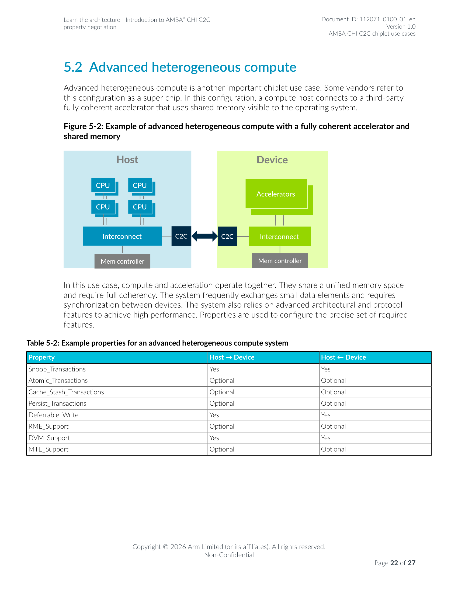

# 全一致性加速器与共享内存（结合 Figure 5-2）

> **定位**：ARM 基座·协议应用篇。本文以 [003.AMBA-CHI-C2C架构-Figure1-3](003.AMBA-CHI-C2C架构-Figure1-3.md) 的分层分析为基础，结合 R5《Introduction to AMBA CHI C2C property negotiation》**Figure 5-2: Example of advanced heterogeneous compute with a fully coherent accelerator and shared memory**（§5.2，PDF 物理页 22）分析全一致性加速器应用场景：图中组件与请求/数据路径、"fully coherent" 的覆盖范围、若干具体工作负载（真实产品案例与教学示例分别标注）、场景流程图与收益/成本分析。

## 导航

| 文档 | 内容 |
| --- | --- |
| [README.md](README.md) | ARM 基座目录入口 |
| [001.Arm-CSS-计算子系统.md](001.Arm-CSS-计算子系统.md) | CSS 计算子系统：定义、交付边界与平台位置 |
| [002.协议指令集与系统IP分类总览.md](002.协议指令集与系统IP分类总览.md) | 002 分类总览：协议/指令集扩展/组件/IP 分类总表与易混对照（本文 §6 与之对接） |
| [003.AMBA-CHI-C2C架构-Figure1-3.md](003.AMBA-CHI-C2C架构-Figure1-3.md) | 姊妹篇：Figure 1-3 分层与通信路径（本文的架构基础） |
| [005.Arm-AGI-CPU架构核验.md](005.Arm-AGI-CPU架构核验.md) | Arm AGI CPU 双芯粒架构核验 |

**短导读**：Figure 5-2 画的是"super chip"式异构计算：计算主机芯粒（CPU 集群 + 片上一致性互连 + 内存控制器）与第三方全一致性加速器芯粒（GPU/加速器 + 互连 + 内存控制器）经 C2C 接口相连，两侧共享一个对操作系统可见的统一内存空间。"全一致性"意味着 snoop 事务双向可用、TLB/DVM 维护同步进行；而原子操作、cache stash、持久化等是按需协商的可选能力。本文用 3 个真实产品案例（NVIDIA Grace Hopper、AMD MI300A、IBM POWER9+OpenCAPI FPGA）、1 个教学示例（CPU+DPU 数据包处理）和 1 个生态公告（Arm Neoverse × NVIDIA NVLink Fusion）展开这类系统的工作负载、收益与成本。

## 1. 图表定位

| 图/表 | 图题（原文逐字） | 位置 | 在本文中的用法 |
| --- | --- | --- | --- |
| Figure 5-2 | "Figure 5-2: Example of advanced heterogeneous compute with a fully coherent accelerator and shared memory" | R5 §5.2 Advanced heterogeneous compute，PDF 物理页 22（页脚 "Page 22 of 27"）；[原文页 22](../../007.BOOKs/learn_the_architecture_introduction_to_amba_chi_c2c_property_negotiation_112071_0100_01_en.pdf#page=22) | 本文 §2–§5 均以此图展开 |
| Table 5-2 | "Table 5-2: Example properties for an advanced heterogeneous compute system" | 同页（R5 物理页 22） | 属性值见 §3.2 |

**同系列对照图**：Figure 5-1（accelerator attach，物理页 21）与 Figure 5-3（memory expansion，物理页 23）与 Figure 5-2 同系列，分别对应降档（IO/非一致加速器）与内存扩展场景（对照用法见 §3.2、§3.3）。

## 2. 图中组件、角色与请求/数据路径

### 2.1 原图（渲染引用）



*出处：[R5 物理页 22](../../007.BOOKs/learn_the_architecture_introduction_to_amba_chi_c2c_property_negotiation_112071_0100_01_en.pdf#page=22)，Figure 5-2 与 Table 5-2 同页，整页渲染（200 DPI）。*

原图同页正文（逐字摘录）：

> "In this configuration, a compute host connects to a third-party fully coherent accelerator that uses shared memory visible to the operating system."
> <sup>（该配置中，计算主机连接到使用共享内存的第三方全一致性加速器，该共享内存对操作系统可见。）——[R5 p22](../../007.BOOKs/learn_the_architecture_introduction_to_amba_chi_c2c_property_negotiation_112071_0100_01_en.pdf#page=22)</sup>

### 2.2 ASCII 重绘

```text
（图 FIG4：Figure 5-2 重绘。保留：Host/Device 两个大框、CPU×4（2×2 排布）、
  Device 侧 Accelerators 大框、每侧 Interconnect 与 Mem controller、内缘 C2C
  深色方框与双向粗箭头。省略：原图配色与堆叠阴影造型；"GPU+加速器,堆叠表示"
  为按原图文本层的补充注解——PDF 文本层中该位置含 "GPU" 与 "Accelerators" 两段
  文字，渲染视图中 GPU 文本被前景 "Accelerators" 框遮挡，系"GPU 等多个加速器"
  的堆叠画法。已用脚本按显示列宽校验对齐。）
+------------------------------------+---------------+------------------------------------+
|           Host(计算主机)           |               |         Device(加速器芯粒)         |
|  [CPU]      [CPU]                  |               |           [Accelerators]           |
|  [CPU]      [CPU]                  |               |           (GPU+加速器,堆叠表示)    |
|     |          |                   |               |               |                    |
|  [Interconnect 片上一致性互连]     |[C2C]<==>[C2C] |  [Interconnect 片上一致性互连]     |
|     |                              | CHI C2C 链路  |        |                           |
|  [Mem controller 内存控制器]       |               |   [Mem controller 内存控制器]      |
+------------------------------------+---------------+------------------------------------+
```

### 2.3 组件逐项与路径归属（片上 vs 跨芯粒）

| 图中组件 | 位置/角色 | 请求与数据路径归属 |
| --- | --- | --- |
| CPU ×4（Host） | 计算主机芯粒的处理器核 | 片上：CPU → 本侧 Interconnect |
| Interconnect（Host/Device 各一） | 片上一致性互连（本侧事务的汇点/源点；承载 CPU/加速器访问与 snoop） | 片上为主；跨芯粒事务经其 C2C 端口进出 |
| Mem controller（每侧一个） | 内存控制器；两侧内存统一编址构成共享内存池 | 片上访问本侧内存；**对侧可经 C2C 一致性访问**（全一致性的含义，§3） |
| Accelerators（Device，GPU 堆叠） | 第三方全一致性加速器（图文本层含 GPU） | 片上：加速器 → Device 侧 Interconnect；跨芯粒：访问 Host 侧内存/接收 snoop |
| C2C ×2 + 双向粗箭头 | 两芯粒内缘的链路端点对，双向粗箭头即 CHI C2C 链路 | **跨芯粒唯一通道**：展开后即 [003 Figure 1-3 分层](003.AMBA-CHI-C2C架构-Figure1-3.md)（Protocol→Packetization→CXS/C2C interface→Data-link→PHY） |

**路径总结**：

- **片上段**（两侧各自完成）：CPU/加速器发出请求 → 本侧片上互连（一致性域内，snoop 广播/过滤在本侧完成）→ 命中本侧内存控制器则本侧完成。
- **跨芯粒段**（经 C2C）：目标地址在对侧（地址译码决定）或需要对对侧缓存行做 snoop/原子/DVM 操作时，请求经本侧互连 → C2C 端口 → CHI C2C 打包 → 对侧解包 → 对侧互连 → 对侧内存控制器/缓存完成，响应与数据按原路径返回。规范口径（R6 §B1.1.2 p21）："The accelerator attach configurations of interest are one or more coherent accelerators connected to a host chip. The accelerators can be fully coherent or IO coherent."（加速器可全一致或 IO 一致；Figure 5-2 对应"fully coherent"档位。）
- **注**：Figure 5-2 是示意框图，未标注具体互连 IP 名称与缓存私有/共享层级；缓存（CPU 私有 L1/L2、加速器侧缓存）在图中以角色存在（snoop 的对象），不在图中显式画出。缓存拓扑的具体实现属产品证据范畴（对照 [005](005.Arm-AGI-CPU架构核验.md)）。

## 3. "fully coherent" 的覆盖范围

### 3.1 结论与适用前提

**结论**：Figure 5-2 的 "fully coherent" 是**协议能力层面的全一致性**——R5 p22 原文给出的是该用例的三项要求（前两项直接对应能力语义；第三项"设备间同步"是用例需求，其协议落点属协商项，见下与 §3.2/§3.5）：

> "In this use case, compute and acceleration operate together. They share a unified memory space and require full coherency. The system frequently exchanges small data elements and requires synchronization between devices."
> <sup>（该用例中，计算与加速协同工作；共享统一内存空间并要求全一致性；系统频繁交换小数据元素且需要设备间同步。）——[R5 p22](../../007.BOOKs/learn_the_architecture_introduction_to_amba_chi_c2c_property_negotiation_112071_0100_01_en.pdf#page=22)</sup>

1. **统一内存空间**（unified memory space）：两侧内存在统一地址空间中，且 "shared memory **visible to the operating system**"（p22）——即从单一 OS 视角看得到这块内存，CPU 与加速器用同一套 VA/PA 视角访问。
2. **全一致性**（full coherency）：任何一侧的缓存行分配/失效都经 snoop 事务在两侧同步维护——协议开关就是 `Snoop_Transactions`（Yes/Yes，Table 5-2）。
3. **设备间同步**（synchronization between devices，用例需求项）：该用例要求设备间可同步——共享内存上的锁/标志/队列依赖跨芯粒原子操作与顺序保证，而原子操作属按需协商的能力（Table 5-2 中 Atomic=Optional，见 §3.2/§3.5），即这一项由协商出的协议开关满足，并非全一致性自动包含。

**不自动包含**（需另行协商，Table 5-2 中为 Optional）：Atomic_Transactions、Cache_Stash_Transactions、Persist_Transactions、RME_Support、MTE_Support。"advanced architectural and protocol features"（高级架构与协议特性）按 R5 p22 原文由属性精确配置："Properties are used to configure the precise set of required features."

### 3.2 协议开关证据（Table 5-2，R5 p22 逐字）

| Property | Host → Device | Host ← Device | 与全一致性的关系 |
| --- | --- | --- | --- |
| Snoop_Transactions | **Yes** | **Yes** | 全一致性核心：snoop 双向开放 |
| Atomic_Transactions | Optional | Optional | 设备间同步原语可选项 |
| Cache_Stash_Transactions | Optional | Optional | 预取/置入加速器缓存（优化项） |
| Persist_Transactions | Optional | Optional | 持久化语义（优化项） |
| Deferrable_Write | **Yes** | **Yes** | 可延迟写（写吞吐优化，两侧必开） |
| RME_Support | Optional | Optional | 机密计算域支持 |
| DVM_Support | **Yes** | **Yes** | TLB/分支预测维护广播（虚拟地址体系的一致性） |
| MTE_Support | Optional | Optional | 内存标记扩展 |

与"降档"场景的对照：accelerator attach（Figure 5-1，p21）中 Snoop_Transactions=No/No，此时（R5 p21 逐字）"reduces CHI to an I/O-coherent or non-coherent protocol subset. This subset has lower complexity and is equivalent to AMBA AXI."——即不开 snoop 就没有全一致性缓存行，这正是 Figure 5-1 与 Figure 5-2 的分界。协议依据（R5 §4.1 p17）：

> "If an interface does not support receiving Snoop Transactions, it must not send transactions that allocate or deallocate fully coherent cache lines."
> <sup>（若接口不支持接收 snoop 事务，则不得发送会分配或释放全一致性缓存行的事务。）——[R5 p17](../../007.BOOKs/learn_the_architecture_introduction_to_amba_chi_c2c_property_negotiation_112071_0100_01_en.pdf#page=17)</sup>

### 3.3 与统一内存/地址空间的关系

- 统一内存 ≠ 自动全一致性：R5 p22 把 "share a unified memory space" 与 "require full coherency" **并列**为两个要求；统一地址空间解决"寻址视角"，一致性解决"数据可见性"。Memory expansion 用例（Figure 5-3，p23）有统一编址但 Snoop=No，即"看得见、不一致"的反例。
- OS 可见性："uses shared memory visible to the operating system"（p22）意味着设备内存不再只是驱动私有的 DMA 缓冲，而是可由内核/用户进程常规分配与访问的内存。

### 3.4 与地址转换的关系

- **协议属性里只协商 TLB 维护（DVM_Support）**；地址转换机制本身由系统实现（协议规定 vs 实现选择须区分）。加速器要按 VA 访问共享内存，需要设备侧 MMU/SMMU 或等价机制：

  > "An incoming address is logically translated from virtual address (VA) to intermediate physical address (IPA) in stage 1, then the IPA is input to stage 2 which translates the IPA to the output physical address (PA)."
  > <sup>（输入地址在 stage 1 由 VA 翻译为 IPA，IPA 再经 stage 2 翻译为输出 PA。）——[SMMU Software Guide §2 p9](../../007.BOOKs/learn_the_architecture_-_smmu_software_guide_109242_0100_01_en.pdf#page=9)（Learn the architecture 系列资料，非 R5/R6）</sup>

- SMMU/设备 MMU 的存在与"DVM_Support=Yes"配套：页表变更要靠 DVM 广播到设备侧 TLB，否则统一地址空间的一致性会因陈旧 TLB 项而破坏。
- R6 §B10（RME-DA/RME-CDA 支持，p125-130）进一步规定了 RME 场景下 Host 与 Device 各自的责任划分（章节标题级证据：B10.3 Host and device responsibilities，p129）；具体转换方案属 IP/产品配置能力，非本文断言范围。

### 3.5 与内存顺序、软件同步的关系

- **Arm 侧是弱序内存模型**，全一致性不改变这一点：

  > "The Arm architecture is a weakly ordered memory architecture that permits the observation and completion of memory accesses in a different order from the program order."
  > <sup>（Arm 架构是弱序内存架构，允许内存访问的观察与完成顺序不同于程序顺序。）——[Arm ARM DDI0487 M.a.a §B2.1，vol1 物理页 244](../../007.BOOKs/Arm%20Architecture%20Reference%20Manual%20for%20A-profile%20architecture/DDI0487_M_a_a_a-profile_architecture_reference_manual-1-3000.pdf#page=244)</sup>

- **链路级顺序**（R6 §B8.1 p105）："Ordering of messages within a message class and an RP is also required."（同一消息类、同一 RP 内的消息须保序）；跨消息类的顺序由协议流控规则与两侧互连的实现共同保证——软件仍需用原子指令（按仓库惯例以 LSE 为主：LDADD/SWP/CAS 等，见 [原子指令笔记](../008.同步原语/001.原子指令/README.md)）与显式内存屏障构造跨设备同步。
- **软件同步的实现路径**：设备间同步依赖 Atomic_Transactions（协商项）或"原子 + 请求/响应往返"；属性协商方向性（R5 §3.3 p15）允许 Host→Device 开 Atomic 而 Device→Host 不用，同步构造要按协商结果设计。技术要点：doorbell/完成标志这类同步模式在小数据高频场景（Figure 5-2 特征）是主要协议流量来源之一，见 §4 各案例成本分析。

## 4. 工作负载案例（3 真实 + 1 教学 + 1 生态公告）

**案例口径**：真实产品案例逐项核实其一致性与共享内存能力并给出处（出处括注访问日期 2026-11-12）；公开资料无法核实一致性与共享内存能力的负载降级为教学示例并明示假设；互连协议不同的真实案例（NVLink-C2C / Infinity Fabric / OpenCAPI）仅作为"fully coherent accelerator + shared memory"这一**架构模式**的实现参照，不声称其使用 AMBA CHI C2C。

### 4.1 案例 1（真实产品）：CPU + GPU AI 推理/训练 —— NVIDIA Grace Hopper（GH200）超级芯片

| 维度 | 内容 |
| --- | --- |
| 系统构成 | Grace CPU（Arm Neoverse 系）+ Hopper GPU，经 NVIDIA NVLink-C2C 封装内互连组成超级芯片 |
| 分工 | CPU：任务编排、预处理/后处理、数据加载；GPU：张量计算（推理/训练主体） |
| 共享数据与访问方式 | 统一内存：GPU 可直接寻址 CPU 侧内存，CPU 可缓存 GPU 内存；"…ATS enables the CPU and GPU to share a single per-process page table, enabling all CPU and GPU threads to access all system-allocated memory."（句首略去 "In NVIDIA Grace Hopper Superchip-based systems,"，以 … 标示截断；NVIDIA 官方博客，访问 2026-11-12） |
| 读写与数据流转 | CPU 写输入/指针 → 原子/门铃通知 GPU → GPU 直读共享输入计算 → 写输出 + 完成标志 → CPU 读结果；无需显式 host-to-device 拷贝 |
| 为何适合全一致性 | 推理/训练中 CPU 与 GPU 频繁交换小数据（控制块、小张量、KV-cache 状态），拷贝路径的延迟/带宽开销远大于数据本身——与 R5 p22 "frequently exchanges small data elements" 特征吻合 |
| 收益 | 免显式拷贝与缓存维护；"NVLink-C2C hardware-coherency enables the Grace CPU to cache GPU memory at cache-line granularity"（CPU 可按缓存行粒度缓存 GPU 内存，NVIDIA 官方博客）；带宽 "up to 900 GB/s total bandwidth"（450 GB/s 每方向）；"native hardware support for system-wide atomic operations"（系统级原子硬件支持，利于同步） |
| 代价 | 同步：GPU 侧等待/轮询与原子争用；内存顺序：弱序模型下的屏障/获取-释放语义；一致性流量：跨芯粒 snoop/数据往返占用链路带宽（900 GB/s 为理论总带宽，有效值取决于流量模式，未在本次引用页给出） |
| 实现前提 | 硬件缓存一致性（NVLink-C2C）、共享页表（ATS）、系统级原子；软件栈（CUDA 统一内存等） |
| 资料依据 | NVIDIA Developer Blog "NVIDIA Grace Hopper Superchip Architecture In-Depth"（https://developer.nvidia.com/blog/nvidia-grace-hopper-superchip-architecture-in-depth ，访问 2026-11-12，上述引句经页面抓取逐字核对）；GH200 上 CPU-GPU 共享内存性能研究（IEEE 2025，https://ieeexplore.ieee.org/document/11164213 ，访问 2026-11-12） |
| 与 Figure 5-2 的关系 | **架构模式同构**（Host CPU + fully coherent 加速器 + 共享内存 + 每侧内存控制器），互连协议为 NVLink-C2C 而非 AMBA CHI C2C |

### 4.2 案例 2（真实产品）：CPU + GPU 统一内存 APU —— AMD Instinct MI300A

| 维度 | 内容 |
| --- | --- |
| 系统构成 | 24 个 Zen 4 CPU 核 + 228 个 CDNA 3 GPU 计算单元 + 128 GB 统一 HBM3 内存封装于同一 package（AMD Instinct MI300A 数据手册；ROCm 文档"8 x 16GB HBM3 stacks per socket"，访问 2026-11-12） |
| 分工 | CPU（Zen 4）：主机逻辑与串行部分；GPU（CDNA 3）：大规模并行计算（HPC/AI） |
| 共享数据与访问方式 | "The MI300A introduces a fully coherent, unified memory architecture, enabling CPU and GPU components to share data and cache efficiently."、"CPU and GPU share a unified memory address space and a large Last Level Cache"（AMD ROCm MI300A APU Overview，访问 2026-11-12，引句经页面抓取逐字核对） |
| 读写与数据流转 | 单一 VA/PA 空间零拷贝传递；ROCm/HMM/SVM 编程模型下 CPU/GPU 线程访问同一指针 |
| 为何适合全一致性 | HPC 混合负载（如 El Capitan 类模拟+分析）中 CPU 与 GPU 需要共享网格/状态数据并频繁小规模互传；统一一致内存消除数据搬运屏障 |
| 收益 | 无冗余内存拷贝；CPU/GPU 缓存高效共享；编程模型简化（无 CPU/GPU 内存空间区分） |
| 代价 | 一致性由 Infinity Fabric 维护，CPU/GPU 争用同一内存池带宽（128 GB 统一池，无 CPU 侧 DDR）；同步仍需 ROCm 层原子/屏障；LLC 位于一致性点之外的表述细节见 §8 未确认项 |
| 实现前提 | 封装内 CPU/GPU 芯粒 + 一致性互连（Infinity Fabric）+ NPS1 统一内存分区（boot 时固定） |
| 资料依据 | AMD ROCm 文档 MI300A APU Overview（https://instinct.docs.amd.com/projects/amdgpu-docs/en/docs-31.40.1/gpu-partitioning/mi300a/overview.html ，访问 2026-11-12）；AMD Instinct MI300A 数据手册（https://www.amd.com/content/dam/amd/en/documents/instinct-tech-docs/data-sheets/amd-instinct-mi300a-data-sheet.pdf ，访问 2026-11-12）；AMD CDNA 3 白皮书（https://www.amd.com/content/dam/amd/en/documents/instinct-tech-docs/white-papers/amd-cdna-3-white-paper.pdf ，访问 2026-11-12） |
| 与 Figure 5-2 的关系 | **架构模式同构**（含"每侧/每域互连 + 统一内存控制器池"结构变体）；互连协议为 Infinity Fabric 而非 AMBA CHI C2C |

### 4.3 案例 3（真实产品）：CPU + FPGA 数据库查询/数据分析卸载 —— IBM POWER9 + CAPI 2.0/OpenCAPI

| 维度 | 内容 |
| --- | --- |
| 系统构成 | POWER9 服务器（如 IBM Power System IC922、E980）+ FPGA/ASIC 加速卡，经 CAPI 2.0/OpenCAPI 一致性接口连接 |
| 分工 | CPU：事务处理、查询计划、结果聚合；FPGA：扫描/谓词过滤/join 合并等数据通路卸载 |
| 共享数据与访问方式 | 内核 ocxl 文档（访问 2026-11-12，逐字核对）："It allows an accelerator (which could be an FPGA, ASICs, ...) to access the host memory coherently, using virtual addresses."（加速器以虚拟地址一致性访问主机内存） |
| 读写与数据流转 | 应用构造 job 数据结构（"This can be described as a job data structure."——OC-Accel 文档，https://opencapi.github.io/oc-accel-doc ，访问 2026-11-12）→ 经卡接口提交 → FPGA 一致性直读主机内存中的数据（表/列数据驻留主机内存或 OpenCAPI 附加闪存）→ 写结果/完成状态 → 中断或轮询 |
| 为何适合全一致性 | 数据库操作符处理的数据量大且被 CPU 与加速器交替读写；一致性共享内存免去"驱动拷贝 + 缓存失效"两道开销，虚拟地址直访免去 DMA 映射管理 |
| 收益 | 免拷贝、免显式缓存维护、低延迟高带宽（OpenCAPI 定位）；OCP 论文将 OpenCAPI 附加闪存/加速器用于 "Database searches, joins, intersections, merges" 场景（Accelerating Flash Memory with the High Performance, Low Latency OpenCAPI Interface，OCP 2019，https://www.opencompute.org/wp-content/uploads/2026/08/Accelerating-Flash-Memory-with-the-High-Performance-Low-Latency-OpenCAPI-Interface-Final-3-21-19.pdf ，访问 2026-11-12） |
| 代价 | FPGA 端一致性逻辑与 TLB 开销；同步与顺序仍需软件/接口协议约定；串行部分仍在 CPU（卸载粒度要合适） |
| 实现前提 | POWER9 处理器（CAPI 2.0/OpenCAPI 主机接口）、支持一致性接口的加速卡、ocxl 驱动/OC-Accel 框架 |
| 资料依据 | Linux 内核文档 ocxl（https://docs.kernel.org/userspace-api/accelerators/ocxl.html ，访问 2026-11-12）；IBM Redbook IC922（redp5584）/E980（redp5510）中 CAPI 2.0 一致性连接与共享内存表述（**检索摘要转述，未逐页核对原文**，见 §8）；OC-Accel 文档 |
| 与 Figure 5-2 的关系 | **架构模式同构但连接为板级**（Host + fully coherent/一致性加速器 + 共享主机内存）；接口为 OpenCAPI（该例中加速器多为板卡而非同封装芯粒） |

### 4.4 案例 4（教学示例）：CPU + DPU/SmartNIC 芯粒数据包处理

**性质：教学示例（明确假设，非真实产品案例）**。当前主流 DPU（如经 PCIe 连接的 SmartNIC/DPU）未见公开资料证实"与主机全一致性共享内存"的实现；本例仅演示 Figure 5-2 模式在该负载下的理论形态。

| 维度 | 内容（假设标注） |
| --- | --- |
| 假设 1 | DPU 芯粒以 CHI C2C 全一致性接入主机芯粒（Table 5-2 档位：Snoop=Yes/Yes、DVM=Yes/Yes） |
| 假设 2 | 包描述符环形队列（descriptor ring）与包缓冲池放于共享统一内存，CPU 与 DPU 以生产者-消费者方式原子推进 head/tail 指针 |
| 分工 | CPU：协议栈上层处理、流表维护；DPU：收包/解析/过滤/分发（数据面） |
| 共享数据与访问方式 | 共享 ring buffer + 包缓冲池；双方经各自互连一致性读写，无驱动拷贝路径 |
| 读写与数据流转 | DPU 收包→写包数据+描述符→原子更新队列指针→CPU 轮询/中断取出→处理后释放回池 |
| 为何适合全一致性 | 数据包处理是典型"小数据高频交换 + 设备间同步"负载，与 R5 p22 场景特征完全吻合；拷贝与 DMA 映射正是现有 SmartNIC 软件栈的主要开销 |
| 收益（理论） | 省去 packet data 双拷贝与 DMA 映射/回收；描述符状态零拷贝共享 |
| 代价（理论） | 高频跨芯粒 snoop/原子流量（每包至少数事务）可能成为链路瓶颈；缓存行伪共享（ring 指针同簇）需刻意布局 |
| 实现前提 | 均为假设：CHI C2C 全一致 DPU 芯粒、共享地址转换方案、驱动模型改造 |

### 4.5 案例 5（生态公告，非出货产品）：Arm Neoverse × NVIDIA NVLink Fusion

Arm 新闻室 2025-11-17 公告：标题 "Arm Neoverse platform integrates NVIDIA NVLink Fusion to accelerate AI data center adoption"（https://newsroom.arm.com/news/arm-neoverse-nvidia-nvlink ，访问 2026-11-14，引句经页面抓取逐字核对）；正文 "NVIDIA NVLink Fusion was built to interface with AMBA CHI C2C (Coherent Hub Interface Chip-to-Chip)"、"Arm is enabling the Neoverse platform with the latest edition of the AMBA CHI C2C protocol"、"so that Neoverse-based SoCs can move data seamlessly between Arm-based CPUs and partners’ preferred accelerators"。

**性质**：生态/接口公告（尚无已出货产品可核验其实现细节）。它佐证的方向恰是 Figure 5-2 的场景——**Arm 主机 + 第三方全一致性加速器**的 CHI C2C 化。产品级一致性能力与共享内存实现待具体产品发布后按 §4.1 的口径另行核实。

### 4.6 案例依据汇总表

| 工作负载 | 系统/互连 | CPU/加速器分工 | 共享数据与访问方式 | 收益与代价 | 实现前提 | 案例性质与依据 |
| --- | --- | --- | --- | --- | --- | --- |
| AI 推理/训练（CPU+GPU） | NVIDIA GH200 / NVLink-C2C | CPU 编排+前后处理；GPU 张量计算 | 统一内存 + ATS 共享页表；CPU 按 cache-line 粒度缓存 GPU 内存 | 收益：零拷贝、900GB/s 级带宽、系统原子；代价：同步/一致性流量 | 硬件一致性 + 共享页表 + 原子 | **真实**；NVIDIA 官方博客引句逐字核对（访问 2026-11-12） |
| HPC/AI 统一内存计算 | AMD MI300A / Infinity Fabric | Zen4 CPU 串行/编排；CDNA3 GPU 并行 | 128GB HBM3 统一池；单一 VA 空间；共享 LLC | 收益：免拷贝、缓存共享、模型简化；代价：内存池带宽争用、同步开销 | 封装内一致性互连 + NPS1 统一内存 | **真实**；AMD ROCm 文档引句逐字核对（访问 2026-11-12） |
| 数据库查询/数据分析卸载（CPU+FPGA） | IBM POWER9 + OpenCAPI（板级） | CPU 查询计划/聚合；FPGA 扫描/过滤/join | job 结构提交；FPGA 以 VA 一致性直访主机内存 | 收益：免拷贝/免缓存维护/DMA 管理；代价：FPGA 一致性逻辑与 TLB 开销 | CAPI2.0/OpenCAPI 主机接口 + ocxl/OC-Accel | **真实**；kernel ocxl 文档引句逐字核对；Redbook 表述为检索摘要转述（未逐页核对原文，见 §8）；OCP 论文场景 |
| 数据包处理（CPU+DPU 芯粒） | 假设 CHI C2C 全一致接入 | CPU 协议栈上层；DPU 数据面 | 共享 descriptor ring + 包缓冲池；原子推进指针 | 收益：免双拷贝/DMA 管理；代价：高频跨芯粒一致性流量、伪共享 | 均为假设 | **教学示例**（假设显式标注，未核实真实产品） |
| Arm 主机 + 第三方全一致加速器（AI 数据中心） | Neoverse × NVLink Fusion（经 CHI C2C 接口） | 待产品披露 | 待产品披露 | 待产品披露 | CHI C2C 协议支持（Arm 公告） | **生态公告**（2025-11-17，尚无出货产品可核验） |

## 5. 场景流程图（提交任务 → 访问共享数据 → 完成通知）

### 5.1 场景 1：AI 推理（教学流程，架构基于 Figure 5-2 + Table 5-2；对应真实案例见 §4.1/§4.2）

```text
（图 FIG5：教学流程图——步骤语义对 Figure 5-2 架构通用；具体产品（GH200/MI300A）
  的驱动栈与同步 API 细节不同，此处不展开。竖线列位已程序化校验。）
(0) 前提: Host/Device 完成 CHI C2C 初始化与属性协商（Snoop_Transactions/
    Deferrable_Write/DVM_Support = Yes, Atomic 可选, 见 R5 Table 5-2 p22）
      |
      v
(1) 提交任务: CPU 把任务描述符 + 输入指针写入共享统一内存,
    原子更新 doorbell/队列标志（单一地址空间, 无需显式拷贝）
      |
      v  ---- 一致性事务跨 C2C 链路（CHI 消息 -> 256B 容器 -> 对侧互连）----
(2) Device 消费描述符: 经设备侧地址转换（IOMMU/SMMU）后,
    直接一致性读取共享输入（权重/激活/KV-cache 全共享, 零拷贝）
      |
      v
(3) Device 计算: 小数据元素高频交换（R5 §5.2 p22 场景特征）,
    中间结果驻留共享内存, 硬件一致性保证两侧缓存可见性
      |
      v
(4) 完成通知: Device 原子写完成标志/中断 -> CPU 感知
      |
      v
(5) CPU 读取输出并调度下一步（同步成本: 原子操作+内存序屏障;
    流量成本: snoop/数据跨芯粒往返）
```

### 5.2 场景 2：FPGA 数据库卸载（真实案例 POWER9/OpenCAPI；流程为教学抽象）

```text
（图 FIG6：基于 §4.3 已逐字核对引句的教学抽象流程；竖线列位已程序化校验。）
(0) 前提: POWER9 主机与 FPGA 经 CAPI 2.0/OpenCAPI 一致性连接
    （真实产品: IBM Power System IC922/E980, IBM Redbooks redp5584/redp5510）
      |
      v
(1) 提交任务: 应用构造 job 数据结构（含共享缓冲区虚拟地址）,
    经加速卡接口提交（OC-Accel 文档: "described as a job data structure"）
      |
      v
(2) FPGA 经 OpenCAPI 以虚拟地址一致性访问主机内存
    （kernel ocxl 文档: "access the host memory coherently, using virtual addresses"）
      |
      v
(3) 数据库卸载计算: 扫描/谓词过滤/join 合并直接对主机内存执行
    （OCP 论文场景: database searches, joins, intersections, merges）
      |
      v
(4) 完成通知: FPGA 写完成状态 -> 中断/轮询; CPU 直接读取结果,
    硬件一致性免去显式缓存维护与驱动层拷贝
```

## 6. 图中对象映射回分类总览表（角色→类别）

Figure 5-2 是**示意框图**：图中只给角色名，未标注具体 IP 名称。下表给出图中对象到 [002 分类总览](002.协议指令集与系统IP分类总览.md)分类条目的映射（"角色→类别"的对应关系），**不是**"该图使用了某具体 IP"的事实声明；表中"端点对"按图中角色名书写，不代表具体 IP 接口名称。

| 图中对象 | 所属类别（按 002 口径） | 在图中的连接/职责 | 详见 |
| --- | --- | --- | --- |
| CPU | 处理器核心 IP（片上） | 计算主机侧发起请求/数据路径的源点；端点对：CPU ↔ 本侧 Interconnect（片上段） | 002 分类总表 |
| Interconnect（两侧） | 一致性互连（具体 IP 产品：CMN/CI/NoC 系列等，图未指名） | 片上一致性域的汇点；端点对：CPU/加速器/Mem controller（本侧）↔ Interconnect ↔ 本侧 C2C 端口 | 002（CCI/CI/CMN 易混对照） |
| C2C（两侧方框 + 双向箭头） | 跨芯粒链路端点（接口实现），承载协议为 AMBA CHI C2C | 跨芯粒唯一通道；端点对：本侧 C2C 端口 ↔ CHI C2C 链路（图中双向粗箭头）↔ 对侧 C2C 端口；分层展开见 [003 Figure 1-3](003.AMBA-CHI-C2C架构-Figure1-3.md) | 002（CHI C2C 条目）+ 003 §2 |
| （未画出，链路能力）AMBA CHI | 片上一致性协议（IHI 0050 体系） | 跨芯粒载荷即片上 CHI 消息 | 003 §2.3 |
| （未画出，链路能力）AMBA CHI C2C | 片上协议的 C2C 扩展（IHI0098） | Protocol 转换 + Packetization + 属性协商 | 003 §3 |
| （未画出，链路能力）AMBA CXS | 接口协议 | C2C interface 处的接口标注（R6 握手示例） | 003 §3.3 |
| （未画出，链路能力）UCIe | 承载标准（Data-link + PHY 选项之一） | "UCIe or other standards"；容器格式 X/Z 映射 UCIe flit | 003 §3.3 |
| Mem controller（每侧） | 内存控制器组件（DMC 类别名称，具体型号图未指名） | 本侧内存访问；端点对：本侧 Interconnect ↔ Mem controller（两侧内存统一编址构成共享内存池，对侧经 C2C 访问） | 002（DMC 条目） |
| Accelerators（GPU 堆叠） | 加速器 IP/芯片（Device 侧） | 全一致性访存与 snoop 接收主体；端点对：Accelerators ↔ Device 侧 Interconnect（片上段），跨芯粒经 C2C 访问 Host 侧内存/接收 snoop | 002 分类总表 |

## 7. 证据汇总

| # | 论断 | 出处（文档/页面 + 访问/核对方式） | 关键摘录 |
| --- | --- | --- | --- |
| 1 | Figure 5-2 图号/图题/页码 | R5 §5.2 p22（本地 PDF 抽取） | "Figure 5-2: Example of advanced heterogeneous compute with a fully coherent accelerator and shared memory" |
| 2 | 场景定义 | R5 p22 | "a compute host connects to a third-party fully coherent accelerator that uses shared memory visible to the operating system." |
| 3 | 统一内存 + 全一致性 + 小数据同步 | R5 p22 | "They share a unified memory space and require full coherency. The system frequently exchanges small data elements and requires synchronization between devices." |
| 4 | 属性配置 | R5 p22 | "Properties are used to configure the precise set of required features." |
| 5 | Table 5-2 属性值 | R5 p22 | Snoop/Deferrable_Write/DVM=Yes；Atomic/Stash/Persist/RME/MTE=Optional |
| 6 | Snoop 与全一致性缓存行 | R5 §4.1 p17 | "If an interface does not support receiving Snoop Transactions, it must not send transactions that allocate or deallocate fully coherent cache lines." |
| 7 | 降档等价 AXI | R5 §5.1 p21 | "reduces CHI to an I/O-coherent or non-coherent protocol subset… equivalent to AMBA AXI." |
| 8 | 加速器可全一致/IO 一致 | R6 §B1.1.2 p21 | "The accelerators can be fully coherent or IO coherent." |
| 9 | DVM 属性语义 | R5 §4.1 p17（属性清单）+ Table 5-2 | DVM_Support 在两方向均为 Yes |
| 10 | 方向性非对称协商 | R5 §3.3 p15 | "Property negotiation is directional… asymmetric capabilities." |
| 11 | Arm 弱序内存模型 | Arm ARM DDI0487 M.a.a §B2.1，vol1 物理页 244（本地 PDF 抽取） | "The Arm architecture is a weakly ordered memory architecture…" |
| 12 | 链路内保序要求 | R6 §B8.1 p105 | "Ordering of messages within a message class and an RP is also required." |
| 13 | SMMU 两级地址转换 | SMMU Software Guide §2 p9（本地 PDF 抽取） | VA→IPA（stage 1）→PA（stage 2） |
| 14 | GH200 一致性/共享页表/带宽/原子 | NVIDIA 官方博客（网页抓取，访问 2026-11-12） | "NVLink-C2C hardware-coherency enables the Grace CPU to cache GPU memory at cache-line granularity" 等（见 §4.1） |
| 15 | MI300A 全一致统一内存 | AMD ROCm 文档（网页抓取，访问 2026-11-12） | "The MI300A introduces a fully coherent, unified memory architecture…" |
| 16 | MI300A 规格 | AMD 数据手册/ROCm 文档（访问 2026-11-12） | 24×Zen4 + 228×CDNA3 CU + 128GB HBM3 |
| 17 | OpenCAPI 一致性访存 | Linux 内核 ocxl 文档（网页抓取，访问 2026-11-12） | "access the host memory coherently, using virtual addresses." |
| 18 | OC-Accel 提交模型 | OC-Accel 文档（网页抓取，访问 2026-11-12） | "This can be described as a job data structure." |
| 19 | 数据库卸载场景 | OCP 2019 论文（URL 核实，正文未逐页核对） | database searches, joins, intersections, merges |
| 20 | POWER9 产品一致性连接 | IBM Redbooks redp5584/redp5510（**检索摘要转述，未逐页核对原文**） | CAPI 2.0 coherent FPGA/ASIC connect；coherent shared memory access |
| 21 | Neoverse × NVLink Fusion | Arm Newsroom 2025-11-17（https://newsroom.arm.com/news/arm-neoverse-nvidia-nvlink ，网页抓取，访问 2026-11-14） | "NVIDIA NVLink Fusion was built to interface with AMBA CHI C2C…" |
| 22 | RME 场景 host/device 责任 | R6 §B10.3 p129（章节标题级） | Host and device responsibilities |

## 8. 未确认项

| 项 | 状态 | 说明 |
| --- | --- | --- |
| Figure 5-2 中 "GPU" 文本被前景遮挡的解读 | 解释性推断 | PDF 文本层含 "GPU" 与 "Accelerators" 两段文字，渲染视图中 GPU 被前景 "Accelerators" 框遮挡；本文按"GPU 等多个加速器堆叠表示"解读，属图示语义推断，非规范文字 |
| IBM Redbook 中 CAPI 2.0 一致性连接的逐字表述 | 检索摘要转述，未逐页核对原文 | §4.3 中 redp5584/redp5510 相关表述来自检索摘要转述；已逐字核对的 ocxl/OCP/OC-Accel 引句不受影响 |
| MI300A "LLC 位于一致性点之外"的细节 | 需进一步确认 | ROCm 页面抓取摘要含此表述（"Sits beyond the coherence point"），其与"CPU/GPU 缓存高效共享"的确切关系需对照 AMD 架构文档确认 |
| GH200 链路有效带宽/理论带宽区分 | 本次引用页未给出 | "900 GB/s total" 为 NVIDIA 官方口径；有效值取决于流量模式，需进一步资料区分理论/有效值 |
| CPU+DPU 全一致性产品案例 | 未找到 | 未检索到公开资料证实某 DPU 与主机全一致性共享内存；相应负载降级为教学示例（§4.4） |
| CAPI/SNAP 传统术语 WED（Work Element Descriptor） | 未核实 | 本次引用页只出现 "job data structure"；WED 一词未在本次来源中核实，故正文未使用 |
| Neoverse NVLink Fusion 产品级一致性能力 | 待产品发布 | 公告未披露产品级细节；不作为事实案例引用 |
