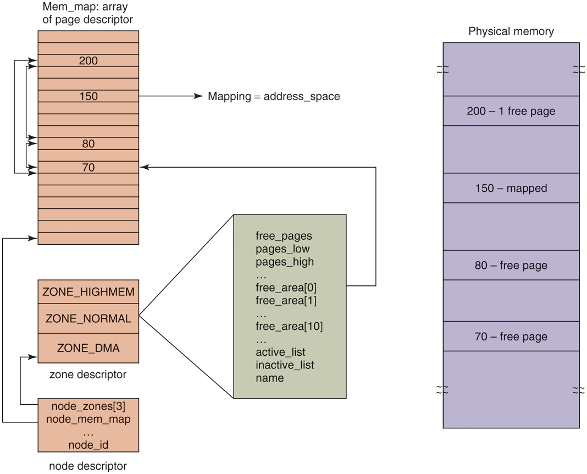

# Linux内核内存组织方式<sub>即 一张内存条在Linux内核中是怎么被组织起来的</sub>
> 先学习:[Run Linux Kernel (2nd Edition) Volume 1: Infrastructure.epub]#第3章　内存管理之预备知识

## 背景
在大部分Linux操作系统中，内存设备的初始化一般在BIOS或BootLoader中完成，然后把DDR存储设备的大小传递给Linux内核，因此，从内核的角度看，DDR存储设备其实就是一段物理内存空间。

在Linux内核中，和内存硬件物理特性相关的一些数据结构主要集中在MMU(如页表、高速缓存/TLB操作等)中。 因此大部分的Linux内核中关于内存管理的相关数据结构是软件层面的概念，如mm ， VMA、内存管理区(zone)、页面、page_data等。

## 物理内存管理相关的数据结构
和物理内存管理相关的数据结构: pglist_data 、 内存管理区(zone)、物理页面（page）、mem_map[]数组、页表项(PTE) 、 页帧号(PFN)、物理地址（paddress）

### pglist_data
描述一个内存节点的所有资源， 在UMA架构中，只有一个内存节点,即系统有一个全局的变量contig_page_data来描述这个内存节点;在NUMA架构中，整个系统的内存由一个 pglist_data*的指针数组node_data[]来管理,在系统初始化时通过枚举BIOS固件来完成。

## Linux内核内存组织方式
> 000.LINUX-5.9/include/linux/mmzone.h
```txt
node_data-整个系统的内存 -> 'struct pglist_data *node_data[MAX_NUMNODES] __read_mostly;'
└── pglist_data- 和NUMA UMA(SMP架构有关),而不是单独对应物理层面上的一个内存条: Linux 内核中用于管理单个 Node 上所有物理内存的核心结构体。它包含该 Node 的统计信息、它所包含的 Zone 列表等。
    └── zone-内存区域划分 (一个 struct zone 对应于一个 NUMA 节点上的一段特定物理地址范围)
        └── free_area-组织不同页块(伙伴系统的核心数据结构，管理空闲页块（page block）链表的数组)

mem_map： 将整个物理内存使用页(page)表示，将这些页用mem_map组织表示
      见[Run Linux Kernel (2nd Edition) Volume 1: Infrastructure.epub]#图3.9　mem_map[]数组和物理页面的关系

页帧号（PFN): 即页面再mem_map数组中的下标

为什么你的电脑只有一个Node 0 (cat /proc/zoneinfo) - 实际内存条数量: 2
    - NUMA（Non-Uniform Memory Access） 架构下，多个内存控制器会划分不同的 Node（每个 Node 对应一个物理 CPU 或内存区域）。
    - 普通台式机/笔记本 通常采用 UMA（Uniform Memory Access） 架构（即使有多根内存条），所有内存由单一内存控制器管理，因此内核默认只有一个 Node 0。
       + 即 台式机/笔记本 没有开启(或不支持NUMA) ， 所以，即使插了多根内存条，那么他也只有一个Node
    - 服务器/工作站（如 AMD EPYC、Intel Xeon）可能启用 NUMA，插多根内存条会分配到不同 Node（例如 Node 0 和 Node 1）。

```

## 内存区域(ZONE)划分 —— MOS5 §10.4.3 Physical Memory Management
> 出处: [Modern Operating Systems 5th Edition §10.4.3 "Physical Memory Management"](../../007.BOOKs/现代操作系统/Modern%20Operating%20Systems%205th%20Edition-PDF-01.pdf#page=777) 书页 748-749(PDF 777-778)。zone 划分是"Node 之下"的第一层切分:`pglist_data → zone → free_area`。

> "Due to idiosyncratic hardware limitations on many systems, not all physical memory can be treated identically, especially with respect to I/O and virtual memory. Linux distinguishes between the following memory zones: ZONE_DMA and ZONE_DMA32: pages that can be used for DMA. ZONE_NORMAL: normal, regularly mapped pages. ZONE_HIGHMEM: pages with high-memory addresses, which are not permanently mapped."（由于许多系统上特有的硬件限制，并非所有物理内存都能被同等对待，尤其是关于 I/O 和虚拟内存时。Linux 区分以下内存区域:ZONE_DMA 与 ZONE_DMA32——可用于 DMA 的页;ZONE_NORMAL——正常的、常规映射的页;ZONE_HIGHMEM——高内存地址、并非永久映射的页。）<sup>[Modern Operating Systems 5th, 书页 748(PDF 777)](../../007.BOOKs/现代操作系统/Modern%20Operating%20Systems%205th%20Edition-PDF-01.pdf#page=777)</sup>

> "The exact boundaries and layout of the memory zones are architecture dependent. On x86 hardware, certain devices can perform DMA operations only in the first 16 MB of address space, hence ZONE_DMA is in the range 0–16 MB. However, on 64-bit machines, there is additional support for those devices that can perform 32-bit DMA operations, and ZONE_DMA32 marks this region. In addition, if the hardware, like the older-generation i386, cannot directly map memory addresses above 896 MB, ZONE_HIGHMEM corresponds to anything above this mark. ZONE_NORMAL is anything in between them. Therefore, on 32-bit x86 platforms, the first 896 MB of the Linux address space are directly mapped, whereas the remaining 128 MB of the kernel address space are used to access high memory regions. On x86 64, ZONE_HIGHMEM is not defined."（内存区域的确切边界与布局是体系结构相关的。x86 硬件上，某些设备只能在地址空间前 16 MB 内做 DMA，故 ZONE_DMA 为 0–16 MB;64 位机器上还要照顾只能做 32 位 DMA 的设备，ZONE_DMA32 标记这一区域;若硬件(如老一代 i386)无法直接映射 896 MB 以上的地址，ZONE_HIGHMEM 对应其上所有部分;ZONE_NORMAL 介于其间。因此 32 位 x86 平台上，Linux 地址空间的前 896 MB 直接映射，内核地址空间其余 128 MB 用于访问高端内存;x86-64 上不定义 ZONE_HIGHMEM。）<sup>[书页 749(PDF 778)](../../007.BOOKs/现代操作系统/Modern%20Operating%20Systems%205th%20Edition-PDF-01.pdf#page=778)</sup>

```text
              32 位 x86(教科书布局)                       x86-64 / arm64(现代布局)
 物理地址
 0        16MB                896MB       上限      0        4GB              上限
 ┌────────┬──────────────────┬───────────────┐    ┌─────────┬──────────────┬─────────────┐
 │ZONE_DMA│   ZONE_NORMAL    │  ZONE_HIGHMEM │    │ZONE_DMA │  ZONE_DMA32  │ ZONE_NORMAL │
 │(ISA 设备│   (永久直映射)    │  (>896MB,非永久 │    │(≤设备DMA │ (32位DMA设备  │ (其余全部,   │
 │ DMA 专 │                  │   映射,kmap 临时│    │  能力下限)│  可用)       │  永久直映射) │
 │ 用)    │                  │   访问)        │    └─────────┴──────────────┴─────────────┘
 └────────┴──────────────────┴───────────────┘
 32 位:内核地址空间 = 896MB 直接映射 + 128MB 高端映射窗口   x86-64 不定义 HIGHMEM;
                                                          arm64 页大小可配(4K/16K/64K),亦无 HIGHMEM
```

**内核源码对照(Linux 7.1.3)**:zone 枚举在 [include/linux/mmzone.h:872 `enum zone_type`](../../000.SOURCE_CODE/003.LINUX-7.1.3/000.LINUX-7.1.3/include/linux/mmzone.h)——`ZONE_DMA`/`ZONE_DMA32` 由 `CONFIG_ZONE_DMA`/`CONFIG_ZONE_DMA32` 裁剪,`ZONE_HIGHMEM` 仅在 `CONFIG_HIGHMEM`(32 位)下存在,与书中"x86-64 上不定义 ZONE_HIGHMEM"一致;枚举注释同时说明了"32 位 DMA 掩码假定 ZONE_DMA32"的成立条件。此外还有一个书里(第5版)没展开的 `ZONE_MOVABLE`:专为内存热插拔/迁移保留的"可移动页"区域(mmzone.h:906 起)。

arm64 的 zone 上限在启动时由 `zone_dma_limit`/`dma32_phys_limit` 划出<sup>[arch/arm64/mm/init.c:126-130](../../000.SOURCE_CODE/003.LINUX-7.1.3/000.LINUX-7.1.3/arch/arm64/mm/init.c)</sup>:

```c
// arch/arm64/mm/init.c arch_zone_limits_init()（7.1.3 无 zone_sizes_init 符号）
#ifdef CONFIG_ZONE_DMA
	max_zone_pfns[ZONE_DMA]   = PFN_DOWN(max_zone_phys(zone_dma_limit));  // :127
#endif
#ifdef CONFIG_ZONE_DMA32
	max_zone_pfns[ZONE_DMA32] = PFN_DOWN(dma32_phys_limit);               // :130
#endif
	max_zone_pfns[ZONE_NORMAL] = max_pfn;                                 // 其余全部
```

> "The kernel maintains a zone structure for each of the three zones, and can perform memory allocations for the three zones separately."（内核为每个区域维护一个 zone 结构，并可以对三个区域分别进行内存分配。）<sup>[书页 749(PDF 778)](../../007.BOOKs/现代操作系统/Modern%20Operating%20Systems%205th%20Edition-PDF-01.pdf#page=778)</sup>

zone 结构内含水位线(low/high,页回收用)与 free_area 数组(伙伴系统)——即上文 `pglist_data → zone → free_area` 树的中层;水位线与页回收详见 [022.页面回收(page reclaim)](022.页面回收(page reclaim)/README.md),DMA 一侧(为什么低地址才能 DMA)详见本仓库 [052.INPUT_OUTPUT/006.DMA](../052.INPUT_OUTPUT/006.DMA/README.md)。用 `cat /proc/zoneinfo` 可直接观察到本机各 zone 的边界与水位线(上文"为什么只有一个 Node 0"的小实验同样从它读出)。

## Figure 10-15 —— Linux 物理内存的完整表示(node / zone / free_area / mem_map)
> 出处: [Modern Operating Systems 5th Edition §10.4.3](../../007.BOOKs/现代操作系统/Modern%20Operating%20Systems%205th%20Edition-PDF-01.pdf#page=779) 书页 750(PDF 779),Figure 10-15 "Linux' main memory representation"。这一节把上文 `node → zone → free_area` 的树状关系与 **mem_map 页描述符数组**、**物理页帧**四者放进同一张图。

### 1. 原文逐段

> "The kernel maintains a map of the main memory which contains all information about the use of the physical memory in the system, such as its zones, free page frames, and so forth. The information, illustrated in Fig. 10-15, is organized as follows."（内核维护一张主内存的"地图"，其中包含系统中物理内存使用的全部信息——比如它有哪些 zone、哪些空闲页帧等等。这些信息的组织方式如图 10-15 所示。）<sup>[Modern Operating Systems 5th, 书页 750(PDF 779)](../../007.BOOKs/现代操作系统/Modern%20Operating%20Systems%205th%20Edition-PDF-01.pdf#page=779)</sup>

> "First of all, Linux maintains an array of page descriptors, of type page, one for each physical page frame in the system, called mem_map. Each page descriptor contains a pointer to the address space that it belongs to, in case the page is not free, a pair of pointers which allow it to form doubly linked lists with other descriptors, for instance to keep together all free page frames, and a few other fields. In Fig. 10-15, the page descriptor for page 150 contains a mapping to the address space the page belongs to. Pages 70, 80, and 200 are free, and they are linked together. The size of the page descriptor is 32 bytes, so the mem_map consumes less than 1% of the physical memory (for a page frame of 4 KB)."（首先，Linux 维护一个页描述符数组 `mem_map`，类型为 `page`，系统中每个物理页帧对应一项。每个页描述符包含:在该页非空闲时指向其所属 address_space 的指针；一对能与其他描述符构成双向链表的指针——例如把所有空闲页帧串在一起；以及少量其他字段。图 10-15 中，页 150 的描述符含指向其所属地址空间的 mapping;页 70、80、200 空闲，且被链接在一起。页描述符大小 32 字节，因此 mem_map 消耗的内存不到物理内存的 1%(按 4KB 页帧计)。）<sup>[书页 750(PDF 779)](../../007.BOOKs/现代操作系统/Modern%20Operating%20Systems%205th%20Edition-PDF-01.pdf#page=779)</sup>

> "Since the physical memory is divided into zones, for each zone Linux maintains a zone descriptor. The zone descriptor contains information about the memory utilization within each zone, such as the number of active or inactive pages, low and high watermarks to be used by the page-replacement algorithm ... In addition, a zone descriptor contains an array of free areas. The ith element in this array identifies the first page descriptor of the first block of 2^i free pages. Since there may be more than one blocks of 2^i free pages, Linux uses the pair of page-descriptor pointers in each page element to link these together. ... In Fig. 10-15, free_area[0], which identifies all free areas of main memory consisting of only one page frame (since 2^0 is one), points to page 70, the first of the three free areas."（由于物理内存被划分为 zone，Linux 为每个 zone 维护一个 zone 描述符，内含该 zone 的内存使用信息——active/inactive 页数、供页面替换算法使用的低/高水位线等。此外 zone 描述符还有一个 free_area 数组:第 i 项指向第一块由 2^i 个空闲页组成的空闲块的首个页描述符。由于可能存在多个 2^i 大小的空闲块，Linux 用每个页元素里的一对指针把它们链起来。……图 10-15 中 free_area[0] ——对应只含 1 个页帧的空闲块(因为 2⁰=1)——指向三个空闲块中的第一个,即页 70。）<sup>[书页 750(PDF 779)](../../007.BOOKs/现代操作系统/Modern%20Operating%20Systems%205th%20Edition-PDF-01.pdf#page=779)</sup>

> "Finally, since Linux is portable to NUMA architectures (where different memory addresses have different access times), in order to differentiate between physical memory on different nodes (and avoid allocating data structures across nodes), a node descriptor is used. Each node descriptor contains information about the memory usage and zones on that particular node. On UMA platforms, Linux describes all memory via one node descriptor. The first few bits within each page descriptor are used to identify the node and the zone that the page frame belongs to."（最后，由于 Linux 可移植到 NUMA 体系(不同内存地址访问时间不同)，为区分不同节点上的物理内存(并避免跨节点分配数据结构)，使用了**节点描述符**。每个节点描述符包含该节点的内存使用信息与其 zone 列表。UMA 平台上 Linux 用**一个**节点描述符描述全部内存。每个页描述符的开头几位用来标识该页帧所属的 node 和 zone。）<sup>[书页 750(PDF 779)](../../007.BOOKs/现代操作系统/Modern%20Operating%20Systems%205th%20Edition-PDF-01.pdf#page=779)</sup>

### 2. 原图(自书 EPUB 提取，未拉伸)


<sup>原图出自 [Modern Operating Systems 5th Edition, Fig. 10-15](../../007.BOOKs/现代操作系统/Modern%20Operating%20Systems%205th%20Edition-PDF-01.pdf#page=779)</sup>

### 3. ASCII 重绘(与原图逐元素对应)

```text
 node 描述符(node_id/node_zones[3]/node_mem_map)          物理内存(每帧 4KB)
 ┌───────────────────────────┐                          ┌──────────────────┐
 │ node_id                   │                          │       ⋮          │
 │ node_zones[3] ────────────┼─► 三张 zone 描述符          │ 200 - free page  │◄──┐
 │ node_mem_map ─────────────┼─┐                        ├──────────────────┤   │
 └───────────────────────────┘ │                        │ 150 - mapped     │   │
                               ▼                        ├──────────────────┤   │
 zone 描述符(×3: DMA/NORMAL/HIGHMEM)                     │ 80  - free page  │◄─┐│
 ┌───────────────────────────┐                          ├──────────────────┤  ││
 │ free_pages                │                          │ 70  - free page  │◄─┼┘
 │ pages_low / pages_high    │ 水位线(页回收/kswapd 用)     │       ⋮          │  │
 │ free_area[0] ─────────────┼─► 2⁰=1页空闲块链 → page[70] └──────────────────┘  │
 │ free_area[1] ─────────────┼─► 2¹=2页空闲块链(头=某page)                       │
 │ …  free_area[10]          │    更高阶: 2²…2¹⁰/2¹¹                            │
 │ active_list/inactive_list │                          mem_map: 页描述符数组     │
 │ name                      │                         ┌──────────────────┐     │
 └───────────────────────────┘                         │ page[200] 空闲    │◄────┤
     free_area[0] 链(双向):                             ├──────────────────┤     │
     page[70] ⇄ page[80] ⇄ page[200] ─────────────────►│ page[150]        │     │
     (空闲页经 page 内部一对指针互连)                      │  .mapping ─►     │     │
                                                       │   address_space  │     │
     上方两条 ◄── 箭头: free_area[0]→page[70];            ├──────────────────┤     │
     node_zones→ZONE_DMA 描述符                          │ page[80] 空闲    │◄────┤
                                                       ├──────────────────┤     │
                                                       │ page[70] 空闲     │◄────┘
                                                       └──────────────────┘
 (MOS5 Fig 10-15 重绘; 所有箭头都是 C 指针)
```

### 4. 内核源码逐元素对照(Linux 7.1.3)

| 图中元素 | 内核实体 | 源码锚点 |
|-|-|---|
| node 描述符 | `struct pglist_data`:`node_zones[MAX_NR_ZONES]`(:1479)、`node_mem_map`(:1490)、`node_id`(:1514);UMA = `contig_page_data`,NUMA = `node_data[]` | [include/linux/mmzone.h:1479-1514](../../000.SOURCE_CODE/003.LINUX-7.1.3/000.LINUX-7.1.3/include/linux/mmzone.h) |
| zone 描述符 | `struct zone`(:967):`_watermark[NR_WMRK]`(:971,即书中 pages_low/high)、`free_area[NR_PAGE_ORDERS]`(:1087) | 同上 |
| free_area 数组 | `struct free_area { free_list[MIGRATE_TYPES]; nr_free; }`(:192-195)——现代内核按 migratetype 分链 | [mmzone.h:192-195](../../000.SOURCE_CODE/003.LINUX-7.1.3/000.LINUX-7.1.3/include/linux/mmzone.h) |
| 页描述符数组 | `extern struct page *mem_map`(:1429);页描述符 `struct page`(:79 起):`flags` + 五词联合体 | [mmzone.h:1429](../../000.SOURCE_CODE/003.LINUX-7.1.3/000.LINUX-7.1.3/include/linux/mmzone.h)、[mm_types.h:79-101](../../000.SOURCE_CODE/003.LINUX-7.1.3/000.LINUX-7.1.3/include/linux/mm_types.h) |
| page 150 的 mapping | `struct page` 联合体内 `struct address_space *mapping`(mm_types.h:101)——非空闲文件页/匿名页指向所属地址空间 | [mm_types.h:101](../../000.SOURCE_CODE/003.LINUX-7.1.3/000.LINUX-7.1.3/include/linux/mm_types.h) |
| 空闲页互连的一对指针 | 同一联合体注释明确写出三重身份:`lru`(回收链)/ **`buddy_list`**(伙伴空闲链)/`pcp_list`(per-CPU 快路径)(mm_types.h:96-99)——书中"页 70/80/200 互链"在 7.1.3 就挂在 `buddy_list` 上 | [mm_types.h:92-99](../../000.SOURCE_CODE/003.LINUX-7.1.3/000.LINUX-7.1.3/include/linux/mm_types.h) |
| "页描述符开头几位标识 node/zone" | `page->flags` 位段布局:`NODES_PGSHIFT`/`ZONES_PGSHIFT`/`ZONEID_SHIFT`(:1246-1262) | [mmzone.h:1246-1262](../../000.SOURCE_CODE/003.LINUX-7.1.3/000.LINUX-7.1.3/include/linux/mmzone.h) |

### 5. 与第 5 版成书时的两处演进(读图须知)

1. **描述符大小**:书中 32 字节是第 5 版成书时代的量级;7.1.3 的 `struct page` 经 memdesc 改造后为 `flags + 五词联合体`,大小随配置(可用 `static_assert(sizeof(struct ptdesc) <= sizeof(struct page))` 的编译期约束理解其紧凑性,mm_types.h:623)。"mem_map < 1% 物理内存"的量级结论依然成立。
2. **active/inactive 链的位置**:图中它们画在 zone 描述符里;现代内核已**上移到 per-node 的 lruvec**(MGLRU 时代更按"代"组织)——zone 只保留水位线与伙伴系统的 free_area。页面在 active/inactive 之间的状态机见 [025.MOS5-Figure10-18-页面回收状态机(PFRA)](025.MOS5-Figure10-18-页面回收状态机(PFRA).md)。

**arm64 落点**:台式机/笔记本(UMA)→ 一个 `contig_page_data`、图中 node 描述符仅一份;ARM 服务器(NUMA,如多路 EPYC 对标机型)→ `node_data[]` 每节点一份,页描述符高位 node/zone 位段随之变宽(`NODES_SHIFT`/`ZONES_SHIFT` 随配置裁剪)。观测入口同样是 `cat /proc/zoneinfo` / `numactl -H`。
