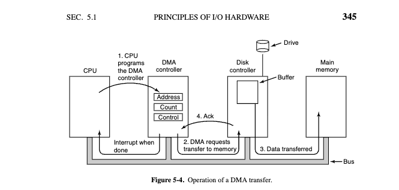

# DMA 传送流程(重绘 Tanenbaum 图 5-4)与"DMA 地址 = 物理地址?"(LINUX-7.1.3)

> **版本基准**: 本文代码引用基于 `000.SOURCE_CODE/003.LINUX-7.1.3/000.LINUX-7.1.3`(下称 **7.1.3**),行号已逐条核实,代码段为源码原文摘录(`...` 表示省略)。为书写简便,`mapping.c:174` 指 `kernel/dma/mapping.c` 第 174 行,其余同理(`dma-mapping.h` = `include/linux/dma-mapping.h`,`direct.h` = `kernel/dma/direct.h`,`iommu-dma.h` = `include/linux/iommu-dma.h`,`dma-iommu.c` = `drivers/iommu/dma-iommu.c`,`iommu.c` = `drivers/iommu/iommu.c`,`dma-api.rst` = `Documentation/core-api/dma-api.rst`)。
>
> **为什么写这篇**: ① 把 [Modern Operating Systems 5th](../../../007.BOOKs/现代操作系统/Modern%20Operating%20Systems%205th%20Edition-PDF-01.pdf) §5.1.4 的 Figure 5-4(Operation of a DMA transfer,[#page:374](../../../007.BOOKs/现代操作系统/Modern%20Operating%20Systems%205th%20Edition-PDF-01.pdf#page:374);[EPUB-02](../../../007.BOOKs/现代操作系统/Modern%20Operating%20Systems%205th%20Edition-EPUB-02.epub) 同文)重绘为 ASCII 并逐步注解;② 回答一个真实的读书疑问——书中说"**大多数 DMA 控制器使用物理内存地址进行传送,OS 须把缓冲区虚拟地址转成物理地址写进 DMA 控制器的地址寄存器**"(引文出自中文第 3 版;英文原文见 5th [#page:375](../../../007.BOOKs/现代操作系统/Modern%20Operating%20Systems%205th%20Edition-PDF-01.pdf#page:375)),**这段话旧不旧?如果它成立,IOMMU 不就没用了吗?**——结论:**话没有错,但它只描述"无 IOMMU"的那条路径;有 IOMMU 时写进设备的是 IOVA。英文第 5 版在同一处补了一句 IOMMU,而 7.1.3 的 `dma_map_phys()` 恰好把这两条路径分派得清清楚楚**。

## 0. 结论速览

|问题|答案|
|---|---|
|"DMA 控制器用物理地址"过时了吗|对**无 IOMMU** 的平台(大量嵌入式 SoC、或 IOMMU 被禁用时)至今**字面成立**;对带 IOMMU 的平台(x86 服务器、Apple Silicon、多数现代 ARM SoC)不再成立——设备编程用的是 **IOVA**,由 IOMMU 硬件翻译成物理地址|
|那书上说错了?|没有。英文第 5 版(#page:375)在同一段**补写**了:"an IOMMU (an MMU for I/O) offers similar functionality: it translates the virtual addresses used by devices to physical addresses."。中文第 3 版(原书 2007 年定稿)成书时 Intel VT-d 尚未进入主流芯片组(2008 年起),写的是"前 IOMMU 时代"的普遍现实|
|IOMMU 是不是没用|**恰恰相反**。正因为"设备裸用物理地址"不安全也不灵活,才造出 IOMMU:安全隔离(设备只能访问被映射的页)、地址能力扩展(小位宽设备访问高内存)、虚拟化直通(虚机/用户态直接持有设备)。"设备用物理地址"是 IOMMU 要解决的问题,不是 IOMMU 失效的证据|
|"OS 必须先翻译地址才能编程设备"过时了吗|没有。7.1.3 里 `dma_map_page()` 第一步仍是 `page_to_phys()`(mapping.c:195);变的只是**翻译产物**(PA → IOVA)和**翻译载体**(设备地址寄存器 → IOMMU 页表)|

## 1. 图 5-4 重绘(含地址层)



原图:[MOS 5th Figure 5-4 "Operation of a DMA transfer"](../../../007.BOOKs/现代操作系统/Modern%20Operating%20Systems%205th%20Edition-PDF-01.pdf#page:374)(PDF #page:374;[EPUB-02](../../../007.BOOKs/现代操作系统/Modern%20Operating%20Systems%205th%20Edition-EPUB-02.epub) §5.1.4 同图,图注文字即"Operation of a DMA transfer")。

```text
                 1. CPU 对 DMA 控制器进行编程(MMIO 写三组寄存器)
                    写进"地址寄存器"的是什么? A=物理地址 / B=IOVA(见下方地址层)
                                                        ┌──────┐
 ┌──────┐           ┌───────────────┐                   │驱动器 │
 │      │ ────────► │ DMA 控制器     │                   └───┬──┘  ┌───────────────┐
 │      │           │ ┌───────────┐ │     4. 应答            │     │ 磁盘控制器     │   ┌──────┐
 │ CPU  │           │ │ 地址      │ │◄───────────────────────┼──── │ ┌───────────┐ │   │      │
 │      │           │ │ 计数      │ │                        └────│─┤  缓冲区    ├─┘   │ 内存 │
 │      │           │ │ 控制      │ │                             │ └───────────┘ │   │      │
 └──┬───┘           └─┬─────────────┘                             └───────┬───────┘   └──┬───┘
    │                 │                                                   │              │
════╪═════════════════╪═════════════════════════════ 总线(Bus) ══════════╪══════════════╪════
    ║                 ║                                                   ║              ║
    ║                 ╠═══ 2. DMA 请求传送到内存 ═╬═══════════════════════════════════════►║
    ║                 ║               ╚═══ 3. 数据传送 ════════════════════════════════►║
    ║◄════ 完成时中断 ═╝
    (说明:第 1、4 步的箭头是部件之间的直连线;第 2 步的读请求、第 3 步的数据、
     最后的"完成中断"则都是总线事务——所以箭头沿总线画。第 2 步发读请求的同时,
     目标内存地址放在总线的地址线上,磁盘控制器因此知道第 3 步该把数据写到内存哪里)

 ┄┄┄┄┄┄┄┄┄┄┄┄┄┄┄┄┄┄┄ 地址层:设备放出去的地址,内存怎么认? ┄┄┄┄┄┄┄┄┄┄┄┄┄┄┄┄┄┄

   A. 无 IOMMU —— 书里那段话描述的世界:
      设备放出去的地址本身就是物理地址,内存直接认,直达
      DMA 控制器 ──物理地址(裸)──► 内存                        ← 设备可及全部物理内存

   B. 有 IOMMU —— 现代 x86/ARM 服务器、手机:
      设备放出去的地址是 IOVA(设备专用虚地址),内存不认,
      必须先由 IOMMU 查表翻译成物理地址,才能进内存
      DMA 控制器 ──IOVA──► ┌────────────────┐ ──物理地址──► 内存
                           │     IOMMU      │
                           │ VT-d/AMD-Vi/   │    ← 只放行 IOMMU 页表里映射过的
                           │ SMMU           │       IOVA(按设备隔离)
                           └────────────────┘
```

对照原书四个部件:**CPU**、**DMA 控制器**(内含 地址/计数/控制 三组寄存器)、**磁盘控制器**(上方是驱动器,内部是缓冲区)、**内存**;下方一条**总线**把四者连起来。编号 1、4 的箭头在部件之间(编程走 MMIO、应答直接回给 DMA 控制器),第 2、3 步与"完成时中断"则是总线事务(箭头沿总线画)。**地址层是本篇对原图的补充**:第 1 步写进"地址寄存器"、第 2、3 步随总线事务放出去的那个地址,在 A/B 两个世界里分别是物理地址与 IOVA——书里那段话只画了 A 的世界,这也是第 3 节整个讨论的出发点。

## 2. 编号步骤详解(依据 §5.1.4 原文)

**前置(图中未编号)**:CPU 先向磁盘控制器发命令——把一个块(一个或多个扇区)从磁盘**串行逐位**读进控制器内部缓冲区,并**校验校验和**;数据有效后 DMA 才能开始。对比:没有 DMA 时,控制器校验完就中断 CPU,由 OS 执行循环、从控制器缓冲区**一次一字节/字**地搬进内存([#page:374](../../../007.BOOKs/现代操作系统/Modern%20Operating%20Systems%205th%20Edition-PDF-01.pdf#page:374))——DMA 省掉的正是这个循环。

**第 1 步 · 编程**:CPU 设置 DMA 控制器三组寄存器——**地址寄存器**(内存缓冲区地址)、**字节计数寄存器**、**控制寄存器**(I/O 端口、传送方向、传送单位、突发长度)。

**第 2~4 步 · 每字一次的循环**:
- **2**:DMA 控制器在总线上向磁盘控制器发**读请求**——与任何读请求一样,磁盘控制器并不知道(也不关心)它来自 CPU 还是 DMA 控制器;**目标内存地址放在总线地址线上**;
- **3**:磁盘控制器从内部缓冲区取下一个字,**写内存**(又一个标准总线周期);
- **4**:写完后磁盘控制器向 DMA 控制器发**应答(Ack)**;DMA 控制器**地址寄存器 +1、计数寄存器 -1**,计数仍 > 0 则回到第 2 步。

**收尾 · 完成时中断**:计数减到 0,DMA 控制器**中断 CPU**。此时数据已在内存,"操作系统开始工作时,用不着将磁盘块复制到内存中,因为它已经在内存中了"。

**三种工作模式**(原文紧随其后):
- **周期窃取(cycle stealing)**:一字一停,每次只为一个字请求总线,CPU 想用总线就得等——设备"偷走"零星总线周期;
- **突发(burst)模式**:一次拿到总线,连发一串传送再释放;省了重复仲裁,但长突发会阻塞 CPU 和其他设备;
- **飞越(fly-by)模式**:上图模型,设备控制器直接把数据送内存;另一种模式是先把字发给 DMA 控制器、由它再发起第二个总线周期写出去——每字多一个总线周期,但换来设备到设备、内存到内存复制的灵活性。

**为什么磁盘控制器要先整块读进自己的缓冲区**:① 传送前先验校验和,错了就不发起传送;② 磁盘数据按固定速率到达,若直接写内存,每字都要抢总线,总线一忙控制器就得自备暂存,设计复杂;先入缓冲区,DMA 阶段对时间就不敏感了。

## 3. 关键问题:DMA 用的到底是什么地址?

### 3.1 引文的版本对照

你引的中译(出自《现代操作系统(原书第 3 版)》§5.1.4,读者手头书,仓库无电子版):

> "大多数DMA控制器使用物理内存地址进行传送。使用物理地址要求操作系统将预期的内存缓冲区的虚拟地址转换为物理地址,并且将该物理地址写入DMA控制器的地址寄存器中。在少数DMA控制器中使用的一个替代方案是将虚拟地址写入DMA控制器,然后DMA控制器必须使用MMU来完成虚拟地址到物理地址的转换。只有在MMU是内存的组成部分(有可能,但罕见)而不是CPU的组成部分的情况下,才可以将虚拟地址放到总线上。"

第 5 版(2014)同一段的英文原文——比中文第 3 版**多出最后两句 IOMMU**(粗体):

> "Most DMA controllers use physical memory addresses for their transfers. Using physical addresses requires the operating system to convert the virtual address of the intended memory buffer into a physical address and write this physical address into the DMA controller's address register. An alternative scheme used in a few DMA controllers is to write virtual addresses into the DMA controller instead. Then the DMA controller must use the MMU to have the virtual-to-physical translation done. Only when the MMU is part of the memory (possible, but rare), rather than part of the CPU, can virtual addresses be put on the bus. **In Chap. 7, we will see that an IOMMU (an MMU for I/O) offers similar functionality: it translates the virtual addresses used by devices to physical addresses. In other words, the virtual address of a buffer used by a device may be different from the virtual address used for the same buffer by the CPU, while both are different from the corresponding physical address.**"
> —— [MOS 5th #page:375](../../../007.BOOKs/现代操作系统/Modern%20Operating%20Systems%205th%20Edition-PDF-01.pdf#page:375)([EPUB-02](../../../007.BOOKs/现代操作系统/Modern%20Operating%20Systems%205th%20Edition-EPUB-02.epub) §5.1.4 同文;IOMMU 两句自译:在第 7 章我们会看到,IOMMU(面向 I/O 的 MMU)提供了类似的功能——它把设备使用的虚拟地址翻译成物理地址;换言之,设备访问某缓冲区用的虚拟地址,可以既不同于 CPU 访问同一缓冲区用的虚拟地址,也不同于对应的物理地址)

**判读**:这段话没有"错",它精确描述**直连 DMA(无 IOMMU)**模型;只是第 3 版成书(英文 2007 年)时 IOMMU 还没进入主流——Intel VT-d 2008 年才随芯片组普及,AMD IOMMU 规范([仓库藏 AMD-48882](../../../007.BOOKs/AMD-48882_IOMMU.pdf),2006 年定稿)当时也仅存在于少数服务器。更有意思的是,书中那句"少数替代方案:把虚拟地址写入 DMA 控制器、由 MMU 翻译"——**这个预言后来成了现实**,只是翻译器不是"内存侧的 MMU",而是根复合体/互连上的 IOMMU(x86 叫 VT-d/AMD-Vi,ARM 叫 [SMMU](../../../007.BOOKs/learn_the_architecture_-_smmu_software_guide_109242_0100_01_en.pdf),Apple Silicon 叫 Dart),设备总线上的地址也叫 IOVA 而不是 CPU 的进程虚拟地址。

### 3.2 两个世界的软件路径(dma_map_page 之后)

硬件侧(总线到内存的最后一跳)已并入 §1 大图的**地址层**;这里看软件侧——同一个 `dma_map_page()` 进内核后怎么分岔(与 3.3 的代码一一对应):

```text
   驱动 dma_map_page(dev, page, off, size, dir)          ← 两个世界入口完全相同
        │
        │   mapping.c:195    phys = page_to_phys(page) + off    ← VA→PA 翻译,OS 做(书里这半句至今成立)
        │
        ├──【A. 无 IOMMU:dma_map_direct() 为真】
        │       direct.h:111      dma_addr = phys_to_dma(phys)      ← DMA 地址 ≈ 物理地址
        │       写进设备"地址寄存器"的 = PA   → 之后走 §1 地址层 A(物理地址直达内存)
        │
        └──【B. 有 IOMMU:use_dma_iommu() 为真】
                dma-iommu.c:866   iova = iommu_dma_alloc_iova(...)   ← 分配设备侧虚地址 IOVA
                dma-iommu.c:870   iommu_map(domain, iova, phys, ...) ← IOVA→PA 写进 IOMMU 页表
                写进设备"地址寄存器"的 = IOVA → 之后走 §1 地址层 B(先过 IOMMU 再进内存)
```

### 3.3 内核证据:两条路径在 `dma_map_phys()` 分家

驱动侧入口是 `dma_map_page` 宏(dma-mapping.h:607),它先做**和书里说的完全一样**的翻译:

```c
/* include/linux/dma-mapping.h:607 */
#define dma_map_page(d, p, o, s, r) dma_map_page_attrs(d, p, o, s, r, 0)

/* kernel/dma/mapping.c:191-205 —— VA→PA 翻译至今仍由 OS 完成 */
dma_addr_t dma_map_page_attrs(struct device *dev, struct page *page,
		size_t offset, size_t size, enum dma_data_direction dir,
		unsigned long attrs)
{
	phys_addr_t phys = page_to_phys(page) + offset;
	...
	return dma_map_phys(dev, phys, size, dir, attrs);
}
```

`dma_map_phys()` 按设备是否挂在 IOMMU 域上分派(`use_dma_iommu()` 见 [include/linux/iommu-dma.h:13](../../../000.SOURCE_CODE/003.LINUX-7.1.3/000.LINUX-7.1.3/include/linux/iommu-dma.h),即查 `dev->dma_iommu`):

```c
/* kernel/dma/mapping.c:155,170-179 */
dma_addr_t dma_map_phys(struct device *dev, phys_addr_t phys, size_t size,
		enum dma_data_direction dir, unsigned long attrs)
{
	...
	if (dma_map_direct(dev, ops) ||
	    (!is_mmio && !is_cc_shared &&
	     arch_dma_map_phys_direct(dev, phys + size)))
		addr = dma_direct_map_phys(dev, phys, size, dir, attrs, true);  /* ← A: 无 IOMMU */
	else if (is_cc_shared)
		return DMA_MAPPING_ERROR;
	else if (use_dma_iommu(dev))
		addr = iommu_dma_map_phys(dev, phys, size, dir, attrs);         /* ← B: 有 IOMMU */
	else if (ops->map_phys)
		addr = ops->map_phys(dev, phys, size, dir, attrs);
	...
}
```

**路径 A(直连)**——`phys_to_dma()` 把物理地址(至多加个总线偏移)直接当 DMA 地址;设备寻址范围不够时退到 swiotlb 弹跳缓冲(先拷贝到低地址,设备 DMA 完再拷回,软件模拟出"设备够得着"的假象):

```c
/* kernel/dma/direct.h:85-116(节选) —— 书里那句话的字面印证 */
static inline dma_addr_t dma_direct_map_phys(struct device *dev,
		phys_addr_t phys, size_t size, enum dma_data_direction dir,
		unsigned long attrs, bool flush)
{
	dma_addr_t dma_addr;
	...
	} else {
		dma_addr = phys_to_dma(dev, phys);          /* ← 写进设备的就是物理地址 */
		if (unlikely(!dma_capable(dev, dma_addr, size, true)) ||
		    dma_kmalloc_needs_bounce(dev, size, dir)) {
			if (is_swiotlb_active(dev) &&
			    !(attrs & DMA_ATTR_REQUIRE_COHERENT))
				return swiotlb_map(dev, phys, size, dir, attrs);   /* ← 弹跳缓冲 */
			goto err_overflow;
		}
	}
	...
}
```

**路径 B(IOMMU)**——先从 IOVA 分配器领一个设备侧虚地址,再把 IOVA→PA 映射写进 IOMMU 页表,**返回给驱动、随后写进设备寄存器的全是 IOVA**:

```c
/* drivers/iommu/dma-iommu.c:846-874(节选) */
static dma_addr_t __iommu_dma_map(struct device *dev, phys_addr_t phys,
		size_t size, int prot, u64 dma_mask)
{
	...
	iova = iommu_dma_alloc_iova(domain, size, dma_mask, dev);        /* 1. 分配 IOVA */
	if (!iova)
		return DMA_MAPPING_ERROR;

	if (iommu_map(domain, iova, phys - iova_off, size, prot, GFP_ATOMIC)) {  /* 2. 建 IOVA→PA 映射 */
		iommu_dma_free_iova(domain, iova, size, NULL);
		return DMA_MAPPING_ERROR;
	}
	return iova + iova_off;                                           /* 3. 驱动拿到的是 IOVA */
}
```

`iommu_map()`(iommu.c:2709)最终落到具体 IOMMU 驱动的页表操作。内核文档把这两种手段写得明明白白:

> "Streaming DMA functions try to overcome such addressing constraints, **either by using an IOMMU (a device which maps I/O DMA addresses to physical memory addresses), or by copying the data to/from a bounce buffer** if the kernel is configured with a SWIOTLB."
> —— [Documentation/core-api/dma-api.rst:190-199](../../../000.SOURCE_CODE/003.LINUX-7.1.3/000.LINUX-7.1.3/Documentation/core-api/dma-api.rst)(7.1.3 原文)

### 3.4 回答:这段话旧不旧?IOMMU 没用吗?

1. **"旧但不错"**:它描述的是路径 A。无 IOMMU 的系统今天仍大量存在(很多嵌入式 SoC 树莓派 BCM2711 这类只对少数外设配 IOMMU;服务器上也常见 `iommu=pt`/按需启用),在这些设备上,DMA 地址就是物理地址,书里的每个字都成立。
2. **有 IOMMU 时,写进设备的是 IOVA**:驱动调用同一个 `dma_map_page()`,拿到的是 IOVA;设备把它放上总线,IOMMU 翻译成物理地址才到内存。Tanenbaum 第 5 版已亲自补上这一句(见 3.1)。
3. **IOMMU 非但有用,而且正是冲着这句话的缺陷来的**:
   - **安全隔离**:路径 A 下设备可 DMA 读写**全部**物理内存——恶意/故障设备等于绕过 MMU 直捣内存;IOMMU 按设备建域,未映射的页一律拦截(VFIO 设备直通、DPDK 用户态驱动都建立在这一保障上,见 [039/DPDK 笔记](../../039.网络协议栈与系统实现/000.软件加速-Intel%20DPDK.md));
   - **地址能力**:32 位设备够不着 4 GB 以上内存——路径 A 只能 swiotlb 拷贝兜底;路径 B 用 IOVA 重映射即可,零拷贝;
   - **虚拟化直通**:把真设备分给虚机,虚机驱动写的"物理地址"其实是该虚机的 GPA,IOMMU 把 GPA 翻译成宿主物理地址([MOS 5th §7.7 I/O Virtualization #page:526](../../../007.BOOKs/现代操作系统/Modern%20Operating%20Systems%205th%20Edition-PDF-01.pdf#page:526))——没有 IOMMU 这件事根本不安全。
4. **一个仍然成立的子命题**:"OS 必须先翻译地址再编程设备"在两个世界里都成立——`page_to_phys()` 一步没省;变的是翻译的**终点**(PA 还是 IOVA)与**执行翻译的硬件**(设备直接用,还是 IOMMU 逐笔翻译)。

## 4. 关联笔记

- 本目录: [000.DMA 学习资料索引](./000.DMA-学习资料索引.md) | [README](./README.md)
- [019.IOMMU 学习资料索引](../019.IOMMU/000.IOMMU-学习资料索引.md)(SMMU/VT-d 资料集中地)
- [051.AI-ASSISANT/001.CPU与DMA双向交互(网络收包事件全流程)](../../051.AI-ASSISANT/001.CPU与DMA双向交互%28网络收包事件全流程%29.md) —— 把上图的"磁盘控制器"换成网卡 RX 环的真实端到端事件
- [023.MMIO/006.MMIO的缺点](../023.MMIO%28内存映射IO%29/006.MMIO的缺点-多总线路由与ARM64处理.md) —— 第 1 步"编程"走的 MMIO 路由问题
- IOMMU 入门文献(仓库藏): [ARM SMMU Software Guide](../../../007.BOOKs/learn_the_architecture_-_smmu_software_guide_109242_0100_01_en.pdf) | [AMD IOMMU 规范](../../../007.BOOKs/AMD-48882_IOMMU.pdf) | [IOMMU Tutorial (ASPLOS 2016)](../../../007.BOOKs/IOMMU_TUTORIAL_ASPLOS_2016.pdf)

## 5. 参考

|资料|位置|说明|
|---|---|---|
|Modern Operating Systems 5th(PDF)|[#page:373-376](../../../007.BOOKs/现代操作系统/Modern%20Operating%20Systems%205th%20Edition-PDF-01.pdf#page:373)|Figure 5-4 与四步流程(#page:374)、三种模式、"物理地址"段英文原文与 IOMMU 补句(#page:375)、§7.7 I/O 虚拟化(#page:526)|
|Modern Operating Systems 5th(EPUB)|[EPUB-02](../../../007.BOOKs/现代操作系统/Modern%20Operating%20Systems%205th%20Edition-EPUB-02.epub) §5.1.4|同文电子版,便于全文检索|
|现代操作系统(中文第 3 版)|读者手头书(仓库无电子版)|本篇所答引文的中译出处;英文原文见上行 #page:375|
|Linux 7.1.3 源码|[kernel/dma/mapping.c](../../../000.SOURCE_CODE/003.LINUX-7.1.3/000.LINUX-7.1.3/kernel/dma/mapping.c)、[kernel/dma/direct.h](../../../000.SOURCE_CODE/003.LINUX-7.1.3/000.LINUX-7.1.3/kernel/dma/direct.h)、[drivers/iommu/dma-iommu.c](../../../000.SOURCE_CODE/003.LINUX-7.1.3/000.LINUX-7.1.3/drivers/iommu/dma-iommu.c)、[include/linux/iommu-dma.h](../../../000.SOURCE_CODE/003.LINUX-7.1.3/000.LINUX-7.1.3/include/linux/iommu-dma.h)|`dma_map_page` → 两条路径分派,行号见文中|
|内核文档|[Documentation/core-api/dma-api.rst:190-199](../../../000.SOURCE_CODE/003.LINUX-7.1.3/000.LINUX-7.1.3/Documentation/core-api/dma-api.rst)|IOMMU / SWIOTLB 两种克服寻址约束的手段|
