# 内存映射IO （CPU如何与设备通信）
> 学习: <br/> - [007.BOOKs/现代操作系统/现代操作系统.epub](../../../007.BOOKs/现代操作系统/现代操作系统.epub) （部分翻译有问题，参考:[007.BOOKs/现代操作系统/现代操作系统（第4版）英文.pdf](../../../007.BOOKs/现代操作系统/现代操作系统（第4版）英文.pdf)学习） <br/> - [Modern Operating Systems 5th Edition](../../../007.BOOKs/现代操作系统/Modern%20Operating%20Systems%205th%20Edition-PDF-01.pdf)(第5版,各行"参考"列给出章节与 PDF 页码)

## 摘要
|说明|备注|参考|
|-|-|-|
|- 访问硬件设备，其实是访问设备控制器的寄存器|- 第5版原文:"Each controller has a few registers that are used for communicating with the CPU. By writing into these registers, the operating system can command the device to deliver data, accept data, switch itself on or off, or otherwise perform some action. By reading from these registers, the operating system can learn what the device's state is..."——写寄存器 = 下命令,读寄存器 = 查状态;此外很多设备还有可读写的数据缓冲区(如显存)|- [007.BOOKs/现代操作系统/现代操作系统.epub](../../../007.BOOKs/现代操作系统/现代操作系统.epub)#5.3.2 设备驱动程序 <br/> - 第5版 [§5.1.3 Memory-Mapped I/O #page:369](../../../007.BOOKs/现代操作系统/Modern%20Operating%20Systems%205th%20Edition-PDF-01.pdf#page:369) / [§5.3.2 Device Drivers #page:388](../../../007.BOOKs/现代操作系统/Modern%20Operating%20Systems%205th%20Edition-PDF-01.pdf#page:388)|
|-|-|-|
|- seek: 用于随机存取文件，seek调用结束后，就可以从该位置开始读写数据|-|-  [007.BOOKs/现代操作系统/现代操作系统.epub](../../../007.BOOKs/现代操作系统/现代操作系统.epub)#4.1.6 文件操作 <br/> - 第5版 [§4.1.6 File Operations #page:298](../../../007.BOOKs/现代操作系统/Modern%20Operating%20Systems%205th%20Edition-PDF-01.pdf#page:298)|
|-|-|-|
|- 什么是I/O设备|- I/O设备一般包括两个部分：设备控制器和设备本身。控制器是插在电路板上的一块芯片或一组芯片，这块电路板物理地控制设备。它从操作系统接收命令，例如，从设备读数据，并且完成数据的处理。 <br/> - 第5版 §5.1.2:"I/O units often consist of a mechanical component and an electronic component"——电子部分即设备控制器(controller / adapter),机械部分是设备本身|- [007.BOOKs/现代操作系统/现代操作系统.epub](../../../007.BOOKs/现代操作系统/现代操作系统.epub)#1.3.5 I/O设备 <br/> - 第5版 [§1.3.4 I/O Devices #page:58](../../../007.BOOKs/现代操作系统/Modern%20Operating%20Systems%205th%20Edition-PDF-01.pdf#page:58) / [§5.1.2 Device Controllers #page:367](../../../007.BOOKs/现代操作系统/Modern%20Operating%20Systems%205th%20Edition-PDF-01.pdf#page:367)|
|-|-|-|
|-|-|-|

## The CPU doesn`t control  I/O devices,it communicates with them
CPU不是对设备进行微观管理，而是简单地发送请求，然后由设备控制器来执行。


## 微控制器（microcontroller）
- 「微控制器」专为与硬件交互而设计，则CPU专注于运行程序，
- 微控制器的性能足以扫描电路（这里是以键盘为例子），由微控制器检测到按键动作，并将结果简单的传递到CPU，通过称之为控制总线的物理连接;
  - 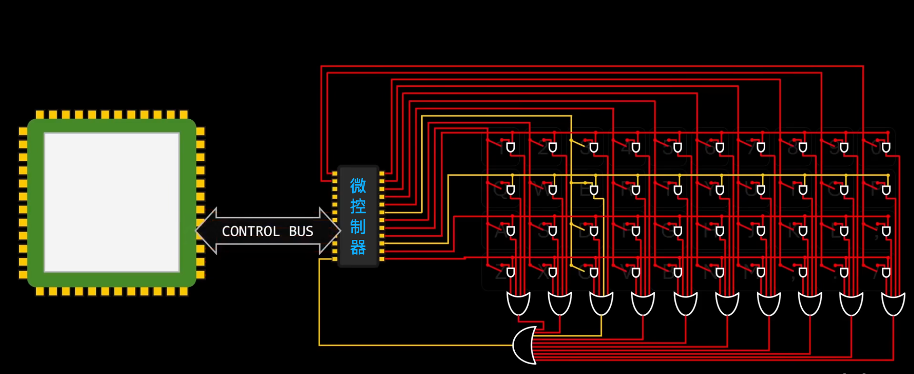

### 以操作文件为例
```c
file = open("data.txt");
buffer = read(file,4);
```
当程序执行这样的代码的时候，CPU并不会执行指令来旋转磁盘并移动磁头来搜索文件，他通过向控制总线发送指令，要求磁盘找到data.txt 。请求一旦发出，则CPU可以继续处理其他任务。与此同时，控制器负责处理旋转磁盘和移动磁头的机械操作，当文件被定位后，控制器会返回文件所在的地址，
  - 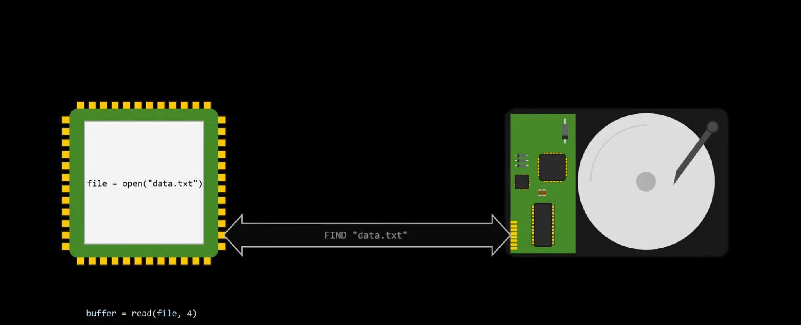

之后，如果程序想读取该文件中的4个字节，CPU会发送一个请求，告诉设备从之前返回的地址开始，读取4个字节。类似的，磁盘控制器执行定位磁头和读取数据的实际工作，而CPU则可以自由执行其他指令，一旦请求就绪，控制器就会通过总线，将其发送到CPU
  - 发送文件读取指令
    + 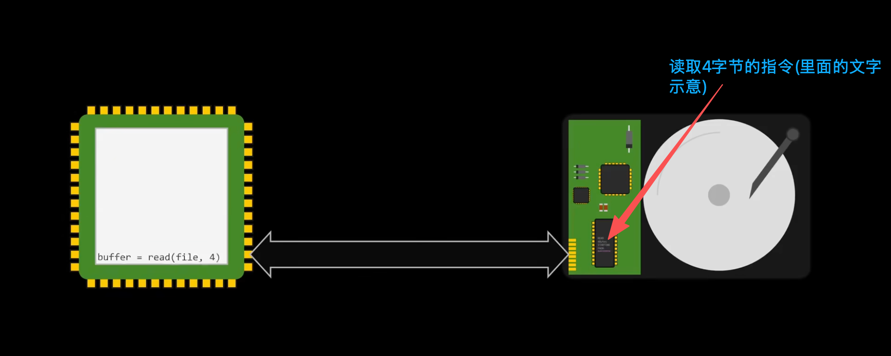
  - 返回数据
    + 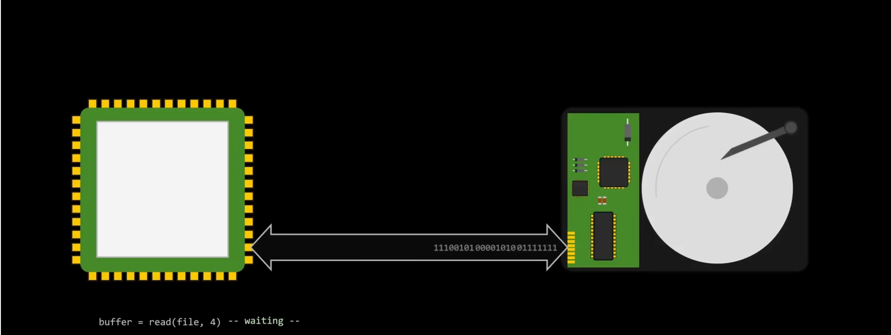


## 内部工作原理解析
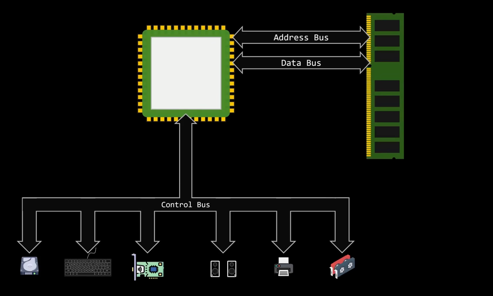
- 控制总线用于发送指令和数据

设计输入输出时，需要考虑：
+ Communication Method .（通信方法）
  - How the CPU physically talks to devices.
+ Data transfer technique (数据传输技术)
  - How and when the data moves.

- 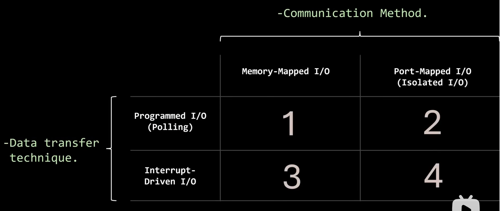
   + 实现两者（通信方法 和 数据传输技术）都有多种方法，在实践中，硬件可以使用它们的任意组合。

### 通信方法
#### Memory-Mapped I/O <sup>有一条定制总线</sup>
- 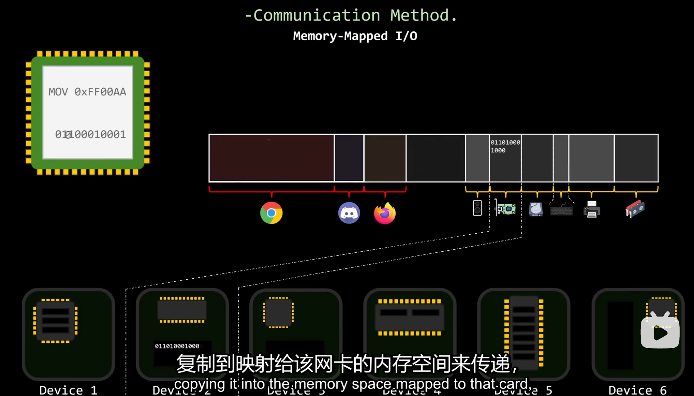
由于输入输出设备有自己的微控制器，也有某种形式的板载内存，可以简单到是锁寄存器、 触发器、或者控制器内部的小型寄存器文件，对于更复杂的设备，可能包含专用的DRAM芯片，内存映射IO的工作原理，就是暴露该板载内存，或至少是其中一部分，使得CPU可以像读写主存的另一部分一样进行读写，就行进程被分配地址空间一样，内存映射方法为IO设备在系统地址空间中，分配了特定的内存区域，通过CPU的角度来看，与设备通信和读写内存中的变量并无区别，因此他可以使用常规的加载、存储，和移动指令来与设备通信。

CPU和设备之间，仍然需要物理连接，需要一些额外的电路来判断通过地址总线传递的内存地址是属于主存还是I/O设备，
- 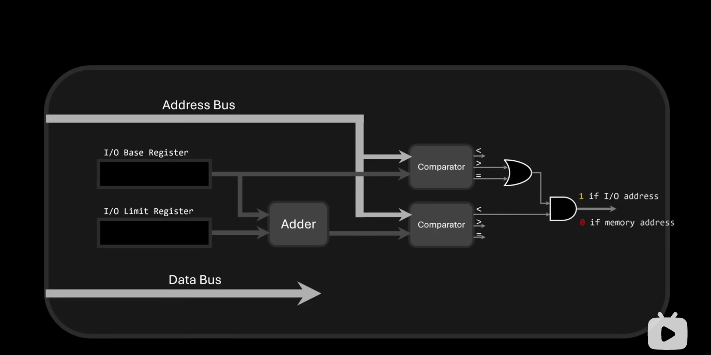
- 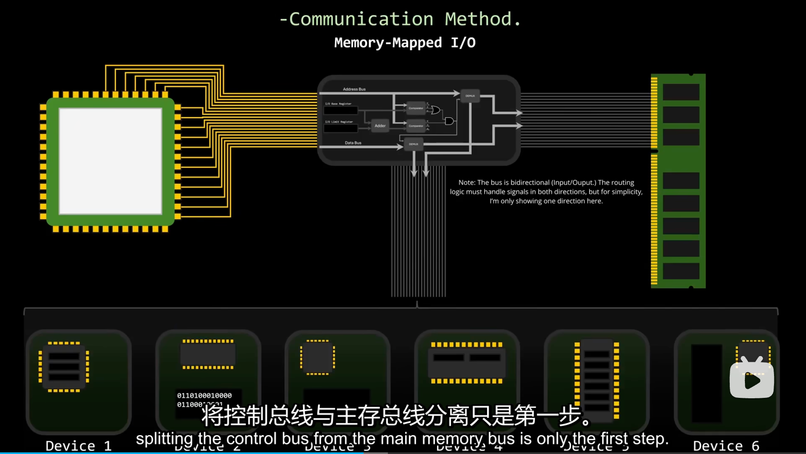

###### 使用内存映射I/O作为抽象层,类似于PCI这种标准化的专用总线


---

#### Isolated I/O
设备不映射到内存中，则是通过一条与内存完全分离的专用总线连接，与设备的通信通过自定义协议进行，最大优点是内存和IO操作互不干扰，这使得系统更有利于并行处理，但缺点是，CPU现在需要特殊指令，才能通过这条总线和设备通信。这意味着CPU内部需要更多的电路，导致CPU体积更大，制造成本更高，并且能效更低，
- 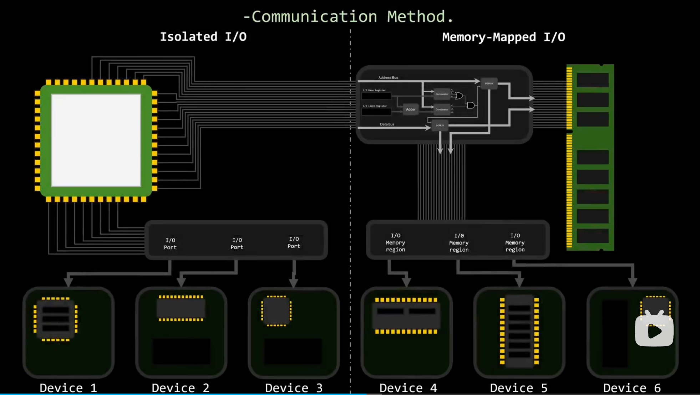

> 教科书对应(《现代操作系统》第5版 §5.1.3,[#page:369-370](../../../007.BOOKs/现代操作系统/Modern%20Operating%20Systems%205th%20Edition-PDF-01.pdf#page:369)):视频里的 "Memory-Mapped I/O" 与 "Isolated I/O" 分别对应书中 **Fig 5-2(b) 内存映射 I/O** 和 **Fig 5-2(a) 独立 I/O 空间**(每个控制寄存器一个 I/O 端口号,用 `IN REG,PORT` / `OUT PORT,REG` 专用指令访问,`IN R0,4` 与 `MOV R0,4` 的 "4" 属于互不相关的地址空间)。书中还给出视频没讲的第三种——**Fig 5-2(c) 混合方案**:数据缓冲区走内存映射、控制寄存器走 I/O 端口,x86 即此(640K~1M−1 留给设备数据缓冲区,另有 0~64K−1 的 I/O 端口)。三种方式的原文、MMIO 三大优点见本目录 [README「第5版 §5.1.3 对 MMIO 的定义」](README.md),缺点与多总线路由见 [006](006.MMIO的缺点-多总线路由与ARM64处理.md)。


#### 数据传输技术
> 教科书对应:《现代操作系统》第5版 §5.2.2 开篇——"There are three fundamentally different ways that I/O can be performed":程序控制 I/O(轮询)、中断驱动 I/O、DMA([#page:383](../../../007.BOOKs/现代操作系统/Modern%20Operating%20Systems%205th%20Edition-PDF-01.pdf#page:383))。三种方式的完整流程整理见 [052.IO设备/002.输入输出实现方式](../../052.IO设备/002.输入输出实现方式.md)。

###### 轮询(Programmed I/O / Polling / Busy Waiting)
- CPU 每输出一个数据单元后,持续读设备的状态寄存器直到就绪:"after outputting a character, the CPU continuously polls the device to see if it is ready to accept another one. This behavior is often called **polling** or **busy waiting**."(第5版 §5.2.2 [#page:384](../../../007.BOOKs/现代操作系统/Modern%20Operating%20Systems%205th%20Edition-PDF-01.pdf#page:384));
- 代价:"tying up the CPU full time until all the I/O is done"。等待极短、或 CPU 本就无事可做(嵌入式)时可接受,否则低效;
- 与 MMIO 的关系:有了 MMIO,这个轮询循环只需一条 `TEST PORT 4` 式指令就能测试状态寄存器——MMIO 优点三(§5.1.3 #page:371)。

###### 中断(Interrupt-Driven I/O)
- 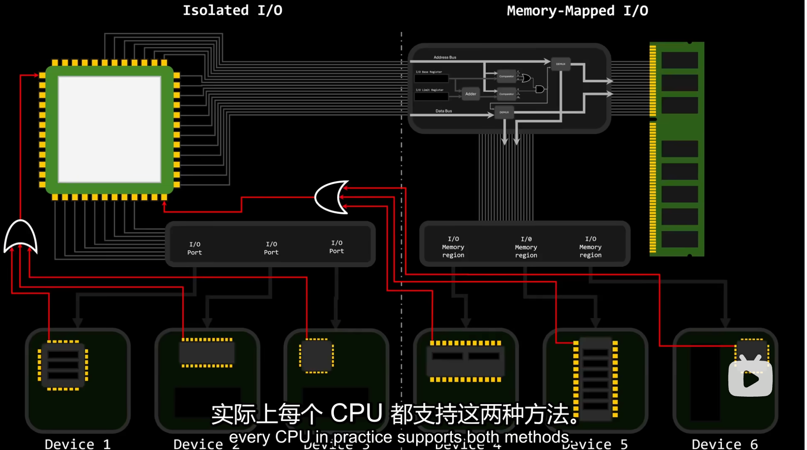
- 设备就绪时发中断,CPU 等待期间可做上下文切换去跑别的进程:"The way to allow the CPU to do something else while waiting for the printer to become ready is to use interrupts."(第5版 §5.2.3 [#page:384](../../../007.BOOKs/现代操作系统/Modern%20Operating%20Systems%205th%20Edition-PDF-01.pdf#page:384));中断硬件链路见 §5.1.5 Interrupts Revisited,中断处理程序见 §5.3.1 Interrupt Handlers([#page:386](../../../007.BOOKs/现代操作系统/Modern%20Operating%20Systems%205th%20Edition-PDF-01.pdf#page:386))。

###### DMA(I/O Using DMA)
- 中断驱动 I/O 的明显缺点是每传一个数据单元就要中断一次;DMA 让 DMA 控制器代替 CPU 搬运整块数据,完成后只中断一次:"In essence, DMA is programmed I/O, only with the DMA controller doing all the work, instead of the main CPU."(第5版 §5.2.4 [#page:385](../../../007.BOOKs/现代操作系统/Modern%20Operating%20Systems%205th%20Edition-PDF-01.pdf#page:385);DMA 控制器硬件原理见 §5.1.4 [#page:373](../../../007.BOOKs/现代操作系统/Modern%20Operating%20Systems%205th%20Edition-PDF-01.pdf#page:373))

## 注意事项
- CPU执行快,I/O设备执行慢;


## 参考资料
- [CPU是如何与千奇百怪的设备交互的？ | Core Dumped](https://www.bilibili.com/video/BV1RVEF6uEzb/?spm_id_from=333.1007.top_right_bar_window_history.content.click&vd_source=9eef164b234175c1ae3ca71733d5a727)


