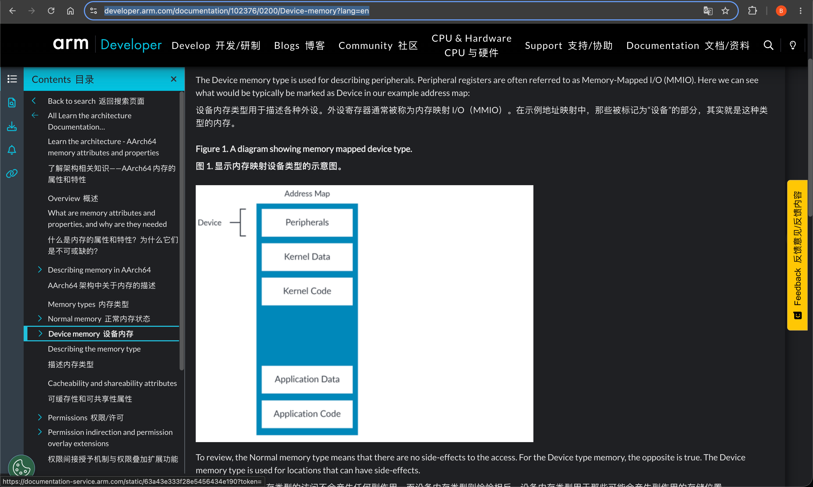
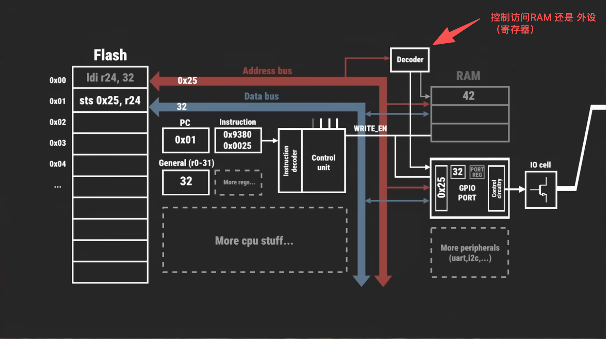
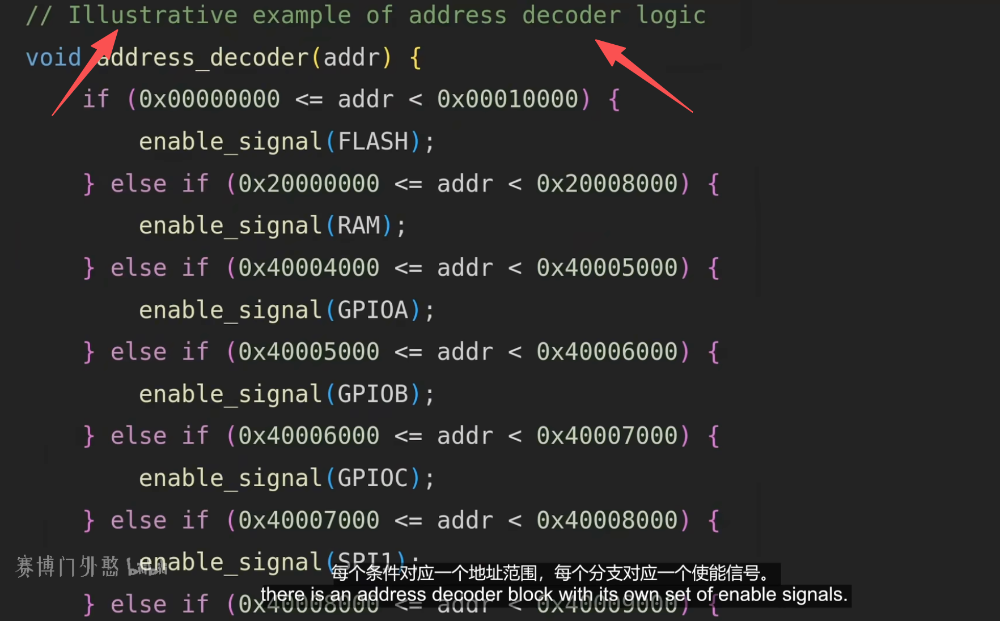
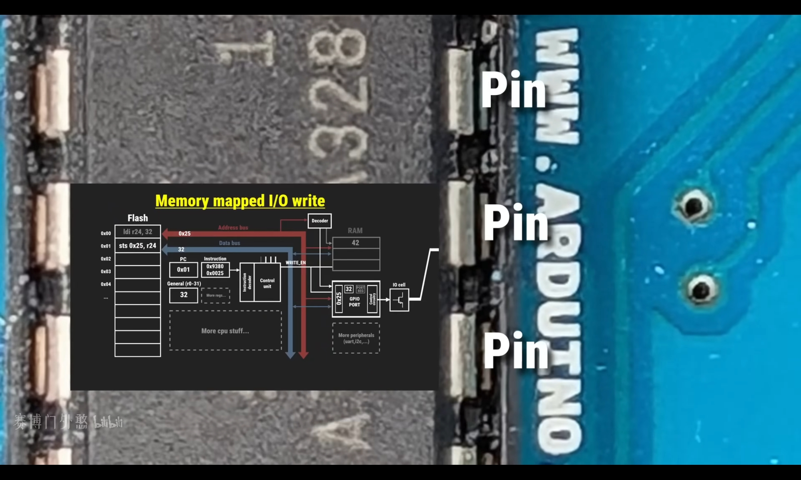
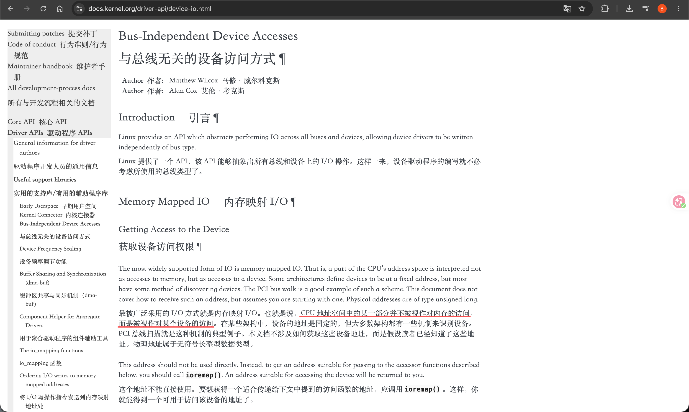

# Memory Mapped Input Output(MMIO)
- “**设备的寄存器映射到内存。只需读取和写入特定地址即可写入设备的寄存器**”
  + MMIO将设备寄存器直接映射到内存地址空间上并拥有独立的地址，CPU通过读写内存指令(AArch 64 的ldr/str) 即可控制设备。<sup>现代操作系统 原理与实现</sup>
- “内存映射I/O与内存驻留的地址空间相同。内核使用通常由RAM（实际上是HIGH_MEM）使用的部分地址空间来映射设备寄存器，所以在该地址上不是实际内存（RAM），而是I/O设备。因此，**与I/O设备通信变得像读取和写入内存地址一样**，该地址专用于I/O设备”
   + MMIO是一种将外设寄存器映射到CPU统一地址空间的编址方式。从处理器角度看，访问设备就像访问普通内存一样

- “内存映射I/O与内存驻留的地址空间相同。内核使用通常由RAM（实际上是HIGH_MEM）使用的部分地址空间来映射设备寄存器，所以在该地址上不是实际内存（RAM），而是I/O设备。因此，与I/O设备通信变得像读取和写入内存地址一样，该地址专用于I/O设备。”<sup>摘录来自 [Linux设备驱动开发 （法）约翰·马迪厄（John Madieu）# “11.4.2　MMIO设备访问”](../../../007.BOOKs/Linux设备驱动开发)</sup>


- 
   + 将设备的寄存器，映射到内存地址空间中。


## 《现代操作系统》第5版 §5.1.3 对 MMIO 的定义(查漏补缺)
> 出处: [Modern Operating Systems 5th Edition §5.1.3 Memory-Mapped I/O](../../../007.BOOKs/现代操作系统/Modern%20Operating%20Systems%205th%20Edition-PDF-01.pdf#page:369) PDF #page:369-371(书页 340-342);缺点部分 #page:372-373 见 [006](006.MMIO的缺点-多总线路由与ARM64处理.md)

### 1. 通信的对象:控制寄存器 + 数据缓冲区(#page:369)
> "Each controller has a few registers that are used for communicating with the CPU. By writing into these registers, the operating system can command the device to deliver data, accept data, switch itself on or off, or otherwise perform some action. By reading from these registers, the operating system can learn what the device's state is, whether it is prepared to accept a new command, and so on."

> "In addition to the control registers, many devices have a data buffer that the operating system can read and write. For example, a common way for computers to display pixels on the screen is to have a video RAM, which is basically just a data buffer, available for programs or the operating system to write into."

中文对照:每个控制器都有少量与 CPU 通信的寄存器——**写寄存器 = 下命令**(传数据、收数据、开/关机……),**读寄存器 = 查状态**(是否能接受新命令等)。除控制寄存器外,很多设备还有一块可读写的**数据缓冲区**(典型如显存 video RAM)。于是问题变成:**CPU 如何对控制寄存器和数据缓冲区编址?**

### 2. 三种编址方式(Fig 5-2,#page:370)
|方式|做法|代表|
|-|-|-|
|(a) 独立 I/O 空间(端口 I/O)|每个控制寄存器分配一个 **I/O 端口号**(8/16 位整数),全部端口构成受保护的 **I/O 端口空间**(仅 OS 可访问),用专门指令 `IN REG,PORT` / `OUT PORT,REG` 读写。`IN R0,4` 与 `MOV R0,4` 完全不同——两个 "4" 属于互不相关的地址空间|早期计算机、几乎所有大型机(IBM 360 及后继)|
|(b) 内存映射 I/O(MMIO)|把所有控制寄存器映射进内存空间,每个寄存器分到一个**未分配给内存的唯一内存地址**;多数系统放在地址空间顶端附近|PDP-11 首创|
|(c) 混合(Hybrid)|**数据缓冲区走内存映射,控制寄存器走独立 I/O 端口**|x86:IBM PC 兼容机把 640K~1M−1 留给设备数据缓冲区,另有 0~64K−1 的 I/O 端口|

原文:
> "In the first approach, each control register is assigned an I/O port number, an 8- or 16-bit integer. The set of all the I/O ports form the I/O port space, which is protected so that ordinary user programs cannot access it (only the operating system can)."

> "The second approach, introduced with the PDP-11, is to map all the control registers into the memory space, as shown in Fig. 5-2(b). Each control register is assigned a unique memory address to which no memory is assigned. This system is called memory-mapped I/O. In most systems, the assigned addresses are at or near the top of the address space. A hybrid scheme, with memory-mapped I/O data buffers and separate I/O ports for the control registers, is shown in Fig. 5-2(c). The x86 uses this architecture, with addresses 640K to 1M − 1 being reserved for device data buffers in IBM PC compatibles, in addition to I/O ports 0 to 64K − 1."

(书中花絮:原始 PC 给 I/O 设备留 360K 地址在当时"大得荒唐",反而限制了 PC 可装的内存量——设计者没料到内存价格会跌得那么快。)

### 3. 硬件上如何工作 —— 地址译码的教科书定义(#page:371)
> "In all cases, when the CPU wants to read a word, either from memory or from an I/O port, it puts the address it needs on the bus' address lines and then asserts a READ signal on a bus' control line. A second signal line is used to tell whether I/O space or memory space is needed. If it is memory space, the memory responds to the request. If it is I/O space, the I/O device responds to the request. If there is only memory space [as in Fig. 5-2(b)], every memory module and every I/O device compares the address lines to the range of addresses that it services. If the address falls in its range, it responds to the request. Since no address is ever assigned to both memory and an I/O device, there is no ambiguity and no conflict."

中文对照:CPU 把地址放上总线地址线、拉起 READ 控制线;另有一根信号线区分"要内存空间还是 I/O 空间"(只有独立 I/O 空间方案才需要,x86 上就是 M/IO# 引脚)。**只有内存空间(MMIO)时,每个内存模块和每个 I/O 设备都把地址线与自己服务的地址范围做比较,落在范围内就响应**;因为没有任何地址同时分给内存和设备,所以无歧义、无冲突。
→ 这段就是下文「地址译码器模块(Decoder)」的教科书定义:**比较地址是否在本模块范围内 → 命中则激活使能/片选**。它同时也是 [006](006.MMIO的缺点-多总线路由与ARM64处理.md) 缺点二的出发点——"全员比较每个地址"在内存走专用总线的多总线系统上会失效。

### 4. MMIO 的三个优点(#page:371)
1. **驱动可全部用 C 写**:没有 MMIO 就得写汇编 IN/OUT,而 MMIO 下控制寄存器"就是内存里的变量";
2. **无需特殊保护机制**:OS 只要不把控制寄存器所在地址段放进任何用户进程的虚拟地址空间即可;若每个设备的寄存器各占一页,还能**按页把特定设备交给特定用户态驱动**(MINIX 3 等微内核如此),驱动崩溃不拖垮整个系统;
3. **所有能引用内存的指令都能操作控制寄存器**:如 `TEST PORT 4` 一条指令即可测试设备是否空闲;没有 MMIO 则要先读入 CPU 再测,两条指令。

原文:
> "First of all, if special I/O instructions are needed to read and write the device control registers, access to them requires the use of assembly code since there is no way to execute an IN or OUT instruction in C or C++. Calling such a procedure adds overhead to controlling I/O. In contrast, with memory-mapped I/O, device control registers are just variables in memory and can be addressed in C the same way as any other variables. Thus, with memory-mapped I/O, an I/O device driver can be written entirely in C. Without memory-mapped I/O, some assembly code is needed."

> "Second, with memory-mapped I/O, no special protection mechanism is needed to keep user processes from performing I/O. All the operating system has to do is refrain from putting that portion of the address space containing the control registers in any user's virtual address space. Even better yet, if each device has its control registers on a different page of the address space, the operating system can give a user control over specific devices but not others by simply including the desired pages in its page table. Such a scheme can allow different device drivers to be run in different user-mode address spaces, not only reducing kernel size but also keeping one driver from interfering with others. This also prevents a driver crash from taking down the entire system. Some microkernels (e.g., MINIX 3) work like this."

> "Third, with memory-mapped I/O, every instruction that can reference memory can also reference control registers. For example, if there is an instruction, TEST, that tests a memory word for 0, it can also be used to test a control register for 0, which might be the signal that the device is idle and can accept a new command. ... If memory-mapped I/O is not present, the control register must first be read into the CPU, then tested, requiring two instructions instead of just one."

### 5. MMIO 的缺点(#page:372-373)
缓存干扰、多总线路由两大缺点及三种解法,原文完整引用与 ARM64 实现见 [006.MMIO的缺点-多总线路由与ARM64处理](006.MMIO的缺点-多总线路由与ARM64处理.md)。

## MMIO工作原理
> 流程：<br/>1. 将设备寄存器，映射到内存地址空间中<br/> 2. ARM内存访问 虚拟地址 -> MMU -> 物理地址 -> 地址译码(属于RAM区域走DRAM控制器 / 属于MMIO区域走外设总线)

- 
   + 地址译码器模块（Decoder）：   拥有自己的使能信号，每个条件对应一个地址范围，每个分支对应一个使能信号： 他们不将（芯片设计者）所有内存地址映射到RAM这样的常规内存，而是将其中一部分映射到其他设备，例如 IO（视频中的示例是控制GPIO引脚）
      - 
        + 以地址作为输入，然后激活相应的使能信号。
        + 译码器是电路原语。《现代操作系统》§5.1.3 方案三"范围寄存器过滤"本质 = **可编程地址译码器**(两个幅度比较器+与门,寄存器存上下界,引导时由固件装载),见 [006.MMIO的缺点-多总线路由与ARM64处理](006.MMIO的缺点-多总线路由与ARM64处理.md)
      - 

- 
   + Addresses in ARM Linux are:
     1. Issued as virtual addresses by the ARM core, then （由 ARM 内核发出虚拟地址，接着）
     2. Mapped into a physical address by the ARM MMU, then（经 ARM MMU（内存管理单元）映射为物理地址，然后）
     3. Used to select the appropriate peripheral or location in RAM（用于选中相应的外设或 RAM 中的特定位置。）

- 
   + Linux内核映射函数: ioremap() 


## 术语表
> 第5版页码均指 [Modern Operating Systems 5th Edition](../../../007.BOOKs/现代操作系统/Modern%20Operating%20Systems%205th%20Edition-PDF-01.pdf) 的 PDF 页码

|术语|解释|出处 / 关联笔记|
|-|-|-|
|I/O 端口 / 独立 I/O 空间(Port-Mapped I/O, PMIO)|每个控制寄存器分配一个端口号,全部端口构成与内存无关、受保护的 I/O 端口空间,用 `IN`/`OUT` 专用指令访问|第5版 §5.1.3 #page:369-370,Fig 5-2(a)|
|内存映射 I/O(Memory-Mapped I/O, MMIO)|把控制寄存器(及数据缓冲区)映射到内存地址空间中"未分配给内存的唯一地址",用普通 load/store 指令访问|第5版 §5.1.3 #page:370,Fig 5-2(b)|
|混合方案(Hybrid)|数据缓冲区走 MMIO、控制寄存器走 I/O 端口;x86 即此(640K~1M−1 缓冲区 + 0~64K−1 端口)|第5版 #page:370,Fig 5-2(c);PCI 的 Memory BAR + I/O BAR 并存见 [03](03-PCI设备MMIO映射.md)|
|设备控制器(Device Controller)/ 适配器|I/O 单元的电子部分(机械部分是设备本身),内含少量控制寄存器和可选的数据缓冲区,向 OS 提供简化接口;内部常有一颗跑固件的微控制器|第5版 §5.1.2 #page:367、§1.3.4 #page:58;[005](005.内存映射IO-CoreDump.md)|
|控制寄存器 vs 数据缓冲区|写寄存器 = 下命令,读寄存器 = 查状态;数据缓冲区是可读写的大块存储(如显存)|第5版 #page:369|
|地址译码器(Address Decoder)/ 片选(Chip Select, CS)|组合逻辑电路:输入地址,比较是否落在本模块服务的地址范围,命中则输出使能信号(片选)。教科书表述:"every memory module and every I/O device compares the address lines to the range of addresses that it services"|第5版 #page:371;本页「MMIO工作原理」;可编程形态 = 范围寄存器,见 [006](006.MMIO的缺点-多总线路由与ARM64处理.md)「方案三的实现本质」|
|范围寄存器(Range Registers)|引导时由固件预装的地址区间寄存器(上下界),内存控制器 / 互连据此决定地址转发给内存还是设备——本质是可编程地址译码器|第5版 #page:373;[006](006.MMIO的缺点-多总线路由与ARM64处理.md)|
|统一地址空间的"全员解码义务"|单一地址空间下,所有内存模块和设备都必须比较每一次内存引用;内存改走专用总线后设备看不见地址 → MMIO 失效,需试错 / snoop / 范围寄存器过滤|第5版 #page:372;[006](006.MMIO的缺点-多总线路由与ARM64处理.md) 缺点二|
|轮询 / 忙等待(Polling / Busy Waiting / Programmed I/O)|CPU 输出后持续读设备状态寄存器直到就绪,占满 CPU:"This behavior is often called polling or busy waiting"|第5版 §5.2.2 #page:384;[052.IO设备/002](../../052.IO设备/002.输入输出实现方式.md)|
|中断驱动 I/O(Interrupt-Driven I/O)|设备就绪时发中断,CPU 等待期间切换去跑其他进程|第5版 §5.2.3 #page:384、§5.3.1 #page:386;[052.IO设备/002](../../052.IO设备/002.输入输出实现方式.md)|
|DMA(Direct Memory Access)|由 DMA 控制器代替 CPU 搬运整块数据,完成后发一次中断:"In essence, DMA is programmed I/O, only with the DMA controller doing all the work"|第5版 §5.1.4 #page:373、§5.2.4 #page:385|
|设备驱动程序(Device Driver)|与特定控制器对话、发命令收响应的内核软件,把 OS 命令翻译成对寄存器的写入|第5版 §5.3.2 #page:388;[02](02-平台设备MMIO映射.md)|
|Device memory(ARM64 内存类型)/ MAIR / AttrIndx|页表描述符的 AttrIndx 索引 MAIR_EL1 属性表;设备页标为 Device(nGnRnE / nGnRE)即不缓存、不预取、不重排——教科书"按页选择性禁用缓存"的 ARM 实现(x86 对应 MTRR/PAT)|第5版 #page:372;[01](01-MMIO核心调用链.md) §1.3、本页「ARM64 关键内存属性速查」|
|ioremap|内核把设备物理地址映射到 vmalloc 区虚拟地址并打上 Device 属性的接口|[01](01-MMIO核心调用链.md) §2|
|BAR(Base Address Register)|PCI 设备用来暴露其 MMIO / I/O 区域的配置寄存器,由固件 / 内核枚举时分配地址|[03](03-PCI设备MMIO映射.md)|
|设备树 `reg` / `ranges`|平台设备寄存器物理地址、总线地址翻译窗口的描述;ARM SoC 没有 BIOS 式固定地图,地址图经设备树传给内核|[02](02-平台设备MMIO映射.md);[006](006.MMIO的缺点-多总线路由与ARM64处理.md) §四.1|
|互连 / SAM(System Address Map)|SoC 总线网络按地址查表得出目标节点 ID 的路由机制(CMN-600 的 RN SAM / HN-F SAM)|[006](006.MMIO的缺点-多总线路由与ARM64处理.md) §四.1|
|SMMU / IOMMU|设备侧(DMA 方向)的地址翻译与保护单元|[006](006.MMIO的缺点-多总线路由与ARM64处理.md) §四.4|

## 参考资料
- [Modern Operating Systems 5th Edition](../../../007.BOOKs/现代操作系统/Modern%20Operating%20Systems%205th%20Edition-PDF-01.pdf):§5.1.2 Device Controllers #page:367 / §5.1.3 Memory-Mapped I/O #page:369-373 / §5.1.4 DMA #page:373 / §5.2.2-5.2.4 轮询·中断·DMA #page:383-385 / §5.3.2 Device Drivers #page:388
- [Linux设备驱动开发#“11.4　使用I/O内存访问硬件”](../../../007.BOOKs/Linux设备驱动开发)
- [learn_the_architecture_-_aarch64_memory_attributes_and_properties_102376_0200_01_en.pdf#6. Device memory](../../../007.BOOKs/learn_the_architecture_-_aarch64_memory_attributes_and_properties_102376_0200_01_en.pdf)
- [软件控制硬件的终极原理：内存映射I/O (MMIO)](https://www.bilibili.com/video/BV1QrptzBErT/?spm_id_from=333.1007.top_right_bar_window_history.content.click&vd_source=9eef164b234175c1ae3ca71733d5a727)
- [树莓派·BCM2711 ARM Peripherals#P4](../../../007.BOOKs/RP-008248-DS-1-bcm2711-peripherals.pdf)
- [https://docs.kernel.org/driver-api/device-io.html](https://docs.kernel.org/driver-api/device-io.html)

---

# ARM64 MMIO 映射与访问 — 文档索引

## 文档列表

| 文档 | 内容 |
|------|------|
| [01-MMIO核心调用链.md](01-MMIO核心调用链.md) | ioremap/iounmap 完整代码路径、页表建立、MAIR 属性、readl/writel 实现 |
| [02-平台设备MMIO映射.md](02-平台设备MMIO映射.md) | 平台设备(platform_device)从 Device Tree 到 ioremap 的完整流程 |
| [03-PCI设备MMIO映射.md](03-PCI设备MMIO映射.md) | PCI 设备 BAR 映射、pci_iomap/pcim_iomap 调用链 |
| [04-MMIO硬件交互流程图.md](04-MMIO硬件交互流程图.md) | CPU→MMU→Cache→总线→设备 完整硬件交互流程图与时间线 |
| [006.MMIO的缺点-多总线路由与ARM64处理.md](006.MMIO的缺点-多总线路由与ARM64处理.md) | 第4版§5.1.3原文完整引用:MMIO两大缺点(缓存/多总线路由)与三种方案、ARM64实现(互连地址映射/Device内存属性/SMMU),引用均带章节+页码锚点 |
| [005.内存映射IO-CoreDump.md](005.内存映射IO-CoreDump.md) | Core Dumped 视频笔记:CPU 与设备"通信而非控制"、微控制器、通信方法(MMIO vs 独立 I/O)、数据传输技术(轮询/中断/DMA),已对照第5版 §5.1.3 / §5.2 补充 |

## 核心要点速查

### ioremap 核心路径

```
ioremap(phys, size)
  → __ioremap(phys, size, PROT_DEVICE_nGnRE)        [arch/arm64/include/asm/io.h:169]
    → __ioremap_caller(phys, size, prot, caller)     [arch/arm64/mm/ioremap.c:20]
      → get_vm_area_caller(size, VM_IOREMAP, ...)   [mm/vmalloc.c:2121]
      → ioremap_page_range(vaddr, vend, phys, prot)  [mm/ioremap.c:222]
        → ioremap_p4d_range → pud → pmd → pte
          → pfn_pte(pfn, prot) | set_pte_at()        [mm/ioremap.c:76-77]
      → return (void __iomem *)(offset + vaddr)
```

### 普通内存 vs MMIO 的关键差异

| 维度 | 普通内存 | MMIO |
|------|---------|------|
| 虚拟地址来源 | 线性映射 `PAGE_OFFSET + PA - PHYS_OFFSET` | vmalloc 区域动态分配 |
| 映射建立 | 启动时 `map_mem()` 一次性 | 驱动加载时 `ioremap()` 按需 |
| MAIR 属性 | 0xff (WBWA, cacheable) | 0x04 (Device nGnRE, non-cacheable) |
| PTE AttrIndx | 4 (MT_NORMAL) | 1 (MT_DEVICE_nGnRE) |
| Cache 行为 | 经过 L1/L2/L3 | 绕过所有 Cache |
| 页表层级 | 通常用 block/section 映射 (PMD/PUD) | 通常用 PTE 级别逐页映射 |
| 访问接口 | 直接指针解引用 | readl/writel (含内存屏障) |

### 平台设备 MMIO 推荐用法

```c
// 推荐：一行搞定
void __iomem *base = devm_platform_ioremap_resource(pdev, 0);
if (IS_ERR(base))
    return PTR_ERR(base);
```

### PCI 设备 MMIO 推荐用法

```c
// 推荐：自动管理
void __iomem *base = pcim_iomap(pdev, BAR0, 0);
if (!base)
    return -ENOMEM;
```

### MMIO 访问

```c
// 读取状态寄存器 (有读屏障)
u32 status = readl(base + STATUS_REG_OFFSET);

// 写入命令寄存器 (有写屏障)
writel(CMD_START, base + CMD_REG_OFFSET);

// 不需要屏障时使用 relaxed 版本
u32 val = readl_relaxed(base + DATA_REG_OFFSET);
```

## ARM64 关键内存属性速查

| 属性 | MAIR 编码 | 用途 |
|------|----------|------|
| `PROT_DEVICE_nGnRnE` | AttrIndx=0, MAIR=0x00 | PCI 配置空间 |
| `PROT_DEVICE_nGnRE` | AttrIndx=1, MAIR=0x04 | 普通 MMIO (默认 ioremap) |
| `PROT_NORMAL_NC` | AttrIndx=3, MAIR=0x44 | ioremap_wc, 显存 |
| `PROT_NORMAL` | AttrIndx=4, MAIR=0xff | 普通内存, 线性映射 |