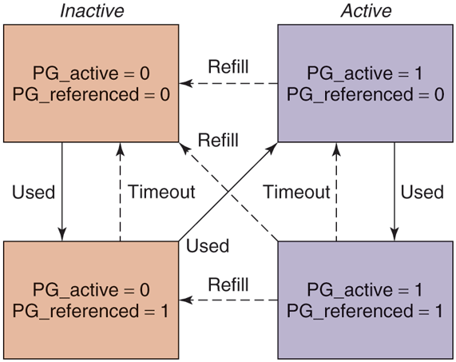

# MOS5 Figure 10-18 —— PFRA 页面状态机:active/inactive × referenced 如何驱动页面回收
> 出处: [Modern Operating Systems 5th Edition §10.4.4 "The Page Replacement Algorithm"](../../007.BOOKs/现代操作系统/Modern%20Operating%20Systems%205th%20Edition-PDF-01.pdf#page=784) 书页 755-758(PDF 784-787),Figure 10-18 "Page states considered in the page-frame replacement algorithm" 见 [书页 757(PDF 786)](../../007.BOOKs/现代操作系统/Modern%20Operating%20Systems%205th%20Edition-PDF-01.pdf#page=786)。
>
> 关联笔记: [022.页面回收(page reclaim)](022.页面回收%28page%20reclaim%29/README.md) | [024.Linux内核内存页面类型总览(LINUX-7.1.3)](024.Linux内核内存页面类型总览%28LINUX-7.1.3%29.md) | [003.Linux内核内存组织方式](003.Linux内核内存组织方式.md)(zone 水位线)

---

## 1. 背景:PFRA 与 kswapd

> "At boot time, init starts up a page daemon, kswapd, for each memory node, and configures them to run periodically. Each time kswapd awakens, it checks to see if there are enough free pages available, by comparing the low and high watermarks with the current memory usage for each memory zone. If there is enough memory, it goes back to sleep... If the available memory for any of the zones ever falls below a threshold, kswapd initiates the page frame reclaiming algorithm."（引导时，init 为每个内存节点启动一个页面守护进程 kswapd，并配置为周期性运行。kswapd 每次醒来，把各 zone 的当前内存用量与低/高水位线比较，看空闲页是否充足；内存充足就继续睡……任何 zone 的可用内存跌破阈值时，kswapd 启动页面帧回收算法 PFRA。）<sup>[Modern Operating Systems 5th, 书页 755(PDF 784)](../../007.BOOKs/现代操作系统/Modern%20Operating%20Systems%205th%20Edition-PDF-01.pdf#page=784)</sup>

内核对应:`kswapd()` 主循环<sup>[mm/vmscan.c:7438](../../000.SOURCE_CODE/003.LINUX-7.1.3/000.LINUX-7.1.3/mm/vmscan.c)</sup>,按 zone 水位线唤醒(见 [003.Linux内核内存组织方式](003.Linux内核内存组织方式.md) 的 ZONE 一节)。

> "During PFRA, pages are moved between the active and inactive list in the manner described in Fig. 10-18. To maintain some heuristics and try to find pages which have not been referenced and are unlikely to be needed in the near future, PFRA maintains two flags per page: active/inactive, and referenced or not. These two flags encode four states, as shown in Fig. 10-18."（PFRA 执行期间，页面在 active 与 inactive 链表之间按图 10-18 的方式移动。为了找出"最近未被引用、且近期也不太会被用到"的页，PFRA 为每页维护两个标志:active/inactive(在 active 还是 inactive 链上)，referenced(是否被引用过)。这两个标志编码出四个状态。）<sup>[书页 757(PDF 786)](../../007.BOOKs/现代操作系统/Modern%20Operating%20Systems%205th%20Edition-PDF-01.pdf#page=786)</sup>

**内核标志位**:`PG_referenced`(page-flags.h:96)与 `PG_active`(page-flags.h:102)<sup>[include/linux/page-flags.h](../../000.SOURCE_CODE/003.LINUX-7.1.3/000.LINUX-7.1.3/include/linux/page-flags.h)</sup>;四条 LRU 链(anon/file × active/inactive)即 `enum lru_list`<sup>[include/linux/mmzone.h:386](../../000.SOURCE_CODE/003.LINUX-7.1.3/000.LINUX-7.1.3/include/linux/mmzone.h)</sup>。

## 2. Figure 10-18 重绘:四状态 + 迁移箭头

> "During the first scan of a set of pages, PFRA first clears their reference bits. If during the second run over the page it is determined that it has been referenced, it is advanced to another state, from which it is less likely to be reclaimed. Otherwise, the page is moved to a state from where it is more likely to be evicted."（对一组页的第一轮扫描中，PFRA 先清掉它们的引用位。第二轮扫到该页时若发现它被引用过，就把它推进到"更不容易被回收"的状态;否则移到"更容易被驱逐"的状态。）<sup>[书页 757(PDF 786)](../../007.BOOKs/现代操作系统/Modern%20Operating%20Systems%205th%20Edition-PDF-01.pdf#page=786)</sup>

原图(自书 EPUB 提取，未拉伸):


<sup>原图出自 [Modern Operating Systems 5th Edition, Fig. 10-18](../../007.BOOKs/现代操作系统/Modern%20Operating%20Systems%205th%20Edition-PDF-01.pdf#page=786)</sup>

```text
       Inactive(惰性链表)                                           Active(活跃链表)
 ┌───────────────────────────────┐                        ┌───────────────────────────────┐
 │ ① inactive+unref              │    Refill(清 PG_active)│ ③ active+unref                │
 │ PG_active=0, PG_ref=0         │◄┄┄┄┄┄┄┄┄┄┄┄┄┄┄┄┄┄┄┄┄┄┄┄┤ PG_active=1, PG_ref=0         │
 │ ★回收首选(最强候选)           │                        │ (在活跃链表,未引用)           │
 └──────┬──┬─────────────┬───────┘                        └──────┬────────┬──────────┬────┘
        ▲  │             ▲                                       │        │          ▲
        ┆  │Used         ┆Timeout                                │Used    │          ┆Timeout
        ┆  │             ┆                                       │        │          ┆
        ┆  │             ┆  Used(二次访问→激活)                  │        │          ┆
        ┆  │    ┌─────────────────────────────────────────────────────────┘          ┆
        ┆  │    │        ┆                                       │                   ┆
        ┆  │    │        ┆ Refill(两位全清→回惰性链)             │                   ┆
        └┄┄┄┄┄┄┄┄┄┄┄┄┄┄┄┄┄┄┄┄┄┄┄┄┄┄┄┄┄┄┄┄┄┄┄┄┄┄┄┄┄┄┄┄┄┄┄┄┄┄┄┄┄┄┄┄┄┄┄┄┐               ┆
           │    │        ┆                                       │   ┆               ┆
           │    │        ┆                                       │   ┆               ┆
           ▼    │        ┆                                       ▼   ┆               ┆
 ┌─────────┴────┴────────┴───────┐                        ┌──────┴───┴───────────────┴────┐
 │ ② inactive+ref                │    Refill(清 PG_active)│ ④ active+ref                  │
 │ PG_active=0, PG_ref=1         │◄┄┄┄┄┄┄┄┄┄┄┄┄┄┄┄┄┄┄┄┄┄┄┄┤ PG_active=1, PG_ref=1         │
 │ 二次访问→激活(→③)             │                        │ 最强保护;超时先降为③          │
 └───────────────────────────────┘                        └───────────────────────────────┘
 实线 Used=被访问(folio_mark_accessed, mm/swap.c:448); 虚线 Timeout=超时清 PG_referenced;
 Refill=退回惰性链(folio_check_references/shrink_folio_list, mm/vmscan.c); 对角 Refill = PG_active 与 PG_referenced 同时清零(书页 757)
```

- **右上/左下两条主路**是时钟算法思想的"第二机会":第一遍清 ref 位,第二遍看到 ref=1 就"激活"(升状态),ref=0 就"降级"。
- **inactive+unref = 回收首选**。

> "Pages on the inactive list, which have not been referenced since the last time they were inspected, are the best candidates for eviction. They are pages with both PG_active and PG_referenced set to zero in Fig. 10-18. However, if necessary, pages may be reclaimed even if they are in some of the other states. The refill arrows in Fig. 10-18 illustrate this fact."（上次检查后一直未被引用的 inactive 链上的页是最佳驱逐候选——即图中 PG_active 与 PG_referenced 同为零的页。不过必要时其他状态的页也可能被回收，图中的 refill 箭头说明了这一点。）<sup>[书页 757(PDF 786)](../../007.BOOKs/现代操作系统/Modern%20Operating%20Systems%205th%20Edition-PDF-01.pdf#page=786)</sup>

> "The reason PFRA maintains pages in the inactive list although they might have been referenced is to prevent situations such as the following. Consider a process which makes periodic accesses to different pages, with a 1-hour period. A page accessed since the last loop will have its reference flag set. However, since it will not be needed again for the next hour, there is no reason not to consider it as a candidate for reclamation."（PFRA 之所以让"可能被引用过"的页仍留在 inactive 链上，是为了避免这种情形:某进程以 1 小时为周期轮流访问不同页——自上轮以来被访问过的页会置上引用标志，但接下来 1 小时它都派不上用场，没有理由不把它列为回收候选。）<sup>[书页 757(PDF 786)](../../007.BOOKs/现代操作系统/Modern%20Operating%20Systems%205th%20Edition-PDF-01.pdf#page=786)</sup>

这一段回答了"为什么不干脆只留 active/inactive 两个状态":**引用位只代表"上轮之后被碰过"，不代表"近期会再用"**——周期性访问模式下，被碰过的页依然应该先在 inactive 链上排队等着。

## 3. 内核源码逐条对应(Linux 7.1.3)

### 3.1 状态迁移:`folio_mark_accessed()` 的注释就是 Fig 10-18

<sup>[mm/swap.c:448-494](../../000.SOURCE_CODE/003.LINUX-7.1.3/000.LINUX-7.1.3/mm/swap.c)</sup>

```c
/**
 * folio_mark_accessed - Mark a folio as having seen activity.
 * ...
 * This function will perform one of the following transitions:
 *
 * * inactive,unreferenced  ->  inactive,referenced      ← ① 访问 → ②
 * * inactive,referenced    ->  active,unreferenced      ← ② 再访问 → ③(激活)
 * * active,unreferenced    ->  active,referenced        ← ③ 再访问 → ④
 */
void folio_mark_accessed(struct folio *folio)
{
	if (!folio_test_referenced(folio)) {
		folio_set_referenced(folio);              // 第一次访问:只置 PG_referenced
	} else if (... !folio_test_active(folio)) {
		folio_activate(folio);                    // 第二次访问:升入 active 链
		folio_clear_referenced(folio);
		workingset_activation(folio);
	}
}
```

每次 `read()`/`filemap` 命中页缓存都会走到这里(文件读路径的 `mark_page_accessed`)——**"访问"就是推动页面沿图 10-18 箭头前进的事件源**。

### 3.2 降级与回收:扫描侧的"看两遍"

<sup>[mm/vmscan.c:863-905 `folio_check_references`](../../000.SOURCE_CODE/003.LINUX-7.1.3/000.LINUX-7.1.3/mm/vmscan.c)</sup>

```c
static enum folio_references folio_check_references(struct folio *folio, ...)
{
	referenced_ptes  = folio_referenced(folio, 1, ...);   // 查页表引用(第一遍)
	referenced_folio = folio_test_clear_referenced(folio); // 取走 PG_referenced(清位)
	if (referenced_ptes) {
		/*
		 * All mapped folios start out with page table references from
		 * the instantiating fault, so we need to look twice if a mapped
		 * file/anon folio is used more than once.
		 *
		 * Mark it and spare it for another trip around the inactive list.
		 */                                    ← "第二机会":再走一圈 inactive
		return FOLIOREF_ACTIVATE; // 或 KEEP(再留 inactive 一轮)
	}
	return FOLIOREF_RECLAIM;                  // 两遍都没人用 → 驱逐候选
}
```

- `shrink_folio_list()`<sup>[mm/vmscan.c:1058](../../000.SOURCE_CODE/003.LINUX-7.1.3/000.LINUX-7.1.3/mm/vmscan.c)</sup> 对候选页逐个执行上述判定,决定回收(FOLIOREF_RECLAIM)或"refill"(FOLIOREF_KEEP/ACTIVATE)——**图中的 refill 箭头就是 `FOLIOREF_KEEP`/`FOLIOREF_ACTIVATE` 这两个返回分支**;
- `isolate_lru_folios`<sup>[mm/vmscan.c:1685](../../000.SOURCE_CODE/003.LINUX-7.1.3/000.LINUX-7.1.3/mm/vmscan.c)</sup> 从 active/inactive 链上摘页,LRU 平衡(降级)在 `move_folios_to_lru`/`shrink_lruvec` 中完成。

### 3.3 状态→回收概率总表

| 图 10-18 状态 | PG_active | PG_referenced | 所在链 | 回收难度 | 内核对应 |
|-|-|-|-|-|---|
| ① inactive+unref | 0 | 0 | inactive LRU | ★最低(首选) | `FOLIOREF_RECLAIM` |
| ② inactive+ref | 0 | 1 | inactive LRU | 低(再看一眼) | `FOLIOREF_KEEP`(refill) |
| ③ active+unref | 1 | 0 | active LRU | 中(需先降级) | active→inactive 降级后才回收 |
| ④ active+ref | 1 | 1 | active LRU | 高 | `folio_mark_accessed` 维持/激活 |

## 4. 一句话理解这张图

**Fig 10-18 = 用两个比特(PG_active/PG_referenced)把"最近用没用过"编码成四个回收难度档位**:访问事件沿 ①→②→③→④ 升级,扫描回收沿 ④→③→②→① 降级;回收永远优先打 ①(两次都冷),给 ②"再看一圈"的第二机会,③④ 要先降级才能被回收——同时保留"refill 箭头"作为内存紧张时的逃生通道。这也是 MOS5 所说 PFRA"clock-like algorithm"的全部含义。

> **版本注**:7.1.3 内核默认启用多代 LRU(MGLRU,`lru_gen_enabled()`),把"代际"代替"两标志"做老化,但 `folio_mark_accessed`/`folio_check_references` 的传统路径仍保留(见上代码分支),MOS5 描述的四状态机仍是理解 LRU 演进的基线。
