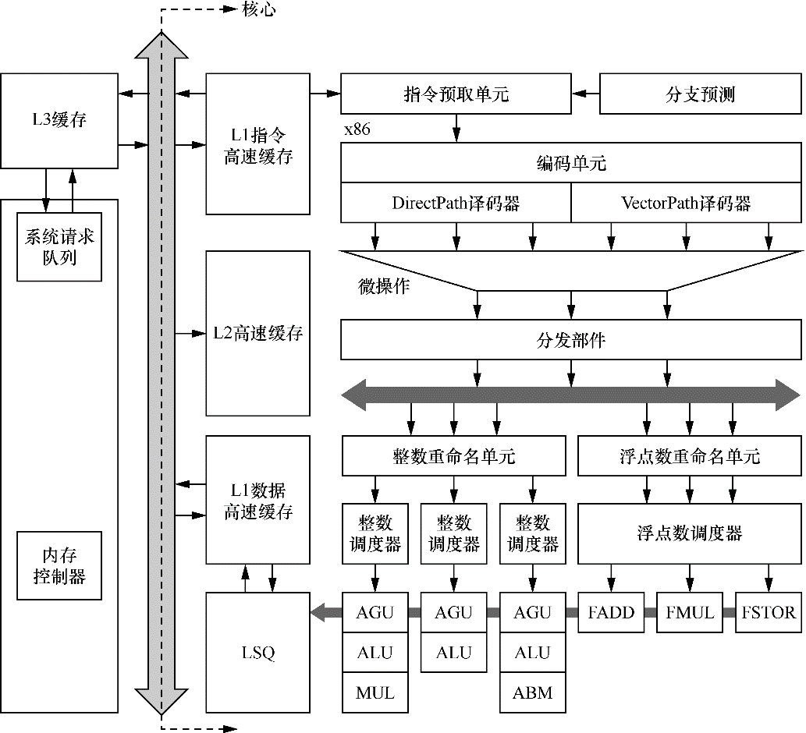
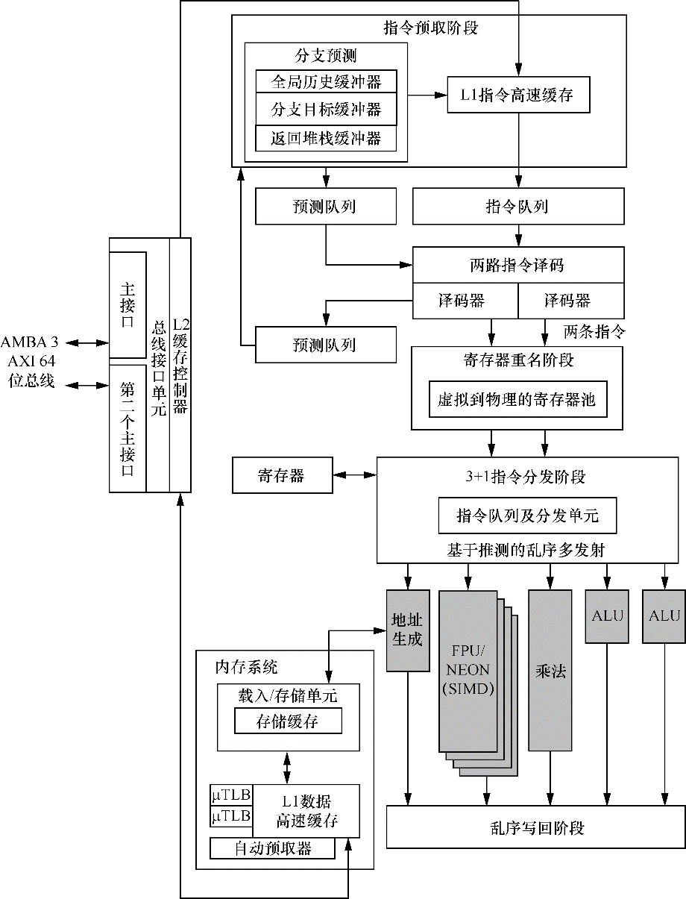
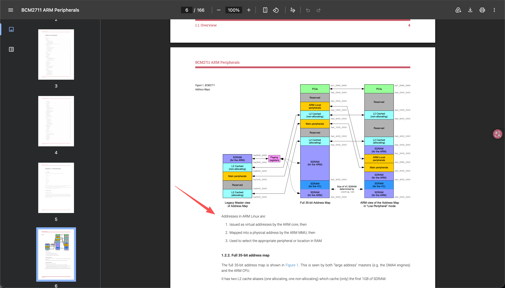

# 一条存储读写指令的执行全过程

> 学习: <br/> - [奔跑吧Linux内核(第2版)卷1 #1.1.3 一条存储读写指令的执行全过程](../007.BOOKs/Run%20Linux%20Kernel%20%282nd%20Edition%29%20Volume%201%3A%20Infrastructure.epub)(主线) <br/> - [计算机组成与设计 MIPS 第6版 #page:233](../007.BOOKs/计算机组成与设计-硬件-软件_接口/计算机组成与设计_硬件软件接口_MIPS版_原书第6版_David_A_Patterson,_John_L_Hennessy-1-297.pdf#page:233)(load 指令过五级流水线的数据通路,图 4-28~4-30) <br/> - 各环节的深入资料见下文,页码为 PDF 页码

## 一、全链路总览(先建立全景)

以 `ldr x0, [x1]` 为例,一条存储读写指令从发出到数据回来,要经过:**取指 → 译码 → 执行(算出虚拟地址)→ MMU/TLB 翻译(得到物理地址 + 内存属性)→ 按属性分岔 → 写回寄存器**。

```
PC → 取指(I-Cache) → 译码(ldr/str 编码、寻址模式) → 执行(AGU: 基址+偏移 → 虚拟地址 VA)
        │
        ▼
   MMU/TLB ── miss ──► 页表遍历(TTBR0/1 → PGD→PUD→PMD→PTE)
        │ 得到 PA + AttrIndx → 查 MAIR_EL1 得内存类型
        ▼
   ┌── Normal(cacheable)────────────┐   ┌── Device(nGnRE, MMIO)────────┐
   │ L1 D$ → L2 → L3 → 互连 → DRAM   │   │ 绕过所有 Cache → AXI 总线      │
   │ store 先进 store buffer         │   │ → 互连地址译码 → 设备寄存器     │
   │ 多核间由一致性协议(MESI)保证可见  │   │ nG/nR:不合并、不重排           │
   └────────────────────────────────┘   └──────────────────────────────┘
        │
        ▼
   写回:load 的数据写入目标寄存器(乱序执行、顺序提交)
```

> 每个环节在仓库里都已有专门资料:MMU/页表 → [003.高速缓存/007.TLB](003.高速缓存/007.TLB.md)、[000.内存管理/011.MMU](000.内存管理/011.MMU%28Memory%20Management%20Unit%29/README.md);两条分岔路径的对比 → [023.MMIO/01-MMIO核心调用链 §5](000.内存管理/023.MMIO%28内存映射IO%29/01-MMIO核心调用链.md)(普通内存 vs MMIO 访问路径图与延迟);到设备寄存器的端到端时间线 → [023.MMIO/04 §7](000.内存管理/023.MMIO%28内存映射IO%29/04-MMIO硬件交互流程图.md)。

### 详细流程图

```
【① 前端:顺序取指与译码】
   PC ─► I-TLB/MMU(取指也要地址翻译)─► 取指:I-Cache 命中?
          │ 未命中 → L2 → L3 → 从内存取回指令
          ▼
   分支预测(BTB/GHB/RSB 猜下一条取指地址)─► 指令队列
          ▼
   译码:ldr/str 编码、寻址模式(基址+偏移 / 前·后变址 / 寄存器偏移)
          ▼
   寄存器读取 + 寄存器重命名(消除 WAR/WAW 假依赖)
【② 乱序引擎】
   分发/调度(超标量:每周期发射多条)─► 乱序执行
          ▼
   执行:ALU 运算 / AGU 计算地址 ──► 虚拟地址 VA
          ▼
【③ 存储子系统入口 + 地址翻译】
   LSQ/LSU(存储子系统最高层:按内存一致性模型定序、处理访存依赖)
          │  L1 D$ 为 VIPT:用 VA 页内偏移查组,可与 TLB 查找并行
          ▼
   L1 D-TLB ── miss ──► L2 TLB ── miss ──► 页表遍历(硬件 walk,自动进行)
          │                              TTBR0(用户)/ TTBR1(内核)
          │                              └► PGD→PUD→PMD→PTE
          │                                 PTE 无映射/权限不符 → Data Abort
          │                                   → 内核缺页处理 handle_mm_fault()
          │                                   → 建好映射后重新执行本指令
          │ 命中(ASID 匹配当前进程):得到 PA + AttrIndx + SH(共享属性)
          ▼
   ◇ 判断内存属性:PTE 的 AttrIndx 索引 MAIR_EL1 → Normal 还是 Device?
          │                                        │
          │ Normal(cacheable)                     │ Device(nGnRE, MMIO)
          ▼                                        ▼
   ┌── ④ Normal(cacheable)──────────────────┐  ┌── ⑤ Device(nGnRE, MMIO)──────────┐
   │ load:                                   │  │ 绕过所有 Cache;禁止投机访问      │
   │   L1 D$ 命中(~1ns)→ 返回               │  │ 驱动侧必须用 readl/writel         │
   │   └ 未命中 → L2(~10ns)                  │  │   (内含 __iormb/__iowmb 屏障)     │
   │       └ 未命中 → L3 / 网状互连           │  │ read:CPU 发 AXI 读事务            │
   │           ├ 窥探他核 L1/L2(MESI,        │  │   (ARADDR/ARCACHE=Device)        │
   │           │  命中则直接取回)             │  │   → 总线仲裁 → 互连地址译码(SAM   │
   │           └ 都未命中 → 内存控制器 → DDR  │  │     查表:地址→目标节点)           │
   │              (行激活/列选,~80ns 起)      │  │   → 设备从端口 → 内部偏移译码      │
   │ store:                                   │  │      (如 0x18 → UARTFR 寄存器)   │
   │   先进 store buffer(指令即告"完成")     │  │   ← 设备返回 RDATA(延迟不可预测,  │
   │   └ 异步下刷:cacheline 不在本核 → RFO    │  │      取决于仲裁与设备速度)        │
   │       (invalidate 他核)→ 写入 L1 D$     │  │ write:posted write,E 位允许互连   │
   │       (Write-Back,置脏位)              │  │   提前应答,不等设备真正接收;      │
   │   多核可见性由 MESI/一致性互连维护        │  │   真正顺序靠 nR + 屏障保证         │
   │   (注意:对 DMA 设备不可见!非一致 DMA    │  │                                   │
   │    需 dc civac 清缓存,见 §4.7)         │  │                                   │
   └────────────┬────────────────────────────┘  └────────────┬─────────────────────┘
                └───────────────┬────────────────────────────┘
                                ▼
【⑥ 写回与提交:乱序执行、顺序提交】
   load 数据写回重命名寄存器(乱序写回;数据先到也不能先提交)
                                ▼
   ROB(重排序缓冲)按程序顺序提交(retire)→ 更新体系结构寄存器
                                ▼
   store 真正"提交" = 从 store buffer 下刷到 L1 D$(此刻才对其他观察者可见;
   跨核/跨设备的先后顺序需 DMB/DSB/ISB 屏障保证)
```

#### 图中缩写对照

|缩写|含义|详见|
|-|-|-|
|LSQ/LSU|加载-存储队列/单元,"存储子系统的最高层",接收访存指令并连接存储器子系统|§三 书中引文|
|VIPT|虚拟索引·物理标签:L1 D$ 用 VA 页内偏移选组、PA 做标签,可与 TLB 并行查找|[奔跑吧卷1 §1.1 思考题 10-12](../007.BOOKs/Run%20Linux%20Kernel%20%282nd%20Edition%29%20Volume%201%3A%20Infrastructure.epub)|
|ASID|地址空间标识符:进程切换时不刷整个 TLB|[003.高速缓存/007.TLB](003.高速缓存/007.TLB.md)、[008.内核代码中的ASID](003.高速缓存/008.内核代码中的ASID.md)|
|RFO|Read-For-Ownership:写入前先把 cacheline 拿到独占(M)状态、invalidate 其他核|[003.高速缓存/005.缓存一致性](003.高速缓存/005.缓存一致性.md)|
|nG / nR / E|不合并(non-Gathering)/ 不重排(non-Reordering)/ 允许提前写应答(Early Write Acknowledgement)|[023.MMIO/README「ARM64 关键内存属性速查」](000.内存管理/023.MMIO%28内存映射IO%29/README.md)|
|posted write|写事务由互连/桥提前应答,不等设备真正接收(E 位语义)|[023.MMIO/01 §4](000.内存管理/023.MMIO%28内存映射IO%29/01-MMIO核心调用链.md)|
|SAM|互连的系统地址映射:把地址查表翻译成目标节点 ID(CMN-600)|[023.MMIO/006 §四.1](000.内存管理/023.MMIO%28内存映射IO%29/006.MMIO的缺点-多总线路由与ARM64处理.md)|
|ROB|重排序缓冲:乱序执行、按程序顺序提交|§三|
|dc civac|按 cacheline 清理 Data Cache 到一致点(PoC),供非一致 DMA 使用|[023.从问题…/009.PoC 和 PoU 的区别](023.从问题来探索Linux内核/001.ARM64在Linux内核中的实现/009.ARMv8架构中，高速缓存管理的PoC和PoU有什么区别.md)|

> 图中延迟数字出处:[023.MMIO/01 §5.1](000.内存管理/023.MMIO%28内存映射IO%29/01-MMIO核心调用链.md);页表遍历/缺页分支详见 §4.1;Device 路径逐步时序详见 [023.MMIO/04 §7](000.内存管理/023.MMIO%28内存映射IO%29/04-MMIO硬件交互流程图.md)。

## 二、经典五级流水线

> 出处:[计算机组成与设计 #page:233](../007.BOOKs/计算机组成与设计-硬件-软件_接口/计算机组成与设计_硬件软件接口_MIPS版_原书第6版_David_A_Patterson,_John_L_Hennessy-1-297.pdf#page:233)——"先讨论 load 指令是因为该指令正好使用了流水线的五个阶段"(图 4-28~4-30 逐阶段画出数据通路活动部分);[奔跑吧卷1 #1.1](../007.BOOKs/Run%20Linux%20Kernel%20%282nd%20Edition%29%20Volume%201%3A%20Infrastructure.epub)

经典处理器架构的流水线是5级流水线,分别是取指、译码、执行、数据内存访问和写回。
1. 取指(IF: Instruction Fetch)
   - 功能:从内存中获取指令。这个阶段的主要任务是从程序计数器(PC)指向的地址加载指令,并将程序计数器更新为下一个指令地址。
   - 详细说明:在这个阶段,指令通过数据总线从内存中读取,送到指令寄存器中。(指令本身也经过 MMU 翻译和 **I-Cache**——见 [五-1](#五注意事项))

2. 指令译码(ID: Instruction Decode)
   - 功能:将指令**分解**为**操作码**(opcode)和**操作数**,识别需要的寄存器、常量等,并准备好后续的执行操作。
   - 详细说明:控制单元从指令中提取出操作码,然后根据操作码生成控制信号。此阶段还会读取寄存器中的值(如果指令需要寄存器操作),并且如果指令有立即数(如加法指令中的常数),也会解析出来。
   - ARM64 的 ldr/str 编码与寻址模式(基址+偏移、前/后变址、寄存器偏移)见 [A64 ISA Guide ch15-18 Loads and stores(目录 #page:5)](../006.REFS/learn_the_architecture_-_a64_instruction_set_architecture_guide_102374_0102_02_en.pdf#page:5)

3. 执行(EX: Execute)
   - 功能:执行算术逻辑运算(ALU)或者计算地址(如加法、减法、比较等)。
   - 详细说明:在这个阶段,算术逻辑单元(ALU)会根据操作码对数据执行相应的操作。对访存指令而言,本阶段由地址生成单元(AGU)完成"基址寄存器 + 偏移"的计算,得到**虚拟地址**。

4. 内存访问(MEM: Memory Access)
   - 功能:访问数据内存进行读写操作。
   - 详细说明:如果指令需要从内存中加载数据(如 LW 指令)或将数据写入内存(如 SW 指令),则在这个阶段完成内存操作。此阶段不会发生任何计算,只是内存的数据传输。**这一阶段在真实处理器上远不止一步,见下文第四节。**

5. 写回(WB: Write Back)
   - 功能:将运算结果写回寄存器或内存。
   - 详细说明:在这个阶段,执行完毕后的结果(如ALU运算结果)会被写回到目标寄存器,或者将从内存中读取的数据写入寄存器。

## 三、微架构视角:超标量、乱序执行与 LSQ

> 出处:[奔跑吧卷1 #1.1.3 一条存储读写指令的执行全过程](../007.BOOKs/Run%20Linux%20Kernel%20%282nd%20Edition%29%20Volume%201%3A%20Infrastructure.epub)(本节引文与两张图均出自该节)

现代处理器普遍采用**超标量**(superscalar,一个时钟周期发射执行多条指令)与**乱序执行**(Out-of-Order, OoO)。书对一条存储读写指令在流水线里完整走法的总结:

> "指令首先进入流水线(pipeline)的前端(front-end),包括预取(fetch)和译码(decode),经过分发(dispatch)和调度(schedule)后进入执行单元,最后提交执行结果。所有的指令采用**顺序方式通过前端**,并采用**乱序的方式进行发射**,然后乱序执行,最后用**顺序方式提交**执行结果,并将最终结果更新到**加载-存储队列(Load-Store Queue,LSQ)**单元。"

> "LSQ 单元是指令流水线的一个执行部件,可以理解为**存储子系统的最高层**,它接收来自 CPU 的存储器指令,并连接着存储器子系统。其主要功能是将来自 CPU 的存储器请求发送到存储器子系统,并处理其下存储器子系统的应答数据和消息。"

原笔记的关键句(保留):

注意这一句话: `对于一串给定的指令序列，为了提高效率，处理器会找出非真正数据依赖和地址依赖的指令，让它们并行执行。但是在提交执行结果时，是按照指令次序提交的。总的来说，顺序提交指令，然后乱序执行，最后顺序提交执行结果。如果有两条没有数据依赖的数据指令，那么后面那条指令读的数据先返回，它的结果也不能先写回最终寄存器，而必须等到前一条指令完成之后才可以。`

那读指令在等数据返回时处理器在干什么?书答:"对于乱序执行的处理器,可以执行后面的指令;对于顺序执行的处理器,会使流水线停顿,直到读取的数据返回。"

### 图1.1 x86 微处理器的经典架构



读图:指令预取单元从 **L1 指令高速缓存**取指令并预译码(**分支预测**单元猜测跳转,猜得准流水线才满)→ 译码成微操作(macro-ops)→ 分发到**整数单元 / 浮点数单元**;整数单元内 **ALU 算完进 AGU 计算有效地址** → 结果送 **LSQ**;LSQ 按内存一致性模型确定访问时序、处理存储指令间依赖、完成虚实地址转换,把地址发到 **L1 数据高速缓存** → 未命中走 L2/L3 → 都未命中经**内存控制器**访问物理内存。

### 图1.2 Cortex-A9 处理器的内部架构



读图(一条存储指令在 Cortex-A9 上的旅程):主存/L2 经 BIU 加载到 **L1 I$** → 指令预取 + 分支预测 → 指令/预测队列 → **2 路译码** → **寄存器重命名**(消除 WAR/WAW 假依赖)→ **4 路猜测发射分发** → 执行单元(ALU/MUL/FPU/NEON)**乱序执行** → **乱序写回**;存储指令算出有效地址送 **LSU** → 访问 L1 D$——"在 ARM 中,只有可缓存的内存地址才需要访问高速缓存";L1 一致性由 **SCU(窥探控制单元)按 MESI 协议**管理,L2 需外接芯片(如 PL310);最坏情况访问主存,数据逐级返回 LSQ,完成一次存储读写全过程。

### 乱序的另一半:store buffer 与内存屏障(写路径)

store 指令把数据写进 **store buffer(存储缓冲区)** 后即告完成,真正落到 Cache/内存是异步的——这正是需要内存屏障的原因:
- [奔跑吧卷2 附录D: D.1 存储缓冲区与写内存屏障 / D.2 无效队列与读内存屏障 / D.3 屏障指令总结](../007.BOOKs/Run%20Linux%20Kernel%20%282nd%20Edition%29%20Volume%202%3A%20Debugging%20and%20Case%20Analysis.epub)
- 仓库笔记:[003.高速缓存/010.内存屏障](003.高速缓存/010.内存屏障.md)、[026.汇编指令/000.内存屏障指令简介](026.汇编指令/000.内存屏障指令简介.md)、[023.从问题…/013.ARMv8 支持哪几条内存屏障指令](023.从问题来探索Linux内核/001.ARM64在Linux内核中的实现/013.在ARMv8架构中，支持哪几条内存屏障指令？它们都有什么区别.md)

## 四、MEM 阶段在 ARM64 上实际发生什么(逐环节展开)

### 4.1 虚拟地址 → 物理地址:MMU / TLB / 页表
- 教材原理:[MOS 5th §3.3.1 Paging #page:222](../007.BOOKs/现代操作系统/Modern%20Operating%20Systems%205th%20Edition-PDF-01.pdf#page:222)、[§3.3.2 Page Tables #page:225](../007.BOOKs/现代操作系统/Modern%20Operating%20Systems%205th%20Edition-PDF-01.pdf#page:225)、[§3.3.3 Speeding Up Paging(TLB)#page:229](../007.BOOKs/现代操作系统/Modern%20Operating%20Systems%205th%20Edition-PDF-01.pdf#page:229);
- ARM64 实现:[AArch64 memory management guide §4 Address spaces #page:11](../007.BOOKs/learn_the_architecture_aarch64_memory_management_guide_101811_0105_00_en.pdf#page:11)(多个虚拟地址空间、翻译阶段)、[ARMv8-A Programmer's Guide Ch12 The MMU(目录 #page:5)](../006.REFS/ARMv8-A-Programmer-Guide.pdf#page:5);
- 仓库笔记:[003.高速缓存/007.TLB](003.高速缓存/007.TLB.md)(TLB/ASID)、[008.内核代码中的ASID](003.高速缓存/008.内核代码中的ASID.md)、[023.从问题…/002.ARM64 处理器的4级页表映射过程](023.从问题来探索Linux内核/001.ARM64在Linux内核中的实现/002.ARM64处理器的4级页表的映射过程.md)、[011.MMU 目录](000.内存管理/011.MMU%28Memory%20Management%20Unit%29/README.md)。


> 译文:ARM Linux 中的地址 ① 由 ARM 核发出时是虚拟地址,② 经 ARM MMU 映射为物理地址,③ 用于选中 RAM 中的位置或相应外设。(图出自 [023.MMIO/README「MMIO工作原理」](000.内存管理/023.MMIO%28内存映射IO%29/README.md))

### 4.2 内存属性分岔:PTE 的 AttrIndx 查 MAIR,决定后面走哪条路
同一条 `ldr/str`,落在不同属性的页上,走的硬件路径完全不同:
- **Normal(cacheable)**:可缓存、可推测、可重排,数据走 Cache 层级——普通内存;
- **Device(nGnRnE/nGnRE)**:不缓存、不合并、不重排、禁止推测访问,事务直接出总线——MMIO 设备寄存器。
- 出处:[AArch64 memory attributes guide §6 Device memory #page:15](../007.BOOKs/learn_the_architecture_-_aarch64_memory_attributes_and_properties_102376_0200_01_en.pdf#page:15)(§6.2 处理器对不同 Device 类型的真实行为 #page:18);仓库:[023.从问题…/011.ARMv8 支持哪几种内存属性](023.从问题来探索Linux内核/001.ARM64在Linux内核中的实现/011.ARMv8架构中支持哪几种内存属性？它们都有哪些特点.md)、[023.MMIO/README「ARM64 关键内存属性速查」](000.内存管理/023.MMIO%28内存映射IO%29/README.md)。

### 4.3 Normal 读路径:过 Cache 链到 DRAM
```
虚拟地址 → TLB 命中(PA + Attr=Normal) → L1 D$ 命中? 
  命中 → 返回(~1ns)
  未命中 → L2(~10ns) → L3 → 互连 → 内存控制器 → DRAM(~80ns)
```
> 出处:[023.MMIO/01-MMIO核心调用链 §5.1](000.内存管理/023.MMIO%28内存映射IO%29/01-MMIO核心调用链.md)(含延迟数字);缓存原理:[003.高速缓存/003.高速缓存结构](003.高速缓存/003.高速缓存结构.md)、[005.高速缓存工作方式](003.高速缓存/005.高速缓存工作方式.md)、[009.cacheline 64字节](003.高速缓存/009.缓存行cacheline64字节为什么这是性能优化的圣杯.md);教材:[计算机组成与设计 第5章 存储层次](../007.BOOKs/计算机组成与设计-硬件-软件_接口/计算机组成与设计_硬件软件接口_MIPS版_原书第6版_David_A_Patterson,_John_L_Hennessy-1-297.pdf)。

### 4.4 Normal 写路径:store buffer 与可见性
store 先进 store buffer,再择机进入 L1 D$(Write-Back);其他核对它何时可见由**缓存一致性协议**管理,而"程序想要的顺序"要靠**内存屏障**保证(DMB/DSB/ISB,获取-释放原语 ldar/stlr)——见第三节引用。

### 4.5 Device 路径:绕过 Cache,直达设备寄存器(MMIO)
```
ldr w0, [x1]  (VA) → TLB(PA + Device nGnRE) → 跳过所有 Cache
→ AXI 读事务(ARADDR/ARCACHE=Device) → 互连地址译码(如 0x09000000 → UART)
→ 设备解码偏移(0x18 → UARTFR) → 返回数据(延迟不可预测,取决于总线与设备)
```
> 出处:[023.MMIO/04-MMIO硬件交互流程图 §7 从 CPU 指令到设备寄存器的端到端时间线](000.内存管理/023.MMIO%28内存映射IO%29/04-MMIO硬件交互流程图.md);为什么驱动代码必须用 `readl/writel`(内含屏障与字节序处理)而不是直接解引用 → [023.MMIO/01 §4 MMIO 访问接口](000.内存管理/023.MMIO%28内存映射IO%29/01-MMIO核心调用链.md);地址在互连上如何被译码路由 → [023.MMIO/006 §四.1](000.内存管理/023.MMIO%28内存映射IO%29/006.MMIO的缺点-多总线路由与ARM64处理.md)。

### 4.6 多核视角:一致性协议与独占访问
多核下,同一 cacheline 的读写由 MESI 族协议维持一致;原子操作(如 CAS)用**独占访问指令对** `ldxr/stxr`(或带获取/释放语义的 `ldaxr/stlxr`)实现:
- [003.高速缓存/005.缓存一致性](003.高速缓存/005.缓存一致性.md)、[026.汇编指令/001.独占内存访问指令](026.汇编指令/001.独占内存访问指令/001.README.md);
- 全流程实战:[051.AI-ASSISANT/002.缓存一致性与CAS(arm64两核争抢一个原子变量全流程)](051.AI-ASSISANT/002.缓存一致性与CAS%28arm64两核争抢一个原子变量全流程%29.md)、跨 socket 版 [003.跨SOCKET缓存一致性](051.AI-ASSISANT/003.跨SOCKET缓存一致性%28arm64双路系统CAS竞争全流程%29.md)。

### 4.7 设备视角:CPU 之外还有 DMA 在动内存
CPU 的 Cache 看不到设备 DMA 写的内存——非一致性 DMA 需要软件做 cache 维护(`dc civac` 等,涉及 PoC/PoU 概念):
- [006.DMA](000.内存管理/006.DMA/README.md)(及其 [学习索引](000.内存管理/006.DMA/000.DMA-学习资料索引.md));[023.从问题…/009.PoC 和 PoU 的区别](023.从问题来探索Linux内核/001.ARM64在Linux内核中的实现/009.ARMv8架构中，高速缓存管理的PoC和PoU有什么区别.md);[ARMv8-A Programmer's Guide Ch11 Caches(目录 #page:5)](../006.REFS/ARMv8-A-Programmer-Guide.pdf#page:5)。

## 五、注意事项
1. 注意 **指令高速缓存(I$)与数据高速缓存(D$)的区分**:取指走 I$,数据访问走 D$(哈佛结构缓存、统一物理内存)。一个经典问题:为什么 U-boot 跳转内核时 I$ 可以打开而 D$ 必须关闭 → [023.从问题…/017](023.从问题来探索Linux内核/001.ARM64在Linux内核中的实现/017.从U-boot跳转到内核时，为什么指令高速缓存可以打开而数据高速缓存必须关闭.md);
2. 乱序执行、**顺序提交**:后发的 load 数据先返回也不能先写回(第三节引文);
3. Device 页禁止投机、合并、重排——访问设备寄存器必须用 `readl/writel`,不能用普通指针解引用(4.5 节);
4. store 完成 ≠ 其他观察者可见:store buffer 异步落盘,跨核/跨设备顺序需要屏障(4.4 节)。

## 六、参考资料(按环节分类)
- **主线**: [奔跑吧卷1 #1.1.3 一条存储读写指令的执行全过程](../007.BOOKs/Run%20Linux%20Kernel%20%282nd%20Edition%29%20Volume%201%3A%20Infrastructure.epub) / [卷2 附录D 高速缓存与内存屏障](../007.BOOKs/Run%20Linux%20Kernel%20%282nd%20Edition%29%20Volume%202%3A%20Debugging%20and%20Case%20Analysis.epub)
- **流水线与数据通路**: [计算机组成与设计 #page:233(load 过五级,图 4-28~4-30)](../007.BOOKs/计算机组成与设计-硬件-软件_接口/计算机组成与设计_硬件软件接口_MIPS版_原书第6版_David_A_Patterson,_John_L_Hennessy-1-297.pdf#page:233)
- **指令编码**: [A64 ISA Guide ch15-18 Loads and stores(目录 #page:5)](../006.REFS/learn_the_architecture_-_a64_instruction_set_architecture_guide_102374_0102_02_en.pdf#page:5)
- **地址翻译**: [MOS 5th §3.3.1 #page:222 / §3.3.2 #page:225 / §3.3.3 TLB #page:229](../007.BOOKs/现代操作系统/Modern%20Operating%20Systems%205th%20Edition-PDF-01.pdf#page:222) / [AArch64 mm guide §4 #page:11](../007.BOOKs/learn_the_architecture_aarch64_memory_management_guide_101811_0105_00_en.pdf#page:11) / [ARMv8-A Programmer's Guide Ch11-12(目录 #page:5)](../006.REFS/ARMv8-A-Programmer-Guide.pdf#page:5) / [PLKA 3.3 页表](../007.BOOKs/Professional-Linux-Kernel-Architecture.epub)
- **内存属性与两条路径**: [AArch64 memory attributes guide §6 #page:15](../007.BOOKs/learn_the_architecture_-_aarch64_memory_attributes_and_properties_102376_0200_01_en.pdf#page:15) / [023.MMIO/01 §5](000.内存管理/023.MMIO%28内存映射IO%29/01-MMIO核心调用链.md) / [023.MMIO/04 §7 时间线](000.内存管理/023.MMIO%28内存映射IO%29/04-MMIO硬件交互流程图.md)
- **一致性与屏障**: [003.高速缓存/005.缓存一致性](003.高速缓存/005.缓存一致性.md) / [010.内存屏障](003.高速缓存/010.内存屏障.md) / [051.AI-ASSISANT/002 CAS 全流程](051.AI-ASSISANT/002.缓存一致性与CAS%28arm64两核争抢一个原子变量全流程%29.md)
