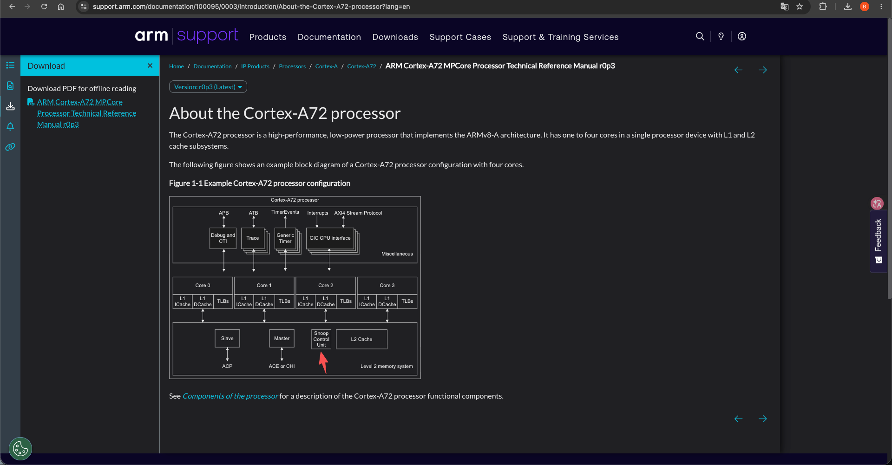
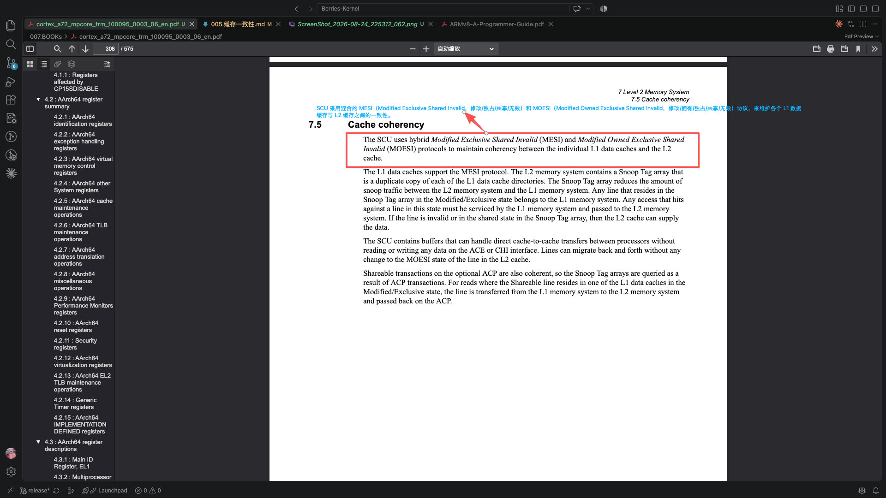
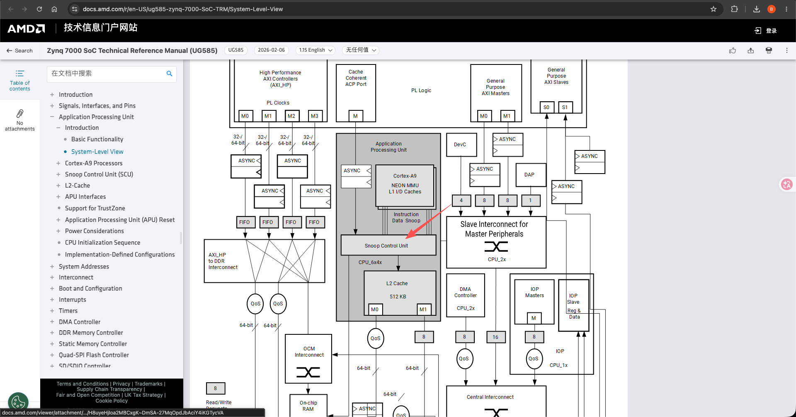
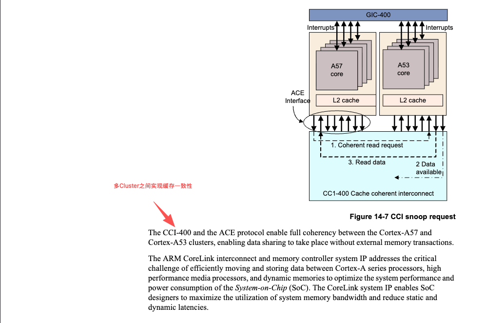
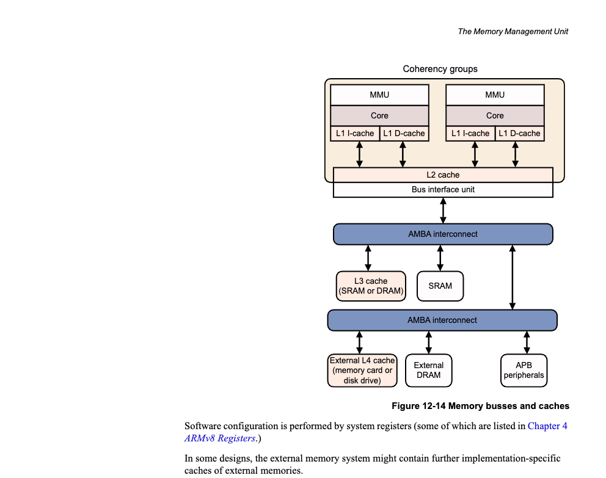

# 缓存一致性(Cache Coherency. ARM-v8+) 
> 学习: <br/>- [000.DynamIQ Shared Unit.md(DSU)](../../007.BOOKs/000.ARM资料库/000.DynamIQ%20Shared%20Unit.md)<br/>- [002.CAS实现原理.md](../008.同步原语/001.原子指令/002.CAS实现原理.md)<br/>- [003.LLSC实现原理.md](../008.同步原语/001.原子指令/003.LLSC实现原理.md)<br/> - [ARM® Cortex®-Series Version: 1.0 Programmer’s Guide for ARMv8-A](../../007.BOOKs/ARMv8-A-Programmer-Guide.pdf)#P14-18<br/>- [ARM® Cortex®-A72 MPCore Processor Technical Reference Manual](../../007.BOOKs/cortex_a72_mpcore_trm_100095_0003_06_en.pdf) <br/> - [Arm CoreLink CMN-600 Coherent Mesh Network Technical Reference Manual](../../007.BOOKs/corelink_cmn600_technical_reference_manual_100180_0302_01_en.pdf) <br/> - [007.BOOKs/000.ARM资料库/003.CMN-600.md](../../007.BOOKs/000.ARM资料库/003.CMN-600.md) <br/> - [ARM® Cortex®-A Series Programmer’s Guide for ARMv8-A#12.3.4 cache configuration](../../007.BOOKs/ARMv8-A-Programmer-Guide.pdf)(值得好好读一下)


- 多核之间的缓存一致性，由SCU<sup>Snoop Control Unit</sup>（DSU<sup>[DynamIQ Shared Unit](../../007.BOOKs/000.ARM资料库/000.DynamIQ%20Shared%20Unit.md)</sup>）硬件来执行维护，使用MESI协议
  + <sup>[ARM® Cortex®-A72 MPCore Processor Technical Reference Manual](../../007.BOOKs/cortex_a72_mpcore_trm_100095_0003_06_en.pdf)#P1-14</sup>
  +  <sup>[ARM® Cortex®-A72 MPCore Processor Technical Reference Manual](../../007.BOOKs/cortex_a72_mpcore_trm_100095_0003_06_en.pdf)#P7-308</sup>
  +  <sup>[ug585-zynq-7000-SoC-TRM](../../007.BOOKs/UG585.pdf)#P'System-Level View'</sup>
- 多cluster之间的缓存一致性，由 CCI<sup>如 [CCI-550](../../007.BOOKs/000.ARM资料库/002.CCI-550.md)</sup>/CMN <sup>CCI-550 ,CMN-600 功能类似，只是使用了不同协议，参考: [007.BOOKs/000.ARM资料库/003.CMN-600.md](../../007.BOOKs/000.ARM资料库/003.CMN-600.md)</sup>来执行维护，没有使用MESI协议
  > ↑ "**多 cluster 是什么、CCI 与 CMN 差在哪、'没有使用 MESI'的准确含义、截图（CCI snoop request）的完整解读**——见文末 **附录 A**"。
  + <sup>[ARM® Cortex®-Series Version: 1.0 Programmer’s Guide for ARMv8-A](../../007.BOOKs/ARMv8-A-Programmer-Guide.pdf)#P14-18</sup>
  + 
     - [ARM® Cortex®-A Series Programmer’s Guide for ARMv8-A#12.3.4 cache configuration](../../007.BOOKs/ARMv8-A-Programmer-Guide.pdf)

> **本文档是"缓存一致性"的概念篇**：只回答"一致性是什么、为什么需要、以及与原子指令的关系"。
> DSU/SCU 的硬件实现细节（DSU 集群结构、snoop filter、cache-to-cache、ACE/CHI 一致性事务、SYSCOREQ/SYSCOACK 握手、ACP、DSU-120 演进、页码索引）已迁移至 [000.DynamIQ Shared Unit.md(DSU)](../../007.BOOKs/000.ARM资料库/000.DynamIQ%20Shared%20Unit.md)。

---

## 1. 为什么需要缓存一致性：多核共享内存

多核处理器上多个核心共享同一份物理内存，而每个核心又有私有的 L1/L2 缓存<sub>（不理解? 和记忆中的有偏差? 看上面的图吧）</sub>。若某核心修改了某地址的缓存副本，其他核心必须看到最新值——否则共享内存编程（锁、消息传递、进程迁移）就会出错。缓存一致性（cache coherency）保证：**任意时刻，对任意共享地址，所有核心观察到一致的缓存行内容**。

- 集群（cluster）**内**多核之间的一致性，由 DSU 内的 **SCU** 硬件维护，使用 **MESI** 协议；
- 集群**间**的一致性，由 **CCI**（如 CCI-550）/ **CMN** 系统互连维护，不使用 MESI。

## 2. 一致性协议：MESI 家族

MESI 用四个状态描述缓存行在系统中的存在方式：

| MESI 状态 | 含义 | 可否写 |
| - | - | - |
| **M**（Modified） | 仅本核有该行且为脏（与内存不同） | 可写，无需通知他人 |
| **E**（Exclusive） | 仅本核有该行且干净 | 可写，无需通知他人 |
| **S**（Shared） | 多核持有该行副本，均干净 | 写前需先取得独占 |
| **I**（Invalid） | 本核副本无效 | - |

写共享数据需要"取得独占"（Invalidate/Unique），读共享数据则维持 S 态；这个状态机由 SCU 落地实现（详见 [DSU 文档中的 ACE/MESI 状态对应表](../../007.BOOKs/000.ARM资料库/000.DynamIQ Shared Unit.md)）。

## 3. 与原子指令的关系

缓存一致性是原子指令的**物理基础**：

- **LSE 原子指令（CAS/LDADD/SWP…）**把"读-比较-写"做成单笔一致性 RMW（Read-Modify-Write，读-改-写：读旧值→计算→写回，定义见 [原子指令 README](../008.同步原语/001.原子指令/README.md)），在缓存行**独占态**上执行，由缓存一致性协议充当原子性保证者——见 [002.CAS实现原理.md](../008.同步原语/001.原子指令/002.CAS实现原理.md)。
- **LL/SC（LDXR/STXR）**靠独占监视器标记地址、条件写，本质仍依赖一致性域的访存序——见 [003.LLSC实现原理.md](../008.同步原语/001.原子指令/003.LLSC实现原理.md)。
- 即：**SCU 维护的缓存行状态（Unique/Dirty/Shared）正是原子指令赖以无锁生效的机制。**

---

## 附录 A：多 Cluster、CCI/CMN 与"没有使用 MESI"的准确含义（含截图 Figure 14-7 解读）

### A.1 "多 cluster"是什么

**cluster（簇）= 一个 SCU/DSU 一致域**：若干核 + 共享的最后一级缓存（DynamIQ 是 L3，老式 A72/A53 是 L2），由簇内 **SCU** 用 MESI 维护一致性（见 [DSU 笔记](../../007.BOOKs/000.ARM资料库/000.DynamIQ%20Shared%20Unit.md)："SCU 是 DynamIQ 集群内的一致性中枢"）。

"**多 cluster**" = SoC 里有**多个互相独立的一致域**——经典 big.LITTLE 就是两个簇：SCU 只管自己簇内，**A57 的 SCU 管不到 A53 的缓存**，反过来也一样。于是簇间的共享数据必须有第三方仲裁：

```
   +-- cluster 0 (big) ---+          +-- cluster 1 (LITTLE) -+
   | A57 x4  (私有 L1)     |          | A53 x4  (私有 L1)      |
   |   共享 L2             |          |   共享 L2              |
   |   SCU(MESI, 只管本簇) |          |   SCU(MESI, 只管本簇)  |
   +--------+-------------+          +--------+--------------+
            |  ACE 接口                        |  ACE 接口
            +--------> CCI-400/550 <-----------+
                     (簇间一致互连: snoop 事务)
                          |
                       DDR 内存
   两簇各自是"完整的小一致域", CCI 负责把它们缝成一个大一致域
```

### A.2 "没有使用 MESI"的准确含义

原文"没有使用 MESI"容易误读成"簇间没有一致性协议"——准确的说法是分三层：

|层|是什么|不是什么|
|-|-|-|
|MESI|**cache 行的状态模型**（M/E/S/I 四态），SCU 在**簇内**实现它|不是总线协议|
|簇间互连协议|CCI-550 用 **ACE**（AXI Coherent Extensions，含 snoop 通道）；CMN-600/700 用 **CHI**（事务名 ReadUnique/SnpUnique…）|不是"另一个 MESI 状态机"|
|行级语义|ACE/CHI 事务里携带的字段（Unique/Shared/Clean/Dirty——CHI 记作 UC/SC/UD/SD）**语义上仍是 MESI/MOESI 家族**|只是表达方式从"SCU 内部状态机"变成"总线事务字段"|

所以：**不是"没有一致性协议"，而是"簇间不走 SCU 的 MESI 状态机，改走 ACE/CHI 总线事务 + 目录/探针"**。现代互连（CMN）还用 **Snoop Filter 当全局目录**，用**定向 snoop 取代广播**（[CMN-600 笔记](../../007.BOOKs/000.ARM资料库/003.CMN-600.md)：SF = 全局共享目录项，p.4-1089；HN-F 结构 p.2-37）。

**CCI-550 vs CMN-600**（"功能类似、协议不同"的具体差）：

|维度|CCI-500/550|CMN-600|
|-|-|-|
|协议|**ACE/ACE-Lite**（AMBA 4 系）|**CHI**（AMBA 5 系）|
|结构|集中式交叉开关（crossbar）|mesh 网状网络，可扩展 1–64 簇|
|CPU 簇入口|ACE 完整一致性口（带 snoop 通道）|**只收 CHI 的 RN-F**；ACE 入口仅有 ACE-Lite（RN-I bridge/SBSX），"不收 ACE 的一致性 snoop 通道"（CMN-600 笔记原文）|
|目录|snoop 转发/过滤|HN-F 内置 **Snoop Filter**（定向探针）|
|定位|取代品：CMN-600 一代同时取代 CCI-5xx（ACE 线）与 CCN-5xx（CHI 中端线）|Arm 第二代顶层一致性互连|

### A.3 截图（Figure 14-7 CCI snoop request，ARMv8-A Programmer's Guide P14-18）逐步解读

原图：**GIC-400** 在顶（负责中断分发，不参与缓存一致），左右两个簇（A57+L2、A53+L2）经 **ACE Interface** 接 **CCI-400 Cache Coherent Interconnect**。三步 snoop 事务：

```
 ① Coherent read request          ② Data available           ③ Read data
 (A57 簇 L2 miss,经 ACE   -->      (CCI 向 A53 簇发 snoop,  --> (数据经 CCI 返回
  向 CCI 发一致性读请求)             A53 的 L2 持有该行!)        A57 簇, 填充其 L2)

 [A57: L1 miss -> L2 miss] --ACE--> [CCI-400] --snoop--> [A53: L2 命中]
                                       |                     (cache-to-cache
                                       +<------数据/响应--------  直接搬运)
                                       v
                                  返回给 A57 簇
 书上原文要点: "CCI-400 and the ACE protocol enable full coherency
 between the Cortex-A57 and Cortex-A53 clusters, enabling data sharing
 to take place WITHOUT external memory transactions."
 即 snoop 命中时数据簇间直传, 不必去 DDR —— 省带宽也省延迟
```

### A.4 由截图引出的完整技术分层：一致性 + 原子性（单核内 / 簇内跨核 / 跨簇跨核）

|战场|缓存一致性用什么|原子性用什么|
|-|-|-|
|**单核内部**（核内 L1↔L2）|无协议——私有层次由核内逻辑自洽（I-cache 另有硬件一致性选项）|**本地独占监视器**（local exclusive monitor，管 LDXR/STXR/CLREX）；LSE 单笔 RMW 在核内独占行上直接完成，**不经过监视器**|
|**簇内跨核**（SCU 域）|SCU + **MESI** + snoop filter（目录）+ cache-to-cache 直传|LSE（CAS/LDADD/SWP）在**独占态行**上单笔 RMW；LL/SC 靠本地监视器即可（同簇）|
|**跨簇跨核**（CCI/CMN 域）|**ACE/CHI snoop 事务** + 互连侧目录（SF）|**全局独占监视器**（global monitor，在互连处给 Shareable 内存打 reservation 标）——跨簇 LDXR/STXR 成立的基石；LSE 独占请求经 ACE/CHI 事务跨簇传递|

```
 原子性的"两级监视器"与一致性的"两级域"严格对齐:

 核内:  [本地监视器]  <-> 簇内:  [SCU/MESI]
   |                         |
   v                         v
 全片:  [全局监视器@互连] <-> 簇间:  [CCI(ACE)/CMN(CHI) + SF 目录]

 LDXR(Inner Shareable) 的 reservation 要同时过两级;
 他核/他簇写监视行 -> 全局监视器撤标 -> STXR 必败 -> 重试
```

现代对照（详见 [../031.进程管理/008.进程调度/000.调度组与调度域/003.AGI-SP113012-层级架构-缓存一致性-原子操作.md](../031.进程管理/008.进程调度/000.调度组与调度域/003.AGI-SP113012-层级架构-缓存一致性-原子操作.md)）：
- CHI 时代全局监视器在 **HN-F（PoS/PoC，含 SF+SLC）**；争用激烈的原子可 offload 为 **CHI 硬件原子事务**（HN 在 SLC/内存处 RMW，核不取独占行）；
- LSE 实现三选一（本地独占行 RMW / CHI Atomic / LL/SC 回退），内核启动期按 `HAS_LSE_ATOMICS` 用 alternatives 打补丁。

### A.5 三平台对照（遵守本仓库平台举例规范）

|平台|"簇"的形态|簇内一致|簇间/系统一致|原子实现|
|-|-|-|-|-|
|**Cortex-A725/A520**（附录教学模型）|A725 私有 L2、A520 对共享 L2，DSU-120 定簇|SCU（snoop filter + MESI 语义）|多簇 SoC 走 CCI/CMN（ACE/CHI）|LSE 于独占行；跨簇靠全局监视器|
|**Arm AGI CPU（SP113012）**|**无簇**（V3 Direct connect，每核直连 CMN mesh）|—（簇概念消失）|全片 CHI：HN-F=PoS/PoC+SF 目录，定向探针|两级监视器（核内 2 态状态机 + HN-F 全局）；CHI 硬件原子|
|**EPYC 9996**|"簇"≈ **CCX**（L3 一致域，16 核）|CCX 内 L3 探针|簇间 Infinity Fabric（IOD 仲裁），NPS 划 NUMA|`LOCK` 前缀：缓存行锁定（行在本核时 L1/L2 内 RMW），跨一致域才总线锁|

### A.6 参考资料

- 截图出处：[ARM® Cortex®-A Series Programmer's Guide for ARMv8-A](../../007.BOOKs/ARMv8-A-Programmer-Guide.pdf) P14-18（Figure 14-7 CCI snoop request；12.3.4 cache configuration）
- 本仓库笔记：[000.DynamIQ Shared Unit.md（DSU/SCU）](../../007.BOOKs/000.ARM资料库/000.DynamIQ%20Shared%20Unit.md) · [002.CCI-550.md](../../007.BOOKs/000.ARM资料库/002.CCI-550.md) · [003.CMN-600.md](../../007.BOOKs/000.ARM资料库/003.CMN-600.md)
- 手册：[CMN-600 TRM](../../007.BOOKs/corelink_cmn600_technical_reference_manual_100180_0302_01_en.pdf) · [CMN-700 TRM](../../007.BOOKs/arm_neoverse_cmn_700_trm_102308_0307_08_en.pdf) · [Neoverse V3 TRM](../../007.BOOKs/arm_neoverse_v3_core_technical_reference_manual_107734_0002_06_en.pdf)（§7.4 内部独占监视器）
- 展开篇：[../031.进程管理/008.进程调度/000.调度组与调度域/003.AGI-SP113012-层级架构-缓存一致性-原子操作.md](../031.进程管理/008.进程调度/000.调度组与调度域/003.AGI-SP113012-层级架构-缓存一致性-原子操作.md)（三层战场/CHI 事务/两级监视器/CHI 硬件原子）
- 同步原语篇：[002.CAS实现原理.md](../008.同步原语/001.原子指令/002.CAS实现原理.md) · [003.LLSC实现原理.md](../008.同步原语/001.原子指令/003.LLSC实现原理.md)
