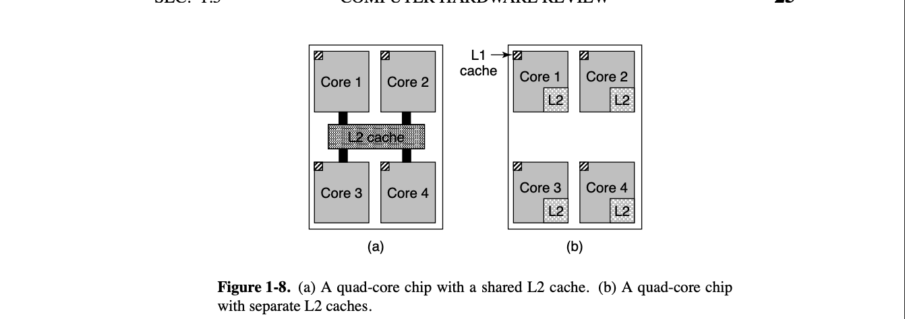

# L2-Cache
> 学习: [007.BOOKs/现代操作系统/Modern Operating Systems 5th Edition-PDF-01.pdf](../../../007.BOOKs/现代操作系统/Modern%20Operating%20Systems%205th%20Edition-PDF-01.pdf)

## L2 Cache 是谁和谁共享
> 没有统一的标准,由芯片设计者决定

- On multicore chips, the designers have to decide where to place the caches. In Fig. 1-8(a), a single L2 cache is shared by all the cores. In contrast, in Fig. 1-8(b), each core has its own L2 cache. Each strategy has its pros and cons. For example, the shared L2 cache requires a more complicated cache control.[007.BOOKs/现代操作系统/Modern Operating Systems 5th Edition-PDF-01.pdf](../../../007.BOOKs/现代操作系统/Modern%20Operating%20Systems%205th%20Edition-PDF-01.pdf)#P27(在多核芯片上，设计者必须决定将缓存放置在何处。在图1-8(a)中，所有核心共享一个单一的L2缓存。相反，在图1-8(b)中，每个核心都有自己的L2缓存。每种策略都有其优缺点。例如，共享L2缓存需要更复杂的缓存控制。)