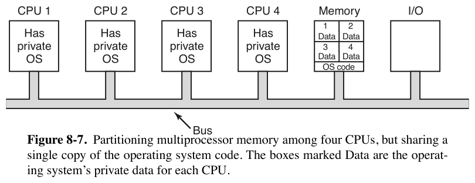
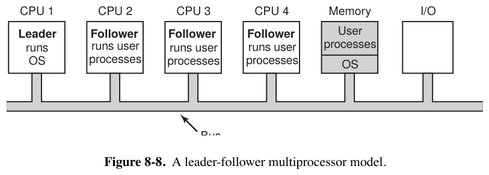
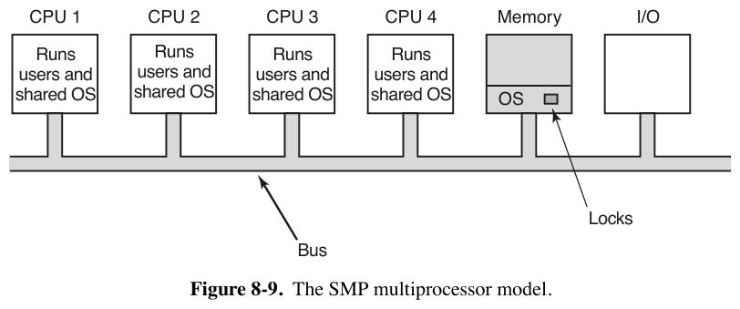

# 8.1.2 多处理器操作系统的类型 —— SMP 与 Linux/arm64 的实现

> 书页 541–545（PDF 570–574）。逐小节精读笔记之二，回答：**书中的 SMP 模型，Linux 内核（arm64）是怎么实现的？**
> 同目录：[001.8.1.1-多处理器硬件.md](./001.8.1.1-多处理器硬件.md)｜[003.8.1.3-多处理器同步.md](./003.8.1.3-多处理器同步.md)｜[004.8.1.4-多处理器调度.md](./004.8.1.4-多处理器调度.md)｜[005.专题-图8-11多锁避免缓存抖动.md](./005.专题-图8-11多锁避免缓存抖动.md)

**本节问题**：硬件有了多个 CPU，操作系统怎么组织自己？书中给出三种模型，并论证为什么现代系统都收敛到第三种（SMP + 细粒度锁）。

---

## 1. 书中理论：三种多处理器 OS 组织

### 模型一：每个 CPU 一套私有 OS（图 8-7）



内存静态划分为 n 份，每个 CPU 跑自己的 OS（可共享**内核代码**，只有**数据结构**各自私有）。本质上是 n 台独立计算机，只是共享磁盘/I/O、可通过内存传数据。

**四个缺点**（书中明确列出）：
1. 系统调用在本 CPU 上用自己的表处理——**进程不能共享**：用户登录到 CPU 1，他的全部进程都在 CPU 1，可能 CPU 1 忙死而 CPU 2 闲死；
2. **物理页不能借用**：CPU 2 疯狂换页时 CPU 1 的空闲页帮不上忙（内存分配是固定的）；
3. **buffer cache 各自为政（最糟）**：同一磁盘块可能同时"脏"在多个 buffer cache 里 → 数据不一致；只能取消 buffer cache，但性能损失惨重；
4. （推论）任何共享表都需要跨 CPU 同步，而这套模型恰恰回避同步 → 能共享的东西很少。

> 现状：生产系统已不用；研究中以"把每 CPU 状态完全本地化、避免共享"的思路回潮（multikernel/ELC 思想）——书中点出：**共享才需要锁，锁是性能问题之源**。

### 模型二：主从式 Leader-Follower（图 8-8）



只有 CPU 1 上有一份 OS 和它的表；**所有系统调用都重定向到 CPU 1** 处理；CPU 1 空闲时也可跑用户进程。
- 优点：单一就绪队列/单一 buffer cache，模型一的四个缺点全解；
- 致命缺点：**leader 是瓶颈**。若 10% 的时间花在系统调用上，10 个 CPU 就能让 leader 饱和，20 个 CPU 彻底过载。只适合小系统。

### 模型三：SMP 对称多处理器（图 8-9）——现代标准



- **内存里只有一份 OS，任何一个 CPU 都可以执行它**。系统调用发生在哪个 CPU，那个 CPU 就陷入内核就地处理。

  > There is one copy of the operating system in memory, but any CPU can run it. When a system call is made, the CPU on which the system call was made traps to the kernel and processes the system call.（内存里只有一份操作系统，但任何 CPU 都可以运行它。发生系统调用时，发起系统调用的那个 CPU 陷入内核并就地处理该系统调用。）<sup>[007.BOOKs/现代操作系统/Modern Operating Systems 5th Edition-PDF-01.pdf](../../../007.BOOKs/现代操作系统/Modern%20Operating%20Systems%205th%20Edition-PDF-01.pdf) 书页 544（PDF 573）</sup>

- 动态均衡进程和内存（只有一套内核表），也没有 leader 瓶颈。
- **新问题**：两个 CPU 同时执行内核代码 → 灾难（同时选中同一个进程去跑、同时认领同一个空闲页……）。

  > In particular, if two or more CPUs are running operating system code at the same time, disaster may well result. Imagine two CPUs simultaneously picking the same process to run or claiming the same free memory page.（特别是，当两个或更多 CPU 同时运行操作系统代码时，很可能酿成灾难。想象两个 CPU 同时挑中同一个进程去运行，或者同时认领同一个空闲内存页。）<sup>[007.BOOKs/现代操作系统/Modern Operating Systems 5th Edition-PDF-01.pdf](../../../007.BOOKs/现代操作系统/Modern%20Operating%20Systems%205th%20Edition-PDF-01.pdf) 书页 544（PDF 573）</sup>

**SMP 的锁演进**（书中两步走）：

1. **大内核锁（big kernel lock）**：给整个 OS 配一把 mutex，想进内核先拿锁——任何 CPU 都能跑 OS，但同时只有一个。仍会排队（假设 10% 时间在内核，20 个 CPU 就排长队），只比主从式略好。

   > The simplest way around these problems is to associate a mutex (i.e., lock) with the operating system, making the whole system one big critical region. When a CPU wants to run operating system code, it must first acquire the mutex. If the mutex is locked, it just waits. In this way, any CPU can run the operating system, but only one at a time. This approach is sometimes called a **big kernel lock**.（绕开这些问题的最简单办法是给操作系统配一把 mutex（即锁），把整个系统变成一个大临界区。CPU 想运行操作系统代码必须先获得 mutex；若 mutex 已被锁住就只好等待。这样任何 CPU 都能运行操作系统，但一次只有一个。这种做法有时被称为**大内核锁**。）<sup>[007.BOOKs/现代操作系统/Modern Operating Systems 5th Edition-PDF-01.pdf](../../../007.BOOKs/现代操作系统/Modern%20Operating%20Systems%205th%20Edition-PDF-01.pdf) 书页 544（PDF 573）</sup>
2. **细粒度锁**：把内核拆成多个**互不影响的独立临界区**，各配一把锁（一个 CPU 跑调度器、另一个跑文件系统调用、第三个处理缺页，互不干扰）；被**多个临界区共享的表**（如进程表：调度、fork、信号处理都要用）单独加锁——"每个临界区一次只能一个 CPU 执行，每张共享表一次只能一个 CPU 访问"。

**书中点出的两大工程难点**：
- 难的不是代码不同，而是**正确划分临界区**——不能有哪怕微妙、间接的相互影响；
- **死锁**：两个临界区都要表 A 和表 B，一个先 A 后 B、另一个先 B 后 A → 死锁。理论上给所有表编号、按升序申请可避免，但代码常年演化、人员更替，"哪里需要就在哪里拿锁"的诱惑很大 → 极易出错且很难长期保持正确。

---

## 2. Linux 的选择：教科书级 SMP + 细粒度锁

| 书中模型 | Linux |
|-|-|
| 每 CPU 私有 OS | ✗ 不用（但吸收其优点：per-CPU 数据，见 §2.4）|
| 主从式 | ✗ 不用 |
| **SMP + 独立临界区各自加锁** | ✓ **就是现代 Linux**（2.0 起支持 SMP；大内核锁 2011 年 2.6.39 彻底删除）|

Linux 7.1.3 树里已无大内核锁（`lock_kernel`/`kernel_lock` 仅在 `Documentation/filesystems/porting.rst` 的历史说明中残留一句）。全书对应关系：

- 书中"一份 OS、任何 CPU 都能执行" → Linux 一份内核映像，`spinlock_t`/`mutex` 等数万把细粒度锁覆盖各子系统；
- 书中"共享表单独加锁" → 典型如 runqueue 的 `rq->lock`、进程表实际由 RCU+每任务锁替代（比书中想象的更细）；
- 书中"加锁顺序防死锁" → lockdep 运行时验证（`Documentation/locking/lockdep-design.rst`），把"人肉记住顺序"工程化。

下面按 arm64 走读**"SMP 三要素"**的代码：一份内核怎么被多 CPU 同时执行（启动）、CPU 之间怎么分工（per-CPU 数据）、以及"同时进内核"的代价怎么控制（锁，另见 [003.8.1.3](./003.8.1.3-多处理器同步.md)）；x86_64 侧对照与图 8-9 的真机硬件底座见 §2.6。

## 2.1 一份内核，多个 CPU：arm64 的 SMP 启动

BSP（CPU 0）走正常启动路径；其余 CPU（从核）由内核逐个"上线"。**关键数据结构是每 CPU 的启动协议 `cpu_operations`**，按固件类型三选一：

```c
// arch/arm64/kernel/cpu_ops.c:25
static const struct cpu_operations *const dt_supported_cpu_ops[] __initconst = {
	&smp_spin_table_ops,          // 设备树"spin-table"：内核往固定地址写入口地址，从核原地轮询该地址后跳转
	&cpu_psci_ops,                // PSCI（Power State Coordination Interface）：SMC 指令请固件（EL3/monitor）唤醒从核——现代服务器的标准路径
};
static const struct cpu_operations *const acpi_supported_cpu_ops[] __initconst = {
	&acpi_parking_protocol_ops,   // ACPI "parking protocol"
	&cpu_psci_ops,
};
```

启动链路（arm64）：

1. **枚举**：`setup_arch()` <sub>[/arch/arm64/kernel/setup.c:281](../../../000.SOURCE_CODE/003.LINUX-7.1.3/000.LINUX-7.1.3/arch/arm64/kernel/setup.c)</sub> → `smp_init_cpus()` <sub>[/arch/arm64/kernel/smp.c:739](../../../000.SOURCE_CODE/003.LINUX-7.1.3/000.LINUX-7.1.3/arch/arm64/kernel/smp.c)</sub>（设备树或 ACPI 解析出 CPU 列表）→ 逐 CPU `smp_cpu_setup()` 置 `cpu_possible_mask`。
2. **上线**：`kernel_init()` <sub>[/init/main.c:1584](../../../000.SOURCE_CODE/003.LINUX-7.1.3/000.LINUX-7.1.3/init/main.c)</sub> → `smp_init()` <sub>[/kernel/smp.c:1005](../../../000.SOURCE_CODE/003.LINUX-7.1.3/000.LINUX-7.1.3/kernel/smp.c)</sub>（为每个未上线 CPU 建一个 idle 任务）→ `cpu_up()` → 架构钩子 `__cpu_up()`：

```c
// arch/arm64/kernel/smp.c:111
int __cpu_up(unsigned int cpu, struct task_struct *idle)
{
	secondary_data.task = idle;              // 告诉从核：你的栈和页表在这个 idle 任务里
	update_cpu_boot_status(CPU_MMU_OFF);
	ret = boot_secondary(cpu, idle);         // 调 cpu_ops->cpu_boot（如 PSCI CPU_ON）
	                                          // 从核在固件帮助下跳到内核入口、开 MMU
	wait_for_completion_timeout(&cpu_running, msecs_to_jiffies(5000)); // 等从核报到
	if (cpu_online(cpu)) return 0;
	...
}
```

3. **从核进入 C 世界**：从核最终跳到 `secondary_start_kernel()`——这是"**一份内核、任何 CPU 都能执行**"的直接体现：从核拿着与主核同一份内核映像，从同一套代码开始跑：

```c
// arch/arm64/kernel/smp.c:195
asmlinkage notrace void secondary_start_kernel(void)
{
	...
	mmgrab(mm); current->active_mm = mm;     // 内核线程共用 init_mm，切到同一份内核页表
	cpu_uninstall_idmap();
	check_local_cpu_capabilities();           // 校验本核能力与主核一致（不一致拒绝上线）
	cpuinfo_store_cpu();
	store_cpu_topology(cpu);                  // 记录本核拓扑（簇/LLC 关系，喂给调度域）
	notify_cpu_starting(cpu);                 // GIC、定时器等 per-CPU 初始化
	ipi_setup(cpu);                           // 登记本核的 IPI（见 §2.2）
	numa_add_cpu(cpu);                        // NUMA: 本核归入其节点
	...
	set_cpu_online(cpu, true);                // smp.c:256 —— 至此调度器可往本核派任务
	complete(&cpu_running);                   // smp.c:257 —— 唤醒主核的 wait_for_completion
}
```

> **对应书中图 8-9**：内存中一份 OS（`init_mm`/同一内核映像），四个 CPU 都"runs users and shared OS"——`secondary_start_kernel()` 之后所有 CPU 地位完全对等，没有 leader。

## 2.2 SMP 的"神经"：IPI（处理器间中断）

SMP 模型下 CPU 之间必须能互相"喊话"（催调度、冲刷 TLB、停止 CPU…）。arm64 上这由 GIC 的 IPI 实现：

- `ipi_setup()` <sub>[/arch/arm64/kernel/smp.c:1046](../../../000.SOURCE_CODE/003.LINUX-7.1.3/000.LINUX-7.1.3/arch/arm64/kernel/smp.c)</sub> 为每类 IPI（RESCHEDULE / CALL_FUNC / CPU_STOP / IRQ_WORK / TIMER…）登记 per-CPU 中断；
- 发送方 `smp_cross_call()` <sub>[:1025](../../../000.SOURCE_CODE/003.LINUX-7.1.3/000.LINUX-7.1.3/arch/arm64/kernel/smp.c)</sub> → 接收方在 IPI 处理器里执行 `scheduler_ipi()`、`flush_tlb_func()` 等。
- 典型：`arch_smp_send_reschedule()` <sub>[:1151](../../../000.SOURCE_CODE/003.LINUX-7.1.3/000.LINUX-7.1.3/arch/arm64/kernel/smp.c)</sub>——唤醒的目标任务在别的 CPU 上睡眠时，发 IPI 让那个 CPU 尽快重新调度。8.1.4 的亲和性调度、8.1.3 的乐观自旋（`need_resched` 检查）都靠它传递信号。

## 2.3 "一份 OS"的共享部分靠锁，锁是 SMP 的税

书中 SMP 图里内存上写着"Locks"。Linux 中一次 `spin_lock()` 的完整路径（arm64）：

```
spin_lock()                          // include/linux/spinlock.h —— API 层
  └ raw_spin_lock()                  // 同上，PREEMPT_RT 下才与 spin_lock 分家
      └ __raw_spin_lock()            // include/linux/spinlock_api_smp.h:154
          ├ preempt_disable()        // ★ 抢占计数+1：持自旋锁期间本 CPU 不可被抢占
          │                          //   —— 正是书中 8.1.4"smart scheduling"的 Linux 实现
          └ LOCK_CONTENDED(...)      // → do_raw_spin_lock()
              └ arch_spin_lock()     // include/asm-generic/qspinlock.h:147 重定向
                  └ queued_spin_lock()  // 见 003.8.1.3 详解（cmpxchg 快路径 + MCS 队列慢路径）
```

arm64 在 Kconfig 中选择队列自旋锁：<sub>[/arch/arm64/Kconfig:69-70](../../../000.SOURCE_CODE/003.LINUX-7.1.3/000.LINUX-7.1.3/arch/arm64/Kconfig)</sub> `select ARCH_USE_QUEUED_SPINLOCKS / QUEUED_RWLOCKS`。

## 2.4 Linux 的独有武器：per-CPU 数据——"少共享就不用锁"

书中模型一的教训是"共享才需要锁"；Linux 把这条反着用成了**不共享的锁替代品**：

```c
// arch/arm64/include/asm/percpu.h:14 —— 每 CPU 基址放在系统寄存器里
static inline void set_my_cpu_offset(unsigned long off)
{
	asm volatile(ALTERNATIVE("msr tpidr_el1, %0",   // 常规：写 TPIDR_EL1
				 "msr tpidr_el2, %0",   // VHE 宿主：TPIDR_EL2
				 ARM64_HAS_VIRT_HOST_EXTN) ...);
}
// arch/arm64/include/asm/percpu.h:52
#define __my_cpu_offset __kern_my_cpu_offset()      // 读 TPIDR_EL1/EL2 —— 一条指令拿到"本 CPU 偏移"
```

- `DEFINE_PER_CPU(type, var)` 给**每个 CPU 一份私有副本**；访问 `this_cpu_ptr(&var)` = 基址 + 本 CPU 偏移（TPIDR_EL1 一条 MRS 指令），**天然无共享、无需锁**；
- 内核里到处都是：运行队列 `runqueues`、qspinlock 的 MCS 节点 `qnodes`（见 [005.专题](./005.专题-图8-11多锁避免缓存抖动.md)）、统计数据、`current`（当前任务指针）…
- 前提：访问期间禁止抢占/迁移（否则"本 CPU"会变），所以 per-CPU 访问宏都隐含 `preempt_disable()`——又一次看到 §2.3 的抢占计数。

> **书中三模型 vs Linux 一句话总结**：Linux = 模型三（SMP，一份内核任何 CPU 执行） + 模型一的精华（状态尽量 per-CPU 本地化，减少共享） + 细粒度锁与 lockdep 管住不可避免的共享。

## 2.5 大内核锁的死亡史（为什么书中"big kernel lock"在 Linux 找不到）

| 时间 | 事件 |
|-|-|
| 2.0（1996）| 引入 `lock_kernel()` 大内核锁，SMP 支持首次合入——对应书中 SMP 图"整个 OS 一把 mutex"|
| 2.6 系列 | 十余年逐子系统"去 BKL 化"：每改一处换 fine-grained lock + RCU |
| 2.6.39（2011）| 最后一个用户（可执行文件加载）迁移完，**BKL 彻底删除**，`CONFIG_BKL` 消失 |

Linux 7.1.3 树中 `grep -r lock_kernel` 只剩 `Documentation/filesystems/porting.rst` 里"把 lock_kernel 换成普通锁"的历史迁移说明。**这正是书中那条演进曲线（一把大锁 → 独立临界区各配锁）的现实版**，而且 Linux 走完了全程。

## 2.6 图 8-9 落到真机：硬件底座与一份内核的布局（补 x86_64 对照）

> 书页 544–545（PDF 573–574）。图 8-9（PDF 为矢量图，框内文字与位置可按词级坐标核对）画了五类元素：4 个 CPU 框（框内写 **Runs users and shared OS**）、Memory 框（内含 OS 内框于左上、Locks 于右下）、I/O 框，三者挂在同一条 Bus 上。本节把每个元素钉到真实硬件与 Linux 7.1.3 源码上。arm64 细节已见 §2.1–2.4，本节补 **x86_64 对照**与**真机硬件平台**（单路 UMA 台式机 / 双路 NUMA 服务器）。

### （1）图 8-9 元素 → 真机 / 内核实体对照

| 图 8-9 元素 | 教科书画法 | 真机 / Linux 7.1.3 实体 |
|-|-|-|
| CPU 框 "Runs users and shared OS" | n 个对等 CPU | 每核私有寄存器组 + **共享同一份内核映像**；从核上线握手见 §2.1（arm64）/ 下文（4）（x86） |
| Bus | 一条共享总线 | 片内：ring/mesh 缓存一致性互连；**片间：Intel UPI / AMD xGMI**（跨 socket 的访存与 IPI 都走它） |
| Memory "一份 OS" | 单一 OS 拷贝 | 内核 `.text/.rodata` 只读共享（多 CPU 同时取指，无需锁）+ 受锁保护的共享数据结构 |
| Memory "Locks" | Memory 框右下角（OS 内框在左上）| 数万把细粒度锁（`spinlock_t`=qspinlock、`mutex`、rwlock）+ RCU + per-CPU 化（把共享消灭在源头） |
| I/O 框 | 与 CPU/Memory 同挂总线 | PCIe/NVMe/网卡等设备树（本节不展开；DMA 也要过缓存一致性互连） |
| （图中没画）CPU 互喊话 | —— | **IPI**：arm64 GIC SGI / x86 LAPIC ICR，见下文（5） |
| （图中没画）每 CPU 私有状态 | —— | **per-CPU 区**：`TPIDR_EL1` / `%gs` 寻址，见下文（3） |

### （2）"Bus" 与 "Memory" 的真身：单路 UMA vs 双路 NUMA

```text
      (a) 图 8-9 原样（依 PDF 词级坐标复核）：CPU/Memory/I/O 挂同一条 Bus

+-----------+ +-----------+ +-----------+ +-----------+   +------------------+   +------+
|   CPU 1   | |   CPU 2   | |   CPU 3   | |   CPU 4   |   |      Memory      |   | I/O  |
|   Runs    | |   Runs    | |   Runs    | |   Runs    |   |                  |   |      |
| users and | | users and | | users and | | users and |   |   +------+       |   |      |
| shared OS | | shared OS | | shared OS | | shared OS |   |   |  OS  |       |   |      |
+-----+-----+ +-----+-----+ +-----+-----+ +-----+-----+   |   +------+       |   +---+--+
      |             |             |             |         |                  |       |
      |             |             |             |         |             Locks|       |
      |             |             |             |         +--------+---------+       |
      |             |             |             |                  |                 |
      +-------------+-------------+-------------+------------------+-----------------+

                                            Bus

      (b) 真机双路服务器：SMP 组织 + NUMA 底座（"一条 Bus" 的真身）

+---------------- Socket0 = Node0 ----------------+
| core0  core1  ...  coreN                        |
| (any core executes the ONE kernel image)        |
|        shared L3 (sliced per core)              |
|            |                                    |
|          IMC ---> Local DDR     (local: fast)   |
+------------------------+------------------------+
                         |
                         |  xGMI (AMD EPYC) / UPI (Intel Xeon)
                         |  cache-coherent interconnect
                         v
+---------------- Socket1 = Node1 ----------------+
| core0  core1  ...  coreN                        |
|          IMC ---> Local DDR                     |
+-------------------------------------------------+

 远端访问：Socket0 的 core -> xGMI/UPI 报文 -> Socket1 的 IMC -> 远端 DDR（慢 => NUMA）
```

- 单路机器（本机 R7-5700G，单 socket 16 线程）就是图 8-9(a) 的 UMA 形态：所有 core 经同一个内存控制器到 DDR，等距 → **UMA**，整台机器 = Node0。
- 双路服务器（如技嘉 MZ73-LM2，2× AMD EPYC）把"一条 Bus"换成**各 socket 独立内存控制器 + socket 间缓存一致性互连**（AMD xGMI，MZ73-LM2 上 4 条链路；Intel 对应 UPI）：本地 DDR 快、远端 DDR 慢 → **NUMA**。Node = Socket + 直属于它的内存插槽。
- **SMP 与 NUMA 正交**：SMP（图 8-9）回答"OS 怎么组织"——一份 OS、任何 CPU 执行；NUMA（图 8-6 的目录协议）回答"内存离谁近"。Linux 两者都占：组织上是 SMP，硬件上普遍 NUMA，内核用 `CONFIG_NUMA` 感知拓扑（从核上线时 `numa_add_cpu()`，§2.1 第 118 行）。硬件实物与 UPI/xGMI 细节见 [../000.NUMA/README.md](../000.NUMA/README.md)。

### （3）"一份 OS" 在内存里长什么样：text 共享 / 共享表上锁 / per-CPU 免锁

```text
一份内核映像（所有 CPU 共用同一套内核页表 init_mm，arm64/x86 皆然）
│
├─ .text / .rodata（只读）──────────────── N 个 CPU 同时取指执行 → 天然共享，无需锁
│    └─ 异常向量表：arm64 = vectors / x86 = IDT
│
├─ 共享数据结构（书中"共享表"）────────── 多个临界区同时访问 → 每类一把锁
│    ├─ task_struct 池、页表/页帧数组、VFS、就绪队列 ……
│    └─ 锁本体：spinlock_t(qspinlock) / mutex / rwlock；读者侧可用 RCU 零锁
│         └─ 有趣事实：qspinlock 的等待队列本身也是 per-CPU 的 ── qnodes
│
└─ per-CPU 区（图 8-9 完全没画的一层）─── 同一变量名，每 CPU 一份私有副本 → 无共享，免锁
     ├─ runqueues（每 CPU 就绪队列，8.1.4 两级调度的底层）
     ├─ 基址：arm64 = TPIDR_EL1（§2.4）｜x86 = %gs 段基址（即 MSR_GS_BASE）
     │    └─ x86 装载点：BSP 在 switch_gdt_and_percpu_base() wrmsrq；从核在 head_64.S 直接 wrmsr
     └─ vmstat / current / 各类统计计数（访问期必须 preempt_disable，§2.4）
```

- x86 与 arm64 的 per-CPU 基址机制不同、思想相同——**一条指令拿到"本 CPU 的偏移"**：arm64 读 `TPIDR_EL1`（§2.4，percpu.h:14/52）；x86 用 `%gs` 段基址，BSP 在 `switch_gdt_and_percpu_base()` 里 `wrmsrq(MSR_GS_BASE, cpu_kernelmode_gs_base(cpu))`<sub>[/arch/x86/kernel/cpu/common.c:812](../../../000.SOURCE_CODE/003.LINUX-7.1.3/000.LINUX-7.1.3/arch/x86/kernel/cpu/common.c)</sub>，从核上线早期在 `head_64.S` 直接 `wrmsr` 装载<sub>[/arch/x86/kernel/head_64.S:370](../../../000.SOURCE_CODE/003.LINUX-7.1.3/000.LINUX-7.1.3/arch/x86/kernel/head_64.S)</sub>。
- "Locks" 那一小格在 Linux 里的真实规模是数万把锁；连 **qspinlock 的等待队列本身都是 per-CPU 的**（`qnodes`<sub>[/kernel/locking/qspinlock.c:80](../../../000.SOURCE_CODE/003.LINUX-7.1.3/000.LINUX-7.1.3/kernel/locking/qspinlock.c)</sub>）——锁的等待结构也遵守"少共享"。

### （4）"any CPU can run it" 何时成立：从核上线握手（arm64 PSCI vs x86 INIT-SIPI-SIPI）

```text
         BSP (CPU0)                         firmware / hardware                 secondary (CPU k)
         |                                  |                                   |
         | smp_init():                      |                                   |
         |   build idle task per AP         |                                   |
         |   cpu_up(k) -> __cpu_up(k)       |                                   |
         |--------------------------------->|                                   |
         |  publish entry + stack           |                                   |
         |    arm64: secondary_data.task    |                                   |
         |    x86: start_eip=trampoline     |                                   |
         |                                  |---- wakeup the AP --------------->|
         |                                  |   arm64: PSCI CPU_ON (SMC)        |
         |                                  |   x86  : INIT, SIPI, SIPI         |
         |                                  |                                   | jump into the ONE kernel image:
         |                                  |                                   |   arm64: secondary_start_kernel()
         |                                  |                                   |   x86  : secondary_startup_64()
         |                                  |                                   | load per-CPU base, setup IPI
         |<---------------------- set_cpu_online(k, true) ----------------------|
         | complete(&cpu_running)           |                                   |
         v                                  v                                   v
```

BSP=启动核；AP=应用核（从核）。arm64 三种启动协议与 `secondary_start_kernel()` 全文见 §2.1。**x86 走的是另一条老路 INIT-SIPI-SIPI**：`do_boot_cpu()`<sub>[/arch/x86/kernel/smpboot.c:998](../../../000.SOURCE_CODE/003.LINUX-7.1.3/000.LINUX-7.1.3/arch/x86/kernel/smpboot.c)</sub> → `wakeup_secondary_cpu_via_init()`<sub>[:851](../../../000.SOURCE_CODE/003.LINUX-7.1.3/000.LINUX-7.1.3/arch/x86/kernel/smpboot.c)</sub> 经 LAPIC 的 ICR 寄存器先发 INIT（assert<sub>[:838](../../../000.SOURCE_CODE/003.LINUX-7.1.3/000.LINUX-7.1.3/arch/x86/kernel/smpboot.c)</sub> / deassert<sub>[:844](../../../000.SOURCE_CODE/003.LINUX-7.1.3/000.LINUX-7.1.3/arch/x86/kernel/smpboot.c)</sub>）把从核打回实模式，再连发两次 SIPI（`APIC_DM_STARTUP | (start_eip >> 12)`<sub>[:892](../../../000.SOURCE_CODE/003.LINUX-7.1.3/000.LINUX-7.1.3/arch/x86/kernel/smpboot.c)</sub>）把从核引到实模式跳板 `trampoline_64.S`<sub>[/arch/x86/realmode/rm/trampoline_64.S:61](../../../000.SOURCE_CODE/003.LINUX-7.1.3/000.LINUX-7.1.3/arch/x86/realmode/rm/trampoline_64.S)</sub>；从核开长模式与页表后跳进 `secondary_startup_64()`<sub>[/arch/x86/kernel/head_64.S:147](../../../000.SOURCE_CODE/003.LINUX-7.1.3/000.LINUX-7.1.3/arch/x86/kernel/head_64.S)</sub>。

**两条路径在内核侧同构**：从核都拿着与主核同一份内核映像、切到同一套内核页表（arm64 是 `current->active_mm = mm`，§2.1 第 111 行；x86 是装载 per-CPU 基址与 GDT），最后都 `set_cpu_online(k, true)`——这个瞬间，图中那句 "any CPU can run it" 才真正成立：调度器从此可以把任务派到 CPU k。

### （5）图 8-9 没画但必需的一层：IPI —— CPU 之间的"喊话"线路

图 8-9 里 CPU 之间没有直接的点到点连线（唯一的公共连接是那条共享 Bus），CPU 间通信默认走共享内存；真实 SMP 还必须有**处理器间中断**催调度、冲刷 TLB、停核（arm64 全景见 §2.2）。两种 ISA 的发送 → 接收路径：

```text
(发送核) try_to_wake_up(): 目标任务睡在 CPU k 的运行队列上
    │
    ├─ arm64: arch_smp_send_reschedule(k)                     ← smp.c:1151
    │    └─ smp_cross_call(cpumask_of(k), IPI_RESCHEDULE)     ← smp.c:1025
    │         └─ GICv3: gic_ipi_send_mask() 写 ICC_SGI1R_EL1 生成 SGI ← irq-gic-v3.c:1379
    │
    └─ x86: arch_smp_send_reschedule(k)                       ← smp_ops.smp_send_reschedule
         │   = native_smp_send_reschedule()                   ← apic/ipi.c:68
         └─ LAPIC/x2APIC: __apic_send_IPI(k, RESCHEDULE_VECTOR)
              → apic->icr_write(dest, vector)                 ← apic/ipi.c:74 / x2apic_phys.c:156
              （跨 socket 时 IPI 也打包成报文走 UPI/xGMI —— 图 8-9 的 "Bus" 派上真正用场）
                        │ 硬件投递中断
                        ▼
(接收核 CPU k) IPI handler
    ├─ arm64: ipi_handler() → do_handle_IPI(IPI_RESCHEDULE) → scheduler_ipi()  ← smp.c:1017/958/966
    └─ x86  : sysvec_reschedule_ipi → scheduler_ipi()         ← arch/x86/kernel/smp.c:249/254
              （CALL_FUNCTION 类则 sysvec_call_function → generic_smp_call_function_interrupt()，smp.c:258/263）
    → set_tsk_need_resched() / 完成请求 —— 8.1.4 亲和性调度、8.1.3 乐观自旋的信号通道
```

- 两类 ISA 形态不同（GICv3 写系统寄存器 `ICC_SGI1R_EL1`<sub>[/drivers/irqchip/irq-gic-v3.c:1379](../../../000.SOURCE_CODE/003.LINUX-7.1.3/000.LINUX-7.1.3/drivers/irqchip/irq-gic-v3.c)</sub> vs LAPIC/x2APIC 写 ICR<sub>[/arch/x86/kernel/apic/x2apic_phys.c:156](../../../000.SOURCE_CODE/003.LINUX-7.1.3/000.LINUX-7.1.3/arch/x86/kernel/apic/x2apic_phys.c)</sub>），**职责完全相同**；x86 的矢量号 `RESCHEDULE_VECTOR=0xfd`、`CALL_FUNCTION_VECTOR=0xfc`<sub>[/arch/x86/include/asm/irq_vectors.h:63](../../../000.SOURCE_CODE/003.LINUX-7.1.3/000.LINUX-7.1.3/arch/x86/include/asm/irq_vectors.h)</sub> 对应 arm64 在 `ipi_setup()`（smp.c:1046）里为每类 IPI 登记的 per-CPU 中断（IPI_RESCHEDULE / IPI_CALL_FUNC，统一由 `ipi_handler()` 收进 `do_handle_IPI()` 分发）。
- 通用层收口在 `kernel/smp.c`：`smp_call_function_many_cond()`<sub>[:795](../../../000.SOURCE_CODE/003.LINUX-7.1.3/000.LINUX-7.1.3/kernel/smp.c)</sub> 排好 CSD 队列、`generic_exec_single()`<sub>[:435](../../../000.SOURCE_CODE/003.LINUX-7.1.3/000.LINUX-7.1.3/kernel/smp.c)</sub> 挂到目标 CPU，再交架构层发送——这就是图 8-9 里 CPU 之间那条**看不见的线**的完整实现。
- **跨 socket 时 IPI 物理上也要打包成报文走 UPI/xGMI**——"喊话"也逃不过 NUMA，与（2）呼应。

### （6）书中"工程难点"的 Linux 工程化答案

书中两段原文把 SMP 的代价说透了：

> This observation leads to splitting the operating system up into multiple independent critical regions that do not interact with one another. Each critical region is protected by its own mutex, so only one CPU at a time can execute it.（这一观察引出做法：把操作系统拆成多个互不交互的独立临界区；每个临界区由自己的 mutex 保护，同一时刻只有一个 CPU 能执行它。）
>
> Getting it right is not easy and keeping it right over a period of years in the face of changing programmers is very difficult, so the whole approach is very error-prone.（做对已经不容易，在人员更替的岁月里长年保持正确更是难上加难，所以整套方法极易出错。）<sup>[007.BOOKs/现代操作系统/Modern Operating Systems 5th Edition-PDF-01.pdf](../../../007.BOOKs/现代操作系统/Modern%20Operating%20Systems%205th%20Edition-PDF-01.pdf) 书页 544–545（PDF 573–574）</sup>

Linux 的回答是把"人肉纪律"升级为"机器验证 + 结构性免锁"：

| 书中的担心 | Linux 7.1.3 的机制 |
|-|-|
| 临界区必须互不干扰（"not even in subtle, indirect ways"）| per-CPU 化（§2.4）直接**消灭**临界区；RCU 让读者零锁 |
| 每张共享表配 mutex、全系统按固定顺序申请防死锁 | lockdep 运行时验证锁序与死锁（`Documentation/locking/lockdep-design.rst`），把"人肉记住顺序"工程化 |
| 新人"哪里需要就在哪里拿锁"的诱惑 | lockdep 在违规加锁发生的第一时间报出调用栈，而不是等线上偶现死锁 |
| 持锁者被抢占/被剥夺（8.1.4 smart scheduling）| `preempt_disable()` 与持锁绑定（§2.3 的抢占计数） |

自旋锁的硬件原理（TSL → qspinlock）逐行对照见 [003.8.1.3-多处理器同步.md](./003.8.1.3-多处理器同步.md) 与 [005.专题-图8-11多锁避免缓存抖动.md](./005.专题-图8-11多锁避免缓存抖动.md)；内核侧总览见 [../003.Linux-7.1.3实现/README.md](../003.Linux-7.1.3实现/README.md)。

---

## 3. 小结（学习记忆钩）

- 三模型一句话：**各跑各的（孤岛）→ 都听老大（瓶颈）→ 都是一等公民（SMP，靠锁）**；
- SMP 的两个代价：**并发进内核要锁**（8.1.3 主题），**调度多了一个维度**（8.1.4 主题）；
- Linux/arm64 对应记忆钩：`secondary_start_kernel()`（一份内核多 CPU 执行）→ `TPIDR_EL1` per-CPU 基址（少共享）→ `preempt_disable()`（持锁不被抢占）→ `qspinlock`（怎么锁，见下一篇）。
- 真机对照记忆钩（§2.6）：图 8-9 的 Bus = 片内互连 + UPI/xGMI（NUMA 底座）、Locks = qspinlock + RCU + per-CPU；图中没画的 IPI 是 CPU 互喊话的神经；x86 的 INIT-SIPI-SIPI 与 arm64 的 PSCI CPU_ON 在内核侧同构。
