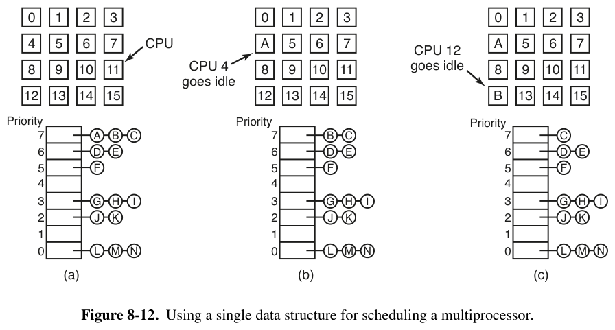
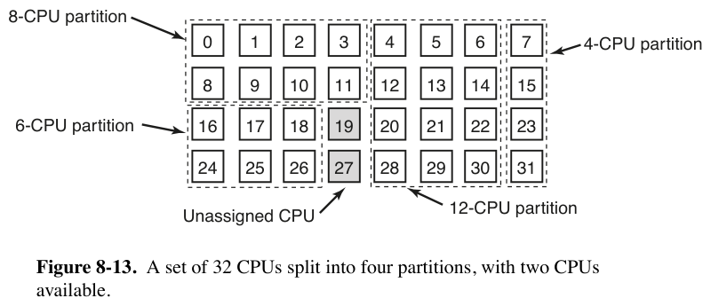
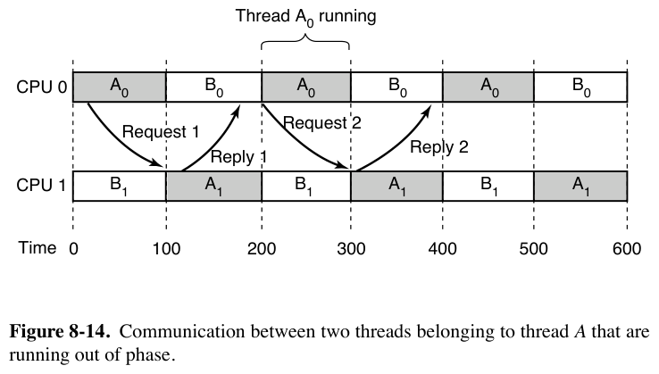
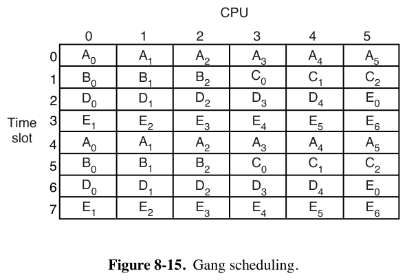

# 8.1.4 多处理器调度 —— 理论与 Linux 对照

> 书页 550–557（PDF 579–586）。逐小节精读笔记之五，回答：**书中的多处理器调度理论，Linux 7.1.3 是怎么实现的？**
> 同目录：[001.8.1.1](./001.8.1.1-多处理器硬件.md)｜[002.8.1.2](./002.8.1.2-多处理器OS类型与SMP.md)｜[003.8.1.3](./003.8.1.3-多处理器同步.md)｜[005.专题-图8-11](./005.专题-图8-11多锁避免缓存抖动.md)

**前置问题（书中三连问）**：
1. **调度什么**？用户线程内核看不见 → 只能调度进程；内核线程才可逐个调度。现代趋势：内核直接挑线程，进程角色弱化。
2. **多了一个维度**：单处理器只需答"下一个跑谁"；多处理器还要答"**在哪个 CPU 上跑**"。
3. **线程是无关的还是一伙的**？服务器上各用户进程互不相干；并行 make / 同进程多线程是一伙的——10 个编译留 1 个到最后，用户感知不到完成 → 应整组考虑；通信频繁的线程最好**同时**跑（共享缓存）、**就近**跑（NUMA 本地内存）。

---

# Part 1 书中理论：四种调度策略 + 安全

## 1.1 分时调度（Timesharing，图 8-12）



- 全系统**一个**就绪数据结构（按优先级分层）：16 个 CPU 全忙、14 个线程排队；CPU 4 先空 → 锁队列、取最高优先级 A；CPU 12 空再取 B……
- 优点：简单、天然负载均衡（不可能一 CPU 闲死另一忙死）。
- 两个缺点：CPU 多时**队列本身成为争用点**；上下文切换开销。
- **自旋锁 × 时间片的坑**：线程持自旋锁时时间片到期被调走 → 其他 CPU 空转干等它回来（单处理器上没这问题：mutex 被持有时后来者立即阻塞，不空转）。对策 **smart scheduling（智能调度，Zahorjan et al., 1991）**：拿自旋锁时设进程级标志，调度器看到标志就不剥夺，宽限它跑完临界区。
- **亲和性调度（affinity scheduling，Vaswani & Zahorjan, 1991）**："所有 CPU 一律平等，但有些 CPU 更平等"——线程上次跑在 CPU k，k 的缓存/TLB 还是它的 → 尽量还排 k。典型实现**两级调度**：顶层把线程分派到 CPU（创建时选最闲的），底层各 CPU 独立调度自己的私有就绪队列；CPU 没活干时从别的 CPU **偷线程**而不是闲着。三个好处：负载大致均衡、吃满缓存亲和、就绪队列争用最小化。

## 1.2 空间共享（Space Sharing，图 8-13）



- 面向**相关线程组**：整组创建时若有足够空闲 CPU，**每个线程独占一个 CPU**（非多道程序）同时开跑；不够就整组等待。线程阻塞也占着 CPU（闲着）；结束才还回池子。任意时刻 CPU 集合被静态分区（例：32 CPU 分成 4/6/8/12 四块 + 2 空闲）。
- 理论最优是"CPU 数×运行时间最小"（SJF 的多处理器类比），但实践难以打败 FCFS（Krueger & Livny, 1994）。
- 改进：**中央服务器动态管理并行度**（Tucker & Gupta, 1989）——应用定期查询可用 CPU 数，自行增减线程（Web 服务器 10 线程→5 线程的例子）。

## 1.3 组调度（Gang Scheduling，图 8-14/8-15）





- **病灶**：A0（CPU 0）与 A1（CPU 1）频繁请求-应答，但两 CPU 分时相位错开——A0 发请求要等 100ms 后 A1 才跑；A1 回应答又要等 200ms 后 A0 才跑 → **一次往返 200ms**。
- **三要素**（Ousterhout 1982 co-scheduling 的推广）：① 相关线程作为一个单元（gang）调度；② 全体成员**同时**在不同 CPU 上运行；③ 时间片**同起同止**。做法：所有 CPU **同步调度**——量子开始全体重排，量子中间不调度；线程阻塞则其 CPU 空转到量子结束。这样 A 组线程在一个量子内可以来回通信很多次（图 8-15：6 CPU、5 进程、24 线程分 4 个时间槽轮转）。

## 1.4 面向安全的调度（SMT 侧信道）

- 同核两个超线程共享缓存/TLB/执行单元 → **侧信道**：加密程序按密钥位执行 f0/f1（不同页 P0/P1），攻击者在另一超线程用大量虚拟页填满 TLB、逐页跳转计时——**慢跳 = TLB miss = 受害者刚访问过该页** → 由页访问序列（P7 循环后跟 P0 还是 P1）反推密钥位。Meltdown/Spectre（2018）后人人自危。
- 调度对策：**不同安全域的线程不同时上同核**。Windows Hyper-V 核调度器保证不同 VM 不共核，宁可空一个超线程；OpenBSD 干脆**默认禁用 SMT**（书的作者之一对 TLB 侧信道的研究直接促成了这个决定）。

---

# Part 2 Linux 7.1.3 实现

## 2.0 全景：书中概念 → Linux 机制对照表

| 书中概念（§8.1.4）| Linux 7.1.3（arm64）实现 | 源码 |
|-|-|-|
| 调度对象 = 内核可见的线程 | `task_struct`：线程即任务（`CLONE_THREAD` 共享进程），内核逐线程调度 | `include/linux/sched.h:820` |
| "跑谁"+"在哪跑"两个维度 | **两个函数**：`select_task_rq()` 答在哪跑，`pick_next_task()` 答跑谁 | `kernel/sched/core.c:3574`、`core.c:6005` |
| 单一就绪队列（图 8-12）| 历史遗迹（2.4 时代全局 runqueue 已废弃）；如今**每 CPU 一个 rq**；sched_ext 的全局 DSQ 是它的现代复刻 | `kernel/sched/sched.h:1131`（`struct rq`）、`sched.h:1386`（`runqueues`）、`include/linux/sched/ext.h:58`（`SCX_DSQ_GLOBAL`）|
| 两级调度（顶层分派/底层私有队列/偷线程）| fork/exec 时 `select_task_rq()` 分派到最闲 CPU；平时各 CPU 只调度自己的 rq；空闲时 `sched_balance_newidle()` 偷任务 | `core.c:4825`（fork）、`core.c:5507`（exec）、`fair.c:13181`（偷）|
| 亲和性（"有些 CPU 更平等"）| 硬：`cpus_mask` 亲和掩码；软：唤醒路径优先 prev CPU / 同 LLC 空闲 CPU；迁移阻力：`task_hot()` 缓存热判定——**全链路 + arm64 硬件落地深读见 §2.10** | `include/linux/sched.h:927`、`fair.c:8092`、`fair.c:9611` |
| 亲和性要懂缓存/NUMA 拓扑 | **调度域**按硬件拓扑分层：SMT→CLS→MC(LLC)→PKG→NUMA，负载均衡由内向外 | `kernel/sched/topology.c:1803` |
| smart scheduling（持锁不被调走）| 三层答案：内核自旋锁禁抢占；**rseq 时间片延长**（用户态，与书中逐句对应）；虚拟化 pv_spinlock + 定向让渡 | `spinlock_api_smp.h:154`、`include/linux/rseq_entry.h:128`、`virt/kvm/kvm_main.c:3960` |
| 空间共享（静态分区）| cpuset 硬分区（`cpuset.cpus.partition`）+ `partition_sched_domains()` 切割调度域 + `isolcpus=` | `kernel/cgroup/cpuset.c:207`、`topology.c:3010`、`kernel/sched/isolation.c` |
| 中央服务器动态调并行度 | cgroup v2 `cpuset.cpus`/`cpu.max` 动态调整；应用侧接口（查询 + 自适应线程池）| `kernel/cgroup/cpuset.c` |
| 组调度三要素（同起同止）| ✗ 无原生 gang；近亲两枚：cgroup **组公平**（时间维度）与 core scheduling 的**核内同步 pick**（空间维度，SMT 粒度全中三要素）；sched_ext 可 BPF 自实现 | `kernel/sched/core.c:6106` |
| 面向安全的调度（不共核）| **core scheduling**：同 cookie 任务才能同核并跑，否则强制空闲；`nosmt` 整体关闭 | `kernel/sched/core_sched.c:131`、`kernel/cpu.c:615` |
| NUMA 就近 | NUMA balancing + `migrate_degrades_locality()` 进入迁移判定 | `kernel/sched/fair.c:2683`、`fair.c:9658` |

## 2.1 "两个维度"在代码里的形状

书中说多处理器调度是二维的。Linux 恰好把它拆成两个正交的函数：

```c
// kernel/sched/core.c:3574 —— 第一维：放在哪个 CPU（fork/exec/唤醒时调用一次）
int select_task_rq(struct task_struct *p, int cpu, int *wake_flags)
{
	if (p->nr_cpus_allowed > 1 && !is_migration_disabled(p))
		cpu = p->sched_class->select_task_rq(p, cpu, *wake_flags);
	else
		cpu = cpumask_any(p->cpus_ptr);      // 只允许一个 CPU：没得选
	...
}

// kernel/sched/core.c:6005 —— 第二维：本 CPU 下一个跑谁（每次 __schedule() 调用）
__pick_next_task(struct rq *rq, struct task_struct *prev, struct rq_flags *rf)
```

而"调度什么"的答案就写在类型里：调度器眼里只有 `task_struct`——线程即任务（`CLONE_THREAD` 的线程共享一个进程/线程组，但各自是独立的调度实体）。这正是书中"现代趋势：内核直接挑线程"的形态。

## 2.2 图 8-12 的"单一就绪队列"：遗迹与复刻

Linux 2.4 时代的全局 runqueue 正是图 8-12，2.6 起**每 CPU 一个 `struct rq`**（调度类再在 rq 内分 `cfs/rt/dl` 子队列）：

```c
// kernel/sched/sched.h:1131 —— 主 per-CPU 运行队列（注释：多 CPU 加锁须按地址升序）
struct rq {
	unsigned int		nr_running;
	struct task_struct __rcu *curr;      // 本 CPU 正在跑的任务
	raw_spinlock_t		__lock;          // 本 rq 的锁（偷任务时要双 rq 锁）
	struct cfs_rq		cfs;             // 普通任务（EEVDF）
	struct rt_rq		rt;               // 实时任务
	struct dl_rq		dl;               // DEADLINE 任务
	struct sched_domain __rcu *sd;       // 本 CPU 的最低层调度域
	int			cpu;
	...
};
DECLARE_PER_CPU_SHARED_ALIGNED(struct rq, runqueues);   // sched.h:1386
```

有意思的是复刻：**sched_ext**（BPF 调度器框架）内置的全局派发队列 `SCX_DSQ_GLOBAL`（`include/linux/sched/ext.h:58`）就是图 8-12 的现代实现。示例调度器 `scx_simple.bpf.c` 的头部注释自己写明了书中那条缺点的边界条件——"在统一 L3 拓扑上工作得还行"（即小系统；言外之意：CPU 多了全局队列就是争用点）。

## 2.3 两级调度：三件套逐一对上

### ① 顶层分派：创建/执行新程序时选"最闲"的 CPU

书中："线程创建时分配到一个 CPU，例如按当时负载最轻的"。

```c
// kernel/sched/core.c:4825 —— fork：新任务入队前先选 CPU
void wake_up_new_task(struct task_struct *p)
{
	int wake_flags = WF_FORK;
	...
	__set_task_cpu(p, select_task_rq(p, task_cpu(p), &wake_flags));

// kernel/sched/core.c:5503 —— exec：注释直说这是"宝贵的均衡时机"
/*
 * sched_exec - execve() is a valuable balancing opportunity, because at
 * this point the task has the smallest effective memory and cache footprint.
 */
void sched_exec(void)
{
	dest_cpu = p->sched_class->select_task_rq(p, task_cpu(p), WF_EXEC);
```

慢路径的选法就是书中"最闲的"：`select_task_rq_fair()`（`fair.c:8829`）在带 `SD_BALANCE_FORK`/`SD_BALANCE_EXEC` 标志的域里调 `sched_balance_find_dst_cpu()`（`fair.c:7753`）——自顶向下**先找最闲的组再找组内最闲/最空的 CPU**（优先浅层 idle CPU，否则最小负载 CPU）。注释里"execve 时缓存足迹最小"正是亲和性的反面：**该弃旧亲和时就果断弃**。

### ② 底层：各 CPU 只碰自己的 rq

`__schedule()` → `__pick_next_task()` 只在**本 CPU 的 rq** 上选任务（按 dl > rt > fair > idle 的调度类顺序），无竞争路径连 `rq->lock` 都不用拿。书中"每个 CPU 获得自己的线程集合，底层用优先级或其他手段各自调度"——逐句命中。

### ③ 空闲偷任务：newidle balance

书中："CPU 没线程可跑时，从别的 CPU 拿一个而不是闲着"。

```c
// kernel/sched/fair.c:13181 —— schedule() 即将进入 idle 前被调用
static int sched_balance_newidle(struct rq *this_rq, struct rq_flags *rf)
{
	...
	if (!get_rd_overloaded(this_rq->rd) ||
	    this_rq->avg_idle < sd->max_newidle_lb_cost)   // 预算控制：预计空闲时间
		goto out;                                      // 短于偷任务成本 → 不偷
	...
	for_each_domain(this_cpu, sd) {                    // 从最内层域向外找
		if (sd->flags & SD_BALANCE_NEWIDLE)
			pulled_task = sched_balance_rq(this_cpu, this_rq,
						       sd, CPU_NEWLY_IDLE, ...);
		if (pulled_task || !continue_balancing)
			break;
	}
```

- 触发点在 `pick_next_task_fair()`（`fair.c:9297`）：本地无事可做 → 先偷再睡；
- **偷的成本意识**：`avg_idle < max_newidle_lb_cost` 就放弃——闲不了多久就别花锁钱去偷（双 `rq->lock` + 地址升序，正是 8.1.3 锁协议的大客户）；
- 另一条路是**周期性均衡**：`sched_tick()`（`core.c:5642`）→ `sched_balance_trigger()`（`fair.c:13356`）排队软中断 → `sched_balance_domains()`（`fair.c:12590`）按各域的 `next_balance` 节奏扫描。newidle 偷是"饿汉"路径（急），周期均衡是"管家"路径（稳）。

书中两级调度的三个好处，对应关系：负载均衡 = ①+③；缓存亲和 = ②+2.4；队列争用最小 = ②（平时零跨 CPU 加锁）。

## 2.4 亲和性调度：软硬三层

**硬亲和（用户指定）**：`task_struct` 带 `cpus_ptr/cpus_mask`（`include/linux/sched.h:925-927`），`sched_setaffinity(2)`（`kernel/sched/syscalls.c:1262`）可把线程钉在指定 CPU 集合——`select_task_rq()` 第一步就检查 `nr_cpus_allowed == 1`：没得选。

**软亲和（唤醒路径自动选）**——书中"CPU k 的缓存/TLB 还是它的"：

```c
// kernel/sched/fair.c:8120 —— select_idle_sibling() 的原话注释：
/*
 * If the previous CPU is cache affine and idle, don't be stupid:
 */
if (prev != target && cpus_share_cache(prev, target) &&
    choose_idle_cpu(prev, p) && ...)
	return prev;                        // 上次跑的 CPU 空闲且同 LLC → 回去
```

唤醒路径的完整决策链（`select_task_rq_fair()`，fair.c:8829）：
1. **wake_affine**（`fair.c:7670`）：唤醒者与被唤醒者通信频繁（producer-consumer）时，值得把 wakee 拉到 waker 旁边（同 LLC 共享缓存）——书中"通信线程不仅在时间上同时、还要在空间上靠近"的直接实现；
2. **select_idle_sibling**（`fair.c:8092`）：优先 target → prev CPU（同 LLC 才行，`cpus_share_cache()` 比的是 `sd_llc_id`，core.c:3886）→ `recent_used_cpu`（上次用过的 CPU，sched.h:862）→ LLC 域内找 idle core/idle CPU。所有候选都圈在**同一个 LLC 域**内——迁移可以，缓存不许凉透。

**迁移阻力（均衡路径的刹车）**——书中"cache 可能还有 A 的块"的定量版本：

```c
// kernel/sched/fair.c:82 —— "任务多热算缓存热"的阈值，可调
unsigned int sysctl_sched_migration_cost = 500000UL;   // 500 µs

// kernel/sched/fair.c:9611 —— 负载均衡搬任务前问一句：还热吗？
static int task_hot(struct task_struct *p, struct lb_env *env)
{
	/* SMT siblings share cache */
	if (env->sd->flags & SD_SHARE_CPUCAPACITY)
		return 0;                       // 同核兄弟间搬：缓存共享，永远不算热
	...
	delta = rq_clock_task(env->src_rq) - p->se.exec_start;
	return delta < (s64)sysctl_sched_migration_cost;  // 距上次运行 <500µs → 热，别搬
}
```

`can_migrate_task()`（`fair.c:9740`）综合判定：热任务不搬，除非均衡已连续失败超过 `cache_nice_tries` 次（拓扑默认 0-1，`topology.c:1689`）——**负载失衡痛过头了才舍得让缓存凉**。NUMA 系统再加一道 `migrate_degrades_locality()`（`fair.c:9658`）：搬走会离"首选节点"更远就判热（见 2.9）。

**亲和性要懂拓扑**——`task_hot()` 和 `select_idle_sibling()` 都依赖"谁跟谁共享什么"，这来自调度域分层（详见 [000.调度域与调度组](../../031.进程管理/008.进程调度/000.调度域与调度组.md)）：

```c
// kernel/sched/topology.c:1803 —— 自底向上的拓扑层级
static struct sched_domain_topology_level default_topology[] = {
	SDTL_INIT(tl_smt_mask, cpu_smt_flags, SMT),    // SMT: SD_SHARE_CPUCAPACITY|SD_SHARE_LLC
	SDTL_INIT(tl_cls_mask, cpu_cluster_flags, CLS),// 簇: SD_CLUSTER|SD_SHARE_LLC
	SDTL_INIT(tl_mc_mask, cpu_core_flags, MC),     // 核: SD_SHARE_LLC（共享末级缓存）
	SDTL_INIT(tl_pkg_mask, NULL, PKG),             // 封装
	{ NULL, },
};
// NUMA 系统再逐级加 NODE/DIE 层（cpu_numa_flags() 返回 SD_NUMA，topology.c:1836）
// sd_init() 给每层默认打开 SD_BALANCE_NEWIDLE|SD_BALANCE_EXEC|SD_BALANCE_FORK|SD_WAKE_AFFINE（topology.c:1691）
```

均衡顺序 = 从最内层域向外（`for_each_domain()` 逐层 `->parent`）：先在 SMT 兄弟间、再在 LLC 内、最后才跨 NUMA——**代价越大的迁移越晚考虑、门槛越高**（`imbalance_pct` 逐层放宽），这就是书中"affinity 要认真对待"的工程化。

> 亲和性这条线的完整展开——arm64 硬件如何把缓存层次翻译成 O(1) 判定、唤醒/均衡两条决策链的流程图、异构算力对亲和的反制——见 §2.10 深读。

## 2.5 smart scheduling：Linux 的三层答案

书中病灶：**持自旋锁的线程时间片到期被调走 → 其他 CPU 空转等它回来**。Linux 在三个层级各有解法：

**① 内核态：根除**。`spin_lock()` 内建 `preempt_disable()`（`include/linux/spinlock_api_smp.h:154`）——持锁期间 `preempt_count` 非零，调度器**根本不会**选它下台（比书中"设标志+宽限"更彻底）。宽限的语义挪到了解锁处：`preempt_enable()`（`include/linux/preempt.h:228`）发现 `TIF_NEED_RESCHED` 被置位 → 立即 `__preempt_schedule()`——临界区一结束马上"还债"。PREEMPT_RT 则反向解（自旋锁变可睡眠的 rtmutex，`kernel/locking/spinlock_rt.c`），两头都不犯病。详见 [003.8.1.3 §2.8](./003.8.1.3-多处理器同步.md)。

**② 用户态：rseq 时间片延长——书中 smart scheduling 的逐句实现**（`CONFIG_RSEQ_SLICE_EXTENSION`，`init/Kconfig:1977`，7.x 新增）：

| 书中（Zahorjan et al., 1991）| rseq 实现 |
|-|-|
| 线程拿自旋锁时**设标志** | 用户态写 `rseq->slice_ctrl.request = 1`（进临界区前）|
| 调度器看到标志**不停止它**，宽限一点时间跑完临界区 | 中断返回时若被要求调度：读 request 位 → **撤销 NEED_RESCHED、放行回用户态**，宽限默认 5µs（上限 50µs）|
| 释放锁时**清标志** | 出临界区清 request；若曾被宽限则调 `rseq_slice_yield(2)` 主动还 CPU |
| ——（书没写的滥用问题）| hrtimer 兜底：宽限到点强制 `set_need_resched_current()` |

核心在 `__rseq_grant_slice_extension()`（`include/linux/rseq_entry.h:128`）：`clear_tsk_need_resched(curr)` + `clear_preempt_need_resched()`，并记下到期时刻（`:178`）；定时器 `rseq_slice_expired()`（`kernel/rseq.c:584`）防止赖着不走。与书中方案的一个差别：标志是**线程级**而非进程级，且宽限是**有限时长**而非"跑完为止"——恶意线程无法靠设标志霸占 CPU。

**③ 虚拟机：同一疾病在新层级复发**。guest 里的 vCPU A 持锁，被 **host** 调度器调走 → 同 guest 其他 vCPU 空转（guest 内核毫无办法，它不知道自己被嵌套调度的）。Linux 的三件套：
- **pv_spinlock**：qspinlock 的半虚拟化扩展——等待者不空转而是 `pv_wait()` 睡眠（`kernel/locking/qspinlock_paravirt.h:16`），释放时 `pv_kick()` 唤醒；
- **`vcpu_is_preempted()`**：乐观自旋前先问 hypervisor"锁主的 vCPU 是不是已被调走"——是就别傻等（x86 KVM：`arch/x86/kernel/kvm.c:799`；arm64 无 SMT 场景恒 false：`arch/arm64/include/asm/spinlock.h:22`）；
- **定向让渡**：检测到 vCPU 在内核态空转（x86 PLE 陷入 / arm64 WFE 陷阱 `arch/arm64/kvm/handle_exit.c:167`）→ `kvm_vcpu_on_spin()`（`virt/kvm/kvm_main.c:3960`）在同一 VM 的 vCPU 里找被抢占的那个，`yield_to()`（`kernel/sched/syscalls.c:1410`）把物理 CPU 让给它——**host 调度器替 guest 补上了"让锁主先跑"**。

（延伸：`CONFIG_SCHED_PROXY_EXEC` 实验性支持"锁等待者把调度权捐赠给睡眠锁持有者"——`struct rq` 的 `donor/curr` 分离，`sched.h:1147`——把这一思路推进到睡眠锁。）

## 2.6 空间共享：cpuset 硬分区

书中图 8-13 的静态分区，Linux 用 **cpuset** 通用化：

- **cgroup v2 `cpuset.cpus`**：把 CPU 划成互不重叠的子集给不同组——最基本形态；
- **`cpuset.cpus.partition = root/isolated`**（`kernel/cgroup/cpuset.c:207`，`PRS_ROOT`/`PRS_ISOLATED`）：更硬的分区——这批 CPU 从默认调度域里**挖走**，`partition_sched_domains()`（`kernel/sched/topology.c:3010`）重建调度域：`root` 分区自成一体（域内仍均衡），`isolated` 分区**完全退出负载均衡**（没有域，任务不进不出）——后者就是书中"线程独占 CPU、整组静态分区"的严格版；
- **`isolcpus=` 启动参数**（`kernel/sched/isolation.c`，`HK_TYPE_DOMAIN`）：系统级的等价物，把指定 CPU 从调度域摘除，只接受显式亲和的任务；
- **动态并行度**（Tucker & Gupta 的"中央服务器"）：Linux 没有中央服务器，答案是**控制平面外置**——cgroup `cpu.max`/`cpuset.cpus` 可在线调整（[032.Control-Groups(CGroups)/002.CPUSET](../../032.Control-Groups\(CGroups\)/002.CPUSET/)），应用/运行时（如自适应线程池）定期查 `sched_getaffinity()`/cgroup 并伸缩线程数。Web 服务器 10→5 线程的剧本由用户态自己写。

## 2.7 组调度：没有同起同止，但有两个近亲

学术 gang scheduling 的三要素（整组为单元/同时跑/同起同止）Linux **没有**原生物——24 线程跨 4 个时间槽对齐轮转的那种全局节拍不存在。但拆开看：

**近亲一：cgroup 组公平（时间维度）**。`CONFIG_FAIR_GROUP_SCHED` 让"组"作为调度实体参与 EEVDF/CFS 分配（按 `cpu.weight`），保证并行 make、Web 服务这类"一伙的"按组拿到公平份额——**组是分配单位，但不是共振单位**（各线程时间片自由错开，图 8-14 的相位病仍可能发生）。这也呼应书中"10 个编译留 1 个到最后"的分组直觉：至少组内份额有了着落。

**近亲二：core scheduling 的核内同步 pick（空间维度）——三要素在 SMT 粒度全中**。`CONFIG_SCHED_CORE` 下 `pick_next_task()`（`kernel/sched/core.c:6106`）变为**核级同步决策**：

```c
// core.c:6106（开启 CONFIG_SCHED_CORE 后的核级版本，节选）
restart_multi:
	for_each_cpu_wrap(i, smt_mask, cpu) {          // ① 核内每个 SMT 兄弟各选一个
		p = pick_task(rq_i, rf);
		if (!max || prio_less(max, p, fi_before))
			max = p;                           //    取全核最高优先级者
	}
	cookie = rq->core->core_cookie = max->core_cookie;   // 它的 cookie 即"核 cookie"
	for_each_cpu(i, smt_mask) {                    // ② 每个兄弟只能跑同 cookie 的
		p = rq_i->core_pick;
		if (!cookie_equals(p, cookie)) {
			p = sched_core_find(rq_i, cookie);  //    换成同 cookie 的任务
			if (!p)
				p = idle_sched_class.pick_task(rq_i, rf);  // ③ 没有就强制空闲
		}
		if (p == rq_i->idle && rq_i->nr_running)
			rq->core->core_forceidle_count++;  //    记账：宁空不混
	}
```

对照三要素：**单元** = 同 cookie 的任务集合；**同时** = 一个时钟下全核统一选定（`core_task_seq/core_pick_seq` 序号防错位）；**阻塞则空转** = force idle——没有同 cookie 伙伴就宁可闲着超线程。动机与书中 gang 相反（gang 为通信性能把**朋友**凑齐，core sched 为侧信道把**敌人**拆开），机制却同构："同步决策 + 成员缺失时容忍空闲"。学术 gang 在云上的近似物是 VM/容器整机独占（cpuset 硬分区的特例）。

顺带一提：sched_ext 允许用 BPF 写调度器，想实验真 gang scheduling（比如给同 cgroup 的任务打标签、按标签同步选）不必改内核——框架已把"选谁"开放给用户态定义。

## 2.8 面向安全的调度：core scheduling + SMT 总开关

承上，core scheduling 的安全语义：

- **cookie 即安全域标签**：`prctl(PR_SCHED_CORE, PR_SCHED_CORE_CREATE/SHARE_TO/SHARE_FROM, ...)`（`kernel/sched/core_sched.c:131`）创建/传递 cookie，fork/clone/exec 继承（文档 `Documentation/admin-guide/hw-vuln/core-scheduling.rst`）——VM/容器各发一个 cookie = "不同安全域不共核"，与书中 Hyper-V 核调度器同思路；同 VM 内的攻击者共享 cookie，仍可能互咬（书中也这么提醒）；
- **它渗进负载均衡**：`task_hot()` 里 `!sched_core_cookie_match(cpu_rq(env->dst_cpu), p)` 直接判热不许搬（`fair.c:9641`）——安全约束优先于均衡收益；
- **arm64 无 SMT 也可用**：cookie 判定走的是调度域 `SD_SHARE_CPUCAPACITY`，拓扑上没有 SMT 层就退化为准空操作，但同 LLC 域内防"挤缓存"类干扰时仍有意义；
- **终极开关 = 禁 SMT**：`nosmt` 启动参数 → `cpu_smt_disable()`（`kernel/cpu.c:615`）；x86 上 L1TF/MDS 漏洞缓解默认就调它（`arch/x86/kernel/cpu/bugs.c`）——OpenBSD"默认禁用 SMT"的 Linux 对应物，只是 Linux 让你自己选。

## 2.9 NUMA 就近：书中一句话，Linux 一整套

书中"NUMA 上让线程访问近端内存"只是伏笔，Linux 是完整机制（详见 [../000.NUMA/README.md](../000.NUMA/README.md)）：NUMA balancing 采样缺页统计任务的"理想节点"（`task_numa_migrate()`，`fair.c:2683`；开关 `/proc/sys/kernel/numa_balancing`），`SD_NUMA` 域的均衡把节点倾向纳入判定（`migrate_degrades_locality()`：搬离首选节点 = 判热拒绝，搬向首选节点 = 放行）。

---

## 2.10 深读：亲和性调度——书页 552 三段话 × Linux 全链路 × 硬件落地（AGI 主实例）

书中讲亲和性调度只有 552 页上三段话（约 300 词），却是整节被引用最多的思想。§1.1/§2.4 已给出骨架，这里把它逐命题拆开，沿 **书中论断 → Linux 通用机制 → 硬件落地** 三层补全——所有行号均对准本仓库 Linux 7.1.3 源码，可直接跳转。平台基座按仓库约定：**主实例 Arm AGI CPU（SP113012，同构 136×Neoverse V3）**，**对照 AMD EPYC 9996（x86_64）**，异构机制（Cortex-A725/A520）收进文末附录 A；SLC/LLC/CLS 之类的短称速查见**附录 B**。

### 2.10.1 书中三个命题（Vaswani & Zahorjan, 1991）

| # | 命题 | 原文关键词（p.552）|
|-|-|-|
| ① 原理 | 所有 CPU 一律平等，但有些更平等：线程 A 长期跑 CPU k，k 的缓存塞满 A 的块，回 k 再跑命中率白捡；TLB 里连页表项都是热的 | "some CPUs are more equal" / "cache blocks preloaded" / "reducing TLB faults" |
| ② 算法 | 亲和调度 = **两级调度**：顶层创建时按最闲分派 CPU；底层各 CPU 私有队列独立调度；尽量终身绑定，没活干去别家偷，不许闲着 | "two-level scheduling" / "same CPU it ran on last time" / "takes one from another CPU rather than go idle" |
| ③ 收益 | 负载大致均衡 / 缓存亲和最大化 / 就绪队列争用最小化 | "three benefits" |

命题②的骨架已对上（§2.3 三件套），下面补齐两块书里没展开的：**亲和的物理基础在真实芯片上到底是什么**（2.10.2/2.10.3），以及**两条决策链的完整流程图**（2.10.4/2.10.5）。

### 2.10.2 亲和的物理基础：真实芯片的缓存层次 → 三个掩码 → O(1) 判定

主实例看 **Arm AGI CPU（SP113012）**——它与教科书上的"集群式 SoC"恰好相反（每核一个 DSU-120 单核簇、无簇级 L3，LLC＝全片一片 SLC），正好把"LLC 边界"这件事的两头都演示出来：

```
 Arm AGI CPU (SP113012) — 136x Neoverse V3, no SMT, 2 chiplets
 |
 |====================================================================|
 |  chiplet 0 (~68 cores)                  chiplet 1 (~68 cores)      |
 |                                                                     |
 |  core0  core1 ... core67              core68  core69 ... core135    |
 |  [L1+L2] [L1+L2] ...                  [L1+L2] [L1+L2] ...           |
 |    每核一个 DSU-120 "Direct connect" 单核簇（无簇级 L3/SCU）        |
 |         CHI RN-F ──┐                      ┌── CHI RN-F             |
 |                    ▼                      ▼                        |
 |     mesh: HN-F x N (SF 目录 + SLC 切片) + SN-F (DDR5)               |
 |     LLC = 全片一片 SLC —— 136 核共享（无"缓存墙"）                  |
 |====================================================================|
```

于是"亲和"的物理颗粒度要分芯片说——**同一堵墙，9996 有，AGI 没有**：

- **AGI（SP113012）**：全片一个 LLC，迁移在缓存层级上"无处可跌"（没有 9996 那种 CCX 缓存墙；同 chiplet 与跨 chiplet 在缓存层级上等价，只剩 mesh 跳数差别，调度器不可见）——真实颗粒度是**私有 L1（64K）/L2（2MB）/TLB 的温度**：回 prev CPU 省的就是这份预热；
- **EPYC 9996（x86 对照）**：MC＝CCX（16 核共享 64MB L3，共 16 块）——`cpus_share_cache()` 判的就是"是否同 CCX"，跨 CCX 回 prev＝L3 全冷，"同 LLC 才许回 prev"（2.10.4 ②）在这里有实牙实齿的墙。

| 层 | EPYC 9996（x86，对照） | Arm AGI CPU（主实例） |
|-|-|-|
| SMT | SMT2（512 CPU）→ SMT 域存在 | 无 → SMT 域不建（arm64 多数如此）|
| 簇（CLS）| 无此层 | DSU-120 单核簇 → CLS 建了即退化 |
| LLC（MC）| CCX＝16 核×64MB，×16 块（缓存墙）| 全片一片 SLC＝136 核（无墙）|
| NUMA | NPS1/2/4 可切 | 单节点形态 |

（层级/一致性/原子操作的完整展开见姊妹篇 [003.AGI-SP113012-层级架构-缓存一致性-原子操作](../../031.进程管理/008.进程调度/000.调度组与调度域/003.AGI-SP113012-层级架构-缓存一致性-原子操作.md)。）

内核把这套硬件翻译成"一次整数比较就能判定亲和"的流水线：

```
  硬件描述（DT cpu-map；ACPI 系统走 PPTT）        drivers/base/arch_topology.c
 ┌──────────────────────┐
 │ socket0              │   parse_socket  :619
 │  └ cluster0          │   parse_cluster :551
 │     ├ core0 → cpu0   │   parse_core    :500
 │     └ core1 → cpu1   │
 └──────────────────────┘
            │  store_cpu_topology（arm64 调用点 smp.c:236 → :961）
            ▼
      struct cpu_topology[cpu]:
      package_id / cluster_id / core_id / thread_id
            │  update_siblings_masks (:745)
            │  ＋ cacheinfo 缓存树（last_level_cache_is_shared, cacheinfo.c:71）
            ▼
 ┌────────────────────┬────────────────────┬───────────────────┐
 │ llc_sibling        │ cluster_sibling    │ core_sibling      │
 │ share the same LLC │ same cluster_id    │ same package_id   │
 └────────────────────┴────────────────────┴───────────────────┘
        │                          │
        ▼                          ▼
  cpu_coregroup_mask (:705)  cpu_clustergroup_mask (:732)
        │                          │
        ▼                          ▼
   MC 域 (SD_SHARE_LLC)      CLS 域 (SD_CLUSTER)
        └────────────┬─────────────┘
                     ▼
   update_top_cache_domain（kernel/sched/topology.c:676）
                     ▼
   per-CPU：sd_llc / sd_llc_id / sd_share_id   ← 亲和判定的"钥匙"
                     ▼
   cpus_share_cache()      core.c:3886   一次整数比较，O(1)
   cpus_share_resources()  core.c:3898   cluster 机型更细一级（L2/LLC tag）
```

关键代码是一把"sibling 掩码"梳子——注意 LLC 掩码**不看 cpu-map，看 cacheinfo**：

```c
// drivers/base/arch_topology.c:745 —— arm64 每颗 CPU 上线时跑一遍
void update_siblings_masks(unsigned int cpuid)
{
	...
	/* LLC 掩码：两 CPU 的"最后一级缓存"是不是同一块硬件 */
	if (last_level_cache_is_shared(cpu, cpuid)) {      // cacheinfo.c:71
		cpumask_set_cpu(cpu, &cpuid_topo->llc_sibling);
		cpumask_set_cpu(cpuid, &cpu_topo->llc_sibling);
	}
	if (cpuid_topo->package_id != cpu_topo->package_id)
		continue;                          // → core_sibling
	if (cpuid_topo->cluster_id != cpu_topo->cluster_id)
		continue;                          // → cluster_sibling
	if (cpuid_topo->core_id != cpu_topo->core_id)
		continue;
	cpumask_set_cpu(cpuid, &cpu_topo->thread_sibling);   // → thread_sibling
}
```

三个掩码各喂一个调度域：`llc_sibling` → MC 域（`SD_SHARE_LLC`，与 NUMA 节点取更小者，arch_topology.c:705）；`cluster_sibling` → CLS 域（`SD_CLUSTER`，:732；**CLS＝调度域拓扑表里 cluster 层的名字**，完整释义见文末附录 A.4）——**这层是 arm64 主场**（`cpu_cluster_flags()` = `SD_CLUSTER|SD_SHARE_LLC`，kernel/sched/topology.c:1772），x86 多数机器没有；`thread_sibling` → SMT 域，arm64 虽声明 `ARCH_SUPPORTS_SCHED_SMT`（arch/arm64/Kconfig:86），绝大多数实现无 SMT，此层不建。

末端收敛成两个 per-CPU 整数，供唤醒/均衡路径随时查询：

```c
// kernel/sched/core.c:3886 —— 书中"认真对待亲和性"的最终形态：一次整数比较
bool cpus_share_cache(int this_cpu, int that_cpu)
{
	return per_cpu(sd_llc_id, this_cpu) == per_cpu(sd_llc_id, that_cpu);
}
```

同一份代码，三台机器三种结局——这就是"LLC 边界由硬件描述说了算"的意义：

| 机器（拓扑来源）| llc_sibling → MC 域 | cluster_sibling → CLS 域 | 对亲和判定的影响 |
|-|-|-|-|
| EPYC 9996（ACPI PPTT）| CCX 16 核 | 无此层 | `cpus_share_cache()`＝同 CCX，真墙 |
| Arm AGI CPU（ACPI PPTT）| 全片 136 核 | 单核（退化）| `cpus_share_cache()` 恒真；`sched_cluster_active` 关，2.10.4 ⑦ 的 cluster 回落成死路 |
| A725/A520 末端 SoC（DT）| DSU 簇（簇级 L3）| ＝ llc_sibling | MC 与 CLS 冗余，建域时 MC 被削（arch_topology.c:720-727 注释原话）|

- **LLC 边界由 cacheinfo 说了算，软件不猜**：`last_level_cache_is_shared()`（cacheinfo.c:71）逐缓存叶比对"谁跟谁共享最后一级"——AGI 的 PPTT 把 SLC 描述成全片共享，MC 就建到 136 核；9996 的 PPTT 把 L3 描述在 CCX 里，MC 就停在 16 核；
- **CLS 成活的条件**：`cluster_sibling` 必须比 LLC 更小才值得一层域——AGI 的单核簇直接退化；A520 的"complex 共享 L2 对"则可能撑起一层有实义的 CLS（成活/退化的完整分析见附录 A.4）。

### 2.10.3 命题①的 TLB 半句：arm64 的 ASID 模型

书里 "the TLB may also contain the right pages" 在 arm64 上有一套精确对应物：

```c
// arch/arm64/mm/context.c:23 —— 每个 mm 一个 ASID（8/16 位 + 世代号滚动）
static atomic64_t asid_generation;
// context.c:158 —— ASID 用尽 → 世代滚动，旧世代表项批量作废
static u64 new_context(struct mm_struct *mm)
```

- 线程迁移**不换 ASID**：ASID 跟着 mm 走（与 x86 PCID 同构），不存在"迁个移还得重刷 TLB"；
- 旧 CPU 上遗留的表项无害：要么被下一次 TLBI 作废，要么随世代滚动自然死亡（`new_context()`）；
- **刷新通道是总线广播**：`__tlbi` 指令经 DVM 广播到 inner shareable 域（arch/arm64/include/asm/tlbflush.h:32-42）——不像 x86 按 `mm_cpumask` 逐 CPU 发 IPI；arm64 的 `mm_cpumask` 只在 erratum 4193714 的 DVMSync 补丁路径出场（tlbflush.h:85-121）。

于是迁移成本的结构在两个架构上不同：x86 要掂量"flush IPI 风暴"，arm64 刷新是一条广播指令的事——**迁移的真实成本几乎 100% 是缓存 + TLB 预热重建**。书中"cache 命中率 + TLB 缺页"两笔账在 arm64 上压进同一个天平，任务比在 x86 上更"黏"。

### 2.10.4 命题②正向：唤醒路径决策链（select_task_rq_fair）

"尽量回老家"的每一步——顺序、条件、行号：

```
select_task_rq_fair(p, prev_cpu)                          fair.c:8829
│
├─ WF_CURRENT_CPU 且本 CPU 在 cpus_ptr ──────────────────► 用本 CPU (:8846)
│
├─ 未 overutilized（能效模式）─► find_energy_efficient_cpu (:8851, EAS)
│
├─ want_affine = !wake_wide(p) && 唤醒者 CPU 在 cpus_ptr (:8857)
│    └─ 存在 SD_WAKE_AFFINE 域且 prev_cpu 在其中 → wake_affine (:7670)
│         WA_IDLE：唤醒者本 CPU 空闲且同缓存 → 留下别动 (:7611)
│
▼
select_idle_sibling(p, prev, target)    fair.c:8092  —— 候选全锁在同一 LLC 内
│
├─ ① target 空闲且 asym_fits_cpu ────────────────────────► target (:8115)
├─ ② prev 同 LLC ＋ 空闲 ＋ fits ——"don't be stupid" ────► prev (:8120)
│       （cluster 机型还须 cpus_share_resources 才即刻返回 :8126）
├─ ③ per-CPU kthread 堆叠（IO 完成回血模式）─────────────► prev (:8141)
├─ ④ recent_used_cpu 同 LLC ＋ 空闲 ＋ fits ─────────────► 上上次的 CPU (:8150)
├─ ⑤ 异构系统 ──► select_idle_capacity：先"放得下"再挑容量 (:8171/8027)
├─ ⑥ sd_llc 域内扫 idle core / idle cpu (:8201, select_idle_cpu :7952)
├─ ⑦ 全空手 → cluster 回落 prev_aff / recent_used_cpu (:8205-8214)
└─ ⑧ 还没有 → target
```

三个从书里长出来、又比书多走一步的点：

1. **"同 LLC 才许回 prev"**（②④ 的前置 `cpus_share_cache()`）：迁移可以，缓存不许凉透——这是"尽量终身绑定"（书）与"必须负载均衡"（现实）的执行版折中；
2. **`recent_used_cpu` 多记一档**（fair.c:8150，字段在 include/linux/sched.h:862）：书只说"上次"，Linux 连"上上次"都记着——wait/wake 轮换的 producer-consumer 各守一个"最近惯用 CPU"，不互相踩；
3. **cluster 回落**（⑦）：扫遍 LLC 域也没空闲时，退回 prev/recent_used——既然要饿，宁可饿在缓存还温热的 CPU 上。此路只在 `sched_cluster_active` 机型有意义（topology.c:674），又一个 arm64 主场开关。

**平台注记（同一流程图在三台机器上的形状）**：

- **AGI（同构）**：①②④ 的 `asym_fits_cpu()` 恒真（无非对称容量域）；⑤ 不走；EAS 早退——`find_energy_efficient_cpu()` 先看 `rd->pd`（fair.c:8655）再看 `sd_asym_cpucapacity`（fair.c:8663），AGI 有 EM（cppc_cpufreq 注册）却无非对称容量层，双双缺席即返回 -1、回落 prev_cpu（fair.c:8854）——"**有 EM 也未必有 EAS**"；⑦ 死路（`sched_cluster_active` 关）→ 实际链＝①②③④⑥⑧；
- **9996（SMT2）**：⑥ 的 `test_idle_core`/`select_idle_smt` 生效；②④ 的"同 LLC"＝同 CCX——跨 CCX 的 prev 不会被点名（缓存墙的调度器语义）；
- **A725/A520（异构）**：⑤ `select_idle_capacity()` 升为主角，亲和让位算力（见附录 A）。

### 2.10.5 命题②负向：均衡路径的迁移阻力（can_migrate_task）

偷任务/搬负载不是自由的——`can_migrate_task()` 自上而下逐道刹车：

```
sched_balance_rq / detach_tasks：把 p 从 src_rq 搬往 dst_cpu
│
▼
can_migrate_task(p, env)   fair.c:9740     —— 一票否决链
├─ sched_delayed 且本次不是搬负载 ─────────────► 不搬 (:9757)
├─ 目标层级被 throttle ────────────────────────► 不搬 (:9760)
├─ 不合格(eligible) 且尚无失败记录 ─────────────► 不搬 (:9769)
├─ per-CPU kthread ────────────────────────────► 不搬 (:9774)  钉在原地是本职
├─ task_is_blocked（proxy exec 锁等待）─────────► 不搬 (:9777)
├─ dst_cpu ∉ p->cpus_ptr ──────────────────────► 不搬 (:9780)  硬亲和：用户意志
├─ 正在运行 / 是 donor ─────────────────────────► 不搬 (:9815)
│
├─ hot = task_hot(p, env)  (:9611)
│    ├─ SMT 兄弟间：永不判热（缓存共享，搬了不亏）(:9624)
│    ├─ core cookie 不匹配：判热（安全约束伪装成亲和）(:9641)
│    └─ 距上次运行 < sysctl_sched_migration_cost(500µs)：热 (:9647)
│  NUMA 开启时改问 migrate_degrades_locality (:9831)：
│    搬离首选节点 = 热；搬向首选节点 = 冷
│
└─ !hot ───────────────────────────────────────► 搬
   hot 但 nr_balance_failed > cache_nice_tries ─► 忍痛搬 (:9837)
   —— 失衡痛过头了，才舍得让缓存凉
```

"热"在这里从比喻变成了三张定量的否决票：**缓存热**（500µs）、**NUMA 变远**（degrades_locality）、**cookie 不匹配**（安全）。刹车也不是绝对的——连续失败超过 `cache_nice_tries`（拓扑默认 0-1，topology.c:1689）就强行搬。书中"亲和 vs 均衡"的矛盾，内核用失败计数器这种土办法仲裁。

平台注记：`task_hot()` 的 SMT 分支（:9624）只在 9996 上活（SMT2 兄弟间共享缓存，永不判热），AGI 上是无 SMT 的死代码；"同 LLC"判定的颗粒度差异见 2.10.2 的三机器对照表。

### 2.10.6 书里没有的第三维：异构算力（异构机型专用）

big.LITTLE/DynamIQ 混核机型上，"所有 CPU 一律平等"连字面都不成立——亲和还得过**算力匹配**这道书里不存在的闸门：

- DT `capacity-dmips-mhz`（drivers/base/arch_topology.c:279）声明每 CPU 相对算力 → 异构时建立 `SD_ASYM_CPUCAPACITY` 域（`sd_asym_cpucapacity`，kernel/sched/topology.c:671）；
- 唤醒路径所有"回老家"候选（①②④）都要先过 `asym_fits_cpu()`（fair.c:8074）：小核再闲，大任务也不许去——**缓存亲和让位于算力匹配**；`select_idle_capacity()`（fair.c:8027）在"放得下"的集合里才谈空闲与容量；
- misfit 反向撕毁"终身绑定"：`update_misfit_status()`（fair.c:5338）把"大任务困在小核"记入 `misfit_task_load`，均衡路径 `migrate_misfit`（fair.c:9990）专搬"源 CPU 放不下"的任务；
- 再叠加能效维度：未 overutilized 时 `find_energy_efficient_cpu()`（fair.c:8851，EAS）先于一切亲和逻辑做全局取舍。

**这条维度在本文两台主实例机器上都不激活**：9996（x86 同构，无 DMIPS 描述）与 AGI（arm64 同构，136 核同为 capacity=1024）都没有非对称容量层——`asym_fits_cpu()` 恒真、EAS 不激活（2.10.4 的平台注记）。完整教学模型——Cortex-A725 + A520、cap=1024/252 的出处、PD/EM 划分与 EAS 能量比较、CLS 域成活/退化——见文末**附录 A**。

书中命题①在异构机上由此改写为：**"有些 CPU 更平等"不仅因为缓存热，还因为算力大、能耗低——亲和是三者博弈后的最优解，不是无条件的乡愁。**

### 2.10.7 收束：三个好处的平台对账

| 书中好处（p.552）| Linux 通用机制 | 平台落点（AGI＝主实例，9996＝对照）|
|-|-|-|
| 负载大致均衡 | newidle 偷任务 + 周期均衡（§2.3）| AGI：MC＝全片 136 核，单次偷任务的扫描/双加锁代价大 → `avg_idle` 成本预算（§2.3）更关键；异构机型 misfit 改写"均衡"定义（附录 A）|
| 缓存亲和最大化 | `select_idle_sibling()` 圈定 LLC（fair.c:8092）| 9996：CCX＝真缓存墙，"同 LLC 才回 prev"有实义；AGI：全片一片 SLC，颗粒度退到私有 L1/L2/TLB（prev/recent_used 的温度）|
| 就绪队列争用最小 | per-CPU rq，平时零跨 CPU 加锁（§2.2）| 架构无关 |

一句话：**两级调度是书给出的"算法形状"，芯片决定了"形状里的权重"——同一份 Linux 调度器，在 9996 上守 CCX 墙，在 AGI 上守私有 L2 的温度，在 A725/A520 上先问"配不配"（附录 A）。**

---

## 3. 学习小结

- **谱系与答案**：书中策略是一条谱系——单队列分时（简单/争用）→ 两级+亲和（防缓存变凉）→ 空间共享（整组独占）→ 组调度（同起同止）→ 安全感知（不共核）。Linux **一个系统吃下大半条谱系**：per-CPU rq + 调度域 = 两级/亲和；`task_hot`/`migration_cost` = 亲和性的定量化；cpuset partition = 空间共享；cgroup = 组公平；core scheduling = 安全；唯 gang 的全局时间片对齐没有对应物（core scheduling 在 SMT 粒度复刻了它的机制）。
- **二维调度的代码形状**：`select_task_rq()`（在哪跑）× `pick_next_task()`（跑谁）两个函数正交分解；fork/exec/唤醒是"在哪跑"的三个决策点，`__schedule()` 是"跑谁"的主战场。
- **smart scheduling 的三层进化**：内核态根除（preempt_disable）、用户态宽限（rseq slice extension——书中 1991 年方案与 30 年后实现的正面相认）、虚拟化补课（pv_spinlock/vcpu_is_preempted/定向让渡）。同一疾病在每一层都被重新治了一遍。
- **一切反迁移力量共用一个词"热"**：`task_hot()` 把"缓存还热"（500µs）、"NUMA 变远"（degrades_locality）、"core cookie 不匹配"统一成迁移阻力——均衡是收益，热是成本，调度域层级决定从哪里开始算这笔账。
- **亲和性的平台对账**（§2.10，主实例 AGI）：物理边界随芯片而变——9996 的墙在 CCX（MC＝16 核），AGI（SP113012）全片一片 SLC（MC＝136 核），颗粒度退到私有 L1/L2/TLB 的温度（prev/recent_used_cpu/task_hot 500µs 保护的正是它）；ASID + 总线广播 TLBI 让迁移成本几乎只剩"预热重建"；异构机型（A725/A520，附录 A）的算力维度（`asym_fits_cpu`/misfit/EAS）会在错配时推翻缓存亲和。
- 与 8.1.3 的呼应：调度器的一切设计都建立在"**持锁不被抢占**"（自旋锁禁抢占）与"**偷任务要拿锁**"（rq->lock 双锁按地址升序 = 8.1.3 的锁序规则）之上——三章一条线：硬件拓扑（8.1.1）→ 同步原语（8.1.3）→ 用原语搭出的二维调度（本节）。

深入阅读（本仓库其他目录）：[031.进程管理/008.进程调度/003.SMP负载均衡](../../031.进程管理/008.进程调度/003.SMP负载均衡)｜[031.进程管理/008.进程调度/000.调度域与调度组](../../031.进程管理/008.进程调度/000.调度域与调度组.md)｜[031.进程管理/008.进程调度/008.SMT](../../031.进程管理/008.进程调度/008.SMT)｜[031.进程管理/008.进程调度/003.组调度.md](../../031.进程管理/008.进程调度/003.组调度.md)

---

## 附录 A：Cortex-A725 + A520 异构教学对照

> 本文主实例 AGI（同构 136×Neoverse V3）与对照 9996 都没有非对称容量层——EAS、misfit、`asym_fits_cpu()` 这些机制只有放在**异构**系统里才有意义。本附录是 §2.10.4/§2.10.6 中所有异构教学数字的出处（量化模型与 [005.绿色节能调度器 · 附录 B](../../031.进程管理/008.进程调度/005.绿色节能调度器/README.md) 同源；TRM 依据见该附录的参考资料表）。

### A.1 两颗核差在哪

| 维度 | Cortex-A725（大核） | Cortex-A520（小核） | 对调度的意义 |
|-|-|-|-|
| 流水线 | 乱序（寄存器重命名→乱序发射） | 顺序（in-order＋分支预测） | 同频下 A725 每周期完成更多工作 → `capacity-dmips-mhz` 1024 vs 403 |
| L2 | 每核私有（8 路，128KB~1MB） | 每 complex（一对核）共享（128~512KB） | PD 划分：A725 每核/数核一域，A520 成对一域；也是 CLS 成活/退化的根源（A.4）|
| L3 | 经 DSU-120 共享簇级 L3 | 同左 | MC（LLC）域跨大小核 |
| 功耗 | 功耗曲线更陡（dynamic-power-coefficient 更大） | 能效优先 | EM 中同频点 A520 功耗远低 → EAS 倾向小核 |

### A.2 capacity 归一化：1024 / 252 从哪来

- 树内真实值：A520 `capacity-dmips-mhz = <403>`（[cix/sky1.dtsi:25](../../../000.SOURCE_CODE/003.LINUX-7.1.3/000.LINUX-7.1.3/arch/arm64/boot/dts/cix/sky1.dtsi)）；A725 取 1024 为示意；
- 书（5.x）只按 DMIPS 比值归一化 → 小核 403；7.1.3 的 `topology_normalize_cpu_scale()`（arch_topology.c:241）把"**原始算力 × 最大频率**"一起归一化：小核 403@2.0GHz vs 大核 1024@3.2GHz → 小核 ≈ **252**、大核＝**1024**（频率为示意值）——这就是正文（2.10.6）里 cap=1024/252 的出处。

```
 异构 big.LITTLE 的 cpu_scale:
  1024 +----------------+  Cortex-A725 @3.2GHz (每核私有 L2, 每核/数核一个 PD)
       |################|
       |################|
       |################|
   252 +----------------+  Cortex-A520 @2.0GHz (complex 成对共享 L2, 一对一个 PD)
       |****            |
       |****            |
     0 +----------------+
```

### A.3 异构机上的亲和流程（§2.10.4/§2.10.6 的异构版）

```
   big cluster (A725, cap=1024)          LITTLE cluster (A520, cap=252)
 ┌──────────────────────────┐     ┌──────────────────────────┐
 │  PD0                     │     │  PD1                     │
 │   CPU4        CPU5       │     │   CPU0        CPU1       │
 │   idle        busy       │     │  [task A]     idle       │
 └──────────────────────────┘     └──────────────────────────┘
      task A（util 大）上次跑在 CPU0 —— 书中命题：下次还回 CPU0？

 唤醒路径（fair.c:8092）:
   ②④ 的 asym_fits_cpu(A, CPU0) = 否 → 亲和作废（错配时）
   ⑤ select_idle_capacity() (fair.c:8027)：先"放得下"，再挑容量
   未过载时更早一步：find_energy_efficient_cpu() (fair.c:8640, EAS)
     按 PD/EM 估能量两次估算（教学数字 E≈533 vs E≈2663，
     出处：绿色节能调度器笔记 compute_energy 一节）
 均衡路径:
   update_misfit_status() (fair.c:5338)：A 在 CPU0 = misfit
   migrate_misfit (fair.c:9990)：只认"源 CPU 放不下"的任务 → 搬去大核
   —— 错配是急症，"热"不再是挡箭牌
```

### A.4 CLS 域的成活/退化（A520 共享 L2 vs A725 私有 L2）

**CLS 是什么**：调度域拓扑表 `default_topology[]`（kernel/sched/topology.c:1803-1820）里的**层级名**——`SDTL_INIT(tl_cls_mask, cpu_cluster_flags, CLS)`（topology.c:1809），即 **cluster（簇）层**：受 `CONFIG_SCHED_CLUSTER` 开关控制，域标志 `SD_CLUSTER|SD_SHARE_LLC`（`cpu_cluster_flags()`，topology.c:1772），span 取 `cpu_clustergroup_mask()`（arch_topology.c:732）＝同 `cluster_id` 的 CPU 集合（即 2.10.2 流水线里的 `cluster_sibling`）。整张层级名速查：**SMT**（超线程，:1805）→ **CLS**（簇，:1809）→ **MC**（共享 LLC 的核组，:1813）→ **PKG**（封装，:1815）→ NUMA 系统再往上叠 NODE 层。

**"成活/退化"是什么**：建域完成后有一道冗余裁剪 `sd_degenerate()`（topology.c:171）——某层域若与相邻层的 span 相同（没多管任何 CPU），就被合并削掉。所以 CLS 只有在"**簇比 LLC 更小**"时才成活（簇内共享的是比 LLC 更近的资源，如 L2）；簇与 LLC 重叠时退化消失。逐机型：

- **A520**：一对核共享一块 L2（complex）——若 SoC 按 complex 划簇，`cluster_sibling`＝共享 L2 的核对 → CLS 有实义（正是 `cpus_share_resources()`（core.c:3898）想表达的"L2/LLC tag 级"共享）；
- **A725**：每核私有 L2，簇的意义只剩簇级 L3——簇 span 若与 LLC 重叠，MC 与 CLS 冗余，建域时被削（arch_topology.c:720-727）；
- 呼应 2.10.2 三机器对照表：同一份建域代码，CLS 成活与否全看硬件描述把簇划在哪。

---

## 附录 B：缩略语速查表

> 收录本文（含 §2.10 与附录 A）实际用到的短称，按主题分组；"本文语境"列给出它在本文中的具体含义/落点。CHI 节点类型等 AGI 相关细节的展开见姊妹篇 [003.AGI-SP113012-层级架构-缓存一致性-原子操作](../../031.进程管理/008.进程调度/000.调度组与调度域/003.AGI-SP113012-层级架构-缓存一致性-原子操作.md)。

### B.1 缓存与地址翻译

| 缩写 | 全称 | 本文语境说明 |
|-|-|-|
| L1/L2/L3 | Level 1/2/3 Cache | 一/二/三级缓存；AGI 上 L1（64K）/L2（2MB）每核私有，L3 即 SLC |
| SLC | System Level Cache | 系统级缓存——Arm 体系放在"核簇之外、互连侧"的共享缓存（DSU 内 L3 或 CMN 的 HN-F 切片）；AGI 的 SLC＝LLC＝全片一片 |
| LLC | Last Level Cache | 末级缓存——MC 域（`SD_SHARE_LLC`）的物理依据，边界由 cacheinfo/PPTT 描述 |
| SCU | Snoop Control Unit | （旧 DynamIQ）簇内探测控制单元；DSU-120 Direct connect 模式下没有（2.10.2 图注"无簇级 L3/SCU"）|
| DSU(-120) | DynamIQ Shared Unit | Arm 的"簇"单元：聚合若干核、可选共享 L3；-120 这一代支持 Direct connect（单核直连 CMN、无簇级 L3）|
| CMN | Coherent Mesh Network | Arm 一致性网格互连（如 CMN-700）：HN-F/SN-F 节点铺成 mesh |
| TLB | Translation Lookaside Buffer | 地址翻译缓存；arm64 表项按 ASID 标记 |
| TLBI | TLB Invalidate | TLB 失效指令；arm64 上经 DVM 广播到 inner shareable 域 |
| ASID | Address Space Identifier | 地址空间标识符：每个 mm 一个（context.c:23），迁移不换 |
| PCID | Process Context Identifier | x86 的 ASID 对应物（2.10.3 对照）|
| DVM | Distributed Virtual Memory | AMBA 的分布式虚拟内存维护通道——TLBI 广播的物理路径 |
| DMIPS | Dhrystone MIPS | Dhrystone 基准的 MIPS 数；`capacity-dmips-mhz` 用它描述每 MHz 相对算力（附录 A.2）|

### B.2 互连与一致性（CHI 视角，AGI）

| 缩写 | 全称 | 本文语境说明 |
|-|-|-|
| CHI | AMBA 5 Coherent Hub Interface | Arm 一致性总线协议（AGI 核口经 DSU Direct connect 接 CHI）|
| RN-F | Request Node, Fully coherent | 核的一致性请求节点（每核一个，2.10.2 图中的 RN-F）|
| HN-F | Home Node, Fully coherent | 一致性枢纽：SF 目录 ＋ SLC 切片（PoS/PoC 语义见姊妹篇）|
| SN-F | Slave Node, Forwarding | 从节点：接 DDR5 内存控制器 |
| SF | Snoop Filter | 探测过滤器（目录式一致性）：记录"谁缓存了这行"，探针只发目录内成员 |

### B.3 拓扑描述来源与平台机型

| 缩写 | 全称 | 本文语境说明 |
|-|-|-|
| DT | Device Tree | 设备树：末端/嵌入式 SoC（A725+A520 类）的 cpu-map 与缓存描述来源 |
| PPTT | (ACPI) Processor Properties Topology Table | ACPI 拓扑表：服务器（AGI、9996）的层级与缓存描述来源 |
| SMP | Symmetric Multiprocessing | 对称多处理：同构 CPU 共享内存的形态（§2.0 单队列的时代背景）|
| AGI CPU / SP113012 | Arm AGI CPU | 本文 arm64 主实例：136×Neoverse V3、无 SMT、单核簇、全片一片 SLC（2.10.2）|
| EPYC 9996 | AMD EPYC 9996 | x86 对照实例：256C/512T（SMT2）、16 CCX×64MB L3、8CCD+2IOD、NPS1/2/4 |
| A725 / A520 | Cortex-A725 / Cortex-A520 | 异构教学模型的大/小核（附录 A：cap=1024/252 的出处）|

### B.4 调度域层级名（topology.c 的 default_topology 表）

| 缩写 | 全称 | 本文语境说明 |
|-|-|-|
| SMT | Simultaneous Multithreading | 同时多线程层（`SD_SHARE_CPUCAPACITY`，:1805）：9996 有（SMT2），AGI 无 |
| CLS | CLuster | 簇层（`SD_CLUSTER`，:1809）：成活/退化机制见附录 A.4 |
| MC | Multi-Core | 共享 LLC 的核组层（`SD_SHARE_LLC`，:1813）：9996＝CCX，AGI＝全片 |
| PKG | Package | 封装层（:1815）|
| NUMA | Non-Uniform Memory Access | 非一致访存：跨节点访存延迟不等（§2.9）|
| NODE/DIE | — | NUMA 节点层/裸片层：NUMA 系统在 PKG 之上再叠（§2.4）|
| SD_* | Scheduling Domain flags | 调度域标志前缀：`SD_SHARE_LLC`/`SD_CLUSTER`/`SD_ASYM_CPUCAPACITY`/`SD_WAKE_AFFINE`/`SD_BALANCE_*`… |

### B.5 调度器机制

| 缩写 | 全称 | 本文语境说明 |
|-|-|-|
| CFS | Completely Fair Scheduler | 完全公平调度器——fair 类的前身语义，7.x 公平性算法由 EEVDF 接管 |
| EEVDF | Earliest Eligible Virtual Deadline First | 最早合格虚拟截止期优先：7.x 的 fair 调度算法（§2.2 `cfs`）|
| EAS | Energy-Aware Scheduling | 能效感知调度：异构＋EM 时唤醒路径按能量选 CPU（`find_energy_efficient_cpu`，fair.c:8640；附录 A.3）|
| EM | Energy Model | 能效模型：每个 PD 一张"频率-功耗-容量"表 |
| PD | Performance Domain | 性能域＝调频域：共享调频策略的 CPU 组，EM 的组织单位（A520 成对一域，A.1）|
| SCX | sched_ext | BPF 可编程调度器框架（§2.2 的现代复刻者）|
| DSQ | Dispatch Queue | sched_ext 的派发队列；`SCX_DSQ_GLOBAL`＝图 8-12 单一队列的现代复刻 |
| rseq | Restartable Sequences | 可重启序列；其时间片延长（§2.5）是书中 smart scheduling 的逐句实现 |
| WFE | Wait For Event | Arm 等事件指令；KVM 捕获 guest WFE 空转做定向让渡（§2.5③）|
| PV | Paravirtualization | 半虚拟化：`pv_spinlock`/`pv_wait`/`pv_kick`（§2.5③）|
| PLE | Pause Loop Exiting | x86 KVM 检测 guest 自旋空转的机制，触发 `kvm_vcpu_on_spin()`（§2.5③）|
| L1TF / MDS | L1 Terminal Fault / Microarchitectural Data Sampling | x86 侧信道漏洞族；缓解默认调 `nosmt`（§2.8）|
| FCFS | First-Come, First-Served | 先来先服务（§1.2：实践中难以打败）|
| SJF | Shortest Job First | 最短作业优先（§1.2：CPU 数×运行时间的理论最优）|
