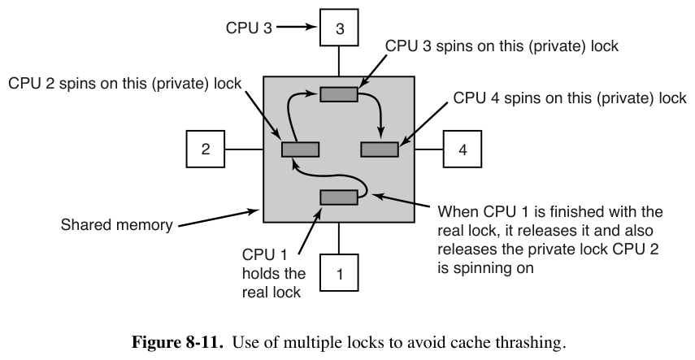

# 专题：图 8-11 "用多个锁避免缓存抖动" —— Linux 中的实现（MCS 锁）

> 书页 547–548（PDF 576–577）。逐小节精读笔记之四，回答：**Linux 内核有没有用书中图 8-11 这种"每个等待者自旋在自己的私有锁变量上"的方式？** —— **有，而且是 Linux 多处理器同步的基石**：它就是 **MCS 锁（Mellor-Crummey–Scott lock）**，在 Linux 7.1.3 里有**一份教科书式直接实现 + 两份生产级变体**。
> 同目录：[001.8.1.1](./001.8.1.1-多处理器硬件.md)｜[002.8.1.2](./002.8.1.2-多处理器OS类型与SMP.md)｜[003.8.1.3](./003.8.1.3-多处理器同步.md)｜[004.8.1.4](./004.8.1.4-多处理器调度.md)

---

## 1. 书中理论：图 8-11 到底在说什么



先复习问题（见 [003.8.1.3](./003.8.1.3-多处理器同步.md) §1.3）：N 个 CPU 自旋在**同一个**锁字上，每次 TSL 都要对锁字所在的缓存行拿独占权 → 该行在 N+1 个 CPU 之间来回搬运（缓存抖动），总线被打爆。

书中方案（原文转述，出自 Mellor-Crummey & Scott 1991）：

1. 给**每个想拿锁的 CPU 分配一个自己的私有锁变量**，该变量放在**独享的缓存块**里（"The variable should reside in an otherwise unused cache block to avoid conflicts"）；
2. 抢锁失败的 CPU 把自己**挂到一个等待 CPU 链表的尾部**，然后**只自旋盯着自己的私有变量**（它在自己的缓存里，永远命中，零总线流量）；
3. 持有者退出临界区时，**释放链表上第一个等待者正在测试的私有锁**（一次写，只弄脏一个缓存行）→ 那个 CPU 进入临界区；它退出时再放行它的后继，依次传递；
4. 协议细节略复杂（要防止两个 CPU 同时挂到表尾），但**高效**（自旋零共享）**且无饥饿**（FIFO 传递）。

图中场景：CPU 1 持有真锁；CPU 2/3/4 各自自旋于自己的私有锁（4→3→2 排队）；CPU 1 释放真锁时顺手"点亮"CPU 2 的私有锁 → CPU 2 进临界区。

**一句话本质：把"N 个 CPU 抢 1 个缓存行"变成"N 个 CPU 各自原地打转 + 锁按队列接力"——竞争的载体从共享行转移到了私有行。**

## 2. 直接回答：Linux 用了，共三处（+1 个新变体）

| # | 实现 | 文件 | 角色 |
|-|-|-|-|
| ① | **教科书 MCS 锁** | `kernel/locking/mcs_spinlock.h:57/94` | 直接实现，头注释点名 Mellor-Crummey & Scott；作为构建块 |
| ② | **qspinlock（队列自旋锁）** | `kernel/locking/qspinlock.c` | **Linux 生产版自旋锁**（arm64/x86/…默认），"压缩进 4 字节的 MCS"——源码注释自述基于 MCS 论文 |
| ③ | **osq（乐观自旋队列）** | `kernel/locking/osq_lock.c` | MCS 变体，专为 mutex/rwsem 的乐观自旋排队（可中途退出）|
| ＋ | resilient qspinlock | `kernel/bpf/rqspinlock.c` | 7.1.3 新增：BPF 用的防死锁变体，同样基于 per-CPU MCS 节点 |

arm64 经 `select ARCH_USE_QUEUED_SPINLOCKS`（`arch/arm64/Kconfig:70`）选用 ②，因此**你在 arm64 上随手写的一把 `spinlock_t`，底层就是图 8-11**。

## 3. 实现 ①：教科书 MCS —— `kernel/locking/mcs_spinlock.h`

节点结构（`include/asm-generic/mcs_spinlock.h`）：

```c
struct mcs_spinlock {
	struct mcs_spinlock *next;  // 链表后继指针（前驱写它）
	int locked;                 // ★ 私有锁变量：本节点就在它上面自旋
	int count;                  // 嵌套计数（qspinlock 用）
};
```

**加锁**（`kernel/locking/mcs_spinlock.h:57`）：

```c
void mcs_spin_lock(struct mcs_spinlock **lock, struct mcs_spinlock *node)
{
	node->locked = 0;                    // 我的私有锁：先"上锁"（=让人等我）
	node->next   = NULL;
	prev = xchg(lock, node);             // ★ 原子换出旧队尾并把自己挂到表尾
	                                   //    （一步完成，天然解决"两人同时挂表尾"）
	if (likely(prev == NULL))
		return;                      // 队列原来是空的 → 我就是持有者，直接进
	WRITE_ONCE(prev->next, node);        // 让前驱知道我是它的后继
	arch_mcs_spin_lock_contended(&node->locked);   // ★ 自旋【只盯自己的 node->locked】
}

// :26 —— arm64 上"自旋"的实现是 smp_cond_load_acquire → WFE 事件等待（不烧 CPU）
#define arch_mcs_spin_lock_contended(l)  smp_cond_load_acquire(l, VAL)
```

**解锁**（`kernel/locking/mcs_spinlock.h:94`）：

```c
void mcs_spin_unlock(struct mcs_spinlock **lock, struct mcs_spinlock *node)
{
	struct mcs_spinlock *next = READ_ONCE(node->next);
	if (likely(!next)) {                                  // 没看见后继
		if (likely(cmpxchg_release(lock, node, NULL) == node))
			return;                                   // 队列空了，锁整体释放
		while (!(next = READ_ONCE(node->next)))       // 后继正在挂接中，稍等它写 next
			cpu_relax();
	}
	arch_mcs_spin_unlock_contended(&next->locked);        // ★ 释放后继的私有锁
}
// :37 —— 释放 = smp_store_release(l, 1)：一次写，惊醒后继的 WFE
```

**逐条对照书中描述**：

| 书中（图 8-11 文字）| 代码 |
|-|-|
| "每个 CPU 分配自己的私有锁变量，放在独享缓存块" | 调用方传入自己的 node；`node->locked` 就是私有锁 |
| "挂到等待链表尾部" | `xchg(lock, node)` 原子接队尾（:71）|
| "自旋在自己的私有锁上" | `arch_mcs_spin_lock_contended(&node->locked)`（:86）——等前驱来"点亮" |
| "持有者退出时释放链表首等待者的私有锁" | `arch_mcs_spin_unlock_contended(&next->locked)`（:110）|
| "避免两人同时挂表尾" | 单条 `xchg` 原子完成挂接（书中说"协议略复杂"——一条原子交换指令就化简了）|
| "无饥饿（FIFO）" | 队列一旦接好，传递顺序固定，无插队 |

## 4. 实现 ②：qspinlock —— 压缩进 4 字节的 MCS（生产版自旋锁）

**为什么不改直接用 ①？** `qspinlock.c:33-68` 注释自己回答：

> 传统 MCS 锁需要 8 字节尾指针 + 8 字节 next 指针（还得把 node 从 lock 带到 unlock）；而 `spinlock_t` 历史上就是 **4 字节**，API 也不能变。于是把 `{tail, next->locked}` **压缩进一个 u32**。

```c
// kernel/locking/qspinlock.c:80 —— ★ 每 CPU 一组 MCS 节点，按上下文嵌套分层
static DEFINE_PER_CPU_ALIGNED(struct qnode, qnodes[_Q_MAX_NODES]);
// 注释 (:72-78)：最多 4 层嵌套（task/softirq/hardirq/nmi）→ 4 个节点，
// "Exactly fits one 64-byte cacheline on a 64-bit architecture"
// ——★ 对应书中"私有变量放在独享缓存块"：每 CPU 的 4 个节点恰好占满一整行，
//    且 DEFINE_PER_CPU_ALIGNED 按 cacheline 对齐
```

**慢路径排队全流程**（`queued_spin_lock_slowpath()`，`kernel/locking/qspinlock.c:130`；pending 乐观位阶段见 [003.8.1.3](./003.8.1.3-多处理器同步.md) §2.5）：

```c
queue:                                                   // :212
	node = this_cpu_ptr(&qnodes[0].mcs);             // :215 取本 CPU 私有节点
	idx = node->count++;                             // 按当前上下文层级选节点
	tail = encode_tail(smp_processor_id(), idx);     // :217 把(cpu,idx)编码进 tail 域
	...
	node->locked = 0; node->next = NULL;             // :251 初始化私有锁变量（同 MCS）
	if (queued_spin_trylock(lock)) goto release;     // :260 摸冷节点期间再试一次（捡漏）

	smp_wmb();                                       // :268 节点初始化先于入队可见
	old = xchg_tail(lock, tail);                     // :277 ★ 原子换队尾（同 mcs 的 xchg）
	if (old & _Q_TAIL_MASK) {                        // :284 前面有人
		prev = decode_tail(old, qnodes);         // :285 从 tail 码解出前驱节点
		WRITE_ONCE(prev->next, node);            // :288 链接（前驱释放时要找 next）
		arch_mcs_spin_lock_contended(&node->locked); // :291 ★ 自旋在自己的 node->locked
		next = READ_ONCE(node->next);            // :299 成为止头后预取后继缓存行
		if (next) prefetchw(next);
	}
	// —— 现在我是队头，改盯真锁字（等现任持有者 + pending 位清空）：
	val = atomic_cond_read_acquire(&lock->val, !(VAL & _Q_LOCKED_PENDING_MASK)); // :328
	// —— 接力棒到手，把锁交给自己，再放行后继：
	if ((val & _Q_TAIL_MASK) == tail && ...)   // :352 若队列只剩我：tail 归零、直接拿锁
	set_locked(lock);                              // :362 (n,0,0)→(*,*,1) 我成为持有者
	if (!next)
		next = smp_cond_load_relaxed(&node->next, (VAL)); // :368 等后继完成挂接
	arch_mcs_spin_unlock_contended(&next->locked);  // :370 ★ 点亮后继的私有锁（同 MCS 解锁）
```

**与教科书 MCS 的三点差异**（都在 `qspinlock.c:44-68` 的注释里写明）：

1. **队列指针装进锁字**：MCS 的 8 字节尾指针 → 压缩成 tail 域 14+2 位（cpu+1 编码，`qspinlock.h:52 encode_tail`）；MCS 的 `next->locked` → 不存在了，**队头改为直接自旋锁字的 locked 字节**（:328）——好处：unlock 不必携带 node（保持旧 API）、解锁路径更简单；**只有队头一个人**看锁字，抖动可忽略；
2. **队列中的等待者**（非队头）仍完全 MCS：自旋在 per-CPU 节点的 `locked` 上（:291），零共享；
3. **pending 乐观位**：第二个竞争者先不入队，在锁字上纯读等待——两 CPU 的轻竞争场景比建队列更快。

**效果数据**：锁事件统计（`CONFIG_LOCK_EVENTS`，`kernel/locking/lock_events.c`）可观测 `lock_pending/lock_slowpath` 命中率；qspinlock 自 3.15（2014）起为 x86 默认，arm64 自 v5.1（2019，依赖 LSE 原子指令）起默认（本树 `Kconfig:70`）。

## 5. 实现 ③：osq —— 睡眠锁乐观自旋的 MCS 变体（`kernel/locking/osq_lock.c`）

场景（见 [003.8.1.3](./003.8.1.3-多处理器同步.md) §2.6）：mutex/rwsem 想自旋等待时，**先要解决"多个自旋者别一起盯锁"**，于是自旋者们先排队——用的就是 MCS 队列：

```c
// kernel/locking/osq_lock.c:15
struct optimistic_spin_node {
	struct optimistic_spin_node *next, *prev;
	int locked;      // ★ 私有锁变量（同 MCS）
	int cpu;         // cpu+1 编码（队列直接存"cpu 号"而非指针）
};
static DEFINE_PER_CPU_SHARED_ALIGNED(struct optimistic_spin_node, osq_node); // :21 每 CPU 一个
```

```c
bool osq_lock(struct optimistic_spin_queue *lock)
{
	node = this_cpu_ptr(&osq_node);                    // :95 本 CPU 私有节点
	node->locked = 0; node->next = NULL;               // :100 初始化私有锁
	old = atomic_xchg(&lock->tail, curr);              // :110 ★ 原子接队尾（同 MCS xchg）
	if (old == OSQ_UNLOCKED_VAL) return true;          // 空队列 → 拿到"自旋权"
	prev = decode_cpu(old);                            // :114
	WRITE_ONCE(prev->next, node);                      // :129 链接前驱
	if (smp_cond_load_relaxed(&node->locked,           // :146 ★ 自旋在私有变量上
				VAL || need_resched() ||
				vcpu_is_preempted(node_cpu(node->prev))))
		return true;                              // 被前驱点亮 → 轮到我去盯真锁
	/* unqueue：等不下去了（need_resched / 前驱 vCPU 被抢），把自己从队列摘掉去睡觉
	   —— 三步曲 A(稳定 prev) B(稳定 next) C(把自己摘出链) :150-207 */
}
void osq_unlock(struct optimistic_spin_queue *lock)
{
	if (atomic_try_cmpxchg_release(&lock->tail, &curr, OSQ_UNLOCKED_VAL))
		return;                                   // :218 队列空，直接整体释放
	next = xchg(&node->next, NULL);                    // :225
	if (next) { WRITE_ONCE(next->locked, 1); return; } // :227 ★ 点亮后继私有锁
	...
}
```

与教科书 MCS 的差异：节点是**静态 per-CPU 存储**（`osq_lock.c:133-138` 注释解释：因此才能用 cmpxchg 安全地"反悔入队"）；等待条件除 `node->locked` 外多了 `need_resched()`/`vcpu_is_preempted()`（**排队也可以中途弃权去睡**——这正是"乐观"二字的含义，纯 MCS 没有）。

## 6. 把书读薄：一张对照表

| 书中图 8-11 的元素 | mcs_spinlock.h | qspinlock | osq |
|-|-|-|-|
| 等待者自旋于自己的私有变量 | `node->locked`（:86）| 队列成员自旋 `node->locked`（:291）；**队头**改盯锁字（:328）| `node->locked`（:146）|
| 私有变量在独享缓存块 | 调用方保证 | `qnodes[4]` 恰占一行（:72-79 注释）| `DEFINE_PER_CPU_SHARED_ALIGNED`（:21）|
| 原子挂到队尾 | `xchg(lock,node)`（:71）| `xchg_tail`（:277）| `atomic_xchg(&lock->tail)`（:110）|
| 释放后继的私有锁 | `smp_store_release(&next->locked,1)`（:110）| `arch_mcs_spin_unlock_contended(&next->locked)`（:370）| `WRITE_ONCE(next->locked,1)`（:227）|
| 防两人同时挂队尾 | 同一条 xchg | 同左 | 同左 |
| FIFO 无饥饿 | ✓ | ✓（另有 pending 捡漏但不插队）| ✓ |
| 额外能力 | — | 4 字节体积不变、pending 快路径 | 可中途 unqueue 弃权 |

**回答标题里的问题**：Linux 不但"用了"图 8-11 的方式，而且把它做成了**默认配置**——arm64 上每一把 `spinlock_t` 的慢路径、每一个 mutex/rwsem 的乐观自旋，走的都是 Mellor-Crummey–Scott 1991 这篇论文的路线；`kernel/locking/qspinlock.c:36-40` 甚至把论文原文链接写进了注释（"Algorithms for Scalable Synchronization on Shared-Memory Multiprocessors"）。

## 7. 延伸阅读（本树内）

- `Documentation/locking/`：`spinlocks.rst`（自旋锁使用纪律）、`mutex-design.rst`（乐观自旋设计）、`locktypes.rst`（各锁型谱系）；
- 论文：Mellor-Crummey & Scott, *Algorithms for Scalable Synchronization on Shared-Memory Multiprocessors*, 1991（图 8-11 的出处，也是 qspinlock 的注释引用）；
- 观测：`/sys/kernel/debug/lock_event_stats`（需 `CONFIG_LOCK_EVENTS`）可看各路径命中率。
