# 多处理器理论（现代操作系统 第5版 §8.1 总结）

> 来源：[Modern Operating Systems 5th Edition # 8.1 MULTIPROCESSORS](../../../007.BOOKs/现代操作系统/Modern%20Operating%20Systems%205th%20Edition-PDF-01.pdf)（PDF 第 559–586 页，书页 530–557）。
> 配套：硬件实物（UPI/xGMI、主板框图）见 [../000.NUMA/README.md](../000.NUMA/README.md)；Linux 内核实现对照见 [../003.Linux-7.1.3实现/README.md](../003.Linux-7.1.3实现/README.md)。

**基本定义**：共享内存多处理器（multiprocessor）= 两个以上 CPU 共享完整访问同一 RAM。程序看到的是普通（分页的）虚拟地址空间，唯一特殊之处是：CPU 写一个内存字再读回，可能得到不同值（别的 CPU 改了）——这正是处理器间通信的基础。多处理器 OS 基本就是普通 OS，特殊之处集中在**同步、资源管理、调度**三件事上。

---

## 1. 多处理器硬件（8.1.1）

按"每个内存字的访问速度是否一致"分为 **UMA**（Uniform Memory Access，一致）和 **NUMA**（Nonuniform，非一致）。

### 1.1 UMA 的三种互连结构

| 结构 | 原理 | 优点 | 致命缺点 | 规模 |
|-|-|-|-|-|
| 单总线（图 8-2）| 所有 CPU、内存挂一条共享总线 | 最简单 | 总线争用，几十个 CPU 就饱和 | ≤ 几十个 CPU |
| 交叉开关（图 8-3）| n×k 网格，每个交叉点一个 crosspoint 小开关 | 非阻塞、无需预先规划 | 交叉点数随 n² 增长（1000 CPU 要 100 万个）| 中等规模 |
| 多级交换网络（图 8-5 omega）| 2×2 开关组成 log₂n 级，每级 n/2 个、共 (n/2)·log₂n 个开关（1024 CPU 只要 5120 个，交叉开关要 100 万+）| 硬件量远小于 n² | 阻塞网络，请求可能冲突等待 | 较大规模 |

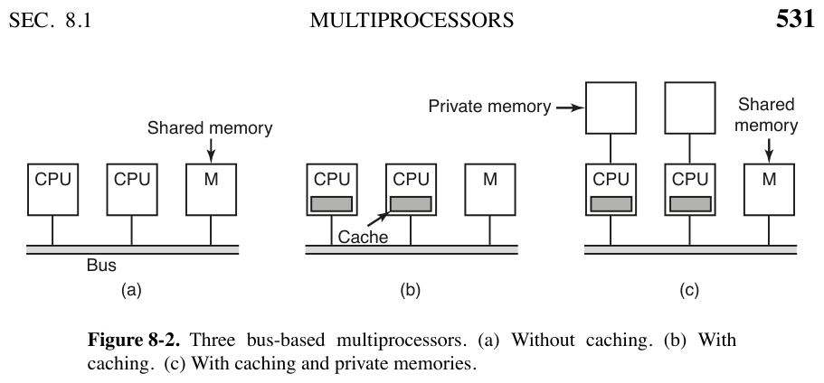

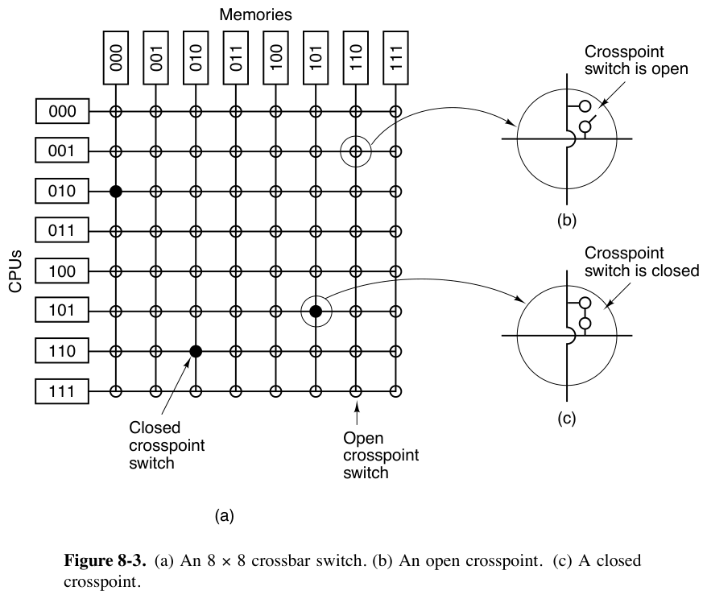

- **单总线的两种改良（图 8-2b/c）**：
  - (b) 每个 CPU 加缓存：以 32/64 字节**缓存行（cache line）**为单位工作；只读块可同时存在于多个缓存、读写块独占；CPU 写远程缓存持有的块时，总线硬件通知其他缓存（clean 副本直接丢弃，dirty 副本写回或直接传给写者）——这套规则叫**缓存一致性协议（cache-coherence protocol）**。
  - (c) 缓存 + 私有内存：编译器把程序文本、字符串、常量、栈、局部变量放进各 CPU 私有内存，共享内存只放可写共享变量，进一步减少总线流量。
- **omega 网络路由**：消息由 Module/Address/Opcode/Value 字段组成，逐级取模块号的一位决定输出（0 走上、1 走下）；模块号高位顺路记录来时的入线编号，供应答按原路返回。不同请求若不共用开关/线路/内存模块即可并行（例：CPU 000 与 CPU 001 会在开关 3A 冲突，需等待）。

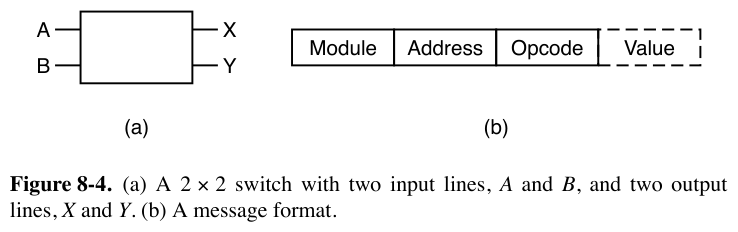

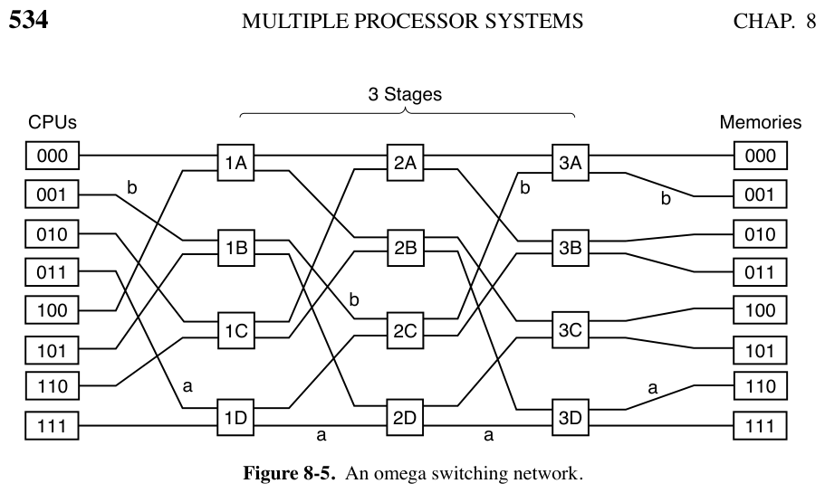

### 1.2 NUMA 多处理器（书页 535–537）

- **动机**：单总线 UMA 限制在几十个 CPU 内；交叉开关昂贵且大不了多少。要超过 100 个 CPU，只能放弃"所有内存模块访问时间相同"这一假设。
- **三个关键特征**：① 所有 CPU 可见的单一地址空间；② 访问远程内存也用普通 LOAD/STORE 指令；③ 访问远程内存比本地慢。因此 UMA 程序无需修改即可运行，只是性能更差。
- **两种形态**：NC-NUMA（无缓存一致性，远程访问延迟无法隐藏）/ **CC-NUMA**（缓存一致）。
- **目录式多处理器（directory-based）**——大型 CC-NUMA 的主流构建法：
  - 维护一个目录数据库，记录每个缓存行的位置和状态（干净/脏）；每条访存指令都要查它，所以必须放在能在远小于一个总线周期内应答的**专用高速硬件**里。
  - 256 节点示例（图 8-6）：每节点 = 1 CPU + 16MB RAM（本地总线），节点间互连网络相连；32 位地址 = **8 位节点号 + 18 位缓存行号 + 6 位行内偏移**（每行 64 字节）；每节点保存自己 2¹⁸ 行的目录项。
  - 访问流程：CPU 20 读 `0x24000108` → MMU 解析出节点 36、行 4、偏移 8 → 互连网络向宿主节点 36 发请求 → 查目录：未缓存则从本地 RAM 取回并更新目录；已缓存在节点 82 则更新目录并指示 82 把行传给 20、作废自己的副本。
  - **要点**：即使所谓"共享内存多处理器"，底层也是大量消息传递。
  - **目录开销**：每条目录项 9 位（8 位节点号 + 1 位脏标记）；16MB 节点按 64 字节行分 = 2¹⁸ 行，9×2¹⁸ 位 ÷ 16MB ≈ **1.76%**（可接受，但必须是高速存储，贵）；行越短目录项越密：32 字节行约 4%，128 字节行 <1%。
  - **多节点缓存扩展**：简化设计一行只能缓存在一个节点；要支持多节点共享，目录项改为**位向量**（每核一位）+ 状态位，开销显著增加；64 位系统更复杂但原理相同。

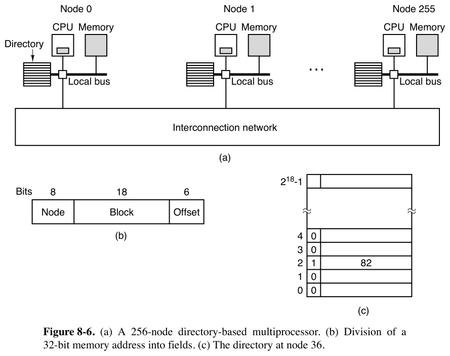

### 1.3 多核、众核、GPU 与异构（书页 537–541）

- **多核（Multicore/CMP）**：晶体管预算两个去向——堆缓存（命中率 99%→99.5% 收益递减）或堆核心。多核芯片本质是"小型多处理器"：硬件通过**侦听（snooping）**保证缓存一致。共享 L3 常按核切片（slice）且访问本地切片更快——"**NUMA 缓存**"。共享缓存的利弊：空闲核的配额可被吃紧核借用；但贪心核也能拖累别人。容错上，共享组件故障会一次带走多个核。
- **SoC**：通用核 + 视频/音频解码器、密码处理器、网卡等专用核 = 单芯片完整计算机。Apple M1：4 大核 + 4 小核（性能/能效分工）。
- **众核（Manycore）**：数十至数千核（判断标准："不在乎损失一两个核"）。最大威胁是**一致性墙（coherency wall）**：位向量目录项每核占 1 位，1024 核 = 1024 位 = 128 字节——一条目录项就赶上它所要跟踪的 128 字节缓存行本身。出路：放弃全局一致性改用消息传递，或混合方案（1024 核分 64 岛、岛内一致、岛间放弃）。
- **GPU**：数千小核，晶体管多花在计算电路、少花在缓存与控制逻辑；本质 SIMD——大量核执行相同指令、不同数据，擅长数据并行、不擅长串行；难编程难调试。GPGPU 需要 CUDA/OpenGL 等专门技术。**TPU/NPU**：面向机器学习的矩阵乘法专用处理器。
- **异构多核**：不同指令集（CPU+GPU+TPU 同芯）或同指令集大小核（ARM big.LITTLE、Intel Alder Lake）——大核跑串行重负载，小核能效跑并行任务。
- **多核编程**：硬件领先软件——语言不适合高并行、工具少、程序员缺经验；同步/竞态/死锁是噩梦，信号量不是答案。家用场景用不满数百核；服务器/云（每请求一核、出租 VM）用得满。
- **SMT 同时多线程（超线程）**：一核多个硬件上下文（= hyper-thread = 虚拟核）：有独立寄存器组，但共享 L1/L2、TLB、执行单元，因此互相干扰（执行部件被占需等待、TLB 项被挤掉）。收益：低价获得"几乎多一个核"，部分负载提速 30%+，多数应用收益小得多。

---

## 2. 多处理器操作系统的三种类型（8.1.2）

| 模型 | 做法 | 优点 | 致命缺点 |
|-|-|-|-|
| 每 CPU 一个 OS（图 8-7）| 内存静态分区，各自跑私有 OS（可共享内核代码、私有数据）| 比独立计算机强（共享磁盘/I/O、内存可灵活共享）| ① 进程不能迁移（一 CPU 空闲另一忙死）；② 物理页不能借用；③ **各自维护 buffer cache，同一磁盘块可同时脏于多处，数据不一致（最糟）** |
| 主从式 Leader-Follower（图 8-8）| 只有一份 OS 在 CPU 1，所有系统调用重定向过去 | 单一就绪队列/单一 buffer cache，问题①②③全解 | leader 是瓶颈：若 10% 时间在系统调用，10 个 CPU 即饱和 |
| **SMP 对称多处理器（图 8-9）** | 一份 OS，任何 CPU 都能执行 | 无瓶颈、动态均衡 | 多 CPU 同时进内核会灾难 → 需要锁 |

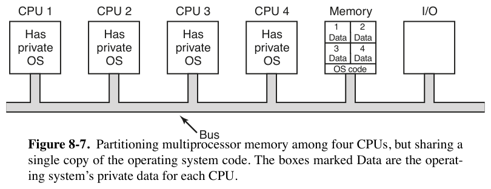

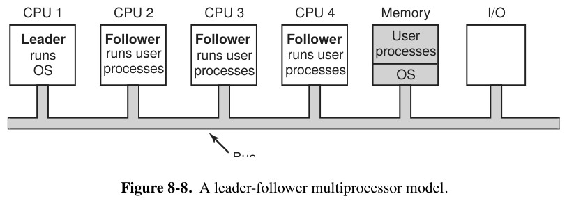

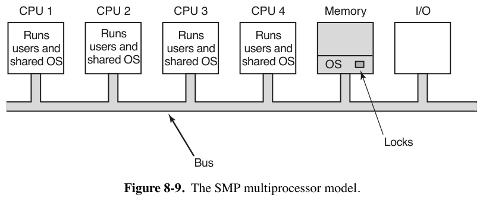

**SMP 的锁演进**：
- 最粗暴：整个 OS 一把 mutex = **大内核锁（big kernel lock）**，一次只放一个 CPU 进——串行化程度和主从式一样糟。
- 现代做法：把内核拆成多个互不交互的**独立临界区**各配一把锁（调度器、文件系统调用、缺页处理可并行）；被多个临界区共享的表（如进程表，被调度/fork/信号处理共用）再加独立锁。
- 难点：正确划分临界区；**按固定顺序申请表锁以避免死锁**——代码常年演化、人员更替，极易出错。

---

## 3. 多处理器同步（8.1.3）

- **为什么关中断失效**：单处理器上关中断即可保护临界表；多处理器上关中断只影响本 CPU，其他 CPU 照常运行 → 必须用真正的锁协议。
- **TSL（Test and Set Lock）**：读内存字进寄存器、同时写入 1，占两个总线周期。若不锁总线，两个 CPU 可能都读到 0（图 8-10 四步失败序列）→ 互斥失效。正确实现：**先锁总线**（拉高专用总线线），完成两次访存再解锁。早期总线没有该硬件，所以才诞生了纯软件的 Peterson 协议。

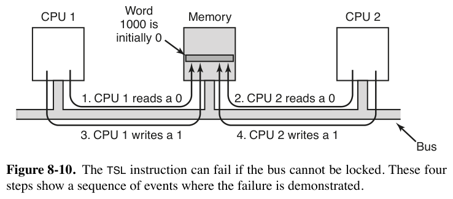
- **自旋锁的代价**：请求 CPU 空转轮询，浪费 CPU 还冲击总线/内存。
- **缓存抖动（cache thrashing）**：TSL 是写操作，需要独占缓存块 → 锁所在缓存块在持有者与请求者之间来回搬运，比单纯读还费总线。
- **三个优化**：
  1. **先读后 TSL**：先纯读探测锁是否空闲，空闲才做 TSL。轮询大多变成读，双方可共享只读副本。纯读成功只是"好时机提示"，正确性仍由原子的 TSL 保证（可能被别人抢走，无妨）。
  2. **二进制指数退避**（借自以太网）：轮询间隔 1→2→4→… 条指令翻倍封顶；低上限响应快但费总线，高上限反之。
  3. **Mellor-Crummey–Scott 私有锁队列**（图 8-11）：每个等待者自旋在**自己的私有锁变量**上，持有者退出时释放链表首等待者的私有锁。高效且无饥饿。

- **自旋还是切换（spin vs. switch）**：切换不免费（两次上下文切换 + 新线程缓存全错 + TLB 缺失 + 最终还要切回来）。经验法则：锁持有时间 < 两次切换成本 → 自旋；反之切换。实用策略是**记录最近几次实际自旋时间做预测**（上次平均 200μs 就再自旋；上次每次都自旋满上限就立即切换）。
- **MONITOR/MWAIT（x86）**：MONITOR 定义监视地址区间，MWAIT 阻塞到有人写该区间——"自旋而不烧 CPU"，还省电。

---

## 4. 多处理器调度（8.1.4）

前置问题：调度对象是内核线程才有意义（用户线程内核看不见）；**多一个维度**——不仅决定"跑哪个线程"，还要决定"在哪个 CPU 上跑"；线程是无关的还是一组相关的（并行 make：10 个编译留 1 个到最后，用户感知不到完成 → 应整组考虑）。

### 4.1 分时调度（Timesharing，图 8-12）
- 全系统一个就绪队列（按优先级分层），哪个 CPU 空闲哪个取最高优先级。简单、自动负载均衡；缺点：CPU 多时队列争用、切换开销。
- **自旋锁 × 时间片问题**：线程持自旋锁时被剥夺 → 其他 CPU 空转等它 → **智能调度（smart scheduling）**：持自旋锁的线程设标志，调度器给它宽限不剥夺。
- **亲和性调度（affinity scheduling）**：线程上次在 CPU k 上跑，缓存/TLB 还是热的，尽量还排到 k。典型实现是**两级调度**：顶层把线程分配到各 CPU（创建时选负载最轻的），底层各 CPU 独立调度自己的队列；没活干时可以从别的 CPU 偷线程。

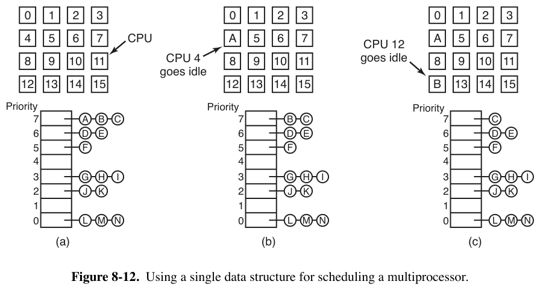

### 4.2 空间共享（Space Sharing，图 8-13）
- 用于相关线程组：整组要么同时各得一个**专用 CPU**（非多道程序设计），要么都不启动；线程占住 CPU 直到结束，阻塞时 CPU 闲着。CPU 集合被静态分区（例：32 CPU 分成 4/6/8/12 四个分区 + 2 空闲）。
- 理论上"CPU 数 × 运行时间最小优先"是 SJF 的类比，但实践很难打败 FCFS。
- 改进：**中央服务器动态管理并行度**——应用定期询问可用 CPU 数，自行增减线程数（Web 服务器 10 线程→5 线程的例子）。

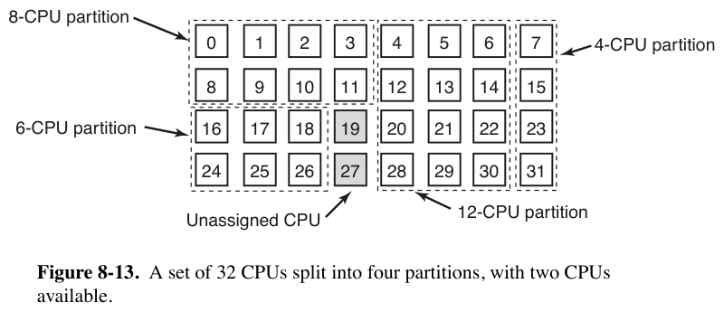

### 4.3 组调度（Gang Scheduling，图 8-14/8-15）
- 问题：通信频繁的线程相位错开——独立分时时一次请求-应答要跨 2 个时间片（200ms）。
- 三要素：相关线程作为一个单元（gang）；全体成员**同时**在不同 CPU 上运行；**时间片同起同止**。关键是所有 CPU 同步调度：量子开始时全体重排、期间不调度，线程阻塞则 CPU 空转到量子结束。这样 A 进程所有线程在一个量子内可交换大量消息。

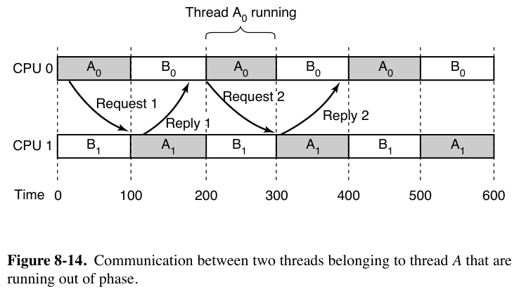

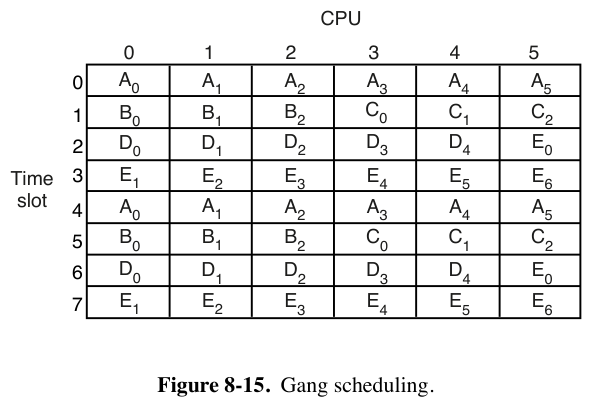

### 4.4 面向安全的调度（书页 556–557）
- 同一核上的两个超线程共享缓存/TLB → **侧信道**。例子：加密程序按密钥位选择执行 f0 或 f1（在不同页上），攻击者在另一超线程用大量虚拟页填满 TLB、逐页跳转计时，慢跳 = TLB 被受害者挤掉 → 从页访问序列反推密钥位。Meltdown/Spectre（2018）后备受重视。
- 调度对策：**不同安全域的线程不同时上同一核**——如 Windows Hyper-V 核调度器保证不同 VM 的线程不共核，宁可空着一个超线程；同 VM 内攻击仍可能。SMT 在安全上天生有隐患，**OpenBSD 已默认禁用 SMT**。

---

## 5. 一句话串起来

硬件上：单总线 → 交叉开关 → omega 网络 → NUMA 目录 → 多核/众核/GPU，一路都在解决"怎么把更多 CPU 连到内存"；软件上：三种 OS 组织（独立 / 主从 / SMP+分区加锁）、靠总线锁定的 TSL 及其降争用优化做同步、再到分时/亲和性/空间共享/组调度/安全感知的调度策略。
