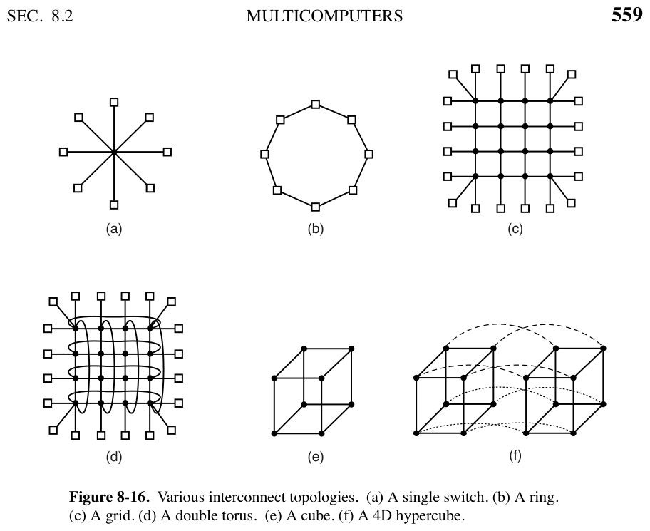
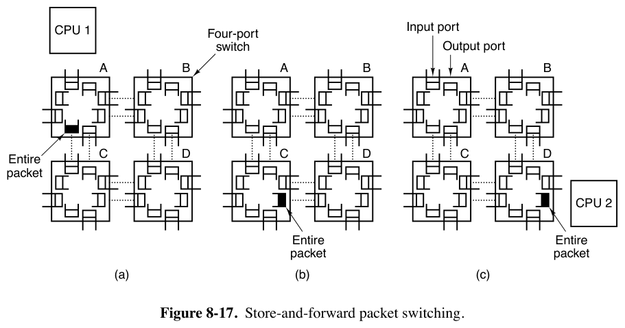
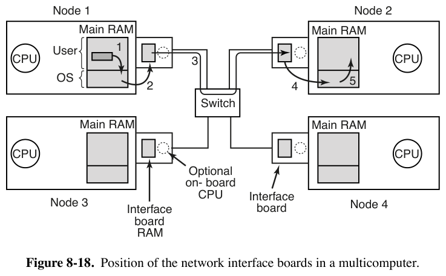

# 8.2.1 多计算机硬件（Multicomputer Hardware）

> 书页 558–562（PDF 587–591）。§8.2 逐小节精读之一。
> 同目录：[002.8.2.2-底层通信软件.md](./002.8.2.2-底层通信软件.md)｜[003.8.2.3-用户级通信软件.md](./003.8.2.3-用户级通信软件.md)｜[004.8.2.4-远程过程调用RPC.md](./004.8.2.4-远程过程调用RPC.md)｜[005.8.2.5-分布式共享内存DSM.md](./005.8.2.5-分布式共享内存DSM.md)｜[006.8.2.6-多计算机调度.md](./006.8.2.6-多计算机调度.md)｜[007.8.2.7-负载均衡.md](./007.8.2.7-负载均衡.md)

**定位回顾**：多计算机（multicomputer）= 紧耦合但不共享内存的 CPU 集群（别名 cluster、COW），云计算的地基。基本节点 = "无头工作站"（去键鼠显的 PC）+ 高性能网卡；目标**微秒级**消息（对比多处理器的纳秒级访存——正因为慢 1000 倍，所以简单便宜）。本小节讲两件事：**节点怎么连**（互连拓扑与交换）与**网卡长什么样**（网络接口）。

---

## 1. 互连拓扑（图 8-16）

**核心度量：直径（diameter）= 任意两节点最坏路径的跳数**。存储转发下延迟 ∝ 跳数，所以直径决定最坏延迟；节点数增长时直径增长越慢，拓扑越可扩展。

| 拓扑 | 结构 | 直径 | 备注 |
|-|-|-|-|
| (a) 星型（单交换机）| 所有节点接一台交换机 | 2 跳 | 现代**交换以太网**的形态，中小规模 |
| (b) 环 | 每节点左右各一线，无需交换机 | ≈ n/2 | 最坏绕半圈，直径**线性**增长 |
| (c) 网格 mesh | √n×√n 方阵 | 2(√n−1)，随 **√n** | 高度规则、易扩展，商用常见；对角最坏 |
| (d) 双环面 double torus | 网格的行/列首尾绕接 | 比 mesh 小 | 更容错（多路径），对角 2 跳直达 |
| (e) 立方体 | k×k×k 三维 | — | 规则三维结构 |
| (f) 超立方体 hypercube | n 维 → 2ⁿ 节点，节点号 n 位，**一跳翻转一位** | **= 维数 = log₂N** | 10 维 1024 节点直径仅 **10**；同规模 32×32 mesh 要 **62**（差 6 倍+）。代价：每节点 n 条链路，扇出/成本随规模线性涨 |

> 记忆钩：环（线性）→ mesh（√n）→ torus（更小）→ 超立方体（log n）——**直径越小，连线越贵**。

## 2. 交换方式（图 8-17）

- **存储转发（store-and-forward）**：整包到齐一个交换机，再复制到下一跳的线上。4 跳 = 4 次完整复制，后一次必须等前一次完成 → 延迟 = 跳数 × 单跳传输时间 T。灵活高效但延迟大。
- **电路交换（circuit switching）**：先沿路打通全程（建立阶段），然后比特**不停泵送**直达终点（中间交换机无缓冲），发完拆链。建立慢、传输快。
- **虫孔路由（wormhole routing）**：折中——包拆成子包（理论上可小到 1 bit），**头部一到就开始向前流**，不必等全路径建好或整包到齐。

## 3. 网络接口（图 8-18）

- **为什么网卡要带大 RAM**：互连网络常是**同步的**——一旦开始发送，比特必须恒定速率流动。主 RAM 里的数据要经系统总线（PCI）搬运，而总线上有磁盘等设备争用，**给不出恒定供给速率** → 发送前先整包复制到网卡板载 RAM。接收同理：入向比特速率恒定且极高，直接写主 RAM 风险大，先落板再择机搬。
- **板载 DMA / CPU / FPGA**：DMA 通道成块请求总线（一次传多个字，不必逐字申请）——但也正因成块占用总线才使板载 RAM 更必要；更强的是"**智能网卡（smart NIC）**"，可卸载可靠传输、组播、压缩/解压、加解密、多进程保护——但两个 CPU 协同就要同步（竞态条件）→ 更多开销、OS 更多工作。
- **复制是头号敌人**：浏览器请求 → 应用缓冲 → 内核（TCP/IP）→ 网卡 RAM → 线路 → 对端网卡 → 对端内核 → 对端应用。每层复制不仅费搬运本身，还污染缓存、TLB → 端到端延迟高。（这是 8.2.2 的主题。）

---

## 4. Linux/arm64 对照

本小节内容基本是**硬件/网络侧**，Linux 的角色是驱动与管理：

| 书中概念 | Linux 7.1.3 | 位置 |
|-|-|-|-|
| 星型拓扑/交换机 | Linux 自己就能当交换机/路由器：**网桥（bridge）** = 软件交换机，学习 MAC 地址表（FDB）并按端口转发 | `net/bridge/br_fdb.c`（转发表）、`net/bridge/br_forward.c`（转发）；用户态 `ip link add ... type bridge` |
| 环/mesh/超立方体 | 单机内核不涉及；InfiniBand/RoCE 子网管理在用户态（opensm）| `drivers/infiniband/` |
| 存储转发/虫孔 | 由交换芯片实现；Linux 作为**端点**只管收发路径 | 发送主线 `net/core/dev.c` 的 `dev_queue_xmit()` → 驱动 `ndo_start_xmit` |
| 板载 RAM 的收发描述符环 | 网卡 DMA **描述符环**（TX/RX ring）：CPU 生产描述符、网卡消费，环本身就是"板载 RAM 上的一次复制"方案 | 每驱动一个，如 arm64 常用的 `drivers/net/ethernet/cadence/macb_main.c`、virtio-net `drivers/net/virtio_net.c` |
| DMA 与总线争用 | DMA 经 **SMMU/IOMMU** 映射（arm64：`drivers/iommu/`）；流式 DMA API `dma_map_single()` 建一致性映射 | `include/linux/dma-mapping.h`、arm64 `arch/arm64/mm/dma-mapping.c` |
| 智能 NIC 卸载 | 卸载在硬件/驱动：TSO/GRO/RSS 校验和卸载、XDP offload；DPU 场景 arm64 SoC 本身常作为智能 NIC 的主控 | `net/ethtool/`（卸载配置）、`Documentation/networking/` |
| 同步网络/恒定速率 | 现代以太网非同步式，恒速问题转化为 **QoS/流量整形**（令牌桶）| `net/sched/sch_tbf.c` 等 `net/sched/` |

**学习小结**：拓扑决定**最坏延迟**（直径），交换方式决定**每跳延迟**（存储转发整包等齐 vs 虫孔流式），网卡决定**入出的那两次复制**——这三样一起定下多计算机通信延迟的下限；剩下的软件层（8.2.2 起）都在跟"复制"作斗争。
