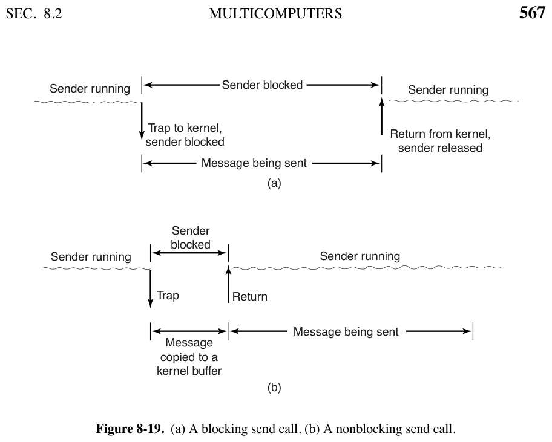

# 8.2.3 用户级通信软件（User-Level Communication Software）

> 书页 565–569（PDF 594–598）。§8.2 逐小节精读之三——消息传递怎么暴露给程序员。
> 同目录：[001.8.2.1](./001.8.2.1-多计算机硬件.md)｜[002.8.2.2](./002.8.2.2-底层通信软件.md)｜[004.8.2.4](./004.8.2.4-远程过程调用RPC.md)｜[005.8.2.5](./005.8.2.5-分布式共享内存DSM.md)｜[006.8.2.6](./006.8.2.6-多计算机调度.md)｜[007.8.2.7](./007.8.2.7-负载均衡.md)

**一句话**：把裸消息传递包装成两个调用 `send`/`receive` 是底线；真正要命的抉择是**阻塞还是非阻塞**——书中把四种方案的账算得明明白白，最后引出两个高阶形态：弹出线程与主动消息。

---

## 1. 书中理论

### 1.1 最小原语与编址

```
send(dest, &mptr);      // 把 mptr 指向的消息发给 dest，阻塞到消息发出
receive(addr, &mptr);   // 阻塞直到消息到达，拷入 mptr 指向的缓冲
```

- **编址**：多计算机 CPU 数固定 → 地址最简单的形式是**两段式：CPU 号 + 该 CPU 上的进程/端口号**——每个 CPU 自管本地地址，天然不冲突。

### 1.2 阻塞 vs 非阻塞 send（图 8-19）——本节的核心权衡



- **阻塞（同步）send**：消息完全发出前调用者挂起（图 a）。简单但 CPU 在干等。
- **非阻塞（异步）send**：立刻返回，传输与计算并行（图 b）——性能好，**但缓冲区在发完之前不许再碰**，而程序员又**不知道什么时候发完** → "永远不敢复用缓冲"。
- **三种出路**：
  1. **内核代抄**：拷进内核缓冲，进程立刻可复用自己的缓冲——好编程；代价 = 每条消息多一次复制（很多网卡最终还要再拷进硬件缓冲，这次复制基本白费）；
  2. **发完中断**：不复制，发完用信号通知——省时，但**用户级中断极难写**、竞态多、无法复现、几乎不可调试；
  3. **写时复制（COW）**：缓冲标只读，真写了才复制——但邻近变量的写也会触发（页粒度），还要为"发消息"管理页读写属性，最后多半还是复制一次。
- **书中结论：正常情况下阻塞 send 最方便**——尤其有多线程时，一个线程阻塞发送，其他线程继续干活；还不占内核缓冲；消息通常更早出门（无复制）。

### 1.3 receive 侧与两个高阶方案

- receive 同样可阻塞/非阻塞；中断难写又慢 → 可**轮询**（`poll` 查有没有消息，有则 `get_message` 取第一条；编译器甚至能自动插入 poll，但频率难定）。
- **弹出线程（pop-up threads）**：消息到达 → 在接收进程地址空间里**自动创建一个新线程**处理该消息（运行预设过程，参数=消息指针），处理完即死。无需等待现有线程来取。
- **主动消息（active messages）**：更激进——**消息自带处理函数地址**，消息一到（中断上下文）几个指令内直接调 handler，**全程零复制**（从网卡就地处理）。代价：**要求收发双方完全互信**（消息里带的是可跳转的地址！）。

---

## 2. Linux 对照

| 书中概念 | Linux 7.1.3 实现 | 源码/说明 |
|-|-|-|
| `send(dest,&m)` / `receive(addr,&m)` | socket API：`send(2)`/`recv(2)`（net/socket.c）；"CPU 号+端口"两段式编址 = **IP 地址 + 端口号**（TCP/UDP 五元组）| `net/socket.c` |
| 阻塞/非阻塞自选 | 文件标志 `O_NONBLOCK`、`MSG_DONTWAIT`——书中"由系统设计者二选一"，Linux 两者都给，**每个 socket 独立选** | `include/linux/socket.h`（标志定义）|
| 非阻塞 send 的"内核代抄" | 正是 Linux 默认路径：`tcp_sendmsg` 把用户数据拷进 skb（`net/ipv4/tcp.c:1117` 起），拷完即返回、缓冲可复用——**书中方案①** | `net/ipv4/tcp.c:1117` |
| "发完中断"通知 | 内核里完成事件用**完成队列**暴露：epoll/io_uring 的 CQ——把"难写的用户级中断"改造成好用的 API（**书中方案②的现代形态**）| `fs/eventpoll.c`、`io_uring/` |
| 零复制 + 异步通知并存 | `MSG_ZEROCOPY`：不代抄（页 pin + DMA 直发），完成/错误经 **err 队列**通知，用户须等通知再复用缓冲——精确实现"非阻塞 send + 发完通知"，且避开了裸中断的难写 | `net/ipv4/tcp.c:1141`、`Documentation/networking/msg_zerocopy.rst` |
| 轮询式 receive | `poll(2)/select(2)`（`fs/select.c`）、`epoll`、AF_XDP 的 `need_wakeup` 忙轮询、io_uring SQPOLL——"书中编译器插 poll"演化为运行时框架 | `fs/select.c`、`fs/eventpoll.c`、`net/xdp/xsk.c` |
| 弹出线程 | **内核不提供**（不硬凑）；用户态线程库/协程框架可实现同型语义。内核最近缘：io_uring 的工作线程（`io_wq`）按需起，但语义是异步执行而非消息驱动 | `io_uring/io-wq.c` |
| 主动消息 | **主线无**（信任模型不适配多用户系统）；内核内部"消息带 handler"的精神存在于 eBPF 程序注入（XDP 处理函数在驱动收包点就地执行，零拷贝）——但加载需特权校验，正是"完全互信"的制度化替代 | `net/core/filter.c`（XDP）|

**学习小结**：本节四选一（阻塞/代抄/中断/COW）的账，Linux 的答案是**按场景全给**——默认代抄（最稳）、MSG_ZEROCOPY（大包）、AF_XDP/io_uring（超低延迟），把"方便 vs 快"从系统设计者的单选题变成程序员每连接的选答题。
