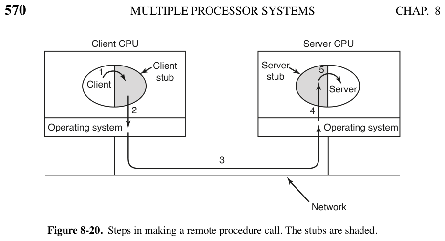

# 8.2.4 远程过程调用（RPC）

> 书页 569–571（PDF 598–600）。§8.2 逐小节精读之四。
> 同目录：[001.8.2.1](./001.8.2.1-多计算机硬件.md)｜[002.8.2.2](./002.8.2.2-底层通信软件.md)｜[003.8.2.3](./003.8.2.3-用户级通信软件.md)｜[005.8.2.5](./005.8.2.5-分布式共享内存DSM.md)｜[006.8.2.6](./006.8.2.6-多计算机调度.md)｜[007.8.2.7](./007.8.2.7-负载均衡.md)

**一句话**：消息传递的根本缺陷是编程模型 = **I/O**（send/receive）；Birrell & Nelson (1984) 的答案是把远端通信伪装成**普通过程调用**——RPC 从此成为多计算机软件的基石。

---

## 1. 书中理论

### 1.1 机制（图 8-20）：两对"替身"

| 步骤 | 发生什么 |
|-|-|
| 0（编译时）| 服务接口编译出 **client stub**（链接进客户）与 **server stub**（链接进服务器）|
| 1 | 客户调用 client stub——**普通本地调用**，参数照常压栈 |
| 2 | client stub 把参数打包成消息（**marshaling/编组**），系统调用发消息 |
| 3 | 客户机内核把消息传给服务器机器 |
| 4 | 服务器内核把包交给 server stub（它此前已调过 receive 在等）|
| 5 | server stub **以本地调用方式**调真正的服务器过程 |
| 6 | 应答沿 5→1 反向回来 |

**关键**：客户代码只是普通调用（同名 stub），服务器代码也只是被普通调用——**两端都察觉不到"远"**，I/O 消失了。

### 1.2 四条"草下的蛇"（实现陷阱）

1. **指针参数失效**：客户/服务器不在同一地址空间，指针传过去无意义。小技巧 **copy-restore（值调用的模拟）**：stub 编组指针**所指的值** k 发过去，服务器端造一个指向 k 的指针给过程用；返回时把 k 送回客户覆盖原值（万一服务器改了）。**对图/链表等复杂结构失效** → 必须限制参数形态。
2. **弱类型语言的数组大小**：C 可以写不指定大小的向量内积（用哨兵值结束）——stub **无法知道数组多大**，编组不了。
3. **参数类型无法推断**：`printf` 可变参数、任意类型混合——给 printf 做 RPC 几乎不可能（"别用 C 写"的规则不会受欢迎）。
4. **全局变量不再共享**：调用方与被调方靠全局变量传信息的代码，搬到远端即碎。

结论：RPC 用得极广，但**必须约束参数**，"容易构造出失败场景，但用 RPC 的程序员会绕开那些场景"。

---

## 2. Linux 对照：内核里真的有一套 RPC

| 书中概念 | Linux 7.1.3 | 源码 |
|-|-|-|
| client stub / server stub | 内核 **sunrpc**：客户端 `net/sunrpc/clnt.c`（call 状态机、重传、超时）、编组 `net/sunrpc/xdr.c`（XDR 就是"marshaling"的数据表示）、传输 `net/sunrpc/xprt.c`；服务端 `net/sunrpc/svc.c`（nfssd 用的服务器框架）| `net/sunrpc/` |
| "RPC 之上盖一层应用" | **NFS 客户端/服务端**就是 RPC 的第一批用户：每个 NFS 操作一个 stub 封装（`fs/nfs/nfs3proc.c`/`nfs4proc.c`）+ XDR 编组（`fs/nfs/nfs2xdr.c` 等）；另有 lockd/rpcbind 用户 | `fs/nfs/` |
| 步骤 3 的传输 | TCP（`xprtsock.c`）或 RDMA（`xprtrdma/`）| `net/sunrpc/xprtsock.c`、`net/sunrpc/xprtrdma/` |
| copy-restore 的现代对应 | XDR 只支持**定长的可描述类型**（int/string/数组+长度/fixed opaque…）——正是书中"必须限制参数"的制度化：**接口描述语言 + 定长编组** | `include/linux/sunrpc/xdr.h` |
| 异步 RPC | `rpc_call_async()`——非阻塞 send（8.2.3）在 RPC 层的投影 | `net/sunrpc/clnt.c` |
| 用户态 RPC | gRPC/Thrift/Cap'n Proto 等（内核不管）——与书中"stub 链接进应用"完全同构 | 用户态 |

**学习小结**：书中五步模型在内核里可以逐一对号（stub=XDR+clnt、传输=xprt）；四条陷阱的共同解法是**用 IDL 把参数约束成可编组的定长描述**——NFS 的所有操作因此都是"定长参数 + 定长结果"的形状。
