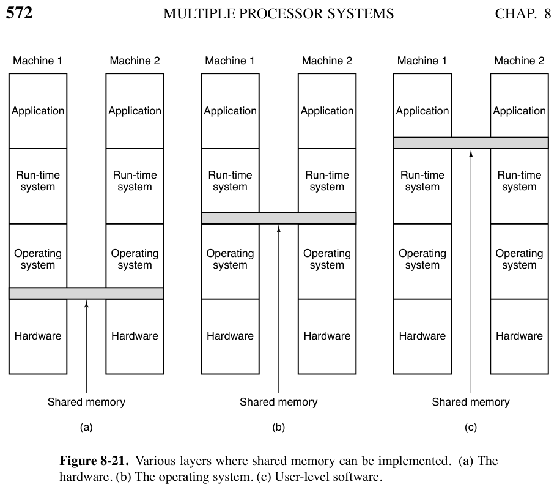
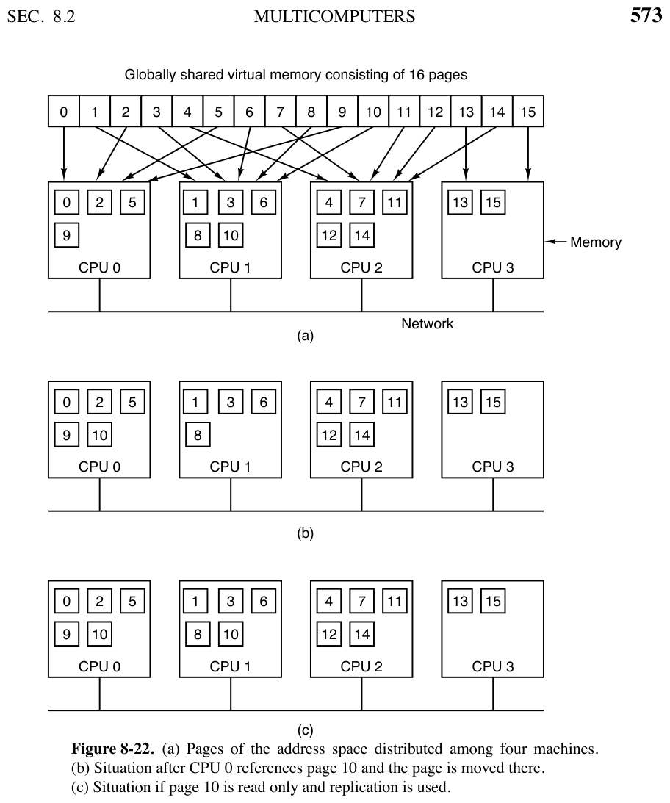
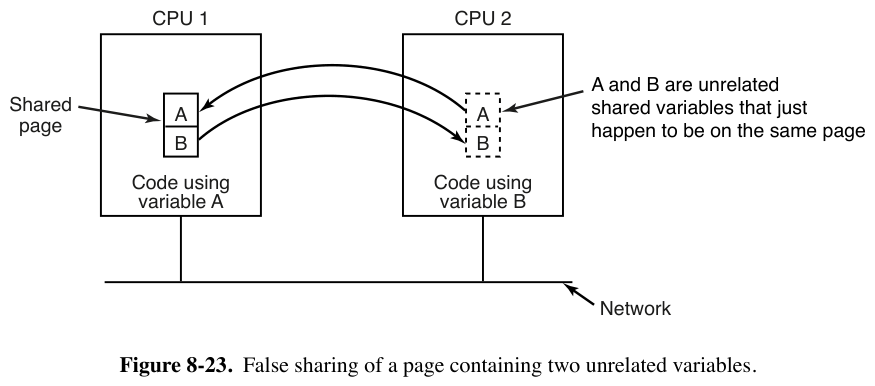

# 8.2.5 分布式共享内存（DSM）

> 书页 571–575（PDF 600–604）。§8.2 逐小节精读之五。
> 同目录：[001.8.2.1](./001.8.2.1-多计算机硬件.md)｜[002.8.2.2](./002.8.2.2-底层通信软件.md)｜[003.8.2.3](./003.8.2.3-用户级通信软件.md)｜[004.8.2.4](./004.8.2.4-远程过程调用RPC.md)｜[006.8.2.6](./006.8.2.6-多计算机调度.md)｜[007.8.2.7](./007.8.2.7-负载均衡.md)

**一句话**：DSM 在**没有共享内存的多计算机上伪造共享内存**——缺页时用"远端 RAM"代替"本地磁盘"。它把多处理器缓存一致性的所有难题（伪共享、写失效、顺序一致性）在页面粒度重演一遍，是理解一致性协议的绝佳教具。

---

## 1. 书中理论

### 1.1 基本机制（图 8-21/8-22）

- 全局虚拟地址空间切成**页**，散布在各节点（16 页 / 4 节点示例）；每机自己的 VM 和页表。
- 访问不在本机的页 → **陷入内核** → DSM 软件找到持有者，让它 **unmap 该页**、经互连网络把页发来 → 映射进本机 → **重启触发缺页的指令**。
- **本质：OS 用远端 RAM 而不是本地磁盘满足缺页**。对用户而言机器"看起来有共享内存"。
- **三层可实现共享内存**（图 8-21）：(a) 硬件（真多处理器，8.1）；(b) 操作系统（本节 DSM）；(c) 用户态软件（Linda 元组空间，见 [../005.分布式系统理论/006.8.3.6](../005.分布式系统理论/006.8.3.6-基于协调的中间件-Linda与发布订阅.md)）。

### 1.2 复制（replication）

- **只读页复制**（程序文本、常量、只读数据）：发给请求者、原副本不动（图 8-22c）→ 两 CPU 后续读都不再缺页。
- **全部页都复制**也行——读没问题，**一旦写**就有一致性问题（见 1.4）。

### 1.3 伪共享（false sharing，图 8-23）——DSM 的招牌问题

- 传输单位受 MMU 限制必须**是页的倍数**（1/2/4…页，等效模拟更大页）：
  - 大单位的好处：网络传输**启动开销**大，传 4096B 不比 1024B 慢多少；局部性原理下大块传输减少总次数；
  - 坏处：占网络更久，阻塞别人的缺页；更大的坏处 = **伪共享**——页上两个**毫无关系**的变量 A、B，节点 1 狂用 A、节点 2 狂用 B → 整页在两机间**乒乓**。
- 页越大伪共享越频繁（普通 VM 里**没有**类似现象——那是单机，页不会因别人用而搬家）。
- 缓解：聪明的编译器把共享变量按使用者分置——**说易做难**；若是数组相邻元素（节点 1 用 a[i]、节点 2 用 a[j]），神仙编译器也没辙。
- **对比 8.1.3 图 8-11**：多处理器的伪共享发生在 **cache line 粒度**（32/64B），DSM 放大到**页粒度**（4KB+）——解法同宗：要么隔离数据（编译器摆位/填充），要么让"自旋/传输点"彼此独立（MCS 的私有节点思想）。

### 1.4 顺序一致性（sequential consistency）

- 只写页不复制 → 单副本来回搬家，无一致性问题。但往往**无法预知哪些页会写** → 常规做法：远端读时本机留副本、**双边 MMU 都设只读**；只要全是读，天下太平。
- 一旦有人要写副本页：模仿多处理器缓存——写前**通知所有持副本的 CPU unmap 丢弃**，**全部应答完成**后才准写。
- 允许多副本可写的两条受限路：
  1. **锁区间批量传播**：先锁住一段地址空间、随便读写、释放锁时才把变更广播给各副本（同一时刻只有一人持锁 → 保持一致）；
  2. **write-diff**（Keleher 1994）：第一次写前存一份干净副本；远端机器要锁该页时，写者比对现页与干净副本，**只发送"变化的字"列表**，对方打补丁而不是整页失效。

---

## 2. Linux 对照：内核没有 DSM，但每一个零件都有

| 书中概念 | Linux 7.1.3 | 源码/说明 |
|-|-|-|
| 远端 RAM 满足缺页 | **主线无 DSM**（研究留在论文与用户态）。但"内存不够时从别处拿页"的两个表亲：① **swap**：本地磁盘满足缺页（`mm/memory.c` `do_swap_page`）；② **NUMA balancing**：缺页统计驱动任务/页迁移到本节点（`kernel/sched/fair.c`，见 [../002.多处理器理论/004.8.1.4](../002.多处理器理论/004.8.1.4-多处理器调度.md)）| swap：`mm/swap_state.c`；numa balancing：`mm/migrate.c`（`migrate_misplaced_folio`，调用点 `mm/memory.c:6205` 起）|
| 页面迁移机制本体 | `migrate_pages()` / `move_pages(2)` 系统调用：把页从一个物理位置迁到另一个并**改所有映射它的页表**（DSM 搬家动作的原材料）| `mm/migrate.c` |
| 只读副本共享 | `mmap(MAP_SHARED)` 只读映射多进程共享同一物理页——单机内的"复制读" | `mm/mmap.c` |
| 写失效 | **不做跨机**；单机内等价物 = fork 的 COW 写时复制（写 → 缺页 → 复制），恰是 8.2.3 书中"写时复制"同一机制 | `mm/memory.c`（`do_wp_page`）|
| 伪共享（cache line 级）| 本目录 [../002.多处理器理论/005.专题-图8-11](../002.多处理器理论/005.专题-图8-11多锁避免缓存抖动.md)：qnode 独占缓存行；内核广泛用 `____cacheline_aligned` / `cacheline_is_shared` 宏显式隔离 | `include/linux/cache.h` |
| 远端内存的当代复活 | **CXL 内存 / far memory** 研究（书中 8.4 提到 LegoOS、Ruan 2020）；Linux 侧落点是 CXL.mem 设备 + NUMA 节点化（把远端内存注册为一个慢节点，让既有 NUMA 机制自动生效）| `drivers/cxl/` |
| 用户态"共享内存"中间件 | 分布式共享内存的精神存于 KV 存储/分布式对象存储（用户态）| — |

**学习小结**：DSM 是"**把 8.1 的缓存一致性协议上移到页粒度**"的思想实验——迁移=缓存行换主，复制=共享态，写失效=invalidate 广播，write-diff=脏行回写。Linux 没整装实现，但 swap、NUMA balancing、migrate_pages、COW 四个零件拼起来就是一套 DSM 的骨架；今天 CXL/far memory 让这个老想法重新实用化。
