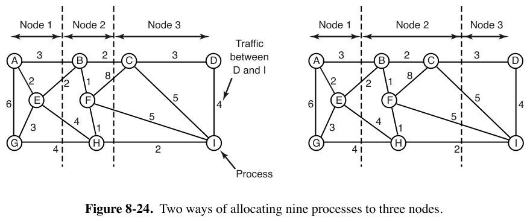
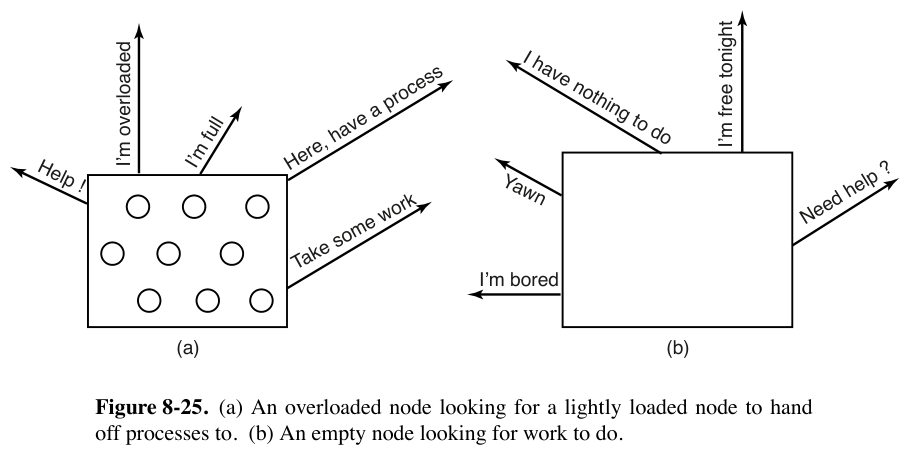

# 8.2.7 负载均衡 / 处理器分配（Load Balancing）

> 书页 576–579（PDF 605–608）。§8.2 逐小节精读之七。
> 同目录：[001.8.2.1](./001.8.2.1-多计算机硬件.md)｜[002.8.2.2](./002.8.2.2-底层通信软件.md)｜[003.8.2.3](./003.8.2.3-用户级通信软件.md)｜[004.8.2.4](./004.8.2.4-远程过程调用RPC.md)｜[005.8.2.5](./005.8.2.5-分布式共享内存DSM.md)｜[006.8.2.6](./006.8.2.6-多计算机调度.md)

**一句话**：进程一旦落到节点就归它管（8.2.6），所以**"进程放哪个节点"才是多计算机真正的调度问题**——这类算法叫处理器分配（processor allocation）算法。书中给一个确定性算法（图论）+ 两个分布式启发式（发送者启动/接收者启动）。

---

## 1. 书中理论

### 1.1 已知量与目标

- **可能已知**：每进程的 CPU 需求、内存用量、两两进程间的通信量矩阵。
- **可能目标**：最小化无活可干浪费的 CPU 周期、最小化总通信带宽、保证公平。

### 1.2 图论确定性算法（图 8-24）

- 系统画成**带权图**：顶点=进程，弧=两进程间平均消息流量；约束=每块 CPU/内存上限。
- 目标：把图切成 k 个子图（分区），**最小化"被切过的弧"的总流量**（跨节点弧=网络流量；块内弧=机内通信，忽略）。
- 例：9 进程 A–I 两种切法，(a) 跨切流量 30 单位，(b) 28 单位——满足约束时 (b) 更好。
- 直觉：找**内紧外松**的簇（簇内通信密、簇间通信稀）。该问题研究了 40+ 年（Stone & Bokhari 1978 起）。

### 1.3 发送者启动（sender-initiated，图 8-25a；Eager et al. 1986）

- 规则：新进程默认在创建它的节点上跑；**除非本节点过载**（判据：进程太多/总工作集太大…）。过载则**随机挑一台**问负载，低于阈值就把新进程送过去；不行再挑下一台；**N 次探测失败**就在本地跑。
- Eager 等用排队论模型证明：**参数范围很宽时都稳定**（阈值/迁移成本/探测上限）。
- **命门：重负载下全员狂探测**——人人都想甩活、没人接得住，活没甩掉几个、探测流量却猛涨（最忙的时候加最重的负担）。

### 1.4 接收者启动（receiver-initiated，图 8-25b）

- 规则：进程结束时自查活够不够；不够就**随机挑机器要工作**，对方没活再问下一台；N 次要不到就先歇着（干排队中的活），下次进程结束再试；实在没活就 idle，固定时间后再试。**让空闲的机器去干探测的活最好**。
- **关键优势**：重负载时"没活"的机器很少 → 探测少；轻负载时全员找活、探测多——**开销发生在欠载时远好于过载时**。
- **可组合**：太忙就甩、太闲就抢；还可以记**历史**（哪些机器慢性过载/欠载），优先探测惯犯。

---

## 2. Linux 对照

| 书中概念 | Linux 7.1.3 | 位置 |
|-|-|-|
| 节点间分配 = 集群层 | 内核不做跨机负载均衡；**K8s 调度器**（打分+过滤选节点）与 Slurm（作业分配）就是书中"处理器分配算法"的工业版 | 用户态 |
| 发送者启动（过载甩活）| K8s descheduler（迁移过载节点上的 Pod）≈ 发送者启动；MPI 任务的动态迁移很少（成本高，正应书中"CPU 1 想跑节点 4 的进程要先费大劲"）| 用户态 |
| 接收者启动（空闲拉活）| **K8s scheduler 的空闲节点拉 Pod、Slurm backfill 填空位**——"开销发生在欠载时"的工程共识 | 用户态 |
| 通信量感知放置（图论/最小割）| K8s **拓扑感知调度**（topologyManager/`preferredDuringScheduling` 提示，同节点/同机架优先）；大数据侧"计算靠近数据"（HDFS rack-aware）= 最小化跨切流量的直接后裔 | 用户态；内核侧 `include/linux/topology.h` 只是单机拓扑 |
| 单机内的"负载均衡" | 内核只做**单机 SMP/NUMA 负载均衡**：调度域逐层平衡 + 空闲 CPU **偷任务**（newidle balance）——恰是"接收者启动"在机内的影子：闲者主动去别人队列里拿活 | `kernel/sched/fair.c`（`load_balance`/`newidle_balance`），详见 [../../031.进程管理/008.进程调度/003.SMP负载均衡](../../031.进程管理/008.进程调度/003.SMP负载均衡) |
| 探测上限 N / 阈值 / 历史 | 机内对应物：`sd->imbalance_pct` 阈值（不平衡达到百分比才动手，避免抖动）、`cache_nice_tries` 等参数都在调度域描述符里 | `include/linux/sched/topology.h`（`struct sched_domain` 字段）|

**学习小结**：三算法一句话——图论（离线最优、要全知）、发送者启动（过载甩、忙时添乱）、接收者启动（欠载抢、忙时安静）。判断标准只有一条：**把开销放到系统有余力的时候**。这条标准同样解释了 Linux 机内负载均衡为什么设计成"空闲 CPU 主动拉"（newidle）为主、"周期性平衡"为辅。
