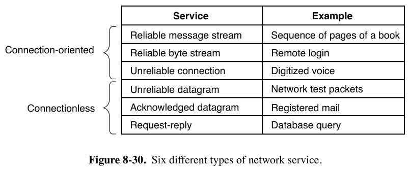
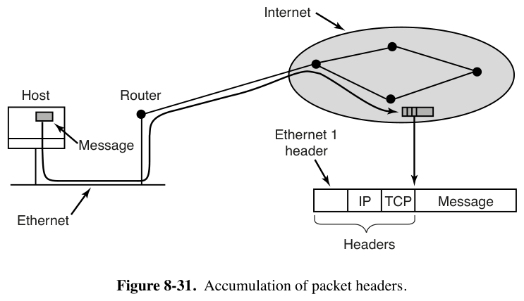

# 8.3.2 网络服务与协议（Network Services and Protocols）

> 书页 585–588（PDF 614–617）。§8.3 逐小节精读之二。
> 同目录：[001.8.3.1](./001.8.3.1-网络硬件.md)｜[003.8.3.3](./003.8.3.3-基于文档的中间件-Web.md)｜[004.8.3.4](./004.8.3.4-基于文件系统的中间件.md)｜[005.8.3.5](./005.8.3.5-基于对象的中间件-CORBA.md)｜[006.8.3.6](./006.8.3.6-基于协调的中间件-Linda与发布订阅.md)

---

## 1. 书中理论

### 1.1 服务的两个正交维度：连接性 × 可靠性

- **面向连接（connection-oriented）**：仿电话——建立、使用、释放；本质是**管道**：这头进什么顺序的比特，那头按同顺序出。
- **无连接（connectionless）**：仿邮政——每封信自带完整目的地址，独立路由；**可能乱序**（后发的先到；面向连接服务不可能乱序）。
- **可靠**=不丢数据，靠**确认（acknowledgement）**实现：收方回 ACK。代价：开销与延迟——数字语音宁可有噪声也不要重传延迟。

### 1.2 六种服务（图 8-30）

| 服务 | 连接性 | 例子 |
|-|-|-|
| 可靠消息流 | 面向连接（保边界）| 逐页送书稿给排版机（两条 1KB 消息不能粘成 2KB）|
| 可靠字节流 | 面向连接（不保边界）| 远程登录 |
| 不可靠连接 | 面向连接 | 数字语音 |
| 不可靠数据报 | 无连接 | 网络测试包（"数据报 datagram"类比电报：无回执）|
| 确认数据报 | 无连接 | 挂号信+回执 |
| 请求-应答 | 无连接 | 数据库查询——**C/S 模型的通信基础** |

### 1.3 协议栈：IP 与 TCP

- **协议（protocol）**= 报文交换的规则集合；**协议栈**分层叠放（底层定帧边界，中层管路由，高层保序保完整）。
- **IP（Internet Protocol）**：**尽力而为（best-effort）数据报**——发送方把最长 64KB 数据报丢进网络"指望它到达"，**无任何保证**；途中可**分片**，各片独立路由，到目的地重组。v4 包头（书中记 40 字节；实际基本头 20 字节、可带选项扩展），含 32 位源/目的地址（点分十进制 192.31.231.65），路由器就按目的地址查表。
- **TCP（Transmission Control Protocol）**：架在 IP 上的**可靠面向连接字节流**。定位进程 = **IP 地址 + 端口号**；建立连接后"往里泵字节，另一头保证完好按序出来"——靠**序号 + 校验和 + 出错重传**实现，对收发进程**完全透明**（用起来就像 UNIX 管道）。v4/v6 并存。
- **发一条消息 = 层层加头（图 8-31）**：用户消息 → 内核协议栈加 **TCP 头** → 加 **IP 头** → 以太网驱动加 **以太网头**（指向同网段路由器）→ 路由器注入互联网。

- **DNS（Domain Name System）**：ASCII 名字（`star.cs.vu.nl`）→ IP 地址（130.37.24.6）的数据库；邮件地址 `user@DNS-host` 的基础——发信程序查 DNS 得 IP，连目标邮件守护进程的 TCP，把消息当文件传，附用户名选邮箱。

---

## 2. Linux 对照：书里的每一行都映射到 net/

| 书中概念 | Linux 7.1.3 | 源码 |
|-|-|-|-|
| 可靠字节流（TCP）| `SOCK_STREAM`/IPPROTO_TCP | `net/ipv4/tcp.c`、`af_inet.c` |
| 可靠消息流 | `SOCK_SEQPACKET`（SCTP：`net/sctp/`）——Linux 里这格有货 | `net/sctp/socket.c` |
| 不可靠数据报（UDP）| `SOCK_DGRAM` | `net/ipv4/udp.c` |
| 确认数据报 | UDP + 应用层 ACK（内核无独立"确认数据报"服务；sunrpc 的 call/reply 即此型）| `net/sunrpc/clnt.c` |
| 请求-应答 | sunrpc（NFS 的通信底座）或用户态 UDP 请求响应 | `net/sunrpc/` |
| IP 尽力而为 + 分片重组 | 分片 `ip_fragment()`、重组 `ip_defrag()` | `net/ipv4/ip_output.c`、`net/ipv4/ip_fragment.c` |
| TCP 序号/校验和/重传 | `tcp_transmit_skb()`（序号+校验和）；重传 RTO **指数退避**（`icsk_backoff` 逐次翻倍）——书中二进制指数退避的第三次登场 | 发送 `net/ipv4/tcp_output.c`；退避 `net/ipv4/tcp_timer.c:658-681` |
| "层层加头"（图 8-31）| 发送主链：`tcp_sendmsg` 建 skb → `ip_queue_xmit` 加 IP 头 → `dev_queue_xmit` → 驱动加链路头（arm64 驱动如 macb/virtio_net 的 `ndo_start_xmit`）| `net/ipv4/tcp.c:1117`、`net/ipv4/ip_output.c`、`net/core/dev.c` |
| "像 UNIX 管道一样透明" | socket fd 即文件——`socket()` 返回的描述符能 read/write/poll，正是"一切皆文件"的延伸 | `net/socket.c`（`sock_read_iter` 等）|
| 端口号定位进程 | `bind()` 登记、`inet_hashinfo` 查找监听 socket | `net/ipv4/inet_hashtables.c` |
| DNS | **内核不参与**（用户态 resolver/nsswitch：glibc）| 用户态 |

**学习小结**：六种服务是"连接性 × 可靠性"的矩阵，Linux socket 类型几乎逐格有对应；图 8-31 的"头部累积"就是内核发送路径 `tcp_sendmsg → ip_queue_xmit → dev_queue_xmit` 的逐步包装——拿书中这张图对照源码走一遍发送路径，网络栈的骨架就通了。
