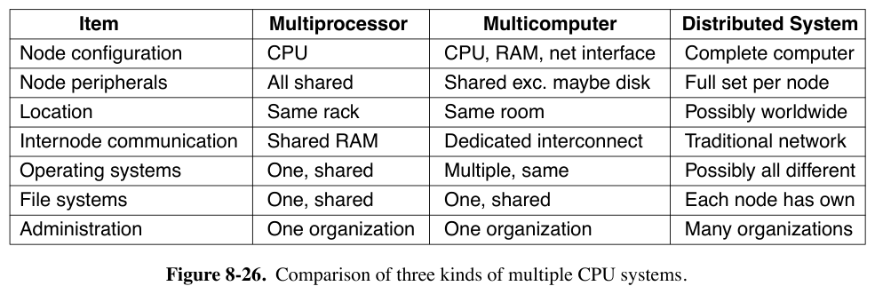
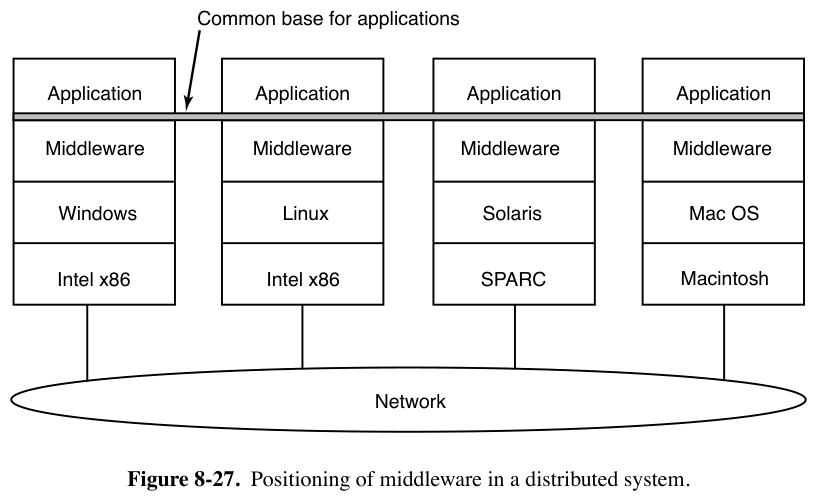
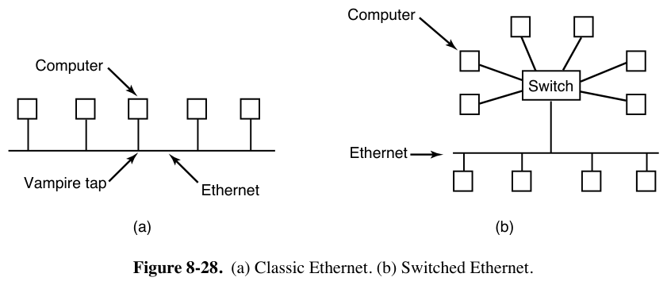
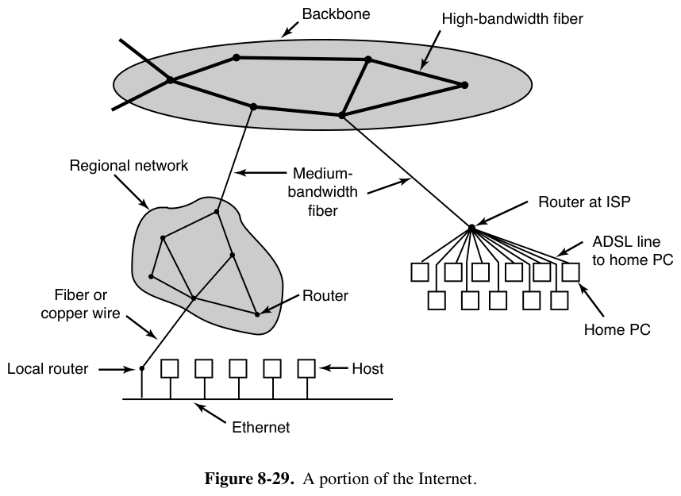
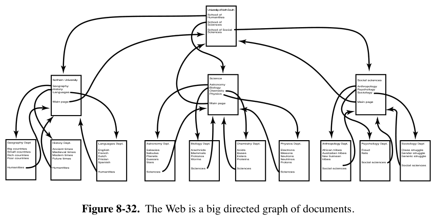
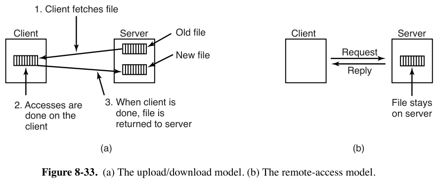
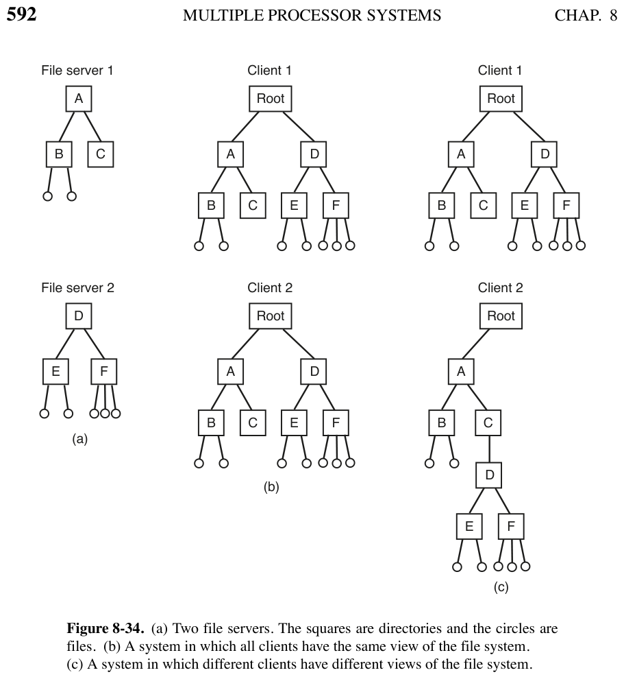
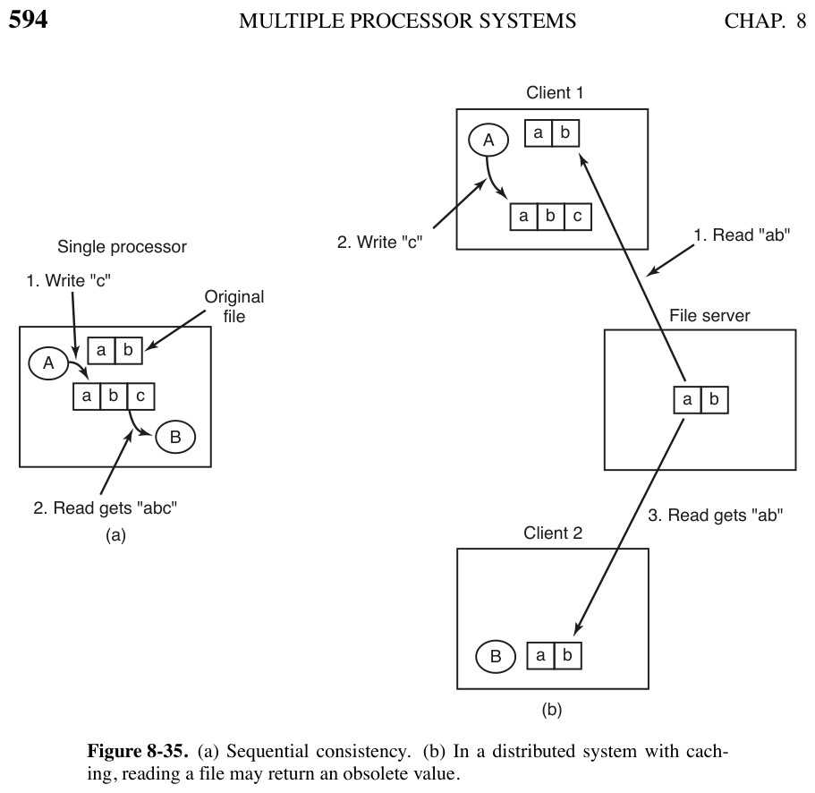
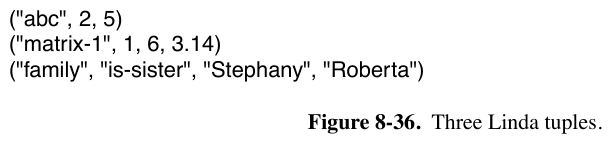
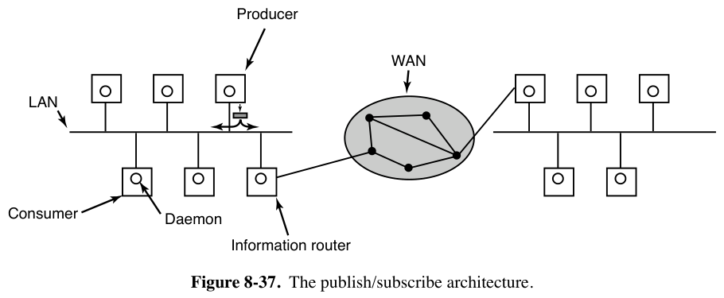

# 分布式系统 DISTRIBUTED SYSTEMS（现代操作系统 §8.3 总结）

> 来源：[Modern Operating Systems 5th Edition # 8.3 DISTRIBUTED SYSTEMS](../../../007.BOOKs/现代操作系统/Modern%20Operating%20Systems%205th%20Edition-PDF-01.pdf)（PDF 第 608–627 页，书页 579–598）。
> 配套：多处理器理论见 [../002.多处理器理论/README.md](../002.多处理器理论/README.md)，多计算机（集群）见 [../004.多计算机理论/README.md](../004.多计算机理论/README.md)。

## 1. 与多计算机的区别（图 8-26）

| 维度 | 多处理器 | 多计算机 | 分布式系统 |
|-|-|-|-|
| 节点 | CPU | CPU+RAM+网卡（±盘）| **完整计算机** |
| 外设 | 全共享 | 基本共享 | **每节点全套** |
| 位置 | 同机架 | 同机房 | **可能全世界** |
| 通信 | 共享内存 | 专用互连 | 传统网络 |
| OS/文件系统/管理 | 统一 | 统一 | **可能全不同** |

趣问：多计算机更像谁？**技术上**多处理器独有共享内存；**应用上**多处理器与多计算机都是机房里算计算密集问题的大机柜，分布式系统则通信远多于计算。松耦合是优势（用途广）也是弱点（缺公共模型，编程难）。

互联网应用各自重新发明轮子（邮件/FTP/Web 本质都是"传文件"却机制全不同）→ 需要统一范式（类比 UNIX"一切皆文件"），手段是在各 OS 之上加一层**中间件（middleware，图 8-27）**——"分布式系统的操作系统"。

## 2. 网络硬件（8.3.1）

- **以太网**（IEEE 802.3）：名字源于被 Michelson-Morley 实验否定的"光以太"；早期同轴电缆 + vampire tap。CSMA/CD：先听后发→冲突检测→随机等待重试→再冲突区间翻倍——**二进制指数退避**（与 [../002.多处理器理论/README.md](../002.多处理器理论/README.md) 中减锁轮询的退避同款算法）。超规模用**网桥**；现代**交换以太网**一机一端口可彻底消除冲突。

- **互联网**：源自 ARPANET（1969，冷战容错、自动绕行）；**主机 + 路由器**；骨干→区域网/ISP→企业/家庭；分组自带目的地址逐跳查表，路由表高度动态。

## 3. 网络服务与协议（8.3.2）

- **面向连接**（电话/管道保序）vs **无连接**（邮政，可乱序）；可靠 = 确认应答（数字化语音宁可有噪声不重传）。
- **六种服务（图 8-30）**：可靠消息流 / 可靠字节流 / 不可靠连接 / 不可靠数据报 / 确认数据报 / 请求-应答（C/S 基础）。

- **IP**：尽力而为数据报——发送方把最长 64KB 的数据报丢进网络"指望它到达"，无任何保证；途中可被分片，各片独立路由（v4 地址为 32 位点分十进制）。**TCP**：IP 之上的可靠面向连接字节流（IP+端口定位进程；序号+校验和+重传，对进程透明如管道）。发消息 = 层层加头（消息+TCP 头+IP 头+以太网头，图 8-31）。**DNS**：名字→IP。

## 4. 基于文档的中间件：Web（8.3.3）

Berners-Lee 1989 CERN。范式：每机持**Web 页** + 超链接 → **Web = 巨大文档有向图**（图 8-32）；**URL** = `protocol://DNS-name/file-name`。取页 8 步：查 DNS 得 IP → TCP 连 80 端口 → 请求文件 → 服务器回文件 → 显示文本 → 取图像 → 释放连接。

## 5. 基于文件系统的中间件（8.3.4）

让系统看起来像一个全局大文件系统；通信 = 一方写文件、另一方读。

- **传输模型（图 8-33）**：**上传/下载**（整文件取回、用完送回；简单高效但本地要装得下、只要局部也得传全量、并发一致性难）vs **远程访问**（文件留服务器、发命令执行）。

- **目录视图（图 8-34）**：全局同视图（像分时系统，好编程）vs 各机不同视图（远程挂载是常态）；全局根方案：路径形如 `/server/path`。

- **命名透明性**：**位置透明**（路径不含位置，服务器可搬家）≠ **位置独立**（文件可迁移而路径不变）。`/server1/...` 有前者无后者；远程挂载两者皆无。三种命名法：机器+路径 / 远程挂载（易）/ 单一全局名字空间（难但理想）。
- **共享语义（图 8-35）**：单处理器"读紧跟写必见新值" = 顺序一致性；客户端缓存会读到**过期文件**。出路：立即回传（低效）/ 放宽为**会话语义（session semantics）**——"修改只对修改者可见，**关闭后才对他人可见**"（最后 close 者胜）/ 下载即加锁。结论：共享文件语义"没有优雅又高效的解"。

## 6. 基于对象的中间件：CORBA（8.3.5）

一切皆**对象**（变量+方法，禁止直接碰变量）。**CORBA**（1991–2012）：异构硬件/OS/语言的 C/S；**ORB** 撮合双方；**IDL** 编译出 client stub 与 server 骨架；ORB 隐藏位置/硬件/OS/活跃状态/底层传输等一切。**硬伤**：每个对象只在一个服务器上 → 全球热点对象性能崩溃 → 只在单机/LAN/单公司规模可用。

## 7. 基于协调的中间件：Linda 与发布/订阅（8.3.6）

- **Linda**（Yale，Gelernter & Carriero）：全局**元组空间（tuple space）**——纯数据元组，投放/取走与位置无关，看起来像全局共享内存（图 8-21c 第三层，DSM 的用户态形态）。四原语：
  - `out`：投放元组；`in`：按**内容模板**原子取走（匹配：字段数同/类型同/常量相等；`?i` 为形式参数只接值；无匹配则**阻塞**）；`read`：同 in 不取走；`eval`：参数**并行求值**后入空间（Linda 创建并行计算的方式）。
  - 阻塞语义可实现信号量：`up = out("sem S")`，`down = in("sem S")`，元组数即信号量值。

- **发布/订阅（图 8-37）**：生产者广播带**层次化主题**（点分隔、可通配）的元组；本机**元组守护进程**按订阅转发；跨 LAN 由 **information router** 中继（远端有订阅者才转发）；可做到保证送达（挂一个"订阅一切"的数据库适配器存档）；生产者消费者**完全解耦**。

## 8. Linux 7.1.3 对照

| 书中概念 | Linux 实现（均已核对源码位置）|
|-|-|
| 二进制指数退避 | 以太网 CSMA 退避在网卡硬件；内核里同款思想 = **TCP 重传 RTO 指数退避**（`icsk_backoff` 逐次倍增）[/net/ipv4/tcp_timer.c:535 tcp_retransmit_timer()](../../../000.SOURCE_CODE/003.LINUX-7.1.3/000.LINUX-7.1.3/net/ipv4/tcp_timer.c) |
| TCP/IP 协议栈 | [/net/ipv4](../../../000.SOURCE_CODE/003.LINUX-7.1.3/000.LINUX-7.1.3/net/ipv4)（tcp.c、ip_output.c 等），协议分层加头即图 8-31 |
| DNS | 用户态（glibc/nsswitch），内核不参与 |
| 远程挂载/分布式文件系统 | 内核原生多家：**NFS** [/fs/nfs](../../../000.SOURCE_CODE/003.LINUX-7.1.3/000.LINUX-7.1.3/fs/nfs)（远程访问模型；close-to-open 一致性 ≈ 书中会话语义）、**9p** [/fs/9p](../../../000.SOURCE_CODE/003.LINUX-7.1.3/000.LINUX-7.1.3/fs/9p)、**AFS** [/fs/afs](../../../000.SOURCE_CODE/003.LINUX-7.1.3/000.LINUX-7.1.3/fs/afs)（整文件缓存 ≈ 上传/下载模型）、**Ceph** [/fs/ceph](../../../000.SOURCE_CODE/003.LINUX-7.1.3/000.LINUX-7.1.3/fs/ceph)、**SMB** [/fs/smb](../../../000.SOURCE_CODE/003.LINUX-7.1.3/000.LINUX-7.1.3/fs/smb) |
| RPC（文件系统之下）| sunrpc（见 [../004.多计算机理论/README.md](../004.多计算机理论/README.md) 的对照表）|
| CORBA/Linda/发布订阅 | 纯用户态中间件（gRPC/Kafka/etcd 等），内核无对应实现 |
| 全局单一名字空间 | 内核不提供跨机名字空间；挂载命名 = 书中"机器+路径/远程挂载"风格 |

---

**一句话串起来**：分布式系统硬件就是普通网络（以太网/互联网），核心是**中间件提供的统一范式**：一切皆文档（Web）、一切皆文件（分布式 FS）、一切皆对象（CORBA）、一切皆元组（Linda/发布订阅）。
