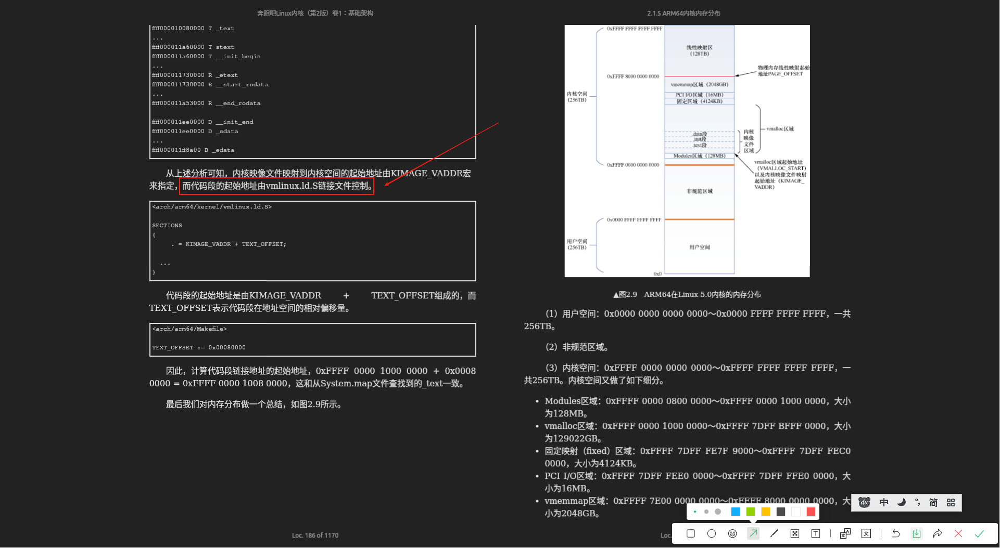

# 链接器：符号解析 + 重定位

> **定位**：本系列的概念总纲——链接器到底做什么。教科书（[编译原理](../../../007.BOOKs/编译原理-张昱_陈意云.pdf) 代码生成章 p365、[计算机组成与设计 #2.12](../../../007.BOOKs/计算机组成与设计-硬件-软件_接口/)）把链接一句话带过，本篇把它拆成**两个动作 + 一份输入格式**，并用一个两文件的最小实验在 `llvm-objdump` 下逐字节观察。宏观流程见姊妹篇 [008.COMPUTER_SCIENCE/000.编译-汇编-链接](../../../008.COMPUTER_SCIENCE/000.编译-汇编-链接/README.md)；内核构建落地见本系列 [001 构建流水线](../001.从C到Image：内核构建流水线.md) / [002 链接脚本](../002.链接脚本走读：vmlinux.lds.S.md) / [004 运行期链接器](../004.模块加载：运行期的链接器.md)。

## 0. 一句话总结

**链接器 = 符号解析（把名字对上号） + 重定位（把地址算出来、写回去）。**

其他一切——段合并、内存布局、入口地址、强弱符号规则、`--gc-sections`——都是这两件事的展开或约束。分开来看：

| 动作 | 解决的问题 | 产物侧的痕迹 |
| - | - | - |
| **符号解析**（symbol resolution） | 每个 `.o` 只知道"别人欠我的名字"（`U` 未定义引用），链接器要给每个名字找到**恰好一个**定义 | `nm` 输出的 `T/D/B/V/U` 分类；多重定义/未定义两种典型报错 |
| **重定位**（relocation） | 编译器不知道最终地址，把"地址还没定"的指令位置**留空并登记**；链接器分配完地址后逐条回填 | `objdump -r` 看到的 `R_AARCH64_*` 重定位记录 |

## 1. 为什么需要链接器

编译是**按编译单元（TU）分而治之**的：`b.c` 编译成 `b.o` 时，`my_func` 和 `global_uninit` 都在别的文件里，编译器**既不知道它们的地址，也无权知道**——它只负责把"这里要引用某个符号"登记下来，指令里的地址字段先填 0 占位：

```
   b.c  (我知道我要用什么)              a.c  (我知道我有什么)
   ┌──────────────────────┐           ┌──────────────────────┐
   │ main:                │           │ int global_init=42;  │ .data
   │   引用 global_uninit │───┐       │ int global_uninit;   │ .bss
   │   调用 my_func       │───┤       │ int my_func(int)     │ .text
   └──────────────────────┘   │  └────►└──────────────────────┘
        编译 (cc1)            │            编译 (cc1)
        ▼                    │             ▼
   ┌──────────────────────┐  │  ┌──────────────────────┐
   │ b.o                  │  │  │ a.o                  │
   │ .text: 地址字段=0 占位│  │  │ .text/.data/.bss     │
   │ 符号表:               │  └──│ 符号表:               │
   │   U global_uninit    │ 引用=│   T my_func          │
   │   U my_func          │ 未定义│   D global_init     │
   │   T main             │      │   B global_uninit   │
   │ 重定位表:             │      │ 重定位表:             │
   │   R_*  global_uninit │      │   R_*  global_init  │
   │   R_*  my_func       │      │   ...               │
   └──────────────────────┘      └──────────────────────┘
            └────────────┬────────────┘
                        ▼  链接器 (ld / lld)
                ┌──────────────────────┐
                │ 可执行文件/大 .o      │
                │  · 同名段合并成段组    │
                │  · 每个符号获得最终地址│
                │  · 每条占位指令被回填  │
                └──────────────────────┘
```

这解释了目标文件六大部分（见 [宏观篇](../../../008.COMPUTER_SCIENCE/000.编译-汇编-链接/README.md)）里最特殊的两块——**符号表**（"还有哪些名字没对上"）和**重定位信息**（"哪些指令的地址字段等着回填"）——它们正是为链接器准备的接口。

## 2. 动作一：符号解析

### 2.1 三类符号、三条规则

`nm` 的单字母分类就是符号解析的"输入清单"（§4 实验有真实输出）：

| nm 字母 | 含义 | 在链接中的角色 |
| - | - | - |
| `T/t` | .text 里的定义（大写=全局） | **强定义**（大写） |
| `D/d` | .data 里的定义 | **强定义**（大写） |
| `B/b/C` | .bss / COMMON | 全局未初始化（历史规则见下） |
| `V/v/W` | 弱定义/弱未定义 | **弱定义**，可被强定义覆盖 |
| `U` | 未定义引用 | **等待解析**：链接器必须在某个输入里找到定义 |

解析规则（ELF 链接器通用语义）：

1. 一个符号**不允许多个强定义**——`multiple definition of ...` 报错；
2. 强定义 + 弱定义并存 → **选强**；只有弱定义 → 用弱（值 0 的"未定义弱引用"还能被链接成 0，运行期判空，内核模块的 `__weak` 依赖这一点，见 [003 §`__weak`](../003.编译器扩展与内核：compiler.h深读.md)）；
3. 强定义 + COMMON（历史遗留的"未初始化全局 tentative 定义"）→ 选强定义，COMMON 让位；现代编译器 `-fno-common`（内核在顶层 [Makefile:598](../../../000.SOURCE_CODE/003.LINUX-7.1.3/000.LINUX-7.1.3/Makefile) 默认开启）已把 COMMON 直接编成 `.bss` 强符号。

### 2.2 静态库：按需拉取，顺序敏感

`.a` 不是"整体链入"，链接器维护**未解析符号集合 E**，对命令行从左到右扫描，只把"能解决 E 中成员的 .o"从档案里抽出来：

```
命令行:  ld main.o -lfoo -lbar          (E = main.o 的未定义引用集合)

  main.o ─► E={printf?...}              扫描 libfoo.a:
            libfoo.a(foo1.o) 解决了部分 ─► 抽出 foo1.o, E 扩充(foo1 的新引用)
            libfoo.a(foo2.o) 无关       ─► 不抽取(死代码, 也不进产物)
  扫描 libbar.a: 解决剩余 ...
  结束: E 非空 ─► undefined reference to ...

  陷阱: -lfoo 若放在 main.o 之前, 扫描 -lfoo 时 E 还是空
        → foo1.o 永远不会被抽出 → "顺序敏感"的根源
```

内核的 `built-in.a` 沿用同一机制，但用 `ld -r` 全量合并（不用按需拉取，`--gc-sections` 在最终链接时再做死代码消除）——见 [001 §3](../001.从C到Image：内核构建流水线.md)。

## 3. 动作二：重定位

### 3.1 两步走

```
 第 1 步: 段合并与地址分配                    第 2 步: 回填(patch)
 ┌────────────────────────────┐            ┌─────────────────────────────┐
 │ 所有输入 .text 顺序拼接     │            │ 逐条扫描重定位记录:           │
 │ 所有输入 .data/.bss 拼接    │  地址定了   │   取出 r_offset 处的指令      │
 │ 按链接脚本定各组起始地址     │ ─────────► │   用公式(如 S+A/PC相对) 计算  │
 │ (内核: vmlinux.lds.S)       │            │   把结果写回指令的立即数字段   │
 │ → 每个符号得到最终地址 S     │            │ (阶段2完成后重定位表即失效)    │
 └────────────────────────────┘            └─────────────────────────────┘
```

第 1 步的"定起始地址"正对应链接器的**功能 1：指定程序各个段的开始位置**（链接脚本 `SECTIONS`，详解见 [002](../002.链接脚本走读：vmlinux.lds.S.md)）：



### 3.2 重定位记录：链接器留给自己的账本

每条记录（ELF64 用 RELA，显式 addend）三要素：

| 字段 | 含义 | 上文实验中的值 |
| - | - | - |
| `r_offset` | 需要回填的位置（段内偏移/最终 VA） | `0x10`（`main` 里那条 `adrp` 的位置） |
| `r_info` | 重定位类型 + 绑定的符号序号 | `R_AARCH64_ADR_PREL_PG_HI21` ↔ `global_uninit` |
| `r_addend` | 计算用的补偿常数（编译期已知部分） | `objdump -r` 不显示 addend，需 `readelf -r` 查看 |

arm64 上 `S`（符号最终地址）+ `A`（addend）按类型组合出目标值，全部类型逐一走读见 [004 §R_AARCH64](../004.模块加载：运行期的链接器.md)（模块加载是同一套重定位的运行期复刻）。

## 4. 最小实验：亲眼看"留空 → 登记"

源文件在 [016.linker_lab_a.c](../../../003.TEST-SPACE/016.linker_lab_a.c) / [017.linker_lab_b.c](../../../003.TEST-SPACE/017.linker_lab_b.c)，命令与输出（macOS 自带工具即可，`-target aarch64-linux-gnu` 产出 arm64 ELF）：

```shell
$ clang -target aarch64-linux-gnu -fno-pic -mcmodel=small -c 016.linker_lab_a.c -o a.o
$ clang -target aarch64-linux-gnu -fno-pic -mcmodel=small -c 017.linker_lab_b.c -o b.o
$ llvm-nm a.o b.o                     # ← 符号解析的输入清单
a.o:
0000000000000000 D global_init       # .data 强定义
0000000000000000 B global_uninit     # .bss  强定义
0000000000000000 T my_func           # .text 强定义
0000000000000004 V weak_var          # 弱定义(参与解析, 可被强覆盖)
b.o:
                 U global_uninit     # 未定义引用 → 等链接器解析
0000000000000000 T main
                 U my_func
```

```shell
$ llvm-objdump -d -r b.o              # ← 重定位的"账本"
0000000000000000 <main>:
       0: d10083ff    sub  sp, sp, #0x20
      10: 90000008    adrp x8, 0x0            ← 地址字段=0 占位!
                0000000000000010:  R_AARCH64_ADR_PREL_PG_HI21  global_uninit
      14: b9400100    ldr  w0, [x8]
                0000000000000014:  R_AARCH64_LDST32_ABS_LO12_NC global_uninit
      18: 94000000    bl   0x18 <main+0x18>   ← 跳转偏移=0 占位!
                0000000000000018:  R_AARCH64_CALL26  my_func
      24: d65f03c0    ret
```

读法（三条记录三种典型）：

1. **`adrp x8, 0x0` + `R_AARCH64_ADR_PREL_PG_HI21`**：取 `global_uninit` 所在 4KB 页的**页基址**（PC 相对、±4GB 范围；`adrp` 的编码细节见 [001.ADRP](../../../008.COMPUTER_SCIENCE/001.汇编指令/000.arm64汇编指令/001.ADRP.md)）。注意它只填"页号"，页内偏移留给下一条；
2. **`ldr w0, [x8]` + `R_AARCH64_LDST32_ABS_LO12_NC`**：把符号地址的低 12 位填进 `ldr` 的 offset 字段——和上一条拼出完整地址（`adrp+ldr` 是 `-fno-pic` 下访问全局数据的经典对子）；
3. **`bl 0x18` + `R_AARCH64_CALL26`**：26 位 PC 相对偏移（±128MB），回填后就是真正的 `my_func`。

再对比 **PIC（默认）编译**的同一段代码，能看到链接器视角的另一面：默认 `-fpic` 时对外部数据的访问改走 **GOT**（`R_AARCH64_ADR_GOT_PAGE`/`LD64_GOT_LO12_NC`），地址在运行期才从 GOT 表项里取——这就是"部分地址未解析，由加载器/动态链接器处理"的微观形态（glibc `_start` 里 `adrp x0, :got:main` 同款，见 [程序是怎么运行的](../../../001.UNIX-DOCS/037.内核基础/001.程序是怎么运行的/002.从_start到main：用户态的接力.md)）。

> 本机无 ELF 链接器（lld）时实验停在 `.o` 一级——恰好把"留空+登记"看得最清楚；继续往下"合并+回填"的全量真实示例，就是内核构建本身（`vmlinux` 的大链接，[001 §4](../001.从C到Image：内核构建流水线.md)）。

## 5. 链接器的输入格式：可重定位 ELF

```
 ELF header (e_machine=EM_AARCH64, e_type=ET_REL)
 ├─ .text          代码           ┐
 ├─ .rodata        只读数据(常量)  │ "装载视图"的原材料
 ├─ .data          已初始化数据    │ (最终布局由链接脚本重排)
 ├─ .bss           未初始化数据    ┘ (不占文件空间, 只有大小)
 ├─ .symtab/.strtab  符号表+名字串   ← 符号解析的输入
 ├─ .rela.text/.rela.data ...       ← 重定位的账本(按段分册)
 ├─ .debug_*       调试信息
 └─ .comment/.note.* 元信息
```

段名与"目标文件六大部分"的对应、`size` 实测见 [宏观篇](../../../008.COMPUTER_SCIENCE/000.编译-汇编-链接/README.md)；vmlinux 里段的最终排布（`_text/_etext/_edata/_end` 围栏符号如何由链接脚本合成）见 [002 §2](../002.链接脚本走读：vmlinux.lds.S.md)。

## 6. 内核里的三个"链接器"场景

| 场景 | "链接器"是谁 | 符号解析 | 重定位 | 详见 |
| - | - | - | - | - |
| 构建期大链接 | `ld -T vmlinux.lds.S` | 全部符号一次性定址（两遍 kallsyms 自举见 [001 §5](../001.从C到Image：内核构建流水线.md)） | `.rela.dyn` 等，KASLR 基址再随机化 | [002](../002.链接脚本走读：vmlinux.lds.S.md) |
| 构建期部分链接 | `ld -r`（归并成 built-in.a） | 只解析**文件间**引用，文件内与外部引用保留 | 重定位记录**合并保留**，推迟到大链接 | [001 §3](../001.从C到Image：内核构建流水线.md) |
| 运行期链接 | `insmod`/`kmod`（内核 `layout_and_allocate`） | 对着内核导出符号表解析模块 `U` 符号 | `apply_relocate_add` 逐条回填 `R_AARCH64_*` | [004](../004.模块加载：运行期的链接器.md) |

三者的共同点：**都是"符号解析 + 重定位"，只是发生的时间点与可用的信息不同**。理解了本篇的两动作，三个场景只是同一台机器换了个时刻运转。

## 参考资料

| 资料 | 用途 |
| - | - |
| [编译原理-张昱/陈意云](../../../007.BOOKs/编译原理-张昱_陈意云.pdf) p365 | 代码生成章（重定位推迟的原理依据） |
| [计算机组成与设计 #2.12](../../../007.BOOKs/计算机组成与设计-硬件-软件_接口/) | 编译→汇编→链接→加载的教材主线 |
| [Run Linux Kernel vol1 #2.6](../../../007.BOOKs/Run%20Linux%20Kernel%20%282nd%20Edition%29%20Volume%201:%20Infrastructure.epub) | 内核侧汇编/链接实践 |
| 实验源码 | [003.TEST-SPACE/016](../../../003.TEST-SPACE/016.linker_lab_a.c) / [017](../../../003.TEST-SPACE/017.linker_lab_b.c) |
