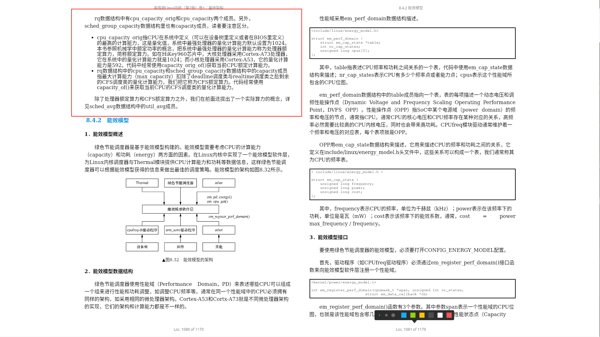

# 绿色节能调度器 (EAS) — Linux 7.1.3

> 学习: [Run Linux Kernel (2nd Edition) Volume 1: Infrastructure.epub#8.4　绿色节能调度器](../../../../007.BOOKs/Run%20Linux%20Kernel%20(2nd%20Edition)%20Volume%201:%20Infrastructure.epub)
> 本文以 **arm64** 为主线(EAS 本身是 ARM/ARM64 生态的产物), 基于 Linux 7.1.3 源码逐行走读; 书中 §8.4 基于 5.x/eas-dev 分支, 接口名(`em_cap_state`/`em_register_perf_domain`)已过时, 本文一律**以 7.1.3 源码为准**; 最后用 **AMD EPYC 9996** 对比 x86 服务器的现实(EAS 在其上不激活)。

---

## 摘要

原书定义: **"绿色节能调度器的设计目标是在保证系统性能的前提下尽可能地降低功耗"**; ARM 和 Linaro 组织希望改变调度器、CPUidle、CPUfreq 三者以性能优先、彼此割裂的现状, 让它们紧密协作, 这个改变称为绿色节能调度(Energy Aware Scheduling, EAS)。在 Linux 内核中, EAS 使用 **PELT**(而非 Android 曾用的 WALT)计算负载。

| 主题 | 关键结论(7.1.3 实测) | 源码锚点 |
|---|---|---|
| 量化计算能力 | DT `capacity-dmips-mhz` × 最大频率归一化, 最强 CPU = 1024 | [drivers/base/arch_topology.c:241](../../../../000.SOURCE_CODE/003.LINUX-7.1.3/000.LINUX-7.1.3/drivers/base/arch_topology.c) |
| 能效模型 EM | `struct em_perf_domain` + `em_perf_state[]`, `cost = 10*power/performance` | [include/linux/energy_model.h:24](../../../../000.SOURCE_CODE/003.LINUX-7.1.3/000.LINUX-7.1.3/include/linux/energy_model.h) |
| EAS 唤醒路径 | `find_energy_efficient_cpu()`, 每个性能域选剩余算力最大 CPU, 再比能量 | [kernel/sched/fair.c:8640](../../../../000.SOURCE_CODE/003.LINUX-7.1.3/000.LINUX-7.1.3/kernel/sched/fair.c) |
| overutilized | util ≥ CFS 算力的 80%(`cap*1280 < util*1024`), 全根域退出 EAS | [kernel/sched/fair.c:104](../../../../000.SOURCE_CODE/003.LINUX-7.1.3/000.LINUX-7.1.3/kernel/sched/fair.c), fair.c:7105 |
| CPU 动态调频 | schedutil: `next_freq = map_util_freq(util+util/4, ref_freq, cap)` | [kernel/sched/cpufreq_schedutil.c:193](../../../../000.SOURCE_CODE/003.LINUX-7.1.3/000.LINUX-7.1.3/kernel/sched/cpufreq_schedutil.c) |
| x86 现实 | x86 无任何 EM 注册 → EAS 静止; EPYC 9996 走 amd-pstate(EPP)+SMU | [drivers/cpufreq/amd-pstate.c](../../../../000.SOURCE_CODE/003.LINUX-7.1.3/000.LINUX-7.1.3/drivers/cpufreq/amd-pstate.c) |

---

## 设计动机: 三个子系统的割裂与统一

书 §8.4 开篇观点: 调度器(选 CPU)、CPUidle(选 idle 状态)、CPUfreq(选频压)各自为政:

```c
// 调度器视角: 只管公平与唤醒, 不知道频压
wake_up_process() -> try_to_wake_up() -> select_task_rq()

// CPUfreq 视角: 旧 governor(ondemand 等)靠采样 idle/active 时间, 滞后且过滤不掉毛刺
// CPUidle 视角: 只看本 CPU 是否空闲, 不知道"进程放在小核更省电"
```

```c
// kernel/sched/fair.c:8602 (注释原文)
 * find_energy_efficient_cpu(): Find most energy-efficient target CPU for the
 * waking task. find_energy_efficient_cpu() looks for the CPU with maximum
 * spare capacity in each performance domain and uses it as a potential
 * candidate to execute the task. Then, it uses the Energy Model to figure
 * out which of the CPU candidates is the most energy-efficient.
```

EAS 的统一思路:

```
        +-------------------+       +-------------------+
        |  调度器 (CFS)     |       |  CPUfreq          |
        |  PELT util 信号   |------>|  schedutil        |
        |  唤醒时选 CPU     |       |  util -> 频率     |
        +---------+---------+       +---------+---------+
                  |                           |
                  |   +---------------+       |
                  +-->| 能效模型 EM   |<------+
                      | capacity+power|  (注册功耗表)
                      +-------+-------+
                              |
                  +-----------v-----------+
                  | OPP 表 (freq, voltage)|
                  | DT operating-points-v2|
                  +-----------------------+
   割裂(旧): 调度器/CPUidle/CPUfreq 各自启发式
   统一(EAS): 唤醒路径用 EM 做能量最优选 CPU; schedutil 用调度器 util 直接调频
```

**PELT 与 WALT 的取舍**: 原文档指出"Linux 内核中绿色节能调度器还是使用 PELT 计算负载, 放弃了原本的 WALT 算法"。EAS 上游化时选择 PELT 作为公共负载信号(`util_avg`/`util_est`), 原因是 PELT 已在主线 CFS 中承担负载均衡与负载跟踪, EAS 直接复用同一套 scale-invariant 信号(见 sched-capacity.rst), 避免维护两套语义; WALT 留在 Android vendor 分支。

**EAS 启用的前提**(7.1.3, [kernel/sched/topology.c:213](../../../../000.SOURCE_CODE/003.LINUX-7.1.3/000.LINUX-7.1.3/kernel/sched/topology.c) `sched_is_eas_possible()`), 4 个条件缺一不可:

1. 存在非对称容量拓扑(`sd_asym_cpucapacity`, 如 big.LITTLE);
2. **不支持 SMT**("EAS definitely does \*not\* handle SMT", topology.c:232);
3. 频率不变性负载跟踪可用(`arch_scale_freq_invariant()`, arm64 用 AMU 计数器);
4. cpufreq 就绪(每个 CPU 有 policy 且可拿到参考频率)。

另需 CONFIG_ENERGY_MODEL + CONFIG_CPU_FREQ_GOV_SCHEDUTIL 同时打开(sched.h:3727), 运行时可用 `/proc/sys/kernel/sched_energy_aware` 开关(topology.c:292)。

---

## 量化计算能力 (capacity) — 书 §8.4.1

### 三层算力概念(承书)

| 概念 | 来源 | 获取函数 |
|---|---|---|
| 处理器额定算力 `cpu_capacity_orig`… | 7.1.3 已并入 `arch_scale_cpu_capacity()` | fair.c 中 `capacity_of()`/`get_actual_cpu_capacity()` |
| CFS 额定算力 `rq->cpu_capacity` | 扣除 RT/DL/IRQ/HW 压力后 | `capacity_of(cpu)` (fair.c:7532) |
| 实际算力 util_avg | PELT 跟踪 | `cpu_util_cfs()` / `task_util_est()` |

### arm64: 从设备树/CPPC 到 cpu_scale

arm64 平台以 **Arm AGI CPU（SP113012，136×Neoverse V3，ACPI 服务器，无 DT）** 为例：capacity 走 **CPPC 路径**——`topology_init_cpu_capacity_cppc()`(arch_topology.c:327)从每个 CPU 的 CPPC `highest_perf` 寄存器读原始算力(arch_topology.c:348)，136 核同构 → 归一化后**全部 1024，只有一档**（这也是后文"EAS 在 AGI 上不启用"的第一个伏笔：`asym_cap_list` 单档）。

书 5.x 基于 DT 平台（HiKey 时代的机制，内核至今保留）：DT 在每个 cpu 节点用 `capacity-dmips-mhz` 描述原始算力（异构大小核的具体示例——Cortex-A725/A520、真实 DTS 取值——见**附录 B**）:

```dts
// DT 机制(通用, 书 §8.4.1)
cpuN: cpu@N {
        compatible = "arm,armv8";
        capacity-dmips-mhz = <...>;        // 原始算力(DMIPS/MHz)
        dynamic-power-coefficient = <...>; // 功耗系数(EM 用, 见下文)
};
```

解析与归一化(以源码为准, 注意与书 5.x 公式的差异):

```c
// drivers/base/arch_topology.c:269 (解析 DT "capacity-dmips-mhz")
bool __init topology_parse_cpu_capacity(struct device_node *cpu_node, int cpu)
{
        ret = of_property_read_u32(cpu_node, "capacity-dmips-mhz",
                                   &cpu_capacity);
        ...
        raw_capacity[cpu] = cpu_capacity;
}

// drivers/base/arch_topology.c:241 (归一化: 7.1.3 把"原始算力×该 CPU 最大频率"作为分子)
void topology_normalize_cpu_scale(void)
{
        ...
        capacity_scale = 1;
        for_each_possible_cpu(cpu) {
                capacity = raw_capacity[cpu] *
                           (per_cpu(capacity_freq_ref, cpu) ?: 1);
                capacity_scale = max(capacity, capacity_scale);   // 全系统最大
        }
        for_each_possible_cpu(cpu) {
                capacity = raw_capacity[cpu] * (per_cpu(capacity_freq_ref, cpu) ?: 1);
                capacity = div64_u64(capacity << SCHED_CAPACITY_SHIFT, capacity_scale);
                topology_set_cpu_scale(cpu, capacity);            // 写入 per-CPU cpu_scale
        }
}
```

- `capacity_freq_ref` 来自 cpufreq policy 的 `cpuinfo.max_freq`(arch_topology.c:407), 即**容量 = DMIPS/MHz × 最大频率**的综合(书的 5.x 时代只按 `capacity-dmips-mhz` 比值; 异构系统中小核会被"压低"——附录 B 教学模型: 小核(403)@2.0GHz vs 大核(1024)@3.2GHz 归一化后 ≈ **252**。AGI 136 核同频同构, 全部归一化为 1024, 无此效应)。
- 访问入口: [arch/arm64/include/asm/topology.h:30](../../../../000.SOURCE_CODE/003.LINUX-7.1.3/000.LINUX-7.1.3/arch/arm64/include/asm/topology.h) `#define arch_scale_cpu_capacity topology_get_cpu_scale`; 默认实现恒返回 1024([include/linux/sched/topology.h:225](../../../../000.SOURCE_CODE/003.LINUX-7.1.3/000.LINUX-7.1.3/include/linux/sched/topology.h))。
- arm64 服务器(无 DT)路径: `topology_init_cpu_capacity_cppc()`(arch_topology.c:327)从 **CPPC `highest_perf`** 读取原始算力(arch_topology.c:348)。

### 频率不变性 FIE (arm64 AMU)

[arch/arm64/kernel/topology.c](../../../../000.SOURCE_CODE/003.LINUX-7.1.3/000.LINUX-7.1.3/arch/arm64/kernel/topology.c) 用核心的 AMU(Activity Monitor Unit)计数器在每个 tick 折算 `arch_freq_scale`(`amu_scale_freq_tick`, topology.c:153-160); 无 AMU 时退回 cpufreq 通知路径 `topology_set_freq_scale()`([drivers/base/arch_topology.c:141](../../../../000.SOURCE_CODE/003.LINUX-7.1.3/000.LINUX-7.1.3/drivers/base/arch_topology.c))。信号来源枚举 CPUFREQ/ARCH/CPPC/VIRT 见 [include/linux/arch_topology.h:38](../../../../000.SOURCE_CODE/003.LINUX-7.1.3/000.LINUX-7.1.3/include/linux/arch_topology.h)。

### 调度域建立时的刷新链

```
sched_init_smp() -> sched_init_domains() -> build_sched_domains()
    -> init_sched_groups_capacity() -> update_group_capacity()
        -> update_cpu_capacity(sd, cpu)          // kernel/sched/fair.c:10346
        -> rq->cpu_capacity = scale_rt_capacity(cpu)  // 扣 RT/DL/IRQ/HW 压力
```

```c
// kernel/sched/fair.c:10346
static void update_cpu_capacity(struct sched_domain *sd, int cpu)
{
        unsigned long capacity = scale_rt_capacity(cpu);
        struct sched_group *sdg = sd->groups;

        if (!capacity)
                capacity = 1;

        cpu_rq(cpu)->cpu_capacity = capacity;   // CFS 额定算力
        sdg->sgc->capacity = capacity;
        ...
}
```

big.LITTLE 容量示意(归一化后, 1024 = 全系统最强核):

```
 Arm AGI CPU (SP113012, 136 x Neoverse V3 同构):
  1024 +----------------+  V3 @最高频 (全部 136 核同一档)
       |################|
       |################|
     0 +----------------+  -> asym_cap_list 单档, 无 SD_ASYM_CPUCAPACITY
         cpu_scale: /sys/devices/system/cpu/cpuN/capacity  (drivers/base/topology.c:220)

 异构大小核的对照(附录 B 教学模型): 大核 1024 / 小核 ≈252, 两档共存
```

---

## 能效模型 EM — 书 §8.4.2

### 数据结构(7.1.3 已演进为 RCU 保护的运行时可更新表)

```c
// include/linux/energy_model.h:24
struct em_perf_state {
        unsigned long performance; // 该频点的"性能值" = max_cap * freq / fmax
        unsigned long frequency;   // kHz, 与 cpufreq 一致
        unsigned long power;       // 该频点功耗(单 CPU), µW 或抽象刻度
        unsigned long cost;        // 能效系数 = 10 * power / performance
        unsigned long flags;       // EM_PERF_STATE_INEFFICIENT 等
};

// include/linux/energy_model.h:74
struct em_perf_domain {
        struct em_perf_table __rcu *em_table; // 指向 em_perf_state state[] (RCU)
        struct list_head node;                // 挂入全局 em_pd_list
        int id;
        int nr_perf_states;                   // 性能状态(频点)个数
        int min_perf_state;                   // 允许的最小/最大性能状态索引
        int max_perf_state;
        unsigned long flags;                  // MICROWATTS/SKIP_INEFFICIENCIES/ARTIFICIAL
        unsigned long cpus[];                 // 该性能域包含的 CPU 位图
};
```

注意: 书中的 `em_cap_state`/`nr_cap_states` 已改名为 `em_perf_state`/`nr_perf_states`, 且新增 `performance` 字段(以频点线性映射 CPU 容量)。

### cost 与 energy 公式(以源码为准)

```c
// kernel/power/energy_model.c:227 (为每个频点算 performance)
static void em_init_performance(struct device *dev, struct em_perf_domain *pd,
                                struct em_perf_state *table, int nr_states)
{
        fmax = (u64) table[nr_states - 1].frequency;
        max_cap = (u64) arch_scale_cpu_capacity(cpu);
        for (i = 0; i < nr_states; i++)
                table[i].performance = div64_u64(max_cap * table[i].frequency, fmax);
}

// kernel/power/energy_model.c:253 (cost 计算 + 低效频点标记)
static int em_compute_costs(struct device *dev, struct em_perf_state *table, ...)
{
        for (i = nr_states - 1; i >= 0; i--) {
                power_res = table[i].power * 10;         // ×10 提高分辨率
                cost = power_res / table[i].performance; // = 10*power*fmax/(max_cap*freq)
                table[i].cost = cost;
                if (table[i].cost >= prev_cost)          // 频率更高、cost 不降 => 低效
                        table[i].flags = EM_PERF_STATE_INEFFICIENT;
                ...
        }
}
```

能量估算公式(energy_model.h:243 `em_cpu_energy()`, 内核注释 (1)~(4) 式):

```
performance = freq * scale_cpu / cpu_max_freq            (源码注释式(1))
cpu_nrg     = power * cpu_util / performance             (式(2))
           = (power * cpu_max_freq) / (freq * scale_cpu) * cpu_util   (式(3))
cost        = 10 * power * max_freq / (scale_cpu * freq)  (式(3)第一项, em_compute_costs 实算)
pd_nrg      = ps->cost * Σ cpu_util                      (式(4), energy_model.h:315)
```

与书式(8.24)/(8.25) 的差别只是**常数因子**(×10/`scale_cpu`), 同一 PD 内比较能量时被约掉, 不影响选 CPU 的结论。`sum_util == 0` 直接返回 0(energy_model.h:253)。

### 性能域 PD 与频域的关系

- 一个 PD = "一起调频压的一组 CPU"(`policy->cpus`), 通常与一个 cpufreq policy 一一对应(energy_model.h:70 注释: "Performance domains often have a 1-to-1 mapping with CPUFreq policies");
- 同一 PD 内所有 CPU **必须同微架构**(附录 B 教学模型中大/小核各自成 PD; AGI 136 核同为 V3, PD 划分只受频域约束);
- 调度器侧用 `struct perf_domain`(内嵌 `em_pd` 指针)链表挂在 `root_domain->pd`, `perf_domain_span(pd)` 即 EM 的 `cpus` 位图(sched.h:3729)。

PD → em_perf_state[] 示意(以附录 B 教学模型的小核 PD 为例, power 为按 `dynamic-power-coefficient` 推算值, 频率/功耗数字为示意比例; AGI 同构场景可类比为"一个 PD 覆盖同频域的一组 V3"):

```
  性能域 PD0 (cpus={4,5}, 小核对共享 L2, cpu_scale≈252)    性能域 PD1 (cpus=0-1, 大核, cpu_scale=1024)
  +-------------------------------------------+     +-------------------------------------------+
  | em_perf_table->state[]                    |     | em_perf_table->state[]                    |
  | idx |  freq  | performance | power | cost |     | idx |  freq  | performance | power | cost |
  |   0 |  600M  |     76      |  8.4  | 1.11 |     |   0 | 1000M  |    320      |   210 | 6.56 |
  |   1 | 1100M  |    139      |   22  | 1.59 |     |   1 | 1600M  |    512      |   470 | 9.18 |
  |   2 | 1600M  |    202      |   43  | 2.13 |     |   2 | 2300M  |    736      |   890 |12.09 |
  |   3 | 2000M  |    252      |   66  | 2.62 |     |   3 | 2800M  |    896      |  1350 |15.07 |
  |     |        |             |       |      |     |   4 | 3200M  |   1024      |  1820 |17.77 |
  +-------------------------------------------+     +-------------------------------------------+
        (power 单位 mW 仅为示意比例; cost=10*power/performance, 见上)
        同频点小核功耗远低于大核 -> EAS 在低负载时倾向小核
```

### 注册路径(arm64 两条主线)

(1) **DT 平台**: cpufreq-dt 驱动通过 `.register_em` 回调([drivers/cpufreq/cpufreq-dt.c:150](../../../../000.SOURCE_CODE/003.LINUX-7.1.3/000.LINUX-7.1.3/drivers/cpufreq/cpufreq-dt.c))→ `cpufreq_register_em_with_opp()`([include/linux/cpufreq.h:1245](../../../../000.SOURCE_CODE/003.LINUX-7.1.3/000.LINUX-7.1.3/include/linux/cpufreq.h))→ `dev_pm_opp_of_register_em()`([drivers/opp/of.c:1542](../../../../000.SOURCE_CODE/003.LINUX-7.1.3/000.LINUX-7.1.3/drivers/opp/of.c))→ `em_dev_register_perf_domain()`([kernel/power/energy_model.c:588](../../../../000.SOURCE_CODE/003.LINUX-7.1.3/000.LINUX-7.1.3/kernel/power/energy_model.c))。功耗回调优先用 DT 里的 `opp-microwatt` 实测值, 否则用 `dynamic-power-coefficient` 推算:

```c
// drivers/opp/of.c:1480 (按 P = C·V²·f 推算功耗, 结果为 µW)
int dev_pm_opp_calc_power(struct device *dev, unsigned long *uW, unsigned long *kHz)
{
        ret = of_property_read_u32(np, "dynamic-power-coefficient", &cap);
        ...
        mV = dev_pm_opp_get_voltage(opp) / 1000;
        tmp = (u64)cap * mV * mV * (Hz / 1000000);
        do_div(tmp, 1000000);
        *uW = (unsigned long)tmp;
}

// drivers/opp/of.c:1593 (注册)
        ret = em_dev_register_perf_domain(dev, nr_opp, &em_cb, cpus, true); // microwatts=true
```

(2) **ACPI/CPPC arm64 服务器**: [drivers/cpufreq/cppc_cpufreq.c:542](../../../../000.SOURCE_CODE/003.LINUX-7.1.3/000.LINUX-7.1.3/drivers/cpufreq/cppc_cpufreq.c) `cppc_cpufreq_register_em()` 直接注册 EM(用 CPPC 寄存器的 `highest_perf` 等生成分级功耗/成本), 这是 arm64 服务器跑 EAS 的入口:

```c
// drivers/cpufreq/cppc_cpufreq.c:542
static void cppc_cpufreq_register_em(struct cpufreq_policy *policy)
{
        struct cppc_cpudata *cpu_data;
        struct em_data_callback em_cb =
                EM_ADV_DATA_CB(cppc_get_cpu_power, cppc_get_cpu_cost);

        cpu_data = policy->driver_data;
        em_dev_register_perf_domain(get_cpu_device(policy->cpu),
                        get_perf_level_count(policy), &em_cb,
                        cpu_data->shared_cpu_map, 0);
}
```

EM 注册后并不直接等于 EAS 生效: 调度域重建时 `build_sched_domains()`(topology.c:2987)调用 `build_perf_domains()`(topology.c:409, 为每个 CPU 用 `em_cpu_get()` 归并出 `perf_domain` 链)并 `sched_energy_set()`(topology.c:388)打开静态钥匙 `sched_energy_present`(topology.c:210)。此后 `sched_energy_enabled()`(sched.h:3732)才为真。

---

## OPP 子系统 — 书 §8.4.3

OPP(Operating Performance Point) = 电源域的一个 {频率, 电压} 点; 一个电源域的 OPP 集合构成 OPP 表。内核 OPP 框架位于 [drivers/opp/](../../../../000.SOURCE_CODE/003.LINUX-7.1.3/000.LINUX-7.1.3/drivers/opp)(CONFIG_PM_OPP, 4.14 起从 drivers/base/power 迁入), 接口在 [include/linux/pm_opp.h](../../../../000.SOURCE_CODE/003.LINUX-7.1.3/000.LINUX-7.1.3/include/linux/pm_opp.h)(`dev_pm_opp_add`/`dev_pm_opp_find_freq_ceil|floor`/`dev_pm_opp_get_voltage`/`dev_pm_opp_get_opp_count` 等)。

`operating-points-v2` 解析(drivers/opp/of.c): `opp-shared` 标记同一频域共享(of.c:230), `opp-hz` 读频率(of.c:728-745), `opp-microvolt` 读电压, 可选 `opp-microwatt` 读实测功耗:

```
  设备树 (附录 B 教学模型, 模板仿树内 DynamIQ DTS)   OPP 子系统              cpufreq
  +--------------------------+   dev_pm_opp_of_cpumask_add_table   +------------------+
  | a520_opp: opp_table0     |------------------------------------>| dev_pm_opp 表    |
  |  compatible =            |   (解析 opp-hz / opp-microvolt)     |  {600M,0.6V}     |
  |   "operating-points-v2"  |                                     |  {1100M,0.7V}    |
  |  opp-shared;             |                                     |  {1600M,0.8V}    |
  |  opp00 { opp-hz=/bits/ 64|                                     |  {2000M,0.9V}    |
  |    <600000000>;          |   dev_pm_opp_init_cpufreq_table     |                  |
  |    opp-microvolt=<600000>|------------------------------------>|> policy->        |
  |  }  ... opp03            |                                     |  freq_table[]    |
  +--------------------------+                                     +------------------+
        cpu4/5 { operating-points-v2 = <&a520_opp>;  /* 对共享 */       |
                  capacity-dmips-mhz = <403>;                           |
                  dynamic-power-coefficient = <...>; } ---> EM 注册时的功耗回调
```

"OPP 与频域": 同一个 `opp-shared` 表覆盖的 CPU 共享一个调频域——cpufreq-dt 用 `dev_pm_opp_of_get_sharing_cpus()` 把它们并入同一个 `policy->cpus`(cpufreq-dt.c:184), EM 又以 `policy->cpus` 建 PD, 因此 **DT 的 opp-shared 边界最终决定了 PD 的边界**。电压由 OPP 层配合 regulator 管理(`dev_pm_opp_set_regulators`, cpufreq-dt.c:176), 高频需要高压, 这是功耗曲线上翘(V² 项)的物理来源。

---

## 初始化 CPUfreq-dt 驱动 — 书 §8.4.4

7.1.3 中 cpufreq-dt 的初始化重心从 `cpufreq_init()` 挪到了 probe 阶段的 `dt_cpufreq_early_init()`(书里 5.x 时代的行号描述不再适用):

```c
// drivers/cpufreq/cpufreq-dt.c:156 dt_cpufreq_early_init() 关键步骤(节选行号)
// 188: dev_pm_opp_set_regulators()          配置 regulator(OPP 层管电压)
// 197: dev_pm_opp_of_get_sharing_cpus()     从 "operating-points-v2" 查频域共享
// 222: dev_pm_opp_of_cpumask_add_table()    解析 DT 建 OPP 表
// 233: dev_pm_opp_get_opp_count()           校验 OPP 表非空
// 248: dev_pm_opp_init_cpufreq_table()      生成 policy->freq_table

// drivers/cpufreq/cpufreq-dt.c:83 (真正的 ->init 很薄, 只做装配)
static int cpufreq_init(struct cpufreq_policy *policy)
{
        ...
        cpumask_copy(policy->cpus, priv->cpus);   // 频域 = opp-shared 覆盖的 CPU
        policy->clk = cpu_clk;
        policy->freq_table = priv->freq_table;    // 来自 OPP 表
        policy->suspend_freq = dev_pm_opp_get_suspend_opp_freq(cpu_dev) / 1000;
        policy->cpuinfo.transition_latency = transition_latency;
        policy->dvfs_possible_from_any_cpu = true;
        return 0;
}
```

policy 建立流程(cpufreq 核心 + cpufreq-dt + EM):

```
 cpufreq_dt_probe
   | dt_cpufreq_early_init(): regulator/共享掩码/OPP 表/freq_table
   v
 cpufreq_register_driver(&dt_cpufreq_driver)            [cpufreq-dt.c:140]
   |  .flags = CPUFREQ_NEED_INITIAL_FREQ_CHECK|CPUFREQ_IS_COOLING_DEV
   v
 cpu online: cpufreq_online()  [drivers/cpufreq/cpufreq.c]
   |  policy->cpus  = cpumask_of(cpu)  (cpufreq.c:1423, 先单 CPU)
   |  ->init = cpufreq_init()          (cpufreq-dt.c:83, 扩成整个频域)
   |  cpufreq_table_validate_and_sort()
   |  register_em 回调: cpufreq_driver->register_em(policy)  (cpufreq.c:1555)
   v                      |
   governor 启动          +-> cpufreq_register_em_with_opp() [include/linux/cpufreq.h:1245]
   (默认 schedutil)            -> dev_pm_opp_of_register_em()  [drivers/opp/of.c:1542]
                                    -> em_dev_register_perf_domain() [kernel/power/energy_model.c:588]
                                        PD 建表 + em_compute_costs() + debugfs
```

---

## EAS 唤醒路径: find_energy_efficient_cpu 完整走读 — 书 §8.4.6

入口门控: 唤醒(`WF_TTWU`)且根域未 overutilized 时才尝试 EAS:

```c
// kernel/sched/fair.c:8843 (select_task_rq_fair, fair.c:8829)
        if (wake_flags & WF_TTWU) {
                record_wakee(p);
                ...
                if (!is_rd_overutilized(this_rq()->rd)) {   // fair.c:8850
                        new_cpu = find_energy_efficient_cpu(p, prev_cpu);
                        if (new_cpu >= 0)
                                return new_cpu;             // EAS 命中, 直接返回
                        new_cpu = prev_cpu;
                }
                ...
```

大流程(7.1.3 实走读, 行号均为 fair.c):

```
 try_to_wake_up() -> select_task_rq() -> select_task_rq_fair()
     | !is_rd_overutilized(rd)?  否-------------------------------> 走普通唤醒(sched_balance)
     v 是
 find_energy_efficient_cpu(p, prev_cpu)                    [fair.c:8640]
     |
     | rd->pd 为空(无 EM)? -> return -1                      [8655]
     | sd = sd_asym_cpucapacity 向上找到覆盖 prev_cpu 的域     [8663]
     | task_util_est(p)==0 且无 uclamp_min -> return prev     [8672]
     | eenv_task_busy_time()                                  [8478]
     |
     v  for (pd = rd->pd; pd; pd = pd->next)   遍历所有性能域   [8677]
     +--------------------------------------------------------------+
     | ① cpus = PD ∩ online; cpu_actual_cap =                       |
     |    get_actual_cpu_capacity()  [fair.c:5198, 额定算力-HW/     |
     |    cpufreq 压力];  eenv.cpu_cap / pd_cap                     |
     | ② for_each_cpu(cpus):                                        |
     |      util = cpu_util(cpu,p,cpu,0);  cpu_cap=capacity_of      |
     |      fits = util_fits_cpu(util,min,max,cpu) [fair.c:5207]    |
     |      不 fits -> continue (misfit 淘汰)                       |
     |      spare = cpu_cap - util                                  |
     |      cpu==prev_cpu  -> prev_spare_cap/prev_fits              |
     |      else 取剩余算力最大者 -> max_spare_cap_cpu              |
     | ③ base_energy = compute_energy(..., dst=-1)  无 p 基准   [8760]
     | ④ prev_delta = compute_energy(..., prev_cpu) - base      [8764]
     |    (若 prev_delta < base: util 已变, 直接返回 prev)      [8767]
     | ⑤ max_spare_cap_cpu 更优时:                              |
     |    cur_delta = compute_energy(..., max_spare_cap_cpu)    [8788]
     |    fits 更差/容量不高/能量不省 -> 维持原 best              [8777-8801]
     |    否则 best_delta/best_energy_cpu 更新                   [8803]
     +--------------------------------------------------------------+
     |
     v  收尾 [8810-8813]
        best_fits > prev_fits, 或 (都 fits 且 best_delta<prev_delta),
        或 (都不 fits 但 best 实际容量更高)  => target = best_energy_cpu
        否则 target = prev_cpu (利用 cache 热度)
```

compute_energy 与两次估算对比:

```c
// kernel/sched/fair.c:8584
static inline unsigned long
compute_energy(struct energy_env *eenv, struct perf_domain *pd,
               struct cpumask *pd_cpus, struct task_struct *p, int dst_cpu)
{
        unsigned long max_util = eenv_pd_max_util(eenv, pd_cpus, p, dst_cpu);
        unsigned long busy_time = eenv->pd_busy_time;
        unsigned long energy;

        if (dst_cpu >= 0)
                busy_time = min(eenv->pd_cap, busy_time + eenv->task_busy_time);

        energy = em_cpu_energy(pd->em_pd, max_util, busy_time, eenv->cpu_cap);
        trace_sched_compute_energy_tp(p, dst_cpu, energy, max_util, busy_time);
        return energy;
}
```

- `eenv_pd_max_util()`(fair.c:8537): 假设 p 落在 dst_cpu 后域内各 CPU 的有效 util, 经 `effective_cpu_util()` + uclamp + `sugov_effective_cpu_perf()`(含 1.25 DVFS 余量, 见下节)取最大——它决定 PD 会请求哪个频点;
- `em_cpu_energy()`(energy_model.h:243): 按 max_util 选频点, 返回 `ps->cost * sum_util`(式(4))。

prev vs 候选 两次估算对比图(书图 8.36/8.39 场景: 大小核各一忙一闲, p 放小核或大核):

```
 假设(附录 B 教学模型): CPU4(小核)util=100, CPU5(小核)空闲, CPU0(大核)util=256, CPU1(大核)空闲, p util=150

 方案 A: p -> CPU5 (小核 PD)                    方案 B: p -> CPU1 (大核 PD)
   max_util = 150 -> 1.25 余量 = 188             max_util = 150 -> 1.25 余量 = 188
   需 performance>=188 => 选 1600MHz(perf=202)   需 performance>=188 => 选 1000MHz(perf=320)
   cost(1600) = 10*43*2000/(252*1600)≈2.13       cost(1000) = 10*210*3200/(1024*1000)≈6.56
   sum_util  = 100+150 = 250                     sum_util  = 256+150 = 406
   E_A = 2.13 * 250  ≈ 533 (相对单位)            E_B = 6.56 * 406  ≈ 2663 (相对单位)
                              |                              |
                              +--------- E_A < E_B ----------+
                     小核 PD 更省电 => target = CPU5
        (若 prev_cpu 本来就在某个更优位置, cur_delta 不小于 prev_delta 则留在 prev)
```

`sched_energy_enabled` 前提链: CONFIG_ENERGY_MODEL+GOV_SCHEDUTIL → 有驱动注册 EM → `build_perf_domains()` 建 PD 链 → `sched_energy_set()` 打开 `sched_energy_present` 静态钥匙 → `sched_energy_enabled()`(sched.h:3732)为真。任一环缺失(如 x86), EAS 路径静默不启用。

另注(fair.c:8630 注释): 新 fork 的进程(forkee)没有可用的 util 数据, **不走** EAS, 交由普通负载均衡找最闲 CPU。

---

## overutilized 条件判断 — 书 §8.4.7

"80% 拐点"在 7.1.3 中的真实实现:

```c
// kernel/sched/fair.c:104
#define fits_capacity(cap, max) ((cap) * 1280 < (max) * 1024)   // cap < 80% * max 才算放得下

// kernel/sched/fair.c:7105
static inline bool cpu_overutilized(int cpu)
{
        unsigned long rq_util_max;

        if (!sched_energy_enabled())
                return false;                          // EAS 未启用时恒 false

        rq_util_max = uclamp_rq_get(cpu_rq(cpu), UCLAMP_MAX);
        /* Return true only if the utilization doesn't fit CPU's capacity */
        return !util_fits_cpu(cpu_util_cfs(cpu), 0, rq_util_max, cpu);
}
```

即: `util * 1280 >= capacity_of(cpu) * 1024`(util ≥ CFS 额定算力的 80%, uclamp_max 可放松)则该 CPU overutilized。

置位与传播:

```c
// kernel/sched/fair.c:7135 (enqueue 路径调用, fair.c:7306; 新任务首次入队不计)
static inline void check_update_overutilized_status(struct rq *rq)
{
        if (!is_rd_overutilized(rq->rd) && cpu_overutilized(rq->cpu))
                set_rd_overutilized(rq->rd, 1);         // 整个 root_domain 置位
}
```

`rd->overutilized` 是**根域级**开关(fair.c:7121 `is_rd_overutilized`); 它只在 EAS 启用时有意义("overutilized value make sense only if EAS is enabled", fair.c:7119 注释), 并有 tracepoint `sched_overutilized_tp`(fair.c:7132)。

与 SMP 负载均衡的协同(书 §8.4.7 的问题):

```
                    +--------------------- rd->overutilized == 0 ---------------------+
                    |  EAS 有效: find_energy_efficient_cpu() 选能量最优 CPU           |
                    |  负载均衡被抑制: group_is_overloaded() [fair.c:10513]           |
                    |      "if (sched_energy_enabled() && !sgs->group_overutilized)   |
                    |           return false;"  组内无 CPU overutilized => 不算过载   |
                    +----------------任何 CPU util>=80% (enqueue/tick 检测)----------------+
                                       | set_rd_overutilized(rd, 1)
                    +------------------v-- rd->overutilized == 1 ---------------------+
                    |  select_task_rq_fair 跳过 EAS [fair.c:8850] -> 普通唤醒路径     |
                    |  负载均衡全速运行(性能优先); 大小核间可自由迁移                 |
                    |  (update_sg_lb_stats 逐 CPU 检查 cpu_overutilized, fair.c:10726)|
                    +----------------------------------------------------------------+
```

要点: 一旦触发 overutilized, **整个系统(根域)暂时退出 EAS**, 回到吞吐量优先的负载均衡; 反之在拐点以下时负载均衡基本不搬任务, 避免破坏 EAS 的能量最优放置(sched-energy.rst 第 289-307 行对此有权威阐述)。

---

## CPU 动态调频 (schedutil) — 书 §8.4.8

### 触发链与公式

调度器侧在任何 util 变化点直接回调 schedutil(不再采样):

```
 scheduler_tick() / enqueue/dequeue / task migration
   -> update_load_avg() 更新 PELT
   -> cfs_rq_util_change(cfs_rq, flags)          [kernel/sched/fair.c:4266]
        -> cpufreq_update_util(rq, flags)        [fair.c:4285]
             -> per-CPU cpufreq_update_util_data->func (钩子, sugov_start 注册)
                  -> sugov_update_*()  -> get_next_freq()   [cpufreq_schedutil.c:193]
                       -> cpufreq_driver_resolve_freq() / fast_switch -> 驱动写频
```

```c
// kernel/sched/cpufreq_schedutil.c:193
static unsigned int get_next_freq(struct sugov_policy *sg_policy,
                                  unsigned long util, unsigned long max)
{
        struct cpufreq_policy *policy = sg_policy->policy;
        unsigned int freq;

        freq = get_capacity_ref_freq(policy);   // 参考频率(policy 最大频)
        freq = map_util_freq(util, freq, max);  // freq = ref_freq * util / max
        ...
        return cpufreq_driver_resolve_freq(policy, freq);
}

// include/linux/sched/cpufreq.h:26 / :32
static inline unsigned long map_util_freq(unsigned long util, unsigned long freq,
                                          unsigned long cap)
{
        return freq * util / cap;      // util 与 cap 同量纲(scale-invariant)
}
static inline unsigned long map_util_perf(unsigned long util)
{
        return util + (util >> 2);     // 1.25x DVFS 余量 (C=1.25, 拐点 util/max=0.8)
}
```

即 **next_freq = ref_freq × min(util×1.25, cap) / cap**(util 已是频率不变量)。示例计算(附录 B 教学模型): 大核 cap=1024, ref_freq=3200MHz, 当前 util=300 → util' = 300×1.25 = 375 → next_freq = 3200×375/1024 ≈ 1172MHz → 向上取频表中不小于 1172 的频点(1600MHz)。AGI (SP113012) 上同理, cap=1024, ref_freq 取 V3 最高频。EAS 的 `eenv_pd_max_util()` 走同一套 `sugov_effective_cpu_perf()`(cpufreq_schedutil.c:207), 保证能量估算与实际调频一致。

iowait boost(cpufreq_schedutil.c:239-290): 检测到 `SCHED_CPUFREQ_IOWAIT` 时把 util 抬到 `IOWAIT_BOOST_MIN` 起步、指数提升至 policy 最大频, 用于缩短 IO 等待时的频压爬升延迟; RT 任务则通过 uclamp/min util 直接拉满(见 `sugov_effective_cpu_perf` 注释)。

### governor 对比

| governor | 决策依据 | 特点 |
|---|---|---|
| schedutil | 调度器 PELT util(直连) | 主线默认; 1.25 余量; 支持 fast_switch; EAS 前提条件之一 |
| performance | 无 | 恒定最大频 |
| powersave | 无 | 恒定最小频 |
| ondemand | 采样 idle/active 占比 | 传统启发式, 反应滞后/毛刺问题(书 §8.4.8 批评的对象); 新平台已弃用 |

---

## 同构服务器上的现实: EPYC 9996(x86) 与 Arm AGI CPU(arm64) — 诚实版

### 芯片事实(2026 年 7 月上市)

| 项目 | 数值 |
|---|---|
| 定位/代号 | 第 6 代 EPYC 9006 系列旗舰, 代号 "Venice", Zen 6c 核心, TSMC N2 |
| 核数/线程 | 256 核 / 512 线程(SMT2) |
| 频率 | 基频 2.55GHz, 加速最高 4.1GHz; TDP 600W |
| 封装拓扑 | 8 CCD + 2 IOD; 每 CCD = 2 CCX × 16 Zen 6c 核, CCX 共享 64MB L3; 全片 16 CCX / 1GB L3 |
| 内存/其他 | 16 通道 DDR5; NPS1/2/4(按系列惯例推断); 单颗 $14,904 |

```
  EPYC 9996 (Venice, 256C/512T)
  +-------------------------------------------------------------------------+
  | IOD #1 (DDR5 x8, PCIe/IO)          IOD #2 (DDR5 x8, PCIe/IO)           |
  +-------------------------------------------------------------------------+
  | CCD0 | CCD1 | CCD2 | CCD3 | CCD4 | CCD5 | CCD6 | CCD7                   |
  | +--------------+  (每 CCD = 2 CCX × 16 Zen 6c, CCX 共享 64MB L3)        |
  | | CCX0 | CCX1  |   全片 16 CCX / 1 GB L3                                |
  +-------------------------------------------------------------------------+
   频压域: 由 SMU 固件管理(硬件协调), Linux 侧 amd-pstate 每逻辑核一个 policy
```

### 为什么 9996 上没有 EAS(三重原因)

1. **x86 无 CPU 能效模型注册**。全树 `grep -rln "em_dev_register_perf_domain"` 只有 [mediatek-cpufreq-hw.c](../../../../000.SOURCE_CODE/003.LINUX-7.1.3/000.LINUX-7.1.3/drivers/cpufreq/mediatek-cpufreq-hw.c)、[scmi-cpufreq.c](../../../../000.SOURCE_CODE/003.LINUX-7.1.3/000.LINUX-7.1.3/drivers/cpufreq/scmi-cpufreq.c)、[cppc_cpufreq.c](../../../../000.SOURCE_CODE/003.LINUX-7.1.3/000.LINUX-7.1.3/drivers/cpufreq/cppc_cpufreq.c)(arm/arm64 平台)与 drivers/opp/of.c 通用路径; [amd-pstate.c](../../../../000.SOURCE_CODE/003.LINUX-7.1.3/000.LINUX-7.1.3/drivers/cpufreq/amd-pstate.c) **没有** `.register_em` 回调 → `build_perf_domains()` 建 PD 链为空 → `sched_energy_present` 不打开;
2. **SMT**: 9996 是 SMT2, `sched_is_eas_possible()` 明确拒绝("EAS definitely does \*not\* handle SMT", topology.c:232);
3. **对称容量**: 256 核全是同构 Zen 6c, 无 `sd_asym_cpucapacity` 非对称容量层(topology.c:218 检查失败)。

即使手工给 9996 注册 EM, 后两条也使 EAS 依旧不激活——EAS 的收益来自大小核非对称性, 在同构众核上收益趋零, 这也是 x86 阵营没有动力接 EM 的根本原因。Zen 6 识别方面: 本树**已识别 Zen 6**——[arch/x86/include/asm/cpufeatures.h:78](../../../../000.SOURCE_CODE/003.LINUX-7.1.3/000.LINUX-7.1.3/arch/x86/include/asm/cpufeatures.h) 定义 `X86_FEATURE_ZEN6`(3*32+6), 早期启动时 [arch/x86/kernel/cpu/amd.c:522](../../../../000.SOURCE_CODE/003.LINUX-7.1.3/000.LINUX-7.1.3/arch/x86/kernel/cpu/amd.c) 按型号区间 `0x60 ... 0xaf` 调 `setup_force_cpu_cap(X86_FEATURE_ZEN6)` 打上能力位; 但后续 `init_amd()` 的 per-Zen 初始化分支只写到 `init_amd_zen1()`~`init_amd_zen5()`(amd.c:1084-1093), Zen 6 落入 `init_amd_zen_common()`(c->x86 >= 0x17, amd.c:1082)通用路径, 无专属工作项——即"认得出, 但无特殊优待"。

### Arm AGI CPU (SP113012) 对照: 有 EM 也未必有 EAS

arm64 平台实例换成 Arm AGI CPU 后, EAS 的处境与 9996 **同而不同**:

|对比项|EPYC 9996|Arm AGI CPU (SP113012)|
|-|-|-|
|EM 注册|amd-pstate **无** `.register_em` → debugfs `energy_model/` 为空|arm64 服务器的 [cppc_cpufreq.c](../../../../000.SOURCE_CODE/003.LINUX-7.1.3/000.LINUX-7.1.3/drivers/cpufreq/cppc_cpufreq.c) **有** `.register_em`(:542) → PD 链建立, debugfs 可见(若固件走 ACPI CPPC, 示意)|
|SMT|SMT2 → `sched_is_eas_possible()` 拒绝(topology.c:232)|无 SMT → 通过此条|
|容量对称性|同构 Zen 6c → 拒绝(topology.c:218)|**同构 Neoverse V3 ×136 → 同样拒绝**|
|EAS|不激活|**不激活**(卡在最后一条)|

教学点: AGI 上"EM 已注册、无 SMT"只差异构容量一条, EAS 仍不激活——**EAS 的前提是"有得可选"(异构), 而不是"有能耗数据"**。同构服务器上 schedutil + CPPC(或 amd-pstate EPP)负责能效, 与调度器的分工依旧是"调度器给 util, 硬件/驱动定频压"。AGI 的 capacity 全部经 CPPC `highest_perf` 归一化为 1024(见上文量化计算能力节), `asym_cap_list` 单档, `SD_ASYM_CPUCAPACITY` 全树不存在。

### 9996 的频压管理: amd-pstate(EPP/CPPC) + schedutil

amd-pstate 三种模式([drivers/cpufreq/amd-pstate.h:141](../../../../000.SOURCE_CODE/003.LINUX-7.1.3/000.LINUX-7.1.3/drivers/cpufreq/amd-pstate.h) 枚举; amd-pstate.c:63-70 字符串):

| 模式 | 枚举值 | 语义 | governor |
|---|---|---|---|
| passive | AMD_PSTATE_PASSIVE(2) | 内核调度器主导(schedutil 算 desired perf) | schedutil |
| active | AMD_PSTATE_ACTIVE(3) | 硬件 EPP 自主(SMU 按 EPP 提示自行调频) | powersave 壳 |
| guided | AMD_PSTATE_GUIDED(4) | 混合: schedutil 定 min/max 边界, 硬件在边界内自主 | schedutil |

内核配置 `X86_AMD_PSTATE_DEFAULT_MODE` 默认 **3 = active**(drivers/cpufreq/Kconfig.x86:59); 启动参数 `amd_pstate=active|guided|passive`(amd-pstate.c:2324, early_param 于 :2356), 运行时可经 `/sys/devices/system/cpu/amd_pstate/status` 改写(amd-pstate.c:1795 `status_show/store` → `amd_pstate_update_status()`)。

EPP(energy_performance_preference)是 8 位提示, sysfs 字符串(amd-pstate.c:121-126): `default / performance / balance_performance / balance_power / power / custom`, 经 `/sys/devices/system/cpu/cpufreq/policyN/energy_performance_preference` 读写(amd-pstate.c:1402 `store_energy_performance_preference`)。

CPPC 寄存器(每逻辑核)打包进一个 MSR(Fast CPPC, `X86_FEATURE_CPPC`):

```c
// drivers/cpufreq/amd-pstate.c:237 (MSR_AMD_CPPC_REQ 一次写入四个字段)
static int msr_update_perf(struct cpufreq_policy *policy, u8 min_perf,
                           u8 des_perf, u8 max_perf, u8 epp, bool fast_switch)
{
        struct amd_cpudata *cpudata = policy->driver_data;   // (节选)
        value &= ~(AMD_CPPC_MAX_PERF_MASK | AMD_CPPC_MIN_PERF_MASK |
                   AMD_CPPC_DES_PERF_MASK | AMD_CPPC_EPP_PERF_MASK);
        value |= FIELD_PREP(AMD_CPPC_MAX_PERF_MASK, max_perf);   // 性能上限
        value |= FIELD_PREP(AMD_CPPC_DES_PERF_MASK, des_perf);   // 期望性能
        value |= FIELD_PREP(AMD_CPPC_MIN_PERF_MASK, min_perf);   // 性能下限
        value |= FIELD_PREP(AMD_CPPC_EPP_PERF_MASK, epp);        // 能效倾向
        ...
}
// 能力来源: msr_init_perf() 读 MSR_AMD_CPPC_CAP1 (amd-pstate.c:470-499)
//   highest_perf / nominal_perf / lowest_nonlinear_perf / lowest_perf
// 无 Fast CPPC 的老平台走 ACPI 共享内存: shmem_* (amd-pstate.c:223/406/508)
```

policy 粒度(以源码核实): cpufreq 核心先给单 CPU 掩码([drivers/cpufreq/cpufreq.c:1423](../../../../000.SOURCE_CODE/003.LINUX-7.1.3/000.LINUX-7.1.3/drivers/cpufreq/cpufreq.c) `cpumask_copy(policy->cpus, cpumask_of(cpu))`), amd-pstate 的 `->init` 不扩大它 → **每个 policy 只管一个逻辑核**; 跨核频压协同(同 CCX/CCD 内)由 SMU 固件按各核请求仲裁完成, Linux 只见每核频率视图。

9996 路径图(passive/guided 下):

```
 task 唤醒/入队/tick
    |
    v
 cfs_rq_util_change() -> cpufreq_update_util()          [fair.c:4266/4285]
    |
    v
 sugov: get_next_freq() = ref_freq*(util*1.25)/cap      [cpufreq_schedutil.c:193]
    |
    v
 amd_pstate_update_perf()/fast: freq -> des_perf        [amd-pstate.c:1128 附近]
    |   min_perf = policy->min 换算, max_perf = policy->max 换算
    |   active 模式另写 EPP(epp 提示), 由 SMU 自主决策
    v
 MSR_AMD_CPPC_REQ (min/des/max perf + EPP)              [amd-pstate.c:238]
    |
    v
 SMU 固件: 在 CCD/CCX 频压域内仲裁(合并多核请求, 选 V/F 点)
    |
    v
 硬件频压域 (Zen 6c 核簇) 实际电压/频率
```

### 调优建议表(9996)

| 旋钮 | 位置/取值 | 建议 |
|---|---|---|
| 驱动模式 | `amd_pstate=active`(默认) | 通用负载用 active(EPP 自主, 切换最快); 想让调度器直接控频用 passive/guided |
| governor | `/sys/devices/system/cpu/cpufreq/policyN/scaling_governor` | active 模式显示为 powersave 壳; passive/guided 用 schedutil |
| EPP | `policyN/energy_performance_preference` | 低延迟: `performance`; 均衡: `balance_performance`; 省电: `balance_power`/`power` |
| 频率边界 | `scaling_min_freq` / `scaling_max_freq` | 封顶降 TDP(600W 旗舰散热敏感时) |
| 运行时切模式 | `/sys/devices/system/cpu/amd_pstate/status` | 免重启在 active/guided/passive 间切换 |
| 提示 | EAS 相关 | 9996 上无需(也无法)开 EAS; `/proc/sys/kernel/sched_energy_aware` 写入会因 `sched_is_eas_possible()` 失败返回 -EOPNOTSUPP |

---

## 调试

### 能效模型 debugfs(已核实路径)

[kernel/power/energy_model.c:178](../../../../000.SOURCE_CODE/003.LINUX-7.1.3/000.LINUX-7.1.3/kernel/power/energy_model.c) 创建 `/sys/kernel/debug/energy_model`, 每个注册过 EM 的设备一个目录(`dev_name(dev)`, 如 `cpu0`), 每个性能状态一个 `ps:<freq>` 子目录(em_debug_create_ps, energy_model.c:80):

```sh
# 树形结构(em_debug_create_pd / em_debug_create_ps)
/sys/kernel/debug/energy_model/
└── cpu0/
    ├── cpus          # 该 PD 的 CPU 位图
    ├── flags
    ├── id
    ├── ps:533000/    # 每个频点一目录
    │   ├── frequency
    │   ├── power
    │   ├── cost
    │   ├── performance
    │   └── inefficient
    ├── ps:999000/
    └── ...

# 若目录为空 => 没有任何驱动注册 EM => EAS 必然未启用 (x86 即此情形)
```

### cpufreq sysfs 与 capacity

```sh
cat /sys/devices/system/cpu/cpu0/capacity              # 归一化容量(1024=最强核)
ls /sys/devices/system/cpu/cpufreq/                    # policy0 policy4 ...
cat policy0/scaling_driver policy0/scaling_governor    # cpufreq-dt / amd-pstate-epp
cat policy0/cpuinfo_min_freq policy0/cpuinfo_max_freq
cat policy0/energy_performance_preference              # 仅 amd-pstate active
cat /proc/sys/kernel/sched_energy_aware                # EAS 运行时开关(需 EAS 可用)
```

### tracepoints 与 ftrace

```sh
# 调频轨迹(DEFINE_EVENT cpu, cpu_frequency: include/trace/events/power.h:185)
cd /sys/kernel/tracing
echo 1 > events/power/cpu_frequency/enable
echo 1 > events/power/cpu_frequency_limits/enable
echo 1 > events/sched/sched_overutilized_tp/enable     # EAS overutilized 切换(需 CONFIG_TRACE)
echo 1 > tracing_on
sleep 5; cat trace | head -30

# 观察每次调频: cpu= 频率 kHz; 对比 9996 上 amd-pstate 的请求频率 vs SMU 实际频率
# ( MSR_AMD_CPPC_REQ 是"请求", 最终 V/F 由 SMU 定, 可用 turbostat 旁证 )
```

`compute_energy` 估算过程亦有 `sched_compute_energy_tp`(fair.c:8596)可用于对比候选 CPU 的能量差。

---

## Q&A

### 绿色节能调度器如何与SMP负载均衡协同工作? (原 Q&A)

通过 **overutilized 开关**切换: 拐点以下(所有 CPU util < CFS 算力 80%)时, EAS 在唤醒路径做能量最优放置, 同时负载均衡被抑制——`group_is_overloaded()`(fair.c:10513)在 EAS 启用且组内无 CPU overutilized 时直接判"不过载", 负载均衡无事可做; 一旦 enqueue/tick 检测到某 CPU util ≥ 80%(`check_update_overutilized_status`, fair.c:7135), 整个 root_domain 置 `rd->overutilized`, `select_task_rq_fair()` 跳过 EAS(fair.c:8850), 系统回退到吞吐量优先的 SMP 负载均衡; util 回落后标志复位, EAS 重新接管。

### 为什么 EPYC 9996 / Arm AGI CPU 上没有 EAS?

9996 三重原因叠加: (1) x86 驱动(含 amd-pstate)不注册能效模型, PD 链为空; (2) 9996 开启 SMT2, `sched_is_eas_possible()` 明确不支持 SMT; (3) 256 个同构 Zen 6c 核没有非对称容量层。同构众核上 EAS 收益本就趋零, x86 的功耗管理交给 amd-pstate EPP + SMU 固件闭环完成。AGI (SP113012) 有 EM(arm64 cppc_cpufreq 注册)且无 SMT, 但 **136 个同构 Neoverse V3 同样没有非对称容量层** → EAS 依旧不激活(见"AGI 对照"小节)。

### EAS 为什么只在唤醒路径做能量感知?

(1) 唤醒是天然的放置决策点, 而 fork/exec 出的新任务没有 util 历史(forkee 不进 EAS, fair.c:8630 注释); (2) 全系统遍历 PD 的能量估算代价高, 放在周期性负载均衡里会显著增加开销; (3) 低负载时任务迁移少, 唤醒路径的放置已足够稳定, 真正需要跨域搬运时说明系统已过载——那正是 overutilized 之后交给 SMP 负载均衡的场景。

### 书上的 capacity 怎么和现在的数字对不上?

书(5.x)只按 `capacity-dmips-mhz` 比值归一化; 7.1.3 的 `topology_normalize_cpu_scale()`(arch_topology.c:241)把原始算力乘以该 CPU 的最大频率(`capacity_freq_ref`, 来自 cpufreq)再归一化——附录 B 教学模型中小核容量变为约 252(示意值, 频率以实际 SoC 为准); AGI 同构场景所有核同为 1024。同理 EM 的 `em_cap_state` 已演进为 `em_perf_state`(新增 `performance` 字段), cost 公式相差常数因子, 但"按能量比较选 CPU"的语义不变。

---

## 附录 B：Cortex-A725 + A520 big.LITTLE 教学模型（异构 EAS 示例）

> 主文的 arm64 平台实例是 **Arm AGI CPU（SP113012，同构 136×Neoverse V3，EAS 不激活）**；但 EAS 机制（capacity 归一化、PD/EM、能量比较）只有放在**异构**系统里才有意义——主文所有"大核 cap=1024 / 小核 cap≈252"的教学数字都来自本附录的 big.LITTLE 模型。

大小核"差在哪里"(依据 [Cortex-A725 TRM](../../../../007.BOOKs/arm_cortex_a725_core_trm_107652_0001_04_en.pdf) / [Cortex-A520 TRM](../../../../007.BOOKs/arm_cortex_a520_core_trm_102517_0001_04_en.pdf)):

|维度|Cortex-A725(大核)|Cortex-A520(小核)|对 EAS 的意义|
|-|-|-|-|
|流水线|乱序(寄存器重命名→乱序发射)|顺序(in-order + 分支预测)|同频下 A725 每周期完成更多工作 → capacity-dmips-mhz 1024 vs 403|
|L2|每核私有, 8 路, 128KB~1MB|每 complex(一对核)共享, 128~512KB|性能域(PD)划分: A725 可每核/每几核一域, A520 成对一域|
|L3|经 DSU-120 共享全片 L3|同左|MC(LLC) 域跨大小核|
|功耗|同工艺下功耗曲线更陡(dynamic-power-coefficient 更大)|能效优先|EM 中同频率点 A520 功耗远低 → EAS 倾向小核|

DT 片段(A520 的 403 取自树内真实 [cix/sky1.dtsi:25](../../../../000.SOURCE_CODE/003.LINUX-7.1.3/000.LINUX-7.1.3/arch/arm64/boot/dts/cix/sky1.dtsi), A725 尚无树内 DTS、为示意):

```dts
// 示意 DT(模板仿 cix/sky1.dtsi)
cpu0: cpu@0 {
        compatible = "arm,cortex-a725", "arm,armv8";
        capacity-dmips-mhz = <1024>;       // 大核原始算力(示意)
        dynamic-power-coefficient = <550>; // 功耗系数(EM 用)
};
// cpu4 (Cortex-A520): capacity-dmips-mhz = <403>;   // 小核(sky1.dtsi:25 真实值)
```

capacity 归一化(主文"量化计算能力"一节的异构版):

- 7.1.3 把"原始算力×最大频率"作分子: 小核(403)@2.0GHz vs 大核(1024)@3.2GHz → 小核 ≈ 403×2.0/(1024×3.2)×1024 ≈ **252**, 大核 = **1024**(频率为示意值);
- 书(5.x)只按 `capacity-dmips-mhz` 比值 → 小核 403; 这就是主文 Q&A"书上的 capacity 怎么对不上"的出处。

```
 异构 big.LITTLE 的 cpu_scale(主文柱状图的完整版):
  1024 +----------------+  Cortex-A725 @3.2GHz (大核, 每核私有 L2, 数核一个性能域)
       |################|
       |################|
       |################|
   252 +----------------+  Cortex-A520 @2.0GHz (小核, 成对共享 L2, 一对一个性能域)
       |****            |
       |****            |
     0 +----------------+
```

主文引用本模型的数字一览: PD0/PD1 的 em_perf_state 表(252/1024 两档)、compute_energy 两次估算(E_A≈533 vs E_B≈2663)、schedutil 示例(大核 cap=1024@3200MHz)。

---

## 参考资料

- 书: [Run Linux Kernel (2nd Edition) Volume 1: Infrastructure.epub#8.4　绿色节能调度器](../../../../007.BOOKs/Run%20Linux%20Kernel%20(2nd%20Edition)%20Volume%201:%20Infrastructure.epub) (§8.4.1 量化计算能力 / §8.4.2 能效模型 / §8.4.3 OPP子系统 / §8.4.4 初始化CPUfreq-dt / §8.4.5 注册能效模型子系统 / §8.4.6 该选择哪个CPU / §8.4.7 overutilized / §8.4.8 CPU动态调频 / §8.4.9 小结)
- 内核文档: [Documentation/scheduler/sched-energy.rst](../../../../000.SOURCE_CODE/003.LINUX-7.1.3/000.LINUX-7.1.3/Documentation/scheduler/sched-energy.rst) · [sched-capacity.rst](../../../../000.SOURCE_CODE/003.LINUX-7.1.3/000.LINUX-7.1.3/Documentation/scheduler/sched-capacity.rst)
- 源码(均为 Linux 7.1.3): [kernel/sched/fair.c](../../../../000.SOURCE_CODE/003.LINUX-7.1.3/000.LINUX-7.1.3/kernel/sched/fair.c) · [kernel/sched/topology.c](../../../../000.SOURCE_CODE/003.LINUX-7.1.3/000.LINUX-7.1.3/kernel/sched/topology.c) · [kernel/power/energy_model.c](../../../../000.SOURCE_CODE/003.LINUX-7.1.3/000.LINUX-7.1.3/kernel/power/energy_model.c) · [include/linux/energy_model.h](../../../../000.SOURCE_CODE/003.LINUX-7.1.3/000.LINUX-7.1.3/include/linux/energy_model.h) · [drivers/base/arch_topology.c](../../../../000.SOURCE_CODE/003.LINUX-7.1.3/000.LINUX-7.1.3/drivers/base/arch_topology.c) · [arch/arm64/kernel/topology.c](../../../../000.SOURCE_CODE/003.LINUX-7.1.3/000.LINUX-7.1.3/arch/arm64/kernel/topology.c) · [drivers/opp/of.c](../../../../000.SOURCE_CODE/003.LINUX-7.1.3/000.LINUX-7.1.3/drivers/opp/of.c) · [drivers/cpufreq/cpufreq-dt.c](../../../../000.SOURCE_CODE/003.LINUX-7.1.3/000.LINUX-7.1.3/drivers/cpufreq/cpufreq-dt.c) · [drivers/cpufreq/cppc_cpufreq.c](../../../../000.SOURCE_CODE/003.LINUX-7.1.3/000.LINUX-7.1.3/drivers/cpufreq/cppc_cpufreq.c) · [drivers/cpufreq/amd-pstate.c](../../../../000.SOURCE_CODE/003.LINUX-7.1.3/000.LINUX-7.1.3/drivers/cpufreq/amd-pstate.c) · [kernel/sched/cpufreq_schedutil.c](../../../../000.SOURCE_CODE/003.LINUX-7.1.3/000.LINUX-7.1.3/kernel/sched/cpufreq_schedutil.c) · [drivers/cpufreq/cpufreq.c](../../../../000.SOURCE_CODE/003.LINUX-7.1.3/000.LINUX-7.1.3/drivers/cpufreq/cpufreq.c)
- AMD EPYC 9996: <https://www.amd.com/en/products/processors/server/epyc/9006-series/amd-epyc-9996.html> · <https://www.techpowerup.com/cpu-specs/epyc-9996.c4532>
- Arm AGI CPU (SP113012): [Neoverse V3 TRM](../../../../007.BOOKs/arm_neoverse_v3_core_technical_reference_manual_107734_0002_06_en.pdf) · [CMN-700 TRM](../../../../007.BOOKs/arm_neoverse_cmn_700_trm_102308_0307_08_en.pdf) · The Energy Mag 报道 <https://www.theenergymag.com/news/market-news/arm-enters-merchant-silicon-market-with-ai-focused-agi-cpu> · EE Journal <https://www.eejournal.com/industry_news/arm-expands-compute-platform-to-silicon-products-in-historic-company-first>
- 附录 B: [Cortex-A725 TRM](../../../../007.BOOKs/arm_cortex_a725_core_trm_107652_0001_04_en.pdf) · [Cortex-A520 TRM](../../../../007.BOOKs/arm_cortex_a520_core_trm_102517_0001_04_en.pdf)
- 一些字段解释(原图片, 保留): 
