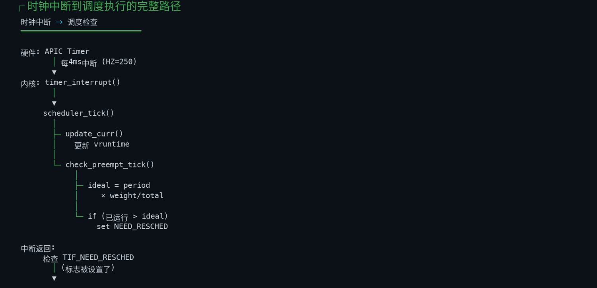

# 时钟中断到调度执行完整路径



> 上图是 x86/CFS 时代的简笔：APIC Timer → `timer_interrupt()` → `scheduler_tick()` → `check_preempt_tick()`（ideal = period × weight/total）→ TIF_NEED_RESCHED。两处都已过时：**x86 的 `timer_interrupt()` 在 arm64 上根本不存在**；**7.1.3 的 `entity_tick()` 里 `check_preempt_tick` 已被删除**（EEVDF 接管，时间片到点改由 hrtick 精确开火）。本文按 Linux 7.1.3 + arm64 把每一跳落到源码（行号均 `grep -n` 实测，可直接跳转）；平台口径：**主实例 Arm AGI CPU（SP113012）**、对照 **AMD EPYC 9996（x86_64）**、异构（A725/A520）见文末附录。缩略语（SLC/CLS/hrtick…）沿用 [004.8.1.4 附录 B](../../025.MULTIPLE_PROCESSOR_SYSTEM/002.多处理器理论/004.8.1.4-多处理器调度.md) 的口径。
> 抢占时机四种分类的专门展开见姊妹篇 [011.Linux内核4种抢占时机.md](./011.Linux内核4种抢占时机.md)——本文聚焦"时钟中断"这一条的完整走线。

---

## 1. 全景图：一条 tick 从硅到硅

```
 ┌─────────────── 硬件（AGI: 每核一个 CNTV 虚拟定时器）────────────────┐
 │  CNTV 倒计时到 0 → 触发 PPI（per-CPU 中断，IRQ 27 一族）           │
 └───────────────────────────┬────────────────────────────────────────┘
                             ▼  EL1 向量入口
   el1h_64_irq_handler (entry-common.c:529)
                             ▼
   el1_interrupt (:518, DAIF_PROCCTX_NOIRQ) → __el1_irq (:505)
        arm64_enter_from_kernel_mode → irq_enter_rcu
                             ▼
   do_interrupt_handler (:152) → handle_arch_irq → GIC
   __gic_handle_irq (irq-gic-v3.c:818) → 认领 PPI
                             ▼
   arch_timer_handler_virt (arm_arch_timer.c:580)
   timer_handler (:564)：读 CNTV CTL，IT_STAT 置位 → 屏蔽 → evt->event_handler
                             ▼  tick 设备层（hrtimer 化的周期 tick）
   tick_nohz_handler (tick-sched.c:306, hrtimer @ :1620)
        tick_sched_do_timer(:227) → tick_sched_handle(:275)
                             ▼
   update_process_times (timer.c:2468)
        account_process_tick / run_local_timers / rcu_sched_clock_irq
        irq_work_tick / ★sched_tick (:2480) / run_posix_cpu_timers
                             ▼  调度检查核心
   sched_tick (core.c:5642)
        arch_scale_freq_tick（housekeeping CPU 才做，:5652 —— 频率不变性心跳）
        donor->sched_class->task_tick (:5669) ──► task_tick_fair (fair.c:13687)
        sched_balance_trigger (:5688 ──► fair.c:13356, 排队均衡)
                             ▼  请求调度（本 CPU）
   task_tick_fair → entity_tick(:5822) / update_misfit_status / overutilized
   resched_curr (core.c:1212)：current 置 TIF_NEED_RESCHED + set_preempt_need_resched
                             ▼  中断返回，二选一
   ┌─────────────────────────┴──────────────────────────┐
   │ 回用户态（task 原本在 EL0）                          │ 回内核态（task 原本在 EL1）
   │ el0_interrupt(:821)→arm64_exit_to_user_mode(:100)  │ __el1_irq → arm64_exit_to_kernel_mode(:55)
   │ → exit_to_user_mode_loop (common.c:94)              │ → irqentry_exit (common.c:159)
   │ → NEED_RESCHED? (:52)                               │ → raw_irqentry_exit_cond_resched(:134)
   │    rseq 宽限? 放行 : schedule()                      │    !preempt_count && need_resched
   └─────────────────────────┬──────────────────────────┘
                             ▼
   preempt_schedule_irq (core.c:7529) / schedule()
                             ▼
   __schedule (core.c:7042, SM_PREEMPT)
        pick_next_task (:6106) → pick_task（dl > rt > fair > idle）
                             ▼
   context_switch (:5335) → switch_to
                             ▼
   arm64 __switch_to (process.c:766)：fpsimd/tls/ptrauth… 线程状态
        cpu_switch_to (:810 → entry.S:821)：x19-x28 + SP 换血
                             ▼
   新任务从 __schedule 的 switch_to 后一行醒来 → 异常返回 → EL0 继续跑
```

---

## 2. 中断从哪来：arm64 的 tick 硬件

**每核一个定时器，中断本地发生本地处理**。arm64 的通用定时器是架构寄存器（不是外设）：每核都有 CNTV（EL1 虚拟定时器）与 CNTP，倒计时到 0 产生 **PPI**（per-CPU interrupt，每核自己响自己的）：

```c
// drivers/clocksource/arm_arch_timer.c:1026 —— tick 中断是 per-CPU 的 PPI
err = request_percpu_irq(ppi, arch_timer_handler_virt, ...);
```

与 x86 的对照：EPYC 9996 上是 **local APIC timer**（现代内核用 TSC-deadline 模式，`X86_FEATURE_TSC_DEADLINE_TIMER`，arch/x86/kernel/apic/apic.c:284）——同样是"每核本地"，但 arm64 靠架构寄存器 + GIC PPI，x86 靠 LAPIC + TSC-deadline MSR。**对调度器来说两者等价：tick 是 CPU 本地的，天然无广播、无争用**——这正是 [004.8.1.4 §2.3](../../025.MULTIPLE_PROCESSOR_SYSTEM/002.多处理器理论/004.8.1.4-多处理器调度.md)"per-CPU 队列争用最小"的物理前提之一。

**tick 的节拍 = HZ**。默认 `HZ_250`（kernel/Kconfig.hz:8）→ 每 4ms 一发，即原图上"每 4ms 中断（HZ=250）"的出处；1000→1ms，100→10ms。

**完整入口链**（内核态被打断的版本）：

```c
// arch/arm64/kernel/entry-common.c
// :529 EL1 向量表 IRQ 入口
asmlinkage void noinstr el1h_64_irq_handler(struct pt_regs *regs)
{
	el1_interrupt(regs, handle_arch_irq);   // :518 —— 先写 DAIF_PROCCTX_NOIRQ 屏中断
}
// :505 —— 进入/退出框架
static __always_inline void __el1_irq(struct pt_regs *regs, void (*handler)(...))
{
	state = arm64_enter_from_kernel_mode(regs);
	irq_enter_rcu();
	do_interrupt_handler(regs, handler);    // :152 —— handle_arch_irq = GIC
	irq_exit_rcu();                          // 退出时顺势处理软中断
	arm64_exit_to_kernel_mode(regs, state); // :55 —— 抢占检查在这里（§5）
}
```

GIC 侧 `__gic_handle_irq`（drivers/irqchip/irq-gic-v3.c:818）读 IAR 认领中断号，认出是定时的 PPI 后落到 timer 驱动：

```c
// drivers/clocksource/arm_arch_timer.c:564 —— 确认真的到期，转手交给 tick 设备
static __always_inline irqreturn_t timer_handler(const int access,
					struct clock_event_device *evt)
{
	ctrl = arch_timer_reg_read_cp15(access, ARCH_TIMER_REG_CTRL);
	if (ctrl & ARCH_TIMER_CTRL_IT_STAT) {
		ctrl |= ARCH_TIMER_CTRL_IT_MASK;      // 屏蔽本中断
		arch_timer_reg_write_cp15(access, ARCH_TIMER_REG_CTRL, ctrl);
		evt->event_handler(evt);              // :573 —— 下一棒：tick 设备
		return IRQ_HANDLED;
	}
	return IRQ_NONE;
}
```

（用户态被打断时走 `el0t_64_irq_handler`（:843）→ `el0_interrupt`（:821）→ 同样的 GIC/timer 链，只是出口是 `arm64_exit_to_user_mode`（:96）——见 §5。）

## 3. tick 一次做什么：tick 设备层

7.1.3 的 tick 设备事件处理器已统一为 **`tick_nohz_handler`**（kernel/time/tick-sched.c:306，hrtimer 于 :1620 以 `CLOCK_MONOTONIC | ABS_HARD` 注册；老的周期模式 `tick_handle_periodic`（tick-common.c:108）只剩无 oneshot 支持的硬件兜底）：

```c
// kernel/time/tick-sched.c:306
static enum hrtimer_restart tick_nohz_handler(struct hrtimer *timer)
{
	tick_sched_do_timer(ts, now);        // :227 —— 全局时钟推进、hold 期间代管
	if (regs)
		tick_sched_handle(ts, regs);      // :275 —— 真正的 tick 杂务
	...
	if (unlikely(tick_sched_flag_test(ts, TS_FLAG_STOPPED)))
		return HRTIMER_NORESTART;         // idle 停 tick：不再重排，唤醒时再排
	hrtimer_forward(timer, now, TICK_NSEC);
	return HRTIMER_RESTART;               // 正常：按 TICK_NSEC 重排下一次
}
```

`tick_sched_handle`（:275）处理 NO_HZ 补账（停 tick 期间摸一把 watchdog、修 idle jiffies），然后 `update_process_times(user_mode(regs))`（kernel/time/timer.c:2468）——一次 tick 的杂务清单：

```c
// kernel/time/timer.c:2468
void update_process_times(int user_tick)
{
	struct task_struct *p = current;
	account_process_tick(p, user_tick);   // 记账：用户态/内核态 tick 各归各
	run_local_timers();                   // 唤醒本 CPU 定时器软中断
	rcu_sched_clock_irq(user_tick);       // RCU 静止状态报告
	...
	sched_tick();                         // ★ :2480 —— 调度器的心跳（本文主角）
	if (IS_ENABLED(CONFIG_POSIX_TIMERS))
		run_posix_cpu_timers();
}
```

**NO_HZ 两兄弟**（平台的隔离部署直接相关）：
- **NO_HZ_IDLE**（默认）：CPU 进 idle 就停 tick（`TS_FLAG_STOPPED` → `HRTIMER_NORESTART`），忙起来在 tick 设备重排时补账——省电，也免得空转 CPU 白挨中断；
- **NO_HZ_FULL**：业务核上 tick 整体下岗，调度职责移交给 `sched_tick_remote`（core.c:5729）——housekeeping CPU 用 delayed work **远程**帮隔离核跑 `sched_tick`。注意 `sched_tick()` 的第一行就认这个环境：`if (housekeeping_cpu(cpu, HK_TYPE_KERNEL_NOISE)) arch_scale_freq_tick();`（core.c:5652）——**频率不变性的采样只发生在 housekeeping CPU 的 tick 上**。

## 4. tick 的调度检查：sched_tick

原图里的 `scheduler_tick()` 在 7.1.3 已更名 **`sched_tick()`**（kernel/sched/core.c:5642）：

```c
// kernel/sched/core.c:5642（节选）
void sched_tick(void)
{
	if (housekeeping_cpu(cpu, HK_TYPE_KERNEL_NOISE))
		arch_scale_freq_tick();          // 频率不变性：AMU 计数→arch_freq_scale
	sched_clock_tick();
	rq_lock(rq, &rf);
	donor = rq->donor;                    // proxy exec：记账对象是"持锁 donor"

	update_rq_clock(rq);
	...
	if (dynamic_preempt_lazy() && tif_test_bit(TIF_NEED_RESCHED_LAZY))
		resched_curr(rq);                 // 懒抢占模式：把 LAZY 再按一遍

	donor->sched_class->task_tick(rq, donor, 0);   // ★ 下一棒：fair 类
	calc_global_load_tick(rq);
	sched_core_tick(rq);                  // core scheduling 记账
	scx_tick(rq);
	rq_unlock(rq, &rf);
	...
	if (donor->flags & PF_WQ_WORKER)
		wq_worker_tick(donor);
	if (!scx_switched_all()) {
		rq->idle_balance = idle_cpu(cpu);
		sched_balance_trigger(rq);        // :5688 —— tick 也是负载均衡的触发源
	}
}
```

一个 tick 在调度器眼里干四件事：**频率不变性采样**（arm64 走 AMU，`amu_scale_freq_tick`，arch/arm64/kernel/topology.c:117——tick 是 FIE 的心跳，而 FIE 产出的 capacity 又喂给 EAS/算力匹配）、**任务记账+让位判定**（`task_tick`）、**均衡触发**（`sched_balance_trigger`，fair.c:13356，排队软中断，[004 §2.3](../../025.MULTIPLE_PROCESSOR_SYSTEM/002.多处理器理论/004.8.1.4-多处理器调度.md) 的"管家路径"）、**顺路杂务**（PSI、全局负载、core sched、perf、woker pool）。

### 4.1 task_tick_fair：EEVDF 时代的 entity_tick

```c
// kernel/sched/fair.c:13687
static void task_tick_fair(struct rq *rq, struct task_struct *curr, int queued)
{
	struct sched_entity *se = &curr->se;
	for_each_sched_entity(se) {
		cfs_rq = cfs_rq_of(se);
		entity_tick(cfs_rq, se, queued);   // :5822 —— 沿父链逐层
	}
	...
	if (static_branch_unlikely(&sched_numa_balancing))
		task_tick_numa(rq, curr);          // NUMA 缺页采样记账
	update_misfit_status(curr, rq);          // ★ 异构：大任务困小核？（:5338）
	check_update_overutilized_status(task_rq(curr)); // ★ 翻转 overutilized（:7135）
	task_tick_core(rq, curr);
}
```

而 `entity_tick`（fair.c:5822）已经瘦成一张皮——**原图的 CFS 剧本（update_curr 累计 vruntime → check_preempt_tick 判"已运行 > ideal = period×weight/total" → set NEED_RESCHED）在这里不存在了**：

```c
// kernel/sched/fair.c:5822 —— 全部家当
static void
entity_tick(struct cfs_rq *cfs_rq, struct sched_entity *curr, int queued)
{
	update_curr(cfs_rq);                    // :1407 —— 累计运行时（vruntime 还在记，但不再当场判决）
	update_load_avg(cfs_rq, curr, UPDATE_TG);   // PELT 刷新
	update_cfs_group(curr);
#ifdef CONFIG_SCHED_HRTICK
	if (queued) {                           // hrtick 回调（queued=1）进门：不用再验
		resched_curr(rq_of(cfs_rq));        // 直接让位
		return;
	}
#endif
}
```

### 4.2 时间片到点谁来讲：hrtick

EEVDF 删掉 `check_preempt_tick` 后，"**该让位了**"的判定从"每 4ms 粗查一次"改成"**时间片用完的精确时刻开火**"——per-rq 的高精度定时器：

```
 enqueue 时布防                          fair.c:7082  hrtick_update（:7310 调用）
   h_nr_queued > 1 才布 ─► hrtick_start_fair (:7043)
     算"还剩多少 slice" ─► hrtick_start(rq, delay)   core.c:945
        下限 10µs（防 timer DoS）
        HRTIMER_MODE_ABS_PINNED_HARD 精确到期
        （跨 CPU 布防走 csd IPI，:930 __hrtick_start）
        ▼ 到期
   hrtick 回调 (core.c:892)
        rq->donor->sched_class->task_tick(rq, donor, 1)   ← queued=1
        ▼
   entity_tick 的 HRTICK 分支 → resched_curr(rq)          ← 让位落笔
```

`CONFIG_SCHED_HRTICK` 在 7.1.3 是通用配置 `def_bool HIGH_RES_TIMERS`（kernel/Kconfig.hz:58）——arm64 只要开了高精度定时器就有，**与 4ms 的 HZ tick 解耦**：HZ tick 只管记账/均衡/杂务，"跑够 slice 没跑够"由 hrtick 在纳秒级精度上讲。

### 4.3 resched_curr：请求调度的落笔

不管哪条路（hrtick 让位、wakeup 抢占、均衡 forced migration），最后都汇到：

```c
// kernel/sched/core.c:1170（__resched_curr）/:1212（resched_curr）
if (is_idle_task(curr) && tif == TIF_NEED_RESCHED_LAZY)
	tif = TIF_NEED_RESCHED;            // idle 没得懒，直接真抢占
...
if (cpu == smp_processor_id()) {
	set_ti_thread_flag(cti, tif);      // 本 CPU：thread_info 置 TIF_NEED_RESCHED
	if (tif == TIF_NEED_RESCHED)
		set_preempt_need_resched();    // 顺手清 TIF 之外的反应位（中断返回快路用）
	return;
}
if (set_nr_and_not_polling(cti, tif))
	smp_send_reschedule(cpu);          // 跨 CPU：发 IPI 把对方唤醒/调度
```

tick 路径永远是本 CPU 分支：置 `TIF_NEED_RESCHED`，然后**什么都不做**——真正的调度发生在中断返回的路上（§5）。这一"延迟执行"的设计正是 [011.四种抢占时机](./011.Linux内核4种抢占时机.md) 的入口。

## 5. 中断返回：两条抢占路径

tick 在哪个上下文打断任务，决定了从哪条路调度：

```
                TIF_NEED_RESCHED 置位后，中断返回
                          │
        ┌─────────────────┴─────────────────────┐
        ▼ 打断的是用户态（EL0）                   ▼ 打断的是内核态（EL1）
 arm64_exit_to_user_mode                arm64_exit_to_kernel_mode
 (entry-common.c:100)                   (:55 → irqentry_exit, common.c:159)
   irqentry_exit_to_user_mode_prepare     raw_irqentry_exit_cond_resched
   → exit_to_user_mode_loop (:94)         (common.c:134)
   → __exit_to_user_mode_loop (:41)         if (!preempt_count()) {     ← 持自旋锁？免谈
       :52  NEED_RESCHED|LAZY?                 rcu_irq_exit_check_preempt();
       if (!rseq_grant_slice_extension(        if (need_resched() &&
           ti_work, TIF_SLICE_EXT_DENY))           arch_irqentry_exit_need_resched())
           schedule();        ◄─ rseq 宽限             preempt_schedule_irq();   ◄─
       （rseq 时间片延长：tick 想切，              (core.c:7529 → __schedule(SM_PREEMPT)，
        用户态临界区可申请宽限——               内核态抢占：先把 TIF 交给
        004 §2.5② 的逐句实现）                preempt_schedule_irq 的使能中断窗口）
```

两个 arm64/通用框架咬合的细节：
- **用户态路径**的判决在 `__exit_to_user_mode_loop`（kernel/entry/common.c:52-54）：`if (ti_work & (_TIF_NEED_RESCHED | _TIF_NEED_RESCHED_LAZY)) { if (!rseq_grant_slice_extension(ti_work, TIF_SLICE_EXT_DENY)) schedule(); }`——rseq slice extension 在这里拦 NEED_RESCHED（宽限默认 5µs，见 [004 §2.5](../../025.MULTIPLE_PROCESSOR_SYSTEM/002.多处理器理论/004.8.1.4-多处理器调度.md)）；
- **内核态路径**的闸门是 `preempt_count()`（common.c:134-143，判空在 :136）：持自旋锁期间 `preempt_disable()` 计数非零 → `preempt_schedule_irq` 根本不会被调——004 §2.5①"内核态根除"在这条 if 里具象化。

## 6. __schedule 与切换执行

无论 `schedule()`（用户态）还是 `preempt_schedule_irq()`（内核态），都汇入 `__schedule`（core.c:7042）：

1. `pick_next_task`（core.c:6106，无竞争路径走 `__pick_next_task` :6005）：按 dl > rt > fair > idle 的调度类顺序逐类 `pick_task`（:6049/6093）——本 rq 的私有队列（[004 §2.2](../../025.MULTIPLE_PROCESSOR_SYSTEM/002.多处理器理论/004.8.1.4-多处理器调度.md)）；
2. `context_switch`（core.c:5335）：换 mm（若不同进程）、`switch_to`；
3. arm64 落地：`__switch_to`（arch/arm64/kernel/process.c:766）先换线程状态——fpsimd、TLS、hw_breakpoint、contextidr、entry_task、SSBS、cntkctl、ptrauth（:766-810 一整排 `*_thread_switch`）——再 `cpu_switch_to`（:810 → entry.S:821-848）纯汇编换 `x19-x28` + SP；
4. **切换点即恢复点**：被切走的任务"冻"在 `__schedule` 里 `switch_to` 的下一行；新任务从它上一次被切走的同一位置醒来——所以每个任务的一生都在 `__schedule` 内"暂停/继续"，只是 rq、时间戳不同。随后异常返回链把新任务送回它的 EL0/EL1 断点。

---

## 7. 平台注记：同一链路在三台机器上

| 环节 | Arm AGI CPU（主实例） | EPYC 9996（x86 对照） |
|-|-|-|
| tick 中断源 | CNTV 虚拟定时器 + GIC PPI，每核独立（arm_arch_timer.c:1026）| local APIC timer，TSC-deadline 模式（apic.c:284）|
| HZ | 默认 250 → 4ms（kernel/Kconfig.hz:8）| 同左（x86 桌面常见 250/300）|
| SMT | 无 → 每核一个 rq 各自被 tick | SMT2 → 同物理核两个 rq 各自被 tick，共享执行端口，tick 抢占互掐更"挤" |
| core sched | `sched_core_tick`（core.c:5673）近似空转 | 开 `CONFIG_SCHED_CORE` 时做核级记账 |
| NO_HZ_FULL 隔离 | 隔离核 tick 停 → `sched_tick_remote`（core.c:5729）由 housekeeping 代跑 | 同机制；256 核大规模隔离部署是它主场 |
| FIE 采样 | tick 里 `arch_scale_freq_tick` → AMU（topology.c:117）→ capacity | tick 里同样调（core.c:5652），x86 用 APERF/MPERF |
| 实际效果 | tick 全本地，136 核互不打扰 | 同左，512 线程 |

一句话：**中断源与寄存器接口随架构而变，tick 的"调度语义"完全架构无关**——这正是 generic tick 层（kernel/time/）与 sched 层（kernel/sched/）分层的意义。

## 附录：A725 + A520 异构机型的 tick 侧差异

同一条链路，异构机型在 `task_tick_fair`（fair.c:13687）里多出两个 tick 专属触发点（教学模型与 cap=1024/252 出处见 [005.绿色节能调度器 · 附录 B](005.绿色节能调度器/README.md)）：

- **`update_misfit_status(curr, rq)`**（:5338，tick 调用点 :13703）——tick 发现"当前任务的 util 超过本核 capacity"就给 rq 挂 misfit 标记，等负载均衡来搬（[004 §2.10.6/附录 A](../../025.MULTIPLE_PROCESSOR_SYSTEM/002.多处理器理论/004.8.1.4-多处理器调度.md)）。**misfit 不是唤醒时发现的，是 tick 巡检出来的**；
- **`check_update_overutilized_status(rq)`**（:7135，tick 调用点 :13704）——util 过 80% 阈值就翻转 `rd->overutilized`，整个系统在"EAS 能量优先 ↔ SMP 均衡吞吐优先"两个模式间切换（[005.绿色节能调度器 Q&A](005.绿色节能调度器/README.md)）。tick 是这个开关的扳机；
- tick 本身**不做**能量决策——EAS 的能量比较只在唤醒路径（`find_energy_efficient_cpu`，fair.c:8640）；tick 只负责记账与翻转开关。

## 小结

- **一条 tick = 三层接力**：硬件层（CNTV+PPI，本地发生）→ tick 层（`tick_nohz_handler` → `update_process_times` 的杂务清单）→ 调度层（`sched_tick` 的记账+触发）；
- **tick 不直接切换任务**：它只落笔 `TIF_NEED_RESCHED`，真正切换发生在中断返回的两条路径上（用户态 `schedule()` / 内核态 `preempt_schedule_irq`）——"谁申请"与"谁执行"分离；
- **EEVDF 改写了"时间片到点"的剧本**：CFS 时代 tick 顺路查 ideal runtime（原图剧本），7.1.3 由 hrtick 在 slice 用完的精确时刻开火（`CONFIG_SCHED_HRTICK = HIGH_RES_TIMERS`），HZ tick 退居记账/均衡/杂务；
- **tick 是很多子系统的节拍器**：FIE 频率采样（AMU）、misfit 巡检、overutilized 翻转、均衡触发、PSI/RCU/irqwork——调度决策的原材料大半产自每 4ms 的这一圈。

相关文档：[011.Linux内核4种抢占时机](./011.Linux内核4种抢占时机.md)｜[000.调度域与调度组](./000.调度域与调度组.md)｜[004.8.1.4-多处理器调度](../../025.MULTIPLE_PROCESSOR_SYSTEM/002.多处理器理论/004.8.1.4-多处理器调度.md)｜[005.绿色节能调度器](./005.绿色节能调度器/README.md)｜[003.AGI-SP113012-层级架构](../000.调度组与调度域/003.AGI-SP113012-层级架构-缓存一致性-原子操作.md)
