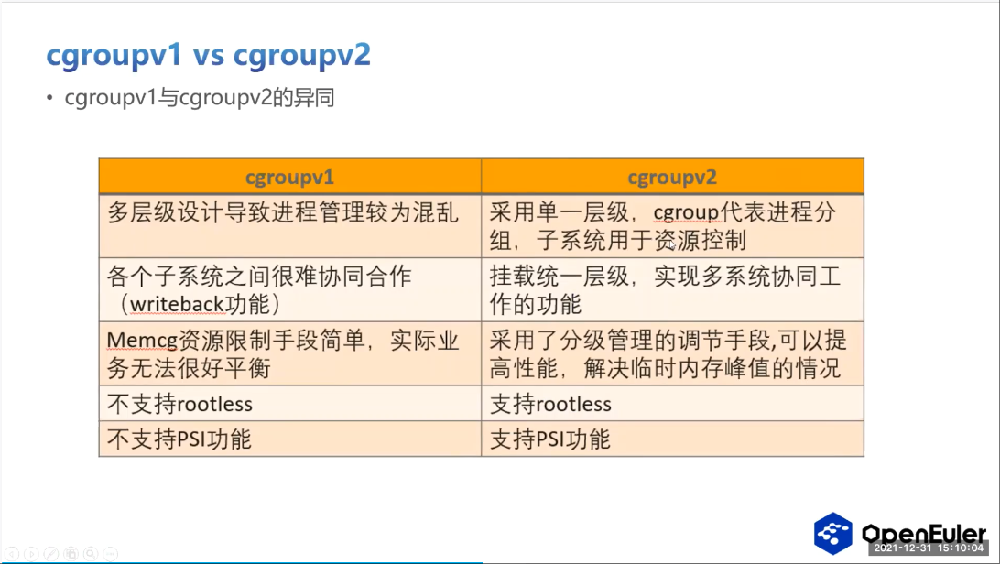
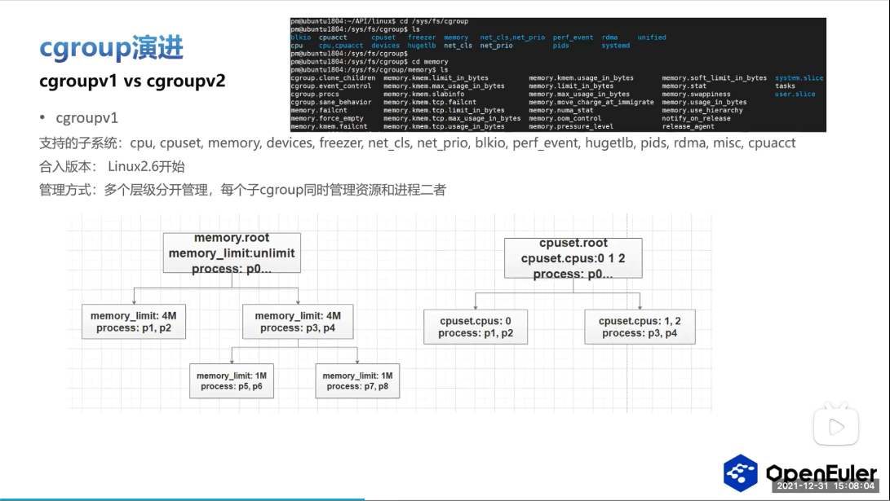
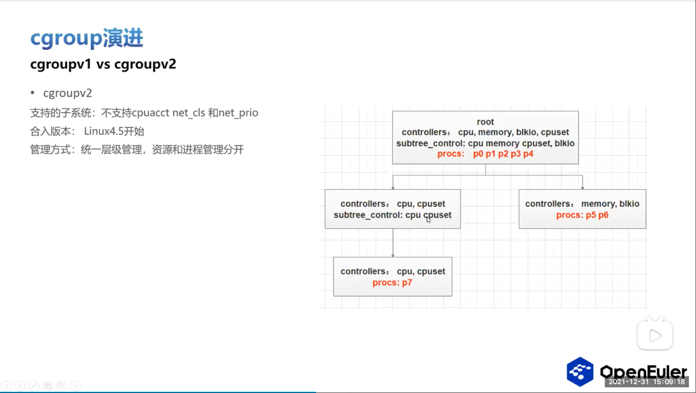

# CGroup v1 vs v2 — 层级(Hierarchy)的区别

> 参考：
> - 内核文档 [cgroup-v2.rst](<../../../000.SOURCE_CODE/003.LINUX-7.1.3/000.LINUX-7.1.3/Documentation/admin-guide/cgroup-v2.rst>)（内核自带权威文档）
> - 同目录 [man7-cgroups.7.md](<../man7-cgroups.7.md>)
> - 源码树 `000.SOURCE_CODE/003.LINUX-7.1.3/000.LINUX-7.1.3`（下称 `$K`，本文所有 `文件:行号` 均用 grep -n 逐条核实）
> - 组调度背景：《Linux 内核深度解析》Vol1 §8.1.8 组调度机制；组调度与 cpu 控制器细节见 [004.CGroup如何影响CPU调度.md](<../004.CGroup如何影响CPU调度.md>)
> - cgroup 核心（kernfs/css_set/attach 事务/rstat）见 [009.CGroup核心机制深挖.md](<../009.CGroup核心机制深挖.md>)
>
> 平台说明：cgroup 代码本身架构无关（`kernel/cgroup/*`），本文通用走读；运行示例默认 arm64（Arm AGI CPU，SP113012，136×Neoverse V3，双 chiplet，无 SMT，LLC=全片 SLC）；NUMA/大规模/隔离实例统一使用 AMD EPYC 9996（第 6 代 EPYC 9006 系列旗舰，代号 "Venice"，Zen 6c，256 核/512 线程，2026 年 7 月上市）。

---

## 摘要

| 维度 | CGroup v1（legacy） | CGroup v2（unified） |
|---|---|---|
| 层级数量 | **多棵树**：每个（组）控制器可单独挂载一棵独立层级 | **统一单树**：全系统一棵 `cgroup2` 层级 |
| 控制器归属 | 挂载时由 `-o cpu,cpuset` 等参数**静态绑定**到某棵树 | 运行时经 `cgroup.subtree_control` **逐节点启用** |
| 进程位置 | 任意节点（含非叶子）都能放进程 | **域控制器**只允许进程在**叶子节点**（"no internal process" 约束，根除外） |
| 进程归属 | 一个进程可同时属于**多棵树**上的多个 cgroup | 一个进程只属于**唯一** cgroup（threaded 子树内线程级除外） |
| 线程粒度 | 任意线程可写 `tasks` 分散到不同 cgroup | 默认进程粒度；仅限 threaded 控制器在 threaded 子树内用 `cgroup.threads` |
| 接口文件 | `tasks`、`cpu.shares`、`cpu.cfs_quota_us`、`memory.limit_in_bytes`…（命名不统一） | `cgroup.procs`、`cpu.max`、`cpu.weight`、`memory.max`…（统一点分命名） |
| cpuset 隔离 | 无 partition 概念，`cpuset.sched_load_balance` 粒度粗 | **partition root/isolated** + sched domain 重建，服务实时/低延迟 |
| 数据结构 | 一个 css_set 需同时描述**跨多棵树**的成员关系 | css_set 只对应**一棵树**上的（含有效 css 的）位置 |

**核心一句话**：v1 是"每个控制器一棵树、进程在每棵树上各自为政"；v2 是"一棵树管所有控制器、进程只能在叶子、资源控制在内部节点生效"——层级从"控制器的容器"变成了"资源分发树"。

---

## 1. 层级总览：v1 多树 vs v2 单树

- 

```text
============================ CGroup v1：多棵独立层级 =================================

  mount -t cgroup -o cpu,cpuacct none /sys/fs/cgroup/cpu        (hierarchy #1)
  mount -t cgroup -o cpuset        none /sys/fs/cgroup/cpuset   (hierarchy #2)
  mount -t cgroup -o memory        none /sys/fs/cgroup/memory   (hierarchy #3)

   /sys/fs/cgroup/cpu          /sys/fs/cgroup/cpuset      /sys/fs/cgroup/memory
        (root)                      (root)                      (root)
          |                           |                           |
      +---+---+                   +---+---+                   +---+---+
      |       |                   |       |                   |       |
    Acpu    Bcpu              Acpuset  Bcpuset             Amem    Bmem
      |       |                   |       |                   |       |
    (叶子)  (叶子)               (叶子)  (叶子)               (叶子)  (叶子)
     ^       ^
     |       +-- 进程 P2 在 cpu 树挂在 Bcpu
     +---------- 进程 P1 在 cpu 树挂在 Acpu

  # 同一个进程必须在【每一棵树】上分别挂一次:
  #   echo P1 > /sys/fs/cgroup/cpu/Acpu/tasks
  #   echo P1 > /sys/fs/cgroup/cpuset/Acpuset/tasks
  #   echo P1 > /sys/fs/cgroup/memory/Amem/tasks
  # 三棵树的目录结构通常还得手工保持一致 -> "重复建目录"

============================ CGroup v2：统一单一层级 ==================================

  mount -t cgroup2 none /sys/fs/cgroup

                    /sys/fs/cgroup (root, 天生是 partition root)
                          |  cgroup.subtree_control = "+cpu +cpuset +memory"
          +---------------+----------------+
          |               |                |
      parent/         latency/          batch/
     (无进程,      (叶子,进程P1在此)   (无进程,
      只开控制器)     cpu.max=...       只开控制器)
          |                              |
      +---+---+                        +---+---+
      |       |                        |       |
   rt/     web/                      j1/      j2/
  (叶子)  (叶子)                    (叶子)   (叶子)

  # 进程只挂一次: echo P1 > latency/cgroup.procs
  # 规则: 内部节点(如 parent/、batch/)开域控制器时不能有进程(no internal process)
  #       资源限制写在"进入子树"的方向上: 父的 subtree_control 决定子的可用文件
```

### 1.1 关键规则对比表

| 规则 | v1 | v2（源码出处） |
|---|---|---|
| 内部进程约束 | 无：任何节点都可既有子目录又有进程 | `cgroup_migrate_vet_dst()`（cgroup.c:2761）对启用 `subtree_control` 的节点拒绝进程迁入，返回 `-EBUSY` |
| 控制器启用 | 挂载参数一次性绑定，populate 后不能换树 | `cgroup_subtree_control_write()`（cgroup.c:3504）按 `+cpu`/`-cpu` 增删，自上而下传播 |
| 线程模式 | `tasks` 文件天然线程级 | `cgroup.type=threaded`（cgroup.c:3671），仅 threaded 控制器（cpu/cpuset/pids/perf_event）参与 |
| 进程文件 | `cgroup.procs`（写整进程）与 `tasks`（写单线程）并存 | `cgroup.procs` + `cgroup.threads`（cgroup.c:5410 的 cgroup_base_files），跨 domain 迁移线程被拒（cgroup.c:5341） |
| 根节点豁免 | — | 根 cgroup 免于 no-internal-process（cgroup.c:390 `cgroup_is_mixable()`），可同时有进程和子域 |
| 空树通知 | `release_agent` fork 用户态程序（cgroup-v1.c:801） | 无（改由 `cgroup.events` 的 `populated` 字段 + inotify 覆盖） |

---

## 2. v1 多层级详解：为什么每个控制器一棵树

- 
  + "多个层级分开管理"中的层级：每个不同的子系统构成一棵树（树即层级），即每棵树管理不同的资源。
  + 非叶子节点能管理进程：非叶子节点既管理资源也管理进程，也说明了**进程之间存在资源方面的父子关系**——子目录进程在父目录进程的资源配额内再分配，两者还会直接互相竞争。

### 2.1 历史动机

- 2007 年 v1 合入时，cpuset 需要与 CPU/内存控制**不同的拓扑**（CPU 集合是"互斥划分"，配额是"比例分配"），于是设计了"任意棵层级、每棵绑一组控制器"的模型。
- 实践结果（cgroup-v2.rst:3203 "Multiple Hierarchies" 原文）：工具型控制器（如 freezer）全局只有一份实例，挂到一棵树后别的树用不了；控制器一旦 populate 就不能换树；同一棵树上的所有控制器被迫共享**完全相同**的目录视图，无法按控制器取不同粒度。
- 最终绝大多数发行版退化成"**每控制器一棵树**"，只有 cpu+cpuacct 这类近亲才共树；用户态（systemd）被迫在每棵树上重复建同样的目录。

### 2.2 v1 挂载流程源码走读

v1 挂载入口在 [kernel/cgroup/cgroup-v1.c](<../../../000.SOURCE_CODE/003.LINUX-7.1.3/000.LINUX-7.1.3/kernel/cgroup/cgroup-v1.c>)，走新 mount API（fs_context）：

```text
mount -t cgroup -o cpuset none /sys/fs/cgroup/cpuset
   |
   v
cgroup_init_fs_context()          // kernel/cgroup/cgroup.c:2311
   |  fc->fs_type != cgroup2_fs_type
   v  => fc->ops = &cgroup1_fs_context_ops   // cgroup.c:2300
cgroup1_parse_param()             // cgroup-v1.c:941  逐个解析 "cpuset" 等控制器名/none/name=/release_agent=
   |  ctx->subsys_mask |= 1<<ssid  (cgroup-v1.c:962)
   v
cgroup1_get_tree()                // cgroup-v1.c:1256 权限检查(CAP_SYS_ADMIN) + cgroup_lock
   v
cgroup1_root_to_use()             // cgroup-v1.c:1164 找已有的 root 或新建
   |--- check_cgroupfs_options()  // cgroup-v1.c:1037 校验: all/none/name 互斥, noprefix 只许 cpuset
   |--- for_each_root(): 命名/控制器集合匹配则复用既有 root (cgroup-v1.c:1193)
   |--- 都不匹配 => kzalloc 新 cgroup_root + init_cgroup_root (cgroup-v1.c:1240)
   v
cgroup_setup_root()               // kernel/cgroup/cgroup.c:2114
   |--- kernfs_create_root(..., cgroup1_kf_syscall_ops, root_cgrp)  // cgroup.c:2147
   |--- rebind_subsystems(root, ctx->subsys_mask)  // 把各 ss 的 root css 挂到这棵新树
   v
cgroup_do_get_tree() => VFS 挂载点出现 root cgroup 目录
```

关键点：**每执行一次 `mount -t cgroup -o <控制器集合>`，就诞生一个新的 `struct cgroup_root`**（定义见 [include/linux/cgroup-defs.h](<../../../000.SOURCE_CODE/003.LINUX-7.1.3/000.LINUX-7.1.3/include/linux/cgroup-defs.h>)）：

```c
// include/linux/cgroup-defs.h:651
struct cgroup_root {
	struct kernfs_root *kf_root;

	/* The bitmask of subsystems attached to this hierarchy */
	unsigned int subsys_mask;                 // 这棵树绑定了哪些控制器

	/* Unique id for this hierarchy. */
	int hierarchy_id;                         // 即 /proc/cgroups 里的 hierarchy 列

	/* A list running through the active hierarchies */
	struct list_head root_list;               // 挂入 cgroup.c:201 的 cgroup_roots 链表
	...
	/* The path to use for release notifications. */
	char release_agent_path[PATH_MAX];        // v1 独有: release_agent 路径
	char name[MAX_CGROUP_ROOT_NAMELEN];       // named hierarchy (name=xxx)

	struct cgroup cgrp;                       // 这棵树的根 cgroup(内嵌)
};
```

`subsys_mask` 的绑定是**互斥**的：一个控制器（`struct cgroup_subsys`，cgroup-defs.h:777）同一时刻只能属于一个 `root`（字段 `ss->root`，cgroup-defs.h:837）。所以挂了 `-o cpuset` 之后再挂 `-o cpuset,memory` 会因 mask 不匹配而 `-EBUSY`（cgroup-v1.c:1218）。

### 2.3 v1 的进程接口：tasks / cgroup.procs / release_agent

v1 每个 cgroup 目录下的基础文件由 `cgroup1_base_files` 定义（cgroup-v1.c:632）：

| 文件 | 写入语义 | 源码 |
|---|---|---|
| `cgroup.procs` | 迁移**整个线程组**（TGID） | `cgroup1_procs_write()` → `__cgroup1_procs_write(..., threadgroup=true)`（cgroup-v1.c:542/498） |
| `tasks` | 迁移**单个线程**（任意 TID，线程可散布各树） | `cgroup1_tasks_write()` → `threadgroup=false`（cgroup-v1.c:548） |
| `notify_on_release` + `release_agent` | cgroup 变空时 fork 一个持**全部能力**的用户态程序 | `cgroup1_check_for_release()`（cgroup-v1.c:771）、`cgroup1_release_agent()`（cgroup-v1.c:801） |

`release_agent` 是 v1 著名的安全隐患（挂载点可传播时容器内可借其在宿主机执行任意命令），所以写入要求 `init_user_ns + CAP_SYS_ADMIN`（cgroup-v1.c:1004、567），v2 中整体废除。

### 2.4 v1 控制器接口表（挂载点 = `/sys/fs/cgroup/<控制器>` 下）

| 控制器(挂载名) | 主要接口文件 | 说明 |
|---|---|---|
| `cpu` | `cpu.shares`（权重,默认1024）、`cpu.cfs_quota_us` + `cpu.cfs_period_us`（带宽,-1=不限）、`cpu.cfs_burst_us`、`cpu.rt_runtime_us`/`cpu.rt_period_us` | 定义于 `cpu_legacy_files`（kernel/sched/core.c:10225）与 `rt_group_files`（core.c:10283） |
| `cpuacct` | `cpuacct.usage`、`cpuacct.usage_percpu`、`cpuacct.stat` | 纯统计，`files`（kernel/sched/cpuacct.c:294），记账在 `cpuacct_charge()`（cpuacct.c:336） |
| `cpuset` | `cpuset.cpus`、`cpuset.mems`、`cpuset.cpu_exclusive`、`cpuset.sched_load_balance`、`cpuset.memory_migrate`… | `cpuset1_files`（kernel/cgroup/cpuset-v1.c:774），**无 partition** |
| `memory` | `memory.limit_in_bytes`、`memory.soft_limit_in_bytes`、`memory.usage_in_bytes`、`memory.memsw.limit_in_bytes` | `mem_cgroup_legacy_files`（mm/memcontrol-v1.c:2048） |
| `blkio` | `blkio.throttle.*`、`blkio.weight`、`blkio.time`、`blkio.sectors` | `blkcg_legacy_files`（block/blk-cgroup.c:1262） |
| `devices`/`freezer`/`net_cls`… | 略 | 见 [man7-cgroups.7.md](<../man7-cgroups.7.md>) |

### 2.5 v1 的三大痛点（对应 v2 的设计动机）

1. **进程必须重复建目录/重复挂**：一个服务要在 cpu、cpuset、memory 三方面受限，就要在三棵树上分别 `mkdir` 并 `echo $PID > tasks`，目录结构靠约定保持同步；控制器间还无法确认这些目录对应的是同一个实体。
2. **控制器之间无协调**：每棵树拓扑完全正交，控制器不敢假设别的控制器在同一条路径上（cgroup-v2.rst:3240），想做"CPU 与内存同视角"的策略（如 OOM 时参考 CPU 占用）非常别扭。
3. **接口不一致**：单位混乱（us/ms/字节）、命名混乱（`limit_in_bytes` vs `cfs_quota_us`）、内部进程与子组竞争行为因控制器而异（cgroup-v2.rst:3300），v2 用统一命名规范和 no-internal-process 约束一次性解决。

---

## 3. v2 统一层级详解

- 
  + 将所有支持的子系统划分到一棵树（一个层级），进程只能在 root 下或者叶子节点上：
  + **非叶子节点管理资源，叶子节点管理进程**。

### 3.1 cgroup2 挂载与控制器启用

v2 只有一个文件系统类型 `cgroup2`（cgroup.c:2362，magic `0x63677270`，见 [include/uapi/linux/magic.h](<../../../000.SOURCE_CODE/003.LINUX-7.1.3/000.LINUX-7.1.3/include/uapi/linux/magic.h>):71）。与 v1 不同，**挂载时不带控制器参数**：

```c
// kernel/cgroup/cgroup.c:2362
static struct file_system_type cgroup2_fs_type = {
	.name			= "cgroup2",
	.init_fs_context	= cgroup_init_fs_context,
	.parameters		= cgroup2_fs_parameters,   // 只有 nsdelegate/memory_localevents 等杂项
	.kill_sb		= cgroup_kill_sb,
	.fs_flags		= FS_USERNS_MOUNT,
};
```

默认层级 `cgrp_dfl_root` 在 `cgroup_init()`（cgroup.c:6379）里 `cgroup_setup_root(&cgrp_dfl_root, 0)` 提前建好（cgroup.c:6405），挂载只是让它可见（`cgroup_get_tree()`，cgroup.c:2278，置 `cgrp_dfl_visible=true`）。所有"未被 v1 占用"的控制器自动挂到 v2（cgroup_init 循环 cgroup.c:6436）。

控制器在**每个节点**按需启用——写父节点的 `cgroup.subtree_control`，即"允许子节点使用该控制器"：

```c
// kernel/cgroup/cgroup.c:3504（节选）
static ssize_t cgroup_subtree_control_write(struct kernfs_open_file *of,
					    char *buf, size_t nbytes, loff_t off)
{
	...
	while ((tok = strsep(&buf, " "))) {           // 解析 "+cpu -memory" 这样的 token
		do_each_subsys_mask(ss, ssid, ~cgrp_dfl_inhibit_ss_mask) {
			...
			if (*tok == '+') {
				enable |= 1 << ssid;   // 要启用的控制器位图
			} else if (*tok == '-') {
				disable |= 1 << ssid;  // 要禁用的控制器位图
			}
	...
	ret = cgroup_vet_subtree_control_enable(cgrp, enable);   // 关键检查, 见 3.2
	...
	cgrp->subtree_control |= enable;                         // 更新本节点控制掩码
	ret = cgroup_apply_control(cgrp);                        // 创建/销毁子 cgroup 的 css 并刷新目录
```

规则链条（自上而下，"top-down constraint"）：想在某节点启用控制器，该控制器必须已在**父节点**的 `subtree_control` 里（否则 `-ENOENT`，cgroup.c:3553 检查 `cgroup_control(cgrp)`）。`cgroup_control()`（cgroup.c:463）就是"父的 subtree_control 决定子可见控制器"这一传播的实现。

### 3.2 "no internal process" 约束：源码级解释

**为什么**：v2 中资源控制沿"进入子树"的方向生效——父节点把资源（CPU 带宽、内存上限）分给**子 cgroup**。如果父节点自己还住着进程，这些进程就处于子组的"外面"，与子组竞争时没有任何配额约束，子组的 limit 会被父里的进程直接击穿；v1 时代各控制器对此各有临时补丁（cgroup-v2.rst:3300），v2 从核心层统一禁止。

**怎么做**——两个方向都被内核拦截：

```c
// kernel/cgroup/cgroup.c:3463 —— 方向一: 有进程的节点想启用域控制器
static int cgroup_vet_subtree_control_enable(struct cgroup *cgrp, u32 enable)
{
	...
	/*
	 * Controllers can't be enabled for a cgroup with tasks to avoid
	 * child cgroups competing against tasks.
	 */
	if (cgroup_has_tasks(cgrp))        // cgrp->nr_populated_csets != 0 (cgroup.c:379)
		return -EBUSY;
	return 0;
}

// kernel/cgroup/cgroup.c:2761 —— 方向二: 已启用控制器的节点想迁入进程
int cgroup_migrate_vet_dst(struct cgroup *dst_cgrp)
{
	/* v1 doesn't have any restriction */
	if (!cgroup_on_dfl(dst_cgrp))
		return 0;
	...
	/* apply no-internal-process constraint */
	if (dst_cgrp->subtree_control)
		return -EBUSY;           // echo $PID > cgroup.procs 报 EBUSY
	return 0;
}
```

`echo $PID > /sys/fs/cgroup/A/cgroup.procs` 的完整路径（cgroup.c:5392 `cgroup_procs_write` → 5347 `__cgroup_procs_write` → 5326 `cgroup_attach_permissions` → 5337 `cgroup_migrate_vet_dst`）保证约束在迁移事务开始前生效。

**豁免**：根 cgroup（cgroup.c:390 `cgroup_is_mixable()`：无父即 mixable）；threaded 子树（线程级控制器允许内部线程）；`implicit_on_dfl` 的工具型控制器（如 perf_event，cgroup-defs.h:815）绕过该约束。

内核文档的原文表述（cgroup-v2.rst:507）：*"Non-root cgroups can distribute domain resources to their children only when they don't have any processes of their own."*

### 3.3 threaded 模式：进程粒度的例外

v2 默认进程粒度（同一进程所有线程同 cgroup），但 per-CPU 线程池类应用需要把**线程**分级。做法是把一个子树标成 `threaded`，加入父的资源域（domain）：

```text
        root (mixable: 可同时当 thread root 和域父节点)
         |
      app/                      cgroup.type = domain threaded   <- thread root
      │                         (资源域: 域级资源记账都算在这里,
      │                          未迁移的线程也默认留在本节点)
      ├─ thr-a/                 cgroup.type = threaded  <- 线程级节点
      └─ thr-b/                 cgroup.type = threaded
            ^
            +-- echo 3187 > thr-a/cgroup.threads   # 单线程迁移, 不再是整进程
```

```c
// kernel/cgroup/cgroup.c:3655（cgroup.type 的读）
static int cgroup_type_show(struct seq_file *seq, void *v)
{
	struct cgroup *cgrp = seq_css(seq)->cgroup;

	if (cgroup_is_threaded(cgrp))            // cgrp->dom_cgrp != cgrp (cgroup.c:384)
		seq_puts(seq, "threaded\n");
	else if (!cgroup_is_valid_domain(cgrp))  // 祖先链上有 threaded => 拓扑无效
		seq_puts(seq, "domain invalid\n");
	else if (cgroup_is_thread_root(cgrp))    // 有 threaded 子节点或启了线程控制器
		seq_puts(seq, "domain threaded\n");
	else
		seq_puts(seq, "domain\n");
	return 0;
}
```

`echo threaded > cgroup.type` 走 `cgroup_type_write()`（cgroup.c:3671）→ `cgroup_enable_threaded()`（cgroup.c:3608）：把整棵子树的 `->dom_cgrp` 重指到最近的域祖先（cgroup.c:3643-3645）。**单向操作**，threaded 不能变回 domain（cgroup.c:3678 只接受 "threaded" 输入）。域控制器（memory/io 等）不能进入 threaded 子树（`cgroup_vet_subtree_control_enable()`，cgroup.c:3481）。哪些控制器是 threaded：`ss->threaded=true`，7.1.3 中为 cpu（sched/core.c:10561）、cpuset（cpuset.c:3675）、pids（pids.c:459）、perf_event/debug（implicit+threaded）。

### 3.4 v2 接口表（`/sys/fs/cgroup` 单树下）

| 控制器 | 接口文件（`cgroup.subtree_control` 启用后出现在子节点） | 源码 |
|---|---|---|
| core | `cgroup.type/procs/threads/controllers/subtree_control/events/stat/freeze/kill` | `cgroup_base_files`（cgroup.c:5410） |
| `cpu` | `cpu.max`（"max 100000"）、`cpu.max.burst`、`cpu.weight`[1,10000]、`cpu.weight.nice`[-20,19]、`cpu.stat`、`cpu.pressure`、`cpu.uclamp.*` | `cpu_files`（kernel/sched/core.c:10495） |
| `cpuset` | `cpuset.cpus`、`cpuset.mems`、`cpuset.cpus.effective`、`cpuset.mems.effective`、`cpuset.cpus.exclusive[.effective]`、`cpuset.cpus.partition`、`cpuset.cpus.isolated`(根) | `dfl_files`（kernel/cgroup/cpuset.c:3371） |
| `memory` | `memory.current/min/low/high/max`、`memory.swap.max`、`memory.events`、`memory.stat` | `memory_files`（mm/memcontrol.c:4900） |
| `io` | `io.max`、`io.weight`、`io.stat`、`io.pressure` | blk-cgroup.c:1254、blk-throttle.c:1609、blk-iocost.c:3521 |
| `pids` | `pids.max`、`pids.current` | `pids_files`（kernel/cgroup/pids.c:390） |

`cpu.stat` 属于基础文件（cgroup.c:5483），不启用控制器也有 `usage_usec/user_usec/system_usec`；启用后经 `cpu_stat_show()`（cgroup.c:3912）追加 `nr_periods/nr_throttled/throttled_usec/nr_bursts/burst_usec`——v1 的 cpuacct 因此在 v2 中没有对应控制器（`cpuacct_cgrp_subsys` 只有 `legacy_cftypes`，cpuacct.c:360-364，无 `dfl_cftypes`，被归入 `cgrp_dfl_inhibit_ss_mask`，cgroup.c:6443）。

---

## 4. cpu 控制器 v1 ↔ v2 映射表（重点）

| v1（`/sys/fs/cgroup/cpu` 下） | v2（`cpu.max` 等） | 语义/换算 | 源码 |
|---|---|---|---|
| `cpu.cfs_quota_us`(-1=∞) + `cpu.cfs_period_us`(默认100000) 两个文件 | `cpu.max` 一个文件 `"$MAX $PERIOD"`，默认 `"max 100000"` | quota=-1 ↔ max；写一个数只改 $MAX | `cpu_period_quota_parse/print`（core.c:10451/10439）、`cpu_max_write`（core.c:10480） |
| `cpu.cfs_burst_us` | `cpu.max.burst` [0,$MAX] | 突发额度 | core.c:10250 / 10524 |
| `cpu.shares`（默认1024） | `cpu.weight`（默认100，[1,10000]） | **weight = shares × 100 / 1024；shares = weight × 1024 / 100**（四舍五入）。1024↔100、2048↔200、512↔50 | `sched_weight_from_cgroup()`（kernel/sched/sched.h:261）、`cpu_weight_write_u64`（core.c:10383）、CGROUP_WEIGHT_MIN/DFL/MAX=1/100/10000（include/linux/cgroup.h:39-41） |
| `cpu.shares` 的 nice 视角 | `cpu.weight.nice` [-20,19] | 与 nice(2) 同刻度，读值为最接近近似 | `cpu_weight_nice_*`（core.c:10400/10418） |
| `cpuacct.usage`（ns） | `cpu.stat` 的 `usage_usec`（us）+ 每周期统计 | 单位从 ns 改 us；cpuacct 控制器在 v2 中消失 | cpuacct.c:296 / cgroup.c:3912 |
| `cpu.rt_runtime_us` + `cpu.rt_period_us` | **无对应**——v2 没有 RT 组控制接口 | RT 带宽由全局 `/proc/sys/kernel/sched_rt_*` 管；v1 的 rt 文件仅 legacy 注册（`cgroup_add_legacy_cftypes`，core.c:10325） | `rt_group_files`（core.c:10283）、`cpu_rt_group_init`（core.c:10320） |
| `cpuset.cpus`/`cpuset.mems`（单独一棵树） | `cpuset.cpus`/`cpuset.mems`（统一树内） | 语义一致，但多了 effective 传播与校验 | cpuset-v1.c:776/784、cpuset.c:3373/3382 |
| `cpuset.cpu_exclusive` + `cpuset.sched_load_balance=0` | `cpuset.cpus.exclusive` + `cpuset.cpus.partition = root/isolated` | v1 两步且粗粒度；v2 一步原子化并重建 sched domain，见 §6 | cpuset-v1.c:804/825、cpuset.c:3412/3403 |

换算示例（同一负载三个写法等价）：

```bash
# v1: 限 4 个 CPU 的带宽
echo 400000 > cpu.cfs_quota_us; echo 100000 > cpu.cfs_period_us
# v2: 一条命令
echo "400000 100000" > /sys/fs/cgroup/latency/cpu.max
# v1: 权重翻倍(1024 -> 2048) ≈ v2: cpu.weight 100 -> 200
echo 2048 > cpu/cpu.shares        # v1
echo 200  > latency/cpu.weight    # v2 (200*1024/100 = 2048)
```

cpu 控制器最终作用于组调度实体 `task_group`（kernel/sched/sched.h:474，`shares` 字段、每 CPU 一个 `se`/`cfs_rq`）：层级 → cfs_rq 栂形结构的展开见 [004.CGroup如何影响CPU调度.md](<../004.CGroup如何影响CPU调度.md>)，本文不重复。

---

## 5. 内核数据结构：task_struct → css_set → css → 控制器

无论 v1/v2，进程到控制器的通路都是同一套：`task_struct->cgroups` 指向一个共享的 `css_set`，`css_set->subsys[]` 数组按控制器 ID 存 `cgroup_subsys_state`（css）。

```text
                         include/linux/sched.h:1330
  task_struct ────────────> struct css_set          (cgroup-defs.h:274)
  (P1,P2,P3 同属一组 cgroup 组合,  ┌────────────────────────────────────┐
   共享同一个 css_set, 哈希查找:   │ subsys[cpu]    subsys[cpuset]  ... │  CGROUP_SUBSYS_COUNT 项
   css_set_table, cgroup.c:911)   └────┬───────────────┬───────────────┘
        |        |                      │               │
        |        |            css(css 属于"某树上的某 cgroup"), cgroup-defs.h:181
        |        |                      v               v
        |        |            +----------------+  +----------------+
        |        |            | task_group     |  | struct cpuset  |   各控制器把 css 放在
        |        |            | (sched.h:474)  |  | (cpuset-       |   自己结构体的第一个字段
        |        |            | +-- shares     |  |  internal.h:75)|   (container_of 反取)
        |        |            | +-- se[]       |  | +-- cpus_      |
        |        |            | +-- cfs_rq[]   |  |     allowed    |
        |        |            +-------+--------+  +-------+--------+
        |        |                    |                   |
        |        |                    v                   v
        |        |            css->cgroup ┈┈> 同一个 struct cgroup (cgroup-defs.h:474)
        |        |                          (cpu 与 cpuset 在 v2 里是同一个对象;
        |        |                           在 v1 里是两棵树上两个不同的 cgroup!)
        v        v
  tasks 链表(css_set->tasks, fork/exit 时 O(1) 增删; "共享整个 cgroup 组合以加速
  fork/exit"的设计动机见 cgroup-defs.h:270-272 注释)
```

css_set 的查找/共享逻辑在 `find_css_set()`（cgroup.c:1171）→ `find_existing_css_set()`（cgroup.c:1052）：先按 `css_set_hash()`（cgroup.c:913，把 `subsys[]` 指针数组求和哈希）在 `css_set_table` 里找现成组合，找到就复用（只加引用计数），找不到才分配新的并经 `cgrp_cset_link`（cgroup-internal.h:96）双向挂到相关 cgroup 上。**"同 cgroup 组合的进程共享一个 css_set"** 由 `compare_css_sets()`（cgroup.c:973）逐根层级比对保证。

### 5.1 v1 vs v2 在 css_set 组织上的差异

```text
v1: 进程 P 在 3 棵树上各有一个位置
    css_set->subsys[cpu]   ──> cpu 树上 Acpu 的 css ──┐
    css_set->subsys[cpuset]─> cpuset 树上 B 的 css     ├─ 3 个 css 属于 3 个不同 cgroup
    css_set->subsys[memory]─> memory 树上 C 的 css   ─┘   (cgrp_links 链 3 个 cgroup)
    # "进程属于多个 cgroup" = 每棵树一个位置, 由 css_set 一并描述
    # compare_css_sets() 必须逐层级比对全部 cgrp_links (cgroup.c:1005-1042)

v2: 进程 P 只有一个位置
    css_set->dfl_cgrp ──> 唯一的 struct cgroup (cgroup-defs.h:294)
    css_set->subsys[cpu]/[cpuset]/[memory] ──> 各控制器在该位置的 css
        (未启用的控制器指向"最近启用祖先"的 css, 即 effective css:
         cgroup_e_css_by_mask(), cgroup.c:510; 挂到 cgroup->e_csets[ssid] 链表)
    # 进程属多 cgroup 仅剩一种形态: threaded 子树里的线程级 cgroup,
    #   此时 cset->dom_cset 指向资源域 cset (cgroup-defs.h:291, 记账仍算域的)
```

这解释了摘要表里的两行：v1 "一个进程多个 cgroup"是**每棵树一个**（跨层级）；v2 是**每进程一个**（threaded 只在树内细分线程，且资源记账归域）。也解释了 cgroup-v2.rst:3232 的论断：v1 层级数无上限 ⇒ 线程的 cgroup 成员键长度无界，操作起来极其别扭；v2 单树 ⇒ css_set 描述固定长度。

组调度视角（Vol1 §8.1.8）：`task_group` 就是 cpu 控制器的 css 容器，创建组时为**每个 CPU** 配一对 `cfs_rq`+`sched_entity`；进程入组后从全局红黑树挪进 `tg->cfs_rq[]`，组自身以 se 挂回父队列，逐级上卷——v2 的"资源在内部节点生效"正是靠这棵 cfs_rq 树自顶向下分发的。

---

## 6. cpuset 深挖（v2 partition）：从绑核到 sched domain 重建

### 6.1 v2 数据面：cpus → effective 的传播

v2 cpuset 的每 cgroup 状态在 `struct cpuset`（[kernel/cgroup/cpuset-internal.h](<../../../000.SOURCE_CODE/003.LINUX-7.1.3/000.LINUX-7.1.3/kernel/cgroup/cpuset-internal.h>):75）：`cpus_allowed`（配置值）、`effective_cpus`（父 effective ∩ 本 cpus 再剔除兄弟分区占用后的**实际可用**）、`exclusive_cpus`/`effective_xcpus`（专供 partition 的独占集）、`partition_root_state`（155 行，PRS 状态机）。写入 `cpuset.cpus` 后由 `update_cpumasks_hier()`（cpuset.c:2087）自上而下重算整棵子树的 effective。

### 6.2 partition 状态机与 PRS_ISOLATED

```c
// kernel/cgroup/cpuset.c:206
#define PRS_MEMBER		0     // 普通成员(默认)
#define PRS_ROOT		1     // partition root: 独立 sched domain, 域内仍负载均衡
#define PRS_ISOLATED		2     // 隔离分区: 独立 domain 且【不做】负载均衡,
				//     并计入 isolated_cpus => housekeeping_update()
#define PRS_INVALID_ROOT	-1    // 失效降级(如独占 CPU 被热插拔走)
#define PRS_INVALID_ISOLATED	-2
```

`echo isolated > cpuset.cpus.partition` 的路径：`cpuset_partition_write()`（cpuset.c:3342，字符串 → PRS 值）→ `update_prstate()`（cpuset.c:2848）：

```c
// kernel/cgroup/cpuset.c:2848（节选）
static int update_prstate(struct cpuset *cs, int new_prs)
{
	...
	err = update_partition_exclusive_flag(cs, new_prs);   // 独占性: new_prs>0 即置 CS_CPU_EXCLUSIVE
	if (!old_prs) {
		if (xcpus_empty(cs)) { err = PERR_CPUSEMPTY; goto out; }  // 空独占集不能建分区
		if (is_partition_valid(parent)) {                  // 父是有效分区 => 本地分区
			enum partition_cmd cmd = (new_prs == PRS_ROOT)
					       ? partcmd_enable : partcmd_enablei;
			err = update_parent_effective_cpumask(cs, cmd, NULL, &tmpmask);
		} else                                              // 否则远程分区(父非分区)
			err = remote_partition_enable(cs, new_prs, &tmpmask);
	}
	...
	spin_lock_irq(&callback_lock);
	cs->partition_root_state = new_prs;                    // 状态落位
	...
	if (isolcpus_updated)
		isolated_cpus_update(old_prs, new_prs, cs->effective_xcpus);  // 更新全局 isolated_cpus
	...
	update_partition_sd_lb(cs, old_prs);                   // 负载均衡豁免 + 触发 domain 重建
```

### 6.3 负载均衡豁免与 sched domain 重建

```text
update_partition_sd_lb() (cpuset.c:1137)
    new_lb = (new_prs != PRS_ISOLATED)     // isolated => 清 CS_SCHED_LOAD_BALANCE 位
    两者任一为真 => cpuset_force_rebuild() 置 force_sd_rebuild
        |
        v
cpuset_update_sd_hk_unlock() (cpuset.c:1341)
    |- rebuild_sched_domains_locked() (cpuset.c:982)
    |      |- generate_sched_domains() (cpuset.c:811)
    |      |     只收集 PRS_ROOT 且 effective_cpus 非空的分区做域边界
    |      |     (PRS_ISOLATED 的 CPU 不进任何调度域 => 无负载均衡)
    |      |- partition_sched_domains(ndoms, doms, attr)   // kernel/sched 真正重建
    |- update_housekeeping 时: housekeeping_update(isolated_hk_cpus) (cpuset.c:1360)
          // isolated_cpus 并入 housekeeping 掩码 => 这些 CPU 退出 unbound workqueue 等
          // 内核噪音源, 对应 boot 参数 isolcpus 的运行时等价物
```

对比 v1：`cpuset.sched_load_balance`（cpuset-v1.c:825）也能关均衡，但它是"按 cgroup 清位"的启发式，没有独占 CPU 的强校验（v1 只有 `cpu_exclusive` 弱标记），没有 invalid 状态反馈，更没有 `cpus.isolated`/housekeeping 联动；v2 partition 把"独占、建域、免均衡、退出 workqueue"做成一个原子的、可观测（inotify）的状态机，这正是实时/低延迟隔离需要的语义。

---

## 7. EPYC 9996 实战示例（重点）

### 7.1 硬件与拓扑前提

EPYC 9996：256 核/512 线程（Zen 6c, SMT2），基频 2.55GHz/加速 4.1GHz，TDP 600W，16 通道 DDR5，8 CCD + 2 IOD；每 CCD = 2 CCX × 16 核（每 CCX 共享 64MB L3），全片 16 CCX、1GB L3。NPS4（每 NUMA 节点 4 通道 DDR5）下按 AMD 惯例为 4 节点 × 2 CCD = 每节点 64 核/128 线程。

```text
        EPYC 9996 (NPS4) —— 256C/512T, 16 CCX, 1GB L3, 16ch DDR5
   IOD ── DDR5 ch0-15 (NPS4: 每节点 4 通道, 就近 2 CCD)
   ┌───────────── NUMA0 ─────────────┐┌──────── NUMA1 ────────┐┌── NUMA2 ──┐┌── NUMA3 ──┐
   │   CCD0            CCD1           ││   CCD2       CCD3      ││CCD4  CCD5 ││CCD6  CCD7 │
   │ CCX0     CCX1     CCX2     CCX3  ││ CCX4    CCX5 CCX6 CCX7 ││ ...  ...  ││ ...  ...  │
   │核0-15  核16-31  核32-47  核48-63  ││核64-79 核80-95 ...    ││核128-191  ││核192-255  │
   │L3 64MB×2        L3 64MB×2        ││                       ││           ││           │
   │CPU 0-63 + 256-319 (SMT 副核)     ││CPU 64-127+320-383     ││128-191+.. ││192-255+.. │
   └──────────────────────────────────┘└───────────────────────┘└───────────┘└───────────┘
     ^ 本示例: NUMA1 的 CCD2(核64-95) 绑延迟敏感服务;  NUMA0 的 CCX2+CCX3(核32-63) 做 isolated 分区
   注: Linux 对 AMD 常把同节点主线程排在前面、SMT 副核整体靠后(如 256-319 是核0-63 的副核);
       实际编号务必以 lscpu / /sys/devices/system/node/node*/cpulist 为准。
```

### 7.2 示例一：把延迟敏感服务绑到 NUMA1 的 1 个 CCD（64 线程）+ 本地内存

```bash
cd /sys/fs/cgroup                          # 前提: cgroup2 已挂载且系统未占用 v1
mkdir -p latency
# 1) 沿路径启用 cpu + cpuset(自上而下: 根 -> latency)
echo "+cpu +cpuset" > cgroup.subtree_control
# 2) 绑核: NUMA1 的 CCD2 = 核64-95 的主线程(64-95)与副核(320-351)
echo "64-95,320-351" > latency/cpuset.cpus
# 3) 绑内存: 只许在节点1 分配(本地 DDR5 通道 4-7)
echo 1 > latency/cpuset.mems
# 4) 校验 effective(经父传播重算, 见 §6.1)
cat latency/cpuset.cpus.effective          # 期望 64-95,320-351
cat latency/cpuset.mems.effective          # 期望 1
# 5) CPU 带宽: 该组每 100ms 周期最多用 64 个 CPU 时间(即整个 CCD, 留 burst)
echo "6400000 100000" > latency/cpu.max
echo 1000000           > latency/cpu.max.burst
# 6) 迁入服务(PID 为 systemd 主进程, 整个进程原子迁入)
echo $PID > latency/cgroup.procs
```

要点：v2 下只此**一处**目录、**一次**迁入即同时完成"绑核 + 绑存 + 限带宽"；v1 时代等价操作要在 `cpuset`、`cpu` 两棵树上各建 `latency/`、各写一次 `tasks`。

### 7.3 示例二：把 NUMA0 的 2 个 CCX（核 32-63，128 线程）隔离成 isolated 分区给 RT

```bash
mkdir -p /sys/fs/cgroup/rt-iso
echo "+cpuset +cpu" > /sys/fs/cgroup/cgroup.subtree_control
# 1) 指定独占 CPU 集(不写也行——本地分区可由 cpuset.cpus 隐式充当, 见 cpuset.c:195 注释)
echo "32-63,288-319" > /sys/fs/cgroup/rt-iso/cpuset.cpus.exclusive
# 2) 分配给该 cgroup(配置值)
echo "32-63,288-319" > /sys/fs/cgroup/rt-iso/cpuset.cpus
# 3) 建隔离分区: root 的父是根(恒为有效分区), 故这是"本地分区"
echo isolated > /sys/fs/cgroup/rt-iso/cpuset.cpus.partition
cat /sys/fs/cgroup/rt-iso/cpuset.cpus.partition       # 期望: isolated
cat /sys/fs/cgroup/cpuset.cpus.isolated               # 根节点只读回显: 32-63,288-319
# 4) 效果: generate_sched_domains() 不为这些 CPU 建域(无负载均衡),
#         isolated_cpus -> housekeeping_update() 使其退出 unbound workqueue;
#         兄弟 cgroup 无法再申请这些 CPU(独占校验).
# 5) 迁入 RT 任务并绑核(隔离分区建议手工绑到具体 CPU, 见 cgroup-v2.rst:2655)
echo $RT_PID > /sys/fs/cgroup/rt-iso/cgroup.procs
taskset -pc 40 $RT_PID
# 回退: echo member > cpuset.cpus.partition (子分区会随之 invalid, 见 cpuset.c:2917 注释)
```

若只要"独立调度域但域内仍均衡"（例如一套 NUMA 感知的批处理），把第 3 步换成 `echo root > cpuset.cpus.partition` 即可（PRS_ROOT，`update_partition_sd_lb()` 中 `new_lb=true`）。

### 7.4 对照：同一套命令在 arm64（Arm AGI CPU）上的差异

以 **Arm AGI CPU（SP113012，136×Neoverse V3，双 chiplet，无 SMT，LLC=全片 SLC）** 为例（单 NUMA 固件形态，示意）：

| 项 | EPYC 9996 (NPS4) | Arm AGI CPU (SP113012) |
|---|---|---|
| `cpuset.cpus` | `64-95,320-351`（跨 SMT 两段） | `0-31`（连续一段，无副核段；如绑一个 chiplet 的一部分） |
| `cpuset.mems` | `1`（本地 DDR5 通道 4-7） | `0`（单节点形态唯一节点，写了也无拓扑收益；若固件按 chiplet 划 2 节点则同 9996 有本地性收益） |
| SMT 处理 | RT 隔离通常连同副核一并隔离，或 `echo 0 > /sys/devices/system/cpu/smt/active` 关 SMT | 无 SMT，无此步骤 |
| partition 收益 | 64 线程整 CCD 出域、L3(2 CCX)独享、退出 workqueue | 32 核出域、域层级更浅（MC=全片 SLC 一层），收益来自免均衡+免内核噪音（注意 SLC 全片共享，无"L3 独享"项） |
| 命令本身 | **完全一致**（cgroup 代码架构无关，arm64/x86 走同一 `kernel/cgroup/cpuset.c`） | 同左 |

arm64 快速版：`echo "+cpuset +cpu" > subtree_control; echo "0-31" > rt/cpuset.cpus; echo isolated > rt/cpuset.cpus.partition; echo $PID > rt/cgroup.procs`。

### 7.5 异构大小核（Cortex-A725/A520）上的 cgroup

异构 big.LITTLE 是 cgroup 分组最经典的应用场景（Android 的 top-app/background 分组即此思路）：**用 cpuset 把"重"业务钉在大核簇、"轻"业务钉在小核簇，用 cpu.weight/cpu.max 控制簇内配额**。

```
 Cortex-A725(大核, cap=1024) + A520(小核, cap≈252), v2 统一层级:

   / (root)
   |- bg/          cpuset.cpus=4-7 (A520 小核簇)   cpu.weight=10   <- 后台/同步/日志
   |- interactive/ cpuset.cpus=0-3 (A725 大核簇)   cpu.weight=100  <- 前台/交互
```

```bash
mkdir /sys/fs/cgroup/bg /sys/fs/cgroup/interactive
echo "+cpuset +cpu" > /sys/fs/cgroup/cgroup.subtree_control
echo "4-7" > /sys/fs/cgroup/bg/cpuset.cpus           # 小核簇(A520 对 x2)
echo "0-3" > /sys/fs/cgroup/interactive/cpuset.cpus  # 大核簇
echo 10  > /sys/fs/cgroup/bg/cpu.weight              # 簇内争用时 1:10 分时间
echo $BG_PID > /sys/fs/cgroup/bg/cgroup.procs
```

注意两个异构特有的语义差异（同构的 AGI/EPYC 9996 上不存在）：
- **cpu.max 的 quota 是 CPU 时间，不是算力**——同样"1 个 CPU"的配额，在 A520 簇上完成的功约为 A725 簇的 252/1024 ≈ 1/4；跨簇比较配额时要折算容量；
- **cpu.weight 只在争用的同组 CPU 间生效**——大/小核分属不同 cpuset 后，weight 只管簇内，跨簇的"大小核倾向"交给 cpuset 边界（EAS 启用时则由调度器按能量自动放置，cgroup 负责划界）。

---

## 8. 如何判断系统用的是 v1 / v2（及混用）

```bash
# 1) 看 /sys/fs/cgroup 的文件系统类型(v2 的 magic 是 cgroup2fs, 即 0x63677270)
stat -f -c %T /sys/fs/cgroup
#   cgroup2fs            => v2 统一层级
#   tmpfs                => v1(各控制器挂在 tmpfs 下的子目录) 或 hybrid
# 2) 内核注册的文件系统(注册点: cgroup.c:6470-6471 的 register_filesystem)
grep cgroup /proc/filesystems
#   nodev   cgroup
#   nodev   cgroup2
# 3) systemd 视角(常见发行版)
cat /proc/self/cgroup | head -3
#   仅一行 "0::/..."           => v2
#   多行 "1:cpu:... 2:cpuset:..." => v1/hybrid
# 4) 强制/切换手段
#   grub: systemd.unified_cgroup_hierarchy=1  (systemd 切 v2; =0 回 v1/hybrid)
#   grub: cgroup_no_v1=all                    (内核侧禁 v1 全部控制器, cgroup-v1.c:1335)
#   grub: cgroup_disable=memory,cpu...        (cgroup.c:7124, 彻底禁某控制器)
```

**hybrid（v1+v2 混用）**：cgroup-v2.rst:159 明确支持——未被 v1 绑定的控制器自动出现在 v2 根的 `cgroup.controllers`；一个控制器在 v1 树卸载并完全释放后才能出现在 v2（css 销毁是异步的，可能要等一会儿，cgroup-v2.rst:162-171）。生产环境不建议动态搬控制器；想实验请用 `cgroup_no_v1=` 在启动时就让出。v2 与 v1 的判断还可看根目录是否同时存在 `cgroup.controllers`（v2）与 `tasks`/`release_agent`（v1）。

---

## 9. Q&A

**Q1：v2 为什么禁止内部进程（no internal process）？**
资源在"进入子树"的方向生效：父节点把配额分给子 cgroup。若父里还住进程，这些进程不受任何子组配额约束地与子组抢资源，子组的 `cpu.max/memory.max` 形同虚设。v1 各控制器对此各打各的补丁（cgroup-v2.rst:3300），v2 在核心统一拦截：启用方向 `cgroup_vet_subtree_control_enable()`（cgroup.c:3497 返回 `-EBUSY`），迁入方向 `cgroup_migrate_vet_dst()`（cgroup.c:2779）。根 cgroup 与 threaded 子树豁免。

**Q2：v1 的程序/脚本如何迁移到 v2？**
三步：① 找对应文件——`cpu.cfs_quota_us`+`cpu.cfs_period_us` 合并成 `cpu.max`，`cpu.shares`×100/1024 换成 `cpu.weight`，`memory.limit_in_bytes`→`memory.max`（§4 表）；② `tasks` 全部换成 `cgroup.procs`（需要线程粒度时先 `cgroup.type=threaded` 再用 `cgroup.threads`）；③ 建组顺序反过来——先建父目录并 `+controller` 到 `subtree_control`，把进程放到**叶子**，再写资源文件。`release_agent`/`notify_on_release` 改用 `cgroup.events` 的 inotify。

**Q3：单个进程能否同时属于多个 cgroup？**
v1：**能**——每棵层级各挂一个位置（本质是"每棵树一个"），这也是 v1 难以管理的原因之一。v2：**不能**——一个进程唯一属于一个 cgroup（`css_set->dfl_cgrp`）；唯一的"多归属"形态是 threaded 子树里的线程级分组，且域资源记账仍算线程所在进程的资源域（`cset->dom_cset`，cgroup-defs.h:291）。跨域迁移单线程会被拒（cgroup.c:5341 检查 `dom_cgrp` 一致，返回 `-EOPNOTSUPP`）。

**Q4：为什么 v2 单树反而更灵活？**
v1 的"灵活"（任意棵树）迫使控制器假设彼此拓扑完全正交，无法协作；v2 单树 + `subtree_control` 可以在**任意深度**收窄控制器作用范围（cgroup-v2.rst:3246：层级可按控制器"从叶向根折叠"）——例如 CPU 想分 4 层而 memory 只分 2 层，单树内即可表达，v1 做不到。

**Q5：EPYC 9996 上做 CPU 隔离，v2 partition 相比 v1/`isolcpus` 好在哪？**
`isolcpus=`（kernel-parameters.txt:2739）是启动期一次性决策，改配置要重启；v1 `sched_load_balance=0` 无独占校验、无失效反馈；v2 `cpuset.cpus.partition=isolated` 是运行时可切换的原子状态机：独占 CPU 验证（`update_parent_effective_cpumask()`）、失效降级可读（`root invalid (<reason>)`，cpuset.c:3332）、变更可监听（inotify）、并联动 housekeeping 让 CPU 退出 unbound workqueue（cpuset.c:1360）——256 核规模的在线伸缩只有它能胜任。

---

## 10. 参考资料

- 内核文档：[Documentation/admin-guide/cgroup-v2.rst](<../../../000.SOURCE_CODE/003.LINUX-7.1.3/000.LINUX-7.1.3/Documentation/admin-guide/cgroup-v2.rst>)（Mounting:147、Threads:312、No Internal Process Constraint:507、cpuset.cpus.partition:2600、Issues with v1:3200）
- 手册页中文整理：[man7-cgroups.7.md](<../man7-cgroups.7.md>)
- 源码（Linux 7.1.3）：
  - [kernel/cgroup/cgroup.c](<../../../000.SOURCE_CODE/003.LINUX-7.1.3/000.LINUX-7.1.3/kernel/cgroup/cgroup.c>)、[kernel/cgroup/cgroup-v1.c](<../../../000.SOURCE_CODE/003.LINUX-7.1.3/000.LINUX-7.1.3/kernel/cgroup/cgroup-v1.c>)、[kernel/cgroup/cpuset.c](<../../../000.SOURCE_CODE/003.LINUX-7.1.3/000.LINUX-7.1.3/kernel/cgroup/cpuset.c>)、[kernel/cgroup/cpuset-v1.c](<../../../000.SOURCE_CODE/003.LINUX-7.1.3/000.LINUX-7.1.3/kernel/cgroup/cpuset-v1.c>)、[kernel/cgroup/pids.c](<../../../000.SOURCE_CODE/003.LINUX-7.1.3/000.LINUX-7.1.3/kernel/cgroup/pids.c>)
  - [include/linux/cgroup-defs.h](<../../../000.SOURCE_CODE/003.LINUX-7.1.3/000.LINUX-7.1.3/include/linux/cgroup-defs.h>)、[include/linux/cgroup.h](<../../../000.SOURCE_CODE/003.LINUX-7.1.3/000.LINUX-7.1.3/include/linux/cgroup.h>)、[include/linux/sched.h](<../../../000.SOURCE_CODE/003.LINUX-7.1.3/000.LINUX-7.1.3/include/linux/sched.h>)
  - [kernel/sched/core.c](<../../../000.SOURCE_CODE/003.LINUX-7.1.3/000.LINUX-7.1.3/kernel/sched/core.c>)、[kernel/sched/cpuacct.c](<../../../000.SOURCE_CODE/003.LINUX-7.1.3/000.LINUX-7.1.3/kernel/sched/cpuacct.c>)、[kernel/sched/sched.h](<../../../000.SOURCE_CODE/003.LINUX-7.1.3/000.LINUX-7.1.3/kernel/sched/sched.h>)、[mm/memcontrol.c](<../../../000.SOURCE_CODE/003.LINUX-7.1.3/000.LINUX-7.1.3/mm/memcontrol.c>)
- 同系列：[004.CGroup如何影响CPU调度.md](<../004.CGroup如何影响CPU调度.md>)（组调度/cfs_rq 展开）｜[009.CGroup核心机制深挖.md](<../009.CGroup核心机制深挖.md>)（kernfs/css_set/attach 事务/rstat）｜[002.CPUSET](<../002.CPUSET>)
- 书籍：《Linux 内核深度解析》Vol1 §8.1.8 组调度机制（task_group/cfs_rq 层级与 sched_move_task 流程）
- AMD EPYC 9996 产品页：<https://www.amd.com/en/products/processors/server/epyc/9006-series/amd-epyc-9996.html>
