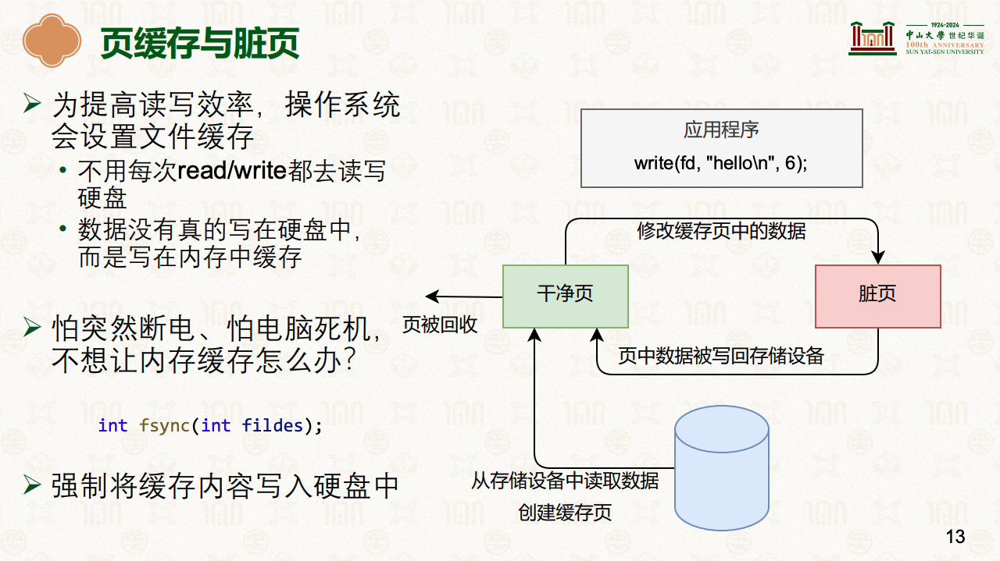
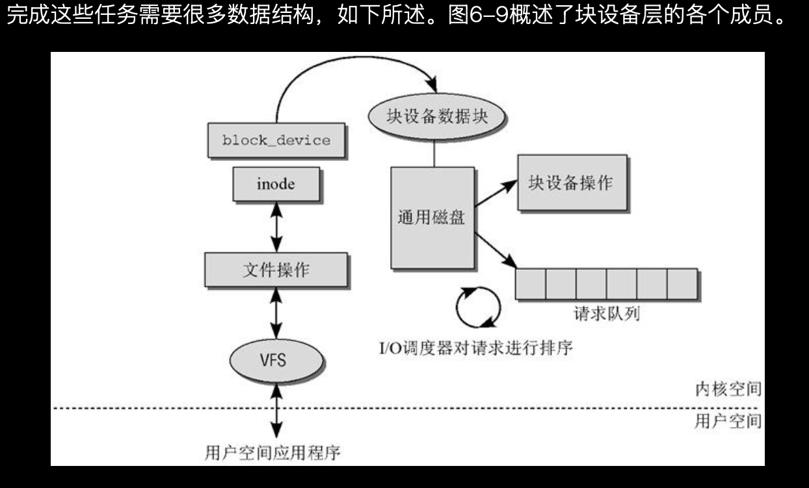

# 块设备的操作
> 学习:<br/>[深入Linux内核架构](../../../007.BOOKs/Professional-Linux-Kernel-Architecture.epub)<br/>[17-文件系统：基于inode的文件系统 [中山大学 操作系统原理]](../../001.UNIX-DOCS/001.操作系统课程/000.中山大学-操作系统2025/9-0424-fs.pdf) <br/> [18-文件系统：使用文件系统 [中山大学 操作系统原理]](../../001.UNIX-DOCS/001.操作系统课程/000.中山大学-操作系统2025/10-0428-fs.pdf)  <br/> [深入理解Linux内核:虚拟文件系统](../../007.BOOKs/Professional-Linux-Kernel-Architecture.epub)  <br/> [文件系统崩溃一致性](../../001.UNIX-DOCS/001.操作系统课程/000.中山大学-操作系统2025/11-0508-fs-crash-1.pdf)  <br/> [文件系统崩溃一致性II](../../001.UNIX-DOCS/001.操作系统课程/000.中山大学-操作系统2025/12-0512-fs-crash-2.pdf)


|项|说明|参考|备注|
|-|-|-|-|
|- 页缓存|- The physical memory is volatile and the common case for getting data into the memory is to read it from files. Whenever a file is read, the data is put into the `page cache` to avoid expensive disk access on the subsequent reads. Similarly, when one writes to a file, the data is placed in the page cache and eventually gets into the backing storage device. The written pages are marked as `dirty` and when Linux decides to reuse them for other purposes, it makes sure to synchronize the file contents on the device with the updated data.<sup>物理内存是易失性的（断电即丢失），而数据进入内存最常见的途径就是从文件中读取。每当读取文件时，数据会被放入 page cache（页面缓存）中，以避免后续再次读取时产生高昂的磁盘访问开销。 同样地，当向文件写入数据时，数据也会被放入页面缓存，并最终写入底层的存储设备。这些被写入的页面会被标记为 dirty（脏页）。当 Linux 决定回收这些页面用于其他用途时，会确保将设备上该文件的内容与更新后的数据进行同步。</sup>|- [Documentation/admin-guide/mm/concepts.rst](../../../000.SOURCE_CODE/003.LINUX-7.1.3/000.LINUX-7.1.3/Documentation/admin-guide/mm/concepts.rst)|-|
|-|-|-|-|
|- 页缓存与脏页 <sup>读写都有缓存!</sup>|- |- 为提高读写效率，操作系统会设置文件缓存:<br/>&nbsp;&nbsp;&nbsp;&nbsp;- 不用每次read/write都去读写硬盘:<br/>&nbsp;&nbsp;&nbsp;&nbsp;- 数据没有真的写在硬盘中，而是写在内存中缓存 <br/><br/>- 对块设备的访问有大规模的缓存，即已经读取的数据保存在内存中。如果再次需要，则直接从内存获得。**写入操作也使用了缓存，以便延迟处理** <br/>- “对块设备的读写请求不会立即执行对应的操作。相反，这些请求会汇总起来，经过协同之后传输到设备。<sup>(请求队列)</sup>”|- [17-文件系统：基于inode的文件系统 [中山大学 操作系统原理]#P13](../../../001.UNIX-DOCS/001.操作系统课程/000.中山大学-操作系统2025/9-0424-fs.pdf) <br/>- [深入Linux架构#“6.5　块设备操作”](../../../007.BOOKs/Professional-Linux-Kernel-Architecture.epub)|
|-|-|-|-|
|- 块设备的读写请求放置在一个队列上：请求队列|- 块设备操作数据结构: [include/linux/blkdev.h#struct block_device_operations](../../../000.SOURCE_CODE/000.LINUX-5.9/000.LINUX-5.9/include/linux/blkdev.h)|-|- [深入理解Linux内核#“6.5　块设备操作”](../../007.BOOKs/Professional-Linux-Kernel-Architecture.epub)|
|-|-|-|-|
|- 块设备层|- 块设备层不仅负责寻址设备，也负责执行其他任务，以提高系统中所有块设备的性能：包括预读算法的实现，在内核判断应用程序稍后将需要使用某数据时，会使用预读算法从块设备预先将数据读入内存|- |- [深入理解Linux内核#“6.5　块设备操作”](../../007.BOOKs/Professional-Linux-Kernel-Architecture.epub)|
|-|-|-|-|
|- 块设备的表示(块设备层的各个成员)|-  <br/>- 块设备层提供了丰富的队列<sup>include/linux/blkdev.h#struct request_queue</sup>功能,每个设备都关联了请求队列 <br/> - “块设备的读写请求放置在一个队列上”，称之为请求队列|- 在 Linux 内核的块设备架构中，“块设备操作”与“请求队列”被画成平级，是因为它们并非上下级调用关系，而是协同工作的两个核心组件，共同构成块设备 I/O 处理的完整流程<sup>请求队列是“蓄水池”，而块设备操作（驱动程序）是“水龙头”: 块设备操作（即驱动程序代码）会向磁盘控制器发送指令（比如通过 DMA 传输数据），真完成数据的读取或写入</sup>。<br/>&nbsp;&nbsp;&nbsp;- 块设备操作：指代的是块设备驱动层提供的操作接口集合（如 request_fn 或 mq_ops），它定义了“如何执行一个 I/O 请求”，包括读取、写入、设备重置等具体动作。它是“执行者”，负责最终将请求转化为硬件指令。<br/>&nbsp;&nbsp;&nbsp;- 请求队列：是 I/O 请求的“缓冲区”和“调度器”的工作场所。所有来自上层的 I/O 请求（bio）首先被封装成 request 结构体并放入队列。I/O 调度器（如 CFQ、Deadline、BFQ）会在此队列中对请求进行排序、合并、优先级调整，以优化设备访问效率。|- [深入理解Linux内核#“6.5.1　块设备表示”](../../007.BOOKs/Professional-Linux-Kernel-Architecture.epub)<br/>- [深入理解Linux内核#“6.5.2 数据结构”](../../007.BOOKs/Professional-Linux-Kernel-Architecture.epub)|
|-|-|-|-|
|- 对块设备的访问不是分别处理单个的请求，而是通过由缓存和请求队列构成的精细、复杂的系统来高效的管理。|- 缓存主要由通用的内核代码操作，而请求队列则由块设备层管理<sup>驱动程序</sup>。|-|- [深入理解Linux内核#“6.3 与文件系统关联”](../../007.BOOKs/Professional-Linux-Kernel-Architecture.epub)|
|-|-|-|-|
|- BIO用于在系统和设备之间传输数据|- [include/linux/blk_types.h]#struct bio <br/> - 用这种方式进行块传输更为高效，因为他可以合并同一请求中后续的块，加速处理的进行。|-|- [深入理解Linux内核#““第16章　页缓存和块缓存” + 深入理解Linux内核#“6.5 块设备操作” ](../../007.BOOKs/Professional-Linux-Kernel-Architecture.epub)|
|-|-|-|-|
|- IO调度|-|-|-|
|-|-|-|-|
|- 提交请求到请求队列<sup>“内核将数据请求提交给外设的机制”</sup>|- “也涉及缓冲和请求的重排，以减少磁头寻道的移动，或捆绑多个操作以提高性能” <br/> - “涵盖了设备驱动程序的操作，驱动程序与具体的硬件交互以处理请求”<br/>- “包括了虚拟文件系统中与设备文件相关的通用代码，这部分代码通过设备文件又关联到用户应用程序以及内核的其他部分”|- 提交步骤<sup>submit_bio 函数</sup>: <br/>- “它首先创建一个bio 实例以描述请求，然后将该实例嵌入到请求中，并置于请求队列上。”<br/>- “接下来内核将处理请求队列并执行bio 中的操作”|- [深入理解Linux内核#“6.5 块设备操作”](../../007.BOOKs/Professional-Linux-Kernel-Architecture.epub)|
|-|-|-|-|
|- 数据块在块设备上持久存储，但是在物理内存中进行修改|- “物理内存和硬盘空间在很大程度上是可以互换的。如果有大量的物理内存是空闲的，则内核使用一部分内存来缓冲块设备的数据。反过来，如果物理内存太少，可以将数据换出内存，转移到磁盘空间。二者有一个共同点，数据总是在物理内存中操作，随后在随机的时间点写回（或刷出）到磁盘，以持久保存修改。在这里，块存储设备通常称为物理内存的后备存储器。”|- 重要!!! --> "数据总是在物理内存中操作"|- [深入理解Linux内核#““第17章　数据同步””](../../007.BOOKs/Professional-Linux-Kernel-Architecture.epub)|
|-|-|-|-|
|- 回写修改的数据|- 由于页缓存的存在，写操作不是直接对块设备进行，而是在内存中进行，修改的数据首先被收集起来，然后被传输到更低的内核层，在那里可以对写操作进一步优化，以完全利用各个设备的具体功能|-|- [深入理解Linux内核#““16.1.2 回写修改的数据””](../../007.BOOKs/Professional-Linux-Kernel-Architecture.epub)|
|-|-|-|-|
|- 物理内存还用于存储从块设备读取的数据，使得随后对该数据的访问可以直接在物理内存进行，而无须从外部设备再次取用|-|-|- [深入理解Linux内核#“第16章·页缓存与块缓存”](../../007.BOOKs/Professional-Linux-Kernel-Architecture.epub)|
|-|-|-|-|
|-|-|-|-|

---

## 块设备写流程(LINUX 7.1.3 源码走读)

> 场景:进程对块设备文件(`/dev/sda`)执行 `write(2)`,缓冲写(非 `O_DIRECT`)。<br/>
> 行号均指本仓库 [000.LINUX-7.1.3](../../../000.SOURCE_CODE/003.LINUX-7.1.3/000.LINUX-7.1.3) 源码树,逐条核实。

### 0. 全景图(写一条数据的旅程)

<pre>
 用户进程                        内核                                       硬件

 write(2) → /dev/sda
    │
    ▼ ① 系统调用/VFS 分发
 SYSCALL_DEFINE3(write) → ksys_write → vfs_write            fs/read_write.c:748/729/668
    │  f_op->write_iter = blkdev_write_iter                 block/fops.c:746,957
    │
    ├── O_DIRECT ─▶ blkdev_direct_write(直接构建 bio,绕过页缓存)──┐
    │                                                           │(直接汇入⑤)
    ▼ ② 缓冲写:进页缓存,标脏,write() 到这里就返回               │
 blkdev_buffered_write → iomap_file_buffered_write            block/fops.c:733
    │   ├ blkdev_iomap_begin        偏移→扇区(1:1)             block/fops.c:439
    │   ├ __block_write_begin_int   folio 划出 buffer_head     fs/iomap/buffered-io.c:1014
    │   ├ copy_folio_from_iter_atomic 用户数据→页缓存 folio     fs/iomap/buffered-io.c:1158
    │   └ block_write_end → mark_buffer_dirty  标脏             fs/buffer.c:2165,2114
    │
    ════ 页缓存:物理内存里的磁盘副本,write() 至此结束 ════
    │
    ▼ ③ 写回触发(与写进程解耦,"随机的时间点")
    ├── a. 脏页超限(同步节流): balance_dirty_pages_ratelimited  mm/page-writeback.c:2111
    │         └ balance_dirty_pages    写进程睡眠,等写回追上     mm/page-writeback.c:1802
    └── b. flusher 内核线程(kworker:"flush-8:0",异步写回)
              wb_workfn → wb_do_writeback → wb_writeback       fs/fs-writeback.c:2411/2380/2184
                → writeback_sb_inodes → __writeback_single_inode fs/fs-writeback.c:1957/1753
                → do_writepages → mapping->a_ops->writepages   mm/page-writeback.c:2560
    ▼ ④ 脏 folio → buffer_head → bio
 blkdev_writepages(= def_blk_aops.writepages)                  block/fops.c:477,524
    ├ blk_start_plug     插头:进程本地攒请求                     block/blk-core.c:1178
    ├ writeback_iter     逐个取出脏 folio                       mm/page-writeback.c:2471
    └ block_write_full_folio → __block_write_full_folio        fs/buffer.c:2625/1733
         ├ get_block = blkdev_get_block   逻辑块→物理块(1:1)    block/fops.c:461
         ├ folio_start_writeback          folio 进入写回态      fs/buffer.c:1825
         └ submit_bh_wbc(REQ_OP_WRITE)    每个脏 bh 包成一个 bio fs/buffer.c:1830,2692
    ▼ ⑤ 块层公共入口 → blk-mq 蓄水                                ▲
 submit_bio → submit_bio_noacct → __submit_bio                 block/blk-core.c:916/780/627
    ├ bio 型驱动: disk->fops->submit_bio(brd/loop 等内存盘)      block/blk-core.c:644
    └ request 型驱动: blk_mq_submit_bio(绝大多数物理盘)          block/blk-mq.c:3124
         ├ blk_mq_attempt_bio_merge  合并进已有请求(排序/合并)   block/blk-mq.c:3034,3187
         ├ blk_mq_get_new_requests   合不了 → 新建 request       block/blk-mq.c:3046,3202
         └ blk_add_rq_to_plug        先挂进程插头链表,不下发      block/blk-mq.c:3230
    ▼ ⑥ 拔插头:批量下泄 → 驱动
 blk_finish_plug → blk_mq_flush_plug_list                      block/blk-core.c:1254
    └ blk_mq_dispatch_rq_list                                   block/blk-mq.c:2969,2116
         └ q->mq_ops->queue_rq   ◀── 驱动实现的唯一入口           block/blk-mq.c:2148
              virtio_queue_rq → virtqueue_kick  通知设备         drivers/block/virtio_blk.c:426
    │                                                        ─────────────
    ▼                                          设备 DMA 把 folio 数据真正写入盘
    ▲ ⑦ 完成中断,原路返回
 virtblk_done → blk_mq_complete_request → bio_endio            drivers/block/virtio_blk.c:350
    └ end_bio_bh_io_sync → end_buffer_async_write              fs/buffer.c:2666/383
         └ folio 的全部 bh 完成 → folio_end_writeback(页变干净,可回收)
</pre>

与上表论断的对应:

+ **"写操作不是直接对块设备进行,而是在内存中进行"(16.1.2)** → ①②:`write(2)` 只把数据拷进页缓存并标脏就返回,盘上还是旧数据;
+ **"数据总是在物理内存中操作,随后在随机的时间点写回(或刷出)到磁盘"(第17章)** → ③④:写回由 flusher 线程周期唤醒或脏页超限触发,与写进程完全解耦,"随机的时间点"= `dirty_expire_interval` 到期或脏页比例越线;
+ **"读写请求放置在一个队列上……汇总起来,经过协同之后传输到设备"(6.5)** → ⑤⑥:plug 在进程本地蓄水、`blk_mq_attempt_bio_merge` 合并相邻块、`blk_finish_plug` 一次性批量下泄——"汇总+协同"的多队列实现。

### 1. ① write(2) → VFS → 块设备文件的 write_iter

系统调用入口与普通文件相同;分叉点在 `f_op`:块设备文件的 `file_operations` 是 `def_blk_fops`,其 `.write_iter = blkdev_write_iter`(block/fops.c:957)。

```c
/* block/fops.c:789-803 */
	if (iocb->ki_flags & IOCB_DIRECT) {
		ret = blkdev_direct_write(iocb, from);            // 直写:立即建 bio,绕过页缓存
		if (ret >= 0 && iov_iter_count(from))
			ret = direct_write_fallback(iocb, from, ret,
					blkdev_buffered_write(iocb, from));   // 剩余部分退回缓冲写
	} else {
		/* ... */
		inode_lock_shared(bd_inode);
		ret = blkdev_buffered_write(iocb, from);          // 缓冲写:进页缓存
		inode_unlock_shared(bd_inode);
	}
```

### 2. ② 缓冲写:数据进页缓存,标脏即返回

7.1.3 中块设备的缓冲写已改走 iomap(`blkdev_buffered_write` 一行完成委派):

```c
/* block/fops.c:733-737 */
static ssize_t blkdev_buffered_write(struct kiocb *iocb, struct iov_iter *from)
{
	return iomap_file_buffered_write(iocb, from, &blkdev_iomap_ops, NULL,
			NULL);
}
```

`blkdev_iomap_ops` 的映射逻辑极其简单——块设备上"文件偏移 == 磁盘扇区偏移",1:1 恒等映射;而普通文件要经 inode 的间接块/extent 树才能把偏移翻译成扇区:

```c
/* block/fops.c:439-455(节选) */
static int blkdev_iomap_begin(struct inode *inode, loff_t offset, loff_t length,
		unsigned int flags, struct iomap *iomap, struct iomap *srcmap)
{
	struct block_device *bdev = I_BDEV(inode);
	...
	iomap->bdev = bdev;
	iomap->offset = ALIGN_DOWN(offset, bdev_logical_block_size(bdev));
	iomap->type = IOMAP_MAPPED;
	iomap->addr = iomap->offset;              // :451 扇区地址 = 文件偏移(恒等)
	iomap->length = isize - iomap->offset;
	iomap->flags |= IOMAP_F_BUFFER_HEAD;      // :453 要求写路径按 buffer_head 方式处理
	return 0;
}
```

随后 `iomap_write_iter`(fs/iomap/buffered-io.c:1099)循环做三件事:先做脏页节流检查,再把用户数据原子拷入页缓存 folio,最后提交标脏。**`write(2)` 的返回点就在这个循环结束处——此后数据只存在于物理内存**:

```c
/* fs/iomap/buffered-io.c:1119-1122, 1158-1160 */
		status = balance_dirty_pages_ratelimited_flags(mapping,
							       bdp_flags);          // 脏页超限则睡眠节流(见③)
...
		copied = copy_folio_from_iter_atomic(folio, offset, bytes, i);  // 用户数据→页缓存
		written = iomap_write_end(iter, bytes, copied, folio) ?         // 提交
			  copied : 0;
```

因为映射带 `IOMAP_F_BUFFER_HEAD` 标志,`iomap_write_begin` 在 folio 上划出 `buffer_head`(fs/iomap/buffered-io.c:1014 → `__block_write_begin_int`),`iomap_write_end` 则调 `block_write_end`(fs/buffer.c:2165)逐个把写到的 buffer 标脏:

```c
/* fs/buffer.c:2112-2114(block_commit_write 节选) */
		} else {
			set_buffer_uptodate(bh);
			mark_buffer_dirty(bh);            // ← 脏页的最终落点:buffer 级 DIRTY 标志
		}
```

块设备 inode 的 `address_space_operations` 一览(写路径各环节的"接口开关"):

```c
/* block/fops.c:524-531(CONFIG_BUFFER_HEAD 变体,节选) */
const struct address_space_operations def_blk_aops = {
	.dirty_folio	= block_dirty_folio,       // fs/buffer.c:768
	.invalidate_folio = block_invalidate_folio,
	.read_folio	= blkdev_read_folio,
	.readahead	= blkdev_readahead,
	.writepages	= blkdev_writepages,        // ← ④ 的写回入口
	.write_begin	= blkdev_write_begin,       // :502
	.write_end	= blkdev_write_end,         // :510
	...
};
```

### 3. ③ 写回触发:超限节流 + flusher 线程,两条路

脏页不会永远躺着,两个时机被唤醒(对应图③):

+ **写进程自己被节流**:②中 `balance_dirty_pages_ratelimited_flags` 每写若干页检查一次 → `balance_dirty_pages`(mm/page-writeback.c:1802)。脏页超过 `vm.dirty_ratio` 时,写进程在此**睡眠等待**,直到写回追上——这是防止内存被脏页灌满的负反馈;
+ **flusher 内核线程异步写回**(每 backing device 一个,`ps` 里名为 `flush-8:0` 之类)。定时器/被节流进程/显式 `sync()` 都会投递工作,最终都进 `wb_workfn`:

```c
/* fs/fs-writeback.c:2411-2424(节选) */
void wb_workfn(struct work_struct *work)
{
	struct bdi_writeback *wb = container_of(to_delayed_work(work),
						struct bdi_writeback, dwork);
	...
	set_worker_desc("flush-%s", bdi_dev_name(wb->bdi));     // 线程名 "flush-8:0" 的由来
		do {
			pages_written = wb_do_writeback(wb);
		} while (!list_empty(&wb->work_list));
```

两条路汇合后的调用链完全一致:`wb_do_writeback`(fs/fs-writeback.c:2380)→ `wb_writeback`(:2184)→ `writeback_sb_inodes`(:1957)→ `__writeback_single_inode`(:1753)→ `do_writepages`。`do_writepages` 里的这一行就是 VFS 对块层的"总开关"——**地址空间操作里的 `.writepages`**:

```c
/* mm/page-writeback.c:2570-2571 */
	while (1) {
		if (mapping->a_ops->writepages)
			ret = mapping->a_ops->writepages(mapping, wbc);   // 块设备 → blkdev_writepages
```

### 4. ④ 脏 folio → buffer_head → bio

`blkdev_writepages` 本体只有 10 行,却集中体现了"汇总协同"的三板斧:**插头蓄水(plug)、逐页写回、按块提交**:

```c
/* block/fops.c:477-490 */
static int blkdev_writepages(struct address_space *mapping,
		struct writeback_control *wbc)
{
	struct folio *folio = NULL;
	struct blk_plug plug;
	int err;

	blk_start_plug(&plug);                                 // :484 开插头:请求先攒在进程本地
	while ((folio = writeback_iter(mapping, wbc, folio, &err)))  // :485 逐个取脏 folio
		err = block_write_full_folio(folio, wbc, blkdev_get_block);
	blk_finish_plug(&plug);                                // :487 拔插头:批量下泄(见⑥)

	return err;
}
```

`block_write_full_folio`(fs/buffer.c:2625)→ `__block_write_full_folio`(:1733)把 folio 的每个脏 buffer_head 映射成磁盘块并逐个提交:

```c
/* fs/buffer.c:1744-1745, 1782, 1812-1814, 1825, 1827-1831(节选) */
	head = folio_create_buffers(folio, inode,               // :1744 复用②中建好的 buffer_head
				    (1 << BH_Dirty) | (1 << BH_Uptodate));
...
		} else if ((!buffer_mapped(bh) || buffer_delay(bh)) &&
			   buffer_dirty(bh)) {
			err = get_block(inode, block, bh, 1);       // :1782 = blkdev_get_block
		}                                                 //     bh->b_blocknr = iblock(1:1)
...
		if (test_clear_buffer_dirty(bh)) {               // :1812 清脏→改为"异步写"态
			mark_buffer_async_write_endio(bh,
				end_buffer_async_write);            // :1813 完成回调挂到 bh->b_end_io
		...
	folio_start_writeback(folio);                          // :1825 folio 进入 writeback 态

	do {                                                   // :1827 第二遍:真正提交
		struct buffer_head *next = bh->b_this_page;
		if (buffer_async_write(bh)) {
			submit_bh_wbc(REQ_OP_WRITE | write_flags, bh,
				      inode->i_write_hint, wbc);     // :1830 一个 bh → 一个 bio
			nr_underway++;
		}
		bh = next;
	} while (bh != head);
```

`submit_bh` → `submit_bh_wbc`(fs/buffer.c:2740/:2692)完成 **buffer_head → bio 的封装**——bio 是块层流通的"货币",从这里开始不再有 buffer 的概念:

```c
/* fs/buffer.c:2716-2737(节选) */
	bio = bio_alloc(bh->b_bdev, 1, opf, GFP_NOIO);         // :2716 单页 bio
	bio->bi_iter.bi_sector = bh->b_blocknr * (bh->b_size >> 9);  // :2721 块号→起始扇区
	bio->bi_write_hint = write_hint;
	bio_add_folio_nofail(bio, bh->b_folio, bh->b_size, bh_offset(bh));  // :2724 挂载 folio 片段
	bio->bi_end_io = end_bio_bh_io_sync;                   // :2726 完成回调(⑦的入口)
	bio->bi_private = bh;
...
	blk_crypto_submit_bio(bio);                            // :2737 无加密上下文时即 submit_bio(bio)
```

### 5. ⑤ 块层公共入口:submit_bio 与 blk-mq 蓄水

`submit_bio`(block/blk-core.c:916)只做统计,立刻委派:`submit_bio_noacct`(:780)→ `__submit_bio_noacct`(:671,把递归拍平成迭代)→ `__submit_bio`(:627),在此按**驱动形态**分流:

```c
/* block/blk-core.c:627-649(节选) */
static void __submit_bio(struct bio *bio)
{
	struct blk_plug plug;

	blk_start_plug(&plug);                                 // :632 顶层再包一个插头
	if (!bdev_test_flag(bio->bi_bdev, BD_HAS_SUBMIT_BIO)) {
		blk_mq_submit_bio(bio);                        // :635 request 型:走 blk-mq(绝大多数驱动)
	} else if (likely(bio_queue_enter(bio) == 0)) {
		struct gendisk *disk = bio->bi_bdev->bd_disk;
		...
		disk->fops->submit_bio(bio);                   // :644 bio 型:驱动自己收(brd/loop/zram)
	}
	blk_finish_plug(&plug);                                // :649
}
```

`blk_mq_submit_bio`(block/blk-mq.c:3124)是多队列路径的核心,**先合并、合不了才新建、建完先蓄水**:

```c
/* block/blk-mq.c:3187, 3202, 3214, 3229-3232(节选) */
	if (blk_mq_attempt_bio_merge(q, bio, nr_segs))         // :3187 与插头/调度器中已有请求合并
		goto queue_exit;                                //     (相邻扇区拼大请求,减少寻道)
...
		rq = blk_mq_get_new_requests(q, plug, bio);    // :3202 合不了 → 分配新 request
...
	blk_mq_bio_to_request(rq, bio, nr_segs);              // :3214 bio 装进 request
...
	if (plug) {
		blk_add_rq_to_plug(plug, rq);                 // :3230 有插头 → 挂进程本地链表
		return;                                       //          (无锁、未进设备队列!)
	}
```

注意:**挂进 plug 的请求此时根本不在任何"请求队列"里**——它在发起进程的栈边本地链表上攒着,这就是《深入理解Linux内核架构》所说"请求会汇总起来,经过协同之后传输到设备"的现代实现(书中 5.x 时代的 `request_queue`→`elevator` 描述已被多队列 + plug 取代)。

### 6. ⑥ 拔插头:批量下泄到驱动 queue_rq

`blk_finish_plug` 一到(④的 `blkdev_writepages` 每批写回结束、⑤的 `__submit_bio` 退出、或进程主动调度),蓄的水一次放完:

```c
/* block/blk-core.c:1254-1259 */
void blk_finish_plug(struct blk_plug *plug)
{
	if (plug == current->plug) {
		__blk_flush_plug(plug, false);                 // :1226 → blk_mq_flush_plug_list
		current->plug = NULL;
	}
}
```

```c
/* block/blk-mq.c:2969-2996(节选) */
void blk_mq_flush_plug_list(struct blk_plug *plug, bool from_schedule)
{
	...
	if (!plug->has_elevator && !from_schedule) {
		if (plug->multiple_queues) {
			blk_mq_dispatch_multiple_queue_requests(&plug->mq_list);  // 多硬件队列:各自直发
			return;
		}
		blk_mq_dispatch_queue_requests(&plug->mq_list, depth);        // 单队列:直发
		...
	}
	do {
		blk_mq_dispatch_list(&plug->mq_list, from_schedule);          // 兜底:经调度器/重派发
	} while (!rq_list_empty(&plug->mq_list));
```

无论哪条支线,最终都压到同一个出口——**驱动的 `queue_rq`**:

```c
/* block/blk-mq.c:2136-2148(节选) */
		rq = list_first_entry(list, struct request, queuelist);
		...
		list_del_init(&rq->queuelist);
		bd.rq = rq;
		bd.last = list_empty(list);
		ret = q->mq_ops->queue_rq(hctx, &bd);              // :2148 ← 驱动唯一入口
```

以 virtio_blk 为例,`queue_rq` 把 request 翻译成 virtio 描述符并"踢"一下设备:

```c
/* drivers/block/virtio_blk.c:426-446(节选) */
static blk_status_t virtio_queue_rq(struct blk_mq_hw_ctx *hctx,
			   const struct blk_mq_queue_data *bd)
{
	...
	spin_lock_irqsave(&vblk->vqs[qid].lock, flags);
	err = virtblk_add_req(vblk->vqs[qid].vq, vbr);         // 请求 → virtqueue 描述符(DMA 地址)
	if (err) {
		virtqueue_kick(vblk->vqs[qid].vq);             // 通知设备开始处理
	...
```

### 7. ⑦ 完成中断:原路返回

设备 DMA 写完盘后发中断,回调链沿 bio→bh→folio 反向展开:`virtblk_done`(drivers/block/virtio_blk.c:350)→ `blk_mq_complete_request` → `bio_endio` → `end_bio_bh_io_sync`(fs/buffer.c:2666)→ `bh->b_end_io` = `end_buffer_async_write`(:383)。当 folio 上**全部** buffer 都完成,folio 结束写回态(`folio_end_writeback`),这页内存重新变为"干净、可回收"——至此"物理内存中修改的数据"才真正与盘上一致。

### 8. 与普通文件写路径的对照

块设备文件与普通文件**只在 VFS 之下、bio 之上不同**;从 `submit_bio` 开始(⑤⑥⑦)完全共用:

| 环节 | `/dev/sda`(块设备文件) | 普通文件(如 ext4) |
|-|-|-|
| write 入口 | `blkdev_write_iter`(block/fops.c:746) | `generic_file_write_iter` → `generic_perform_write`(mm/filemap.c:4297) |
| 偏移→扇区 | `blkdev_iomap_begin`:恒等映射(block/fops.c:439) | 文件系统映射:查 extent/间接块(偏移≠物理扇区) |
| 标脏 | `block_write_end` → `mark_buffer_dirty`(fs/buffer.c:2114) | 文件系统 write_end(如 ext4),或 iomap 通用路径 |
| 写回 writepages | `blkdev_writepages`(block/fops.c:477) | `ext4_writepages` 等文件系统实现 |
| bio 之后 | `submit_bio` → blk-mq → `queue_rq`(完全相同) | 同左 |

> 注:块设备缓冲写在 7.1.3 已切换到 iomap 框架(`blkdev_buffered_write` → `iomap_file_buffered_write`),但写回仍按 `CONFIG_BUFFER_HEAD` 走 `buffer_head` 路径;若内核未启用 `CONFIG_BUFFER_HEAD`,`def_blk_aops` 换用 iomap 写回变体(block/fops.c:585),`writepages` 改为 `iomap_writepages`。
