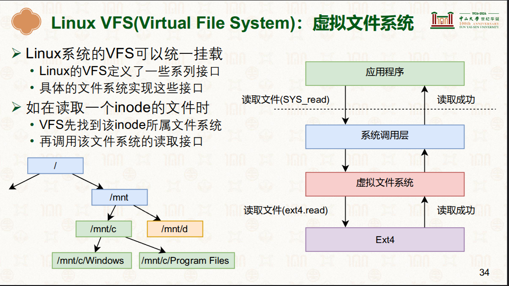
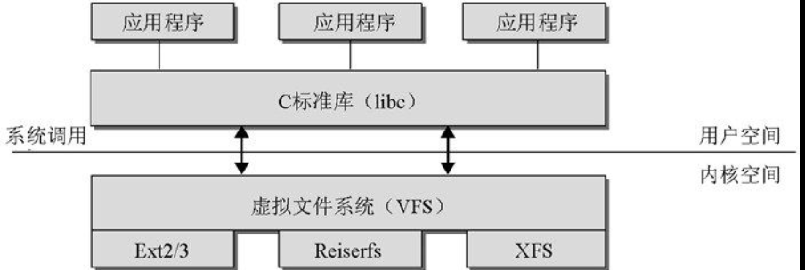

# 虚拟文件系统VFS(Virtual File System.VFS)

## VFS 架构
- 

## 虚拟文件系统应用
|应用|文件系统名称|说明|
|-|-|-|
|cgroup|wei@Berries:/sys/fs/cgroup$ stat -f -c %T . </br> cgroup2fs|参考:[001.UNIX-DOCS/032.Control-Groups(CGroups)](../../../001.UNIX-DOCS/032.Control-Groups%28CGroups%29)|
|-|-|-|
|- struct file_operations |- 由VFS层用来与用户空间通信，会调用 stuct block_device_operations 中的函数，来实现与块设备通信 |-|
|-|-|-|
|- Linux 内核在用户进程（或C标准库）和文件系统实现之间引入了一个抽象层： 虚拟文件系统（Virtual File System.VFS）|-  <br/> - 用来提供一种操作文件、目录及其他对象的统一方法<br/>- 必须能够与各种方法给出的具体文件系统的实现达成妥协<br/>- 内核支持多种文件系统: 网络文件系统（NFS、coda）、虚拟的文件系统（proc）、ReiserFS 和 XFS 都是基于块设备（Block Device）的日志文件系统|-|
|- 文件系统类型|- 基于磁盘的文件系统（Disk-based Filesystem）:Ext2/3/4,FAT/... <br/>- 虚拟文件系统（Virtual Filesystem）: proc文件系统<sup>核心功能可以归纳为三大类：进程信息监控、系统状态与硬件信息暴露，以及内核参数动态调优</sup> <br/> - 网络文件系统(Network Filesystem): 这种文件系统允许访问另外一台计算机上的数据，该计算机通过网络连接到本地计算机： NFS、...|-|

---

## 附录：VFS 架构分层图（ASCII，7.1.3 锚点）

> 上文 [VFS 架构](#vfs-架构) 图片的代码版：每层标一个可跳转的 7.1.3 实测锚点，自上而下正是 `write(2)` 的一次旅程。

```
┌─────────────────────────── 用户态 ────────────────────────────┐
│  应用: fprintf/fwrite/read ...        glibc 封装              │
└───────────────────────────┬───────────────────────────────────┘
                            │ syscall(svc #0)
┌───────────────────────────▼────────────── 系统调用层 ─────────┐
│ SYSCALL_DEFINE3(write,...)              fs/read_write.c:748   │
│   └► ksys_write(fd,buf,count)           fs/read_write.c:729   │
│        └► vfs_write(file,...)           fs/read_write.c:668   │
└───────────────────────────┬──────────────── VFS 核心层 ───────┐
│  四大对象(每个打开的文件都在这四棵结构里):                       │
│   struct file        "一次打开"     include/linux/fs.h:1260    │
│   struct inode       "一个文件"     include/linux/fs.h:767     │
│   struct dentry      "一个名字"     include/linux/dcache.h:93  │
│   struct super_block "一个实例"     include/linux/fs/super_types.h:132
│  面向对象的方法表(VFS 只认函数指针,不认识任何具体文件系统):      │
│   file_operations(.read_iter/.write_iter) fs.h:1926            │
│   inode_operations / super_operations / dentry_operations      │
│  缓存: dentry cache(dcache) ∥ inode cache                      │
└───────────────────────────┬───────────────────────────────────┘
                            │ f_op->write_iter(...) 间接调用
┌───────────────────────────▼────────────── 具体文件系统层 ──────┐
│  file_system_type.get_sb/kill_sb        include/linux/fs.h:2338│
│  ┌──────────┬──────────┬──────────┬──────────┬───────────────┐ │
│  │ ext4     │ xfs/btrfs│ proc     │ sysfs    │ tmpfs/...     │ │
│  │ ext4_file│          │ proc_... │          │               │ │
│  │ _oper-   │          │          │          │               │ │
│  │ ations   │          │          │          │               │ │
│  │ ext4/    │          │          │          │               │ │
│  │ file.c:974          │          │          │               │ │
│  └──────────┴──────────┴──────────┴──────────┴───────────────┘ │
│         基于磁盘                        虚拟(内存里现造内容)     │
└───────────────────────────┬───────────────────────────────────┘
                            │ (磁盘类才往下走)
┌───────────────────────────▼────── 地址空间/页缓存层 ───────────┐
│  struct address_space(每个 inode 一个) ← write_back 的组织单位  │
└───────────────────────────┬───────────────────────────────────┘
                            ▼
                     通用块层 → 块驱动 → 磁盘
      (写全流程见 [000.块设备的操作](../000.块设备/000.块设备的操作.md) 写流程章节)
```

读法三要点：

1. **VFS 的"虚拟"= 靠方法表多态**：`vfs_write` 只做权限/一致性检查和计数，真正的落盘动作由 `file->f_op->write_iter` 这个函数指针跳到具体文件系统——proc/sysfs 这类"虚拟文件系统"就在这一层把读写劫持成"现造内容"（[深入理解Linux内核:虚拟文件系统](../../../007.BOOKs/Professional-Linux-Kernel-Architecture.epub) 的"统一方法"即指此）；
2. **四个对象各管一个抽象**：`file`（打开的会话，含 offset）→ `dentry`（路径分量，dcache 缓存）→ `inode`（文件本体，多个硬链接共享一个）→ `super_block`（一个已挂载实例）；`file_operations` 是 `file` 的方法表，`file_system_type` 是"文件系统驱动"的注册入口；
3. **分界线**：VFS 层不知道块设备，块层不知道文件系统——页缓存（address_space）是两者的汇合点。

---

## 参考资料
- 18-文件系统：使用文件系统 [中山大学 操作系统原理]（原 `./000.REFS/001.文件系统-2.pdf` 已移除，2026-11 复核）#P34
- [深入理解Linux内核:虚拟文件系统](../../../007.BOOKs/Professional-Linux-Kernel-Architecture.epub)