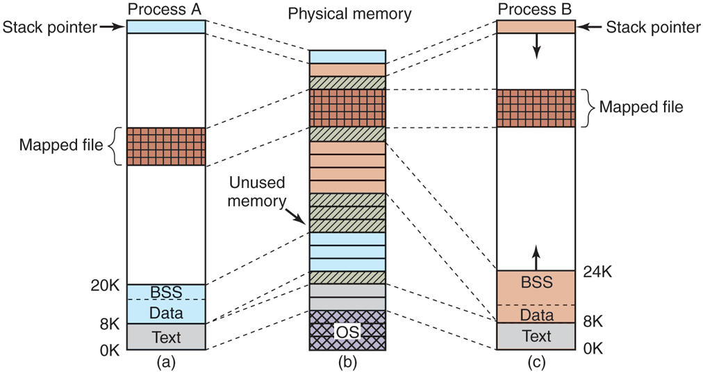

# MOS5 —— 内存映射文件:Figure 10-13 与 §3.5.8 联动精读
> 出处: [Modern Operating Systems 5th Edition §3.5.8 Mapped Files](../../../007.BOOKs/现代操作系统/Modern%20Operating%20Systems%205th%20Edition-PDF-01.pdf#page=261) 书页 232(PDF 261);[§10.4.1/10.4.2 Memory Management in Linux](../../../007.BOOKs/现代操作系统/Modern%20Operating%20Systems%205th%20Edition-PDF-01.pdf#page=775) 书页 746-748(PDF 775-777),Figure 10-13 见 [书页 747(PDF 776)](../../../007.BOOKs/现代操作系统/Modern%20Operating%20Systems%205th%20Edition-PDF-01.pdf#page=776)。
>
> 定位:文件映射是**进程虚拟地址空间 ↔ 文件地址空间**两个 address_space 的接合,故归入本目录;`struct address_space` 本体见 [README](README.md),完整 mmap 系统调用链见 [000.内存管理/018.mmap系统调用分析](../../000.内存管理/018.mmap系统调用分析/README.md)。

---

## 1. §3.5.8 Mapped Files:概念原型

> "The idea here is that a process can issue a system call to map a file onto a portion of its virtual address space. In most implementations, no pages are brought in at the time of the mapping, but as pages are touched, they are demand paged in one page at a time, using the file on nonvolatile storage as the backing store. When the process exits, or explicitly unmaps the file, all the modified pages are written back to the file on disk or SSD."（其思想是:进程通过系统调用把文件映射到自己虚拟地址空间的一部分。多数实现中，映射建立时不调入任何页；随着页被触碰，以非易失存储上的文件为后备存储，按缺页机制一次一页地调入。进程退出或显式解除映射时，所有修改过的页被写回磁盘或 SSD 上的文件。）<sup>[Modern Operating Systems 5th, 书页 232(PDF 261)](../../../007.BOOKs/现代操作系统/Modern%20Operating%20Systems%205th%20Edition-PDF-01.pdf#page=261)</sup>

> "Mapped files provide an alternative model for I/O. Instead of doing reads and writes, the file can be accessed as a big character array in memory. ... If two or more processes map onto the same file at the same time, they can communicate over shared memory. ... This mechanism thus provides a high-bandwidth channel between processes."（映射文件为 I/O 提供了另一种模型：不做读写，而是把文件当作内存中一个大字符数组来访问……两个或多个进程同时映射同一文件时，它们可以经由共享内存通信——这提供了进程间的高带宽通道。）<sup>[书页 232(PDF 261)](../../../007.BOOKs/现代操作系统/Modern%20Operating%20Systems%205th%20Edition-PDF-01.pdf#page=261)</sup>

**两个要点**:① 映射时**不搬数据**,缺页时才按需调入(demand paging);② 共享映射 = 进程间通信原语(共享库就是它的特例)。

## 2. §10.4.1 + Figure 10-13:两个进程共享一个映射文件

> "In addition to dynamically allocating more memory, processes in Linux can access file data through memory-mapped files. This feature makes it possible to map a file onto a portion of a process' address space so that the file can be read and written as if it were a byte array in memory. Mapping a file in makes random access to it much easier than using I/O system calls such as read and write. Shared libraries are accessed by mapping them in using this mechanism. In Fig. 10-13, we see a file that is mapped into two processes, at different virtual addresses."（除了动态分配更多内存，Linux 进程还能通过**内存映射文件**访问文件数据：把文件映射到进程地址空间的一部分，之后就可以像访问内存中的字节数组一样读写文件。映射进来之后，对文件的随机访问比 read/write 系统调用容易得多。共享库就是以这种机制映射进来的。图 10-13 中，一个文件被映射进两个进程，映射在不同的虚拟地址上。）<sup>[Modern Operating Systems 5th, 书页 746(PDF 775)](../../../007.BOOKs/现代操作系统/Modern%20Operating%20Systems%205th%20Edition-PDF-01.pdf#page=775)</sup>

> "An additional advantage of mapping a file in is that two or more processes can map in the same file at the same time. Writes to the file by any one of them are then instantly visible to the others. In fact, by mapping in a scratch file (which will be discarded after all the processes exit), this mechanism provides a high-bandwidth way for multiple processes to share memory."（映射文件的另一个优点：两个或多个进程可以同时映射同一个文件，任何一方的写入立即对其他方可见。实际上，映射一个临时文件(所有进程退出后即丢弃)就能得到进程间共享内存的高带宽实现。）<sup>[书页 747(PDF 776)](../../../007.BOOKs/现代操作系统/Modern%20Operating%20Systems%205th%20Edition-PDF-01.pdf#page=776)</sup>

原图(自书 EPUB 提取，未拉伸):


<sup>原图出自 [Modern Operating Systems 5th Edition, Fig. 10-13](../../../007.BOOKs/现代操作系统/Modern%20Operating%20Systems%205th%20Edition-PDF-01.pdf#page=776)</sup>

Figure 10-13(Two processes can share a mapped file)ASCII 重绘:

```text
 进程 A 虚拟地址空间──┐                   物理内存(页帧)                               文件 abc(x)
 │ 栈                 │
 │ ↓                  │                 ┌─────────────────────┐                     ┌──────────────────────┐
 │ 数据段             │                 │        ⋮            │                     │ 页 0                 │
 │ ─────────          │      缺页调入   │ 文件页帧 4          │              ┐┄┄┄┄┄┄├ 页 1                 │
 │ 文件映射区         ├────────────────►┤ 文件页帧 5          ┤◄┄┄┄┄┄┄┄┄┄┄┄┄┄┆┄┄┄┄┄┄├ 页 2                 │
 │ VA 0x7F1A2000      │                 │        ⋮            ┤◄┄┄┄┄┄┄┄┄┄┄┄┄┄┘      │ 页 3                 │
 └────────────────────┘                 └─────────────────────┘                     └──────────────────────┘

 ┌────────────────────┐
 │ 进程 B(同一文件)   │
 │ VA 0x7F0B1000(≠A)  │
 │ 文件映射区         ├──────────────────────────────────────► 同一批物理页帧 4/5(VA 不同,页帧相同)
 └────────────────────┘

 (A/B 页表把各自 VA 指向同一批文件页帧,帧4↔页2、帧5↔页1 为乱序映射——正是要点;MOS5 Fig 10-13 重绘)
 (MAP_SHARED=图中场景;MAP_PRIVATE=写时拷贝,见下文 flags 表)
```

三个容易忽视的细节:
1. **不同进程映射地址不同**:映射区起始地址由 `mmap` 的 `addr` 参数(通常传 NULL 让内核自选)决定,图 10-13 特意画成不同 VA;
2. **共享靠的是"指向同一物理页帧"**,而不是复制——页表(PTE)指到同一页帧,天然共享;
3. 映射文件也是 MOS5 提到的**地址空间区域(vm_area_struct)**的典型例子:"The text segment and mapped files are examples of areas"([书页 753(PDF 782)](../../../007.BOOKs/现代操作系统/Modern%20Operating%20Systems%205th%20Edition-PDF-01.pdf#page=782))。

## 3. §10.4.2:mmap/munmap 系统调用参数逐项

> "The mmap and munmap system calls control memory-mapped files. The first parameter to mmap, addr, determines the address at which the file (or portion thereof) is mapped. It must be a multiple of the page size. If this parameter is 0, the system determines the address itself and returns it in a. The second parameter, len, tells how many bytes to map. It, too, must be a multiple of the page size. The third parameter, prot, determines the protection for the mapped file. It can be marked readable, writable, executable, or some combination of these. The fourth parameter, flags, controls whether the file is private or sharable, and whether addr is a requirement or merely a hint. The fifth parameter, fd, is the file descriptor for the file to be mapped. Only open files can be mapped, so to map a file in, it must first be opened. Finally, offset tells where in the file to begin the mapping."（`mmap`/`munmap` 系统调用控制内存映射文件。`mmap` 第一参数 addr 决定映射地址,必须是页大小的倍数,为 0 则由系统自选并经返回值给出;第二参数 len 是映射字节数,同样须按页对齐;第三参数 prot 决定映射区的保护位(可读/写/执行及其组合);第四参数 flags 控制文件映射是私有还是共享,以及 addr 是硬性要求还是仅为提示;第五参数 fd 是被映射文件的描述符——只有已打开的文件才能被映射;最后,offset 指出从文件何处开始映射。）<sup>[书页 747(PDF 776)](../../../007.BOOKs/现代操作系统/Modern%20Operating%20Systems%205th%20Edition-PDF-01.pdf#page=776)</sup>

| 参数 | MOS5 说明 | Linux 语义 |
|-|-|---|
| `addr` | 映射目标地址,页对齐;0 = 系统自选 | 建议(hint)还是硬约束由 `MAP_FIXED` 决定 |
| `len` | 映射长度,页对齐 | 不足一页向上取整 |
| `prot` | PROT_READ/WRITE/EXEC | 写进 VMA `vm_page_prot` |
| `flags` | **私有/共享** + addr 语义 | `MAP_PRIVATE`(写时复制,不回写文件)/`MAP_SHARED`(写可见且回写)/`MAP_ANONYMOUS`(无名映射,0 文件) |
| `fd` | 已打开文件的描述符 | 匿名映射时可传 -1 |
| `offset` | 从文件何处开始映射 | 页对齐 |

> "The other call, unmap, removes a mapped file. If only a portion of the file is unmapped, the rest remains mapped."(另一个调用 unmap 移除映射文件；若只解除一部分，其余保持映射。<sup>[书页 747(PDF 776)](../../../007.BOOKs/现代操作系统/Modern%20Operating%20Systems%205th%20Edition-PDF-01.pdf#page=776)</sup>)

**flags 的私有/共享之分正是 Fig 10-13 与 §3.5.8 的接口**:共享映射(`MAP_SHARED`)= 多进程指向同一批文件页帧(图中场景);私有映射(`MAP_PRIVATE`)= 同样指向文件页,但写入触发拷贝(COW),写的是私有副本,不回写文件。

## 4. 内核源码对照(Linux 7.1.3)

```text
 mmap(2) / mmap2(2)
   └─ arm64: SYSCALL_DEFINE6(mmap)→宏生成 __arm64_sys_mmap [arch/arm64/kernel/sys.c:21]
        └─ ksys_mmap_pgoff [mm/mmap.c:568]
             ├─ MAP_ANONYMOUS? → 无名映射(后备存储 = swap/zero page)
             └─ fd 有效 → fget → vm_mmap_pgoff → do_mmap
                  └─ 文件映射建立 VMA, file_operations->mmap 挂钩
                     call_mmap: file->f_op->mmap(file, vma) [include/linux/fs.h:2137]
                  └─ inode->i_mapping(address_space) 与 VMA 关联
                     (共享文件页 = i_pages 中的 page,PTE 指向这些页帧)
```

- **映射 ≠ 读入**:`do_mmap` 只建 VMA 与地址空间关联;数据在首次访问缺页时经 `filemap_fault`/`readahead` 从页缓存调入——与 §3.5.8 "no pages are brought in at the time of the mapping" 一致。
- **共享可见性**:MAP_SHARED 的多个 VMA 通过 `address_space.i_mmap`(优先查找树/区间树)索引到同一文件页——反向映射,见 [000.内存管理/018.mmap系统调用分析](../../000.内存管理/018.mmap系统调用分析/README.md) 与本目录 [README](README.md) 的"两个地址空间"分层表。
- **共享库**:`ldd` 看到的每一条 so 映射都是 MAP_PRIVATE 文件映射(代码段共享只读,数据段写时复制)——即 §3.5.8 "Shared libraries are really a special case of a more general facility called memory-mapped files"。

## 5. 与 Fig 10-22/全景图的关系

文件映射把 033.文件系统 与 000.内存管理 连成一环:文件一侧是 `address_space`(文件地址空间),进程一侧是 `vm_area_struct`(虚拟地址空间区域),页缓存是中间共用的物理页帧池——这正是 [README.md 附录全景图](../README.md#附录linux-文件系统全景图) 里"页缓存是握手区"的依据。
