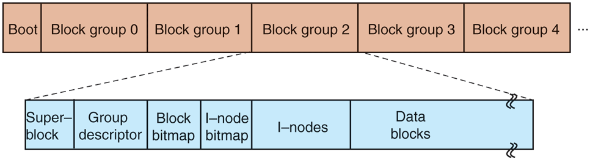
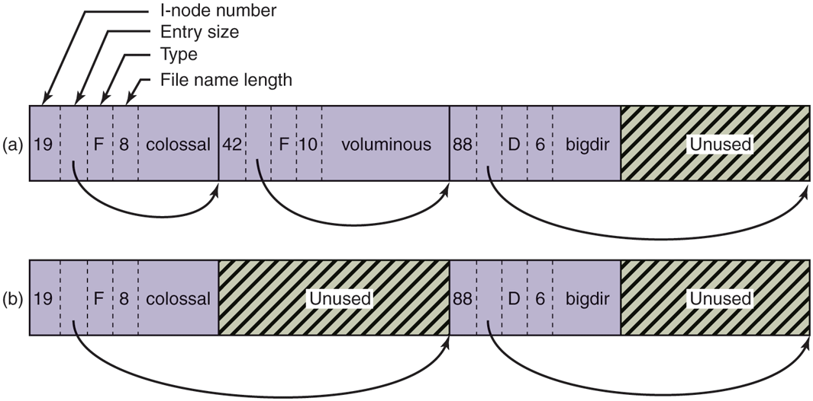

# MOS5 —— The Linux Ext4 File System(附 ext2 布局背景)
> 出处: [Modern Operating Systems 5th Edition §10.6.3 "The Linux Ext4 File System"](../../007.BOOKs/现代操作系统/Modern%20Operating%20Systems%205th%20Edition-PDF-01.pdf#page=810) 书页 781-782(PDF 810-811);ext2 布局背景在 [书页 775-778(PDF 804-807)](../../007.BOOKs/现代操作系统/Modern%20Operating%20Systems%205th%20Edition-PDF-01.pdf#page=804)。
>
> 关联笔记: [001.基于Inode的文件系统](001.基于Inode的文件系统/README.md) | [012.WAL预写日志在Linux文件系统中的实现-ext4与JBD2](012.WAL预写日志在Linux文件系统中的实现-ext4与JBD2.md)(JBD2 深入) | [010.MOS5-10.6-Linux文件系统精读](010.MOS5-10.6-Linux文件系统精读.md) | I/O 侧视角见 [015.Linux-IO系统全路径-从VFS到块设备驱动](015.Linux-IO系统全路径-从VFS到块设备驱动.md)

---

## 1. 背景:为什么 ext2 之后必须"日志化"

> "In order to prevent all data loss after system crashes and power failures, the ext2 file system would have to write out each data block to disk as soon as it was created. The latency incurred during the required disk-head seek operation would be so high that the performance would be intolerable. Therefore, writes are delayed, and changes may not be committed to disk for up to 30 sec, which is a very long time interval in the context of modern computer hardware."（为了防止系统崩溃和掉电后丢失全部数据，ext2 文件系统就得在每个数据块一创建时就把它们写出到磁盘。而这样所需的磁盘寻道延迟会高到性能无法忍受。因此写操作被推迟，变更可能长达 30 秒才提交到磁盘——以现代计算机硬件的尺度衡量，这是一个非常长的时间间隔。）<sup>[Modern Operating Systems 5th, 书页 781(PDF 810)](../../007.BOOKs/现代操作系统/Modern%20Operating%20Systems%205th%20Edition-PDF-01.pdf#page=810)</sup>

> "To improve the robustness of the file system, Linux relies on journaling file systems. Ext3, a successor of the ext2 file system, is an example of a journaling file system. Ext4, a follow-on of ext3, is also a journaling file system, but unlike ext3, it changes the block addressing scheme used by its predecessors, thereby supporting both larger files and larger overall file-system sizes. Today, it is considered to be the most popular among the Linux file systems."（为提升文件系统的健壮性，Linux 采用日志文件系统。ext3 是 ext2 的后继，是日志文件系统的一个例子；ext4 是 ext3 的后续，同样是日志文件系统，但与 ext3 不同，它改变了前代使用的块寻址方案，从而同时支持更大的文件和更大的整体文件系统容量。今天它被认为是 Linux 文件系统中最流行的一个。）<sup>[书页 781(PDF 810)](../../007.BOOKs/现代操作系统/Modern%20Operating%20Systems%205th%20Edition-PDF-01.pdf#page=810)</sup>

30 秒正是 Fig 10-22 中页缓存"脏块定期刷盘"的周期(见 [015 笔记](015.Linux-IO系统全路径-从VFS到块设备驱动.md))——**缓存的收益与崩溃一致性风险是同一枚硬币的两面**，日志就是化解后者代价最小的手段。

## 2. 日志文件系统基本思想

> "The basic idea behind a journaling file system is to maintain a journal, which describes all file-system operations in sequential order. By sequentially writing out changes to the file-system data or metadata (i-nodes, superblock, etc.), the operations do not suffer from the overheads of disk-head movement during random disk accesses. Eventually, the changes will be written out, committed, to the appropriate disk location, and the corresponding journal entries can be discarded. If a system crash or power failure occurs before the changes are committed, during restart the system will detect that the file system was not unmounted properly, traverse the journal, and apply the file-system changes described in the journal log."（日志文件系统的基本思想是维护一个日志，按顺序记录所有文件系统操作。把对文件系统数据或元数据(i-node、超级块等)的变更**顺序**写出，操作就不会遭受随机磁盘访问时的磁头移动开销。最终，变更会被写出、提交到合适的磁盘位置，相应的日志项随之废弃。如果变更提交前发生系统崩溃或掉电，重启时系统会检测到文件系统未被正确卸载，遍历日志并应用其中描述的文件系统变更。）<sup>[书页 781(PDF 810)](../../007.BOOKs/现代操作系统/Modern%20Operating%20Systems%205th%20Edition-PDF-01.pdf#page=810)</sup>

> "The journal is a file managed as a circular buffer. The journal may be stored on the same or a separate device from the main file system. Since the journal operations are not 'journaled' themselves, these are not handled by the same ext4 file system. Instead, a separate JBD (Journaling Block Device) is used to perform the journal read/write operations."（日志是一个按环形缓冲区管理的文件。它可以与主文件系统存放在同一设备或不同设备上。由于日志操作本身不再被"记日志"，它们不由同一个 ext4 文件系统处理，而是由一个独立的 JBD(Journaling Block Device)执行日志的读写操作。）<sup>[书页 781(PDF 810)](../../007.BOOKs/现代操作系统/Modern%20Operating%20Systems%205th%20Edition-PDF-01.pdf#page=810)</sup>

```text
        逻辑上:日志 = 环形缓冲区文件
 ┌────────────────────────────────────────────────┐
 │  T1  T2  T3  T4  T5  T6  T7 …(事务依序追加)      │
 └────────────────────────────────────────────────┘
    ▲已安全落盘,日志项可废弃      ▲checkpoint 点
    ◄────── 已提交 ──────────────┤◄── 正在写入(崩溃后从此重放)
 JBD2 独立于 ext4 处理日志 I/O: fs/jbd2/ ,日志结构 journal_s [include/linux/jbd2.h:766]
```

### 2.1 JBD 的三种数据结构

> "JBD supports three main data structures: log record, atomic operation handle, and transaction. A log record describes a low-level file-system operation, typically resulting in changes within a block. Since a system call such as write includes changes at multiple places—i-nodes, existing file blocks, new file blocks, list of free blocks, etc.—related log records are grouped in atomic operations. Ext4 notifies JBD of the start and end of system-call processing, so that JBD can ensure that either all log records in an atomic operation are applied, or none of them. Finally, primarily for efficiency reasons, JBD treats collections of atomic operations as transactions. Log records are stored consecutively within a transaction. JBD will allow portions of the journal file to be discarded only after all log records belonging to a transaction are safely committed to disk."（JBD 支持三种主要数据结构：日志记录、原子操作句柄和事务。日志记录描述一个低层文件系统操作，典型结果是某个块内的变更。由于 `write` 这样的系统调用会牵涉多处修改——i-node、既有文件块、新文件块、空闲块列表等——相关的日志记录被归组为**原子操作**。ext4 通知 JBD 系统调用处理的开始与结束，JBD 就能保证原子操作内的日志记录要么全部生效、要么全部不生效。最后，主要出于效率考虑，JBD 把原子操作的集合当作**事务**。日志记录在事务内连续存放。只有当属于一个事务的所有日志记录都安全提交到磁盘后，JBD 才允许日志文件的相应部分被废弃。）<sup>[书页 781(PDF 810)](../../007.BOOKs/现代操作系统/Modern%20Operating%20Systems%205th%20Edition-PDF-01.pdf#page=810)</sup>

```text
 层级: 事务(transaction) ⊇ 原子操作(handle) ⊇ 日志记录(record)
 ┌─ transaction T ────────────────────────────────────────┐
 │  ┌─ atomic op (write() 的全部修改) ──────────────────┐  │
 │  │ record: 修改 inode N        (块内变更)             │  │
 │  │ record: 修改位图块 B                              │  │
 │  │ record: 写数据块 D                                │  │
 │  └──────────────(全有 或 全无)────────────────────────┘  │
 │  ┌─ atomic op … ─┐                                      │
 └─────────────────────────────────────────────────────────┘
```

**内核对应**:`handle_t`(`jbd2_journal_start`/`jbd2_journal_stop`,ext4 每个 `ext4_journal_start` 包住一次系统调用内的所有元数据修改)、`transaction_t`、`journal_s`<sup>[include/linux/jbd2.h:766](../../000.SOURCE_CODE/003.LINUX-7.1.3/000.LINUX-7.1.3/include/linux/jbd2.h)</sup>;提交与恢复逻辑在 [fs/jbd2/](../../000.SOURCE_CODE/003.LINUX-7.1.3/000.LINUX-7.1.3/fs/jbd2)。与 WAL 语义(checkpoint/原子提交/崩溃恢复)的完整推导见 [012.WAL预写日志在Linux文件系统中的实现-ext4与JBD2](012.WAL预写日志在Linux文件系统中的实现-ext4与JBD2.md)。

### 2.2 记什么:全量 or 仅元数据

> "Since writing out a log entry for each disk change may be costly, ext4 may be configured to keep a journal of all disk changes, or only of changes related to the file-system metadata (the i-nodes, superblocks, etc.). Journaling only metadata gives less system overhead and results in better performance but does not make any guarantees against corruption of file data. Several other journaling file systems maintain logs of only metadata operations (e.g., SGI's XFS). In addition, the reliability of the journal can be further improved via checksumming."（为每个磁盘变更都写一条日志可能代价很高，因此 ext4 可以配置为记录全部磁盘变更，或只记录文件系统元数据(i-node、超级块等)相关的变更。只记元数据开销更小、性能更好，但对文件数据本身的损坏不作任何保证。其他一些日志文件系统也只维护元数据日志(如 SGI 的 XFS)。此外，日志的可靠性还可以通过校验和进一步提升。）<sup>[书页 781(PDF 810)](../../007.BOOKs/现代操作系统/Modern%20Operating%20Systems%205th%20Edition-PDF-01.pdf#page=810)</sup>

对应 mount 选项:`data=journal`(全量)/ `data=ordered`(默认,元数据日志+数据先落盘)/ `data=writeback`(仅元数据)。

## 3. ext4 的关键改动:extents

> "Key modification in ext4 compared to its predecessors is the use of extents. Extents represent contiguous blocks of storage, for instance 128 MB of contiguous 4-KB blocks vs. individual storage blocks, as referenced in ext2. Unlike its predecessors, ext4 does not require metadata operations for each block of storage. This scheme also reduces fragmentation for large files. As a result, ext4 can provide faster file system operations and support larger files and file system sizes. For instance, for a block size of 1 KB, ext4 increases the maximum file size from 16 GB to 16 TB, and the maximum file system size to 1 EB (Exabyte)."（与前辈们相比，ext4 的关键修改是使用**区段(extents)**。区段表示连续的存储块——比如 128 MB 连续的 4-KB 块——而 ext2 引用的是一个个单独的存储块。ext4 不再需要对每个存储块做元数据操作，这一方案也减少了大文件的碎片。结果是 ext4 提供更快的文件系统操作，并支持更大的文件与文件系统容量。例如块大小 1 KB 时，ext4 把最大文件从 16 GB 提升到 16 TB，最大文件系统提升到 1 EB(艾字节)。）<sup>[书页 781(PDF 810)](../../007.BOOKs/现代操作系统/Modern%20Operating%20Systems%205th%20Edition-PDF-01.pdf#page=810)</sup>

i-node 的 60 字节 Addr 字段(12 个直接块 + 3 个间接块指针)是 ext2 的寻址方案上限来源(1KB 块时单间接 256 项 → 文件上限 268 KB,双间接 ~64 MB,三间接 16 GB);ext4 用 extent 树替代:

```text
 ext2(间接块)                          ext4(extent 树,inode 60B Addr 字段复用)
 inode.Addr[0..11] ─► 数据块            inode.i_block ─► extent header
        Addr[12] ─► 单间接块(256项)                       └► extent index/leaf
        Addr[13] ─► 双间接(256²)                             └► extent: {逻辑起始块, 物理起始块, 连续块数≤2^15}
        Addr[14] ─► 三间接(256³) → 16GB 上限                 大文件=少量大 extent,连续落盘
```

内核实现:[fs/ext4/extents.c](../../000.SOURCE_CODE/003.LINUX-7.1.3/000.LINUX-7.1.3/fs/ext4/extents.c)(`ext4_ext_insert_extent` :1992、`ext4_ext_map_blocks`);挂载入口 `__ext4_fill_super`<sup>[fs/ext4/super.c:5334](../../000.SOURCE_CODE/003.LINUX-7.1.3/000.LINUX-7.1.3/fs/ext4/super.c)</sup>。

## 4. 附:ext2 磁盘布局与目录项(理解 ext4 兼容性的基线)

> "An ext2 Linux disk partition contains a file system with the layout shown in Fig. 10-31. Block 0 is not used by Linux and contains code to boot the computer. Following block 0, the disk partition is divided into groups of blocks."（一个 ext2 Linux 磁盘分区包含的文件系统布局如图 10-31。0 号块不被 Linux 使用，放着引导计算机的代码。0 号块之后，分区被划分为若干块组。）<sup>[书页 776(PDF 805)](../../007.BOOKs/现代操作系统/Modern%20Operating%20Systems%205th%20Edition-PDF-01.pdf#page=805)</sup>

原图(自书 EPUB 提取，未拉伸):


<sup>原图出自 [Modern Operating Systems 5th Edition, Fig. 10-31](../../007.BOOKs/现代操作系统/Modern%20Operating%20Systems%205th%20Edition-PDF-01.pdf#page=805)</sup>

Fig 10-31(ext2 磁盘布局)ASCII 重绘:

```text
 ┌──────┬───────────┬──────────────────────────────────────────┐
 │块0   │ 块组0      │ 块组1        块组2       …     块组N-1     │
 │引导码 │superblock │                                          │
 │(不用) │group descr│  每个块组内部结构:                         │
 └──────┴───────────┴──────────────────────────────────────────┘
            ┌───────────────────────────────────────────┐
            │ superblock(块数/i-node数/空闲块链起点)       │
            │ group descriptor(位图位置/空闲块与i-node数/  │
            │                 目录数——目录尽量均匀铺开)     │
            │ 块位图(1块) ── 1KB块 → 每组最多8192块         │
            │ i-node位图(1块)                              │
            │ i-nodes(每项128字节,从1编号)                 │
            │ 数据块(文件/目录;尽量与父目录同组+预分配8块)   │
            └───────────────────────────────────────────┘
```

> "Each directory entry … consists of four fixed-length fields and one variable-length field. The first field is the i-node number … Next comes a field rec_len, telling how big the entry is (in bytes) … Then comes the type field … The last fixed field is the length of the actual file name in bytes … Finally, comes the file name itself, terminated by a 0 byte and padded out to a 32-bit boundary."（每个目录项由四个定长字段和一个变长字段组成：i-node 号；rec_len(本项总长,含填充,用于跳到下一项);类型(文件/目录等);文件名长度;最后是文件名本身,以 0 字节结尾并填充到 32 位边界。）<sup>[书页 777(PDF 806)](../../007.BOOKs/现代操作系统/Modern%20Operating%20Systems%205th%20Edition-PDF-01.pdf#page=806)</sup>

原图(自书 EPUB 提取，未拉伸):


<sup>原图出自 [Modern Operating Systems 5th Edition, Fig. 10-32](../../007.BOOKs/现代操作系统/Modern%20Operating%20Systems%205th%20Edition-PDF-01.pdf#page=807)</sup>

Fig 10-32(目录项与删除后的复用)ASCII 重绘:

```text
 (a) 三个文件的目录                (b) 删除 voluminous 后
 ┌────────┬─────────┬──────────┬─┐   ┌───────────────┬──────────┬─┐
 │ino=19  │ino=42   │ino=88    │ │   │ino=19         │ino=88    │ │
 │rec_len │rec_len  │rec_len   │ │   │rec_len(扩大,  │rec_len   │ │
 │type=f  │type=f   │type=d    │ │   │原voluminous成 │type=d    │ │
 │nlen=8  │nlen=10  │nlen=6    │ │   │为填充)type=f  │nlen=6    │ │
 │colossal│volumino.│bigdir    │ │   │colossal       │bigdir    │ │
 └────────┴─────────┴──────────┴─┘   └───────────────┴──────────┴─┘
 (删除只改前一表项的 rec_len;填充空间可被后续表项复用)
```

> "An i-node contains accounting information (including all the information returned by stat …), as well as enough information to locate all the disk blocks that hold the file's data."（i-node 包含记账信息(包括 stat 返回的全部信息)以及足以定位该文件全部数据块的信息。）<sup>[书页 776(PDF 805)](../../007.BOOKs/现代操作系统/Modern%20Operating%20Systems%205th%20Edition-PDF-01.pdf#page=805)</sup>

i-node 关键字段(Fig 10-33 摘录):Mode(2B,类型+保护位+setuid/setgid)、Nlinks(2B)、Uid/Gid(2B+2B)、Size(4B)、**Addr(60B,前12个直接块地址+3个间接块)**、Gen(1B,复用计数)、Atime/Mtime/Ctime(4B×3)。内核态镜像即 `struct ext4_inode_info` 与磁盘 `ext4_inode`([fs/ext4/ext4.h](../../000.SOURCE_CODE/003.LINUX-7.1.3/000.LINUX-7.1.3/fs/ext4/ext4.h))。

> "Ext4 is designed to be highly compatible with ext2 and ext3, although its core data structures and disk layout are modified. Regardless, a file system which has been unmounted as an ext2 system can be subsequently mounted as an ext4 system and offer the journaling capability."（ext4 被设计得与 ext2/ext3 高度兼容，尽管核心数据结构与磁盘布局已被修改。一个按 ext2 卸载的文件系统随后可以直接按 ext4 挂载并获得日志能力。）<sup>[书页 781(PDF 810)](../../007.BOOKs/现代操作系统/Modern%20Operating%20Systems%205th%20Edition-PDF-01.pdf#page=810)</sup>

## 5. /proc 文件系统(同节彩蛋)

> "Another Linux file system is the /proc (process) file system, an idea originally devised in the 8th edition of UNIX from Bell Labs … The basic concept is that for every process in the system, a directory is created in /proc. The name of the directory is the process PID expressed as a decimal number. … In fact, these files do not exist on the disk. When they are read, the system retrieves the information from the actual process as needed and returns it in a standard format."（另一个 Linux 文件系统是 /proc(进程)文件系统，源自 Bell 实验室第 8 版 UNIX……基本概念是:系统里每个进程都在 /proc 下有以其十进制 PID 命名的目录……这些文件其实并不存在于磁盘上，读取时系统按需从真实进程取回信息并以标准格式返回。）<sup>[书页 782(PDF 811)](../../007.BOOKs/现代操作系统/Modern%20Operating%20Systems%205th%20Edition-PDF-01.pdf#page=811)</sup>

内核实现 [fs/proc/](../../000.SOURCE_CODE/003.LINUX-7.1.3/000.LINUX-7.1.3/fs/proc);扩展信息(CPU、分区、中断向量、模块等)即 `/proc/cpuinfo`、`/proc/interrupts` 之属——与 [021.进程管理/](../031.进程管理/README.md)、[038.系统监控](../038.系统监控/000.系统监控-学习资料索引.md) 笔记呼应。

## 6. 问题一:整个磁盘是怎么规划的?
> 参考课件: [中山大学《操作系统》2026 第十二周:文件系统 I](../001.操作系统课程/001.中山大学-操作系统2026/第十二周：文件系统%20I.pdf);MOS5 Fig 10-31(见上文 §4);内核源码 Linux 7.1.3。

课件把磁盘看成一维"块序列":

> 「如何用"块"来存储这些字符序列:如果一个视频文件大小为 4G,假设块大小为 4K,需要 1M 个块。」(文件 = 文件元数据 + 一串 4K 数据块;文件经常被修改,存储方案必须灵活。)<sup>[第十二周:文件系统 I, P23](../001.操作系统课程/001.中山大学-操作系统2026/第十二周：文件系统%20I.pdf#page=23)</sup>

在这个"块序列"上,从盘到字节一共有**四层规划**:

```text
 整块磁盘 /dev/sda                (块设备,gendisk [include/linux/blkdev.h:146])
 └─ 分区 partition ×N             (谁划的:fdisk/mkfs 之前;谁解析:block/partitions/
     │   /dev/sda1 /dev/sda2       MBR: [msdos.c] GPT: [efi.c:712 efi_partition])
     └─ 一个分区 = 一个文件系统实例   (ext4 挂载入口 __ext4_fill_super super.c:5334)
         ├─ 块 0:引导块(ext2/ext4 不用;x86 BIOS 引导代码;arm64+UEFI 下是 GPT 保护 MBR)
         ├─ 超级块 superblock       (字节偏移 1024 处:[EXT4_MIN_BLOCK_SIZE ext4.h:333])
         ├─ 块组描述符表              (每组一项:[ext4_get_group_desc balloc.c:265])
         └─ 块组 block group ×M      (MOS5 Fig 10-31:位图+inode表+数据块,见 §4)
              每块组 ≤ 8×块大小 个块(位图只有 1 块:4K 块 → 32768 块/组)
```

规划的全部参数记录在盘上**两个结构**里——超级块记全盘,组描述符记每组:

### 6.1 盘上"总账"的源码:ext4_super_block 与 ext4_group_desc

```c
/* fs/ext4/ext4.h:1329 —— 全盘自描述的"总账",挂载时从字节偏移 1024 读入 */
struct ext4_super_block {
/*00*/	__le32	s_inodes_count;		/* 全盘 inode 总数 */
	__le32	s_blocks_count_lo;	/* 全盘块总数 */
	__le32	s_free_blocks_count_lo;	/* 空闲块总数 */
	__le32	s_free_inodes_count;	/* 空闲 inode 总数 */
/*10*/	__le32	s_first_data_block;	/* 第一个数据块号:1K块=1(超级块占块1),其余=0 */
	__le32	s_log_block_size;	/* 块大小 = 1024 << 此值 [EXT4_BLOCK_SIZE ext4.h:341] */
/*20*/	__le32	s_blocks_per_group;	/* 每块组块数(≤ 8×块大小,受 1 块位图限制) */
	__le32	s_inodes_per_group;	/* 每块组 inode 数(mkfs -i 决定,课件 P32"比例可调") */
	...
/*CE*/	__le16	s_reserved_gdt_blocks;	/* 在线扩容预留的组描述符块数 */
/*E0*/	__le32	s_journal_inum;		/* 日志文件的 inode 号(默认 8) */
/*FE*/	__le16	s_desc_size;		/* 组描述符大小(64bit 特性 → 64 字节) */
};	/* 1024 字节,字段全为 __le 小端 → 盘上格式与体系结构无关 */
```

```c
/* fs/ext4/ext4.h:402 —— 每个块组一项,记录"本组的元数据放在哪些块" */
struct ext4_group_desc {
	__le32	bg_block_bitmap_lo;	/* 本组块位图所在块号 */
	__le32	bg_inode_bitmap_lo;	/* 本组 inode 位图所在块号 */
	__le32	bg_inode_table_lo;	/* 本组 inode 表起始块号 */
	__le16	bg_free_blocks_count_lo; /* 本组空闲块数 */
	__le16	bg_free_inodes_count_lo; /* 本组空闲 inode 数 */
	__le16	bg_used_dirs_count_lo;	 /* 本组目录数(目录尽量打散到各组,MOS5 书页 778) */
	/* … 64bit 特性:以上各 *_lo 字段后跟对应 *_hi 高位扩展 */
};
```

### 6.2 全盘布局 ASCII(4K 块为例)

```text
 块号 →     0                             1              2 … D             D+1 …
        ┌───────────────────────────────┬──────────────┬───────────────┬───────────────
        │ 块 0:引导块 + 超级块            │ 组描述符表    │ 保留 GDT       │ 块组 0 … 块组 ×M
        │  [0, 1024)   引导代码/保护MBR   │ ext4_group_  │ s_reserved_   │ (组内解剖见 6.3)
        │  [1024,2048) ext4_super_block  │ desc ×M 组   │ gdt_blocks 个 │
        │  [2048,4096) 空闲              │              │ 预留块(扩容)  │
        └───────────────────────────────┴──────────────┴───────────────┴───────────────
            ▲ 超级块永远位于字节偏移 1024:super.c:5131 sb_min_blocksize(EXT4_MIN_BLOCK_SIZE)
              先按 1K 读入再解析(块>1K 时它落在块 0 中部;块=1K 时独占块 1,
              此时 s_first_data_block=1)。组 1、3ⁿ、5ⁿ、7ⁿ 内另有 SB/GDT 备份
              (sparse_super 特性,其余组开头直接是位图)。
```

与 §4 的 MOS5 Fig 10-31(ext2)逐项对应,唯一演进是:**flex_bg 特性下多组的位图/inode 表可以集中打包存放,不再固定在本组开头**——因为组描述符的 `bg_*` 字段显式记录位置。"自描述"的价值正在于此:布局策略可以演进,盘上结构不变。

### 6.3 单个块组解剖 + 内核定位算术

```text
 一个块组(s_blocks_per_group ≤ 8×块大小;4K 块 → 最多 32768 块 = 128MB/组)
 组内块号    0              1             2 … 2+T                    T+2 …
        ┌──────────────┬─────────────┬──────────────────────────┬────────────────────
        │ 块位图(1块)  │ inode 位图   │ inode 表(T 块)            │ 数据块
        │ 1 bit/块     │ 1 bit/inode │ N 项×256B(mkfs 默认,     │ 文件/目录数据
        │              │             │ MOS5 书页 777 的 128B     │ (分配倾向:与父目录
        │              │             │ 是旧版)从 1 编号:        │  同组、连续成 extent)
        │              │             │  1=坏块表 2=根目录        │
        │              │             │  7=扩容 8=日志 …         │
        │              │             │  11=第一个可用 inode      │
        └──────────────┴─────────────┴──────────────────────────┴────────────────────
           ▲                ▲                ▲
 bg_block_bitmap_lo  bg_inode_bitmap_lo  bg_inode_table_lo —— 三块位置由组描述符显式给出
 [ext4.h:404]        [ext4.h:405]        [ext4.h:406]       (保留 inode 表见 ext4.h:313-323)
```

已知组号,内核把"第 N 组描述符"定位到内存 buffer 只需两步算术:

```c
/* fs/ext4/balloc.c:265 —— 组号 → 组描述符 */
struct ext4_group_desc *ext4_get_group_desc(struct super_block *sb,
					    ext4_group_t block_group, …)
{
	group_desc = block_group >> EXT4_DESC_PER_BLOCK_BITS(sb); /* 第几个描述符块 */
	offset     = block_group &  (EXT4_DESC_PER_BLOCK(sb) - 1);/* 块内第几项(4K/64B=64项) */
	desc = (struct ext4_group_desc *)((__u8 *)bh_p->b_data +
					  offset * EXT4_DESC_SIZE(sb));  /* 64B × 组内偏移 */
}
/* 相关公式:
 *   组首块号 = group_no × s_blocks_per_group + s_first_data_block
 *              [ext4_group_first_block_no ext4.h:2630]
 *   每描述符块容纳组数 EXT4_DESC_PER_BLOCK = 块大小 / s_desc_size [ext4.h:465] */
```

### 6.4 挂载时内核按序读出这些规划

```text
 mount -t ext4 /dev/sda2 /mnt
   └─► ext4_fill_super [super.c:5804] ─► __ext4_fill_super [super.c:5334]
        │ ① sb_min_blocksize(sb, EXT4_MIN_BLOCK_SIZE=1024) [super.c:5131]
        │    ── 先按 1K 读字节偏移 1024 处的 ext4_super_block,得 s_log_block_size
        │ ② 按 1024 << s_log_block_size 重设块大小,校验
        │    s_blocks_count_lo / s_inodes_count / s_blocks_per_group
        │ ③ ext4_group_desc_init [super.c:4892] 把组描述符表读入 sbi->s_group_desc[]
        │ ④ 此后一切按需:ext4_get_group_desc [balloc.c:265] 定位任意组的位图/inode 表
        ▼
      规划就位 —— 剩余工作只是把"位图 + inode 表"按需缓存进内存
```

三个值得展开的点:

1. **"规划"发生在 mkfs,不是 mount**:块大小(`mke2fs -b 4096` → `s_log_block_size`)、每组 inode 数(`-i bytes-per-inode`,呼应课件 P32 "比例是可调的")、是否日志、是否 extent,都写进超级块并终身有效;挂载(§6.4)只是照着盘上的账本读出来。
2. **自描述性**:块大小、组数、位图位置全部记录在盘上(超级块+组描述符),内核挂载时逐项读取——**不依赖体系结构**。arm64 与 x86 读同一块 ext4 盘结果一致(移动硬盘/U 盘跨平台场景),前提仅是端序一致(ext4 磁盘结构全为 `__le*` 小端)。
3. **arm64 的引导差异**:块 0 "引导代码"是 x86 BIOS 时代的遗产;arm64 + UEFI 启动时,引导程序(grub/systemd-boot)放在 **ESP(EFI 系统分区,FAT 格式)**,块 0 通常只是 GPT 的保护性 MBR——文件系统层的规划(ext4)完全不受影响。

## 7. 问题二:单个文件是如何存储的(与 inode 的关系)?
> 课件主线:文件太大数据块太多 → 指针数组不可行 → 分级索引(类比多级页表) → ext4 换成 extent。源码:`fs/ext4/`。

### 7.1 课件推导:为什么 inode 的指针要"分级"

> 「用 100 万个指针数组,指针长度 8 字节,数组共 8M 大小。」——inode = 文件元数据 + **连续的指针数组**,每个指针指向一个 4K 数据块。<sup>[第十二周:文件系统 I, P24](../001.操作系统课程/001.中山大学-操作系统2026/第十二周：文件系统%20I.pdf#page=24)</sup>

> 「和多级页表类似,用分级减少组织管理代价。」——4G 文件需要 100 万个指针,全部塞进 inode 不可行;于是 inode 里只放**索引块指针**,索引块(本身也是 4K 数据块)里再放数据块指针。<sup>[P25](../001.操作系统课程/001.中山大学-操作系统2026/第十二周：文件系统%20I.pdf#page=25)</sup>

推导的出发点是一对容量矛盾:

```text
        inode 是定长的(盘上 128/256B,MOS5 书页 777)        4G 文件的"理想指针数组"
 ┌─────────────────────────────────┐           ┌──────────────────────────────────┐
 │ 元数据(时间/大小/链接数…)         │    vs     │ 4G / 4K = 1,048,576 个指针         │
 │ + 固定的 60 字节寻址区(i_block)   │           │ × 8B = 8MB ≫ 60B —— 装不下         │
 └─────────────────────────────────┘           └──────────────────────────────────┘
   ⇒ 唯一出路:60B 里只放少量"索引块指针",索引块(普通 4K 数据块)里再放下一级指针
     —— 与多级页表同构:每层节点都是一块,叶子才指向真正的数据
```

课件模型的账目(假设:直接指针 12 个、间接指针 3 个、二级间接指针 1 个;指针 8 字节,索引块 4K → 512 项)<sup>[P26-P30](../001.操作系统课程/001.中山大学-操作系统2026/第十二周：文件系统%20I.pdf#page=26)</sup>:

| 层级 | 容量 | 计算课件原文 |
|-|-|---|
| 12 个直接指针 | 48K | 「12 个直接指针,每个指向 4K,总共 48K」P27 |
| 1 个间接指针 | 2M | 「每个指针 8 字节,索引块 4K 大小,总共有 512 个指针」「一个索引块能表示 4K×512=2M 数据」P28-P29 |
| 3 个间接指针 | 6M | 3 × 2M |
| 1 个二级间接指针 | 1G | 「1 个二级间接指针,指向二级索引块,表示 2M×512=1G 数据」P30 |
| **合计** | **48K + 6M + 1G** | 「48K + 6M + 1G;比例是可调的」P32 |

### 7.2 与 MOS5/ext2 的对照(同一思想,参数不同)

MOS5 的 ext2 i-node Addr 字段(60 字节 = 前 12 个直接块 + 3 个间接块,书页 777/PDF 806,见 §4)与课件同构;参数差异:

| 参数 | 课件模型 | ext2/ext3(MOS5) | 说明 |
|-|-|-|---|
| 直接指针 | 12 | 12 | `EXT4_NDIR_BLOCKS` = 12<sup>[fs/ext4/ext4.h:472](../../000.SOURCE_CODE/003.LINUX-7.1.3/000.LINUX-7.1.3/fs/ext4/ext4.h)</sup> |
| 指针宽度 | 8 字节 | 4 字节(`__le32`) | 磁盘块号 32 位 |
| 索引块项数 | 512(4K 块) | 256(1K 块)/1024(4K 块) | MOS5 书页 779 的 268KB/64MB/16GB 按 1KB 块算 |
| 最大文件 | 48K+6M+1G ≈ 1G | 16 GB(三重间接) | 同一公式不同参数 |

**磁盘上的实体**是 `struct ext4_inode.i_block[EXT4_N_BLOCKS]`<sup>[fs/ext4/ext4.h:817](../../000.SOURCE_CODE/003.LINUX-7.1.3/000.LINUX-7.1.3/fs/ext4/ext4.h)</sup>(`EXT4_N_BLOCKS = EXT4_TIND_BLOCK + 1 = 15`,ext4.h:476):`i_block[0..11]` 直接、`[12]` 单间接、`[13]` 双间接、`[14]` 三间接。画出来:

```text
          i_block: [0]…[11]      [12]             [13]                        [14]
                ┌────────────┬────────────────┬─────────────────────────┬─────────────────────────┐
   盘上内容      │ 12 个直接   │ 单间接:1 个     │ 双间接:1 个              │ 三间接:1 个              │
                │ 数据块号    │ 索引块号        │ 索引块号                 │ 索引块号                 │
                └─────┬──────┴───────┬────────┴────────────┬────────────┴──────────────┬──────────┘
                      ▼              ▼                     ▼                           ▼
                12 个数据块     4K 索引块               4K 索引块                    4K 索引块
                (48K@4K)      1024 项×4B 块号          1024 项──► 1024 个           1024 项──► 1024 个
                              ──► 1024 个数据块        单间接索引块(每个             双间接索引块(每个
                              (4M@4K)                 再→1024 数据块,4G@4K)        再→1024 单间接,4T@4K)

   容量@4K 块(索引块 1024 项):48K  +  4M  +  4G  +  4T
   容量@1K 块(索引块  256 项):12K  + 256K + 64M + 16G  ←— MOS5 "三重间接 16GB"上限(书页 779)
   注:课件模型(3 单间接 + 1 双间接,§7.1 表)是教学简化;ext2/ext4 真身是 12 直接 + 1/2/3 级各 1 个。
```

### 7.3 ext4 的现代化答案:extent(上文 §3 的展开)

间接块对大文件效率低(每 512/256 个块就要维护一层索引),ext4 把 `i_block[15]` 这 60 字节复用为 **extent 树**:

```c
// fs/ext4/ext4_extents.h:56-60
struct ext4_extent {
	__le32	ee_block;	/* 该 extent 覆盖的第一个"逻辑块号" */
	__le16	ee_len;		/* 覆盖的块数 */
	__le16	ee_start_hi;	/* 物理块号高 16 位 */
	__le32	ee_start_lo;	/* 物理块号低 32 位 */
};  /* 一个 extent = (逻辑块号, 物理块号, 连续块数) → 最多 2^15 块连续 = 128MB(4K 块) */
```

**树的第一级就在 inode 里**:60 字节 `i_block` = `ext4_extent_header`(12B<sup>[ext4_extents.h:76](../../000.SOURCE_CODE/003.LINUX-7.1.3/000.LINUX-7.1.3/fs/ext4/ext4_extents.h)</sup>)+ 4 × `ext4_extent`(12B),根容量恰为 4 项——`ext4_ext_space_root()` [fs/ext4/extents.c:303] 算的就是 (60−12)/12 = 4:

```text
 例 A:512MB 文件(4K 块)→ 4 个 128MB extent,整棵树塞进 inode,0 个额外元数据块

 ┌ header(ext4_extents.h:76)──┐  ┌ ext4_extent × 4(ext4_extents.h:56)──────────────────┐
 │ eh_magic=0xf30a            │  │ [0] ee_block=     0 ─► ee_start=   1024, ee_len=32768│
 │ eh_entries=4   eh_max=4    │  │ [1] ee_block= 32768 ─► ee_start=  40960, ee_len=32768│
 │ eh_depth=0(叶即根)         │  │ [2] ee_block= 65536 ─► ee_start=  61440, ee_len=32768│
 └────────────────────────────┘  │ [3] ee_block= 98304 ─► ee_start= 102400, ee_len=32768│
                                 └──────────────────────────────────────────────────────┘
   len 上限 2^15 = 32768 块(EXT_INIT_MAX_LEN ext4_extents.h:149)→ 4 × 128MB = 512MB
```

超过 4 个 extent 时根分裂,长出叶子块——索引项 `ext4_extent_idx`(12B:`ei_block` 子树最小逻辑块号 + `ei_leaf_lo/hi` 下层物理块号,ext4_extents.h:68):

```text
 例 B:1GB 文件 = 262,144 个 4K 块 = 8 个 128MB extent > 4 项 → 树长高到 depth=1

 inode.i_block(根,60B)                        叶子块(盘上普通 4K 块,可容纳 ~340 项)
 ┌ header: eh_entries=2, eh_max=4,   ┐         ┌ 叶#0(覆盖 lblk 0~131071)──────────────┐
 │         eh_depth=1                │         │ extent[0] lblk      0 ─► pblk   1024  │
 ├ idx[0] ei_block=     0 ───────────────► 叶#0 │           len 32768(128MB 连续)       │
 ├ idx[1] ei_block=131072 ───────────────► 叶#1 │ extent[3] lblk  98304 ─► pblk 102400  │
 └ (idx[2]/idx[3] 空闲)              │         ├ 叶#1(覆盖 lblk 131072~262143)─────────┤
                                     │         │ … 4 个 extent 至 lblk 262143           │
      ext4_extent_idx(12B/项)        │         └────────────────────────────────────────┘
      ei_block = 子树最小逻辑块号     │
      ei_leaf_lo/hi = 下层物理块号    │         1GB 间接块方案要读 ~257 个索引块(12+1+1+255
                                    │         个双间接区索引块);extent 方案 ≤ 1 个叶块
 树高 ≤ 5(EXT4_MAX_EXTENT_DEPTH ext4_extents.h:87)——两级已覆盖 TB 级文件
```

| 维度 | 课件/间接块模型 | ext4 extent |
|-|-|---|
| 记录粒度 | 1 块/指针 | 一段连续块/extent(≤128MB) |
| 大文件元数据量 | 每块 1 指针,层层索引块 | 1G 文件 ≈ 8 个 128MB extent |
| 1GB 文件要读的元数据块 | ~257 个索引块(双间接区) | ≤1 个叶子块(树根就在 inode 里) |
| 与页表的类比 | 多级页表(P25) | 更像"段表":基址+长度 |

**读路径串起来**(`read()` → 页缓存缺页 → 逻辑块号翻译成物理块号 → bio 下发):

```text
 read() 命中文件偏移 150MB 处(lblk = 150MB / 4K = 38400)
   ▼
 ext4_map_blocks [fs/ext4/inode.c:701]   ← "逻辑块号→物理块号"的唯一翻译点
   └─► ext4_ext_map_blocks [fs/ext4/extents.c:4269](extent 文件;老文件走 ext4_ind_map_blocks)
        └─ ext4_find_extent(lblk=38400):根 idx 二分 → 叶项
            命中 例A 的 extent[1]:ee_block=32768, ee_len=32768, ee_start=40960
            pblk = ee_start + (lblk − ee_block) = 40960 + (38400 − 32768) = 46592
   ▼
 map.m_pblk=46592 → 构造 bio → 块层(052.INPUT_OUTPUT)——extent 内连续块共享同一次寻道
```

**与 inode 的关系一句话**:inode 不是文件数据的容器,而是文件的**元数据 + 数据块索引**;数据散在数据块里,inode 持有找到它们的全部线索。课件 P31 的思考题(inode 索引 vs 页表差异)可从三方面回答:①连续性——页表映射的 VA 空间连续,inode 数据块任意离散;②生命周期——页表随进程创建/销毁、驻内存,inode 持久在盘上、按需读入;③数据结构——多级页表每级固定 512 项、层级固定,extent 树高度可变且节点是"范围"而非"单块"。

### 7.4 arm64 落点

arm64 页大小常见 4K(可配 16K/64K):块大小配 4K 时,一个数据块恰好等于一页缓存页——`read()` 缺页调入 1 块 = 1 页;若内核页 64K 而 ext4 块 4K,一页缓存聚合 16 块,`address_space` 的读聚合(readahead)按页而非块进行(见 [015 Fig 10-22 笔记](015.Linux-IO系统全路径-从VFS到块设备驱动.md))。课件"块=4K"的直觉在 arm64 4K 页配置下精确成立。

## 8. 问题三:目录和文件是如何组织的?

> 「目录就是一张有名字→inode 号映射的表」是课件更早给出的直观模型;ext4 里它的实体如下。

### 8.1 目录也是文件:内容是目录项数组

目录在磁盘上就是一个带 `S_IFDIR` 类型的 inode,其"数据块"里装的是**线性目录项数组**——`struct ext4_dir_entry_2`<sup>[fs/ext4/ext4.h:2418](../../000.SOURCE_CODE/003.LINUX-7.1.3/000.LINUX-7.1.3/fs/ext4/ext4.h)</sup>:

```c
struct ext4_dir_entry_2 {
	__le32	inode;       /* 该名字指向的 inode 号 —— 名字↔inode 的映射本体 */
	__le16	rec_len;     /* 本项总长(含填充):跳到下一项的唯一依据 */
	__u8	name_len;    /* 名字长度 */
	__u8	file_type;   /* EXT4_FT_REG_FILE / EXT4_FT_DIR / … */
	char	name[EXT4_NAME_LEN];   /* 名字本体,变长 */
};
```

与 §4 的 Fig 10-32 重绘对应:**删除文件 = 把前一项的 `rec_len` 扩到吞掉被删项**(填充空间可复用),inode 本身要等 `links_count` 归零才释放。

### 8.2 打开一个文件的完整组织链

```text
 open("/usr/ast/file")
   │ VFS: 路径逐段解析(dentry cache 命中则跳过盘上查找,[fs/dcache.c])
   ▼
 / 的 inode(号 2,挂载时从超级块读出)
   │ 读其"数据块"(=目录项数组),线性/htree 查找名字 "usr"
   ▼ 得 inode 号 ──► 读 inode 表第 N 项 ──► /usr 的 inode
   │        └── 目录查找:[__ext4_find_entry fs/ext4/namei.c:1517]
   ▼ 重复:ast → file
 file 的 inode ──► i_block/extent 树 ──► 数据块(§7)
```

- **线性查找的扩展**:目录项从头到尾 `rec_len` 串联;大目录用 **htree**(目录哈希树)把线性查找降为对数级——`dx_probe()`<sup>[fs/ext4/namei.c:778](../../000.SOURCE_CODE/003.LINUX-7.1.3/000.LINUX-7.1.3/fs/ext4/namei.c)</sup> 按文件名哈希走 B 树索引块。
- **VFS 层加速**:路径各段(dentry)缓存于 dentry_cache;重复 open 同一路径不再碰盘(见 [015.Linux-IO系统全路径-从VFS到块设备驱动](015.Linux-IO系统全路径-从VFS到块设备驱动.md) 的 VFS 四对象表)。

### 8.3 目录与文件的三种"组织关系"

| 关系 | 机制 | 磁盘/内存表现 |
|-|-|---|
| 一对一(常规) | 目录项 `inode` 字段指向独占 inode | `ls -i` 每行一个 inode 号 |
| 多对一(硬链接) | 多个目录项写同一 inode 号,`i_links_count` 计数 | 删一个名字只是 `links_count--`;归零才回收 inode+数据块 |
| 一对多(子目录) | 子目录 inode 的数据块里默认含 `.`(指自己)与 `..`(指父目录)两项 | 目录树由 `..` 链向上、目录项链向下构成 |

符号链接是第 4 种:快速符号链接直接把目标路径存在 inode 的数据区,否则占一个数据块——详见本目录 [007.符号链接和硬链接](007.符号链接和硬链接.md)。

**arm64/体系结构注**:目录格式同样是磁盘自描述、小端定长字段,与体系结构无关;目录的组织(线性+htree)在 arm64 与 x86 上逐字节一致。唯一与平台沾边的是 dentry/inode 缓存的内存布局(随 `long` 宽度与配置变化),不影响磁盘格式。

## 参考资料
- [Modern Operating Systems 5th Edition §10.6.3 The Linux File System](../../007.BOOKs/现代操作系统/Modern%20Operating%20Systems%205th%20Edition-PDF-01.pdf#page=803)(ext2 布局 #page:804-807,Ext4 #page:810-811,/proc #page:811)
- [中山大学《操作系统》2026 第十二周:文件系统 I(P23-P32 inode 数据索引方式)](../001.操作系统课程/001.中山大学-操作系统2026/第十二周：文件系统%20I.pdf#page=23)
- Linux 7.1.3 源码: [fs/ext4/](../../000.SOURCE_CODE/003.LINUX-7.1.3/000.LINUX-7.1.3/fs/ext4) · [fs/jbd2/](../../000.SOURCE_CODE/003.LINUX-7.1.3/000.LINUX-7.1.3/fs/jbd2) · [fs/proc/](../../000.SOURCE_CODE/003.LINUX-7.1.3/000.LINUX-7.1.3/fs/proc) · [block/partitions/](../../000.SOURCE_CODE/003.LINUX-7.1.3/000.LINUX-7.1.3/block/partitions)
- 仓库深潜: [012.WAL预写日志在Linux文件系统中的实现-ext4与JBD2](012.WAL预写日志在Linux文件系统中的实现-ext4与JBD2.md)
