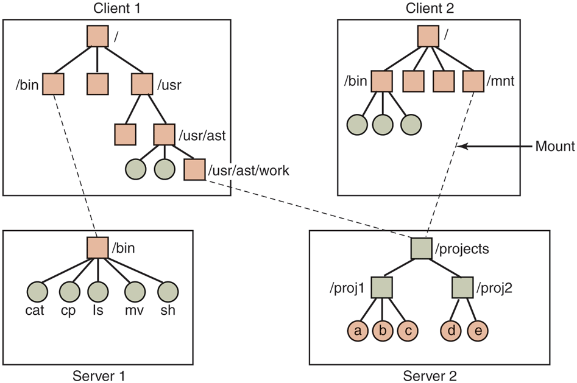
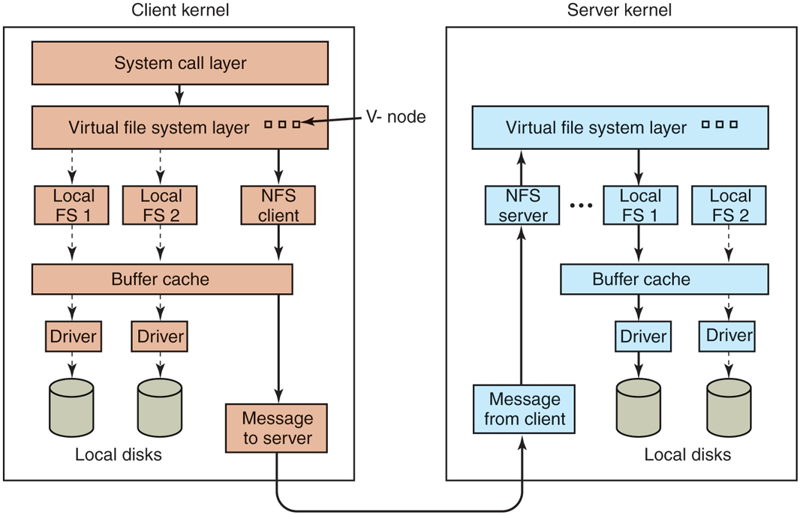

# MOS5 §10.6.4 NFS: The Network File System
> 出处: [Modern Operating Systems 5th Edition §10.6.4 NFS](../../007.BOOKs/现代操作系统/Modern%20Operating%20Systems%205th%20Edition-PDF-01.pdf#page=812) 书页 783-789(PDF 812-818)。NFSv3 1994 年引入,现行版本 NFSv4(2000 年提出)。
>
> 关联笔记: [039.网络协议栈与系统实现](../039.网络协议栈与系统实现/README.md) | [002.虚拟文件系统](002.虚拟文件系统/README.md)(v-node/VFS 层) | [013.MOS5-Ext4文件系统](013.MOS5-Ext4文件系统.md) | RPC 层见 [013.UNIX-NET](../../013.UNIX-NET/README.md)

---

## 1. NFS 架构:把多台机器的文件系统拼成一个逻辑整体

> "The basic idea behind NFS is to allow an arbitrary collection of clients and servers to share a common file system. In many cases, all the clients and servers are on the same LAN, but this is not required. ... Each NFS server exports one or more of its directories for access by remote clients. When a directory is made available, so are all of its subdirectories, so actually entire directory trees are normally exported as a unit. The list of directories a server exports is maintained in a file, often /etc/exports."（NFS 的基本思想是允许任意一组客户机和服务器共享一个公共文件系统。多数情况下客户机与服务器在同一局域网内，但这不是必需的……每个 NFS 服务器把它的一个或多个目录**导出(export)**给远程客户机访问；目录被开放时其所有子目录一并开放，因此实际上通常以整棵目录树为单位导出。服务器导出的目录列表维护在一个文件中，通常是 /etc/exports。）<sup>[Modern Operating Systems 5th, 书页 783(PDF 812)](../../007.BOOKs/现代操作系统/Modern%20Operating%20Systems%205th%20Edition-PDF-01.pdf#page=812)</sup>

> "Clients access exported directories by mounting them. When a client mounts a (remote) directory, it becomes part of its directory hierarchy, as shown in Fig. 10-35."（客户机通过**挂载**来访问被导出的目录。远程目录被挂载后，就成为客户机目录层次的一部分，如图 10-35。）<sup>[书页 783(PDF 812)](../../007.BOOKs/现代操作系统/Modern%20Operating%20Systems%205th%20Edition-PDF-01.pdf#page=812)</sup>

原图(自书 EPUB 提取，未拉伸):


<sup>原图出自 [Modern Operating Systems 5th Edition, Fig. 10-35](../../007.BOOKs/现代操作系统/Modern%20Operating%20Systems%205th%20Edition-PDF-01.pdf#page=813)</sup>

Fig 10-35(远程挂载示例;方块=目录,圆圈=文件)ASCII 重绘:

```text
      Client 1                                         Client 2
 ┌────────────────────────────────┐             ┌────────────────────────┐
 │              [/]               │             │          [/]           │
 │           /       \            │             │      /       \         │
 │     [/bin]      [/usr]         │             │   [/bin]    [/mnt]     │ ◄── Mount
 │      ○○○          │            │             │    ○○○        ┊        │
 │               [/usr/ast]       │             │               ┊        │
 │                   │            │             │               ┊        │
 │             [/usr/ast/work]    │             │               ┊        │
 └────────┬─────────┬─────────────┘             └───────────────┬────────┘
          ┆         ┆                                           ┆
          ┆         └┄┄┄┄┄┄┄┄┄┄┄┄┄┄┄┄┄┄┄┄┄┄┄┄┄┄┄┄┄┄┄┐       ┌┄┄┄┘
 ┌────────▼─────────────┐               ┌───────────▼───────▼──────────┐
 │        [/bin]        │               │           [/projects]        │
 │ ○cat○cp○ls○mv○sh     │               │            /      \          │
 │       (Server 1)     │               │   [/proj1]          [/proj2] │
 └──────────────────────┘               │                              │
                                        │    ○a○b○c            ○d○e    │
                                        │         (Server 2)           │
                                        └──────────────────────────────┘
 同一文件 a:客户机1 经 /usr/ast/work/proj1/a 访问 ↔ 客户机2 经 /mnt/proj1/a 访问(书页 784 正文)
 (方块=目录,圆圈=文件;┄┄虚线=远程挂载关系;◄── Mount 箭头=挂载动作;要素与原图一一对应,无虚构)
```

> "the same file can have different names on different clients due to its being mounted in a different place in the respective trees. The mount point is entirely local to the clients; the server does not know where it is mounted on any of its clients."（同一个文件因挂载点不同，在不同客户机上的名字不同。挂载点完全是客户机本地的事；服务器并不知道自己的目录被挂到了哪台客户机的哪个位置。）<sup>[书页 784(PDF 813)](../../007.BOOKs/现代操作系统/Modern%20Operating%20Systems%205th%20Edition-PDF-01.pdf#page=813)</sup>

## 2. NFS 协议:两个协议 + 无状态

> "NFS accomplishes this goal by defining two client-server protocols."（NFS 通过定义两个客户-服务器协议来实现异构系统的目标。）<sup>[书页 785(PDF 814)](../../007.BOOKs/现代操作系统/Modern%20Operating%20Systems%205th%20Edition-PDF-01.pdf#page=814)</sup>

### 2.1 挂载协议

> "The first NFS protocol handles mounting. A client can send a path name to a server and request permission to mount that directory somewhere in its directory hierarchy. ... If the path name is legal and the directory specified has been exported, the server returns a file handle to the client. The file handle contains fields uniquely identifying the file-system type, the disk, the i-node number of the directory, and security information."（第一个协议处理挂载。客户机把路径名发给服务器，请求把该目录挂载到自己层次中的某处……如果路径名合法且目录已导出，服务器返回一个**文件句柄(file handle)**给客户机。句柄中包含唯一标识文件系统类型、磁盘、目录 i-node 号以及安全信息的字段。）<sup>[书页 785(PDF 814)](../../007.BOOKs/现代操作系统/Modern%20Operating%20Systems%205th%20Edition-PDF-01.pdf#page=814)</sup>

> "When Linux boots, it runs the /etc/rc shell script before going multiuser. Commands to mount remote file systems can be placed in this script ... Alternatively, most versions of Linux also support automounting. This feature allows a set of remote directories to be associated with a local directory. None of these remote directories are mounted (or their servers even contacted) when the client is booted. Instead, the first time a remote file is opened, the operating system sends a message to each of the servers. The first one to reply wins, and its directory is mounted."（Linux 引导时先运行 /etc/rc 再进入多用户，远程挂载命令可以放进该脚本……另外大多数 Linux 版本还支持**自动挂载(automounting)**：把一组远程目录关联到一个本地目录；引导时一个都不挂载(甚至不去联系服务器)，而第一次打开远程文件时，操作系统向每台服务器发消息，**先应答者胜出**，其目录被挂载。）<sup>[书页 785(PDF 814)](../../007.BOOKs/现代操作系统/Modern%20Operating%20Systems%205th%20Edition-PDF-01.pdf#page=814)</sup>

自动挂载的两个优点(原文大意):服务器宕机不阻塞客户机启动;并行试探多台服务器带来容错(只需一台在线)与性能(选最先应答者,大概率最空闲)。代价是假定候选文件系统内容一致——NFS 不做复制,所以自动挂载多用于只读的系统二进制类目录。autofs 的内核侧实现见 [fs/autofs/](../../000.SOURCE_CODE/003.LINUX-7.1.3/000.LINUX-7.1.3/fs/autofs)。

### 2.2 文件/目录访问协议:为何没有 open/close

> "The second NFS protocol is for directory and file access. Clients can send messages to servers to manipulate directories and read and write files. ... Most Linux system calls are supported by NFS, with the perhaps surprising exceptions of open and close. The omission of open and close is not an accident. It is fully intentional."（第二个协议处理目录与文件访问。客户机向服务器发消息来操作目录、读写文件，也能访问文件属性……大多数 Linux 系统调用被 NFS 支持，但也许令人意外的是没有 open 和 close。这个遗漏不是疏忽，而是完全刻意的。）<sup>[书页 785(PDF 814)](../../007.BOOKs/现代操作系统/Modern%20Operating%20Systems%205th%20Edition-PDF-01.pdf#page=814)</sup>

> "Instead, to read a file, a client sends the server a lookup message containing the file name, with a request to look it up and return a file handle ... Each such message is self-contained. The advantage of this scheme is that the server does not have to remember anything about open connections in between calls to it. Thus if a server crashes and then recovers, no information about open files is lost, because there is none. A server like this that does not maintain state information about open files is said to be stateless."（读文件时，客户机发给服务器一条 lookup 消息(含文件名)，请求查找并返回文件句柄……每条消息都是自包含的。这样设计的好处是服务器不必在两次调用之间记住任何与打开连接有关的信息。服务器崩溃重启后不会丢失任何"打开文件"信息——因为根本没有这种信息。这种不维护打开文件状态信息的服务器称为**无状态(stateless)**服务器。）<sup>[书页 785(PDF 814)](../../007.BOOKs/现代操作系统/Modern%20Operating%20Systems%205th%20Edition-PDF-01.pdf#page=814)</sup>

> "Unfortunately, the NFS method makes it difficult to achieve the exact Linux file semantics. For example, in Linux a file can be opened and locked so that other processes cannot access it. When the file is closed, the locks are released. In a stateless server such as NFS, locks cannot be associated with open files, because the server does not know which files are open. NFS therefore needs a separate, additional mechanism to handle locking."（遗憾的是，NFS 的方法难以完全复刻 Linux 文件语义。例如 Linux 中文件可以被打开并加锁，关闭时锁随之释放；而无状态服务器不知道哪些文件被打开，锁无法与打开文件关联，因此 NFS 需要一个单独的附加机制来处理锁。）<sup>[书页 785(PDF 814)](../../007.BOOKs/现代操作系统/Modern%20Operating%20Systems%205th%20Edition-PDF-01.pdf#page=814)</sup>

> "NFS uses the standard UNIX protection mechanism, with the rwx bits ... Originally, each request message simply contained the user and group IDs of the caller, which the NFS server used to validate the access. In effect, it trusted the clients not to cheat. ... Currently, public key cryptography can be used to establish a secure key for validating the client and server on each request and reply."（NFS 使用标准 UNIX 保护机制(rwx 位)……最初每条请求只携带调用者的 UID/GID,服务器据此校验——等于信任客户端不作弊……现在可用公钥密码为每对请求/应答建立安全密钥校验客户端与服务器。）<sup>[书页 785(PDF 814)](../../007.BOOKs/现代操作系统/Modern%20Operating%20Systems%205th%20Edition-PDF-01.pdf#page=814)</sup>

内核侧文件句柄:`struct nfs_fh`(include/linux/nfs_fs.h);无状态→有状态的协议演化见 §4。

## 3. NFS 实现:三层结构与 v-node/r-node

> "Although the implementation of the client and server code is independent of the NFS protocols, most Linux systems use a three-layer implementation similar to that of Fig. 10-36. The top layer is the system-call layer. This handles calls like open, read, and close. After parsing the call and checking the parameters, it invokes the second layer, the Virtual File System (VFS) layer."（客户机与服务器代码的实现独立于 NFS 协议，大多数 Linux 系统采用类似图 10-36 的三层实现。顶层是系统调用层，处理 open/read/close 等调用；解析并检查参数后，调用第二层——虚拟文件系统(VFS)层。）<sup>[书页 786(PDF 815)](../../007.BOOKs/现代操作系统/Modern%20Operating%20Systems%205th%20Edition-PDF-01.pdf#page=815)</sup>

原图(自书 EPUB 提取，未拉伸):


<sup>原图出自 [Modern Operating Systems 5th Edition, Fig. 10-36](../../007.BOOKs/现代操作系统/Modern%20Operating%20Systems%205th%20Edition-PDF-01.pdf#page=816)</sup>

Fig 10-36(NFS 三层结构)ASCII 重绘:

```text
          Client kernel                                 Server kernel
┌──────────────────────────────────────┐    ┌─────────────────────────────────────┐
│         ┌─────────────────┐          │    │                                     │ (服务器侧无 System call layer,原图如此)
│         │System call layer│          │    │                                     │
│         └─────────────────┘          │    │                                     │
│                  │                   │    │                                     │
│ ┌────────────────▼──────────────┐    │    │ ┌──────────────────────────────┐    │
│ │ Virtual file system layer []  │    │    │ │ Virtual file system layer [] │    │ ◄─ V-node(小方块=v-node)
│ └───────────────────────────────┘    │    │ └────▲───────────▲───────────▲─┘    │
│      ┆           ┆          ┆        │    │      ┆           ┆           ┆      │
│ [Local FS 1][Local FS 2][NFS client] │    │ [NFS server][Local FS 1][Local FS 2]│
│      ┆           ┆          │        │    │      │           ┆           ┆      │
│  ┌───▼───────────▼───────┐  │        │    │      │  ┌────────▼───────────▼──┐   │
│  │      Buffer cache     │  │        │    │      │  │      Buffer cache     │   │
│  └───────────────────────┘  │        │    │      │  └───────────────────────┘   │
│       │               │     │        │    │      │       │            │         │
│    [Driver]        [Driver] │        │    │      │    [Driver]     [Driver]     │
│       ▼               ▼     │        │    │      │       ▼            ▼         │
│    (disk)          (disk)   │        │    │      │    (disk)       (disk)       │
│   Local disks               │        │    │      │   Local disks                │
│                   ┌─────────┬───────┐│    │┌─────┬─────────────┐                │
│                   │Message to server│─────►│Message from client│                │
│                   └─────────────────┘│    │└───────────────────┘                │
└──────────────────────────────────────┘    └─────────────────────────────────────┘
 图例:框线/实线箭头为原图要素;虚线 ┆ 为原图 dotted 线(本地 FS 与 NFS client 汇入 Buffer cache,v-node 经虚线
 指向各 FS 的 i-node/r-node);Message to server ↔ Message from client 即 RPC 消息通道(网络)。服务器侧无系统调用层,
 客户机侧有(原图如此);v-node/r-node ↔ 7.1.3: struct inode / struct nfs_inode(nfs_fs.h:147)。
```

> "The task of the VFS layer is to maintain a table with one entry for each open file. ... V-nodes are used to tell whether the file is local or remote. ... The kernel then constructs a v-node for the remote directory and asks the NFS client code ... to create an r-node (remote i-node) in its internal tables to hold the file handle. The v-node points to the r-node."（VFS 层为每个打开文件维护一个表项……v-node 用来判断文件是本地的还是远程的……内核为远程目录构造 v-node，并让 NFS 客户端代码在其内部表中创建一个 **r-node(远程 i-node)** 来保存文件句柄，v-node 指向 r-node。）<sup>[书页 786-787(PDF 815-816)](../../007.BOOKs/现代操作系统/Modern%20Operating%20Systems%205th%20Edition-PDF-01.pdf#page=815)</sup>

**内核对应(Linux 7.1.3)**:书中"v-node"即现代 Linux 的 `struct inode`,"r-node"即 `struct nfs_inode`<sup>[include/linux/nfs_fs.h:147](../../000.SOURCE_CODE/003.LINUX-7.1.3/000.LINUX-7.1.3/include/linux/nfs_fs.h)</sup>(`NFS_I(inode)` 经 container_of 从 VFS inode 取回);客户端挂载/超级块在 [fs/nfs/super.c](../../000.SOURCE_CODE/003.LINUX-7.1.3/000.LINUX-7.1.3/fs/nfs/super.c)(`nfs_get_root` :1341)、服务端守护在 [fs/nfsd/](../../000.SOURCE_CODE/003.LINUX-7.1.3/000.LINUX-7.1.3/fs/nfsd)(`nfsd_svc` :751)。

> "For efficiency reasons, transfers between client and server are done in large chunks, normally 8192 bytes, even if fewer bytes are requested. ... After the client's VFS layer has gotten the 8-KB chunk it asked for, it automatically issues a request for the next chunk ... This feature, known as read ahead, improves performance considerably."（出于效率，客户机与服务器之间按大块传输，通常 8192 字节，即使请求的字节数更少……客户机 VFS 层拿到所要的 8-KB 块后，会自动发出下一块的请求——即**预读(read ahead)**，可显著提升性能。）<sup>[书页 788(PDF 817)](../../007.BOOKs/现代操作系统/Modern%20Operating%20Systems%205th%20Edition-PDF-01.pdf#page=817)</sup>

内核形态:`struct nfs_server` 里的 `rsize`/`wsize`(默认 4KB~1MB 可调,NFSv3+ 协商)<sup>[include/linux/nfs_fs_sb.h:141](../../000.SOURCE_CODE/003.LINUX-7.1.3/000.LINUX-7.1.3/include/linux/nfs_fs_sb.h)</sup>;预读挂到页缓存 readahead 框架 `nfs_readahead`<sup>[fs/nfs/file.c:620](../../000.SOURCE_CODE/003.LINUX-7.1.3/000.LINUX-7.1.3/fs/nfs/file.c)</sup>。写方向同理:不足一块先在客户端累积,凑满 8KB(实际为 wsize)再发;文件关闭时全部立即刷给服务器。

### 3.1 客户端缓存与一致性

> "Clients maintain two caches, one for file attributes (i-nodes) and one for file data. ... Suppose that two clients are both caching the same file block and one of them modifies it. When the other one reads the block, it gets the old (stale) value. The cache is not coherent."（客户机维护两个缓存：文件属性(i-node)缓存与文件数据缓存……两个客户机缓存同一文件块,其中一个修改后,另一个读到旧值——缓存不一致。）<sup>[书页 788(PDF 817)](../../007.BOOKs/现代操作系统/Modern%20Operating%20Systems%205th%20Edition-PDF-01.pdf#page=817)</sup>

> "For one, associated with each cache block is a timer. When the timer expires, the entry is discarded. Normally, the timer is 3 sec for data blocks and 30 sec for directory blocks. In addition, whenever a cached file is opened, a message is sent to the server to find out when the file was last modified. If the last modification occurred after the local copy was cached, the cache copy is discarded and the new copy fetched from the server. Finally, once every 30 sec a cache timer expires, and all the dirty (i.e., modified) blocks in the cache are sent to the server."（其一，每个缓存块带一个定时器，到期即丢弃条目——数据块通常 3 秒、目录块 30 秒。其二，每次打开被缓存的文件都向服务器查询最后修改时间，若晚于本地缓存时间则丢弃本地副本重新拉取。其三，每 30 秒一次，把缓存中所有脏块发回服务器。这些补丁虽不完美，但让系统在大多数实际场景下高度可用。）<sup>[书页 788(PDF 817)](../../007.BOOKs/现代操作系统/Modern%20Operating%20Systems%205th%20Edition-PDF-01.pdf#page=817)</sup>

| 机制 | 参数 | 目的 |
|-|-|---|
| 缓存条目定时器 | 数据块 3s / 目录块 30s | 限制"陈旧窗口" |
| 打开时重验(atime 查询) | 每次打开 | 打开点强制与服务器对齐 |
| 定期回写脏块 | 30s | 缩小丢失窗口,缓和写冲突 |

## 4. NFSv4:从无状态到有状态

> "Version 4 of the Network File System was designed to simplify certain operations from its predecessor. In contrast to NSFv3 ... NFSv4 is a stateful file system. This permits open operations to be invoked on remote files, since the remote NFS server will maintain all file-system-related structures, including the file pointer. Read operations then need not include absolute read ranges, but can be incrementally applied from the previous file-pointer position. This results in shorter messages, and also in the ability to bundle multiple NFSv3 operations in one network transaction."（NFSv4 旨在简化前代的某些操作。与 NFSv3 不同，NFSv4 是**有状态**的文件系统：服务器维护所有文件系统相关结构，包括文件指针。于是 open 可以直接作用于远程文件，read 不必携带绝对读范围，可以从上一次文件指针位置增量进行——消息更短，还能把多个 NFSv3 操作捆绑在一次网络事务中。）<sup>[Modern Operating Systems 5th, 书页 789(PDF 818)](../../007.BOOKs/现代操作系统/Modern%20Operating%20Systems%205th%20Edition-PDF-01.pdf#page=818)</sup>

> "The stateful nature of NFSv4 makes it easy to integrate the variety of NFSv3 protocols described earlier in this section into one coherent protocol. There is no need to support separate protocols for mounting, caching, locking, or secure operations. NFSv4 also works better with both Linux (and UNIX in general) and Windows file-system semantics."（有状态特性使 NFSv3 的多种协议(挂载/缓存/锁/安全)得以整合为一个连贯协议：不再需要为挂载、缓存、加锁或安全操作支持单独的协议。NFSv4 与 Linux(及一般 UNIX)和 Windows 的文件系统语义配合得也更好。）<sup>[书页 789(PDF 818)](../../007.BOOKs/现代操作系统/Modern%20Operating%20Systems%205th%20Edition-PDF-01.pdf#page=818)</sup>

| 维度 | NFSv3 | NFSv4 |
|-|-|---|
| 服务器状态 | 无状态(lookup+file handle) | 有状态(open/委托/锁全在服务器) |
| 协议族 | mount + file access + 锁 + 安全分散 | 单一 RPC 程序(4.0)/复合操作 |
| open/close | 不存在(lookup 替代) | 支持,返回状态句柄(stateid) |
| 锁 | 附加机制(NLM) | 内建(状态 + lease) |
| 消息效率 | 每消息自包含(偏移+长度) | 文件指针增量 + COMPOUND 打包 |

## 参考资料
- [Modern Operating Systems 5th Edition §10.6.4 NFS #page:812-818](../../007.BOOKs/现代操作系统/Modern%20Operating%20Systems%205th%20Edition-PDF-01.pdf#page=812)
- Linux 7.1.3 源码: [fs/nfs/](../../000.SOURCE_CODE/003.LINUX-7.1.3/000.LINUX-7.1.3/fs/nfs)(客户端) · [fs/nfsd/](../../000.SOURCE_CODE/003.LINUX-7.1.3/000.LINUX-7.1.3/fs/nfsd)(服务端) · [fs/lockd/](../../000.SOURCE_CODE/003.LINUX-7.1.3/000.LINUX-7.1.3/fs/lockd)(NLM 锁)
