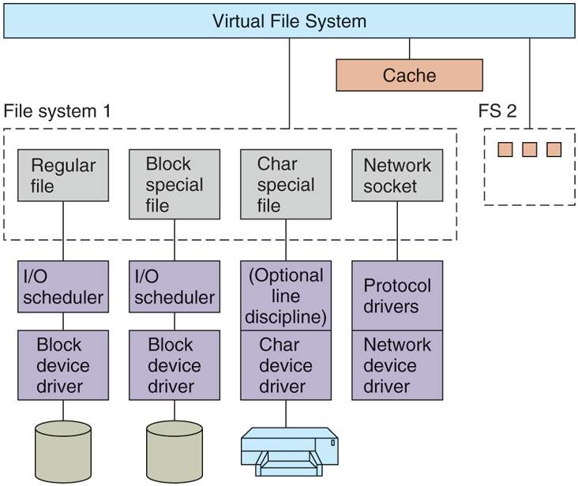

# MOS5 §10.6 Linux 文件系统实现 × Figure 10-22 —— I/O 系统里的文件系统
> 出处: [Modern Operating Systems 5th Edition §10.6 The Linux File System(实现小节)](../../007.BOOKs/现代操作系统/Modern%20Operating%20Systems%205th%20Edition-PDF-01.pdf#page=803) 书页 774-783(PDF 803-812);Figure 10-22 见 §10.5.4 [书页 763(PDF 792)](../../007.BOOKs/现代操作系统/Modern%20Operating%20Systems%205th%20Edition-PDF-01.pdf#page=792)。
>
> 文件系统内部的深入笔记(本目录):全章精读 [010.MOS5-10.6-Linux文件系统精读](010.MOS5-10.6-Linux文件系统精读.md)、VFS [002.虚拟文件系统](002.虚拟文件系统/README.md)、Ext4 见 [013.MOS5-Ext4文件系统](013.MOS5-Ext4文件系统.md)、NFS 见 [014.MOS5-NFS网络文件系统](014.MOS5-NFS网络文件系统.md)。本文以 **I/O 系统视角**(Fig 10-22)为主轴。

---

## 1. Figure 10-22:Linux I/O 系统全图(ASCII 重绘)

> "Prior to the 2.2 kernel, Linux maintained completely separate page and buffer caches, so a file residing in a disk block could be cached in both caches. Newer versions of Linux have a unified cache. A generic block layer holds these components together, performs the necessary translations between disk sectors, blocks, buffers and pages of data, and enables the operations on them."（在 2.2 内核之前，Linux 维护完全分离的页缓存与缓冲缓存，一个驻留在磁盘块中的文件可能同时被缓存两份。新版本 Linux 采用统一缓存。一个通用块层把这些组件粘合在一起，在磁盘扇区、块、缓冲区与数据页之间完成必要的翻译，并使能对它们的操作。）<sup>[Modern Operating Systems 5th, 书页 763(PDF 792)](../../007.BOOKs/现代操作系统/Modern%20Operating%20Systems%205th%20Edition-PDF-01.pdf#page=792)</sup>

原图(自书 EPUB 提取，未拉伸):


<sup>原图出自 [Modern Operating Systems 5th Edition, Fig. 10-22](../../007.BOOKs/现代操作系统/Modern%20Operating%20Systems%205th%20Edition-PDF-01.pdf#page=792)</sup>

Fig 10-22 全图 ASCII 重绘(框内文字与连线为原图要素,整体布局与原图对应;原图要素之外的内核对照见下方图例):

```text
┌──────────────────────────────────── Virtual File System ────────────────────────────────────┐
└─────────┬──────────────────────────────────────┬───────────────────────────────────────┬────┘
          │                                      │                                       │
          │                              ┌───────▼───────┐                               │
          │                              │     Cache     │                               │
          │                              └───────────────┘                               │
          │                                                                              │
╔─────────▼────────────────────────────────────────────────────────────────────╗   ╔─────▼─────────╗
║ File system 1                                                                ║   ║ FS 2          ║
║ ┌───────────────┐  ┌───────────────┐  ┌───────────────┐  ┌───────────────┐   ║   ║               ║
║ │ Regular file  │  │ Block special │  │ Char special  │  │ Network socket│   ║   ║               ║
║ │               │  │ file          │  │ file          │  │               │   ║   ║ [] [] []      ║
║ └───────────────┘  └───────────────┘  └───────────────┘  └───────────────┘   ║   ║               ║
║         │                  │                  │                  │           ║   ║               ║
║ ┌───────────────┐  ┌───────────────┐  ┌───────────────┐  ┌───────────────┐   ║   ║               ║
║ │ I/O scheduler │  │ I/O scheduler │  │ (Optional line│  │ Protocol      │   ║   ║               ║
║ │               │  │               │  │ discipline)   │  │ drivers       │   ║   ║               ║
║ └───────────────┘  └───────────────┘  └───────────────┘  └───────────────┘   ║   ║               ║
║         │                  │                  │                  │           ║   ║               ║
║ ┌───────────────┐  ┌───────────────┐  ┌───────────────┐  ┌───────────────┐   ║   ║               ║
║ │ Block device  │  │ Block device  │  │ Char device   │  │ Network device│   ║   ║               ║
║ │ driver        │  │ driver        │  │ driver        │  │ driver        │   ║   ║               ║
║ └───────┬───────┘  └───────┬───────┘  └───────┬───────┘  └───────────────┘   ║   ║               ║
╚─────────│──────────────────│──────────────────│──────────────────────────────╝   ╚───────────────╝
          │                  │                  │
       (disk)             (disk)            (printer)        [原图: 网络驱动下无图标]
```

图例:╔═╗=原图虚线容器(File system 1/FS 2,原图标签 "File system 1"/"FS 2" 位于容器外上方);┌─┐=原图实线框。

**内核对照(扩展标注,原图无此文字)**:

| 原图要素 | 含义/内核 7.1.3 对照 |
|-|-|
| Virtual File System | VFS 四对象骨架,见本文 §2 |
| Cache(原图实心填充框) | 统一页缓存:`filemap_read`/`filemap_get_pages`([mm/filemap.c:2769/:2668](../../000.SOURCE_CODE/003.LINUX-7.1.3/000.LINUX-7.1.3/mm/filemap.c)),命中不落盘;原图中 Cache 挂在 VFS 与 File system 1 之间 |
| File system 1 虚线框 | 框内是**四种文件类型**(Regular file/Block special file/Char special file/Network socket)——文件类型决定走哪条 I/O 路径;Regular file 列同样经 I/O scheduler→Block device driver 落到磁盘 |
| FS 2(三个小方块) | 另一个文件系统,原图未展开(与 FS 1 并列,都挂在 VFS 下) |
| I/O scheduler ×2 | elevator/mq-deadline/kyber/bfq,见 [052/008.IO调度器](../052.INPUT_OUTPUT/008.IO调度器-电梯算法与死线.md) |
| (Optional) line discipline | tty 线路规程(仅字符设备路径,可选) |
| Protocol drivers | 内核协议栈(TCP/UDP 等,见 039 笔记) |
| Block device driver | `submit_bio`→`blk_mq_submit_bio`([block/blk-core.c:627-635](../../000.SOURCE_CODE/003.LINUX-7.1.3/000.LINUX-7.1.3/block/blk-core.c)) |
| Char device driver | `chrdev_open`+`cdev_map`([fs/char_dev.c:370-383](../../000.SOURCE_CODE/003.LINUX-7.1.3/000.LINUX-7.1.3/fs/char_dev.c)) |
| 通用块层 generic block layer | **出自本页正文而非图中框**(见 §1 首段引文):负责扇区↔块↔缓冲↔页翻译,对应图中 scheduler 与 driver 之间的衔接职责 |

**与书配套的三条缓存行为**(原文摘录):

> "The cache is a table in the kernel for holding thousands of the most recently used blocks. When a block is needed from a disk for whatever reason (i-node, directory, or data), a check is first made to see if it is in the cache."（缓存是内核中的一张表，保存数千个最近使用的块。无论出于什么原因(i-node、目录或数据)需要从磁盘读一个块时，先检查它是否在缓存中。）<sup>[书页 763(PDF 792)](../../007.BOOKs/现代操作系统/Modern%20Operating%20Systems%205th%20Edition-PDF-01.pdf#page=792)</sup>

> "The page cache works for writes as well as for reads. When a program writes a block, it goes to the cache, not to the disk. The kernel worker threads will flush the block to disk in the event the cache grows above a specified value. In addition, to avoid having blocks stay too long in the cache before being written to the disk, all dirty blocks are written to the disk every 30 seconds."（页缓存对写同样起作用。程序写一个块时，块进缓存而不是进磁盘；当缓存增长超过规定值时，内核工作线程把块刷入磁盘。此外，为避免块在缓存中停留过久，所有脏块每 30 秒写一次磁盘。）<sup>[书页 763(PDF 792)](../../007.BOOKs/现代操作系统/Modern%20Operating%20Systems%205th%20Edition-PDF-01.pdf#page=792)</sup>

> "Starting with the 4.0 kernel, Linux supports DAX (Direct Access for files). With DAX, the cache is removed and reads and writes are directly issued to the storage device."（从 4.0 内核开始，Linux 支持 DAX(文件的直接访问)。使用 DAX 时缓存被移除，读写直接发往存储设备。）<sup>[书页 763(PDF 792)](../../007.BOOKs/现代操作系统/Modern%20Operating%20Systems%205th%20Edition-PDF-01.pdf#page=792)</sup>

**内核对照(Linux 7.1.3)**:

| Fig 10-22 层 | 内核实体/入口 | 位置 |
|-|-|---|
| 页缓存查找 | `filemap_read()` / `filemap_get_pages()` | [mm/filemap.c:2769 / :2668](../../000.SOURCE_CODE/003.LINUX-7.1.3/000.LINUX-7.1.3/mm/filemap.c) |
| 缓存未命中→下发 | `address_space_operations->readahead` | include/linux/fs.h(`a_ops`) |
| 通用块层提交 | `submit_bio()` → `__submit_bio` → `blk_mq_submit_bio` | [block/blk-core.c:627-635](../../000.SOURCE_CODE/003.LINUX-7.1.3/000.LINUX-7.1.3/block/blk-core.c) |
| I/O 调度器 | elevator / mq-deadline / kyber / bfq | 见 [052/008.IO调度器-电梯算法与死线](../052.INPUT_OUTPUT/008.IO调度器-电梯算法与死线.md) |
| 脏块回写 | 内核工作线程(writeback) | mm/page-writeback.c |
| 块侧全链路笔记 | 系统调用→页缓存→bio→调度器→驱动 | [052/000.块设备/000.块设备的操作](../052.INPUT_OUTPUT/000.块设备/000.块设备的操作.md) |

## 2. §10.6.3 VFS 四对象:Fig 10-22 顶层框的内部

> "In order to enable applications to interact with different file systems, implemented on different types of local or remote devices, Linux takes an approach used in other UNIX systems: the Virtual File System (VFS). VFS defines a set of basic file-system abstractions and the operations which are allowed on these abstractions. Invocations of the system calls described in the previous section access the VFS data structures, determine the exact file system where the accessed file belongs, and via function pointers stored in the VFS data structures invoke the corresponding operation in the specified file system."（为了使应用能与实现于不同类型的本地或远程设备上的不同文件系统交互，Linux 采用其他 UNIX 系统也使用的方法：虚拟文件系统(VFS)。VFS 定义了一组基本文件系统抽象以及允许在这些抽象上进行的操作。对上一节所述系统调用的调用会访问 VFS 数据结构，确定被访问文件所属的确切文件系统，并经由 VFS 数据结构中存放的函数指针，调用指定文件系统中的相应操作。）<sup>[Modern Operating Systems 5th, 书页 774(PDF 803)](../../007.BOOKs/现代操作系统/Modern%20Operating%20Systems%205th%20Edition-PDF-01.pdf#page=803)</sup>

> "Figure 10-30 summarizes the four main file-system structures supported by VFS."（图 10-30 总结了 VFS 支持的四种主要文件系统结构。）<sup>[书页 775(PDF 804)](../../007.BOOKs/现代操作系统/Modern%20Operating%20Systems%205th%20Edition-PDF-01.pdf#page=804)</sup>

Fig 10-30(VFS 四对象)重排:

| 对象 | 描述 | 主要操作 | 内核源码(Linux 7.1.3) |
|-|-|-|---|
| superblock | 特定文件系统(挂载的关键布局信息) | `read_inode`, `sync_fs` | 全局链表 `super_blocks`<sup>[fs/super.c:46](../../000.SOURCE_CODE/003.LINUX-7.1.3/000.LINUX-7.1.3/fs/super.c)</sup>;`struct super_block` + `super_operations` |
| dentry | 目录项,路径的单个组成部分 | `d_compare`, `d_delete` | `dentry_hashtable`<sup>[fs/dcache.c:115](../../000.SOURCE_CODE/003.LINUX-7.1.3/000.LINUX-7.1.3/fs/dcache.c)</sup>,dentry_cache(SLAB) |
| i-node | 特定文件(目录、设备也是文件) | `create`, `link` | `inode_hashtable`<sup>[fs/inode.c:65](../../000.SOURCE_CODE/003.LINUX-7.1.3/000.LINUX-7.1.3/fs/inode.c)</sup>;磁盘侧对应 ext2/ext4 的 i-node(见 033 笔记) |
| file | 进程关联的已打开文件 | `read`, `write` | `struct file`(fs.h),即 Fig 10-22 里进程持 fd 的直接对象 |

> "In order to facilitate certain directory operations and traversals of paths, such as /usr/ast/bin, VFS supports a dentry data structure which represents a directory entry. This data structure is created by the file system on the fly. Directory entries are cached in what is called the dentry_cache. For instance, the dentry_cache would contain entries for /, /usr, /usr/ast, and the like."（为方便目录操作与路径遍历(如 /usr/ast/bin)，VFS 支持表示目录项的 dentry 数据结构。该结构由文件系统即时创建，目录项被缓存在 dentry_cache 中。例如 dentry_cache 会含有 /、/usr、/usr/ast 等条目。）<sup>[书页 775(PDF 804)](../../007.BOOKs/现代操作系统/Modern%20Operating%20Systems%205th%20Edition-PDF-01.pdf#page=804)</sup>

**在 Fig 10-22 中的位置**:VFS 四对象就是图中"VFS"那一层的骨架;`file` 对象把 fd 与文件系统相连,`inode` 的 `i_mapping`(`address_space`)把文件与页缓存相连——这正是"文件系统 ↔ 页缓存"交界的内核接合点,已在 [008.地址空间](008.地址空间/README.md) 的 `struct address_space` 笔记展开。VFS 之下的 ext2/ext4 磁盘布局、目录项格式与路径解析全流程,见 [010.MOS5-10.6-Linux文件系统精读](010.MOS5-10.6-Linux文件系统精读.md) 与 [002.虚拟文件系统](002.虚拟文件系统/README.md)。

## 3. Fig 10-22 一图串联 052.INPUT_OUTPUT 笔记链(本文原属该目录)

```text
        005/006 笔记                     本文(015)                      008 笔记
   socket / 块·字符设备二分 ──►  VFS 四对象 + 页缓存 + 通用块层 ──►  电梯/死线/kyber/bfq
              │                                                        │
              └────────── 000.块设备:read() 全链路(把三层连成一条线) ──┘
```
