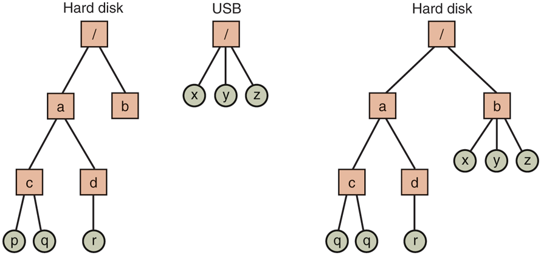
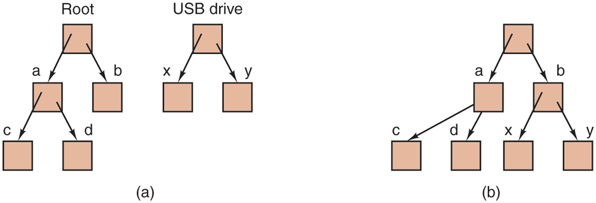

# Linux 磁盘挂载与目录挂载(Mount)——从 mount 系统调用到 vfsmount
> 出处: [Modern Operating Systems 5th Edition §1.5 / §1.6 / §10.6.1 / §10.6.4](../../007.BOOKs/现代操作系统/Modern%20Operating%20Systems%205th%20Edition-PDF-01.pdf#page=73) + Linux 7.1.3 源码([fs/namespace.c](../../000.SOURCE_CODE/003.LINUX-7.1.3/000.LINUX-7.1.3/fs/namespace.c) 等)。
>
> 挂载是 UNIX 把"多个存储设备/多个文件系统来源"拼成**一棵目录树**的机制:一块磁盘、一个分区、一台 NFS 服务器的导出目录、甚至本机的另一个目录(bind mount),都要先 mount 到树的某个目录上才能访问。本笔记把 MOS5 的挂载叙述与 Linux 内核实现逐层钉在一起。
>
> 关联笔记: [014.MOS5-NFS网络文件系统](014.MOS5-NFS网络文件系统.md)(远程挂载) | [002.虚拟文件系统](002.虚拟文件系统/README.md)(VFS 四对象) | [010.MOS5-10.6-Linux文件系统精读](010.MOS5-10.6-Linux文件系统精读.md) | [015.Linux-IO系统全路径](015.Linux-IO系统全路径-从VFS到块设备驱动.md) | [000.块设备](../052.INPUT_OUTPUT/000.块设备/000.块设备的操作.md)

---

## 1. 为什么需要挂载:从"多盘符"到"单一树"

多块盘怎么处理?书先给出 Windows 式方案再对比 UNIX 方案:

> "One solution is to put a self-contained file system on each one and just keep them separate. Consider, for example, the situation shown in Fig. 10-25(a). Here we have a hard disk, which we call C:, and a USB external drive, which we call D:. Each has its own root directory and files. With this solution, the user has to specify both the device and the file when anything other than the default is needed. For instance, to copy a file x to a directory d (assuming C: is the default), one would type `cp D:/x /a/d/x`. This is the approach used by a number of systems, including Windows, which it inherited from MS-DOS a century long ago."（一种方案是每个盘各放一套自包含的文件系统并保持分离——如图 10-25(a)，硬盘叫 C:，USB 外置盘叫 D:，各有各的根目录。这样用户除默认盘外都要同时指明设备与文件：把文件 x 拷到目录 d 得写 `cp D:/x /a/d/x`。这是包括 Windows 在内的一批系统采用的做法，继承自 MS-DOS。）<sup>[书页 769(PDF 798)](../../007.BOOKs/现代操作系统/Modern%20Operating%20Systems%205th%20Edition-PDF-01.pdf#page=798)</sup>

> "The Linux solution is to allow one disk to be mounted in another disk's file tree. In our example, we could mount the USB drive on the directory /b, yielding the file system of Fig. 10-25(b). The user now sees a single file tree, and no longer has to be aware of which file resides on which device. The above copy command now becomes `cp /b/x /a/d/x` exactly the same as it would have been if everything had been on the hard disk in the first place."（Linux 的方案是允许把一块盘**挂载**进另一块盘的文件树：把 USB 盘挂到目录 /b 上，得到图 10-25(b)。用户从此看到的是单一的文件树，不必再关心哪个文件位于哪个设备上——上面那条拷贝命令变成 `cp /b/x /a/d/x`，与所有内容一开始就在硬盘上完全一样。）<sup>[书页 769(PDF 798)](../../007.BOOKs/现代操作系统/Modern%20Operating%20Systems%205th%20Edition-PDF-01.pdf#page=798)</sup>

原图(自书 EPUB 提取,未拉伸):


<sup>原图出自 [Modern Operating Systems 5th Edition, Fig. 10-25](../../007.BOOKs/现代操作系统/Modern%20Operating%20Systems%205th%20Edition-PDF-01.pdf#page=798),方块=目录,圆圈=文件;右侧 USB 的 x/y/z 已"长"在 /b 之下。</sup>

第 1 章的图 1-15 讲的是同一件事,并补了一个关键限定——**挂载点遮蔽**:

> "UNIX does not allow path names to be prefixed by a drive name or number; that would be precisely the kind of device dependence that operating systems ought to eliminate. Instead, the mount system call allows the file system on the USB drive to be attached to the root file system wherever the program wants it to be. ... If directory b had contained any files, they would not be accessible while the USB drive was mounted, since /b would now refer to the root directory of the USB drive. (Not being able to access these files is not as serious as it at first seems: file systems are nearly always mounted on empty directories.)"（UNIX 不允许在路径前缀上写盘符——那正是操作系统应当消除的设备依赖。mount 系统调用可以把 USB 盘的文件系统挂到根文件系统中程序想要的任何位置……若目录 b 里原本有文件,USB 盘挂载期间它们将不可访问,因为 /b 现在指向 USB 盘的根目录。(这并不像乍看之下那么严重:文件系统几乎总是挂在空目录上。))<sup>[书页 44(PDF 73)](../../007.BOOKs/现代操作系统/Modern%20Operating%20Systems%205th%20Edition-PDF-01.pdf#page=73)</sup>


<sup>原图出自 [Modern Operating Systems 5th Edition, Fig. 1-15](../../007.BOOKs/现代操作系统/Modern%20Operating%20Systems%205th%20Edition-PDF-01.pdf#page=73)。书还特意说明两块盘的文件系统可以不同:"The USB drive may even be formatted with, say, FAT-32 and the hard disk with, say, ext4."(书页 44)——挂载是 VFS 层的事,不要求底下同一种文件系统,这正是 [002.虚拟文件系统](002.虚拟文件系统/README.md) 存在的理由。</sup>

挂载点遮蔽的内核本质见 [§5](#5-路径解析如何穿过挂载点):lookup 命中带 `DCACHE_MOUNTED` 的 dentry 就整体跳转到子挂载的根,原目录内容不再可见;`..` 也只会在挂载树中向上弹,不会"穿回"被遮蔽的目录。

## 2. mount(2):三件事——挂什么、挂到哪、怎么挂

> "As we have mentioned earlier, the mount system call allows two file systems to be merged into one. ... By executing the mount system call, the USB file system can be attached to the root file system, as shown in Fig. 1-22. A typical statement in C to mount is `mount("/dev/sdb0", "/mnt", 0);` where the first parameter is the name of a block special file for USB drive 0, the second parameter is the place in the tree where it is to be mounted, and the third parameter tells whether the file system is to be mounted read-write or read-only."（前面提过,mount 系统调用把两个文件系统合并为一个……执行 mount 后 USB 的文件系统即可挂上根文件系统,如图 1-22。典型的 C 语句是 `mount("/dev/sdb0", "/mnt", 0);`:第一个参数是 USB 盘 0 的块特殊文件名,第二个参数是树中挂载位置,第三个参数指明以读写还是只读方式挂载。）<sup>[书页 59(PDF 88)](../../007.BOOKs/现代操作系统/Modern%20Operating%20Systems%205th%20Edition-PDF-01.pdf#page=88)</sup>

> "After the mount call, a file on drive 0 can be accessed by just using its path from the root directory or the working directory, without regard to which drive it is on. ... The mount call makes it possible to integrate removable media into a single integrated file hierarchy, without having to worry about which device a file is on. ... portions of hard disks (often called partitions or minor devices) can also be mounted this way, as well as external hard disks and SSDs. When a file system is no longer needed, it can be unmounted with the umount system call. After that, it is no longer accessible. Of course, if it is needed later on, it can be mounted again."（mount 之后,0 号盘上的文件用路径即可访问,不必关心它在哪块盘上……mount 让可移动介质融入单一文件层次。除了 USB 盘,硬盘的分区(minor device)乃至外置硬盘和 SSD 也可以这样挂载。文件系统不再需要时,用 umount 卸载,之后不可访问;下次需要时再挂即可。）<sup>[书页 59(PDF 88)](../../007.BOOKs/现代操作系统/Modern%20Operating%20Systems%205th%20Edition-PDF-01.pdf#page=88)</sup>

书里 3 个参数,Linux 实际是 5 个,后两个是"怎么挂"的完整版:

> **内核签名**:`SYSCALL_DEFINE5(mount, char __user *, dev_name, char __user *, dir_name, char __user *, type, unsigned long, flags, void __user *, data)`<sup>[fs/namespace.c:4363](../../000.SOURCE_CODE/003.LINUX-7.1.3/000.LINUX-7.1.3/fs/namespace.c)</sup> —— 源设备(块设备名/远程目录/`/proc` 这类虚拟名)、挂载点、文件系统类型、flags、文件系统私有选项(如 ext4 的 `data=`)。

flags 是**按位组合的语义词**,低 16 位是"怎么挂",高位是"挂哪个变体":

| flag | 值 | 语义 |
|-|-|---|
| `MS_RDONLY` | 1 | 只读挂载 |
| `MS_NOSUID` | 2 | 忽略 suid/sgid 位 |
| `MS_NODEV` | 4 | 禁止访问设备特殊文件 |
| `MS_NOEXEC` | 8 | 禁止执行程序 |
| `MS_BIND` | 4096 | **目录挂载**:把目录/文件再挂一份(§8) |
| `MS_MOVE` | 8192 | 挂载搬家 |
| `MS_REC` | 16384 | 连子挂载一起递归(bind/move 后缀) |
| `MS_SHARED/MS_PRIVATE/MS_SLAVE/MS_UNBINDABLE` | 1<<20/18/19/17 | 传播类型(容器/mount namespace 用) |
| `MS_MGC_VAL` | 0xC0ED0000 | 古董魔数:2.x 时代用于校验 flags,现代内核直接丢弃("Discard magic") |

<sup>flag 定义 [include/uapi/linux/mount.h:13-59](../../000.SOURCE_CODE/003.LINUX-7.1.3/000.LINUX-7.1.3/include/uapi/linux/mount.h);丢弃魔数见 [fs/namespace.c path_mount](../../000.SOURCE_CODE/003.LINUX-7.1.3/000.LINUX-7.1.3/fs/namespace.c) "Discard magic" 一段。</sup>

`path_mount`<sup>[fs/namespace.c:4082](../../000.SOURCE_CODE/003.LINUX-7.1.3/000.LINUX-7.1.3/fs/namespace.c)</sup> 是这些 flags 的**总分发**:同一个 `mount(2)` 其实有五条执行路径,磁盘挂载只是最后那条默认分支:

```c
	if ((flags & (MS_REMOUNT | MS_BIND)) == (MS_REMOUNT | MS_BIND))
		return do_reconfigure_mnt(path, mnt_flags);   // 3334: 改已挂实例的 per-mount 选项
	if (flags & MS_REMOUNT)
		return do_remount(path, sb_flags, ...);       // 3371: 重挂(如 ext4 root remount,ro)
	if (flags & MS_BIND)
		return do_loopback(path, dev_name, flags & MS_REC); // 2996: 目录/子树再挂一份
	if (flags & (MS_SHARED | MS_PRIVATE | MS_SLAVE | MS_UNBINDABLE))
		return do_change_type(path, flags);           // 2876: 改传播类型
	if (flags & MS_MOVE)
		return do_move_mount_old(path, dev_name);     // 3702: 移动挂载
	return do_new_mount(path, type_page, sb_flags, mnt_flags, dev_name, data_page); // 3790: 全新挂载
```

另注意 `path_mount` 中的一处关键拆分:`flags` 被分成两半——`MS_*` 里的 `SB_RDONLY/SB_SYNCHRONOUS...` 是 **superblock 级**(同设备的所有挂载共享,最终进 `super_block->s_flags`),其余如 `MNT_NOSUID/MNT_READONLY` 是 **per-mountpoint 级**(只作用于这次挂载,存进 `vfsmount->mnt_flags`)。所以 `mount -o bind` 出来的两份挂载可以一份 ro 一份 rw——同一块数据,两种视图。

## 3. 一次磁盘挂载的内核旅程

以 `mount -t ext4 /dev/sdb1 /mnt` 为例,整条链路(每步一个 7.1.3 锚点):

```text
mount("/dev/sdb1", "/mnt", "ext4", flags, data)          [用户态]
 │
 ▼ SYSCALL_DEFINE5(mount)        fs/namespace.c:4363   把 5 个参数从用户空间拷入内核
 ▼ do_mount → path_mount         fs/namespace.c:4082   安全检查(security_sb_mount/capable) + flags 分发
 ▼ do_new_mount                  fs/namespace.c:3790   默认分支:"全新挂载"
 ▼   get_fs_type("ext4")                               查注册表 fs/file_systems → file_system_type
 ▼   fs_context_for_mount(type, sb_flags)              建 fs_context(新挂载 API 的配置上下文)
 ▼   vfs_parse_fs_string(fc,"source",name) / parse_monolithic_mount_data(fc,data)
 ▼ do_new_mount_fc               fs/namespace.c:3757
 ▼   fc_mount(fc)                fs/namespace.c:1191
 ▼     vfs_get_tree(fc)                                → file_system_type->get_tree
 ▼       ext4_get_tree                fs/ext4/super.c:5854 → get_tree_bdev(fc, ext4_fill_super)
 ▼       get_tree_bdev                fs/super.c:1713      lookup_bdev 解析源设备 → sget_dev
 ▼       sget_dev                     fs/super.c:1405      按 device 找已有 sb,没有才新建(一设备一 sb)
 ▼       ext4_fill_super              fs/ext4/super.c     解析 ext4 元数据 → fc->root = 根 dentry
 ▼     vfs_create_mount(fc)           fs/namespace.c:1171  alloc_vfsmnt + setup_mnt → struct mount
 ▼   mount_too_revealing              fs/namespace.c:6401  userns 下防 setuid 逃逸(§8)
 ▼   LOCK_MOUNT(mp, mountpoint)                            挂载点加锁、查/建 struct mountpoint
 ▼   do_add_mount(newmnt, &mp, mnt_flags) fs/namespace.c:3720
 ▼     拒绝 1: 同 sb 挂同 dentry → -EBUSY("Refuse the same filesystem on the same mount point")
 ▼     拒绝 2: 挂载根是符号链接 → -EINVAL
 ▼     graft_tree(newmnt, &mp)        fs/namespace.c:2831
 ▼       attach_recursive_mnt         fs/namespace.c:2559  真正"嫁接":挂进 mnt_hashtable、
 ▼                                                        父挂载 mnt_mounts 链表、DCACHE_MOUNTED 置位
 ▼ 返回 0 —— 从此 /mnt 的 lookup 会跳进新挂载
```

三个值得停下来的点:

1. **超级块来自磁盘,且一设备只读一次**。`get_tree_bdev`<sup>[fs/super.c:1713](../../000.SOURCE_CODE/003.LINUX-7.1.3/000.LINUX-7.1.3/fs/super.c)</sup> 先 `lookup_bdev` 把 `/dev/sdb1` 解析成设备号,再由 `sget_dev`<sup>[fs/super.c:1405](../../000.SOURCE_CODE/003.LINUX-7.1.3/000.LINUX-7.1.3/fs/super.c)</sup> 用设备号查/建 `struct super_block`:sb 已有根(`s->s_root`)就**复用现有 superblock**(新挂载只是新 `vfsmount`,且不允许改动 RO/RW 状态,否则 `-EBUSY`),没挂过才 `setup_bdev_super` 打开设备并调 `ext4_fill_super` 读盘。bind mount 能"零成本再挂一份"正是因为 superblock 复用。
2. **挂载 = 两类对象的组合**。`vfs_create_mount` 只是 `alloc_vfsmnt(fc->source)` + `setup_mnt`<sup>[fs/namespace.c:1148](../../000.SOURCE_CODE/003.LINUX-7.1.3/000.LINUX-7.1.3/fs/namespace.c)</sup>(把 `fc->root` 根 dentry 接进 `mnt`)——此时它还"未挂到任何东西上"(注释:"Note that this does not attach the mount to anything")。真正挂上树的是 `do_add_mount → graft_tree → attach_recursive_mnt`:插 mount 哈希表、挂父挂载的孩子链表、给挂载点 dentry 打 `DCACHE_MOUNTED` 标记。
3. **挂载点也会"动"**。挂载点被 `unlink`/`rmdir` 会触发 `__detach_mounts`<sup>[fs/namespace.c](../../000.SOURCE_CODE/003.LINUX-7.1.3/000.LINUX-7.1.3/fs/namespace.c)</sup> 懒卸载,防止挂载泄漏——`struct mountpoint`<sup>[fs/mount.h:39](../../000.SOURCE_CODE/003.LINUX-7.1.3/000.LINUX-7.1.3/fs/mount.h)</sup> 的引用计数就是为此服务。

**NFS 版旅程的差异只在 `vfs_get_tree` 那一格**:`nfs_fs_context` 不读盘,而是 RPC 握手拿 file handle 建 sb(见 [014.MOS5-NFS网络文件系统 §2.1](014.MOS5-NFS网络文件系统.md) 的挂载协议),后面的嫁接与路径解析完全共用。

## 4. 核心数据结构:vfsmount / mount / mountpoint

VFS 的"四对象"(superblock/dentry/inode/file)见 [002.虚拟文件系统](002.虚拟文件系统/README.md);挂载机制在此之上加了三个"空间管理"对象:

> **`struct vfsmount`**<sup>[include/linux/mount.h:58](../../000.SOURCE_CODE/003.LINUX-7.1.3/000.LINUX-7.1.3/include/linux/mount.h)</sup> —— 对外(路径解析、`mntget/mntput`)暴露的"一次挂载"句柄,只有 4 个字段:`mnt_root`(被挂子树的根 dentry)、`mnt_sb`(superblock)、`mnt_flags`(per-mount 选项,`MNT_NOSUID=0x01...MNT_READONLY=0x40`)、`mnt_idmap`(idmapped mount)。

> **`struct mount`**<sup>[fs/mount.h:45](../../000.SOURCE_CODE/003.LINUX-7.1.3/000.LINUX-7.1.3/fs/mount.h)</sup> —— vfsmount 的"私有扩展"(内核内部称 real mount,`real_mount(mnt)` 经 container_of 取回),回答两个问题:

```text
 struct mount {
     struct mount   *mnt_parent;      /* 挂到了哪个挂载上(父)      —— "挂在哪" */
     struct dentry  *mnt_mountpoint;  /* 挂载点 dentry(父树上的名) —— "挂在哪" */
     struct vfsmount mnt;             /* mnt_root/mnt_sb/mnt_flags —— "管什么" */
     struct list_head mnt_mounts;     /* 孩子挂载链表(挂在我身上的) */
     struct list_head mnt_child;      /* 兄弟链表 */
     const char *mnt_devname;         /* /proc/mounts 第一列,如 /dev/sdb1 */
     struct mountpoint *mnt_mp;       /* 挂载点对象(引用计数) */
     struct mnt_namespace *mnt_ns;    /* 属于哪个 mount namespace */
     int mnt_group_id;                /* shared subtree 传播组 id(§8) */
     ...
 };
```

即:挂载树是一棵**与目录树平行的 mount 树**——沿 `mnt_parent/mnt_mounts` 走是"挂载的父子关系",沿每个 `mnt->mnt_root` 的 dentry 走才是"目录的父子关系"。

> **`struct mountpoint`**<sup>[fs/mount.h:39](../../000.SOURCE_CODE/003.LINUX-7.1.3/000.LINUX-7.1.3/fs/mount.h)</sup> —— `m_dentry` + 引用计数,同一 dentry 上叠多个挂载(如容器的 /tmp 套 /tmp)共享一个 mountpoint,卸载时按计数回收。

> **`struct mnt_namespace`**<sup>[fs/mount.h:11](../../000.SOURCE_CODE/003.LINUX-7.1.3/000.LINUX-7.1.3/fs/mount.h)</sup> —— 一个 mount namespace = 一棵以 `root` 为根的挂载树 + `mounts` rbtree(全部成员)+ `nr_mounts` 上限管理。`current->nsproxy->mnt_ns` 就是进程当前所在的 namespace。

并发与查找的配角:

| 实体 | 锚点 | 作用 |
|-|-|---|
| `mount_hashtable` | [fs/namespace.c:80](../../000.SOURCE_CODE/003.LINUX-7.1.3/000.LINUX-7.1.3/fs/namespace.c) | 以 (父挂载, 挂载点 dentry) 哈希成链,`__lookup_mnt`<sup>:789</sup> O(1) 查"这个 dentry 上挂了谁" |
| `mount_lock`(seqlock) | [fs/namespace.c:127](../../000.SOURCE_CODE/003.LINUX-7.1.3/000.LINUX-7.1.3/fs/namespace.c) | RCU 路径行走时验证挂载树没变(§5) |
| `DCACHE_MOUNTED` | [include/linux/dcache.h:222](../../000.SOURCE_CODE/003.LINUX-7.1.3/000.LINUX-7.1.3/include/linux/dcache.h) | dentry 标记位:"我是挂载点,路径走到我要跳转" |
| `path_mounted(path)` | [fs/internal.h:351](../../000.SOURCE_CODE/003.LINUX-7.1.3/000.LINUX-7.1.3/fs/internal.h) | 判定"路径是某挂载的根":`path->mnt->mnt_root == path->dentry`,umount/remount 都先过这一关 |

## 5. 路径解析如何"穿过"挂载点

挂载生效的全部秘密在一个跳转里:每次 lookup 命中一个 dentry,VFS 先问"它上面挂了东西吗",挂了就**把整个 path 顶替成子挂载的根**:

```c
// fs/namei.c:1682 __follow_mount_rcu()
if (flags & DCACHE_MOUNTED) {
    struct mount *mounted = __lookup_mnt(path->mnt, dentry);  // mount_hashtable 查子挂载
    if (mounted) {
        path->mnt = &mounted->mnt;             /* 顶替! 路径切进子挂载 */
        dentry = path->dentry = mounted->mnt.mnt_root; /* 名字变成子挂载根 */
        ...
        continue;                              /* 子挂载根上可能又挂着更深的挂载 */
    }
}
```

以书里 Fig 10-25 的 `cp /b/x /a/d/x` 走一遍(挂载树视角,与目录树平行):

```text
 目录树视角                       mount 树视角(每个节点是一个 struct mount)
 ─────────────                   ─────────────────────────────────────
 /                                root mount (rootfs→真实根, §6)
 ├── a                            ├─ mnt_root = /
 │   └── d/x                      └─ child: usb mount
 └── b ←── USB 盘挂这里                mnt_mountpoint = 目录树上的 b
     ├── x (USB 盘根!)                   mnt_root    = USB 盘的根 dentry
     ├── y                               mnt_sb      = USB 盘的 superblock(FAT-32)
     └── z                               mnt_flags   = MNT_RELATIME|...

 lookup("/b/x"):
   根 mount 下逐分量找 b → 命中的 dentry 带 DCACHE_MOUNTED
   → __lookup_mnt 找到 usb mount → path 切到 (usb.mnt, usb.mnt_root)
   → 新挂载的根下继续找 x → 命中 USB 盘里的 x
   —— 原来目录 b 的旧内容全程没被访问(遮蔽),这正是书页 44 那句话的源码形态
```

> 注:目录树中的 `a`/`d/x` 取自书页 769 正文的 `cp /b/x /a/d/x` 场景作为查找目标示例,并非 Fig 10-25 原树内容(Fig 10-25 原树只画 USB 盘挂到 /b 下长出 x/y/z);`/b/x` 的 lookup 示例同样是为讲遮蔽而设。

两点细节:

- **`..` 的方向**:在挂载根上执行 `..`,`follow_dotdot_rcu`<sup>[fs/namei.c:2151](../../000.SOURCE_CODE/003.LINUX-7.1.3/000.LINUX-7.1.3/fs/namei.c)</sup> 检测 `nd->path.dentry == nd->path.mnt->mnt_root`,用 `choose_mountpoint_rcu`<sup>[fs/namei.c:1483](../../000.SOURCE_CODE/003.LINUX-7.1.3/000.LINUX-7.1.3/fs/namei.c)</sup> 沿 mount 树弹回**挂载点所在的目录**,而不是进入被遮蔽的目录——`cd /b/..` 回到 `/`,不是"USB 盘根的父"(它不存在)。这就是"路径解析以 mount 树为准"的另一半。
- **它对本地/远程一视同仁**:NFS 挂载后,跳转到的 `mnt_root` 是 NFS superblock 的根 dentry,后续 lookup 触发的是 `nfs_lookup` 的 RPC 而不是磁盘读——书里"服务器并不知道自己的目录被挂到了哪台客户机的哪个位置"(挂载点完全是客户机本地的事,<sup>[书页 784(PDF 813)](../../007.BOOKs/现代操作系统/Modern%20Operating%20Systems%205th%20Edition-PDF-01.pdf#page=813)</sup>,详见 [014 §1](014.MOS5-NFS网络文件系统.md))在源码上就是:挂载点信息只存在于**客户端**的 mount 树里。

## 6. 启动时的第一次挂载:从内存 rootfs 到真实根

mount 自己也需要一个"落脚点"——内核最早把内存盘 rootfs 挂成根,引导后期再挂真实根并**搬家**(`init/do_mounts.c`,root=` 启动参数指定设备):

```c
// init/do_mounts.c:458 prepare_namespace()
	wait_for_device_probe();      // 等驱动把 /dev/sdb1 之类设备摸出来
	initrd_load();                // 有 initrd 则先挂内存盘(见 do_mounts_initrd.c)
	mount_root(saved_root_name);  // :382 → mount_root_generic :178
	devtmpfs_mount();             // /dev 就位
	init_pivot_root(".", ".");    // rootfs 换根:真实根转正、内存 rootfs 卸掉
	init_umount(".", MNT_DETACH); // 卸载旧 rootfs
```

`mount_root_generic` 最终调 `do_mount_root`<sup>[init/do_mounts.c:142](../../000.SOURCE_CODE/003.LINUX-7.1.3/000.LINUX-7.1.3/init/do_mounts.c)</sup>:

```c
	ret = init_mount(name, "/root", fs, flags, data_page); // 内核态 mount()
	init_chdir("/root");
	s = current->fs->pwd.dentry->d_sb;
	ROOT_DEV = s->s_dev;
	printk(KERN_INFO
	       "VFS: Mounted root (%s filesystem)%s on device %u:%u.\n", ...);
```

每个人开机都会看到的这行 dmesg,就是"根文件系统挂上了"的广播:`VFS: Mounted root (ext4 filesystem) readonly on device 8:2`。网络根也走同一入口:`root=/dev/nfs` 时改调 `do_mount_root(root_dev, "nfs", ...)`<sup>[init/do_mounts.c:270](../../000.SOURCE_CODE/003.LINUX-7.1.3/000.LINUX-7.1.3/init/do_mounts.c)</sup>——无盘工作站/嵌入式设备用 NFS 当根盘,与 [014 §2.1](014.MOS5-NFS网络文件系统.md) 的挂载协议衔接。

## 7. umount:为什么总是 EBUSY

> "When a file system is no longer needed, it can be unmounted with the umount system call."(书页 59)——反过来,只要**还有人在用**,内核就拒绝放手:

```c
// SYSCALL_DEFINE2(umount) fs/namespace.c:2068 → ksys_umount :2050 → path_umount :2035 → do_umount :1865
	if (&mnt->mnt == current->fs->root.mnt && !(flags & MNT_DETACH)) {
		/* 特例: 卸载根 = 尝试 remount 只读,而不是真卸载 */
		return do_umount_root(sb);              // fs/namespace.c:1842
	}
	...
	if (!propagate_mount_busy(mnt, 2)) {        // 引用计数 == 1(父挂载) + 1(sys_umount 自身) 才放行
		umount_tree(mnt, UMOUNT_PROPAGATE|UMOUNT_SYNC);
		retval = 0;
	}
```

- **busy 的判定是"还有多少入口"**:`cd` 进了挂载目录的进程(其 `fs->pwd` 持引用)、打开中的文件、子挂载,都会让 `propagate_mount_busy` 返回真 → `-EBUSY`。这就是 `umount: target is busy` 的来源;
- **不想逐个找进程时**用 lazy umount:`umount -l`(MNT_DETACH)把挂载从树中摘除,活着的入口用完即回收;`umount -f`(MNT_FORCE)触发 `s_op->umount_begin`(NFS 用它中断挂起的 RPC);
- `umount2` 的另一件玩具 `MNT_EXPIRE`:只在"自上次标记以来无人再碰"时才卸,用于自动挂载器;
- 根挂载是特例:对 `current->fs->root.mnt` 的 umount 被解释成 `do_umount_root`——**remount 成只读**而非卸载(shutdown 流程依赖这个语义);
- 卸载的收尾在 `umount_tree`<sup>[fs/namespace.c:1771](../../000.SOURCE_CODE/003.LINUX-7.1.3/000.LINUX-7.1.3/fs/namespace.c)</sup>:整棵子挂载树摘除、引用归零后 `deactivate_super` → 最终 `mntput` 可能走延迟队列 `delayed_mntput`<sup>[fs/namespace.c:1323](../../000.SOURCE_CODE/003.LINUX-7.1.3/000.LINUX-7.1.3/fs/namespace.c)</sup>(RCU 环境下不能立刻释放)。

## 8. 目录挂载:bind mount、传播与容器

书的第 1/4/10 章讲的都是"把磁盘挂上树";现代 Linux 的挂载早已不止于此——**目录挂载**(把文件系统内的一个目录再挂一份)是容器世界的地基,`mount --bind` 的实现是 `do_loopback`<sup>[fs/namespace.c:2996](../../000.SOURCE_CODE/003.LINUX-7.1.3/000.LINUX-7.1.3/fs/namespace.c)</sup>:

- **bind = 同一 superblock 的第二个 mount 实例**。不新建 sb,只 `clone` 出新 `struct mount` 挂到目标点——所以同一份数据在树上出现两次,`/mnt/src/a` 与 `/mnt/dst/a` 是同一 inode,而两份挂载可以有**不同的 `mnt_flags`**(常见:只读 bind `mount -o bind,ro`)。MS_REC 递归版连源下的子挂载一起克隆;
- **传播类型**(shared subtrees,`do_change_type`<sup>[fs/namespace.c:2876](../../000.SOURCE_CODE/003.LINUX-7.1.3/000.LINUX-7.1.3/fs/namespace.c)</sup>):`MS_SHARED`(默认,挂载事件沿 `mnt_group_id`/`mnt_share` 传播)、`MS_PRIVATE`(互不影响)、`MS_SLAVE`(只听 master 的)、`MS_UNBINDABLE`。`attach_recursive_mnt` 里的 `propagate_mnt`<sup>[fs/namespace.c:2598](../../000.SOURCE_CODE/003.LINUX-7.1.3/000.LINUX-7.1.3/fs/namespace.c)</sup> 负责"一处挂,处处挂";
- **mount namespace**(clone 的 CLONE_NEWNS)让每个容器拥有独立的挂载树;容器 rootfs 的接线就是 §6 那套搬家术在用户态重演:`pivot_root`<sup>[fs/namespace.c:4759](../../000.SOURCE_CODE/003.LINUX-7.1.3/000.LINUX-7.1.3/fs/namespace.c)</sup> 换根 + bind mount 注入 /proc /dev /sys;
- **安全护栏**:namespace 语义下 `mount_too_revealing`<sup>[fs/namespace.c:6401](../../000.SOURCE_CODE/003.LINUX-7.1.3/000.LINUX-7.1.3/fs/namespace.c)</sup> 禁止在用户 namespace 里用少选项挂载暴露含 setuid 文件的 sb;`MNT_LOCKED`<sup>[include/linux/mount.h:44](../../000.SOURCE_CODE/003.LINUX-7.1.3/000.LINUX-7.1.3/include/linux/mount.h)</sup> 防止通过 umount/bind 摸回被锁定的子树——`do_umount` 里 `MNT_LOCKED → -EINVAL` 就是容器防逃逸的一环;
- **新挂载 API**(§3 流程里的 fs_context 就是它的地基):`open_tree`<sup>:3240</sup>/`fsmount`<sup>:4431</sup>/`move_mount`<sup>:4569</sup>/`mount_setattr`<sup>:5137</sup> 把"配置→建挂载→挂上树"拆成三步,再用 `statmount`/`listmount`<sup>:5953/:6115</sup> 编程式枚举挂载。旧的 5 参数 `mount(2)` 在内核里被 `fc->oldapi = true` 标记走兼容路径([fs/namespace.c:3822-3826](../../000.SOURCE_CODE/003.LINUX-7.1.3/000.LINUX-7.1.3/fs/namespace.c) "Indicate ... the mount request is coming from the legacy mount system call",`fc->oldapi = true` 在 :3826)。

## 9. NFS 挂载:同一机制,挂上"远程盘"

书里 NFS 一节把挂载从"本地盘"推广到"别人的盘",而机制完全复用本笔记 §3-§5 的那套:

> "Clients access exported directories by mounting them. When a client mounts a (remote) directory, it becomes part of its directory hierarchy, as shown in Fig. 10-35."(客户机通过**挂载**来访问被导出的目录。远程目录被挂载后,就成为客户机目录层次的一部分。)<sup>[书页 783(PDF 812)](../../007.BOOKs/现代操作系统/Modern%20Operating%20Systems%205th%20Edition-PDF-01.pdf#page=812)</sup>

> "the same file can have different names on different clients due to its being mounted in a different place in the respective trees. The mount point is entirely local to the clients; the server does not know where it is mounted on any of its clients."(同一文件因挂载点不同,在各客户机上的路径不同;挂载点完全是客户机本地的事,服务器不知道自己的目录被挂到了哪里。)<sup>[书页 784(PDF 813)](../../007.BOOKs/现代操作系统/Modern%20Operating%20Systems%205th%20Edition-PDF-01.pdf#page=813)</sup>

本地盘挂载与 NFS 挂载的"同与不同"(完整协议/缓存一致性见 [014](014.MOS5-NFS网络文件系统.md)):

| 维度 | 本地磁盘挂载 | NFS 挂载 |
|-|-|---|
| `mount` 第一参数 | 块特殊文件 `/dev/sdb1` | `server:/export/path`(仍是 dev_name) |
| superblock 填充 | `get_tree_bdev` **读盘**(§3) | RPC 挂载协议换 **file handle**,`nfs_get_root`<sup>[fs/nfs/super.c:1341](../../000.SOURCE_CODE/003.LINUX-7.1.3/000.LINUX-7.1.3/fs/nfs/super.c)</sup> 建 sb |
| lookup 落点 | dcache → 磁盘 | dcache miss → RPC `LOOKUP` |
| 挂载点知识 | 本地 mount 树 | **只在客户端**的 mount 树里,服务器无感(书页 784) |
| 卸载 | 引用计数 busy 检查 | 同左 + `-f` 中断在途 RPC(`umount_begin`) |

书里提到的 **automounting**("第一次打开远程文件时才挂,先应答者胜出",书页 785)在 Linux 的落地是 autofs<sup>[fs/autofs/](../../000.SOURCE_CODE/003.LINUX-7.1.3/000.LINUX-7.1.3/fs/autofs)</sup>——一个由用户态守护进程撑腰的文件系统,配合 §5 的 `DCACHE_NEED_AUTOMOUNT`<sup>[include/linux/dcache.h:223](../../000.SOURCE_CODE/003.LINUX-7.1.3/000.LINUX-7.1.3/include/linux/dcache.h)</sup> 触发按需挂载。

## 10. 观察挂载:从 dmesg 到 /proc

挂载的全部状态都在 mount 树里,内核把树"投影"成两个 proc 文件:

| 文件 | 生成函数 | 内容 |
|-|-|---|
| `/proc/mounts` | `show_vfsmnt`<sup>[fs/proc_namespace.c:101](../../000.SOURCE_CODE/003.LINUX-7.1.3/000.LINUX-7.1.3/fs/proc_namespace.c)</sup> | `设备 挂载点 类型 选项` 四列(与 `mount` 命令输出同构;`mnt_devname` 即 `struct mount` 里那个字段) |
| `/proc/self/mountinfo` | `show_mountinfo`<sup>[fs/proc_namespace.c:135](../../000.SOURCE_CODE/003.LINUX-7.1.3/000.LINUX-7.1.3/fs/proc_namespace.c)</sup> | 完整挂载树:`36 35 8:2 / /mnt rw,relatime ...` = 挂载ID 父挂载ID major:minor 挂载根 挂载点 选项——**父ID 形成的正是 §4 的 mount 树**,bind mount 的"同一 sb 两个实例"在此现形(两行 major:minor 相同) |

常用命令(更多 `df -T`/`stat -f` 见 [README 命令摘要](README.md#命令摘要)):

```bash
sudo mount -t ext4 /dev/sdb1 /mnt          # 磁盘挂载(§3 全流程)
mount -o bind /srv/data /mnt/data          # 目录挂载: 同 sb 第二实例(§8)
mount --bind --make-shared /srv/data /mnt/data
mount -o remount,ro /mnt                   # MS_REMOUNT → do_remount
sudo umount /mnt                            # busy → -EBUSY(§7); umount -l = MNT_DETACH
findmnt --tree                              # 以树状打印 /proc/self/mountinfo(mount 树!)
cat /proc/self/mountinfo | grep ' / '       # 根挂载: 挂载根为 /
```

`/etc/fstab` 是这些命令的声明式版本(`mount -a` 逐行执行),书里对应的说法是"挂载命令可以放进 /etc/rc 启动脚本"(书页 785,见 [014 §2.1](014.MOS5-NFS网络文件系统.md))。

## 11. 对照总表:MOS5 ↔ Linux 7.1.3

| 书中(MOS5) | Linux 7.1.3 | 备注 |
|-|-|---|
| Fig 1-15/10-22/10-25 "挂载后单一树" | mount 树:`struct mount` 的 `mnt_parent/mnt_mounts`([fs/mount.h:45](../../000.SOURCE_CODE/003.LINUX-7.1.3/000.LINUX-7.1.3/fs/mount.h)) | 与目录树平行的第二棵树 |
| `mount("/dev/sdb0","/mnt",0)`(书页 59) | `SYSCALL_DEFINE5(mount)`([fs/namespace.c:4363](../../000.SOURCE_CODE/003.LINUX-7.1.3/000.LINUX-7.1.3/fs/namespace.c)) → `path_mount` | 第三参扩展成 type+flags+data |
| "挂到空目录/遮蔽原内容"(书页 44) | `DCACHE_MOUNTED` + `__follow_mount_rcu`([fs/namei.c:1682](../../000.SOURCE_CODE/003.LINUX-7.1.3/000.LINUX-7.1.3/fs/namei.c)) | 路径跳转 = 遮蔽的实现 |
| "umount 后不可访问"(书页 59) | `do_umount`([fs/namespace.c:1865](../../000.SOURCE_CODE/003.LINUX-7.1.3/000.LINUX-7.1.3/fs/namespace.c)) busy 检查 | 有入口就 EBUSY |
| "盘符是设备依赖,应消除"(书页 44) | 路径解析无盘符概念,mount 树接管 | Windows 驱动器字母 vs UNIX mount |
| 挂载协议 file handle(书页 785,[014](014.MOS5-NFS网络文件系统.md)) | `fs/nfs/super.c` `nfs_get_root` | 差异只在 `vfs_get_tree` 一格 |
| 挂载命令进 /etc/rc(书页 785) | `/etc/fstab` + `mount -a`;automounting → autofs | |

## 12. 小结(记忆钩)

- 一句话:挂载 = **把一个"文件系统来源"(块设备/远程目录/本机目录)的根 dentry,以一个 `struct mount` 的身份,嫁接进当前 mount namespace 的挂载树**,从此路径解析在挂载点处跳转;
- 数据结构钩:`vfsmount`(4 字段对外句柄)⊂ `mount`(回答"挂在哪" + "管什么");mountpoint 管"同一挂载点叠多个挂载";mnt_namespace 管"每容器一棵树";
- 流程钩:mount = **建 sb**(`vfs_get_tree`,一设备一 sb)+ **建挂载**(`vfs_create_mount`)+ **嫁接**(`attach_recursive_mnt`);umount 卡在引用计数;启动时 `prepare_namespace` 的 pivot_root 是它的第一次运行;
- 行为钩:遮蔽(`DCACHE_MOUNTED` 跳转)、`..` 沿 mount 树弹回、bind = 同 sb 双实例双 flags、NFS 挂载点服务器无感;
- 往下走:挂载的"被挂对象"从哪来 → [000.块设备](../052.INPUT_OUTPUT/000.块设备/000.块设备的操作.md);VFS 四对象 → [002.虚拟文件系统](002.虚拟文件系统/README.md);远程端 → [014.MOS5-NFS](014.MOS5-NFS网络文件系统.md)。

## 参考资料
- [Modern Operating Systems 5th Edition §1.5(p44)/§1.6(p59) #page:73/88](../../007.BOOKs/现代操作系统/Modern%20Operating%20Systems%205th%20Edition-PDF-01.pdf#page=73) · [§10.6.1(p769)/§10.6.4(p785) #page:798](../../007.BOOKs/现代操作系统/Modern%20Operating%20Systems%205th%20Edition-PDF-01.pdf#page=798)
- Linux 7.1.3 源码: [fs/namespace.c](../../000.SOURCE_CODE/003.LINUX-7.1.3/000.LINUX-7.1.3/fs/namespace.c)(挂载主战场) · [fs/mount.h](../../000.SOURCE_CODE/003.LINUX-7.1.3/000.LINUX-7.1.3/fs/mount.h)(mount/mountpoint/mnt_namespace) · [include/linux/mount.h](../../000.SOURCE_CODE/003.LINUX-7.1.3/000.LINUX-7.1.3/include/linux/mount.h) · [fs/namei.c](../../000.SOURCE_CODE/003.LINUX-7.1.3/000.LINUX-7.1.3/fs/namei.c)(穿挂载点) · [fs/super.c](../../000.SOURCE_CODE/003.LINUX-7.1.3/000.LINUX-7.1.3/fs/super.c)(sb 获取) · [init/do_mounts.c](../../000.SOURCE_CODE/003.LINUX-7.1.3/000.LINUX-7.1.3/init/do_mounts.c)(挂根) · [fs/proc_namespace.c](../../000.SOURCE_CODE/003.LINUX-7.1.3/000.LINUX-7.1.3/fs/proc_namespace.c)(/proc 投影) · [fs/pnode.c](../../000.SOURCE_CODE/003.LINUX-7.1.3/000.LINUX-7.1.3/fs/pnode.c)(shared subtree 传播)
- man 手册: mount(2) · umount2(2) · mount(8) · mount_namespaces(7)
