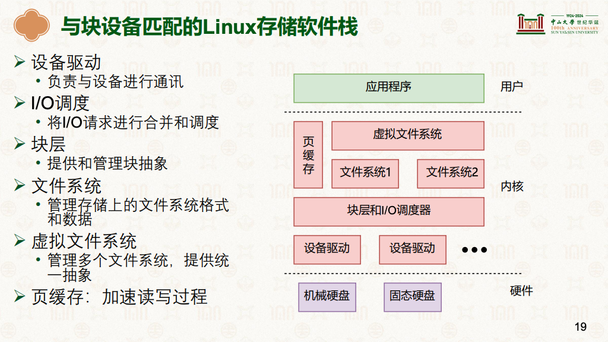
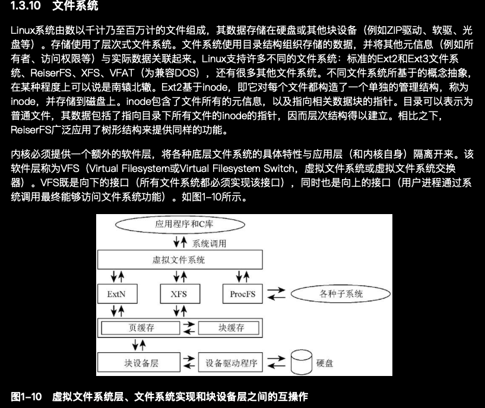
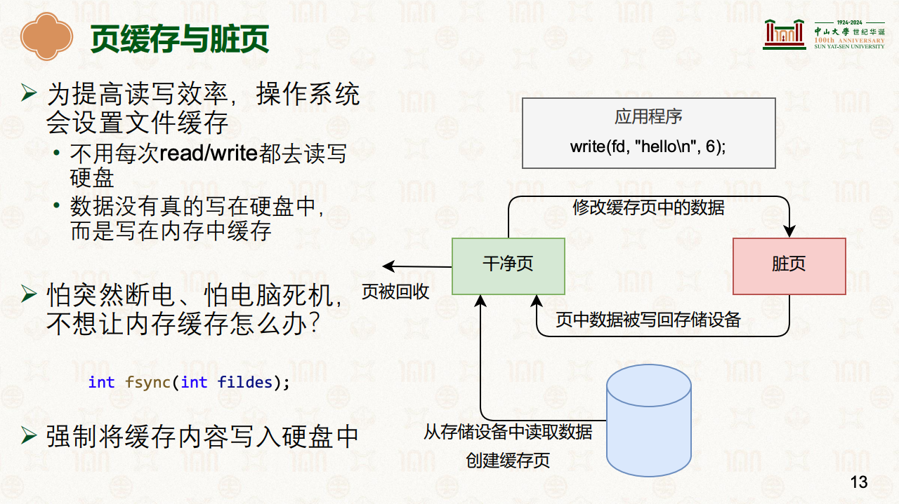

# 文件系统(File System.FS)
先学习:  <br/>[17-文件系统：基于inode的文件系统 [中山大学 操作系统原理]](../../001.UNIX-DOCS/001.操作系统课程/000.中山大学-操作系统2025/9-0424-fs.pdf) <br/> [18-文件系统：使用文件系统 [中山大学 操作系统原理]](../../001.UNIX-DOCS/001.操作系统课程/000.中山大学-操作系统2025/10-0428-fs.pdf)  <br/> [深入理解Linux内核:虚拟文件系统](../../007.BOOKs/Professional-Linux-Kernel-Architecture.epub)  <br/> [文件系统崩溃一致性](../../001.UNIX-DOCS/001.操作系统课程/000.中山大学-操作系统2025/11-0508-fs-crash-1.pdf)  <br/> [文件系统崩溃一致性II](../../001.UNIX-DOCS/001.操作系统课程/000.中山大学-操作系统2025/12-0512-fs-crash-2.pdf)

---

## 简介
Linux 文件系统是操作系统管理和存储文件的一套机制。但 Linux 的精妙之处在于，它不仅用文件系统来存照片和文档，还用它来**“管理内核状态”**。

在 Linux 中，有一句名言：“万物皆文件”（Everything is a file）。
- 常规文件系统（如 Ext4, XFS）
- 虚拟文件系统（如 procfs, sysfs, cgroupfs）：这些文件并不存在于硬盘上，而是内核在内存中虚拟出来的。当你读取这些“文件”时，你其实是在读取内核的状态；当你修改这些“文件”时，你其实是在直接调整内核的参数。

---

## 概念整理
### MOS5 精读系列（Modern Operating Systems 5th Edition）
- [010.MOS5-10.6-Linux文件系统精读.md](010.MOS5-10.6-Linux文件系统精读.md)：VFS 四对象/ext2 布局/ext4 日志/NFS
- [011.MOS5-第4章-文件系统精读.md](011.MOS5-第4章-文件系统精读.md)：文件/目录/分配方案/一致性/性能全章
- [012.WAL预写日志在Linux文件系统中的实现-ext4与JBD2.md](012.WAL预写日志在Linux文件系统中的实现-ext4与JBD2.md)：WAL 机制 + JBD2 提交/恢复全链路
- [013.MOS5-Ext4文件系统.md](013.MOS5-Ext4文件系统.md)：ext2 布局 → ext3/ext4 日志化 → extents(含 JBD 三数据结构与 Fig 10-31/10-32 重绘)
- [014.MOS5-NFS网络文件系统.md](014.MOS5-NFS网络文件系统.md)：导出/挂载、无状态协议、三层实现(v-node/r-node)、缓存一致性与 NFSv4
- [015.Linux-IO系统全路径-从VFS到块设备驱动.md](015.Linux-IO系统全路径-从VFS到块设备驱动.md)：Fig 10-22 重绘——read()/write() 经 VFS→页缓存→通用块层→调度器→驱动的全路径 + VFS 四对象,原 052.INPUT_OUTPUT/007 迁入
- [016.Linux磁盘挂载与目录挂载-mount系统调用到vfsmount.md](016.Linux磁盘挂载与目录挂载-mount系统调用到vfsmount.md)：挂载语义(盘符 vs 单一树)/mount(2) 五分支/vfsmount·mount·mountpoint/路径穿挂载/挂根/umount busy/bind 与容器/NFS 挂载对照

|概念|说明|备注|参考|
|-|-|-|-|
|- 块设备|- 一次性读取多位数据，即“块”  <br/> - “数据总是以固定长度的块进行传输。即使只请求一个字节的数据，设备驱动程序也会从设备取出一个完全块的数据。” <br/>- "块"是一个特定长度的字节序列，用于保存在内核和设备之间传输的数据” <br/>- 对块设备的访问有大规模的缓存，即已经读取的数据保存在内存中。如果再次需要，则直接从内存获得。**写入操作也使用了缓存，以便延迟处理**。<br/>- “对块设备的读写请求不会立即执行对应的操作。相反，这些请求会汇总起来，经过协同之后传输到设备。<sup>(请求队列)</sup>”|- “块的长度可通过软件方法修改”，但 “块的最大长度，会受到特定体系结构的内存页长度的限制”|- [17-文件系统：基于inode的文件系统 [中山大学 操作系统原理]#P17](../../001.UNIX-DOCS/001.操作系统课程/000.中山大学-操作系统2025/9-0424-fs.pdf) <br/>- [深入Linux架构#“6.5　块设备操作”](../../007.BOOKs/Professional-Linux-Kernel-Architecture.epub)|
|-|-|-|-|
|- Linux存储软件技术栈|-  <br/> - |- 应用程序从上往下调用 <br/> 不同文件系统，操作函数不一样，见: [000.LINUX-5.9/include/linux/fs.h]#struct file_operations|- [17-文件系统：基于inode的文件系统 [中山大学 操作系统原理]#P19](../../001.UNIX-DOCS/001.操作系统课程/000.中山大学-操作系统2025/9-0424-fs.pdf) <br/>-  [深入理解Linux内核:1.3.10 文件系统](../../007.BOOKs/Professional-Linux-Kernel-Architecture.epub)|
|-|-|-|-|
|- 页缓存与脏页 <sup>读写都有缓存!</sup>|- |- 为提高读写效率，操作系统会设置文件缓存:<br/>&nbsp;&nbsp;&nbsp;&nbsp;- 不用每次read/write都去读写硬盘:<br/>&nbsp;&nbsp;&nbsp;&nbsp;- 数据没有真的写在硬盘中，而是写在内存中缓存 <br/><br/>- 对块设备的访问有大规模的缓存，即已经读取的数据保存在内存中。如果再次需要，则直接从内存获得。**写入操作也使用了缓存，以便延迟处理** <br/>- “对块设备的读写请求不会立即执行对应的操作。相反，这些请求会汇总起来，经过协同之后传输到设备。<sup>(请求队列)</sup>”|- [17-文件系统：基于inode的文件系统 [中山大学 操作系统原理]#P13](../../001.UNIX-DOCS/001.操作系统课程/000.中山大学-操作系统2025/9-0424-fs.pdf) <br/>- [深入Linux架构#“6.5　块设备操作”](../../007.BOOKs/Professional-Linux-Kernel-Architecture.epub)|
|- 挂载(Mount)|- 把一块盘/一个分区/一个远程目录(乃至本机另一个目录)的文件系统"嫁接"进目录树某处，之后按路径访问，无需知道设备 <br/>- "UNIX does not allow path names to be prefixed by a drive name or number"（不用盘符，设备依赖由挂载消除）<br/>- 挂载点遮蔽：挂载期间原目录内容不可见；文件系统几乎总是挂在空目录|- 与目录树平行的还有一棵 mount 树(struct mount)；路径解析在挂载点跳转(DCACHE_MOUNTED)|- [016.Linux磁盘挂载与目录挂载-mount系统调用到vfsmount.md](016.Linux磁盘挂载与目录挂载-mount系统调用到vfsmount.md) <br/>- [MOS5 §1.5/§10.6.1](../../007.BOOKs/现代操作系统/Modern%20Operating%20Systems%205th%20Edition-PDF-01.pdf#page=798) <br/>- NFS 远程挂载见 [014](014.MOS5-NFS网络文件系统.md)|
|-|-|-|-|
|-|-|-|-|
|-|-|-|-|
|-|-|-|-|

## 文件系统实现
|细节|说明|参考|
|-|-|-|
|-|-|-|
|-|-|-|
|-|-|-|
|-|-|-|

---

## 命令摘要
|命令|说明|备注|
|-|-|-|
|- sudo fsck -t ext4 /dev/sdb2 |-|- 文件系统恢复|
|-|-|-|
|-|-|-|

---

## 内核源码标记
|描述|说明|参考|
|-|-|-|
|- 块设备|- [struct block_device :“ 对设备驱动程序层表示一个块设备”](../../000.SOURCE_CODE/000.LINUX-5.9/000.LINUX-5.9/include/linux/blk_types.h)|-|
|- 挂载|- [struct mount(fs/mount.h): mnt_parent/mnt_mountpoint=挂在哪, mnt(vfsmount)=管什么](../../000.SOURCE_CODE/003.LINUX-7.1.3/000.LINUX-7.1.3/fs/mount.h) <br/> - [struct vfsmount: mnt_root/mnt_sb/mnt_flags](../../000.SOURCE_CODE/003.LINUX-7.1.3/000.LINUX-7.1.3/include/linux/mount.h) <br/> - [SYSCALL_DEFINE5(mount)](../../000.SOURCE_CODE/003.LINUX-7.1.3/000.LINUX-7.1.3/fs/namespace.c) / [__follow_mount_rcu(穿挂载点)](../../000.SOURCE_CODE/003.LINUX-7.1.3/000.LINUX-7.1.3/fs/namei.c)|详见 [016](016.Linux磁盘挂载与目录挂载-mount系统调用到vfsmount.md)|
|-|-|-|
|-|-|-|
|-|-|-|


---

## 查看文件的文件系统类型
```bash
# 1. df -T <文件路径>
wei@Berries:~/VirtualBox_VMs$ df -T /sys/fs/cgroup/
Filesystem     Type    1K-blocks  Used Available Use% Mounted on
cgroup2        cgroup2         0     0         0    - /sys/fs/cgroup


# 2. state -f <文件路径>
wei@Berries:~/VirtualBox_VMs$ stat -f /sys/fs/cgroup/
  File: "/sys/fs/cgroup/"
    ID: 218518cfb40c0f19 Namelen: 255     Type: cgroup2fs
Block size: 4096       Fundamental block size: 4096
Blocks: Total: 0          Free: 0          Available: 0
Inodes: Total: 0          Free: 0

```

---

## 附录:Linux 文件系统全景图
> 参考 MOS5 [Figure 10-22 "The Linux I/O system showing one file system in detail"](../../007.BOOKs/现代操作系统/Modern%20Operating%20Systems%205th%20Edition-PDF-01.pdf#page=792)(书页 763/PDF 792)重绘并扩展成"全景"视角:10-22 只画了一个本地文件系统的 I/O 路径,这里把 VFS 之下"挂着的各种文件系统"与左右两侧的内存管理/网络栈一并画出。各层内核实体均标注 Linux 7.1.3 源码位置。

```text
                                用户进程 (task_struct → files_struct)
                                    │
              fd ──────────────────►│  open/read/write/ioctl/stat… (系统调用)
                                    │
╔═══════════════════════════════════▼══════════════════════════════════════════╗
║  VFS 虚拟文件系统 (fs/)                                                      ║
║   file(fd)──► dentry──► inode──► superblock        四对象见 002.虚拟文件系统 ║
║      │                           │                                           ║
║      │ struct file_operations    │ struct inode_operations / super_operations║
║      │ (函数指针,每类一套)       │   挂载点: dentry → vfsmount(mount表)      ║
╚══════╪═══════════════════════════╪═══════════════════════════════════════════╝
       │                           │
       │              ┌────────────┼──────────────────┬───────────────────┐
       │              │            │                  │                   │
 ╔═════▼═════╗  ╔═════▼═════╗  ╔═══▼════════╗  ╔══════▼══════╗   ╔════════▼═══════╗
 ║ 本地磁盘FS║  ║ 虚拟FS    ║  ║ 网络FS     ║  ║ 用户态FS    ║   ║ 特殊文件       ║
 ║ ext4/xfs/ ║  ║ procfs    ║  ║ NFS(fs/nfs)║  ║ FUSE        ║   ║ 块: /dev/sdX   ║
 ║ btrfs…    ║  ║ sysfs     ║  ║ (v-node↔   ║  ║ (fs/fuse)   ║   ║ 字符: /dev/tty ║
 ║ (fs/ext4) ║  ║ cgroupfs  ║  ║  r-node)   ║  ║             ║   ║ (052/006 笔记) ║
 ╚═════╪═════╝  ╚═════╪═════╝  ╚══╪═════════╝  ╚═════════════╝   ╚════════╪═══════╝
       │              │           │                                       │
       │              │读=取内核状态/写=调内核参数 (README「万物皆文件」) │
       │              │           │ RPC(8KB块/预读)──网络栈(fs/nfsd服务端)│
       ▼              ▼           ▼                                       │
╔═════════════════════════════════════════════════════╗                   │
║ 页缓存 page cache(统一缓存;读写都经它,脏块30s回写)  ║◄─── address_space ║
║  inode->i_mapping = struct address_space            ║   (008.地址空间)  ║
║  filemap_read / readahead [mm/filemap.c]            ║                   │
╚════════════════════════╪════════════════════════════╝                   │
                         │ 未命中/回写 → 生成 bio(段/页/扇区描述)         │
╔════════════════════════▼═════════════════════════╗                      │
║ 通用块层 (block/)  submit_bio → blk_mq_submit_bio║◄────── 000.块设备    ║
║  bio 合并/翻译: 扇区↔块↔缓冲↔页                  ║                      │
╚════════════════════════╪═════════════════════════╝                      │
╔════════════════════════▼═════════════════════════╗                      │
║ I/O 调度器: mq-deadline(电梯+死线0.5s/5s) / kyber║◄─── 007.IO调度器     ║
║        / bfq(按权重分带宽)  [block/mq-deadline.c]║   052/008 笔记       ║
╚════════════════════════╪═════════════════════════╝                      │
╔════════════════════════▼═════════════════════════╗                      │
║ 块设备驱动 → 硬件                                ║                      │
║  NVMe / SCSI / SD / DM(device-mapper,RAID/LVM)   ║                      │
╚════════════════════════╪═════════════════════════╝                      │
                         │ DMA(006.DMA 笔记: 总线地址/IOMMU)              │
                    ┌────▼─────┐                                          │
                    │ 磁盘/SSD │       崩溃一致性: 页缓存↔磁盘窗口 =      │
                    └──────────┘      ext4+JBD2 日志(012/013 笔记)        │
```

**与 Fig 10-22 的对应关系**:

| Fig 10-22 框 | 本图位置 | 内核源码锚点(Linux 7.1.3) | 仓库笔记 |
|-|-|---|---|
| file system(细节框) | 本地磁盘 FS 列 | [fs/ext4/](../../000.SOURCE_CODE/003.LINUX-7.1.3/000.LINUX-7.1.3/fs/ext4) | 013.MOS5-Ext4文件系统 |
| VFS | 顶部四对象 | [fs/super.c:46](../../000.SOURCE_CODE/003.LINUX-7.1.3/000.LINUX-7.1.3/fs/super.c)(super_blocks 链表) | 002.虚拟文件系统 |
| page cache(对应原图 "Cache" 实心填充框) | 页缓存大框 | [mm/filemap.c:2769](../../000.SOURCE_CODE/003.LINUX-7.1.3/000.LINUX-7.1.3/mm/filemap.c)(filemap_read) | 005.页缓存和块缓存 / 008.地址空间 |
| generic block layer(出自 Fig 10-22 所在页正文,原图无此框) | 通用块层 | [block/blk-core.c:627](../../000.SOURCE_CODE/003.LINUX-7.1.3/000.LINUX-7.1.3/block/blk-core.c)(submit_bio) | 000.块设备 |
| I/O scheduler | 调度器层 | [block/mq-deadline.c:30-38](../../000.SOURCE_CODE/003.LINUX-7.1.3/000.LINUX-7.1.3/block/mq-deadline.c) | 007.IO调度器(052/008) |
| disk driver | 驱动层 | [drivers/nvme/](../../000.SOURCE_CODE/003.LINUX-7.1.3/000.LINUX-7.1.3/drivers/nvme) 等 | 052/000.块设备 |
| (10-22 未画)网络 FS | NFS 分支 | [fs/nfs/](../../000.SOURCE_CODE/003.LINUX-7.1.3/000.LINUX-7.1.3/fs/nfs) | 014.MOS5-NFS网络文件系统 |
| (10-22 未画)内核状态 FS | 虚拟 FS 分支 | [fs/proc/](../../000.SOURCE_CODE/003.LINUX-7.1.3/000.LINUX-7.1.3/fs/proc) | 032.Control-Groups / 021.进程管理 |

一句话读图:**VFS 是"万物皆文件"的收口**(普通文件、目录、设备、进程状态、内核参数全走一套系统调用),**页缓存是"内存管理 ↔ 文件系统"的握手区**(address_space),**块层+调度器是"文件系统 ↔ 设备"的必经窄口**(bio/请求队列)。
