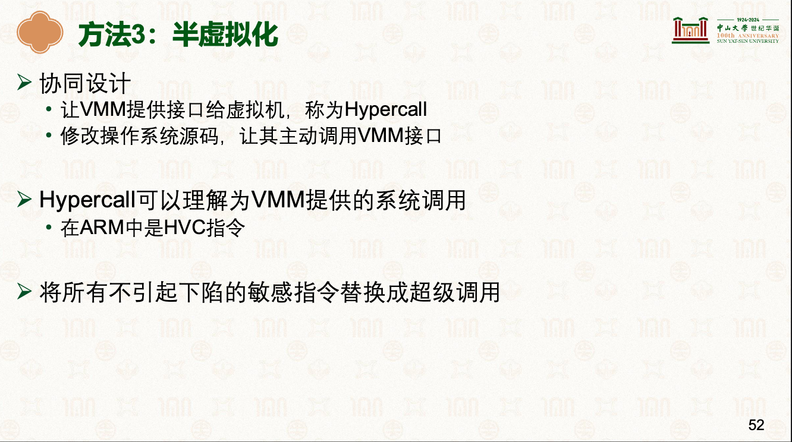
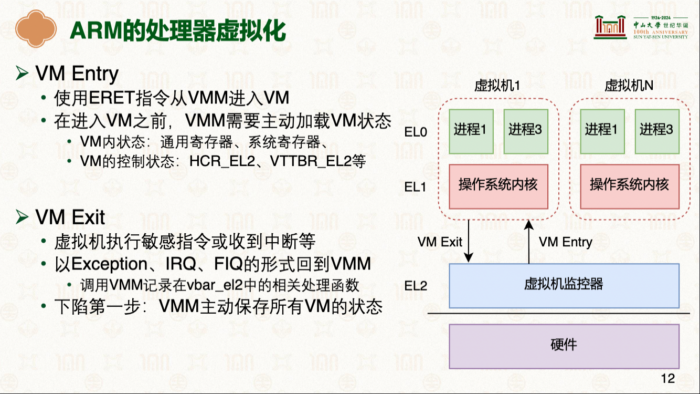
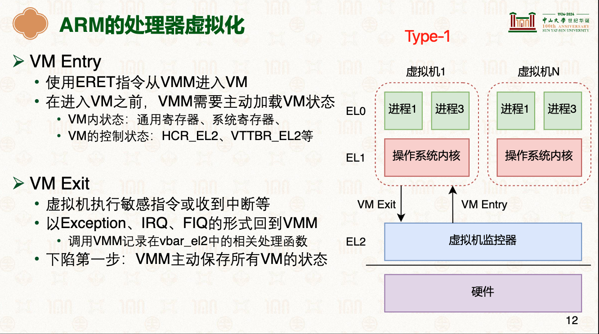
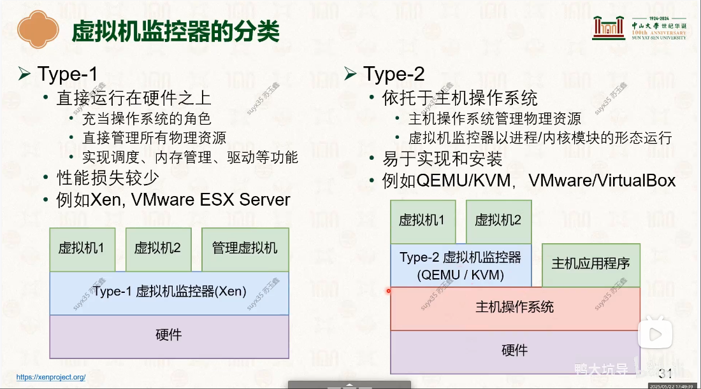
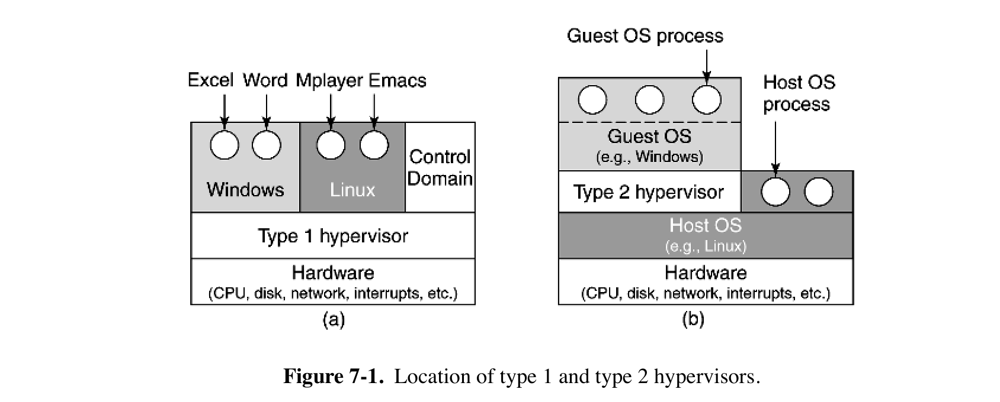
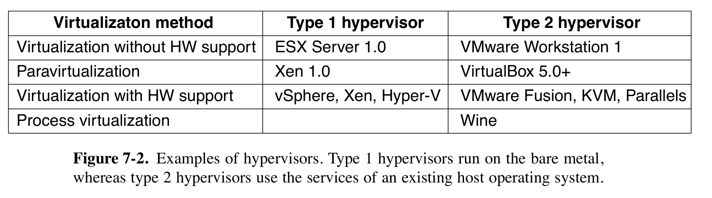

# 系统虚拟化
|重要的概念|说明|备注|
|-|-|-|
|池化|资源抽象为共享资源池  - CPU： 计算资源  - 硬盘： 存储资源|-|
|-|-|-|
|解耦|解除物理硬件和操作系统之间的紧耦合关系,操作系统所需资源从资源池中分配|- 在硬件和虚拟机之间加一层: 虚拟机监控器(VMM: Virtual Machine Monitor 、Hypeisor)： - 向上层虚拟机暴露其所需要的ISAISA: Instruction Set Architecture   - 可同时运行多台虚拟机|
|-|-|-|
|VM是文件|虚拟机(VM)对于硬件来说，就是一个文件，迁移的时候，只需要将这个"文件"迁移到另一台物理服务器上(虚拟机热迁移场景)，而无需修改|- 整台虚拟机的执行环境封装在独立文件中，可以通过移动文件的方式来迁移该虚拟机 in [001.UNIX-DOCS/035.系统虚拟化/000.REF-DOCS/HCIA-Cloud Computing V5.5 培训教材.pdf](../../007.BOOKs/HCIA-Cloud%20Computing%20V5.5%20培训教材.pdf)|
|-|-|-|

---

## 系统虚拟化的流程 (虚拟机监控器行为)
> 指令最终还是运行在物理硬件上

|步骤|说明|备注|
|-|-|-|
|步骤1|- 捕捉所有系统ISA并下陷(Trap) & 返回|- CPU 虚拟化:   -    - |
|-|-|-|
|步骤2|- 由具体指令实现相应虚拟化:  - 控制虚拟处理器行为:[CPU虚拟化](./000.CPU虚拟化/README.md)  - 控制虚拟内存行为[内存虚拟化](./003.内存虚拟化/README.md)  - 控制虚拟设备行为:[002.IO(设备)虚拟化](./002.IO(设备)虚拟化/README.md)|-|
|-|-|-|
|步骤3|- 回到虚拟机继续执行|-|

### HVC 和 ERET 指令区别

| 指令 | 全称 | 作用 | 转换方向 |备注|
| --- | --- | --- | --- | --- |
| **HVC** Hypervisor call to allow OS code to call the Hypervisor. It generates an exception targeting exception level 2 (EL2).(虚拟机监控程序调用，允许作系统代码调用虚拟机管理程序。它生成一个针对异常等级 2（EL2）的异常。) | Hypervisor Call | **发起请求**：从 Non-secure EL1（内核态）调用 EL2（虚拟化层）。 | 向上切换 (Low -> High) |- CPU虚拟化方式之一：`方法3：半虚拟化`[23-虚拟化：CPU虚拟化 [中山大学 操作系统原理]](../../001.UNIX-DOCS/001.操作系统课程/000.中山大学-操作系统2025/13-0522-virt-1.pdf) 的核心 这就要求OS镜像分为 虚拟机版和非虚拟机版|
| **ERET** | Exception Return | **异常返回**：从当前异常级别返回到发生异常之前的级别。 | 向下切换 (High -> Low) ||

---

## 虚拟化核心 - 虚拟机监控器（Virtual Machine Monitor VMM,Hypervisor）
- 向上层虚拟机暴露其所需要的ISA（Instruction Set Architecture）
- 可同时运行多台虚拟机(VM)

### 不同虚拟机内的进程如何切换? [23-虚拟化：CPU虚拟化 [中山大学 操作系统原理]](../../001.UNIX-DOCS/001.操作系统课程/000.中山大学-操作系统2025/14-0526-virt-2.pdf)

### 虚拟机监控器分类
<table>
<th>虚拟化类型</th><th>说明</th><th>虚拟化技术</th><th>参考</th>
<tr><td>Type-1</td><td>直接运行在硬件之上( 又称:  - 本机或裸机虚拟机监控程序  - 裸金属 Hypervisor:此类 Hypervisor 直接在主机的物理硬件上运行。凭借卓越的性能与效率，此类 Hypervisor 广泛应用于企业级数据中心。例如，Google Cloud 采用基于 KVM 的 Hypervisor 作为核心引擎，为 Compute Engine 虚拟机提供强力支撑)</td><td>- VMware ESXi (vSphere): 商业化最成熟，功能最全，企业级私有云的首选。  - KVM (Kernel-based Virtual Machine)：Linux 内核的一部分。目前的公有云（亚马逊 AWS、阿里云、腾讯云）底层几乎全是 KVM 的变体,参考:<a href="./998.IMGS/RedHat一文看懂 KVM 是什么？KVM 虚拟化技术详解.png">什么是 KVM？-RedHat</a> & KVM用户机代码是受VMM控制直接运行在物理CPU上的 出自: <a href="../../007.BOOKs/HCIA-Cloud%20Computing%20V5.5%20培训教材.pdf">HCIA-Cloud Computing V5.5 培训教材.pdf#'虚拟化技术概览'</a>（KVM： 将Linux宿主机转变为一个hypervisor）- KVM 在架构上是 Type-1，但在形态上（依赖 Linux 内核）常被视作 Type-2   - Microsoft Hyper-V：Windows Server 自带，与 Windows 生态集成度极高。 - Xen：以安全隔离性著称，虽然在通用云市场被 KVM 赶超，但在安全系统（如 Qubes OS）和某些嵌入式场景仍在使用 </td><td rowspan="3"></td></tr>
<tr><td> </td><td></td><td></td></tr>
<tr><td>Type-2</td><td>虚拟机当做物理机操作系统的一个进程,又称:  - 托管式 Hypervisor：此类 Hypervisor 以应用形式运行在现有操作系统之上，更适用于桌面环境。此类 Hypervisor 主要应用于开发与测试场景</td><td>- Oracle VirtualBox：开源免费，跨平台支持好   -  VMware Workstation / Player：Windows/Linux 用户常用的桌面虚拟化</td></tr>
</table>

> 书中的经典定义、图 7-1/7-2 与逐句中英对照见文末 **附录 A**（《Modern Operating Systems》5th Ed. §7.3）。

---

## 附录 A：Type 1 与 Type 2 Hypervisor（《Modern Operating Systems》5th Ed. §7.3）

> **出处**：Andrew S. Tanenbaum, Herbert Bos, *Modern Operating Systems*, 5th Edition, §7.3 "Type 1 and Type 2 Hypervisors"，印刷页 **484–486**（PDF 第 513–515 页）。原书：[Modern Operating Systems 5th Edition-PDF-01.pdf](../../007.BOOKs/现代操作系统/Modern%20Operating%20Systems%205th%20Edition-PDF-01.pdf)
>
> **定位**：本文上面的"虚拟机监控器分类"是工程视角；本附录补书里的**原始定义、两张原图、逐句中英对照**，作为术语和分类的权威锚点。

### A.1 一句话

**Type 1 自己当操作系统、直接跑在裸机最高特权级；Type 2 寄宿在宿主 OS 上、像个普通进程，靠宿主分配和调度资源，但仍然向 guest 伪装出一台完整计算机。**

### A.2 原图 7-1：两种 hypervisor 的位置

> **Figure 7-1.** Location of type 1 and type 2 hypervisors.（图 7-1：Type 1 与 Type 2 hypervisor 的位置；原书 p485）

**Type 1 侧（图 7-1a）**

| 图中标注 | 中文 | 说明 |
| - | - | - |
| Excel / Word / MPlayer / Emacs | 应用示例 | 运行在 VM 里的应用 |
| Windows / Linux | guest OS | Type 1 hypervisor 之上的多台虚拟机 |
| Control Domain | 控制域 | 管理域；Xen 中通常对应 dom0 |
| Type 1 hypervisor | Type 1 hypervisor | 直接跑在硬件上、最高特权级 |
| Hardware (CPU, disk, network, interrupts, etc.) | 硬件（CPU、磁盘、网络、中断等） | 物理硬件 |

**Type 2 侧（图 7-1b）**

| 图中标注 | 中文 | 说明 |
| - | - | - |
| Guest OS process | guest OS 的进程 | 运行在 guest OS 里的普通进程 |
| Guest OS (e.g., Windows) | guest OS（如 Windows） | 跑在 Type 2 hypervisor 之上 |
| Type 2 hypervisor | Type 2 hypervisor | 作为 Host OS 里的一个进程运行 |
| Host OS (e.g., Linux) | host OS（如 Linux） | 直接跑在硬件上的 OS |
| Host OS process | host OS 的进程 | 与 Type 2 hypervisor 同层，说明它只是一个普通进程 |
| Hardware (CPU, disk, network, interrupts, etc.) | 硬件（CPU、磁盘、网络、中断等） | 物理硬件 |

### A.3 原图 7-2：Hypervisor 示例

> **Figure 7-2.** Examples of hypervisors. Type 1 hypervisors run on the bare metal, whereas type 2 hypervisors use the services of an existing host operating system.（图 7-2：hypervisor 示例；Type 1 跑在裸机上，Type 2 使用现有宿主 OS 的服务。原书 p486）

| 虚拟化方式（原文） | 中文 | Type 1 hypervisor | Type 2 hypervisor |
| - | - | - | - |
| Virtualization without HW support | 无硬件支持的虚拟化 | ESX Server 1.0 | VMware Workstation 1 |
| Paravirtualization | 半虚拟化 | Xen 1.0 | VirtualBox 5.0+ |
| Virtualization with HW support | 有硬件支持的虚拟化 | vSphere, Xen, Hyper-V | VMware Fusion, KVM, Parallels |
| Process virtualization | 进程级虚拟化 | —— | Wine |

### A.4 中英对照：§7.3 的关键定义与原文

| # | 英文原文 | 中文翻译 | 要点 |
| - | - | - | - |
| 1 | "Goldberg (1972) distinguished between two approaches to virtualization." | Goldberg（1972）把虚拟化分成两类。 | 分类来源 |
| 2 | "One kind of hypervisor, dubbed a **type 1 hypervisor**... Technically, it is like an operating system, since it is the only program running in the most privileged mode." | 一类称为 **Type 1 hypervisor**……技术上它就像一个操作系统，因为它是唯一运行在最高特权级的程序。 | Type 1 定义 |
| 3 | "Its job is to support multiple copies of the actual hardware, called **virtual machines**, similar to the processes a normal operating system runs." | 它的职责是支持多份真实硬件的副本，即**虚拟机**；这类似于普通操作系统管理多个进程。 | Type 1 职责 |
| 4 | "In contrast, a **type 2 hypervisor**... is a program that relies on, say, Windows or Linux to allocate and schedule resources, very much like a regular process." | 相反，**Type 2 hypervisor** 依赖 Windows 或 Linux 等宿主 OS 来分配和调度资源，很像一个普通进程。 | Type 2 定义 |
| 5 | "Of course, the type 2 hypervisor still pretends to be a full computer with a CPU and various devices." | 当然，Type 2 hypervisor 仍然假装自己是一台带 CPU 和各种设备的完整计算机。 | 对 guest 透明 |
| 6 | "Both types of hypervisor must execute the machine's instruction set in a safe manner. For instance, an operating system running on top of the hypervisor may change and even mess up its own page tables, but not those of others." | 两种 hypervisor 都必须以安全的方式执行机器指令集。例如，跑在 hypervisor 之上的 OS 可以修改甚至弄乱自己的页表，但不能影响别人的页表。 | 隔离要求 |
| 7 | "The operating system running on top of the hypervisor in both cases is called the **guest operating system**. For a type 2 hypervisor, the operating system running on the hardware is called the **host operating system**." | 两种情况下跑在 hypervisor 之上的 OS 都叫 **guest OS**；对 Type 2 而言，直接跑在硬件上的 OS 叫 **host OS**。 | 术语 |
| 8 | "Type 2 hypervisors, sometimes referred to as **hosted hypervisors**, depend for much of their functionality on a host operating system such as Windows, Linux, or macOS." | Type 2 hypervisor 又称 **hosted hypervisor**，其大部分功能依赖 Windows、Linux 或 macOS 等宿主 OS。 | 别名 |
| 9 | "The first type 2 hypervisor on the x86 market was **VMware Workstation**." | x86 市场上第一个 Type 2 hypervisor 是 **VMware Workstation**。 | 历史 |
| 10 | "When it starts for the first time, it acts like a newly booted computer and expects to find a DVD, USB drive, or CD-ROM containing an operating system in the drive. This time, however, the drive could be a virtual device." | 首次启动时，它像一台刚启动的计算机，期待光驱里有一张含操作系统的 DVD/USB/CD-ROM；但这次这个驱动器可以是虚拟设备。 | 安装流程 |
| 11 | "Once the guest operating system is installed on the virtual disk, it can be booted and run. It is completely unaware that it has been tricked." | guest OS 安装到虚拟磁盘后即可启动运行；它完全不知道自己被“骗”了。 | 透明性 |
| 12 | "Type 1 hypervisors run on the bare metal, whereas type 2 hypervisors use the services of an existing host operating system." | Type 1 跑在裸机上，Type 2 使用现有宿主 OS 的服务。 | 图 7-2 图注 |

### A.5 对照总结

| 维度 | Type 1 | Type 2 |
| - | - | - |
| 运行位置 | 裸机（bare metal） | 宿主 OS 之上 |
| 特权级 | 最高特权级；是唯一运行在该级的程序 | 宿主 OS 里的一个普通进程 |
| 资源管理 | 自己分配和调度 | 依赖 host OS 分配和调度 |
| 别称 | 本机 / 裸机 hypervisor | hosted hypervisor |
| 对 guest 的透明性 | 提供完整机器 | 同样提供完整机器 |
| 典型代表 | ESX Server 1.0、vSphere、Xen、Hyper-V | VMware Workstation、VirtualBox、VMware Fusion、KVM、Parallels、Wine（进程级） |
| 书中例子 | 见图 7-2 | 见图 7-2 |

### A.6 辨析：KVM 到底算 Type 1 还是 Type 2？

- 本书 **图 7-2 把 KVM 放在 Type 2 列**（"有硬件支持的虚拟化"）。
- 本文上面的分类表写的是："**KVM 在架构上是 Type-1，但在形态上（依赖 Linux 内核）常被视作 Type-2**"。
- 差别在**分类标准**：
  - 按"hypervisor 是否直接跑在裸机上"：KVM 是 Linux 内核模块，依托 Linux 内核，看起来像 Type 2；
  - 按"hypervisor 是否直接控制硬件虚拟化扩展、是否承担资源调度"：KVM 通过 Linux 内核直接使用 VT-x/SVM，Linux 内核本身就是 hypervisor 的一部分，因此常被归为 Type 1。
- **结论**：Type 1/2 是 Goldberg 的经典二分；现实产品（KVM、Xen、Hyper-V）常落在两者之间。读不同资料时，先看它的分类标准。

### A.7 一句话记忆

- **Type 1：Hypervisor 就是"OS"，跑在裸机上，VM 是它的"进程"。**
- **Type 2：Hypervisor 是"进程"，跑在 Host OS 上，Guest OS 是它的"子进程"。**

---

## 参考资料
- [23-虚拟化：CPU虚拟化 [中山大学 操作系统原理]](../../001.UNIX-DOCS/001.操作系统课程/000.中山大学-操作系统2025/13-0522-virt-1.pdf)
- [24-虚拟化：内存、设备虚拟化 [中山大学 操作系统原理]](../../001.UNIX-DOCS/001.操作系统课程/000.中山大学-操作系统2025/14-0526-virt-2.pdf)
- [001.UNIX-DOCS/001.操作系统课程/002.上海交通大学-操作系统2021/OS-18 virtualization-1.pdf](../../001.UNIX-DOCS/001.操作系统课程/002.上海交通大学-操作系统2021/OS-18%20virtualization-1.pdf)
- [什么是虚拟化？ IBM](998.IMGS/virtualization-IBM.png)
- [Ubuntu  KVM/Installation](./998.IMGS/Ubuntu_KVM_Installation-Wiki.png)
- [什么是 KVM？-RedHat](https://www.redhat.com/zh-cn/topics/virtualization/what-is-KVM)
- [KVM介绍](../../007.BOOKs/HCIA-Cloud%20Computing%20V5.5%20培训教材.pdf) #'KVM虚拟化简介'章节
- [HVC (A64)](https://developer.arm.com/documentation/dui0801/l/A64-General-Instructions/HVC--A64-?lang=en)
- [Learn the architecture - AArch64 virtualization](https://developer.arm.com/documentation/102142/0100/Stage-2-translation)
- [Learn the architecture - AArch64 virtualization](../../../006.REFS/learn_the_architecture_aarch64_virtualization_guide_102142_0100_06_en.pdf)
- [Modern Operating Systems, 5th Edition](../../007.BOOKs/现代操作系统/Modern%20Operating%20Systems%205th%20Edition-PDF-01.pdf) §7.3 "Type 1 and Type 2 Hypervisors"（p484–486）：附录 A 的定义、图 7-1/7-2 与中英对照出处
