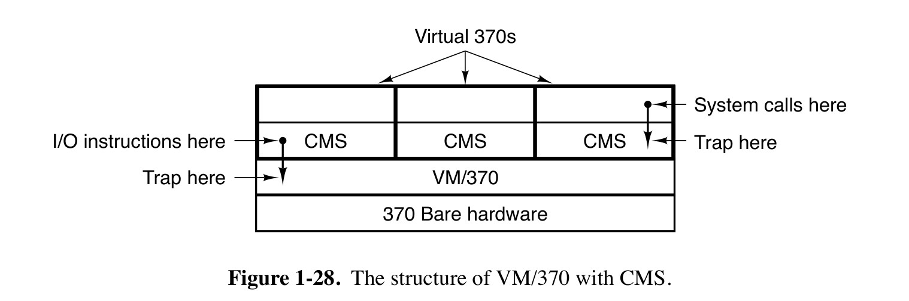
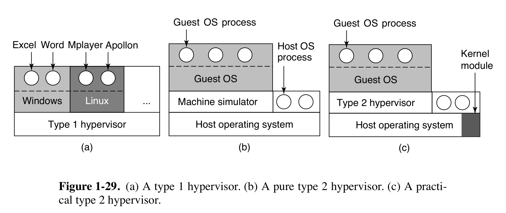

# 系统虚拟化
|重要的概念|说明|备注|
|-|-|-|
|池化|资源抽象为共享资源池  - CPU： 计算资源  - 硬盘： 存储资源|-|
|-|-|-|
|解耦|解除物理硬件和操作系统之间的紧耦合关系,操作系统所需资源从资源池中分配|- 在硬件和虚拟机之间加一层: 虚拟机监控器(VMM: Virtual Machine Monitor 、Hypeisor)： - 向上层虚拟机暴露其所需要的ISAISA: Instruction Set Architecture   - 可同时运行多台虚拟机|
|-|-|-|
|VM是文件|虚拟机(VM)对于硬件来说，就是一个文件，迁移的时候，只需要将这个"文件"迁移到另一台物理服务器上(虚拟机热迁移场景)，而无需修改|- 整台虚拟机的执行环境封装在独立文件中，可以通过移动文件的方式来迁移该虚拟机 in [001.UNIX-DOCS/035.系统虚拟化/000.REF-DOCS/HCIA-Cloud Computing V5.5 培训教材.pdf](../../007.BOOKs/HCIA-Cloud%20Computing%20V5.5%20培训教材.pdf)|
|-|-|-|

---

## 系统虚拟化的流程 (虚拟机监控器行为)
> 指令最终还是运行在物理硬件上

|步骤|说明|备注|
|-|-|-|
|步骤1|- 捕捉所有系统ISA并下陷(Trap) & 返回|- CPU 虚拟化:   -    - |
|-|-|-|
|步骤2|- 由具体指令实现相应虚拟化:  - 控制虚拟处理器行为:[CPU虚拟化](./000.CPU虚拟化/README.md)  - 控制虚拟内存行为[内存虚拟化](./003.内存虚拟化/README.md)  - 控制虚拟设备行为:[002.IO(设备)虚拟化](./002.IO(设备)虚拟化/README.md)|-|
|-|-|-|
|步骤3|- 回到虚拟机继续执行|-|

### HVC 和 ERET 指令区别

| 指令 | 全称 | 作用 | 转换方向 |备注|
| --- | --- | --- | --- | --- |
| **HVC** Hypervisor call to allow OS code to call the Hypervisor. It generates an exception targeting exception level 2 (EL2).(虚拟机监控程序调用，允许作系统代码调用虚拟机管理程序。它生成一个针对异常等级 2（EL2）的异常。) | Hypervisor Call | **发起请求**：从 Non-secure EL1（内核态）调用 EL2（虚拟化层）。 | 向上切换 (Low -> High) |- CPU虚拟化方式之一：`方法3：半虚拟化`[23-虚拟化：CPU虚拟化 [中山大学 操作系统原理]](../../001.UNIX-DOCS/001.操作系统课程/000.中山大学-操作系统2025/13-0522-virt-1.pdf) 的核心 这就要求OS镜像分为 虚拟机版和非虚拟机版|
| **ERET** | Exception Return | **异常返回**：从当前异常级别返回到发生异常之前的级别。 | 向下切换 (High -> Low) ||

---

## 虚拟化核心 - 虚拟机监控器（Virtual Machine Monitor VMM,Hypervisor）
- 向上层虚拟机暴露其所需要的ISA（Instruction Set Architecture）
- 可同时运行多台虚拟机(VM)

### 不同虚拟机内的进程如何切换? [23-虚拟化：CPU虚拟化 [中山大学 操作系统原理]](../../001.UNIX-DOCS/001.操作系统课程/000.中山大学-操作系统2025/14-0526-virt-2.pdf)

### 虚拟机监控器分类
| 虚拟化类型 | 说明 |
| - | - |
| Type-1 | 直接运行在硬件之上（又称：本机或裸机虚拟机监控程序、裸金属 Hypervisor）。自己充当操作系统角色：直接管理全部物理资源，实现调度、内存管理、驱动等功能，性能损失较少；此类 Hypervisor 广泛应用于企业级数据中心 |
| Type-2 | 虚拟机被当作物理机操作系统里的一个进程（又称：托管式 Hypervisor）。依赖宿主操作系统的分配与调度，虚拟机监控器以进程/内核模块形态运行；易于实现和安装，主要用于开发与测试、桌面环境 |

> 分类示意图（中山大学 OS 课件）：左 Type-1 直接跑在硬件上，右 Type-2 依托主机 OS。

#### 典型产品速查

| 产品 | 类型 | 特点 |
| - | - | - |
| VMware ESXi (vSphere) | Type-1 | 商业化最成熟、功能最全，企业级私有云首选 |
| KVM (Kernel-based Virtual Machine) | 架构上 Type-1、形态上常被视作 Type-2（争议见文末 **A.6**） | Linux 内核的一部分，把 Linux 宿主机变成 hypervisor；客户机代码受 VMM 控制、直接运行在物理 CPU 上；公有云（亚马逊 AWS、阿里云、腾讯云）底层几乎全是 KVM 的变体，Google Cloud 也以基于 KVM 的 Hypervisor 作为 Compute Engine 的核心引擎 |
| Microsoft Hyper-V | Type-1 | Windows Server 自带，与 Windows 生态集成度极高 |
| Xen | Type-1 | 以安全隔离性著称；通用云市场被 KVM 赶超，但在安全系统（如 Qubes OS）和部分嵌入式场景仍在使用 |
| Oracle VirtualBox | Type-2 | 开源免费，跨平台支持好 |
| VMware Workstation / Player | Type-2 | Windows/Linux 用户常用的桌面虚拟化 |

> 产品信息出处：HCIA-Cloud Computing V5.5《虚拟化技术概览》（[教材](../../007.BOOKs/HCIA-Cloud%20Computing%20V5.5%20培训教材.pdf)）、RedHat《[什么是 KVM？](https://www.redhat.com/zh-cn/topics/virtualization/what-is-KVM)》（[截图](./998.IMGS/RedHat一文看懂%20KVM%20是什么？KVM%20虚拟化技术详解.png)）。

> 书中的经典定义、图 7-1/7-2 与逐句中英对照见文末 **附录 A**；同一本书 §1.7.5 的 VM/370、JVM 与容器对照见 **附录 B**。

---

## 附录 A：Type 1 与 Type 2 Hypervisor（《Modern Operating Systems》5th Ed. §7.3）

> **出处**：Andrew S. Tanenbaum, Herbert Bos, *Modern Operating Systems*, 5th Edition, §7.3 "Type 1 and Type 2 Hypervisors"，印刷页 **484–486**（PDF 第 513–515 页）。原书：[Modern Operating Systems 5th Edition-PDF-01.pdf](../../007.BOOKs/现代操作系统/Modern%20Operating%20Systems%205th%20Edition-PDF-01.pdf)
>
> **定位**：本文上面的"虚拟机监控器分类"是工程视角；本附录补书里的**原始定义、两张原图、逐句中英对照**，作为术语和分类的权威锚点。

### A.1 一句话

**Type 1 自己当操作系统、直接跑在裸机最高特权级；Type 2 寄宿在宿主 OS 上、像个普通进程，靠宿主分配和调度资源，但仍然向 guest 伪装出一台完整计算机。**

> **注意**：Type 1 hypervisor 本身也是**软件**；“裸机（bare metal）”描述的是它**运行的位置**——下面没有 host OS 这一层，不是指它是硬件或固件。它通常是一个很小的 hypervisor 内核/OS 层（负责调度、内存管理；设备驱动可能在 hypervisor 内，也可能由 Xen dom0 这类控制域提供），运行在最高特权级，并借助 VT-x/SVM 等硬件虚拟化扩展。

### A.2 原图 7-1：两种 hypervisor 的位置

> **Figure 7-1.** Location of type 1 and type 2 hypervisors.（图 7-1：Type 1 与 Type 2 hypervisor 的位置；原书 p485）

**Type 1 侧（图 7-1a）**

| 图中标注 | 中文 | 说明 |
| - | - | - |
| Excel / Word / MPlayer / Emacs | 应用示例 | 运行在 VM 里的应用 |
| Windows / Linux | guest OS | Type 1 hypervisor 之上的多台虚拟机 |
| Control Domain | 控制域 | 管理域；Xen 中通常对应 dom0 |
| Type 1 hypervisor | Type 1 hypervisor | 直接跑在硬件上、最高特权级 |
| Hardware (CPU, disk, network, interrupts, etc.) | 硬件（CPU、磁盘、网络、中断等） | 物理硬件 |

**Type 2 侧（图 7-1b）**

| 图中标注 | 中文 | 说明 |
| - | - | - |
| Guest OS process | guest OS 的进程 | 运行在 guest OS 里的普通进程 |
| Guest OS (e.g., Windows) | guest OS（如 Windows） | 跑在 Type 2 hypervisor 之上 |
| Type 2 hypervisor | Type 2 hypervisor | 作为 Host OS 里的一个进程运行 |
| Host OS (e.g., Linux) | host OS（如 Linux） | 直接跑在硬件上的 OS |
| Host OS process | host OS 的进程 | 与 Type 2 hypervisor 同层，说明它只是一个普通进程 |
| Hardware (CPU, disk, network, interrupts, etc.) | 硬件（CPU、磁盘、网络、中断等） | 物理硬件 |

### A.3 原图 7-2：Hypervisor 示例

> **Figure 7-2.** Examples of hypervisors. Type 1 hypervisors run on the bare metal, whereas type 2 hypervisors use the services of an existing host operating system.（图 7-2：hypervisor 示例；Type 1 跑在裸机上，Type 2 使用现有宿主 OS 的服务。原书 p486）

| 虚拟化方式（原文） | 中文 | Type 1 hypervisor | Type 2 hypervisor |
| - | - | - | - |
| Virtualization without HW support | 无硬件支持的虚拟化 | ESX Server 1.0 | VMware Workstation 1 |
| Paravirtualization | 半虚拟化 | Xen 1.0 | VirtualBox 5.0+ |
| Virtualization with HW support | 有硬件支持的虚拟化 | vSphere, Xen, Hyper-V | VMware Fusion, KVM, Parallels |
| Process virtualization | 进程级虚拟化 | —— | Wine |

### A.4 中英对照：§7.3 的关键定义与原文

| # | 英文原文 | 中文翻译 | 要点 |
| - | - | - | - |
| 1 | "Goldberg (1972) distinguished between two approaches to virtualization." | Goldberg（1972）把虚拟化分成两类。 | 分类来源 |
| 2 | "One kind of hypervisor, dubbed a **type 1 hypervisor**... Technically, 🔴 **it is like an operating system**, since it is the only program running in the most privileged mode." | 一类称为 **Type 1 hypervisor**……技术上它就像一个操作系统，因为它是唯一运行在最高特权级的程序。 | Type 1 定义 |
| 3 | "Its job is to support multiple copies of the actual hardware, called **virtual machines**, similar to the processes a normal operating system runs." | 它的职责是支持多份真实硬件的副本，即**虚拟机**；这类似于普通操作系统管理多个进程。 | Type 1 职责 |
| 4 | "In contrast, a **type 2 hypervisor**... is a program that relies on, say, Windows or Linux to allocate and schedule resources, very much like a regular process." | 相反，**Type 2 hypervisor** 依赖 Windows 或 Linux 等宿主 OS 来分配和调度资源，很像一个普通进程。 | Type 2 定义 |
| 5 | "Of course, the type 2 hypervisor still pretends to be a full computer with a CPU and various devices." | 当然，Type 2 hypervisor 仍然假装自己是一台带 CPU 和各种设备的完整计算机。 | 对 guest 透明 |
| 6 | "Both types of hypervisor must execute the machine's instruction set in a safe manner. For instance, an operating system running on top of the hypervisor may change and even mess up its own page tables, but not those of others." | 两种 hypervisor 都必须以安全的方式执行机器指令集。例如，跑在 hypervisor 之上的 OS 可以修改甚至弄乱自己的页表，但不能影响别人的页表。 | 隔离要求 |
| 7 | "The operating system running on top of the hypervisor in both cases is called the **guest operating system**. For a type 2 hypervisor, the operating system running on the hardware is called the **host operating system**." | 两种情况下跑在 hypervisor 之上的 OS 都叫 **guest OS**；对 Type 2 而言，直接跑在硬件上的 OS 叫 **host OS**。 | 术语 |
| 8 | "Type 2 hypervisors, sometimes referred to as **hosted hypervisors**, depend for much of their functionality on a host operating system such as Windows, Linux, or macOS." | Type 2 hypervisor 又称 **hosted hypervisor**，其大部分功能依赖 Windows、Linux 或 macOS 等宿主 OS。 | 别名 |
| 9 | "The first type 2 hypervisor on the x86 market was **VMware Workstation**." | x86 市场上第一个 Type 2 hypervisor 是 **VMware Workstation**。 | 历史 |
| 10 | "When it starts for the first time, it acts like a newly booted computer and expects to find a DVD, USB drive, or CD-ROM containing an operating system in the drive. This time, however, the drive could be a virtual device." | 首次启动时，它像一台刚启动的计算机，期待光驱里有一张含操作系统的 DVD/USB/CD-ROM；但这次这个驱动器可以是虚拟设备。 | 安装流程 |
| 11 | "Once the guest operating system is installed on the virtual disk, it can be booted and run. It is completely unaware that it has been tricked." | guest OS 安装到虚拟磁盘后即可启动运行；它完全不知道自己被“骗”了。 | 透明性 |
| 12 | "Type 1 hypervisors run on the bare metal, whereas type 2 hypervisors use the services of an existing host operating system." | Type 1 跑在裸机上，Type 2 使用现有宿主 OS 的服务。 | 图 7-2 图注 |

### A.5 对照总结

| 维度 | Type 1 | Type 2 |
| - | - | - |
| 运行位置 | 裸机（bare metal） | 宿主 OS 之上 |
| 特权级 | 最高特权级；是唯一运行在该级的程序 | 宿主 OS 里的一个普通进程 |
| 资源管理 | 自己分配和调度 | 依赖 host OS 分配和调度 |
| 别称 | 本机 / 裸机 hypervisor | hosted hypervisor |
| 对 guest 的透明性 | 提供完整机器 | 同样提供完整机器 |
| 典型代表 | ESX Server 1.0、vSphere、Xen、Hyper-V | VMware Workstation、VirtualBox、VMware Fusion、KVM、Parallels、Wine（进程级） |
| 书中例子 | 见图 7-2 | 见图 7-2 |

> **“自己分配和调度”指什么？** 这不是 §7.3 原文，而是对上表“资源管理”一行的展开：Type 1 跑在裸机最高特权级，下面没有 host OS，物理资源由它直接掌管——CPU（vCPU 在物理 CPU 上的调度）、内存（物理页帧分配 + guest 物理地址 → 机器物理地址映射）、I/O/中断（设备管理与路由）、存储（裸磁盘/分区/卷）。`分配` 是把物理资源划给某个 VM；`调度` 是在多个 VM/vCPU 之间时分复用。Type 2 则是 host OS 的一个进程：物理 CPU、内存、设备先由 host OS 分配/调度给它，它再在内部二次分配给 guest。

| 资源 | Type 1：自己分配和调度 | Type 2：依赖 host OS |
| - | - | - |
| CPU | vCPU 调度到物理 CPU；决定时间片/优先级 | host OS 调度 hypervisor 进程，hypervisor 再调度 vCPU |
| 内存 | 物理页帧分配给各 VM；维护 guest 物理地址 → 机器物理地址映射 | 先向 host OS 申请内存，再在进程内分给 guest |
| I/O / 中断 | 自己拥有/管理设备，决定中断路由到哪个 VM | 物理设备由 host OS 驱动处理，hypervisor 模拟/转发 |
| 存储 | 直接管理裸磁盘/分区/卷 | 虚拟磁盘通常是 host 文件系统里的一个文件 |

> 边界：Type 1 仍可能借助固件或控制域（如 Xen dom0）跑设备驱动，但**资源所有权与调度核心仍在 hypervisor**，dom0 不是 host OS；KVM 是特例（Linux 内核本身即 hypervisor），分类争议见 **A.6**。

### A.6 辨析：KVM 到底算 Type 1 还是 Type 2？

- 本书 **图 7-2 把 KVM 放在 Type 2 列**（"有硬件支持的虚拟化"）。
- 本文上面的分类表写的是："**KVM 在架构上是 Type-1，但在形态上（依赖 Linux 内核）常被视作 Type-2**"。
- 差别在**分类标准**：
  - 按"hypervisor 是否直接跑在裸机上"：KVM 是 Linux 内核模块，依托 Linux 内核，看起来像 Type 2；
  - 按"hypervisor 是否直接控制硬件虚拟化扩展、是否承担资源调度"：KVM 通过 Linux 内核直接使用 VT-x/SVM，Linux 内核本身就是 hypervisor 的一部分，因此常被归为 Type 1。
- **结论**：Type 1/2 是 Goldberg 的经典二分；现实产品（KVM、Xen、Hyper-V）常落在两者之间。读不同资料时，先看它的分类标准。

### A.7 一句话记忆

- **Type 1：Hypervisor 就是"OS"，跑在裸机上，VM 是它的"进程"。**
- **Type 2：Hypervisor 是"进程"，跑在 Host OS 上，Guest OS 是它的"子进程"。**

---

## 附录 B：§1.7.5 Virtual Machines 中英对照与小结（《Modern Operating Systems》5th Ed.）

> **出处**：Andrew S. Tanenbaum, Herbert Bos, *Modern Operating Systems*, 5th Edition, §1.7.5 "Virtual Machines"，印刷页 **69–73**（PDF 第 98–102 页）。原书：[Modern Operating Systems 5th Edition-PDF-01.pdf](../../007.BOOKs/现代操作系统/Modern%20Operating%20Systems%205th%20Edition-PDF-01.pdf)
>
> **定位**：附录 A 是 §7.3 的 Type 1/Type 2 分类；本附录是同一本书更早的"虚拟机"导论，补 **VM/370 的起源、PC 世界为什么重新发现虚拟机、三条实现路线、JVM 与容器**。两节对照读，能看清"虚拟机"这个词在三层意义上的用法：**硬件副本（VM/370、Type 1/2）→ 指令集（JVM）→ OS 用户态（容器）**。

### B.1 一句话

**VM/370 把"多道程序"和"扩展机器"拆开：VMM 在裸机上做多道程序，向上提供多台"裸机的精确副本"；每台 VM 可跑不同 OS。** 这条思路后来演化成 Type 1/Type 2 hypervisor；JVM 和容器则是另外两种"虚拟机"形态。

### B.2 中英对照（逐段全译）

> 下表按原书段落逐段对照：英文为原文，中文为逐句全译，不再做摘要或省略；编号 1–21 按原书顺序。

#### B.2.1 VM/370：VMM 与"裸机副本"

> **Figure 1-28.** The structure of VM/370 with CMS.（图 1-28：VM/370 与 CMS 的结构；原书 p70）

| # | 英文原文 | 中文翻译 | 要点 |
| - | - | - | - |
| 1 | The initial releases of OS/360 were strictly batch systems. Nevertheless, many 360 users wanted to be able to work interactively at a terminal, so various groups, both inside and outside IBM, decided to write timesharing systems for it. The official IBM timesharing system, TSS/360, was delivered late, and when it finally arrived it was so big and slow that few sites converted to it. It was eventually abandoned after its development had consumed some $50 million (Graham, 1970). But a group at IBM’s Scientific Center in Cambridge, Massachusetts, produced a radically different system that IBM eventually accepted as a product. A linear descendant of it, called z/VM, is now widely used on IBM’s current mainframes, the zSeries, which are heavily used in large corporate data centers, for example, as e-commerce servers that handle hundreds or thousands of transactions per second and use databases whose sizes run to millions of gigabytes. | OS/360 最初的版本是严格的批处理系统。然而，许多 360 用户希望能在终端上交互工作，因此 IBM 内外的一些团体决定为它编写分时系统。IBM 官方的分时系统 TSS/360 交付得很晚，而且最终问世时又大又慢，几乎没有站点迁移到它上面。在开发耗资约 5000 万美元后，它最终被放弃（Graham，1970）。但 IBM 位于马萨诸塞州剑桥的科学中心的一个小组做出了一个截然不同的系统，IBM 最终将其作为产品接受。它的直系后代叫 z/VM，如今广泛用于 IBM 当前的大型机 zSeries；这些大型机大量用于大型企业数据中心，例如作为电子商务服务器，每秒处理数百或数千笔交易，使用的数据库规模可达数百万 GB。 | 背景：批处理 → 分时 → CP/CMS → z/VM |
| 2 | This system, originally called CP/CMS and later renamed VM/370 (Seawright and MacKinnon, 1979), was based on an astute observation: a timesharing system provides (1) multiprogramming and (2) an extended machine with a more convenient interface than the bare hardware. The essence of VM/370 is to completely separate these two functions. | 这个系统最初叫 CP/CMS，后来更名为 VM/370（Seawright 和 MacKinnon，1979）。它基于一个敏锐的观察：分时系统提供（1）多道程序设计和（2）比裸机接口更方便的扩展机器。VM/370 的本质就是把这两个功能完全分开。 | 分时 = 多道程序 + 扩展机器；VM/370 把两者拆开 |
| 3 | The heart of the system, called a virtual machine monitor, runs on the bare hardware and does the multiprogramming, providing not one, but several virtual machines to the next layer up, as shown in Fig. 1-28. However, unlike all other operating systems, these virtual machines are not extended machines, with files and other nice features. Instead, they are exact copies of the bare hardware, including kernel/user mode, I/O, interrupts, and everything else the real machine has. | 系统的核心叫虚拟机监控器（VMM），它跑在裸机上、负责多道程序设计，向上层提供的不只是一台，而是多台虚拟机，如图 1-28 所示。然而，与所有其他操作系统不同，这些虚拟机不是带文件等便利功能的扩展机器，而是裸机的精确副本，包括内核/用户模式、I/O、中断以及真实机器拥有的一切。 | VMM 在裸机上做多道程序；VM = 裸机精确副本 |
| 4 | Because each virtual machine is identical to the true hardware, each one can run any operating system that will run directly on the bare hardware. Different virtual machines can, and frequently do, run different operating systems. On the original IBM VM/370 system, some ran OS/360 or one of the other large batch or transaction-processing operating systems, while others ran a single-user, interactive system called CMS (Conversational Monitor System) for interactive timesharing users. The latter was popular with programmers. | 因为每台虚拟机都与真实硬件完全相同，所以每台都能运行任何可直接跑在裸机上的操作系统。不同虚拟机可以、而且经常运行不同的操作系统。在最初的 IBM VM/370 系统上，有些虚拟机运行 OS/360 或其他大型批处理/事务处理操作系统，另一些则运行一个供交互式分时用户使用的单用户交互系统 CMS（Conversational Monitor System，会话监控系统）。后者很受程序员欢迎。 | 多 OS 并存；CMS 是交互式单用户系统 |
| 5 | When a CMS program executed a system call, the call was trapped to the operating system in its own virtual machine, not to VM/370, just as it would be were it running on a real machine instead of a virtual one. CMS then issued the normal hardware I/O instructions for reading its virtual disk or whatever was needed to carry out the call. These I/O instructions were trapped by VM/370, which then performed them as part of its simulation of the real hardware. By completely separating the functions of multiprogramming and providing an extended machine, each of the pieces could be much simpler, more flexible, and much easier to maintain. | CMS 程序执行系统调用时，调用陷入的是它自己那台虚拟机里的操作系统，而不是 VM/370——就像它跑在真机上而不是虚拟机上一样。CMS 随后发出正常的硬件 I/O 指令，去读它的虚拟磁盘或执行调用所需的任何操作。这些 I/O 指令被 VM/370 陷入，由 VM/370 作为“模拟真实硬件”的一部分来执行。通过把多道程序设计和提供扩展机器这两个功能完全分开，每一部分都可以更简单、更灵活、更容易维护。 | 两级陷入：syscall → 本 VM OS；I/O → VM/370 |
| 6 | In its modern incarnation, z/VM is usually used to run multiple complete operating systems rather than stripped-down single-user systems like CMS. For example, the zSeries is capable of running one or more Linux virtual machines along with traditional IBM operating systems. | 在现代形态下，z/VM 通常用于运行多个完整的操作系统，而不是像 CMS 那样精简的单用户系统。例如，zSeries 能够运行一台或多台 Linux 虚拟机，同时运行传统的 IBM 操作系统。 | 现代 z/VM 跑多个完整 OS（含 Linux） |

#### B.2.2 PC 世界为什么重新发现虚拟机

| # | 英文原文 | 中文翻译 | 要点 |
| - | - | - | - |
| 7 | While IBM has had a virtual-machine product available for four decades, and a few other companies, including Oracle and Hewlett-Packard, have recently added virtual-machine support to their high-end enterprise servers, the idea of virtualization has largely been ignored in the PC world until recently. But in the past decades, a combination of new needs, new software, and new technologies have combined to make it a hot topic. | 尽管 IBM 的虚拟机产品已经存在了四十年，Oracle 和惠普等其他少数公司最近也在其高端企业服务器上增加了虚拟机支持，但直到最近，虚拟化思想在 PC 世界基本被忽视。然而在过去几十年里，新需求、新软件和新技术的结合使它成为一个热门话题。 | PC 世界为何后来才热：新需求/新软件/新技术 |
| 8 | First the needs. Many companies have traditionally run their mail servers, Web servers, FTP servers, and other servers on separate computers, sometimes with different operating systems. They see virtualization as a way to run them all on the same machine without having a crash of one server bring down the rest. | 首先是需求。许多公司传统上把邮件服务器、Web 服务器、FTP 服务器等跑在不同计算机上，有时还跑不同的操作系统。他们希望用虚拟化把它们全部放到同一台机器上，同时一台服务器崩溃不会拖垮其余服务器。 | 服务器整合：一台崩溃不拖垮其他 |
| 9 | Virtualization is also popular in the Web hosting world. Without virtualization, Web hosting customers are forced to choose between shared hosting (which just gives them a login account on a Web server, but no control over the server software) and dedicated hosting (which gives them their own machine, which is very flexible but not cost effective for small to medium Websites). When a Web hosting company offers virtual machines for rent, a single physical machine can run many virtual machines, each of which appears to be a complete machine. Customers who rent a virtual machine can run whatever operating system and software they want to, but at a fraction of the cost of a dedicated server (because the same physical machine supports many virtual machines at the same time). | 虚拟化在 Web 托管领域也很流行。没有虚拟化时，Web 托管客户只能在共享托管（只给一个 Web 服务器上的登录账号，但不能控制服务器软件）和独立托管（独占一台机器，非常灵活，但对中小网站不划算）之间二选一。当托管商出租虚拟机时，一台物理机可以跑多台虚拟机，每台看起来都是一台完整机器。租用虚拟机的客户可以运行任何想要的操作系统和软件，但成本只是独立服务器的一小部分（因为同一台物理机同时支持多台虚拟机）。 | Web 托管：共享 vs 独立；VM 出租 |
| 10 | Another use of virtualization is for end users who want to be able to run two or more operating systems at the same time, say Windows and Linux, because some of their favorite application packages run on one and some run on the other. This situation is illustrated in Fig. 1-29(a), where the term “virtual machine monitor” has been renamed type 1 hypervisor, which is commonly used nowadays because “virtual machine monitor” requires more keystrokes than people are prepared to put up with now. Note that many authors use the terms interchangeably though. | 另一个用途是让终端用户同时运行两个或更多操作系统，比如 Windows 和 Linux，因为他们喜欢的应用有些只能跑在其中一个上。这种情况如图 1-29(a) 所示；图中“虚拟机监控器”这个术语被改名为 Type 1 hypervisor，这个叫法如今很常用，因为“虚拟机监控器”需要敲的键比现在的人愿意忍受的更多。注意，许多作者仍然把这两个术语混用。 | 桌面多系统；VMM 改称 Type 1 hypervisor |

#### B.2.3 可虚拟性与三条实现路线

> **Figure 1-29.** (a) A type 1 hypervisor. (b) A pure type 2 hypervisor. (c) A practical type 2 hypervisor.（图 1-29：(a) Type 1；(b) 纯 Type 2；(c) 实用 Type 2；原书 p71）

| # | 英文原文 | 中文翻译 | 要点 |
| - | - | - | - |
| 11 | While no one disputes the attractiveness of virtual machines today, the problem then was implementation. In order to run virtual machine software on a computer, its CPU must be virtualizable (Popek and Goldberg, 1974). In a nutshell, here is the problem. When an operating system running on a virtual machine (in user mode) executes a privileged instruction, such as modifying the PSW or doing I/O, it is essential that the hardware trap to the virtual-machine monitor so the instruction can be emulated in software. On some CPUs—notably the Pentium, its predecessors, and its clones—attempts to execute privileged instructions in user mode are just ignored. This property made it impossible to have virtual machines on this hardware, which explains the lack of interest in the x86 world. Of course, there were interpreters for the Pentium, such as Bochs, that ran on the Pentium, but with a performance loss of one to two orders of magnitude, they were not useful for serious work. | 尽管今天没有人怀疑虚拟机的吸引力，但当时的问题在于实现。要在计算机上运行虚拟机软件，其 CPU 必须是可虚拟化的（Popek 和 Goldberg，1974）。简而言之，问题如下。当运行在虚拟机中的操作系统（处于用户态）执行一条特权指令——例如修改 PSW 或执行 I/O——时，硬件必须陷入虚拟机监控器，以便在软件中模拟该指令。在某些 CPU 上——尤其是 Pentium 及其前辈和兼容芯片——在用户态执行特权指令会被直接忽略。这一特性使得在这类硬件上不可能实现虚拟机，也解释了 x86 世界为何缺乏兴趣。当然，Pentium 上有 Bochs 这类解释器，但性能损失一到两个数量级，无法用于严肃工作。 | 可虚拟性前提；Pentium 忽略特权指令；Bochs 太慢 |
| 12 | This situation changed as a result of several academic research projects in the 1990s and early years of this millennium, notably Disco at Stanford (Bugnion et al., 1997) and Xen at Cambridge University (Barham et al., 2003). These research papers led to several commercial products (e.g., VMware Workstation and Xen) and a revival of interest in virtual machines. Besides VMware and Xen, popular hypervisors today include KVM (for the Linux kernel), VirtualBox (by Oracle), and Hyper-V (by Microsoft). | 20 世纪 90 年代和本世纪初的几个学术研究项目改变了这一局面，尤其是斯坦福的 Disco（Bugnion 等，1997）和剑桥大学的 Xen（Barham 等，2003）。这些研究论文催生了若干商业产品（例如 VMware Workstation 和 Xen），并引发了虚拟机兴趣的复兴。除了 VMware 和 Xen，如今流行的 hypervisor 还包括 KVM（用于 Linux 内核）、VirtualBox（Oracle）和 Hyper-V（Microsoft）。 | 研究项目 → 商业产品；KVM/VirtualBox/Hyper-V |
| 13 | Some of the early research projects improved the performance over interpreters like Bochs by translating blocks of code on the fly, storing them in an internal cache, and then reusing them if they were executed again. This improved the performance considerably, and led to what we will call machine simulators, as shown in Fig. 1-29(b). However, although this technique, known as binary translation, helped improve matters, the resulting systems, while good enough to publish papers about in academic conferences, were still not fast enough to use in commercial environments where performance matters a lot. | 早期一些研究项目通过“即时翻译代码块、存入内部缓存、再次执行时复用”来提升相对 Bochs 这类解释器的性能。这显著提升了性能，并引出了我们所说的机器模拟器，如图 1-29(b) 所示。然而，尽管这种称为二进制翻译的技术改善了情况，所得系统虽然足以在学术会议上发表论文，但仍不够快，无法用于对性能要求很高的商业环境。 | 二进制翻译 + 缓存；能发论文但不够商用 |
| 14 | The next step in improving performance was to add a kernel module to do some of the heavy lifting, as shown in Fig. 1-29(c). In practice now, all commercially available hypervisors, such as VMware Workstation, use this hybrid strategy (and have many other improvements as well). They are called type 2 hypervisors by everyone, so we will (somewhat grudgingly) go along and use this name in the rest of this book, even though we would prefer to called them type 1.7 hypervisors to reflect the fact that they are not entirely user-mode programs. In Chap. 7, we will describe in detail how VMware Workstation works and what the various pieces do. | 提升性能的下一步是加一个内核模块来承担一部分重活，如图 1-29(c) 所示。如今在实践中，所有商用 hypervisor（如 VMware Workstation）都采用这种混合策略（并且还有许多其他改进）。大家都叫它们 Type 2 hypervisor，所以我们也（有点不情愿地）沿用这个名字，尽管我们更愿意叫它们 Type 1.7，以反映它们并非完全是用户态程序。第 7 章将详细描述 VMware Workstation 如何工作，以及各个部分做什么。 | 内核模块混合；实用 Type 2；作者戏称 Type 1.7 |
| 15 | In practice, the real distinction between a type 1 hypervisor and a type 2 hypervisor is that a type 2 makes uses of a host operating system and its file system to create processes, store files, and so on. A type 1 hypervisor has no underlying support and must perform all these functions itself. | 实践中，Type 1 与 Type 2 hypervisor 的真正区别在于：Type 2 利用宿主操作系统及其文件系统来创建进程、存储文件等；Type 1 没有底层支持，必须自己完成所有这些功能。 | 本质区别：Type 2 用 host OS/FS；Type 1 自己管 |
| 16 | After a type 2 hypervisor is started, it reads the installation image file for the chosen guest operating system and installs the guest OS on a virtual disk, which is just a big file in the host operating system’s file system. Type 1 hypervisors cannot do this because there is no host operating system to store files on. They must manage their own storage on a raw disk partition. | Type 2 hypervisor 启动后，读取所选 guest OS 的安装镜像文件，把 guest OS 装到虚拟磁盘上——虚拟磁盘只是宿主 OS 文件系统里的一个大文件。Type 1 做不到这一点，因为没有宿主 OS 可供存文件；它们必须在裸磁盘分区上管理自己的存储。 | 存储：Type 2 虚拟磁盘=host 文件；Type 1 裸分区 |
| 17 | When the guest operating system is booted, it does the same thing it does on the actual hardware, typically starting up some background processes and then a GUI. To the user, the guest operating system behaves the same way it does when running on the bare metal even though that is not the case here. | guest 操作系统启动时，做的事情与在真实硬件上一样：通常先启动一些后台进程，然后启动 GUI。对用户来说，guest 操作系统的行为与跑在裸机上时相同，尽管实际情况并非如此。 | guest 启动与裸机一致：后台进程 + GUI |
| 18 | A different approach to handling control instructions is to modify the operating system to remove them. This approach is not true virtualization. Instead it is called paravirtualization. We will discuss virtualization in Chap. 7. | 另一种处理控制指令的方法是修改操作系统、把这些指令去掉。这不是真正的虚拟化，而叫半虚拟化。我们将在第 7 章讨论虚拟化。 | 半虚拟化：改 OS 去掉控制指令 |

#### B.2.4 JVM 与容器：另外两种"虚拟机"

| # | 英文原文 | 中文翻译 | 要点 |
| - | - | - | - |
| 19 | Another area where virtual machines are used, but in a somewhat different way, is for running Java programs. When Sun Microsystems invented the Java programming language, it also invented a virtual machine (i.e., a computer architecture) called the JVM (Java Virtual Machine). Sun no longer exists today (because Oracle bought the company), but Java is still with us. The Java compiler produces code for JVM, which then typically is executed by a software JVM interpreter. The advantage of this approach is that the JVM code can be shipped over the Internet to any computer that has a JVM interpreter and run there. If the compiler had produced SPARC or x86 binary programs, for example, they could not have been shipped and run anywhere as easily. (Of course, Sun could have produced a compiler that produced SPARC binaries and then distributed a SPARC interpreter, but JVM is a much simpler architecture to interpret.) Another advantage of using JVM is that if the interpreter is implemented properly, which is not completely trivial, incoming JVM programs can be checked for safety and then executed in a protected environment so they cannot steal data or do any damage. | 虚拟机还有一个用途，方式略有不同：运行 Java 程序。Sun Microsystems 发明 Java 语言时，也发明了一台称为 JVM（Java Virtual Machine，Java 虚拟机）的虚拟机（即一种计算机体系结构）。Sun 今天已不存在（因为 Oracle 收购了该公司），但 Java 仍然存在。Java 编译器生成 JVM 代码，JVM 代码通常由软件 JVM 解释器执行。这种做法的优点是，JVM 代码可以通过互联网传输到任何有 JVM 解释器的计算机上并在那里运行。例如，如果编译器生成的是 SPARC 或 x86 二进制程序，就不可能这么容易地到处传输和运行。（当然，Sun 也可以让编译器生成 SPARC 二进制程序，然后分发一个 SPARC 解释器，但 JVM 是更容易解释的体系结构。）使用 JVM 的另一个优点是：如果解释器实现得当（这并不完全简单），传入的 JVM 程序可以先经过安全检查，然后在一个受保护的环境中执行，从而无法窃取数据或造成任何破坏。 | JVM：指令集级 VM；可移植 + 安全检查 |
| 20 | Besides full virtualization, we can also run multiple instances of an operating system on a single machine at the same time by having the operating system itself support different systems, or containers. Containers are provided by the host operating system such as Windows or Linux and mostly run just the user mode portion of an operating system. Each container shares the host operating system kernel and typically the binaries and libraries in a read-only fashion. This way, a Linux host can support many Linux containers. Since a container does not contain a full operating system, it can be extremely lightweight. | 除了完全虚拟化，我们还可以让操作系统本身支持不同的系统——即容器——从而在同一台机器上同时运行操作系统的多个实例。容器由 Windows 或 Linux 等宿主操作系统提供，通常只运行操作系统的用户态部分。每个容器共享宿主操作系统内核，通常以只读方式共享二进制和库。这样，一台 Linux 宿主可以支持许多 Linux 容器。由于容器不包含完整的操作系统，它可以非常轻量。 | 容器：共享 host 内核；轻量 |
| 21 | Of course, there are downsides to containers also. First, it is not possible to run a container with a completely different operating system from that of the host. Also, unlike virtual machines, there is no strict resource partitioning. The container may be restricted in what it may access on SSD or disk and how much CPU time it gets, but all containers still share the resources in the underlying host operating system. Phrased differently, containers are process-level isolated. This means that a container that messes with the stability of the underlying kernel will also affect other containers. | 当然，容器也有缺点。首先，容器无法运行与宿主完全不同的操作系统。其次，与虚拟机不同，容器没有严格的资源分区。容器可以限制能访问 SSD 或磁盘上的哪些内容、能获得多少 CPU 时间，但所有容器仍然共享底层宿主操作系统中的资源。换一种说法，容器是进程级隔离的。这意味着一个容器破坏了底层内核的稳定性，也会影响其他容器。 | 容器局限：不能异构 OS；无严格分区；进程级隔离 |

### B.3 小结

**1. VM/370 的两个拆分**

- 分时系统 = **多道程序** + **扩展机器**；VM/370 把两者拆给不同层：
  - VMM（裸机、最高特权）只做多道程序；
  - 每台 VM 是**裸机的精确副本**（含内核/用户模式、I/O、中断），不是带文件系统的扩展机器；
  - "扩展机器"由 VM 里的 guest OS（如 CMS）自己提供。
- 好处：两部分都更简单、更灵活、更好维护。

**2. 三条实现路线（按性能演进）**

| 路线 | 做法 | 代表 | 书中评价 |
| - | - | - | - |
| 解释器 | 逐条解释指令 | Bochs | 性能损失 1–2 个数量级，不能严肃使用 |
| 二进制翻译 | 即时翻译代码块、缓存、复用 | 早期研究项目 / 机器模拟器（Fig 1-29b） | 明显改善，但仍不够商用 |
| 内核模块混合 | 内核模块承担重活 + 用户态部分 | VMware Workstation 等实用 Type 2（Fig 1-29c） | 商用主流；作者戏称 Type 1.7 |

> 注：**KVM 的结构也是“内核模块（kvm.ko）+ 用户态 QEMU”**，广义上可归入这条混合路线；但 KVM 的内核模块不是辅助性的“重活帮手”，而是**虚拟化核心**（Linux 内核本身成为 hypervisor），所以通常被归为 **Type 1**（或混合型）。本书图 7-2 把 KVM 列在 Type 2，分类差异见 **A.6**。

**3. Type 1 vs Type 2 的本质区别（本书 §1.7.5 的口径）**

- **Type 2**：利用 **host OS 及其文件系统**创建进程、存文件；guest OS 装在虚拟磁盘（host 文件系统里的大文件）上。
- **Type 1**：没有底层 OS 支持，**自己完成所有功能**；在**裸磁盘分区**上管理存储。

**4. 几种"虚拟机"形态对照**

| 形态 | 抽象的是什么 | 隔离单位 | 代表 |
| - | - | - | - |
| VM/370 / Type 1 | 裸机硬件（精确副本） | 整台机器（VM） | VM/370、z/VM、ESX、Xen |
| 实用 Type 2 | 宿主 OS 之上的完整机器 | 整台机器（VM） | VMware Workstation、VirtualBox |
| 机器模拟器 / 纯 Type 2 | 指令块（二进制翻译） | 整台机器 | 早期 VMware、研究型模拟器 |
| 解释器 | 指令流（逐条解释） | 整台机器 | Bochs |
| JVM | Java 字节码 / 指令集 | 进程 / 语言运行时 | JVM |
| 容器 | OS 用户态接口 | 进程（共享内核） | Docker、Linux containers |

### B.4 一句话记忆

- **VM/370**：VMM 做多道程序，VM 是裸机副本；"扩展机器"交给 VM 里的 OS。
- **Type 1**：hypervisor 自己管一切；**Type 2**：靠 host OS 和文件系统。
- **JVM** 虚拟的是**指令集**；**容器**虚拟的是**OS 用户态**。

---

## 参考资料
- [23-虚拟化：CPU虚拟化 [中山大学 操作系统原理]](../../001.UNIX-DOCS/001.操作系统课程/000.中山大学-操作系统2025/13-0522-virt-1.pdf)
- [24-虚拟化：内存、设备虚拟化 [中山大学 操作系统原理]](../../001.UNIX-DOCS/001.操作系统课程/000.中山大学-操作系统2025/14-0526-virt-2.pdf)
- [001.UNIX-DOCS/001.操作系统课程/002.上海交通大学-操作系统2021/OS-18 virtualization-1.pdf](../../001.UNIX-DOCS/001.操作系统课程/002.上海交通大学-操作系统2021/OS-18%20virtualization-1.pdf)
- [什么是虚拟化？ IBM](998.IMGS/virtualization-IBM.png)
- [Ubuntu  KVM/Installation](./998.IMGS/Ubuntu_KVM_Installation-Wiki.png)
- [什么是 KVM？-RedHat](https://www.redhat.com/zh-cn/topics/virtualization/what-is-KVM)
- [KVM介绍](../../007.BOOKs/HCIA-Cloud%20Computing%20V5.5%20培训教材.pdf) #'KVM虚拟化简介'章节
- [HVC (A64)](https://developer.arm.com/documentation/dui0801/l/A64-General-Instructions/HVC--A64-?lang=en)
- [Learn the architecture - AArch64 virtualization](https://developer.arm.com/documentation/102142/0100/Stage-2-translation)
- [Learn the architecture - AArch64 virtualization](../../007.BOOKs/learn_the_architecture_aarch64_virtualization_guide_102142_0100_06_en.pdf)
- [Modern Operating Systems, 5th Edition](../../007.BOOKs/现代操作系统/Modern%20Operating%20Systems%205th%20Edition-PDF-01.pdf) §7.3 "Type 1 and Type 2 Hypervisors"（p484–486）：附录 A 的定义、图 7-1/7-2 与中英对照出处
- [Modern Operating Systems, 5th Edition](../../007.BOOKs/现代操作系统/Modern%20Operating%20Systems%205th%20Edition-PDF-01.pdf) §1.7.5 "Virtual Machines"（p69–73）：附录 B 的 VM/370、可虚拟性、JVM 与容器中英对照出处
