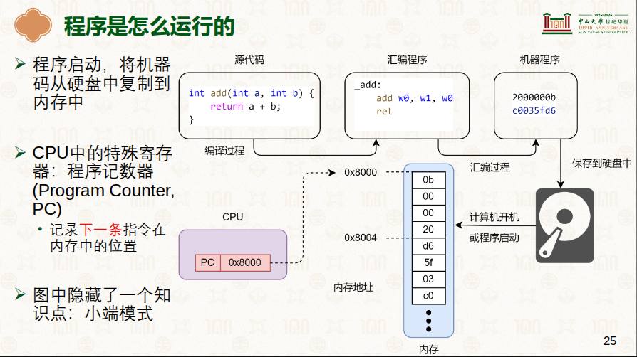

# Program Counter 与 0x8000

> 学习: - [硬件环境与软件抽象：ARM指令集架构:P25](../../../001.UNIX-DOCS/001.操作系统课程/000.中山大学-操作系统2025/2-0303-hardware-isa.pdf) <br/> - [Learn the architecture - AArch64 memory management Guide](../../../006.REFS/learn_the_architecture_aarch64_memory_management_guide_101811_0105_00_en.pdf)

## 尝试理解这句话

> At Arm, we use the address 0x8000 in many of our examples. 0x8000 is also the default address for linking with the Arm linker, armlink. The address comes from an early microcomputer, the BBC Micro Model B, which had ROM (and sideways RAM) at the address 0x8000. The BBC Micro Model B was built by a company called Acorn, which developed the Acorn RISC Machine (ARM), and later became Arm.
> —— <sup>from [Learn the architecture - AArch64 memory management Guide](../../../006.REFS/learn_the_architecture_aarch64_memory_management_guide_101811_0105_00_en.pdf)</sup>

- 与 armlinker 缺省约定是这个，但是实际上不是。例如 STM32F103C8T6 的默认地址是 0x08000000（这是 Cortex-M 的 Flash 别名区）；x86 的复位向量在 0xFFFFFFF0。**0x8000 是一个历史遗留 + 教学惯例**。

### 它是做什么的？

在编写代码并进行"链接"（Linking）阶段时，编译器需要知道程序将来运行在内存的哪个具体位置。`所有的函数跳转、变量访问都需要基于一个基地址来计算绝对地址`。

- 默认行为： 如果你不手动指定地址，Arm 专用链接器（armlink）会默认把程序的入口点设在 0x8000。
- 作用： 它告诉处理器："你的第一条指令（或者是向量表）就在这里，去这里找它。"

> **链接基址由谁定**：这个"基地址"就是链接脚本的第一件事（`SECTIONS` 里 `. = 0x8000` 或内核的 `KIMAGE_VADDR`），详见 [028.编译原理/000.链接器](../../028.编译原理/000.链接器/README.md) §3.1（为什么必须有个基址）与 [002.链接脚本走读](../../028.编译原理/002.链接脚本走读：vmlinux.lds.S.md)（内核的真实取值）。

## 0x8000 是什么？<sup>功能是这个，但是实际值不是</sup>



> **原文（保留）**：所有CPU在设计的时候，PC寄存器的初始值都是0x8000，即 CPU上电后，PC寄存器的值就是0x8000。这时CPU就会从0x8000这个地址开始执行指令。—— 意思是，PC寄存器会有默认值，程序需要加载到指定位置，程序才能运行起来。0x8000就是这个指定位置。<sup>当然，也不一定是 0x8000，现在都不是了</sup>

> **⚠️ 勘误（2026-11 复核）**：**"所有 CPU 的 PC 初始值都是 0x8000"不成立**。上电后 PC 的取值由**复位向量（reset vector）**决定，属于 CPU 实现/芯片设计的选择：
>
> | 平台 | 上电后第一条指令位置 | 出处 |
> | - | - | - |
> | Cortex-M（如 STM32F103） | 0x00000000（别名到 Flash 0x08000000），向量表第 2 项才是初始 SP | 芯片手册 |
> | x86 | 0xFFFFFFF0（复位向量，接近 4G 顶端） | Intel SDM |
> | arm64（A-profile） | **IMPLEMENTATION DEFINED 的复位向量**，从最高实现 EL（常为 EL3）执行第一句；引导 ROM → BL1/BL2 → bootloader → 内核 | [Arm ARM for A-profile](../../../007.BOOKs/Arm%20Architecture%20Reference%20Manual%20for%20A-profile%20architecture/) |
>
> 正确的表述是：**"PC 一定有一个初始取值（复位向量），所以第一条执行的指令位置是芯片固定的；而程序必须被装载到与其链接基址一致的位置（或做了重定位），绝对地址引用才成立"**——这个机制是普适的，0x8000 只是 arm 生态的历史取值之一。

### 0x8000 的三重身份

| 身份 | 值/含义 | 出处 |
| - | - | - |
| ① armlink 缺省链接基址 | BBC Micro Model B 的 ROM 在 0x8000，Acorn→Arm 沿袭成缺省值 | 上方引文 |
| ② 32 位 Linux 内核加载偏移 | `TEXT_OFFSET = 0x00008000`（内核第一条指令在 RAM 基址 + 32KB 处，前 32KB 留给页表/ATAGs） | [000.LINUX-5.9/arch/arm/Makefile:142](../../../000.SOURCE_CODE/000.LINUX-5.9/000.LINUX-5.9/arch/arm/Makefile) `textofs-y := 0x00008000` |
| ③ arm64 教学惯例 | AArch64 指南/裸机例程常用 0x8000 当加载地址 | ARM 官方指南 |

而 **arm64 Linux 早已不用 0x8000**：7.1.3 中 `TEXT_OFFSET` 符号连同变量一起被删除，Image 头部的"Image load offset"字段恒为 0（[head.symbol.md:33](../../../000.SOURCE_CODE/003.LINUX-7.1.3/000.LINUX-7.1.3/arch/arm64/kernel/head.symbol.md)），bootloader 只需把 Image 放在 2MB 对齐的地址（[booting.rst](../../../000.SOURCE_CODE/003.LINUX-7.1.3/000.LINUX-7.1.3/Documentation/arch/arm64/booting.rst)），重定位交给内核自己做（`.rela.dyn`，见 [001.KASLR](../../029.内核启动/001.KASLR.md)）。

### PC 的接力：从上电到你的 main

PC 的初始值只管"第一棒"，之后每一棒都是**跳转指令/异常返回写的**——程序运行的全程就是 PC 被接力的过程：

```
 上电        复位向量(芯片固定)          PC ← 实现定义
  │              │
  ▼              ▼
 [引导 ROM/BLx] ──跳转──► [bootloader(U-Boot/UEFI)]          PC ← 跳转目标
  (EL3/secure)             │ 加载 Image+DTB 到约定地址
  │                        │ 置 x0=dtb, x1/x2/x3=保留
  │                        ▼
  │              内核第一条指令 _head(head.S)                  PC ← bootloader 跳入
  │                        │ 自重定位/建初始页表/开 MMU
  │                        ▼
  │              start_kernel()(EL1)   ...                    PC ← 顺序执行
  │                        │ fork + execve(用户程序)
  │                        ▼
  │              eret → e_entry(EL0)                          PC ← eret 写入
  │               (动态链接: 先 ld.so 重定位 GOT,               (静态: 即程序 _start;
  │                再跳 auxv AT_ENTRY 指的 _start)              动态: ld.so 的入口)
  │                        │ __libc_start_main
  │                        ▼
  └────────────► main()  ◄─ 你写的代码                        PC ← call bl
```

- 内核侧每一跳（bootloader→`_head`→`__primary_entry`）见 [029.内核启动流程](../../029.内核启动/002.内核启动流程/README.md)；
- `eret` 之前的整条装载链（`execve → load_elf_binary → start_thread`）见 [001.execve与ELF加载](./001.execve与ELF加载：内核侧.md) §3——`start_thread` 里那句 `regs->pc = pc` 就是上图倒数第二棒的落笔处；
- `_start → main` 的最后一棒见 [002.从_start到main](./002.从_start到main：用户态的接力.md)。

## 参考

| 资料 | 链接 | 说明 |
| - | - | - |
| PSTATE（Processor State）寄存器 | [009.中断与异常/003.PSTATE.md](../../009.中断与异常/003.PSTATE.md) | EL0t 等处理器状态（eret 后 PSTATE 的归宿） |
| 中大 OS 课件：硬件环境与软件抽象 | [2-0303-hardware-isa.pdf](../../../001.UNIX-DOCS/001.操作系统课程/000.中山大学-操作系统2025/2-0303-hardware-isa.pdf) P25 | 指令集/PC 概念 |
| AArch64 memory management Guide | [006.REFS PDF](../../../006.REFS/learn_the_architecture_aarch64_memory_management_guide_101811_0105_00_en.pdf) | 0x8000 引文出处 |
