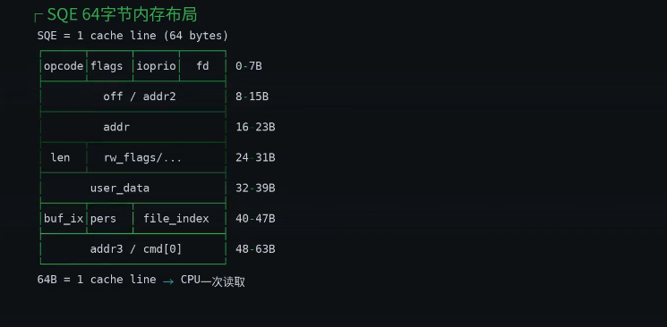
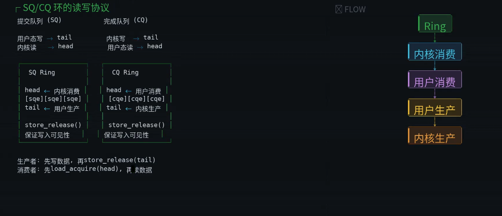
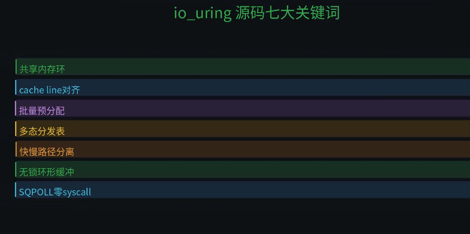

# io_uring

> 本文档行号均指本仓库源码树 [000.LINUX-7.1.3](../../../000.SOURCE_CODE/003.LINUX-7.1.3/000.LINUX-7.1.3/io_uring/io_uring.c),已于 2026-10-24 逐条核对。

|源码类型|源代码路径|备注|
|-|-|-|
|- 系统调用入口|- [io_uring.c](../../../000.SOURCE_CODE/003.LINUX-7.1.3/000.LINUX-7.1.3/io_uring/io_uring.c):3159(setup)/:2609(enter);[register.c:1006](../../../000.SOURCE_CODE/003.LINUX-7.1.3/000.LINUX-7.1.3/io_uring/register.c)(register)|-
|-|-|-|
|- 用户API定义|- [include/uapi/linux/io_uring.h](../../../000.SOURCE_CODE/003.LINUX-7.1.3/000.LINUX-7.1.3/include/uapi/linux/io_uring.h)(SQE :32,CQE :500)|-
|-|-|-|
|- 内核内部类型|- [include/linux/io_uring_types.h](../../../000.SOURCE_CODE/003.LINUX-7.1.3/000.LINUX-7.1.3/include/linux/io_uring_types.h)(io_ring_ctx/io_rings/io_kiocb)|-
|-|-|-|
|- 操作分发表|- [opdef.c:54](../../../000.SOURCE_CODE/003.LINUX-7.1.3/000.LINUX-7.1.3/io_uring/opdef.c) `io_issue_defs[]`|io_uring 的"多态"核心|
|-|-|-|
|- 固定资源注册|- [rsrc.c](../../../000.SOURCE_CODE/003.LINUX-7.1.3/000.LINUX-7.1.3/io_uring/rsrc.c):529(files)/:861(buffers)|由 register.c:767/779 分发|
|-|-|-|
|- 辅助子系统|- [sqpoll.c](../../../000.SOURCE_CODE/003.LINUX-7.1.3/000.LINUX-7.1.3/io_uring/sqpoll.c)(SQ轮询线程)、[io-wq.c](../../../000.SOURCE_CODE/003.LINUX-7.1.3/000.LINUX-7.1.3/io_uring/io-wq.c)(异步线程池)、[poll.c](../../../000.SOURCE_CODE/003.LINUX-7.1.3/000.LINUX-7.1.3/io_uring/poll.c):705(`io_arm_poll_handler`)、[wait.c](../../../000.SOURCE_CODE/003.LINUX-7.1.3/000.LINUX-7.1.3/io_uring/wait.c):189(`io_cqring_wait`)、[tctx.c](../../../000.SOURCE_CODE/003.LINUX-7.1.3/000.LINUX-7.1.3/io_uring/tctx.c):139(每任务上下文)|-
|-|-|-|

## 数据结构
### io_uring_sqe <sup>uapi/linux/io_uring.h:32(本树已加中文注释)</sup>
```c
struct io_uring_sqe {
    __u8    opcode;     /* 操作类型, IORING_OP_READV/WRITEV/SEND/... 40+种 */
    __u8    flags;      /* IOSQE_IO_LINK(链接)/FIXED_FILE(固定文件)/... */
    __u16   ioprio;
    __s32   fd;         /* 目标文件描述符 */
    union {
        __u64   off;    /* 文件偏移 */
        __u64   addr2;
    };
    union {
        __u64   addr;   /* buffer 或 iovec 数组指针 */
        __u64   splice_off_in;
    };
    __u32   len;       /* buffer 长度或 iovec 个数 */
    union {             /* 各 opcode 专属 flags(24 种共用这一个槽位) */
        __u32 rw_flags;
        __u32 accept_flags;
        __u32 uring_cmd_flags;
        /* ... */
    };
    __u64   user_data; /* 用户自定义数据, 原样回传到 CQE —— 提交与完成的关联键 */
    /* ... */
};
```
- 

### io_uring_cqe <sup>uapi/linux/io_uring.h:500</sup>
```c
struct io_uring_cqe {
    __u64   user_data; /* sqe->user_data 的原样拷贝 */
    __s32   res;       /* 结果: 成功=字节数, 失败=-errno */
    __u32   flags;
    __u64   big_cqe[]; /* IORING_SETUP_CQE32 时附加 16 字节 */
};
```

### io_rings:共享内存环的物理布局 <sup>include/linux/io_uring_types.h</sup>
用户态与内核态 mmap 同一块内存:SQ 环(indices 数组)+ SQEs 数组 + CQ 环(CQEs 数组),`io_rings` 结构本身就是环头(tail/head 计数器)。**这是零系统调用的根基**——生产者写 tail、消费者推进 head,靠 `smp_store_release`/`smp_load_acquire` 内存序而非锁同步。
- 

## 核心函数
|函数名|定义|文件路径:行号|备注|
|-|-|-|-|
|- io_uring_setup|SYSCALL_DEFINE2(io_uring_setup, ...)|io_uring.c:3159|建环|
|-|-|-|-|
|-io_uring_enter|SYSCALL_DEFINE6(io_uring_enter, ...)|io_uring.c:2609|io_uring性能的核心秘密:<br/> 传统IO：提交&获取结果，两次系统调用 ；<br/>io_uring:只需要一次系统调用|
|-|-|-|-|
|-io_submit_sqes|io_uring.c:2035|批量提交引擎|循环体见 §代码走读②|
|-|-|-|-|
|- io_issue_sqe|io_uring.c:1423|多态分发 → `def->issue`(:1431→:1408)|表驱动,见 opdef.c|
|-|-|-|-|
|- io_uring_register|register.c:1006 → __io_uring_register :739|缓存file指针，绕过原子引用计数，提升性能;实现在 rsrc.c:529/:861||
|-|-|-|-|

### 处理流程

**调用链路全景** (基于 000.LINUX-7.1.3/io_uring/,行号已逐条核实)

```
用户态                                         内核态
──────────────────────────────────────────────────────────────────────

[1] io_uring_setup()  [io_uring.c:3159]
    │
    └─ io_uring_create()                      [io_uring.c:2987]
         ├─ io_ring_ctx_alloc()               :2999 → io_uring.c:234 分配 io_ring_ctx 上下文
         ├─ io_allocate_scq_urings()          :3064 → io_uring.c:2740 分配 SQ/CQ 共享内存环形缓冲区
         │    └─ mmap 共享内存：用户态与内核态共享 SQ 和 CQ 环
         ├─ io_sq_offload_create()            :3068 → sqpoll.c:449 创建 SQPOLL 线程（如启用）
         └─ __io_uring_add_tctx_node()        :3089 → tctx.c:139 关联当前任务到 io_uring 上下文

[2] io_uring_register()  [register.c:1006]
    │
    └─ __io_uring_register()                 [register.c:739]
         ├─ IORING_REGISTER_FILES → io_sqe_files_register()    [rsrc.c:529, 分发于 register.c:779]
         │    └─ 绕过 fget/fput 原子引用计数，SQE 里用索引代替 fd
         ├─ IORING_REGISTER_BUFFERS → io_sqe_buffers_register() [rsrc.c:861, 分发于 register.c:767]
         │    └─ 预映射用户态内存，避免每次 IO 都做 get_user_pages
         └─ io_register_personality() / 其他

[3] io_uring_enter()  [io_uring.c:2609]  ★ 核心提交路径
    │
    ├─ [SQPOLL 模式] :2643
    │    ├─ wake_up(&ctx->sq_data->wait)      :2649 (需 IORING_ENTER_SQ_WAKEUP)
    │    └─ io_sqpoll_wait_sq()               :2651 → sqpoll.c:429 可选等待 SQ 条目被消费
    │
    └─ [非 SQPOLL 模式]  —— 直接提交 :2654
         ├─ io_uring_add_tctx_node()          :2655 获取/创建 io_uring_task
         ├─ mutex_lock(&ctx->uring_lock)      :2659
         └─ io_submit_sqes()                  :2660 → [io_uring.c:2035]  ★ 批量提交引擎
              │
              ├─ 循环: do { ... } while (--left)   :2055-2075
              │    ├─ io_alloc_req()           从缓存分配 io_kiocb 请求对象 :2059
              │    ├─ io_get_sqe()             从 SQ 环获取下一个 SQE 条目  :2061 → :2003
              │    └─ io_submit_sqe()          [io_uring.c:1895]
              │         │
              │         ├─ io_init_req()        [io_uring.c:1743]
              │         │    ├─ 解析 SQE: opcode/flags/user_data :1752-1756
              │         │    ├─ 验证 opcode 范围 + 防推测执行    :1762-1766
              │         │    └─ return def->prep(req, sqe)       :1855  ← 每opcode专属预准备
              │         │
              │         └─ io_queue_sqe()       [io_uring.c:1655]  ★ 多态分发
              │              └─ io_issue_sqe(req, NONBLOCK|COMPLETE_DEFER) :1662
              │                   → [io_uring.c:1423]
              │                        └─ __io_issue_sqe()  [io_uring.c:1390]
              │                             └─ def->issue(req, issue_flags) :1408 ← 多态派发
              │                                  │
              │                                  │  io_issue_defs[] 表 [opdef.c:54]
              │                                  │  例: [IORING_OP_READV] { .prep=io_prep_readv :72
              │                                  │                                .issue=io_read  :73 }
              │                                  │      io_read()  rw.c:1026 / io_write() rw.c:1126
              │                                  │      io_accept()/io_send()/io_recv()/io_poll_add()...
              │                                  │      (40+ 种 opcode)
              │                                  │
              │                                  ├─ 同步完成: 返回 IOU_COMPLETE
              │                                  │    ├─ 提交路径带 COMPLETE_DEFER →
              │                                  │    │    io_req_complete_defer()  :1435
              │                                  │    │      (io_uring.h:488: 挂到 compl_reqs 链表,
              │                                  │    │       io_submit_state_end :1954 批量冲刷)
              │                                  │    └─ io_req_complete_post()   :1437
              │                                  │         (7.1.3 仅剩 io-wq 走此路, :936 有WARN把关)
              │                                  │              └─ 填充 CQE → 更新 CQ 环 tail
              │                                  │                   → 唤醒等待 CQ 事件的用户态
              │                                  │
              │                                  └─ 异步: ret != 0 (如 -EAGAIN)
              │                                       └─ io_queue_async()  :1630
              │                                            ├─ io_arm_poll_handler() poll.c:705
              │                                            │    (就绪回调接管, 类 epoll)
              │                                            └─ io_queue_iowq()  :416 → io-wq 线程池
              │
              └─ 循环结束: io_submit_state_end() :2085 (冲刷延迟完成)
                           io_commit_sqring()    :2087 (发布 SQ head)

[4] 完成事件收割
    │
    ├─ io_uring_enter(IORING_ENTER_GETEVENTS)   :2665/:2678
    │    └─ io_cqring_wait()                    :2699 → wait.c:189 等待 CQ 环中有新事件
    │
    └─ 用户态直接读取 CQ 环（无需系统调用，无锁）
         └─ smp_load_acquire(cq->tail) 获取最新完成事件
```

**SQPOLL 模式详解**

```
用户态                                       内核 SQPOLL 线程
──────────────────────────────────────────────────────────────────────

[初始化] io_uring_setup(IORING_SETUP_SQPOLL)
    │
    └─ io_sq_offload_create()                [sqpoll.c:449]
         └─ 内核线程 io_sq_thread             [sqpoll.c:293]
            (io_uring_create 在 io_uring.c:3068 处调用)

[提交] 用户态填充 SQE → 更新 SQ 尾指针 (纯内存写, 零系统调用)
    │
    ├─ [默认] SQPOLL 线程主动轮询 SQ 环
    │    └─ __io_sq_thread()                  [sqpoll.c:204]
    │         ├─ io_sqring_entries()          :210 检测新提交的 SQE
    │         ├─ io_submit_sqes()             :233 批量提交（同非 SQPOLL 路径）
    │         └─ io_do_iopoll()               :225 处理 IO 轮询完成
    │
    └─ [SQ 空闲超时] io_sq_thread 进入休眠
         │    (sqpoll.c:379/:421 置 IORING_SQ_NEED_WAKEUP 标志, :406 醒来后清除)
         │
         └─ [用户再次提交时] 看到 NEED_WAKEUP 标志
              └─ io_uring_enter(IORING_ENTER_SQ_WAKEUP)
                   └─ wake_up(&ctx->sq_data->wait)  io_uring.c:2649 唤醒 SQPOLL 线程

[完成] SQPOLL 线程将结果写入 CQ 环
    │
    └─ 用户态直接读取 CQ 环（零系统调用）
```

---

## 关键代码走读(7.1.3 摘录)

### ① 建环:`io_uring_setup` → `io_uring_create`

```c
/* io_uring.c:3159 系统调用入口 */
SYSCALL_DEFINE2(io_uring_setup, u32, entries,
        struct io_uring_params __user *, params)
{
    int ret;
    ret = io_uring_allowed();                // io_uring_disabled 内核引导参数检查
    if (ret)
        return ret;
    return io_uring_setup(entries, params);   // → io_uring_create
}

/* io_uring.c:2987 核心建环 */
static __cold int io_uring_create(struct io_ctx_config *config)
{
    ...
    ctx = io_ring_ctx_alloc(p);            // :2999 分配 io_ring_ctx(含锁/等待队列/分配缓存)
    ...
    ret = io_allocate_scq_urings(ctx, config);  // :3064 分配 SQ/CQ 共享环 + SQE 数组
    if (ret) goto err;
    ret = io_sq_offload_create(ctx, p);         // :3068 IOPOLL/SQPOLL 离载初始化
    ...
    ret = __io_uring_add_tctx_node(ctx);        // :3089 把 ring 挂进当前任务的 io_uring_task
    ...
}
```

### ② 提交:`io_uring_enter` → `io_submit_sqes` → 多态分发

```c
/* io_uring.c:2643-2660 两分支 */
if (ctx->flags & IORING_SETUP_SQPOLL) {
    ...
    if (flags & IORING_ENTER_SQ_WAKEUP)
        wake_up(&ctx->sq_data->wait);          // :2649 只负责叫醒内核轮询线程
    if (flags & IORING_ENTER_SQ_WAIT)
        io_sqpoll_wait_sq(ctx);                // :2651
    ret = to_submit;
} else if (to_submit) {
    ret = io_uring_add_tctx_node(ctx);         // :2655
    ...
    mutex_lock(&ctx->uring_lock);              // :2659
    ret = io_submit_sqes(ctx, to_submit);      // :2660
    ...
}

/* io_uring.c:2035-2088 批量提交引擎 */
int io_submit_sqes(struct io_ring_ctx *ctx, unsigned int nr)
{
    ...
    entries = __io_sqring_entries(ctx);        // :2045 tail-head 即待提交数
    ...
    do {
        if (unlikely(!io_alloc_req(ctx, &req))) break;   // :2059 io_kiocb 走缓存
        if (unlikely(!io_get_sqe(ctx, &sqe))) { ... }    // :2061 取下一个 SQE
        if (unlikely(io_submit_sqe(ctx, req, sqe, &left)) &&
            !(ctx->flags & IORING_SETUP_SUBMIT_ALL)) { left--; break; }  // :2070
    } while (--left);
    ...
    io_submit_state_end(ctx);                  // :2085 冲刷延迟完成(见 io_uring.h:247)
    io_commit_sqring(ctx);                     // :2087 发布 SQ head 给用户态
    return ret;
}

/* io_uring.c:2003-2032 SQE 的两级索引: SQ数组[head] → sq_array[head] → SQEs[] */
static bool io_get_sqe(struct io_ring_ctx *ctx, const struct io_uring_sqe **sqe)
{
    unsigned mask = ctx->sq_entries - 1;
    unsigned head = ctx->cached_sq_head++ & mask;
    ...
    head = READ_ONCE(ctx->sq_array[head]);     // :2010 乱序提交的关键: 数组存真实下标
    ...
    *sqe = &ctx->sq_sqes[head];                // :2031
    return true;
}

/* io_uring.c:1743-1855 io_kiocb 初始化: SQE(通用) → req(内核态) */
static int io_init_req(struct io_ring_ctx *ctx, struct io_kiocb *req,
               const struct io_uring_sqe *sqe, unsigned int *left)
{
    req->opcode = READ_ONCE(sqe->opcode);      // :1752
    req->cqe.user_data = READ_ONCE(sqe->user_data);  // :1756
    ...
    req->opcode = array_index_nospec(req->opcode, IORING_OP_LAST);  // :1766 防推测执行
    def = &io_issue_defs[req->opcode];         // :1768
    ...
    return def->prep(req, sqe);                // :1855 opcode 专属预准备(如 io_prep_readv)
}

/* io_uring.c:1655-1670 同步发起, 失败转异步 */
static inline void io_queue_sqe(struct io_kiocb *req, unsigned int extra_flags)
{
    unsigned int issue_flags = IO_URING_F_NONBLOCK |
                   IO_URING_F_COMPLETE_DEFER | extra_flags;  // :1658 非阻塞+延迟完成
    ret = io_issue_sqe(req, issue_flags);      // :1662
    if (unlikely(ret))                         // -EAGAIN 等 → 异步化
        io_queue_async(req, issue_flags, ret); // :1669 → arm_poll / io-wq
}

/* io_uring.c:1423-1448 多态分发的汇合点 */
static int io_issue_sqe(struct io_kiocb *req, unsigned int issue_flags)
{
    const struct io_issue_def *def = &io_issue_defs[req->opcode];  // :1425
    ...
    ret = __io_issue_sqe(req, issue_flags, def);   // :1431
    if (ret == IOU_COMPLETE) {                     // 同步完成
        if (issue_flags & IO_URING_F_COMPLETE_DEFER)
            io_req_complete_defer(req);            // :1435 提交路径全走这里
        else
            io_req_complete_post(req, issue_flags);// :1437 仅 io-wq 等
        return 0;
    }
    ...
}

/* io_uring.c:1408 真正的"多态调用" */
    ret = def->issue(req, issue_flags);

/* opdef.c:61-74 表驱动: 每个 opcode 一条 */
[IORING_OP_READV] = {
    .needs_file = 1, .pollin = 1, .plug = 1, .iopoll = 1, .vectored = 1,
    .prep  = io_prep_readv,     // :72
    .issue = io_read,           // :73 → rw.c:1026
},
```

### ③ 完成:延迟完成批量冲刷 + CQE 填充 + 唤醒

```c
/* io_uring.h:488-496 延迟完成: 只挂链表, 不填 CQE */
static inline void io_req_complete_defer(struct io_kiocb *req)
{
    struct io_submit_state *state = &req->ctx->submit_state;
    wq_list_add_tail(&req->comp_list, &state->compl_reqs);
}

/* io_uring.c:1954-1961 提交批次结束时一次性冲刷(省锁开销) */
static void io_submit_state_end(struct io_ring_ctx *ctx)
{
    ...
    /* flush only after queuing links as they can generate completions */
    io_submit_flush_completions(ctx);          // :1961 → io_uring.h:247
    ...
}

/* io_uring.h:295-317 填 CQE: 从缓存 tail 拿槽位, memcpy */
static __always_inline bool io_fill_cqe_req(struct io_ring_ctx *ctx, struct io_kiocb *req)
{
    bool is_cqe32 = req->cqe.flags & IORING_CQE_F_32;
    struct io_uring_cqe *cqe;
    if (unlikely(!io_get_cqe(ctx, &cqe, is_cqe32)))
        return false;                          // CQ 溢出 → 走溢出路径
    memcpy(cqe, &req->cqe, sizeof(*cqe));      // :308
    ...
}

/* io_uring.h:412-415 发布: release 语义保证 CQE 内容先于 tail 可见 */
static inline void io_commit_cqring(struct io_ring_ctx *ctx)
{
    /* order cqe stores with ring update */
    smp_store_release(&ctx->rings->cq.tail, ctx->cached_cq_tail);
}

/* io_uring.c:526-532 提交锁内完成的出口: commit + 唤醒收割者 */
static void io_cq_unlock_post(struct io_ring_ctx *ctx)
{
    io_commit_cqring(ctx);                     // :526 tail 发布
    spin_unlock(&ctx->completion_lock);
    io_cqring_wake(ctx);                       // :528 → io_uring.h:436 唤醒 cq_wait 等待者
    io_commit_cqring_flush(ctx);
}

/* 用户态收割(无系统调用): smp_load_acquire(cq->tail) 与上面的
 * smp_store_release 配对 —— 共享环的完整内存序协议 */
```

### ④ SQPOLL 内核线程

```c
/* sqpoll.c:293 内核线程主函数 */
static int io_sq_thread(void *data)
{
    ...
    snprintf(buf, sizeof(buf), "iou-sqp-%d", sqd->task_pid);   // :311 ps 里就叫这个
    set_task_comm(current, buf);
    if (sqd->sq_cpu != -1)
        set_cpus_allowed_ptr(current, cpumask_of(sqd->sq_cpu)); // :318 绑核
    ...

/* sqpoll.c:204-243 每轮: 收割 iopoll → 提交新 SQE */
static int __io_sq_thread(struct io_ring_ctx *ctx, struct io_sq_data *sqd,
              bool cap_entries, struct io_sq_time *ist)
{
    to_submit = io_sqring_entries(ctx);        // :210
    ...
    mutex_lock(&ctx->uring_lock);
    if (!list_empty(&ctx->iopoll_list))
        io_do_iopoll(ctx, true);               // :225
    if (to_submit && ...)
        ret = io_submit_sqes(ctx, to_submit);  // :233 与系统调用路径共用同一引擎
    mutex_unlock(&ctx->uring_lock);
    ...
}
```

**传统 IO vs io_uring 对比**

| 对比项 | 传统 IO (read/write) | io_uring (非 SQPOLL) | io_uring (SQPOLL) |
|--------|---------------------|---------------------|-------------------|
| 提交 | 1 次系统调用 | 1 次系统调用 (批量) | 0 次系统调用 |
| 完成 | 1 次系统调用 | 可选 1 次系统调用 | 0 次系统调用 |
| 每 IO 系统调用数 | 2 次 | 0~1 次 | 0 次 |
| 数据拷贝 | 需要 | 注册缓冲区避免 | 注册缓冲区避免 |
| 适用场景 | 通用 | 高吞吐 IO | 超低延迟、高 IOPS |

**关键设计要点**

1. **共享内存环** (`struct io_rings`): 用户态和内核态通过 mmap 共享 SQ/CQ 环形缓冲区,生产/消费靠 `smp_store_release`/`smp_load_acquire` 配对(io_uring.h:415 ↔ 用户态读 tail),避免数据拷贝与锁
2. **批量提交** (`io_submit_sqes` :2035): 一次系统调用可批量提交多个 SQE,分摊系统调用开销;`io_alloc_req`(:2059) 走 per-cpu 缓存分配 io_kiocb
3. **延迟完成** (`io_req_complete_defer` io_uring.h:488): 批次内完成只挂 `compl_reqs` 链表,`io_submit_state_end`(:1954) 一次冲刷——7.1.3 中这是常态路径,`io_req_complete_post`(:927) 已收窄为 io-wq 专用(:936 有 WARN 把关)
4. **多态分发** (`io_issue_defs[]` opdef.c:54): 通过 opcode 索引,如 `io_issue_defs[IORING_OP_READV].issue = io_read()`,prep/issue/fail 三钩子统一分发
5. **异步双路** (`io_queue_async` :1630): 先试 `io_arm_poll_handler`(poll.c:705,就绪回调接管,免线程),不支持再 `io_queue_iowq`(:416) 进 io-wq 线程池
6. **固定文件/缓冲区** (`io_uring_register`): SQE 用索引代替 fd,绕过 `fget/fput` 原子引用计数;缓冲区预映射避免每 IO 做 `get_user_pages`(rsrc.c:529/:861)


## 零拷贝基石： 共享内存环机制:用户态和内核态共享内存环形缓冲区
> 阅读:[000.LINUX-7.1.3/include/linux/io_uring_types.h]#struct io_rings{....}
- 

---

## 参考资料
- [https://blog.cloudflare.com/missing-manuals-io_uring-worker-pool/](https://blog.cloudflare.com/missing-manuals-io_uring-worker-pool/)
- 
