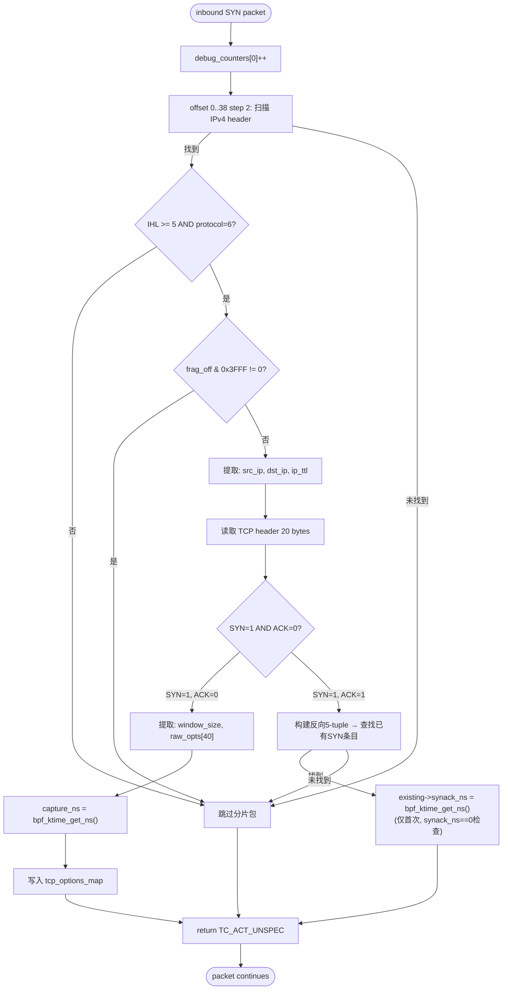
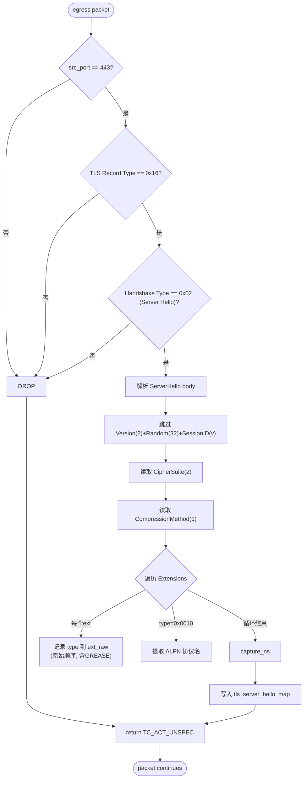
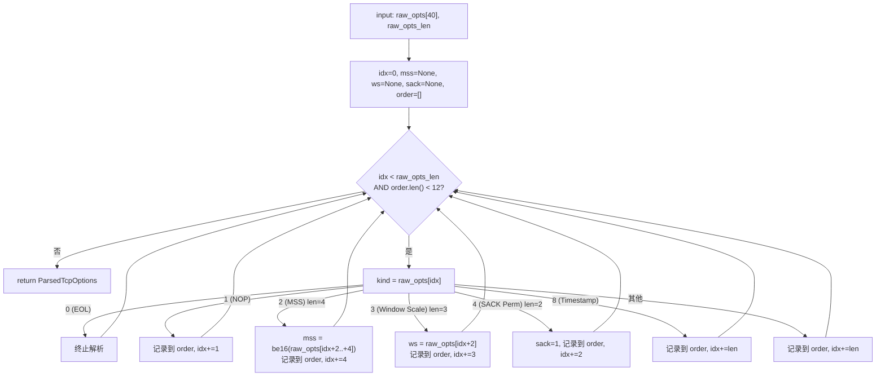
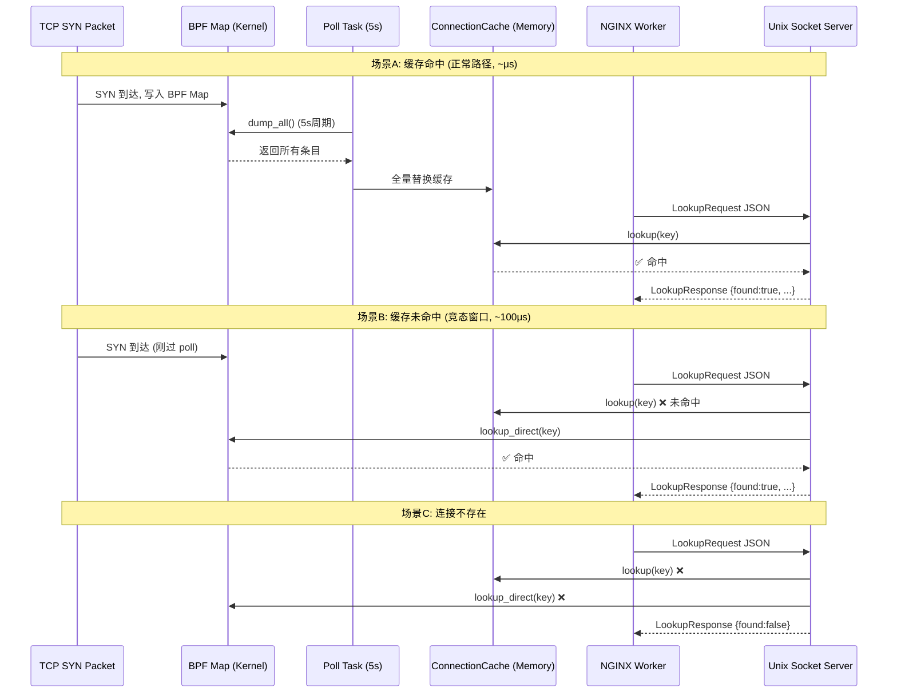
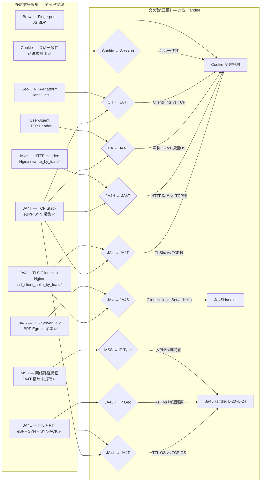

> 📌 迁移自 `Berries-CYBERCLOAK/000.CODE_SPACE/003.JA4T_PLUGIN/docs/JA4T_DATA_FLOW.md`(2026-10-24);导读见 [000.导读.md](../000.导读.md)。

# JA4T Plugin 数据流程图

> 最后更新: 2026-07-07
> 
> 本文档描述 CYBERCLOAK JA4T/JA4S 系统的端到端数据流。
> 从网络数据包到最终验证决策，跨越 5 层处理。

## 一、端到端数据流 (Packet → Fingerprint → Decision)

```mermaid
flowchart TD
    subgraph L1[第一层: 数据采集 - eBPF Kernel]
        A1[网卡 eth0] --> A2{TC Hook}
        A2 -->|ingress| A3[eBPF: ja4t_parse_syn<br/>tcp_options.bpf.c]
        A2 -->|egress| A3S[eBPF: ja4s_parse_server_hello<br/>tls_server_hello.bpf.c]
        A3 --> A4{p0f-style Offset 扫描<br/>0..38 step 2}
        A4 -->|匹配 IPv4+TCP| A5{协议过滤}
        A5 -->|SYN=1 ACK=0| A6[提取数据: window_size + raw_opts + ip_ttl]
        A5 -->|SYN=1 ACK=1| A7[反向5-tuple匹配 → 更新 synack_ns]
        A6 --> A8[(tcp_options_map<br/>LRU Hash 65K)]
        A7 --> A8
        A3S --> A9[TLS Record解析<br/>Server Hello → cipher + ALPN + extensions]
        A9 --> A10[(tls_server_hello_map<br/>LRU Hash 65K)]
    end

    subgraph L2[第二层: 数据处理 - ja4t-daemon User Space]
        B1[Poll Task 5s] --> B2[BpfReader::dump_all]
        B2 --> A8
        B2 --> A10
        A8 --> B3[parse_tcp_options<br/>MSS/WindowScale/SACK/Order]
        A10 --> B4[compute_ja4s<br/>TLS版本/密码套件/扩展hash]
        B3 --> B5[ConnectionCache<br/>内存 HashMap]
        B4 --> B6[ServerHelloCache<br/>内存 HashMap]
    end

    subgraph L3[第三层: 查服务 - Unix Socket IPC]
        C1[NGINX Worker] --> C2[构建 LookupRequest JSON<br/>src_ip, dst_ip, src_port, dst_port]
        C2 --> C3[/var/run/ja4t.sock]
        C3 --> C4{快路径: 内存缓存}
        C4 -->|命中| C5[构建 LookupResponse]
        C4 -->|未命中| C6[回退: BPF Map 直查]
        C6 --> C5
        C5 --> C7[JSON响应: found, mss, ws, sack, opts, ip_ttl, rtt_us, ja4s]
    end

    subgraph L4[第四层: 指纹构建与传递 - NGINX]
        D1[接收响应] --> D2[缓存 found:true 600s]
        D2 --> D3[构建 JA4T 指纹:<br/>window_mss_scale_sack_opts]
        D1 --> D4[提取 ip_ttl / rtt_us / ja4s]
        D3 --> D5[proxy_set_header<br/>X-JA4T-Fingerprint]
        D4 --> D6[proxy_set_header<br/>X-JA4T-TTL<br/>X-JA4T-RTT<br/>X-JA4S-Fingerprint]
    end

    subgraph L5[第五层: 验证决策 - App Server (22 Handlers)]
        E1[接收 Headers] --> E2[VerificationContext 构建]
        E2 --> E3[验证链短路执行]
        E3 --> E4[Phase 1: 无IP依赖规则]
        E4 --> E4A[Ja4FingerprintHandler<br/>JA4+JA4H+JA4T + Cookie变异]
        E4A --> E4B[BrowserFingerprintHandler]
        E4B --> E4C[UserAgentBlockHandler]
        E4C --> E4D[HttpHeaderBlockHandler]
        E4D --> E4E[Ja4LHandler<br/>TTL OS推断 + RTT距离 + MSS语义]
        E4E --> E5[Phase 2: IP相关规则]
        E5 --> E5A[IpInfo/Google/FB/Amazon Block]
        E5A --> E5B[IP White/Blacklist + ASN]
        E5B --> E5C[Crawler + Proxy + Datacenter + Mobile]
        E5C --> E5D[Ja4SHandler<br/>TLS响应指纹 + JA4配对基线]
        E5D --> E5E[Device/Language/Region + Default]
        E5E --> E6{首个 BLOCK 命中?}
        E6 -->|是| E7[BLOCK]
        E6 -->|否| E8[ALLOW]
    end

    L1 --> L2
    L2 --> L3
    L3 --> L4
    L4 --> L5
```

## 二、eBPF 数据采集详细流程

### 2.1 纯 SYN 处理流程



### 2.2 TLS Server Hello 处理流程



## 三、TCP 选项解析流程



### 平台特征 TCP Option Order

| 平台 | Option Order | 说明 |
|------|-------------|------|
| Linux (含 Android) | 2-4-8-1-3 | mss, sack, ts, nop, ws |
| Windows 7+ | 2-1-3-4-8 | mss, nop, ws, sack, ts |
| Apple (macOS/iOS) | 2-1-3-1-1-8-4[-0] | mss, nop, ws, nop, nop, ts, sack[, eol] |

## 四、查时序 (Cache Hit vs Miss)



## 五、跨层指纹交叉验证矩阵

> 以下矩阵对应后端验证链中的实际 Handler。所有信号已实现并通过 Nginx headers 注入。



## 六、关键指标

| 指标 | 值 | 说明 |
|------|-----|------|
| BPF Map 类型 | LRU Hash × 2 | tcp_options_map + tls_server_hello_map |
| BPF Map 容量 | 65,536 × 2 | 最多同时追踪 65K TCP 连接 + 65K TLS 会话 |
| tcp_options_info 大小 | 64 bytes | 含 TTL + SYN-ACK 时间戳 (synack_ns) |
| tls_server_hello_info 大小 | 168 bytes | 含密码套件 + 扩展 + ALPN |
| 轮询周期 | 5 秒 (可配) | 用户态从 BPF Map 拉取数据的频率 |
| nginx 缓存 TTL | 600 秒 | 仅缓存 found=true 的结果 |
| 缓存 key | `src_ip->dst_ip:dst_port` | 不含 src_port (同一客户端 TCP 指纹稳定) |
| Unix Socket 权限 | 0666 | 允许所有 nginx worker 进程访问 |
| Unix Socket 超时 | 100ms | Nginx Lua settimeout |
| eBPF 扫描范围 | offset 0..38, step 2 | p0f 兼容的链路层头部扫描，最多 20 次探测 |
| TCP 选项最大字节 | 40 | 足以容纳常见 TCP 选项组合 |
| 响应延迟 (命中) | ~微秒级 | 纯内存 HashMap 查询 |
| 响应延迟 (未命中) | ~百微秒级 | 一次 bpf_map_lookup_elem 系统调用 |
| JA4S 指纹计算 | 用户态完成 (SHA256) | 避免 eBPF 中进行 SHA256 (指令数超限) |
| JA4S 基线存储 | 内存 HashMap | LazyLock<RwLock<HashMap>>, 上限 50,000 条, 30天 TTL |
| Cookie 会话缓存 | 内存 HashMap | Mutex<HashMap>, 上限 10,000 条, 30min TTL |
| 后端 Handler 总数 | 22 个 | 短路执行，首个命中立即返回 |
