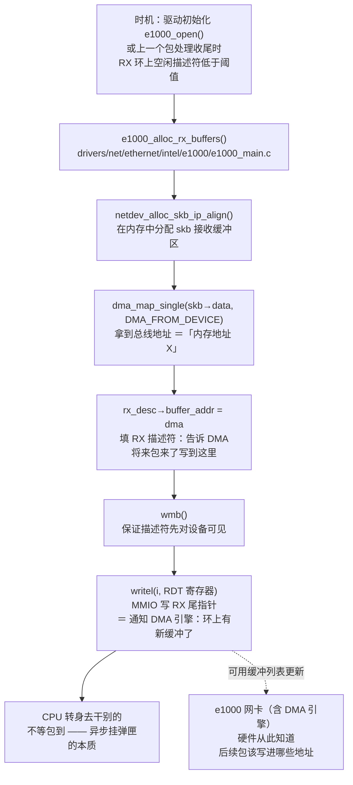
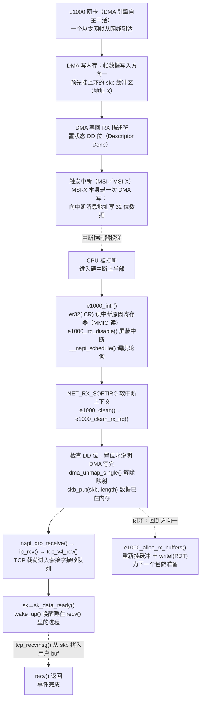

# CPU 与 DMA 的双向交互 —— 以「一次 recv() 收到网络包」为例
> 学习: <br/> - [001.操作系统课程/002.上海交通大学-操作系统2021/OS-16 device.pdf](../001.操作系统课程/002.上海交通大学-操作系统2021/OS-16%20device.pdf) P27
> 关联笔记：
> + [内存映射IO-CoreDump.md](../000.内存管理/023.MMIO(内存映射IO)/005.内存映射IO-CoreDump.md) —— CPU 写 RDT 尾指针本质就是 MMIO 写
> + [硬中断与软中断.md](../009.中断与异常/003.硬中断与软中断.md) —— 方向二的主战场在软中断（NAPI）

## 摘要
|说明|备注|参考|
|-|-|-|
|网卡收包与课件 6 步完全同构：挂缓冲＝第 1~2 步（**CPU 主动**），包到达后 DMA 写内存＋发中断＝第 5~6 步（**DMA 主动**），第 3~4 步 DMA 搬数据时 CPU 完全不参与|**同一个事件的两个方向**|- OS-16 device.pdf P27|
|CPU 主动 ＝ 在内存里挂好接收缓冲（skb），把总线地址写进 RX 描述符（即课件的「内存地址 X」），再 MMIO 写 RDT 尾指针通知 DMA 引擎|e1000 驱动：`e1000_alloc_rx_buffers()`|- `drivers/net/ethernet/intel/e1000/e1000_main.c`|
|DMA 主动 ＝ 网卡 DMA 把帧写进预挂的 skb、写回描述符 DD 位，然后发 MSI/MSI-X 中断；MSI-X 的物理实现本身就是一次 DMA 写|中断链：`e1000_intr()` → NAPI → `tcp_v4_rcv()`|- 同上|
|本文只讲一个事件：进程 `recv()` 睡眠等数据 → 一帧到达 → `recv()` 返回，驱动补挂新缓冲|方向一在「序章＋尾声」出现，方向二是主体|-|

## 先校准一个观念：现代网卡里「DMA 控制器」在哪
课件 P27 画的是传统模型：独立 DMA 控制器挂在系统总线上，外设是「总线从设备」，数据经 DMA 控制器中转（外设 → DMA 控制器 → 内存）。

现代网卡（e1000/e1000e/igb）里，**DMA 引擎集成在网卡控制器内部，网卡自己是总线主控（bus master）**，通过 PCIe 直接读写内存，不需要 CPU 或第三方搬运。因此：
- 「CPU 主动和 DMA 交互」落地为：**CPU 在内存里填好 RX 描述符，再用一条 MMIO store 指令（`writel`）写网卡的 RDT 尾指针寄存器**；
- 「DMA 向 CPU 发起交互」落地为：**网卡（的 DMA 引擎）把帧写进内存后向 CPU 发中断**。

## 事件设定
整个文档只围绕这一个事件，它天然包含两个方向：

```c
int fd = socket(AF_INET, SOCK_STREAM, 0);
connect(fd, ...);
char buf[4096];
recv(fd, buf, 4096, 0);   /* 没有数据时进程睡在套接字上（sk_wait_data）—— 事件开始 */
```

事件时间线（注意方向的出场顺序）：
1. **序章（方向一）**：驱动在初始化（或上一个包的处理尾声）时，已把一批 skb 缓冲挂上 RX 环 —— DMA 将来「有地方可写」是整个事件的前提；
2. **主体（方向二）**：对端的一个 TCP 段到达网卡，DMA 把它写进预挂的缓冲，发中断，协议栈向上投递，唤醒 `recv()`；
3. **尾声（又是方向一）**：驱动处理完这个包，发现环上空位多了，补挂新缓冲并写 RDT —— 事件的结尾恰好是下一次方向一的起点，**收包环因此构成闭环**。

### 与课件 P27 六步的对应
|课件步骤|属于哪个方向|本例（e1000 收包）中的落点|
|-|-|-|
|1. 驱动发出请求：将外设数据读至内存地址 X|**CPU 主动**|`e1000_alloc_rx_buffers()`：`dma_map_single()` 拿到总线地址填入 `rx_desc->buffer_addr`（即「地址 X」）＋ `writel()` 写 RDT|
|2. 外设初始化 DMA 传递|设备侧（CPU 主动的后果）|网卡看到 RDT 变化，环上新增可用缓冲|
|3. 外设传送数据到 DMA 控制器|DMA 自主（CPU 不参与）|帧从网线进入网卡 MAC|
|4. DMA 将数据传至内存地址 X|DMA 自主（CPU 不参与）|网卡 DMA 把帧写入预挂的 skb 缓冲|
|5. DMA 完成后对 CPU 发出中断|**DMA 主动**|写回描述符 DD 位 ＋ 发 MSI/MSI-X 中断（MSI-X 本身是一次 DMA 写）|
|6. CPU 收到中断：调用驱动中断处理函数|CPU 被动应答|`e1000_intr()` → NAPI → `e1000_clean_rx_irq()` → `tcp_v4_rcv()` → 唤醒 `recv()`|

---

## 方向一：CPU 主动和 DMA 交互（挂缓冲／布防阶段）

一句话：**CPU 是说话的人** —— 在内存里准备好接收缓冲，把它的总线地址写进 RX 描述符，再用一条 MMIO 写「按铃」通知 DMA 引擎。这一步在内核里叫**挂接收缓冲**，它就是课件「驱动发出请求：将外设数据读至内存地址 X」的落地：把「地址 X」提前交给 DMA。

内核调用链：

```text
初始化时机: e1000_open() → e1000_alloc_rx_buffers()
收包循环: e1000_clean_rx_irq() → (空位多于阈值) e1000_alloc_rx_buffers()
    → netdev_alloc_skb_ip_align()  [分配 skb 接收缓冲]
    → dma_map_single(DMA_FROM_DEVICE)  [skb→data 总线地址, 即「内存地址 X」]
    → rx_desc->buffer_addr = dma  [地址进描述符]
    → writel(i, RDT)  [MMIO 写尾指针: 通知 DMA 引擎有新缓冲]
```

真实代码摘录（简化自 `drivers/net/ethernet/intel/e1000/e1000_main.c`，省略锁与错误处理）：

```c
/* 给 RX 环补充缓冲，让网卡 DMA 有地方写。
 * 这就是课件第 1 步“驱动发出请求：将外设数据读至内存地址 X”的落地。 */
static void e1000_alloc_rx_buffers(struct e1000_adapter *adapter,
                                   struct e1000_rx_ring *rx_ring,
                                   int cleaned_count)
{
        while (cleaned_count--) {
                skb = netdev_alloc_skb_ip_align(netdev, bufsz);   /* 在内存中分配接收缓冲 */
                buffer_info->skb = skb;
                dma = dma_map_single(&pdev->dev, skb->data,
                                     adapter->rx_buffer_len,
                                     DMA_FROM_DEVICE);            /* 拿总线地址（声明：设备将写入） */
                buffer_info->dma = dma;

                rx_desc = E1000_RX_DESC(*rx_ring, i);
                rx_desc->buffer_addr = cpu_to_le64(dma);          /* ← “内存地址 X”写进描述符 */
                if (unlikely(++i == rx_ring->count))
                        i = 0;
        }
        wmb();                                  /* 保证描述符先于 RDT 对设备可见 */
        writel(i, hw->hw_addr + rx_ring->rdt);   /* ← MMIO 写 RDT：按响 DMA 引擎的门铃 */
}
```

流程图（节点内为内核代码路径）：



要点：
- CPU 与 DMA 之间**没有函数调用、没有共享变量**，唯一的「对话」就是两次访存：把地址写进内存中的描述符、写一下 RDT 寄存器；
- RDT（RX Descriptor Tail）是网卡 BAR 空间里的寄存器，`writel()` 最终是一条 store 指令落在设备上（MMIO）；
- `DMA_FROM_DEVICE` 声明了传输方向是「设备写内存」——这是收包；发包方向则用 `DMA_TO_DEVICE`。

---

## 方向二：DMA 向 CPU 发起交互（包到达／完成通知阶段）

一句话：**CPU 是听话的人** —— DMA 引擎把帧写进内存、写回描述符后，用一次中断把 CPU 拽回来。两个细节让它字面意义上成立为「DMA 向 CPU 发起交互」：
1. 通知手段是中断（课件第 5 步）；
2. **MSI-X 中断的物理实现就是一次 DMA 写**：网卡向启动时分配的「中断消息地址」写一个 32 位数据，中断控制器把它译码成对特定 CPU 核的中断 —— 一根中断引脚都不需要。

内核调用链（完成路径）：

```text
[NIC, 无 CPU 参与]
  DMA 写内存: 帧数据 → RX 描述符指向的 skb
  DMA 写内存: 状态 DD 位 → RX 描述符
  MSI/MSI-X 中断
        │
        ▼ 打断 CPU
e1000_intr() [硬中断: 读 ICR, 屏蔽中断, __napi_schedule]
  → NET_RX_SOFTIRQ [软中断] → e1000_clean() → e1000_clean_rx_irq()
  → napi_gro_receive() → ip_rcv() → tcp_v4_rcv() → tcp_data_queue()
  → 套接字接收队列 → sk_data_ready() → 唤醒 recv()
  → (收尾) e1000_alloc_rx_buffers() + writel(RDT)  [回到方向一, 闭环]
```

真实代码摘录（简化自 `e1000_main.c`）：

```c
/* 硬中断上半部：网卡 DMA 写完内存、触发中断后，内核首先落到这里 */
static irqreturn_t e1000_intr(int irq, void *data)
{
        u32 icr = er32(ICR);                        /* 读中断原因寄存器（MMIO 读） */
        ...
        if (napi_schedule_prep(&adapter->napi)) {
                e1000_irq_disable(adapter);         /* 先屏蔽中断：高流量下避免中断风暴 */
                __napi_schedule(&adapter->napi);    /* 把真正的收割工作交给软中断轮询 */
        }
        return IRQ_HANDLED;
}

/* 软中断（NAPI）上下文：收割 DMA 已经写进内存的数据 */
static bool e1000_clean_rx_irq(struct e1000_adapter *adapter, ...)
{
        while (rx_desc->status & E1000_RXD_STAT_DD) {   /* DD 位：DMA 确已写完该描述符 */
                dma_unmap_single(&pdev->dev, buffer_info->dma, ...);
                length = le16_to_cpu(rx_desc->length);
                skb_put(skb, length);               /* 数据已在 skb —— 是 DMA 写进去的, CPU 没搬过一个字节 */
                e1000_receive_skb(adapter, status, rx_desc->special, skb);  /* 向上进入协议栈 */
                ...
                if (cleaned_count == E1000_RX_BUFFER_WRITE) {
                        adapter->alloc_rx_buffers(adapter, rx_ring, cleaned_count); /* ← 闭环回方向一 */
                        cleaned_count = 0;
                }
        }
}
```

`e1000_receive_skb()` 之后的向上投递链：`napi_gro_receive()` → `netif_receive_skb()` → `ip_rcv()` → `tcp_v4_rcv()` → `tcp_data_queue()` 把数据挂入 `sk->sk_receive_queue`，最后 `sk->sk_data_ready()` 回调（`sock_def_readable`）唤醒睡在 `recv()` 里的进程，`tcp_recvmsg()` 把数据拷入用户 buf 后返回。

流程图（节点内为内核代码路径）：



---

## 两个方向对照
| |方向一：CPU → DMA|方向二：DMA → CPU|
|-|-|-|
|发起者|CPU（内核：驱动初始化 / NAPI 收尾）|网卡 / DMA 引擎|
|发生时机|驱动初始化＋每次收包后的间隙|一帧写进内存之后|
|通信手段|MMIO 写（`writel` RDT）|中断（MSI/MSI-X，本质是一次内存写）|
|CPU 状态|主动、同步、纳秒级完成|被动、异步、被打断|
|内核入口|`e1000_alloc_rx_buffers()`|`e1000_intr()` → `e1000_clean_rx_irq()`|
|结束时|CPU 转身去干别的|补挂缓冲，**闭环回到方向一**|
|对应课件步骤|第 1~2 步|第 5~6 步|

## 延伸追问
- **为什么 NAPI 要先屏蔽中断再轮询**：包速率高时中断频率会压垮 CPU（每次打断都有上下文切换开销），所以 e1000 的中断上半部只干两件事——屏蔽中断、调度软中断，剩下的包由 `e1000_clean()` 在软中断里按预算轮询收割；流量回落后 `napi_complete()` 再重新开中断。
- **`DMA_FROM_DEVICE` 的意义**：向内核声明传输方向，非一致性缓存架构上内核据此在 `dma_map_single()` 时做 D-cache invalidate，保证 CPU 之后读到的是 DMA 写入的数据而不是缓存里的旧值。
- **MSI-X 的更强论据**：现代驱动 igb/e1000e 为每个收发队列开独立 MSI-X 向量（`igb_msix_ring()`），投递机制就是一次内存写 —— 「DMA 向 CPU 发起交互」字面成立。
- **发送路径是镜像**：`send()` → TCP → `e1000_xmit_frame()` 里 `dma_map_single(DMA_TO_DEVICE)` 把 skb 数据地址填进 TX 描述符、`writel(TDT)` 写发送尾指针＝方向一；发送完成后 DMA 写回描述符＋中断 → `e1000_clean_tx_irq()` 释放 skb＝方向二。同一个骨架换个方向而已。
- **GRO**：`napi_gro_receive()` 会把同一流的多个小段在软中断里合并成一个大 skb 再上送，减少协议栈重复开销。

## 参考资料
- [OS-16 device.pdf P27](../001.操作系统课程/002.上海交通大学-操作系统2021/OS-16%20device.pdf)（课件 6 步原图）
- [linux/drivers/net/ethernet/intel/e1000/e1000_main.c](https://git.kernel.org/pub/scm/linux/kernel/git/torvalds/linux.git/tree/drivers/net/ethernet/intel/e1000/e1000_main.c)
- [内核文档：NAPI](https://docs.kernel.org/networking/napi.html)
- [内核文档：The DMA API](https://docs.kernel.org/core-api/dma-api.html)
