# CPU 与 DMA 的双向交互 —— 以「一次 recv() 收到网络包」为例
> 学习: <br/> - [001.操作系统课程/002.上海交通大学-操作系统2021/OS-16 device.pdf](../001.操作系统课程/002.上海交通大学-操作系统2021/OS-16%20device.pdf) P27
> 关联笔记：
> + [内存映射IO-CoreDump.md](../000.内存管理/023.MMIO(内存映射IO)/005.内存映射IO-CoreDump.md) —— CPU 写 RDT 尾指针本质就是 MMIO 写
> + [硬中断与软中断.md](../009.中断与异常/003.硬中断与软中断.md) —— 方向二的主战场在软中断（NAPI）

## 事件
整个文档只围绕这一个事件：

```c
int fd = socket(AF_INET, SOCK_STREAM, 0);
connect(fd, ...);
char buf[4096];              /* 用户空间：进程栈上 */
recv(fd, buf, 4096, 0);      /* 无数据时进程阻塞于套接字等待队列 —— 事件开始 */
```

标题里的「双向交互」指这一个事件天然包含的两个方向，全篇按此展开：
- **方向一 · CPU 主动找 DMA**：把接收缓冲挂上环、写 RDT 寄存器发出 doorbell（门铃）通知（时序图①②③，以及尾声⑩⑪）；
- **方向二 · DMA 主动找 CPU**：把帧写进内存、发中断打断 CPU 当前执行流（时序图④~⑨）。

## 时序图
两条 CPU 生命线代表**两种执行上下文**（不一定是同一颗物理核——MSI-X 中断落在哪个核由中断亲和性决定）；图中「内存」一律指**内核内存**，用户空间内存只在最后的 `copy_to_user()` 中被访问。序章画在时间轴最前：挂缓冲一定发生在帧到达**之前**——首次挂在接口 up 时（早于 recv() 被调用），之后的包用的是上一个包的尾声 ⑩ 补上的缓冲。

```mermaid
%%{init: {"theme":"base","themeVariables":{"background":"#000000","fontFamily":"PingFang SC, Microsoft YaHei, sans-serif","actorBkg":"#1f2937","actorBorder":"#6b7280","actorTextColor":"#ffffff","actorLineColor":"#9ca3af","signalColor":"#ffffff","signalTextColor":"#ffffff","noteBkgColor":"#111827","noteTextColor":"#ffffff","noteBorderColor":"#6b7280","actorFontSize":"18px","messageFontSize":"17px","noteFontSize":"15px"},"sequence":{"messageMargin":42,"actorMargin":90},"themeCSS":"svg{background-color:#000000;}"}%%
sequenceDiagram
    participant P as 应用进程
    participant K as CPU 核（进程上下文）
    participant S as CPU 核（中断/软中断上下文）
    participant N as 网卡（DMA 引擎）
    participant M as 内核内存（直接映射区）

    rect rgb(21,64,121)
        Note over K,M: 序章 · 方向一：CPU 主动准备（接口 up 时 e1000_open()，进程上下文｜课件第 1~2 步）
        K->>M: ① netdev_alloc_skb_ip_align()：在内核内存分配接收缓冲 skb
        Note over M: skb 缓冲和描述符环都在内核空间
        K->>M: ② dma_map_single()：把缓冲的总线地址写进 RX 描述符（即课件「内存地址 X」）
        K->>N: ③ writel() 写 RDT：告诉 DMA「新缓冲挂好了」
    end

    P->>K: recv(fd, buf, 4096, 0) —— 无数据，进程阻塞在套接字等待队列上（sk_wait_data）
    Note over P: recv 传进来的 buf 在用户空间

    Note over K,S: 接下来搬数据 CPU 不参与（课件第 3~4 步）—— CPU 转去执行其他进程

    rect rgb(128,32,38)
        Note over N,M: 主体 · 方向二：DMA 主动完成＋通知（课件第 5~6 步）
        N->>M: ④ TCP 段从网线到达，DMA 直接写进 ① 挂好的缓冲
        N->>M: ⑤ DMA 置 DD 位（描述符完成位）＝「这块我写完了」
        N-->>S: ⑥ 发 MSI-X 中断（亲和性决定落在哪个核）
        S->>S: ⑦ e1000_intr() 硬中断：读 ICR、屏蔽中断、调度 NAPI
        S->>S: ⑧ e1000_clean_rx_irq() 软中断：DD 位为 1 才处理，skb 上送
        S->>S: ⑨ ip_rcv()→tcp_v4_rcv()：数据入套接字接收队列
        S-->>P: sk_data_ready() 唤醒 recv（加入运行队列，不立即执行）
    end

    K-->>P: 调度回来：tcp_recvmsg() 把数据从内核 skb 拷进用户 buf（copy_to_user）
    P->>P: recv() 返回 —— 事件完成

    rect rgb(18,90,55)
        Note over S,M: 尾声 · 又是方向一：就在同一软中断里补缓冲，闭环
        S->>M: ⑩ e1000_alloc_rx_buffers()：补挂新缓冲（回到 ①）
        S->>N: ⑪ writel(RDT)：通知网卡 —— 下一个包的序章
    end
```



## 课件 P27 的六步是什么
本文所有「课件」均指这份讲义：**[OS-16 device.pdf](../001.操作系统课程/002.上海交通大学-操作系统2021/OS-16%20device.pdf)**（上海交通大学 2021《操作系统》课程 · 第 16 讲 设备驱动，`001.UNIX-DOCS/001.操作系统课程/002.上海交通大学-操作系统2021/` 目录下），其 P27 画了「一次 DMA 请求的六步」示意图。六步如下（本例落点对应时序图编号）：

|课件步骤|谁在干活|本例（e1000 收包）落点|
|-|-|-|
|1. 驱动发出请求：将外设数据读至内存地址 X|CPU（驱动代码）|图①②③：分配 skb、把总线地址填进描述符、写 RDT|
|2. 外设初始化 DMA 传递|设备侧（CPU 主动动作的效果）|网卡看到 RDT 变化，知道环上新增了可用缓冲|
|3. 外设传送数据到 DMA 控制器|**DMA 自主，CPU 不参与**|帧从网线到达，MAC 解码后字节流进网卡内部 FIFO|
|4. DMA 将数据传至内存地址 X|**DMA 自主，CPU 不参与**|DMA 引擎经总线把帧写进预挂的 skb（图④）|
|5. DMA 完成后对 CPU 发出中断|DMA（主动）|图⑤ DD 位写回（write-back）＋图⑥ MSI-X 中断|
|6. CPU 收到中断：调用驱动中断处理函数|CPU（被动应答）|图⑦⑧⑨ 硬中断→软中断→协议栈|

**第 3~4 步细看**（时序图中「接下来搬数据 CPU 不参与」那条注释说的就是它们）：

- **第 3 步「外设传送数据到 DMA 控制器」**：课件画的是传统模型——独立的 DMA 控制器挂在系统总线上，外设先把数据交给它。落到本例：帧从网线到达网卡，MAC 层解码后字节流进入网卡内部的接收 FIFO。这一跳完全发生在网卡芯片内部；
- **第 4 步「DMA 将数据传至内存地址 X」**：DMA 引擎从 FIFO 取出数据，以总线主控身份发起内存写，写进第 1 步登记过的「内存地址 X」——就是图① 挂好的那块 skb 缓冲。写完后 DMA 顺手把描述符 DD 位置 1（图⑤），这就是第 4 步「完成」的凭据；
- **为什么时序图只有图④一步**：课件的传统模型里 3、4 是两跳（外设→DMA 控制器→内存）；现代网卡把 DMA 引擎做进了芯片，这两跳变成「MAC→FIFO（第 3 步）＋FIFO→内存（第 4 步）」，都发生在芯片内部和总线上，所以图里合并为图④ 一条消息；
- **CPU 在这两步里的状态**：没有一条指令是为搬数据执行的——CPU 正在跑别的进程。这就是 DMA 的核心价值：**数据搬运与 CPU 计算并行**。课件用「CPU 不参与／无需等待」描述这一点。

## 逐步解读：①~⑪ 到底在干什么
每一步都给出内核源码／官方文档出处（Elixir 是 Linux 内核源码交叉引用站，点击直达函数定义）；最后一列的「课件第 N 步」指上节的六步模型：

|#|这一步在干什么（人话）|内核依据（源码 / 文档）|[课件 P27](../001.操作系统课程/002.上海交通大学-操作系统2021/OS-16%20device.pdf)|
|-|-|-|-|
|①|内核在**内核内存**里申请一块空缓冲 skb（不是进程用户空间），将来网卡收到的包就放这里。首次挂在 [`e1000_open()`](https://elixir.bootlin.com/linux/latest/A/ident/e1000_open)（接口 up 时，**进程上下文**），此后每轮由 ⑩ 在软中断里循环补挂|[`netdev_alloc_skb_ip_align()`](https://elixir.bootlin.com/linux/latest/A/ident/netdev_alloc_skb_ip_align)，由 [`e1000_alloc_rx_buffers()`](https://elixir.bootlin.com/linux/latest/A/ident/e1000_alloc_rx_buffers) 调用|第 1 步|
|②|把这块缓冲的总线地址登记到 RX 描述符（内存里的一张「登记表」，结构详见下文「RX 描述符是什么」），DMA 只认这张表；这个地址就是课件里的「内存地址 X」。`DMA_FROM_DEVICE` 声明「设备将写入」|[`dma_map_single()`](https://elixir.bootlin.com/linux/latest/A/ident/dma_map_single)；方向声明见 [内核 DMA API 文档](https://docs.kernel.org/core-api/dma-api.html)|第 1 步|
|③|CPU 写网卡的 RDT（RX Descriptor Tail）寄存器通知网卡——这类写业内称 doorbell（门铃）：不写这一下，网卡不会得知有新缓冲。这条 store 指令落在网卡 BAR 空间上，就是一次 MMIO 写|[`writel()`](https://elixir.bootlin.com/linux/latest/A/ident/writel)（e1000_main.c 内 `writel(i, hw->hw_addr + rx_ring->rdt)`）|第 1~2 步|
|④|包真的到了：DMA 自己把数据写进 ① 准备好的缓冲，CPU 全程不在场、不知情——这正是用 DMA 的意义。现代 e1000 网卡是总线主控（bus master），自己经总线（PCI／PCI-X／PCIe，视具体型号）直接读写内存，**没有课件里画的「独立 DMA 控制器」**|[e1000 driver](https://elixir.bootlin.com/linux/latest/source/drivers/net/ethernet/intel/e1000/e1000_main.c)|第 3~4 步|
|⑤|DMA 向描述符写回状态（write-back）：把 DD 位（Descriptor Done，描述符完成位——每个 RX 描述符 status 字段的第 0 位，DMA 写完该缓冲后**硬件自动置 1**，驱动以 DD＝1 作为缓冲就绪的判据；驱动处理完该描述符后立刻清 0——`rx_desc->status = 0`，e1000_main.c:4458——随后才重新挂缓冲等下一轮）置 1，表示该缓冲数据已就绪|DD 位定义 [`E1000_RXD_STAT_DD`](https://elixir.bootlin.com/linux/latest/source/drivers/net/ethernet/intel/e1000/e1000_hw.h)（值 `0x01`）|第 5 步前奏|
|⑥|网卡发 MSI-X 中断，打断 CPU 当前的执行流（落在哪个核由中断亲和性决定，未必是 recv 阻塞所在的那颗）。MSI 的物理实现就是**一次设备内存写**（往约定地址写 32 位数据），所以「DMA 向 CPU 发起交互」字面成立|[内核 MSI Driver Guide](https://docs.kernel.org/PCI/msi-howto.html)|第 5 步|
|⑦|硬中断 [`e1000_intr()`](https://elixir.bootlin.com/linux/latest/A/ident/e1000_intr) 刻意少干活：读 ICR（中断原因寄存器）确认原因 → 写 IMC 寄存器全 1（`ew32(IMC, ~0)`，e1000_main.c:3768）把网卡中断**整体**屏蔽 → 调度 NAPI（`__napi_schedule`）——高流量下逐包中断会引发中断风暴（interrupt storm），所以改成「中断一次、轮询一批」；轮询收尾由 `napi_complete_done()` → `e1000_irq_enable()` 重新开中断|[内核 NAPI 文档](https://docs.kernel.org/networking/napi.html)|第 6 步|
|⑧|软中断 [`e1000_clean_rx_irq()`](https://elixir.bootlin.com/linux/latest/A/ident/e1000_clean_rx_irq) 轮询（poll）处理：看到 DD 位为 1 即处理该描述符、取走 skb——`dma_unmap_single()` 解除映射，`skb_put(skb, length)` 按收到的帧长框定数据范围。此刻数据早已在内存里——**从网卡到内存这一段**，CPU 一个字节都没搬|同上（e1000_main.c）|第 6 步|
|⑨|协议栈接力：`ip_rcv()` → `tcp_v4_rcv()` 把数据挂进套接字接收队列（`tcp_data_queue()`）。**注意：跑这段代码的是软中断上下文，不是 recv 进程**；它最后调 `sk_data_ready()`（→[`sock_def_readable()`](https://elixir.bootlin.com/linux/latest/A/ident/sock_def_readable)）唤醒 recv——但唤醒仅将进程置为可运行（TASK_RUNNING）并加入运行队列，不会立即执行|[`tcp_v4_rcv()`](https://elixir.bootlin.com/linux/latest/A/ident/tcp_v4_rcv)、[内核 NAPI 文档](https://docs.kernel.org/networking/napi.html)|第 6 步|
|⑩|驱动补挂一批新缓冲，把环上被消费掉的空位填回来——就发生在 ⑧ 同一个软中断里（轮询途中每攒够 `E1000_RX_BUFFER_WRITE`＝16 个空位就补一批、少写 RDT 寄存器；轮询结束后剩余空位也会补满）|[`e1000_alloc_rx_buffers()`](https://elixir.bootlin.com/linux/latest/A/ident/e1000_alloc_rx_buffers)|第 1 步（下一轮）|
|⑪|再写一次 RDT 通知网卡——尾声恰好是下一个事件的序章，收包环因此持续循环|同 ③|第 1~2 步（下一轮）|

**唤醒之后还有半步**：recv 进程被调度回来，[`tcp_recvmsg()`](https://elixir.bootlin.com/linux/latest/A/ident/tcp_recvmsg) 在**它自己的进程上下文**里执行 `copy_to_user()` 把数据拷进用户 buf——执行 ⑨ 的软中断和最终拷贝数据的 recv 进程，是两个互不感知的执行上下文，甚至可能在不同的 CPU 核上。

## 内存归属：① 的缓冲到底在哪？是进程内存吗？
**不是进程内存。** skb 缓冲自始至终位于**内核地址空间**，与 recv 进程的用户地址空间相互独立：

- **分配者与位置**：[`__netdev_alloc_skb()`](https://elixir.bootlin.com/linux/latest/A/ident/__netdev_alloc_skb) 优先从 per-CPU **页片段缓存**（page_frag，避免每个小包都整页申请）切一块，请求过大或过小则退回普通 skb 分配器（slab／伙伴系统）。拿到的页位于内核**直接映射区（线性映射区）**——把全部物理内存线性映射进内核虚拟地址空间的那段（x86_64 从 `PAGE_OFFSET` 开始），不属于任何进程；
- **「登记表」本身也是内核内存**：RX 描述符环不是凭空存在的，`e1000_setup_rx_resources()` 用 [`dma_alloc_coherent()`](https://elixir.bootlin.com/linux/latest/A/ident/dma_alloc_coherent) 分配它——**相干映射**（coherent），CPU 和设备读写都无需显式同步缓存；而 skb 数据缓冲走 `dma_map_single()` 的**流式映射**（streaming），用完要 `dma_unmap_single()` 解除。一环两映射，正是 DMA API 的两种基本类型（见 [内核 DMA API](https://docs.kernel.org/core-api/dma-api.html)）；
- **用户空间什么时候出现**：整个事件只有一次——`tcp_recvmsg()` 里 `skb_copy_datagram_msg()` → `copy_to_user()`，把数据拷进 recv 传进来的 `buf`（它在进程栈上、用户空间）；
- **描述符里写的地址是什么**：`dma_map_single()` 返回**总线地址**（DMA address）——不开 IOMMU 时就是那段内核内存的物理地址；开 IOMMU 时是 IOMMU 重映射出的 IOVA，设备只能访问被显式映射过的地址（这正是 DMA API 的核心职责，见 [内核 DMA API](https://docs.kernel.org/core-api/dma-api.html)）；
- **所以收包至少两次拷贝**：DMA 写内核 skb ＋ skb→用户 buf。想省掉第二次，就是零拷贝技术的战场：`splice()`、packet ring（`mmap`）、`MSG_ZEROCOPY`（主要发包侧）、AF_XDP 等。

## RX 描述符是什么
一句话：RX 描述符是内存里的一个 **16 字节小结构体**，是 CPU 与网卡之间关于「一块接收缓冲」的记录条目——CPU 往里写「数据放哪」，网卡往里写「收到了什么」。默认 256 个这样的条目排成环形数组，就是全篇反复出现的「RX 描述符环」。

结构体定义（Linux 5.9，e1000_hw.h:497，注释为原注释）：

```c
/* Receive Descriptor */
struct e1000_rx_desc {
	__le64 buffer_addr;	/* Address of the descriptor's data buffer */
	__le16 length;		/* Length of data DMAed into data buffer */
	__le16 csum;		/* Packet checksum */
	u8     status;		/* Descriptor status */
	u8     errors;		/* Descriptor Errors */
	__le16 special;
};
```

字段分工——「谁写哪个字段」正是 CPU 与 DMA 通过共享内存对话的具体内容：

|字段|谁写|含义|
|-|-|-|
|`buffer_addr`|**CPU**（图②）|接收缓冲的总线地址，即课件的「内存地址 X」|
|`length`|**网卡 DMA**（图④写回）|本次实际写入的字节数|
|`csum`／`errors`／`special`|**网卡 DMA**|硬件校验和、错误标志、RSS/VLAN 信息|
|`status`|**双向**|驱动处理完清 0（e1000_main.c:4458）；DMA 完成后置 DD 位等标志（图⑤）|

环的组织（两个游标把环分成两个区域）：

- 环长默认 256（[`E1000_DEFAULT_RXD`](../../000.SOURCE_CODE/000.LINUX-5.9/000.LINUX-5.9/drivers/net/ethernet/intel/e1000/e1000.h)，e1000.h:69），整块由 `dma_alloc_coherent()` 相干分配（见上文「内存归属」）；
- **RDH**（RX Descriptor Head，网卡侧游标，e1000_hw.h:879）到 **RDT**（Tail，CPU 侧游标，e1000_hw.h:880）之间的描述符属于**网卡**——缓冲已挂好、等待帧到达；RDT 向前绕到 RDH 之间的空位归 **CPU**——可重填 `buffer_addr` 补挂；
- 网卡每收一帧 RDH 前进一格；CPU 每补一批缓冲 RDT 前进一格——**写 RDT 寄存器就是通知网卡「tail 前进了」**，这正是 ③ 的 doorbell 写；
- 一个描述符 ↔ 一块 skb 缓冲一一对应，软件侧由 `rx_ring->buffer_info[]` 数组维护这个对应关系。

为什么用「描述符环」而不是把缓冲地址直接写进网卡寄存器：

- **批量**：一次 RDT 写即可通知 N 个新缓冲（⑩ 的 16 个一批正因如此）；
- **省寄存器**：缓冲地址放普通内存，不占用稀缺的设备寄存器空间；
- **天然的生产者—消费者队列**：环形数组＋两个游标，CPU 是生产者（挂缓冲）、网卡是消费者（收帧），无需额外同步机制——DD 位与 RDT 就是它的读写指针协议。

生命周期闭环（对应 ①~⑪）：CPU 填 `buffer_addr`（②）→ 写 RDT（③）→ DMA 写缓冲并写回 `length`/`status`（④⑤）→ 驱动查 DD、取走 skb、清 `status`（⑧）→ 重填 `buffer_addr`（⑩）→ 写 RDT（⑪）→ 循环。

## 要点
- **同台演出的是三种上下文**：进程上下文——初始挂缓冲①②③跑在触发接口 up 的那个进程里（如 systemd／ifconfig，**不是 recv 进程**）；recv 进程自己的上下文里发生的是「进入 recv() → 检查接收队列 → `sk_wait_data()` 阻塞睡眠」以及被唤醒后的 `copy_to_user()`；硬中断上下文（⑦）、软中断上下文（⑧⑨⑩⑪）各管一段——图里用两条 CPU 生命线区分；被唤醒的进程和执行协议栈的软中断不是一回事，甚至可能不在同一个核上。
- **两种内存、两个地址空间**：经典路径下网卡 DMA 只写内核缓冲，用户 buf 只在最后 `copy_to_user()` 时被访问——这条「内核缓冲→用户缓冲」的界线正是零拷贝技术要消除的（AF_XDP 是例外：它专门把用户内存映射给网卡 DMA）。
- **两个方向的「对话」本质**：CPU 不能「调用」DMA——没有函数调用这回事，只能**留信息**：把缓冲地址写进共享的描述符环、把环下标写进网卡的 RDT 寄存器（描述符环正是 CPU 与设备共享的内存），两次访存就是全部对话；DMA 主动方向就是一次中断（MSI 本身是一次 DMA 写）。
- **CPU 与 DMA 之间的核心同步原语**：描述符 DD 位（Descriptor Done，DMA 说「写完了」）＋ RDT 寄存器（CPU 说「有新缓冲」），一进一出刚好凑成对话。
- **发送路径是镜像**：`send()` → [`e1000_xmit_frame()`](https://elixir.bootlin.com/linux/latest/A/ident/e1000_xmit_frame) 填 TX 描述符＋`writel(TDT)`＝方向一；DMA 发完写回描述符＋中断 → `e1000_clean_tx_irq()`＝方向二。同一个骨架换个方向而已。

## 本地源码索引（Linux 5.9）
本文所有内核标识符在本地内核树 [000.SOURCE_CODE/000.LINUX-5.9](../../000.SOURCE_CODE/000.LINUX-5.9/000.LINUX-5.9) 中的定义位置（行号以 5.9 树为准，点击打开文件；正文里的 Elixir 链接指向最新版树，行号可能有出入）。

**e1000 驱动侧**（`drivers/net/ethernet/intel/e1000/`）
|标识符|本地出处|作用|
|-|-|-|
|[`e1000_open()`](../../000.SOURCE_CODE/000.LINUX-5.9/000.LINUX-5.9/drivers/net/ethernet/intel/e1000/e1000_main.c)|e1000_main.c:1353|接口 up：配置 + 初始挂缓冲（进程上下文）|
|[`e1000_setup_rx_resources()`](../../000.SOURCE_CODE/000.LINUX-5.9/000.LINUX-5.9/drivers/net/ethernet/intel/e1000/e1000_main.c)|e1000_main.c:1687|`dma_alloc_coherent()` 分配 RX 描述符环|
|[`e1000_intr()`](../../000.SOURCE_CODE/000.LINUX-5.9/000.LINUX-5.9/drivers/net/ethernet/intel/e1000/e1000_main.c)|e1000_main.c:3743|硬中断上半部（⑦）|
|[`e1000_clean_rx_irq()`](../../000.SOURCE_CODE/000.LINUX-5.9/000.LINUX-5.9/drivers/net/ethernet/intel/e1000/e1000_main.c)|e1000_main.c:4341|NAPI 轮询收包（⑧）|
|[`e1000_alloc_rx_buffers()`](../../000.SOURCE_CODE/000.LINUX-5.9/000.LINUX-5.9/drivers/net/ethernet/intel/e1000/e1000_main.c)|e1000_main.c:4552|挂／补挂接收缓冲（①⑩）|
|[`e1000_xmit_frame()`](../../000.SOURCE_CODE/000.LINUX-5.9/000.LINUX-5.9/drivers/net/ethernet/intel/e1000/e1000_main.c)|e1000_main.c:3097|发送路径·方向一（填 TX 描述符＋TDT）|
|[`e1000_clean_tx_irq()`](../../000.SOURCE_CODE/000.LINUX-5.9/000.LINUX-5.9/drivers/net/ethernet/intel/e1000/e1000_main.c)|e1000_main.c:3822|发送路径·方向二（回收 skb）|
|[`e1000_irq_disable()`](../../000.SOURCE_CODE/000.LINUX-5.9/000.LINUX-5.9/drivers/net/ethernet/intel/e1000/e1000_main.c)|e1000_main.c:278|整体屏蔽中断（close／down 路径用；⑦ 的硬中断里是直接 `ew32(IMC, ~0)`，见 e1000_main.c:3768）|
|[`er32`](../../000.SOURCE_CODE/000.LINUX-5.9/000.LINUX-5.9/drivers/net/ethernet/intel/e1000/e1000_osdep.h)|e1000_osdep.h:28|读网卡寄存器的宏（MMIO 读，如 `er32(ICR)`）|
|[`E1000_RXD_STAT_DD`](../../000.SOURCE_CODE/000.LINUX-5.9/000.LINUX-5.9/drivers/net/ethernet/intel/e1000/e1000_hw.h)|e1000_hw.h:563|DD 位定义（`0x01`，Descriptor Done）|
|[`E1000_RX_BUFFER_WRITE`](../../000.SOURCE_CODE/000.LINUX-5.9/000.LINUX-5.9/drivers/net/ethernet/intel/e1000/e1000.h)|e1000.h:108|补缓冲阈值＝16（⑩）|
|[`struct e1000_rx_desc`](../../000.SOURCE_CODE/000.LINUX-5.9/000.LINUX-5.9/drivers/net/ethernet/intel/e1000/e1000_hw.h)|e1000_hw.h:497|RX 描述符结构体（buffer_addr／length／status…）|
|[`E1000_DEFAULT_RXD`](../../000.SOURCE_CODE/000.LINUX-5.9/000.LINUX-5.9/drivers/net/ethernet/intel/e1000/e1000.h)|e1000.h:69|默认环长＝256 个描述符|
|[`E1000_RDH`／`E1000_RDT`](../../000.SOURCE_CODE/000.LINUX-5.9/000.LINUX-5.9/drivers/net/ethernet/intel/e1000/e1000_hw.h)|e1000_hw.h:879/880|环的网卡侧／CPU 侧游标寄存器|

**协议栈与内核核心侧**
|标识符|本地出处|作用|
|-|-|-|
|[`sk_wait_data()`](../../000.SOURCE_CODE/000.LINUX-5.9/000.LINUX-5.9/net/core/sock.c)|net/core/sock.c:2577|recv 没数据时在此睡眠|
|[`sock_def_readable()`](../../000.SOURCE_CODE/000.LINUX-5.9/000.LINUX-5.9/net/core/sock.c)|net/core/sock.c:2901|`sk_data_ready` 默认回调：唤醒进程|
|[`tcp_recvmsg()`](../../000.SOURCE_CODE/000.LINUX-5.9/000.LINUX-5.9/net/ipv4/tcp.c)|net/ipv4/tcp.c:2016|recv 主体：睡眠与最后的 copy_to_user|
|[`ip_rcv()`](../../000.SOURCE_CODE/000.LINUX-5.9/000.LINUX-5.9/net/ipv4/ip_input.c)|net/ipv4/ip_input.c:530|IP 层入口（⑨）|
|[`tcp_v4_rcv()`](../../000.SOURCE_CODE/000.LINUX-5.9/000.LINUX-5.9/net/ipv4/tcp_ipv4.c)|net/ipv4/tcp_ipv4.c:1886|TCP 层入口（⑨）|
|[`tcp_data_queue()`](../../000.SOURCE_CODE/000.LINUX-5.9/000.LINUX-5.9/net/ipv4/tcp_input.c)|net/ipv4/tcp_input.c:4849|数据挂入套接字接收队列（⑨）|
|[`__napi_schedule()`](../../000.SOURCE_CODE/000.LINUX-5.9/000.LINUX-5.9/net/core/dev.c)|net/core/dev.c:6281|调度 NAPI 软中断（⑦）|
|[`netdev_alloc_skb_ip_align()`](../../000.SOURCE_CODE/000.LINUX-5.9/000.LINUX-5.9/include/linux/skbuff.h)|include/linux/skbuff.h:2848|① 的分配入口（5.9 里从 netdevice.h 挪到了 skbuff.h，内用 GFP_ATOMIC）|
|[`__netdev_alloc_skb()`](../../000.SOURCE_CODE/000.LINUX-5.9/000.LINUX-5.9/net/core/skbuff.c)|net/core/skbuff.c:425|实际分配：per-CPU 页片段缓存优先|
|[`skb_put()`](../../000.SOURCE_CODE/000.LINUX-5.9/000.LINUX-5.9/net/core/skbuff.c)|net/core/skbuff.c:1860|按帧长框定数据（⑧；inline 快路径 `__skb_put` 在 skbuff.h:2230）|
|[`skb_copy_datagram_msg()`](../../000.SOURCE_CODE/000.LINUX-5.9/000.LINUX-5.9/include/linux/skbuff.h)|include/linux/skbuff.h:3524|skb→用户 buf 拷贝入口（内部 `copy_to_user`）|
|[`dma_map_single`](../../000.SOURCE_CODE/000.LINUX-5.9/000.LINUX-5.9/include/linux/dma-mapping.h)|include/linux/dma-mapping.h:504|流式映射宏（实体 `dma_map_single_attrs`:392）|
|[`dma_unmap_single`](../../000.SOURCE_CODE/000.LINUX-5.9/000.LINUX-5.9/include/linux/dma-mapping.h)|include/linux/dma-mapping.h:505|解除流式映射（实体 `dma_unmap_single_attrs`:404）|
|[`dma_alloc_coherent()`](../../000.SOURCE_CODE/000.LINUX-5.9/000.LINUX-5.9/include/linux/dma-mapping.h)|include/linux/dma-mapping.h:534|相干映射（描述符环用）|
|[`writel`](../../000.SOURCE_CODE/000.LINUX-5.9/000.LINUX-5.9/arch/x86/include/asm/io.h)|arch/x86/include/asm/io.h:67|x86 的 MMIO 写实现（`build_mmio_write` 展开）|

## 参考资料
- [本地内核源码树 Linux 5.9](../../000.SOURCE_CODE/000.LINUX-5.9/000.LINUX-5.9)（上文「本地源码索引」的行号基准）
- [OS-16 device.pdf P27](../001.操作系统课程/002.上海交通大学-操作系统2021/OS-16%20device.pdf)（上海交通大学 2021《操作系统》· 第 16 讲 设备驱动；P27 的 DMA 请求六步原图）
- [e1000_main.c — Elixir 内核交叉引用](https://elixir.bootlin.com/linux/latest/source/drivers/net/ethernet/intel/e1000/e1000_main.c)（本文全部驱动函数的源码出处）
- [e1000_hw.h — 寄存器与描述符位定义](https://elixir.bootlin.com/linux/latest/source/drivers/net/ethernet/intel/e1000/e1000_hw.h)（RDT、ICR、E1000_RXD_STAT_DD）
- [内核文档：The Linux DMA API](https://docs.kernel.org/core-api/dma-api.html)
- [内核文档：NAPI](https://docs.kernel.org/networking/napi.html)
- [内核文档：The MSI Driver Guide HOWTO](https://docs.kernel.org/PCI/msi-howto.html)
