# 缓存一致性与 CAS —— 以「两个核同时抢一把 CAS 自旋锁」为例（arm64）
> 学习: <br/> - [005.缓存一致性.md](../003.高速缓存/005.缓存一致性.md)（概念篇：集群内 SCU/MESI、集群间 CCI/CMN 的分工）
> - [002.CAS实现原理.md](../008.同步原语/001.原子指令/002.CAS实现原理.md)（ARM 架构参考手册 DDI0487 的页码依据，本文所有 ARM ARM 引文转引自它）
> - [003.LLSC实现原理.md](../008.同步原语/001.原子指令/003.LLSC实现原理.md)（LDXR/STXR 与独占监视器——CAS 的前世）
> 关联笔记：
> + [003.高速缓存结构.md](../003.高速缓存/003.高速缓存结构.md) —— 缓存行 64 字节，是一致性协议的管理粒度
> + [000.DynamIQ Shared Unit.md](../../007.BOOKs/000.ARM资料库/000.DynamIQ%20Shared%20Unit.md) —— SCU、snoop filter、ACE 事务的硬件落点
> + [010.内存屏障.md](../003.高速缓存/010.内存屏障.md) —— acquire/release 屏障原语（casa 的 a 后缀是什么）
> + [006.高速缓存伪共享.md](../003.高速缓存/006.高速缓存伪共享.md) —— 抢独占以整行为单位，伪共享的代价来源

## 事件
整个文档只围绕这一个事件：同一集群的两个核上的线程，**同时**用 CAS 抢同一个原子变量：

```c
atomic_t lock = { .counter = 0 };   /* 0＝空闲，1＝已持有；躺在一行 64 字节缓存行里的 4 个字节 */

/* CPU0 · 线程A 与 CPU1 · 线程B（同集群的另一个核）各自执行 */
for (;;) {
        int old = 0;    /* 每轮都重新期望「锁是空的」——失败时 old 被带回当前值，须重置再试 */
        if (atomic_try_cmpxchg_acquire(&lock, &old, 1))
                break;  /* CAS 成功＝抢到锁 */
        cpu_relax();    /* 失败：自旋再来 */
}
/* 两个线程同一时刻发出同一笔 CAS（期望 0 → 写 1）抢锁 —— 事件开始 */
```

标题里的「缓存一致性与 CAS」是一对**互相成就**的原理，全篇按此展开：
- **一致性是舞台**：MESI（Modified／Exclusive／Shared／Invalid，缓存行四状态协议）由 SCU（Snoop Control Unit，侦听控制单元——位于 DSU（DynamIQ Shared Unit，集群共享单元）内）硬件自动维护，任何时刻一条缓存行在全系统至多一个「独占持有者」——写共享行必须先取得独占（时序图⑨~⑪；序章①~⑦先把 M/E/S/I 四个状态的迁移看全）；
- **CAS 是演员**：`casa`（原子指令——CAS 的 acquire 变体，一条指令完成「读-比较-写」，详见下文「CAS 指令是什么」一节）把这个动作做成**一笔**请求，在一行的独占态上执行——一致性协议顺手给了它「期间无人能插」的原子性（时序图⑧~⑱）。

没有一致性，CAS 无从原子（架构只对可缓存共享内存保证原子性，见下文「为什么」）；没有 CAS，一致性只保证「大家看得到最新值」，不保证「读-改-写不被插队」——软件要互斥，还得显式发出原子事务。

## 时序图
六条生命线各司其职：线程A/B 是**两个 PE（Processing Element，即 CPU 核）**，L1D-0/L1D-1 是它们**各自私有的 L1 数据缓存**——MESI 状态全部标注在这两条生命线上，状态的迁移就是「缓存一致性」的全部戏份；SCU 是 DSU 内的一致性中枢（含 snoop filter（侦听目录：记录哪个核缓存了哪行）与共享 L3）；「内存」指 DRAM。三条说明先行：

- **⑧⑭ 一先一后不是画错**：两笔 `casa` 可以同一拍发出，但「对同一行的独占」是全系统唯一资源，SCU/一致性点把它**串行化**——谁先拿到独占谁先完成 RMW（Read-Modify-Write，读-改-写）。这个串行化正是 CAS 原子性的来源（下文「为什么」一节展开）；
- **序章的 S 副本从哪来**：LL/SC（Load-Linked／Store-Conditional，即 LDXR／STXR 指令对）自旋路径每轮开头的 `prfm pstl1strm`（prefetch memory，预取指令）预取（[atomic_ll_sc.h:59](../../000.SOURCE_CODE/000.LINUX-5.9/000.LINUX-5.9/arch/arm64/include/asm/atomic_ll_sc.h)、[cmpxchg.h:32](../../000.SOURCE_CODE/000.LINUX-5.9/000.LINUX-5.9/arch/arm64/include/asm/cmpxchg.h)）或任何一次对 lock 的普通读（`atomic_read` 的 ldr）。就算没有序章，CAS 的读半边也会把行拉进缓存——序章只为把 MESI 四态的迁移一次看全；
- **范围**：只画单集群（DSU）内；跨集群／跨 socket 一致性由 CCI／CMN（两代一致性互连）用 ACE／CHI（AMBA 4／AMBA 5 两代一致性互连协议）事务维护、**不用 MESI**（见 [005.缓存一致性.md](../003.高速缓存/005.缓存一致性.md)，全流程画在姊妹篇 [003.跨SOCKET缓存一致性](./003.跨SOCKET缓存一致性%28arm64双路系统CAS竞争全流程%29.md) 里）。行状态用经典 MESI 字母标注，它与 ARM TRM（Technical Reference Manual，技术参考手册）状态词的对照见下一节。

```mermaid
%%{init: {"theme":"base","themeVariables":{"background":"#000000","fontFamily":"PingFang SC, Microsoft YaHei, sans-serif","actorBkg":"#1f2937","actorBorder":"#6b7280","actorTextColor":"#ffffff","actorLineColor":"#9ca3af","signalColor":"#ffffff","signalTextColor":"#ffffff","noteBkgColor":"#111827","noteTextColor":"#ffffff","noteBorderColor":"#6b7280","actorFontSize":"18px","messageFontSize":"17px","noteFontSize":"15px"},"sequence":{"messageMargin":42,"actorMargin":90},"themeCSS":"svg{background-color:#000000;}"}%%
sequenceDiagram
    participant A as 线程A（PE0·核0）
    participant L0 as L1D-0（核0私有缓存）
    participant S as SCU（DSU一致性中枢）
    participant M as 内存（DRAM）
    participant L1 as L1D-1（核1私有缓存）
    participant B as 线程B（PE1·核1）

    rect rgb(21,64,121)
        Note over A,B: 序章 · MESI 摆舞台：预取／普通读让两核各持一份 S 态副本
        A->>L0: ① 读 lock（prfm／ldr）→ 行不命中
        L0->>S: ② linefill（读意图）
        S->>M: ③ snoop filter 未命中 → 向内存取整行
        M-->>S: 整行数据（64 字节）
        S-->>L0: ④ 行装入 L1D-0，状态 E（独占·干净）
        B->>L1: ⑤ 读 lock → 行不命中
        L1->>S: linefill（读意图）
        S->>L0: ⑥ 要求降级：E→S（读副本可多份共存）
        S-->>L1: ⑦ 行装入 L1D-1，状态 S（数据由 L0 副本直供）
    end

    rect rgb(128,32,38)
        Note over A,B: 主体 · 同一时刻两笔 casa 原子指令到达：同一行的独占请求被 SCU 强制串行化，先到者先完成
        A->>L0: ⑧ casa 原子指令（读-比较-写一笔发出；S 态不可写）：期望0 → 新值1
        L0->>S: ⑨ 请求独占（对应 ACE 的 CleanUnique：store 命中非 Unique 行，升级独占）
        S->>L1: ⑩ 无效化通知（snoop filter 查到 L1 有副本）
        L1->>L1: 行 S→I（副本作废）
        S-->>L0: ⑪ 授予独占：行 S→E，行锁窗口开启
        L0->>L0: ⑫ 窗口内一口气：读旧值0 → 比较 0==期望0 → 写入1，行 E→M
        L0-->>A: ⑬ 返回旧值 0 —— CAS 成功，A 持锁
        B->>L1: ⑭ casa（第二笔，被串行化在后；本核行已 I，须重取）
        L1->>S: 请求独占＋重取行
        S->>L0: snoop：最新数据在 L0（M 态）
        L0->>L0: ⑮ 脏行让出：M→I，数据 cache-to-cache 直送（不落内存）
        L0-->>S: 脏数据转交
        S-->>L1: ⑯ 授予独占：行＝M（带着 A 刚写入的 1）
        L1->>L1: ⑰ 窗口内一口气：读旧值1 → 比较 1≠期望0 → 不写
        L1-->>B: ⑱ 返回旧值 1 —— CAS 失败，B 继续自旋
    end

    rect rgb(18,90,55)
        Note over S,B: 尾声 · 释放与接力：同一套独占迁移再走一轮
        A->>L0: ⑲ stlr 写 lock=0 释放（A 的行已在 ⑮ 让出 → 迁移回来后就地写）
        B->>L1: ⑳ 自旋重试 casa：读到 0 → 0==期望0 → 写 1 —— B 持锁，闭环（回到 ⑧）
    end
```



## MESI 四态与 ARM 状态词对照
MESI 用四个状态描述「一行缓存当前在系统里的存在方式」，集群内由 SCU 落地实现；ARM TRM 层面用 Unique/Shared × Clean/Dirty 的状态词（[DSU 文档 §1.2](../../007.BOOKs/000.ARM资料库/000.DynamIQ%20Shared%20Unit.md)）：

| MESI | 含义 | ACE/TRM 状态词 | 可否直接写 |
|-|-|-|-|
| **M**（Modified） | 仅本核有该行且脏（与内存不同） | UD（UniqueDirty） | 可写（已独占） |
| **E**（Exclusive） | 仅本核有该行且干净 | UC（UniqueClean） | 可写（已独占） |
| **S**（Shared） | 多核持有副本，均干净 | SC（SharedClean） | **不可写，须先取得独占** |
| **I**（Invalid） | 本核副本无效 | —— | —— |

- 还有一个表里没有的 **SD（SharedDirty）**，对应 MOESI 的 O（Owner）态：多份副本、本份脏、可响应 snoop 供数。真实 ACE 事务里，⑮ 的 M 持有者也可以只降级为 S/SD（保留副本当 Owner）而不彻底让出——图中选「彻底让出（M→I）＋数据直送」这条最直白的路径画；
- 谁在维护：**集群内**＝DSU 内的 SCU，用 snoop filter 当「目录」（收到请求先查目录，不必逐核广播；DSU TRM §2.1/§3.2）；**集群间**＝CCI/CMN 互连，用 ACE/CHI 事务，**不用 MESI**——本文时序图只覆盖前者。

## 逐步解读：①~⑳ 到底在干什么
每步给出手册／源码出处；裸写的「002」「003」分别指 008.同步原语 目录下的 [002.CAS实现原理.md](../008.同步原语/001.原子指令/002.CAS实现原理.md) 与 [003.LLSC实现原理.md](../008.同步原语/001.原子指令/003.LLSC实现原理.md)（其 ARM ARM 引文均带 DDI0487 章节页码）——**不是**本目录里同编号的姊妹篇，姊妹篇一律以全名称呼：

|#|这一步在干什么（人话）|依据|
|-|-|-|
|①~③|PE0 第一次摸这行：私有 L1 没有，发 linefill。SCU 先查 **snoop filter**（目录）而不是逐核问，未命中才下探内存，取回**整行 64 字节**（不是 lock 那 4 个字节）——一致性协议的管理粒度是行|[DSU 文档](../../007.BOOKs/000.ARM资料库/000.DynamIQ%20Shared%20Unit.md)（snoop filter＝目录，DSU TRM §2.1/§3.2）；[003.高速缓存结构.md](../003.高速缓存/003.高速缓存结构.md)（缓存行）|
|④|行以 **E** 态装入：目录知道全集群仅此一份——之后写它**不用再问任何人**|[005.缓存一致性.md](../003.高速缓存/005.缓存一致性.md) §2|
|⑤~⑦|PE1 也来读：读副本可以共存，SCU 令 L0 降级 E→S，两边各持一份 S——「一致性」保证两份内容相同|[005.缓存一致性.md](../003.高速缓存/005.缓存一致性.md) §1~2|
|⑧|线程A 发出 CAS。`atomic_try_cmpxchg_acquire` 在 LSE（Large System Extensions，ARMv8.1 原子指令扩展）路径编译成**一条** `casa`（原子指令：读-比较-写一笔发出）；但本核行是 S 态——**S 态不可写，写前须先取得独占**，这就是「在缓存行独占态上执行」的第一层含义|[atomic_lse.h:358](../../000.SOURCE_CODE/000.LINUX-5.9/000.LINUX-5.9/arch/arm64/include/asm/atomic_lse.h)（宏展开）；[005.缓存一致性.md](../003.高速缓存/005.缓存一致性.md) §2；原子性只对 Shareable＋Write-Back 可缓存内存保证（ARM ARM B2-249，002 §4.1）|
|⑨~⑪|独占三部曲：发独占升级（对应 ACE 的 **CleanUnique**——store 命中非 Unique 行时的升级；整行写且 miss 才用 MakeUnique）→ 无效化其他副本（L1 行 S→I）→ 授予独占（行 S→E）。**行锁窗口开启**：一致性协议保证窗口内没有其他 agent 能合法碰这行——不需要锁总线，天然可扩展|ACE 事务名（CleanUnique/MakeUnique/MakeInvalid 等）见 DSU TRM 表 7-8（[DSU 文档 §1.2](../../007.BOOKs/000.ARM资料库/000.DynamIQ%20Shared%20Unit.md)）；「独占态＋行锁、不用总线锁」＝002 §4.2|
|⑫|窗口内一口气做完 RMW：读旧值 0 → 比较（CASCompare）→ 相等 → 写入 1，行 E→M（脏）。架构保证共享域内**所有观察者**看到的读和写是**原子的、不可分割的一笔**|`MemAtomic`（ARM ARM J1-15838："All observers in the shareability domain observe the following load and store atomically"）、`CASCompare`（J1-15834），002 §3.2/§3.3|
|⑬|无论成败 CAS 都**返回旧值**（写回 Rs），软件据此判断成功|CAS Operation（C6-1872），002 §3.1|
|⑭~⑯|线程B 的 casa 排在后面：本核行已 I。图中画的是**迁移路线**：L0 让出（M→I），脏数据 **cache-to-cache 直送**给 L1（DSU 里甚至可以不落 L3），行带着 A 写入的 1 落进 L1，B 在自己的窗口里比较；架构同样允许**就地路线**——RMW 在行所在的那级缓存完成、只把旧值带回（002 §4.2 第 3 点）。两条路线殊途同归：原子性都由一致性机制兜底|002 §4.2（RMW 在哪执行）；[DSU 文档](../../007.BOOKs/000.ARM资料库/000.DynamIQ%20Shared%20Unit.md)（cache-to-cache 脏数据不落 L3）|
|⑰~⑱|B 的窗口内：读旧值 1 → 比较 1≠期望 0 → **不写**（架构允许失败时省掉写，CONSTRAINED UNPREDICTABLE），返回旧值 1——`atomic_try_cmpxchg` 收到 false 且 `*old` 被填成 1，B 自旋（下一轮把 old 重置回 0 再试，否则会拿「期望1→写1」假成功）|`Unpredictable_WRITEFAILEDCAS`（002 §4.4）；无写则无 release 语义（C3-397，002 §5）；[atomic-arch-fallback.h:917](../../000.SOURCE_CODE/000.LINUX-5.9/000.LINUX-5.9/include/linux/atomic-arch-fallback.h)|
|⑲|A 释放锁：`smp_store_release` → `stlr`（带 release 语义的 store 指令）写 0。注意 A 的行已在 ⑮ 让出——**普通写共享行同样要先取得独占**，再走一轮 ⑨~⑪ 式迁移。一致性对任何写都收「过路费」，不是 CAS 特有|MESI 写规则（[005.缓存一致性.md](../003.高速缓存/005.缓存一致性.md) §2）；[010.内存屏障.md](../003.高速缓存/010.内存屏障.md)（store-release）|
|⑳|B 自旋重试成功：读到 0 → 0==期望 → 写 1。**CAS「无条件完成」≠「比较必成功」**：指令本身不会失败，比较失败后的重试是软件职责——内核真例：`__lse_atomic64_dec_if_positive()` 就是一个 casal 重试循环|[atomic_lse.h:324](../../000.SOURCE_CODE/000.LINUX-5.9/000.LINUX-5.9/arch/arm64/include/asm/atomic_lse.h)（`casal`＋`cbnz` 回跳）|

## CAS 指令是什么
一句话：**`CAS`（Compare-and-Swap）是 FEAT_LSE（ARMv8.1 引入）原子指令族里「比较-条件写」的那一条**——同族还有 LDADD/SWP/LDSET 等（每个都有 acquire/release 变体），本文事件用的 `casa` 是它的 acquire 变体。四变体是**同一条编码**、两个 bit 之差（002 §2）：

```
[31:30] [29:23]  [22] [21]  [20:16] [15] [14:10] [9:5] [4:0]
   1x   0010001   L    1     Rs      o0   11111   Rn    Rt
```

| Mnemonic | `L` | `o0` | 内存序 |
|-|-|-|-|
| `CAS` | 0 | 0 | 无（plain） |
| `CASA` | 1 | 0 | acquire |
| `CASL` | 0 | 1 | release |
| `CASAL` | 1 | 1 | acquire＋release |

`Rs`＝比较值来源＋旧值回写目标；`Rt`＝新值；`Rn`＝地址（唯一寻址模式：基址寄存器）。acquire 生效还要求 `Rt` 不是 WZR/XZR（32／64 位零寄存器；002 §2）。指令的架构语义只调用一个 `MemAtomic`（J1-15838），精髓三行：

```
(memstatus, oldvalue) = PhysMemRead(...);           // 读
(newvalue, cmpfail, retvalue) = MemAtomicInt(...);  // 比较（CASCompare）
if requirewrite then PhysMemWrite(..., newvalue);   // 条件写
// ★ 读和写对共享域内所有观察者原子可见（single-copy atomic）
```

关键在「**一笔事务，而不是两次访存**」：读效应和写效应在一致性顺序里被绑定成不可分割的一对（ARM ARM B2-257 的 "Successful Read-Modify-Write pair"），别的东西插不进来——这正是时序图⑫那个「窗口」的形式化说法。

## 为什么说「原子性由缓存一致性协议兑现」
这是理解 CAS 的最重要一句话（002 §0），但它**不是手册原文**——手册机制中立（IMPLEMENTATION DEFINED），它是三处手册约束的必然推论（完整推理见 002 §4.2.1）：

```
① B2-249：原子性只对 Shareable ＋ Write-Back 的 Normal 可缓存内存保证
② B2-250：不保证原子性 ⇔ 不支持硬件缓存一致性的内存；且保证者来自 PE 之外
③ B2-248：single-copy atomic 本身就用一致性序（Coherence-after）定义
──────────────────────────────────────────────────
⟹ 保证存在的场景 ＝ 一致性存在的场景；保证缺失的场景 ＝ 一致性缺失的场景
⟹ 原子性的保证者 ＝ 缓存一致性协议（时序图⑨~⑪ 那套独占机制）
```

两个直接后果：
- **内存类型限制**：Device／Non-cacheable 内存没有缓存行可锁，一致性协议不生效——CAS 在上面可能产生同步 External abort／IMPLEMENTATION DEFINED fault，甚至被当 NOP（B2-250，002 §4.3）。这就是时序图全部戏码都发生在「可缓存共享内存」上的原因；
- **不用总线锁**：一致性协议本身保证一行任一时刻至多一个独占者，CAS 只需把行拿到独占态、在行锁窗口内做完 RMW——对比 x86 的 LOCK 前缀（历史上真的锁过总线，现代同样改为缓存行锁），ARM LSE 从第一天就走缓存行独占这条路，天然可扩展。

## LL/SC 是另一条路：监视器，不锁行
ARMv8.0 的基础原子原语是 LDXR/STXR 指令对（LL/SC）——CAS 出现之前，`atomic_cmpxchg` 靠它模拟。内核里的 LL/SC 路径长这样（[atomic_ll_sc.h:50](../../000.SOURCE_CODE/000.LINUX-5.9/000.LINUX-5.9/arch/arm64/include/asm/atomic_ll_sc.h)）：

```c
"	prfm	pstl1strm, %2\n"      // 预取（序章 S 副本的来源之一）
"1:	ldxr	%w0, %2\n"            // 读 ＋ 标记（登记独占监视器 local＋global）
"	" #asm_op "	%w0, %w0, %w3\n" // 本地改（不碰内存）
"	stxr	%w1, %w0, %2\n"        // 条件写：状态位进 %w1
"	cbnz	%w1, 1b\n"             // 失败 ≠0 → 回到 1: 重试
```

它不锁行，靠**独占监视器（exclusive monitor）**：LDXR 把地址登记进监视器；共享域内**任何其他观察者**对标记块的成功写入都必须清除标记（ARM ARM B2-334 的硬性要求——监视器「看见别人写过」的观察能力，同样推断自缓存一致性系统，见 003 §4.3）；STXR 只在登记仍有效时写成功。两条路线对照（002 §6、003 §1.1）：

| | LDXR/STXR（LL/SC·监视器） | casa（LSE·一致性 RMW） |
|-|-|-|
| 指令数 | **两条**（中间可插本地计算） | **一条** |
| 结果 | **条件成功**，状态位回报，软件重试 | **无条件完成**（比较失败≠指令失败） |
| 机制 | 监视器**事后检测**：别人写过就让 STXR 失败 | 一致性点**事前锁死**：独占态＋行锁窗口 |
| 一致性系统的角色 | 只读借用＝**看门狗** | 主动下场＝**锁本身** |
| 竞争激烈时 | 反复失败重试（活锁风险，架构强制前瞻保证兜底） | 不需要重试（比较语义除外） |

顺带一提：自旋锁释放后唤醒等待者也不用显式 SEV（Send Event，发事件指令）——持锁者的写清掉等待者的全局监视器标记，监视器 Exclusive→Open 的跳变**硬件自动产生事件**唤醒 WFE（Wait For Event，等待事件指令；ARM ARM B2-341，003 §4.7）。

## 内核里的 CAS：一个宏的两副面孔
事件里的 `atomic_try_cmpxchg_acquire` 在 arm64 上层层内联，最终在**一条宏**上分成 LSE／LL/SC 两副面孔（运行时按 CPU 能力用 static key（静态键：内核运行时打补丁翻转跳转的机制）选择，不是编译期二选一）：

```
atomic_try_cmpxchg_acquire(&lock, &old, 1)
  └─ arch_atomic_try_cmpxchg_acquire()      include/linux/atomic-arch-fallback.h:930
      └─ arch_atomic_cmpxchg_acquire()      arch/arm64/include/asm/atomic.h:156
          └─ arch_cmpxchg_acquire()         arch/arm64/include/asm/cmpxchg.h:205
              └─ __cmpxchg_wrapper(_acq,…) → __cmpxchg_acq()  cmpxchg.h:190/159
                  └─ __cmpxchg_case_acq_32 (cmpxchg.h:109 桥接宏)
                      └─ __lse_ll_sc_body(_cmpxchg_case_acq_32, …)   lse.h:32
                          ├─ 有 LSE → __lse__cmpxchg_case_acq_32()  atomic_lse.h:358 → 一条 casa
                          └─ 无 LSE → __ll_sc__cmpxchg_case_acq_32() atomic_ll_sc.h:271 → ldxr/stxr 重试环
```

LSE 那副面孔的全部正文就是一条指令（[atomic_lse.h:358](../../000.SOURCE_CODE/000.LINUX-5.9/000.LINUX-5.9/arch/arm64/include/asm/atomic_lse.h)）：

```c
"	mov	%w[tmp], %w[old]\n"
"	cas" #mb #sfx "	%w[tmp], %w[new], %[v]\n"   // casa：读-比较-写一条完成，%w[tmp] 回收旧值
"	mov	%w[ret], %w[tmp]\n"
```

## 要点
- **舞台与演员**：一致性（MESI/SCU）是硬件自动维护的舞台，CAS 是软件显式发出的一笔原子事务；CAS 的原子性不是 CPU 执行单元给的，是缓存一致性系统给的——时序图⑨~⑪ 的独占迁移＋⑫⑰ 的行锁窗口就是「给」的动作。
- **独占态是天然锁**：一行任一时刻至多一个独占持有者，所以 CAS 不需要锁总线/内存控制器——这也是「原子性只对可缓存共享内存保证」的硬件根源（Device/NC 内存上可能直接 fault 或当 NOP）。
- **CAS 无条件完成 ≠ 比较必成功**：指令永不「执行失败」，比较失败返回旧值、下一步（重试/放弃）是软件的事；内核真例：`__lse_atomic64_dec_if_positive()` 的 casal 循环（atomic_lse.h:324）。
- **一致性对任何写都收费**：⑲ 的普通 `stlr` 同样要先取得独占——CAS 的开销不是「额外的锁」，而是把读-改-写一笔做完的独占迁移。
- **粒度是整行 64 字节**：抢独占、无效化都以行为单位——同一行里的无关变量跟着遭殃，这就是[伪共享](../003.高速缓存/006.高速缓存伪共享.md)的机制根源；LL/SC 的独占保留粒度（ERG＝Exclusives Reservation Granule，4~512 字）同理。
- **两级一致性域**：集群内 SCU/MESI（本文），集群间 CCI/CMN 的 ACE/CHI 事务（不用 MESI）——跨集群的 CAS 由互连的一致性事务继续兜底，全流程见姊妹篇 [003.跨SOCKET缓存一致性](./003.跨SOCKET缓存一致性%28arm64双路系统CAS竞争全流程%29.md)。

## 本地源码索引（Linux 5.9）
本文所有内核标识符在本地内核树 [000.SOURCE_CODE/000.LINUX-5.9](../../000.SOURCE_CODE/000.LINUX-5.9/000.LINUX-5.9) 中的定义位置（行号以 5.9 树为准）。

**arm64 侧**（`arch/arm64/include/asm/`）
|标识符|本地出处|作用|
|-|-|-|
|[`__CMPXCHG_CASE`（LSE 版）](../../000.SOURCE_CODE/000.LINUX-5.9/000.LINUX-5.9/arch/arm64/include/asm/atomic_lse.h)|atomic_lse.h:358|LSE 版 cmpxchg：发射单条 cas/casa/casal（⑧⑭）|
|[`__lse_atomic64_dec_if_positive()`](../../000.SOURCE_CODE/000.LINUX-5.9/000.LINUX-5.9/arch/arm64/include/asm/atomic_lse.h)|atomic_lse.h:324|casal 重试循环的真例（⑳）|
|[`ATOMIC_OP`](../../000.SOURCE_CODE/000.LINUX-5.9/000.LINUX-5.9/arch/arm64/include/asm/atomic_ll_sc.h)|atomic_ll_sc.h:50|LL/SC 重试环：prfm:59／ldxr:60／stxr:62／cbnz:63|
|[`__CMPXCHG_CASE`（LL/SC 版）](../../000.SOURCE_CODE/000.LINUX-5.9/000.LINUX-5.9/arch/arm64/include/asm/atomic_ll_sc.h)|atomic_ll_sc.h:271|LL/SC 版 cmpxchg（ldxr/eor/cbnz/stxr）|
|[`system_uses_lse_atomics()`](../../000.SOURCE_CODE/000.LINUX-5.9/000.LINUX-5.9/arch/arm64/include/asm/lse.h)|lse.h:26|static key：运行时判定 CPU 有无 LSE|
|[`__lse_ll_sc_body`](../../000.SOURCE_CODE/000.LINUX-5.9/000.LINUX-5.9/arch/arm64/include/asm/lse.h)|lse.h:32|一个宏、两副面孔的分岔点|
|[`arch_atomic_cmpxchg` 等](../../000.SOURCE_CODE/000.LINUX-5.9/000.LINUX-5.9/arch/arm64/include/asm/atomic.h)|atomic.h:154~160|原子 API → arch_cmpxchg 的映射|
|[`__CMPXCHG_CASE`（桥接）](../../000.SOURCE_CODE/000.LINUX-5.9/000.LINUX-5.9/arch/arm64/include/asm/cmpxchg.h)|cmpxchg.h:109|经 `__lse_ll_sc_body` 桥到 lse/ll_sc 两版|
|[`__cmpxchg`／`__cmpxchg_wrapper`](../../000.SOURCE_CODE/000.LINUX-5.9/000.LINUX-5.9/arch/arm64/include/asm/cmpxchg.h)|cmpxchg.h:159/190|按尺寸分发／入口包装|
|[`arch_cmpxchg` 系](../../000.SOURCE_CODE/000.LINUX-5.9/000.LINUX-5.9/arch/arm64/include/asm/cmpxchg.h)|cmpxchg.h:204~215|relaxed/acquire/release/mb 四变体|
|[`dmb`](../../000.SOURCE_CODE/000.LINUX-5.9/000.LINUX-5.9/arch/arm64/include/asm/barrier.h)|barrier.h:31|数据内存屏障（casa 的 a/l 后缀让多数场景省掉它）|

**通用侧**
|标识符|本地出处|作用|
|-|-|-|
|[`arch_atomic_try_cmpxchg(_acquire)`](../../000.SOURCE_CODE/000.LINUX-5.9/000.LINUX-5.9/include/linux/atomic-arch-fallback.h)|atomic-arch-fallback.h:917/930|bool 返回语义：失败时 `*old`＝读到的旧值（⑱）|

## 参考资料
- [005.缓存一致性.md](../003.高速缓存/005.缓存一致性.md)（本文「一致性」侧的概念篇：为什么需要、MESI、与原子指令的关系）
- [002.CAS实现原理.md](../008.同步原语/001.原子指令/002.CAS实现原理.md)（本文「CAS」侧的完整依据：DDI0487 章节页码、MemAtomic 伪代码、三前提推理链及其诚实标注）
- [003.LLSC实现原理.md](../008.同步原语/001.原子指令/003.LLSC实现原理.md)（LDXR/STXR、独占监视器两级状态机、ERG 粒度、WFE 事件）
- [000.DynamIQ Shared Unit.md](../../007.BOOKs/000.ARM资料库/000.DynamIQ%20Shared%20Unit.md)（SCU/snoop filter/ACE 事务的硬件实现与 TRM 页码）
- [003.高速缓存结构.md](../003.高速缓存/003.高速缓存结构.md)、[006.高速缓存伪共享.md](../003.高速缓存/006.高速缓存伪共享.md)、[010.内存屏障.md](../003.高速缓存/010.内存屏障.md)
- [ARMv8-A Programmer's Guide](../../006.REFS/ARMv8-A-Programmer-Guide.pdf)（14 章 cache coherency）
- [atomic_try_cmpxchg — Elixir 内核交叉引用](https://elixir.bootlin.com/linux/latest/A/ident/atomic_try_cmpxchg)、[cmpxchg](https://elixir.bootlin.com/linux/latest/A/ident/cmpxchg)
- [内核文档：Kernel Memory Barriers](https://docs.kernel.org/memory-barriers.html)（acquire/release 语义）
- [Arm Learn-the-Architecture: Introduction to LSE](https://learn.arm.com/learning-paths/servers-and-cloud-computing/lse/intro/)
