# 跨 SOCKET 的缓存一致性 —— 以「双路服务器上两核 CAS 竞争」为例（arm64·CMN-600）
> 学习: <br/> - [003.CMN-600.md](../../007.BOOKs/000.ARM资料库/003.CMN-600.md)（HN-F／SLC／SF／PoC-PoC、定向 snoop 的手册页码依据）
> - [000.DynamIQ Shared Unit.md](../../007.BOOKs/000.ARM资料库/000.DynamIQ%20Shared%20Unit.md)（DSU 对外接口、上行／下行两条路径、Evict 与 back-invalidation）
> 关联笔记：
> + [002.缓存一致性与CAS(arm64两核争抢一个原子变量全流程).md](./002.缓存一致性与CAS%28arm64两核争抢一个原子变量全流程%29.md) —— 姊妹篇·直接前篇：单集群内 MESI＋CAS 全流程（本文 reuse 它的全部结论）
> + [005.缓存一致性.md](../003.高速缓存/005.缓存一致性.md) —— 「集群内 SCU/MESI、集群间 CCI/CMN 不用 MESI」的分工，本文把后半句画出来
> + [002.CCI-550.md](../../007.BOOKs/000.ARM资料库/002.CCI-550.md) —— 上一代一致性互连（ACE 线，被 CMN 线取代）

## 事件
同一份 CAS 抢锁代码，这次两个线程分处**两个 socket**（双路 arm64 服务器：每个 socket 一个 DynamIQ 集群＝DSU，挂在 CMN-600 一致性 mesh 上，跨 socket 经 CCIX/CXG 链路构成**一个**一致性域）：

```c
atomic_t lock = { .counter = 0 };   /* 同一物理地址：两个 socket 共享的一致性行 */

/* socket0 · 线程A（绑核在 node0） */           /* socket1 · 线程B（绑核在 node1） */
for (;;) {
        int old = 0;
        if (atomic_try_cmpxchg_acquire(&lock, &old, 1))
                break;      /* CAS 成功＝抢到锁 */
        cpu_relax();
}
/* 与姊妹篇同一段代码——差别只在两个线程分处两个 socket：CAS 一出手就得跨 socket 找 Home */
```

姊妹篇里「一致性是舞台、CAS 是演员」的结论原封不动，只是舞台换了更大的一层。本文三条新线索，全篇按此展开：
- **Home 唯一**：每个地址在互连里**只有一个家**（HN-F）——两个 socket 发来的请求殊途同归，都到同一扇门前排队；
- **目录定向**：互连的 snoop filter 是**存在性目录**（snoop vector）——要么零 snoop（没人缓存），要么只定向问持有者，**不广播**；
- **PoC 串行化**：同一地址的所有请求在 Home 的 PoC/PoCQ 点排队——**跨 socket 的 CAS 原子性由这个串行化点兑现**。

## 时序图
六条生命线：线程A/B 是两个 PE；**DSU-0/DSU-1**＝每个 socket 的 DynamIQ 集群（SCU＋集群私有 snoop filter＋共享 L3——姊妹篇里的 SCU、两条 L1D 生命线全部折叠在这里面）；**HN-F**＝mesh 互连中 lock 这个地址的 Home（内含 SLC 系统级缓存＋分布式 snoop filter＋PoC/PoCQ）；「内存」＝该地址哈希落到的 DRAM 切片。mesh 与跨 socket 链路不单画——所有到达 H 的箭头都经过它。三点说明先行：

- **②④ 同拍发出、⑥ 里一先一后不是画错**：两笔请求在互连上赛跑，但进入同一 HN-F 的 POCQ 后由**仲裁**定序——谁先出队与谁先发出、距离远近都没有必然关系。串行化点才是唯一裁判；
- **序章「行无人缓存」是常见稳态**：锁空闲久了行迟早被逐出，集群逐出干净行会发 **Evict** 还掉目录项（见下文）；若行恰好在某集群里，⑥⑦ 就换成「向量命中 → 定向 snoop」路径——⑪~⑬ 演示的正是它；
- **缩略声明**：真实双路系统每个 socket 常有多个集群，本文每 socket 画一个；多出的集群只是目录向量里多几个位，机制不变。集群内那一层（L1/L2/L3＋SCU 的 MESI）见姊妹篇，本文只画**出了集群之后**的段落。

```mermaid
%%{init: {"theme":"base","themeVariables":{"background":"#000000","fontFamily":"PingFang SC, Microsoft YaHei, sans-serif","actorBkg":"#1f2937","actorBorder":"#6b7280","actorTextColor":"#ffffff","actorLineColor":"#9ca3af","signalColor":"#ffffff","signalTextColor":"#ffffff","noteBkgColor":"#111827","noteTextColor":"#ffffff","noteBorderColor":"#6b7280","actorFontSize":"18px","messageFontSize":"17px","noteFontSize":"15px"},"sequence":{"messageMargin":42,"actorMargin":90},"themeCSS":"svg{background-color:#000000;}"}%%
sequenceDiagram
    participant A as 线程A（socket0·PE0）
    participant D0 as DSU-0（socket0集群）
    participant H as HN-F（lock地址的Home）
    participant M as 内存（DRAM切片）
    participant D1 as DSU-1（socket1集群）
    participant B as 线程B（socket1·PE1）

    rect rgb(21,64,121)
        Note over A,B: 序章 · lock＝0 空闲；这行不在任何集群缓存——上次逐出时 DSU 发过 Evict 还掉目录项
        H->>H: ① SF（存在性目录）向量＝空：没有 RN-F 持有该行
    end

    rect rgb(128,32,38)
        Note over A,B: 主体 · 两笔 casa 从两个 socket 出发，在同一 HN-F 的 PoCQ 相遇、被串行化
        A->>D0: ② casa（期望0→新值1）：L1/L2/L3＋SF-0 全 miss
        D0->>H: ③ 经 CHI 发 ReadUnique 到该地址唯一的 Home（由地址映射选定，与请求者无关）
        B->>D1: ④ casa（同一拍）：L1/L2/L3＋SF-1 全 miss
        D1->>H: ⑤ 经 CHI 发 ReadUnique —— 同一 Home、同一队列
        H->>H: ⑥ POCQ 按序出队：③ 先赢（仲裁定序，与距离无关）
        H->>M: ⑦ SF 向量空 → 一个 snoop 都不发，从 SLC/DRAM 取行
        M-->>H: 整行数据（值 0）
        H-->>D0: ⑧ 授予独占＋数据跨 mesh 送 DSU-0；SF 向量改记「DSU-0」
        D0->>D0: ⑨ A 的行锁窗口：读旧值0 → 0==期望0 → 写1，行＝M
        D0-->>A: ⑩ 返回旧值 0 —— CAS 成功，A 持锁（socket0）
        H->>H: ⑪ POCQ 处理 ⑤：向量＝{DSU-0} → 只向 DSU-0 定向 snoop（不广播）
        H->>D0: 要求交出独占（定向 snoop）
        D0->>D0: ⑫ 行 M→I，脏数据（值1）经 SCU 缓冲回交
        D0-->>H: 脏数据跨 socket 回送
        H-->>D1: ⑬ 授予独占＋数据（带着 1）送 DSU-1；SF 向量改记「DSU-1」
        D1->>D1: ⑭ B 的行锁窗口：读旧值1 → 1≠期望0 → 不写
        D1-->>B: ⑮ 返回旧值 1 —— CAS 失败，B 自旋
    end

    rect rgb(18,90,55)
        Note over H,B: 尾声 · 释放与接力：行像烫手山芋再跨 socket 一轮
        A->>D0: ⑯ stlr 写 lock=0 释放（A 的行已在 ⑫ 让出 → 又一趟 ③~⑬ 式迁移后就地写）
        B->>D1: ⑰ 自旋重试 casa：读到 0 → 0==期望0 → 写 1 —— B 持锁，闭环（回到 ②）
    end
```



## 对照：单集群（姊妹篇）vs 跨 socket（本文）
| 维度 | 单集群（DSU 内） | 跨 socket（互连上） |
|-|-|-|
| 一致性维护者 | SCU（DSU 内） | **HN-F**（每个地址一个 Home） |
| 协议词表 | MESI（M/E/S/I） | CHI 事务＋目录，**不用 MESI**（行状态仍可用 Unique/Shared×Clean/Dirty 描述） |
| 目录 | SCU 的 snoop filter（集群私有） | **分布式 SF**：≤64 个 HN-F 各管一片地址，条目＝tag＋存在性向量 |
| snoop 方式 | 集群内点对点 | **定向 snoop**：向量空→零 snoop；命中→只问持有者 |
| 串行化点 | SCU | **HN-F 的 PoC/PoCQ**（同一地址所有请求排队） |
| 脏数据路径 | cache-to-cache，可不落 L3 | **跨 mesh 的 cache-to-cache**（仍可绕开 DRAM） |
| 原子指令执行 | 本地 L1 行锁窗口 | 行拉回本 socket 独占执行——PoC 串行化兜底 |

## 逐步解读：①~⑰ 到底在干什么
「姊妹篇」指 [002.缓存一致性与CAS](./002.缓存一致性与CAS%28arm64两核争抢一个原子变量全流程%29.md)；正文里裸写的「002」一律指 008.同步原语 目录下的 [002.CAS实现原理.md](../008.同步原语/001.原子指令/002.CAS实现原理.md)（ARM ARM 引文带 DDI0487 页码）——不是本目录的姊妹篇。CMN／DSU 文档页码均转引自仓库资料：

|#|这一步在干什么（人话）|依据|
|-|-|-|
|①|序章稳态：互连目录里没有这行。集群逐出干净行时会发 **Evict**（不带数据的事务）专门去释放外部 snoop filter 的目录项——「还掉目录」是集群的义务，目录才能放心只记增量|[DSU TRM §3.4 p31、p72/p83]（[DSU 文档 §3.1.1](../../007.BOOKs/000.ARM资料库/000.DynamIQ%20Shared%20Unit.md)）；SF 完全包含式（CMN TRM p.4-1089）|
|②~⑤|两个 socket 各自 casa：先在**本集群**找（L1/L2/L3＋集群 SF 全 miss）才上送互连；上送的事务是 **ReadUnique**（store 类访存引起，请求独占所有权）。无论从哪个 socket 出发，同一地址哈希到**同一个 Home**——这是后面串行化能成立的前提|上行路径（[DSU 文档 §4.1](../../007.BOOKs/000.ARM资料库/000.DynamIQ%20Shared%20Unit.md)）；ReadUnique（DSU TRM 表 7-8）；each byte→single Home（CMN TRM p.1-21）|
|⑥|两笔请求进入同一 HN-F 的 **POCQ**（Point-of-Coherency Queue）排队串行化——跨 socket 的「先来后到」在这里裁决|[CMN TRM p.2-74]（[CMN-600 文档 §4](../../007.BOOKs/000.ARM资料库/003.CMN-600.md)）|
|⑦|目录向量空：**一个 snoop 都不发**，直接从 SLC/DRAM 取行返回——目录未命中零广播流量，这是目录协议对广播协议的核心优势|[CMN-600 文档 §4 步骤2](../../007.BOOKs/000.ARM资料库/003.CMN-600.md)|
|⑧~⑩|授予独占＋数据跨 mesh 直送；A 在自己的行锁窗口完成 RMW——与姊妹篇 ⑨~⑬ 完全同构，只是行跨越了 socket 边界（同样存在「迁移／就地」两条执行路线，见姊妹篇 ⑭~⑯ 的说明）|姊妹篇 ⑨~⑬ 及其引用（002 §4.2 第 3 点）|
|⑪~⑬|B 的请求后出队：向量命中 → **只向 DSU-0 定向 snoop**（LDID→NodeID 寻址，支持 CCIX 跨片转发）；DSU-0 内部再走一遍姊妹篇的下行路径（SCU 查 L3＋SF，脏数据 cache-to-cache）；脏行跨 socket 回交、向量改记新持有者|[定向 snoop／snoop vector：CMN-600 文档 §3/§4]（CMN TRM p.2-138）；[下行路径：DSU 文档 §4.2]|
|⑭⑮|B 的窗口：读旧值 1 → 1≠期望 0 → 不写（架构允许），返回旧值 1——与姊妹篇 ⑰⑱ 逐字相同：比较逻辑是 CAS 自己的，与行走了多远无关|姊妹篇 ⑰⑱；`Unpredictable_WRITEFAILEDCAS`（002 §4.4）|
|⑯|A 释放：普通 `stlr` 写共享行同样要先取得独占——A 的行已在 ⑫ 让出，于是第三趟跨 socket 迁移。**「锁在谁手里，行就在谁的缓存里」**：每次转手都是一次跨 mesh 搬运|姊妹篇 ⑲（写共享行须独占）；MESI 写规则（[005.缓存一致性.md](../003.高速缓存/005.缓存一致性.md) §2）|
|⑰|B 重试成功闭环。注意 ⑧⑫⑯ 三趟搬运：两笔竞争的 CAS＋一次释放，行在两个 socket 间往返——跨 socket 锁竞争的 NUMA 病理，软件对策见下文|姊妹篇 ⑳|

## 关键机制展开
### Home Node：每个地址只有一个家
「每个字节的地址空间被分配给**唯一一个** Home Node」（CMN TRM p.1-21）：DRAM 空间按系统地址图（SAM）交织到所有 HN-F 切片上（CMN 用哈希交织均摊流量），每个 HN-F 管一片。请求无论来自哪个 socket，同一地址永远路由到同一 Home——**这是 PoC 串行化能成立的前提**：要是同一地址有两个「裁判」，两笔竞争的 CAS 就可能各拿一份独占。

### 分布式目录：snoop vector 与定向 snoop
互连的 snoop filter 是**完全包含式**的存在性目录（CMN TRM p.4-1089）：追踪所有 RN-F 缓存里的行，条目＝cacheline tag＋**存在性向量**（记录哪些集群持有拷贝），**不记录 MESI 全状态**——一致性权威状态由 HN-F 的 PoS/PoC 点维护。两种省法：向量空→零 snoop（⑦ 快路径）；向量命中→只向持有者定向发（⑪~⑬）。包含式的代价：目录条目被驱逐时要向持有者发 **back-invalidation** 反向失效其行；集群侧逐出干净行也要发 **Evict** 还目录项——集群内 SCU 的 SF 与互连的 SF 是**两级目录**，各管一层。容量经验值：SF 总量＝2× 所有 RN-F 独占缓存总量。

### PoC／POCQ：跨 socket 的串行化点
姊妹篇的结论「CAS 原子性由缓存一致性协议兑现」在系统级的形态：同一地址的所有请求（含两笔竞争的原子 RMW）在 Home 的 POCQ 排队，出队顺序就是一致性顺序；行以独占态授予出队者，窗口内无人能插。CHI 还定义了可在 Home 侧就地完成的 Atomic 事务（AtomicSwap/AtomicCompareSwap 等）——那属 AMBA CHI 规范细节，本文不展开；无论哪种形态，「同一 PoC 点串行化」都是共同骨架。

### 集群进出一致性域与广播通道
集群不是永远泡在一致性域里：DSU 用 **SYSCOREQ/SYSCOACK 四相握手**申请进出一致性域（下电/复位时脱离，避免被 snoop 打扰）。真正需要**广播**的是控制流：**DVM/DVMOp** 事务分发 TLB 与 I-cache 维护操作（TLBI 等），互连发给集群的 DVM 数量**绝不能超过其接受能力，否则系统死锁**（DSU TRM p82）。

### NUMA：软件看到什么
- **病理**：一个跨 socket 争抢的锁字像烫手山芋——每次 CAS 转手都是一趟跨 mesh 独占迁移（⑧⑫⑯），延迟是本地集群的数倍；争抢越激烈，行跑得越欢；
- **内核的标准缓解——排队自旋锁（qspinlock）**：竞争者排进 MCS 队列，在**各自 per-CPU 的队列节点**上自旋，只有队首才碰真正的锁字——远程竞争者的自旋不再每次都打穿互连；锁字上的 `atomic_try_cmpxchg` 只是快路径（qspinlock.c:683）；
- **更广的原则**：per-CPU/每节点数据结构让共享行尽量留在本节点（计数器、freelist 皆然）——这也是[伪共享](../003.高速缓存/006.高速缓存伪共享.md)治理在 NUMA 尺度上的翻版。

## 要点
- **MESI 到集群边界为止**：集群内 SCU/MESI（姊妹篇），集群间互连目录＋CHI 事务（本文）——[005.缓存一致性.md](../003.高速缓存/005.缓存一致性.md) 的分工在时序图里落地；两级目录（SCU 的 SF＋HN-F 的 SF）各管一层。
- **Home 是锚**：地址→唯一 HN-F，PoC/PoCQ 把同一地址的所有请求排成一队——跨 socket CAS 原子性的保证者，等价于单集群篇的「行锁窗口」。
- **目录的两种省法**：向量空→零 snoop；向量命中→定向只问持有者——数据流几乎不广播，广播只留给 DVM 这类控制流。
- **包含式目录有代价**：SF 驱逐→back-invalidation 反向失效集群行；集群逐出干净行→发 Evict 还目录项——进出都要打报告。
- **远端脏数据不落 DRAM**：⑫ 的跨 socket 回交仍是 cache-to-cache——一致性域的价值：距离变远，「绕开内存」的好处没丢。
- **NUMA 病理与对策**：锁字在 socket 间往返（⑧⑫⑯ 三趟/一轮竞争）；qspinlock 让等待者在本地节点变量上排队自旋。

## 本地源码索引（Linux 5.9）
|标识符|本地出处|作用|
|-|-|-|
|[`queued_spin_lock` 快路径](../../000.SOURCE_CODE/000.LINUX-5.9/000.LINUX-5.9/kernel/locking/qspinlock.c)|qspinlock.c:683|锁字上的 `atomic_try_cmpxchg`（NUMA 病理的源头，也是快路径）|
|[`queued_spin_lock_slowpath`](../../000.SOURCE_CODE/000.LINUX-5.9/000.LINUX-5.9/kernel/locking/qspinlock.c)|qspinlock.c:368|MCS 排队：等待者在 per-CPU 节点自旋，队首才碰锁字|
|[`mcs_spinlock.h`](../../000.SOURCE_CODE/000.LINUX-5.9/000.LINUX-5.9/kernel/locking/mcs_spinlock.h)|kernel/locking/mcs_spinlock.h|MCS 队列节点定义|

## 参考资料
- [003.CMN-600.md](../../007.BOOKs/000.ARM资料库/003.CMN-600.md)（节点模型、HN-F 结构、SF 目录、POCQ、定向 snoop 流程——本文互连侧页码的出处）
- [000.DynamIQ Shared Unit.md](../../007.BOOKs/000.ARM资料库/000.DynamIQ%20Shared%20Unit.md)（ACE/CHI 事务表、上行/下行路径、Evict/back-invalidation、DVM、SYSCO 握手）
- [002.缓存一致性与CAS(arm64两核争抢一个原子变量全流程).md](./002.缓存一致性与CAS%28arm64两核争抢一个原子变量全流程%29.md)（姊妹篇：单集群 MESI＋CAS 全流程）
- [005.缓存一致性.md](../003.高速缓存/005.缓存一致性.md)、[006.高速缓存伪共享.md](../003.高速缓存/006.高速缓存伪共享.md)
- [queued_spin_lock — Elixir 内核交叉引用](https://elixir.bootlin.com/linux/latest/A/ident/queued_spin_lock)
- [Arm CoreLink CMN-600 TRM](../../007.BOOKs/corelink_cmn600_technical_reference_manual_100180_0302_01_en.pdf)
