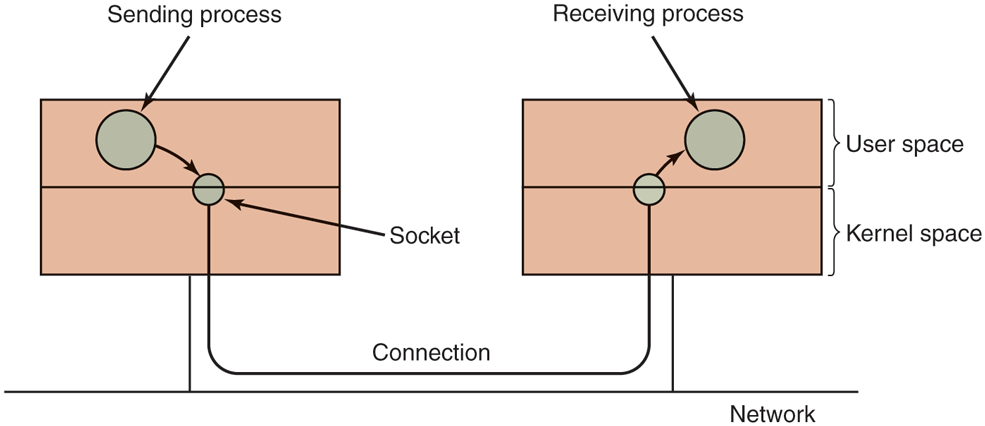

# MOS5 §10.5.2 Networking —— 网络也是 I/O：socket 体系
> 出处: [Modern Operating Systems 5th Edition §10.5.2 Networking](../../007.BOOKs/现代操作系统/Modern%20Operating%20Systems%205th%20Edition-PDF-01.pdf#page=788),书页 763-765(PDF 788-790)。§10.5 Input/Output in Linux 的第 2 小节。
>
> 关联笔记: [039.网络协议栈与系统实现](../039.网络协议栈与系统实现/README.md)(完整协议栈) | [006.块设备与字符设备两大组件](006.块设备与字符设备两大组件.md)(§10.5.4 的网络设备段落也在此展开) | [051.AI-ASSISANT/001.CPU与DMA双向交互(网络收包事件全流程)](../051.AI-ASSISANT/001.CPU与DMA双向交互(网络收包事件全流程).md)(收包端到端)

---

## 1. 原文精读

### 1.1 socket:网络世界的"特殊文件"

> "Another example of I/O is networking, as pioneered by Berkeley UNIX and taken over by Linux more or less verbatim. The key concept in the Berkeley design is the socket. Sockets are analogous to mailboxes and telephone wall sockets in that they allow users to interface to the network, just as mailboxes allow people to interface to the postal system and telephone wall sockets allow them to plug in telephones and connect to the telephone system. The sockets' position is shown in Fig. 10-19."（I/O 的另一个例子是网络，它由 Berkeley UNIX 开创，之后几乎原封不动地被 Linux 继承。Berkeley 设计中的关键概念是套接字(socket)。套接字 analogous 于信箱和电话墙壁插座——它们让用户得以接入网络，正如信箱让人们接入邮政系统、电话墙壁插座让人们插上电话接入电话系统一样。套接字的位置如图 10-19 所示。）<sup>[Modern Operating Systems 5th, 书页 763(PDF 788)](../../007.BOOKs/现代操作系统/Modern%20Operating%20Systems%205th%20Edition-PDF-01.pdf#page=788)</sup>

原图(自书 EPUB 提取，未拉伸):


<sup>原图出自 [Modern Operating Systems 5th Edition, Fig. 10-19](../../007.BOOKs/现代操作系统/Modern%20Operating%20Systems%205th%20Edition-PDF-01.pdf#page=788)</sup>

图 10-19(套接字在网络体系中的位置)ASCII 重绘:

```text
                       主机 A                                                                             主机 B                  (MOS5 Fig 10-19 重绘)
 ┌────────────────────────────────────────────────┐                                 ┌────────────────────────────────────────────────┐
 │ 发送进程                                       │                                 │ 接收进程                                       │  ← 用户空间
 │ (系统调用 write/send ↓)                        │                                 │ (系统调用 read/recv ↑)                         │
 │                                                │                                 │                                                │
 ├────────────────────────┬──────────────────────┤                                  ├────────────────────────┬──────────────────────┤   ← 用户态/内核态边界
 │                        ▼ socket(套接字)        │                                 │                        ▼ socket(套接字)        │  ← 内核空间
 └────────────────────────────────────────────────┘                                 └────────────────────────────────────────────────┘
                          │                                                                                  │
                          └──────────────────────────────────────────────────────────────────────────────────┘
                                                        ── Connection(连接) ──
        ══════════════════════════════════════════════════════════════════════════════════════════════════════════════════════
                                                                                                                      网络
 socket 是进程与协议栈的接口,长在用户态/内核态边界上;两端 socket 跨网络连接。Linux 协议栈/驱动展开见 039 网络笔记
```

> "Sockets can be created and destroyed dynamically. Creating a socket returns a file descriptor, which is needed for establishing a connection, reading data, writing data, and releasing the connection."（套接字可以动态地创建和销毁。创建套接字会返回一个文件描述符，后续建立连接、读数据、写数据、释放连接都需要用到它。）<sup>[Modern Operating Systems 5th, 书页 763(PDF 788)](../../007.BOOKs/现代操作系统/Modern%20Operating%20Systems%205th%20Edition-PDF-01.pdf#page=788)</sup>

**这就是"网络也是 I/O"的落点**：socket 不像块/字符设备那样在 `/dev` 下挂特殊文件，但它依然走 VFS 的 `file` 抽象——创建即返回 fd，一切后续操作皆以 fd 为中心。Linux 内核里 `__sys_socket()` 的返回值就是经 `sock_alloc_file()` 绑定到 `struct socket` 的 fd<sup>[net/socket.c:1802 __sys_socket](../../000.SOURCE_CODE/003.LINUX-7.1.3/000.LINUX-7.1.3/net/socket.c)</sup>；socket 自身也有一套 `file_operations`(`sock_read_iter`/`sock_write_iter`/`sock_mmap`/`sock_close`,net/socket.c:159-168),所以 `read`/`write`/`mmap` 系统调用对 socket fd 一样成立。

### 1.2 三种 socket 类型

> "Each socket supports a particular type of networking, specified when the socket is created. The most common types are as follows: Reliable connection-oriented byte stream. Reliable connection-oriented packet stream. Unreliable packet transmission."（每个套接字支持一种特定的网络类型，在创建时指定。最常见的类型如下：可靠的面向连接的字节流；可靠的面向连接的包流；不可靠的包传输。）<sup>[Modern Operating Systems 5th, 书页 763(PDF 788)](../../007.BOOKs/现代操作系统/Modern%20Operating%20Systems%205th%20Edition-PDF-01.pdf#page=788)</sup>

对三种类型的展开(原文大意 + 中文):

- **类型 1(字节流)**:两个不同机器上的进程之间建立一条"等价于管道"的通道。字节从一端泵入，从另一端按相同顺序流出；系统保证所有正确发送的字节都按发送顺序到达。<sup>[书页 763(PDF 788)](../../007.BOOKs/现代操作系统/Modern%20Operating%20Systems%205th%20Edition-PDF-01.pdf#page=788)</sup>
- **类型 2(包流)**:与类型 1 类似，但**保留包边界**。若发送方调用 5 次 `write`、每次 512 字节，接收方一次请求 2560 字节——类型 1 会一次给满 2560 字节，类型 2 只返回 512 字节，还要再调 4 次。<sup>[书页 764(PDF 789)](../../007.BOOKs/现代操作系统/Modern%20Operating%20Systems%205th%20Edition-PDF-01.pdf#page=789)</sup>
- **类型 3(不可靠包传输)**:让用户直接访问裸网络(raw)。包可能丢失、乱序，系统不作任何保证。好处是性能更高——对多媒体等"快比对更重要"的场景反而合适。<sup>[书页 764(PDF 789)](../../007.BOOKs/现代操作系统/Modern%20Operating%20Systems%205th%20Edition-PDF-01.pdf#page=789)</sup>

**Linux 内核对应**:`include/linux/net.h` 中 socket 类型就是这几个枚举<sup>[include/linux/net.h:85-89](../../000.SOURCE_CODE/003.LINUX-7.1.3/000.LINUX-7.1.3/include/linux/net.h)</sup>:

```c
// include/linux/net.h
SOCK_STREAM   = 1,   /* 类型1: 可靠面向连接字节流 → TCP */
SOCK_DGRAM    = 2,   /* 类型2? 注意:内核语义下 SOCK_DGRAM 是不可靠数据报 → UDP */
SOCK_RAW      = 3,   /* 类型3: 裸网络访问 */
SOCK_SEQPACKET = 5,  /* 保留包边界的面向连接套接字 → 类型2在 Linux 的对应物 */
```

> 注意书中的"类型 2 可靠包流"在 BSD/Linux 里对应 `SOCK_SEQPACKET`(如 SCTP);日常最常用的 `SOCK_DGRAM`(UDP)其实是"不可靠数据报"。TCP= `SOCK_STREAM`,UDP= `SOCK_DGRAM`,raw= `SOCK_RAW`。

### 1.3 协议与地址域

> "When a socket is created, one of the parameters specifies the protocol to be used for it. For reliable byte streams, the most popular protocol is TCP (Transmission Control Protocol). For unreliable packet-oriented transmission, UDP (User Datagram Protocol) is the usual choice. Both of these are layered on top of IP (Internet Protocol)."（创建套接字时，其中一个参数指定该套接字使用的协议。对可靠的字节流，最流行的协议是 TCP(传输控制协议)；对不可靠的面向包传输，通常选择 UDP(用户数据报协议)。两者都分层构建在 IP(网际协议)之上。）<sup>[Modern Operating Systems 5th, 书页 764(PDF 789)](../../007.BOOKs/现代操作系统/Modern%20Operating%20Systems%205th%20Edition-PDF-01.pdf#page=789)</sup>

> "Before a socket can be used for networking, it must have an address bound to it. This address can be in one of several naming domains. The most common one is the Internet naming domain, which uses 32-bit integers for naming endpoints in Version 4 and 128-bit integers in Version 6."（套接字在被用于网络通信之前，必须绑定一个地址。该地址可以属于若干命名域之一。最常见的是 Internet 命名域，第 4 版用 32 位整数命名端点，第 6 版用 128 位整数。）<sup>[Modern Operating Systems 5th, 书页 764(PDF 789)](../../007.BOOKs/现代操作系统/Modern%20Operating%20Systems%205th%20Edition-PDF-01.pdf#page=789)</sup>

### 1.4 建立连接:listen/connect 与"管道化"

> "Once sockets have been created on both the source and destination computers, a connection can be established between them (for connection-oriented communication). One party makes a listen system call on a local socket, which creates a buffer and blocks until data arrive. The other makes a connect system call, giving as parameters the file descriptor for a local socket and the address of a remote socket. If the remote party accepts the call, it creates a new socket (since it may need the original one to continue to listen for other connection requests), and the system then establishes a connection between the caller's socket and the newly created remote socket."（当源与目的计算机上都创建了套接字之后，就可以在它们之间建立连接(对于面向连接的通信)。一方在本地套接字上调用 `listen`，它会创建一个缓冲区并阻塞直至数据到达；另一方调用 `connect`，参数是本地套接字的文件描述符和远程套接字的地址。如果远程一方接受呼叫，它会创建一个**新的**套接字(因为它可能还需要原来的套接字继续监听其他连接请求)，然后系统在调用方的套接字与这个新建的远程套接字之间建立连接。）<sup>[Modern Operating Systems 5th, 书页 764(PDF 789)](../../007.BOOKs/现代操作系统/Modern%20Operating%20Systems%205th%20Edition-PDF-01.pdf#page=789)</sup>

> "Once a connection has been established, it functions analogously to a pipe. A process can read and write from it using the file descriptor for its local socket. When the connection is no longer needed, it can be closed in the usual way, via the close system call."（连接一旦建立，其功能就类似于管道。进程可以使用其本地套接字的文件描述符进行读写。当连接不再需要时，可以按通常的方式通过 `close` 系统调用关闭。）<sup>[书页 765(PDF 790)](../../007.BOOKs/现代操作系统/Modern%20Operating%20Systems%205th%20Edition-PDF-01.pdf#page=790)</sup>

**"accept 返回新 socket"** 是这段的关键细节:监听 socket 与通信 socket 分离,内核中 `__sys_accept4()` 就是创建新 socket 并关联新 fd 的入口<sup>[net/socket.c:2097 __sys_accept4](../../000.SOURCE_CODE/003.LINUX-7.1.3/000.LINUX-7.1.3/net/socket.c)</sup>。整套系统调用的内核入口:

| BSD socket API | Linux 内核入口 | 位置(net/socket.c) |
|-|-|-|
| `socket()` | `__sys_socket` | :1802 |
| `bind()` | `__sys_bind` | :1948 |
| `listen()` | `__sys_listen` | :1992 |
| `accept()` | `__sys_accept4` | :2097 |
| `connect()` | `__sys_connect` | :2155 |
| `sendto()` / `recvfrom()` | `__sys_sendto` / `__sys_recvfrom` | :2231 / :2276 |

## 2. §10.5.4 里的网络设备:与块/字符设备的分野

10.5.4 结尾单独交代了网络设备的实现路径(原文):

> "The interaction with network devices is different. While network devices also produce/consume streams of characters, their asynchronous nature makes them less suitable for easy integration under the same interface as other character devices. The networking device driver produces packets consisting of multiple bytes of data, along with network headers. These packets are then routed through a series of network protocol drivers, and ultimately are passed to the user-space application. A key data structure is the socket buffer structure, skbuff, which is used to represent portions of memory filled with packet data. The data in an skbuff buffer do not always start at the start of the buffer. As they are being processed by various protocols in the networking stack, protocol headers may be removed, or added. The user processes interact with networking devices via sockets, which in Linux support the original BSD socket API. The protocol drivers can be bypassed and direct access to the underlying network device is enabled via raw_sockets. Only the superuser is allowed to create raw sockets."（与网络设备的交互是不同的。虽然网络设备同样产生/消耗字符流，但它们的异步性质使其不适合像其他字符设备那样轻易地纳入同一接口。网络设备驱动产生由多字节数据连同网络头部组成的包；这些包随后经过一系列网络协议驱动路由，最终传递给用户态应用。一个关键数据结构是套接字缓冲区结构 skbuff，用来表示装满包数据的那部分内存。skbuff 缓冲区中的数据并不总是从缓冲区头部开始——在协议栈各层处理过程中，协议头可能被剥除或添加。用户进程通过套接字与网络设备交互，Linux 支持原始的 BSD socket API。协议驱动可以被绕过，通过 raw sockets 直接访问底层网络设备。只有超级用户才允许创建 raw socket。）<sup>[Modern Operating Systems 5th, 书页 768(PDF 793)](../../007.BOOKs/现代操作系统/Modern%20Operating%20Systems%205th%20Edition-PDF-01.pdf#page=793)</sup>

**内核三件套对照(Linux 7.1.3)**:

| MOS5 概念 | 内核实体 | 位置 |
|-|-|-|
| socket buffer(`skbuff`) | `struct sk_buff` | [include/linux/skbuff.h:886](../../000.SOURCE_CODE/003.LINUX-7.1.3/000.LINUX-7.1.3/include/linux/skbuff.h) |
| 分配一个包缓冲区 | `__alloc_skb()` | [net/core/skbuff.c:672](../../000.SOURCE_CODE/003.LINUX-7.1.3/000.LINUX-7.1.3/net/core/skbuff.c) |
| "数据不一定从缓冲区头部开始" | `skb->data` 与 `skb->head` 分离,`skb_reserve()`/`skb_push()`/`skb_pull()` 挪动 `data` 指针实现"加头/剥头" | [include/linux/skbuff.h](../../000.SOURCE_CODE/003.LINUX-7.1.3/000.LINUX-7.1.3/include/linux/skbuff.h) |
| raw socket(仅超级用户) | `SOCK_RAW`,CAP_NET_RAW 能力检查 | net/core/sock.c `sock_create` 路径 |

sk_buff 的"协议头会移动"设计,ASCII 图示意:

```text
skb->head ──────────────────────────────────────────────────────────► skb->end
    headroom
              ▲ skb->data(随处理逐层移动)
 ┌──────────────┬────────────┬──────────┬──────────┬───────────┐
 │ (预留空间) │ 以太网头 │ IP 头  │ TCP 头 │ 载荷    │
 └──────────────┴────────────┴──────────┴──────────┴───────────┘
  收包: 逐层 skb_pull() 剥头 (ETH→IP→TCP)      data ──►
  发包: 逐层 skb_push() 加头 (TCP→IP→ETH)   ◄── data
  (预留空间 = skb->head → skb->data 之间,即 headroom;data 在 预留空间|以太网头 边界)
```

- 网络收发端到端(网卡 DMA → sk_buff → 协议栈 → socket)的完整事件流,见 [051.AI-ASSISANT/001.CPU与DMA双向交互(网络收包事件全流程)](../051.AI-ASSISANT/001.CPU与DMA双向交互(网络收包事件全流程).md);协议栈分层实现见 [039.网络协议栈与系统实现/005.Linux内核网络](../039.网络协议栈与系统实现/005.Linux内核网络/README.md)。
- sk_buff 走的也是 DMA(网卡 DMA 到内核缓冲),DMA 与 CPU 的交互/优先级见本目录 [006.DMA](006.DMA/README.md)。

## 3. 小结:网络 I/O 在 Linux I/O 版图中的位置

| 维度 | 块设备 | 字符设备 | 网络 |
|-|-|-|---|
| 用户态入口 | `/dev/sdX` 特殊文件 | `/dev/ttyX` 特殊文件 | socket(fd,不在 /dev) |
| 内核抽象 | `file_operations` = `def_blk_fops` | `file_operations` + cdev | `file_operations` = socket_fops |
| 数据单元 | 页/块/扇区 | 字节流(线路规程加工) | 包(sk_buff) |
| 缓存 | 页缓存(统一缓存) | 一般无 | 协议栈内部缓冲 |
| 可靠性保证 | 块层/I/O 调度器 | — | 按类型:TCP 可靠/UDP 不可靠 |
