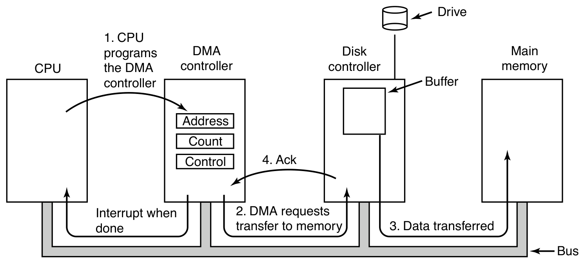

# 《现代操作系统(第 5 版)》§5.1.4 Direct Memory Access 全篇翻译

> 出处:[Modern Operating Systems 5th Edition, §5.1.4 Direct Memory Access, 书页 344–347(PDF 373–376)](../../../007.BOOKs/现代操作系统/Modern%20Operating%20Systems%205th%20Edition-PDF-01.pdf#page=373);同文电子版:[Modern Operating Systems 5th Edition-EPUB-02](../../../007.BOOKs/现代操作系统/Modern%20Operating%20Systems%205th%20Edition-EPUB-02.epub) §5.1.4。
>
> 格式:小节标题、段落顺序与插图位置均照原书;每段先给英文原文(逐字摘录,连字符断行已合并),紧接中文对照;原书加粗术语在中文对照中加粗(如 DMA、周期窃取/突发模式/飞越模式)。跨页的段落按完整段落合并,并随段注明跨页范围;各"书页"小标题即 PDF 对应页的跳转链接。

## 5.1.4 Direct Memory Access(直接内存访问)

### [书页 344(PDF 373)](../../../007.BOOKs/现代操作系统/Modern%20Operating%20Systems%205th%20Edition-PDF-01.pdf#page=373)

> "No matter whether a CPU does or does not have memory-mapped I/O, it needs to address the device controllers to exchange data with them. The CPU can request data from an I/O controller one byte at a time, but doing so wastes the CPU’s time, so a different scheme, called DMA (Direct Memory Access) is often used. To simplify the explanation, we assume that the CPU accesses all devices and memory via a single system bus that connects the CPU, the memory, and the I/O devices, as shown in Fig. 5-4. We already know that the real organization in modern systems is more complicated, but all the principles are the same. The operating system can only use DMA if the hardware has a DMA controller, which most systems do. Sometimes this controller is integrated into disk controllers and other controllers, but such a design requires a separate DMA controller for each device. More commonly, a single DMA controller is available (e.g., on the motherboard) for regulating transfers to multiple devices, often concurrently."
>
> 无论 CPU 有没有内存映射 I/O,它都需要对设备控制器寻址,以便与它们交换数据。CPU 可以一次一个字节地向 I/O 控制器请求数据,但这样做浪费 CPU 的时间,所以经常采用另一种方案,称为 **DMA(直接内存访问)**。为了简化解释,我们假设 CPU 经由一条单一的系统总线访问所有设备和内存,这条总线把 CPU、内存和 I/O 设备连接在一起,如图 5-4 所示。我们已经知道,现代系统的实际组织结构要复杂得多,但所有原理都是相同的。只有硬件拥有 DMA 控制器,操作系统才能使用 DMA,而大多数系统都有。有时这个控制器被集成到磁盘控制器和其他控制器之中,但这样的设计要求每个设备各有一个单独的 DMA 控制器。更常见的做法是只提供一个 DMA 控制器(例如在主板上),用它来协调向多个设备的传送,而且经常是并发进行的。

> "No matter where it is physically located, the DMA controller has access to the system bus independent of the CPU, as shown in Fig. 5-4. It contains several registers that can be written and read by the CPU. These include a memory address register, a byte count register, and one or more control registers. The control registers specify the I/O port to use, the direction of the transfer (reading from the I/O device or writing to the I/O device), the transfer unit (byte at a time or word at a time), and the number of bytes to transfer in one burst."
>
> 无论 DMA 控制器物理上位于何处,它都可以独立于 CPU 访问系统总线,如图 5-4 所示。它包含若干个可由 CPU 读写的寄存器,其中包括一个内存地址寄存器、一个字节计数寄存器和一至多个控制寄存器。控制寄存器指明要使用的 I/O 端口、传送方向(从 I/O 设备读出,还是写入 I/O 设备)、传送单位(一次一个字节还是一次一个字),以及一次突发传送要传送的字节数。

> "To explain how DMA works, consider how data are read from, say, a disk. Let us first look at how disk reads occur when DMA is not used. First, the disk controller reads the block (one or more sectors) from the drive serially, bit by bit, until the entire block is stored in the controller’s internal buffer. Next, it computes the checksum to verify that no read errors have occurred. Then the controller causes an interrupt. When the operating system starts running, it can read the disk block from the controller’s buffer a byte or a word at a time by executing a loop, with each iteration reading one byte or word from a controller device register and storing it in main memory."
>
> 为了解释 DMA 是如何工作的,我们考察一下从磁盘这类设备读出数据的过程。先看不使用 DMA 时磁盘读是如何进行的。首先,磁盘控制器从驱动器逐位串行地读出这个块(一个或多个扇区),直到整个块被存入控制器的内部缓冲区。接着,它计算校验和,以确认没有发生读错误。然后,控制器引发一次中断。操作系统开始运行时,它可以通过执行一个循环,一次一个字节或一次一个字地从控制器缓冲区读出这个磁盘块,循环的每一次迭代都从控制器的设备寄存器读取一个字节或一个字,并将其存入主存。

*(本段从书页 344 末尾跨到 345 顶部;原书把图 5-4 插在本段的中间。)*

### [书页 345(PDF 374)](../../../007.BOOKs/现代操作系统/Modern%20Operating%20Systems%205th%20Edition-PDF-01.pdf#page=374)

*Figure 5-4. Operation of a DMA transfer.*(图 5-4:一次 DMA 传送的操作)原图出自 [PDF 374 页](../../../007.BOOKs/现代操作系统/Modern%20Operating%20Systems%205th%20Edition-PDF-01.pdf#page=374);该页无嵌入位图,本图由页面矢量数据按 300 dpi 渲染裁出(不含图注)

> "When DMA is used, the procedure is different. First the CPU programs the DMA controller by setting its registers so it knows what to transfer where (step 1 in Fig. 5-4). It also issues a command to the disk controller telling it to read data from the disk into its internal buffer and verify the checksum. When valid data are in the disk controller’s buffer, DMA can begin."
>
> 使用 DMA 时,过程就有所不同。首先,CPU 通过设置 DMA 控制器的寄存器来对它进行编程,让它知道要传送什么、传送到哪里(图 5-4 中的第 1 步)。CPU 还向磁盘控制器发出命令,告诉它把数据从磁盘读入内部缓冲区,并校验校验和。当磁盘控制器的缓冲区中有了有效数据之后,DMA 就可以开始了。

> "The DMA controller initiates the transfer by issuing a read request over the bus to the disk controller (step 2). This read request looks like any other read request, and the disk controller does not know (or care) whether it came from the CPU or from a DMA controller. Typically, the memory address to write to is on the bus’ address lines, so when the disk controller fetches the next word from its internal buffer, it knows where to write it. The write to memory is another standard bus cycle (step 3). When the write is complete, the disk controller sends an acknowledgement signal to the DMA controller, also over the bus (step 4). The DMA controller then increments the memory address to use and decrements the byte count. If the byte count is still greater than 0, steps 2 through 4 are then repeated until the count reaches 0. At that time, the DMA controller interrupts the CPU to let it know that the transfer is now complete. When the operating system starts up, it does not have to copy the disk block to memory; it is already there."
>
> DMA 控制器通过在总线上向磁盘控制器发出一个读请求来启动传送(第 2 步)。这个读请求看上去和其他任何读请求一样,磁盘控制器并不知道(也不关心)它来自 CPU 还是来自 DMA 控制器。通常,要写入的内存地址就放在总线的地址线上,所以当磁盘控制器从自己的内部缓冲区中取出下一个字时,它知道该把这个字写到哪里。写内存是另一个标准的总线周期(第 3 步)。写操作完成后,磁盘控制器向 DMA 控制器发送一个应答信号,同样是经由总线(第 4 步)。然后,DMA 控制器递增要使用的内存地址,并递减字节计数。如果字节计数仍然大于 0,就重复第 2 步到第 4 步,直到计数减到 0。这时,DMA 控制器中断 CPU,让它知道传送现在已经完成。当操作系统开始运行时,它不必把磁盘块复制到内存;它已经在内存里了。

> "DMA controllers vary considerably in their sophistication. The simplest ones handle one transfer at a time, as described above. More complex ones can be programmed to handle multiple transfers at the same time. Such controllers have multiple sets of registers internally, one for each channel. The CPU starts by loading each set of registers with the relevant parameters for its transfer. Each transfer must use a different device controller. After each word is transferred (steps 2 through 4) in Fig. 5-4, the DMA controller decides which device to service next. It may be set up to use a round-robin algorithm, or it may have a priority scheme design to favor some devices over others. Multiple requests to different device controllers may be pending at the same time, provided that there is an unambiguous way to tell the acknowledgements apart. Often a different acknowledgement line on the bus is used for each DMA channel for this reason."
>
> DMA 控制器在复杂程度上差别很大。最简单的一类一次只处理一个传送,如上文所述。更复杂的一类可以被编程为同时处理多个传送,这类控制器内部有多组寄存器,每个通道一组。CPU 一开始先为每个传送把相关参数装入各自的那组寄存器。每个传送必须使用各自不同的设备控制器。图 5-4 中每当一个字传送完毕(第 2 步到第 4 步),DMA 控制器就要决定接下来为哪个设备服务。它可以被设置成采用轮转(round-robin)算法,也可以设计优先级方案,让某些设备优先于其他设备。只要有一种无歧义的方式能把各个应答区分开,发往不同设备控制器的多个请求就可以同时处于未决状态。为此,总线上常常为每个 DMA 通道使用一条单独的应答信号线。

*(本段跨书页 345–346。)*

### [书页 346(PDF 375)](../../../007.BOOKs/现代操作系统/Modern%20Operating%20Systems%205th%20Edition-PDF-01.pdf#page=375)

> "Many buses can operate in two modes: word-at-a-time mode and block mode. Often, DMA controllers can also operate in either mode. In the former mode, the operation is as described above: the DMA controller requests the transfer of one word and gets it. If the CPU also wants the bus, it has to wait. The mechanism is called cycle stealing because the device controller sneaks in and steals an occasional bus cycle from the CPU once in a while, delaying it slightly. In block mode, the DMA controller tells the device to acquire the bus, issue a series of transfers, then release the bus. This form of operation is called burst mode. It is more efficient than cycle stealing because acquiring the bus takes time and multiple words can be transferred for the price of one bus acquisition. The downside to burst mode is that it can block the CPU and other devices for a substantial period if a long burst is being transferred."
>
> 许多总线能够以两种模式工作:一次一字模式(word-at-a-time mode)和块模式(block mode)。DMA 控制器通常也在这两种模式之一下工作。在前一种模式下,操作如上所述:DMA 控制器请求传送一个字,然后得到这个字。如果 CPU 也想使用总线,它就必须等待。这种机制称为**周期窃取**(cycle stealing),因为设备控制器会悄悄插进来,时不时地从 CPU 手里偷走一个偶然的总线周期,使 CPU 稍微延迟。在块模式下,DMA 控制器让设备获取总线、发出一串传送,然后释放总线。这种工作形式称为**突发模式**(burst mode)。它比周期窃取更高效,因为获取总线需要时间,而一次获取总线的代价可以传送多个字。突发模式的缺点是:如果一个很长的突发正在传送,它可能在相当长的一段时间内阻塞 CPU 和其他设备。

> "In the model we have been discussing, sometimes called fly-by mode, the DMA controller tells the device controller to transfer the data directly to main memory. An alternative mode that some DMA controllers use is to have the device controller send the word to the DMA controller, which then issues a second bus request to write the word to wherever it is supposed to go. This scheme requires an extra bus cycle per word transferred, but is more flexible in that it can also perform device-to-device copies and even memory-to-memory copies (by first issuing a read to memory and then issuing a write to memory at a different address)."
>
> 在我们一直讨论的模型(有时称为**飞越模式**(fly-by mode))中,DMA 控制器让设备控制器把数据直接传送到主存。某些 DMA 控制器使用的另一种模式是:让设备控制器把字发给 DMA 控制器,再由 DMA 控制器发出第二次总线请求,把这个字写到它该去的地方。这种方案每传送一个字要多花一个总线周期,但更加灵活——它还能执行设备到设备的复制,甚至内存到内存的复制(先对内存发一次读,再对另一个地址发一次写)。

> "Most DMA controllers use physical memory addresses for their transfers. Using physical addresses requires the operating system to convert the virtual address of the intended memory buffer into a physical address and write this physical address into the DMA controller’s address register. An alternative scheme used in a few DMA controllers is to write virtual addresses into the DMA controller instead. Then the DMA controller must use the MMU to have the virtual-to-physical translation done. Only when the MMU is part of the memory (possible, but rare), rather than part of the CPU, can virtual addresses be put on the bus. In Chap. 7, we will see that an IOMMU (an MMU for I/O) offers similar functionality: it translates the virtual addresses used by devices to physical addresses. In other words, the virtual address of a buffer used by a device may be different from the virtual address used for the same buffer by the CPU, while both are different from the corresponding physical address."
>
> 大多数 DMA 控制器使用物理内存地址进行传送。使用物理地址要求操作系统把打算用作内存缓冲区的虚拟地址转换成物理地址,并把这一物理地址写入 DMA 控制器的地址寄存器。少数 DMA 控制器采用的替代方案是把虚拟地址写入 DMA 控制器,然后由 DMA 控制器借助 MMU 完成虚拟地址到物理地址的翻译。只有当 MMU 是内存的组成部分(有可能,但罕见)而不是 CPU 的组成部分时,才能把虚拟地址放到总线上。在第 7 章我们将看到,IOMMU(面向 I/O 的 MMU)提供了类似的功能:它把设备使用的虚拟地址翻译成物理地址。换言之,设备访问某个缓冲区所用的虚拟地址,可以不同于 CPU 访问同一缓冲区所用的虚拟地址,而这两者又都不同于对应的物理地址。

> "We mentioned earlier that before DMA can start, the disk first reads data into its internal buffer. You may be wondering why the controller does not just store the bytes in main memory as soon as it gets them from the disk. In other words, why does it need an internal buffer? There are two reasons. First, by doing internal buffering, the disk controller can verify the checksum before starting a transfer. If the checksum is incorrect, an error is signaled and no transfer is done."
>
> 前面提到过,DMA 开始之前,磁盘要先把数据读入内部缓冲区。你可能会感到奇怪:为什么控制器不把从磁盘得到的字节一收到就直接存入主存?换句话说,它为什么需要一个内部缓冲区?原因有两个。第一,通过在内部做缓冲,磁盘控制器可以在开始传送之前校验校验和;如果校验和不正确,就发出错误信号,并且不做传送。

*(本段跨书页 346–347。)*

### [书页 347(PDF 376)](../../../007.BOOKs/现代操作系统/Modern%20Operating%20Systems%205th%20Edition-PDF-01.pdf#page=376)

> "The second reason is that once a disk transfer has started, the bits keep arriving from the disk at a constant rate, whether the controller is ready for them or not. If the controller tried to write data directly to memory, it would have to go over the system bus for each word transferred. If the bus were busy due to some other device using it (e.g., in burst mode), the controller would have to wait. If the next disk word arrived before the previous one had been stored, the controller would have to store it somewhere. If the bus were very busy, the controller might end up storing quite a few words and having a lot of administration to do as well. When the block is buffered internally, the bus is not needed until the DMA begins, so the design of the controller is much simpler because the DMA transfer to memory is not time critical. (Some older controllers did, in fact, go directly to memory with only a small amount of internal buffering, but when the bus was very busy, a transfer might have had to be terminated with a buffer overrun error.)"
>
> 第二个原因是,一旦磁盘传送开始,这些位就会以恒定的速率从磁盘不断到达,不管控制器有没有为它们做好准备。如果控制器试图把数据直接写入内存,每传送一个字它都要占用一次系统总线。如果总线正被其他设备占用而忙(例如某个设备正处于突发模式),控制器就不得不等待。如果下一个磁盘字在上一个字存好之前到达,控制器就得把它先存到某个地方。如果总线非常忙,控制器最后可能要存下相当多的字,还要做大量管理工作。而当块被缓冲在控制器内部时,在 DMA 开始之前总线是不需要的,控制器的设计因此简单得多,因为到内存的 DMA 传送不再是时间敏感的。(确实有一些较老的控制器直接写内存,只有少量内部缓冲;但当总线非常忙时,传送可能不得不以缓冲区溢出错误而终止。)

> "Some computers do not use DMA. The argument against it might be that the main CPU is often far faster than the DMA controller and can do the job much faster (when the limiting factor is not the speed of the I/O device). If there is no other work for it to do, having the (fast) CPU wait for the (slow) DMA controller to finish is pointless. Also, getting rid of the DMA controller and having the CPU do all the work in software saves money, important on low-end (embedded) computers."
>
> 有些计算机不使用 DMA。反对 DMA 的理由可能是:主 CPU 往往比 DMA 控制器快得多,能更快地完成这项工作(当限制因素不是 I/O 设备的速度时)。如果 CPU 反正没有别的事可做,让(快的)CPU 干等(慢的)DMA 控制器完成工作毫无意义。此外,去掉 DMA 控制器、让 CPU 用软件包揽全部工作还能省钱,这一点对低端(嵌入式)计算机很重要。

*(本节至此结束;下节 §5.1.5 Interrupts Revisited 从书页 347 中部开始,不在本篇范围。)*

## 关联笔记

- [001.DMA传送流程(重绘图5-4)与IOMMU地址翻译](001.DMA传送流程%28重绘图5-4%29与IOMMU地址翻译.md) —— 本节图 5-4 的 ASCII 重绘与逐步注解;"Most DMA controllers use physical memory addresses…"一段(书页 346)旧不旧、IOMMU/IOVA 关系的 7.1.3 源码分派证据
- [000.DMA-学习资料索引](000.DMA-学习资料索引.md) | [README](README.md)
