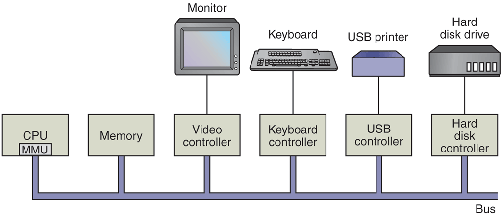
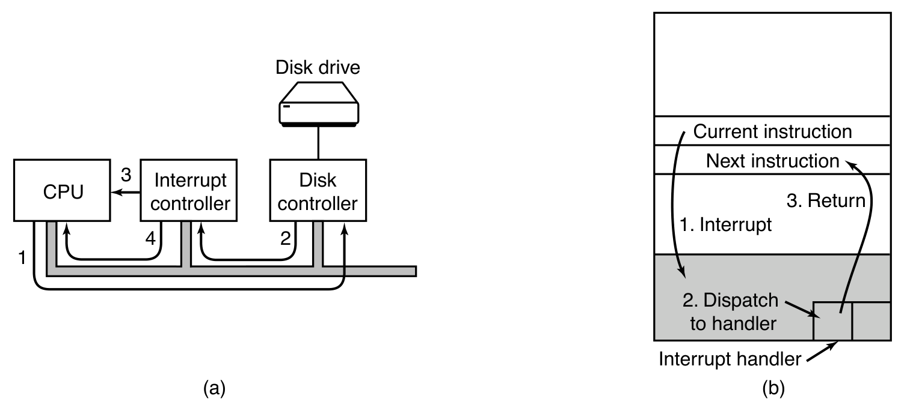

# 《现代操作系统(第 5 版)》§1.3.4 I/O Devices 全篇翻译

> 出处:[Modern Operating Systems 5th Edition, §1.3.4 I/O Devices, 书页 29–32(PDF 58–61)](../../007.BOOKs/现代操作系统/Modern%20Operating%20Systems%205th%20Edition-PDF-01.pdf#page=58);同文电子版:[Modern Operating Systems 5th Edition-EPUB-02](../../007.BOOKs/现代操作系统/Modern%20Operating%20Systems%205th%20Edition-EPUB-02.epub) §1.3.4。
>
> 格式:小节标题、段落顺序与插图位置均照原书;每段先给英文原文(逐字摘录),紧接中文对照;原书加粗术语(SATA、device driver、I/O port space、busy waiting、interrupt、interrupt vector table、DMA)在中文对照中加粗。跨页段落按完整段落合并并随段注明;各"书页"小标题即 PDF 对应页的跳转链接;§1.3.4 开头引用的图 1-6 在原书中位于本节之前(书页 21/PDF 50 的 §1.3.1 内),摘录时随引用段落附上并注明出处。
>
> 字形说明:提取层的字距伪影(如 SAT A)已按书面原文修正(SATA);原书两处疑似排印问题——"Besides disks **there** many other I/O devices"(疑漏 are)与 "further **in in** the next chapter"(疑重复 in)——经目视与第二提取器核对均为书上原样,引文逐字保留并随段注明;书中的双引号原样保留为连续弯引号(''…'')。

## 1.3.4 I/O Devices(I/O 设备)

### [书页 29(PDF 58)](../../007.BOOKs/现代操作系统/Modern%20Operating%20Systems%205th%20Edition-PDF-01.pdf#page=58)

> "It should now be clear that CPU and memory are not the only resources that the operating system must manage. There are many other ones. Besides disks there many other I/O devices that interact heavily with the operating system. As we saw in Fig. 1-6, I/O devices generally consist of two parts: a controller and the device itself. The controller is a chip (or a set of chips) that physically controls the device. It accepts commands from the operating system, for example, to read data from the device, and carries them out."
>
> 到这里应该已经清楚了:CPU 和内存并不是操作系统必须管理的仅有资源,还有许多其他资源。除了磁盘之外,还有许多要与操作系统深度交互的 I/O 设备。如图 1-6 所示,I/O 设备大体由两部分组成:控制器和设备本身。控制器是物理地控制设备的一块芯片(或一组芯片),它从操作系统接受命令——例如从设备读取数据——并加以执行。

*Figure 1-6. Some of the components of a simple personal computer.*（图 1-6：一台简单个人计算机的部分组件。）原图出自 [PDF 50 页(书页 21,§1.3.1 内)](../../007.BOOKs/现代操作系统/Modern%20Operating%20Systems%205th%20Edition-PDF-01.pdf#page=50),不在本节页面范围;本文件为此前从 EPUB 提取的存图,023.MMIO README 同用

*(原书此句为 "Besides disks there many other I/O devices",疑漏 "are",引文按原书逐字保留。)*

### [书页 30(PDF 59)](../../007.BOOKs/现代操作系统/Modern%20Operating%20Systems%205th%20Edition-PDF-01.pdf#page=59)

> "In many cases, the actual control of the device is complicated and detailed, so it is the job of the controller to present a simpler (but still very complex) interface to the operating system. For example, a hard disk controller might accept a command to read sector 11,206 from disk 2. The controller then has to convert this linear sector number to a cylinder, sector, and head. This conversion may be complicated by the fact that outer cylinders have more sectors than inner ones and that some bad sectors have been remapped onto other ones. Then the controller has to determine which cylinder the disk arm is on and give it a command to move in or out the requisite number of cylinders. It has to wait until the proper sector has rotated under the head and then start reading and storing the bits as they come off the drive, removing the preamble and computing the checksum. Finally, it has to assemble the incoming bits into words and store them in memory. To do all this work, controllers often contain small embedded computers that are programmed to do their work."
>
> 很多情况下,对设备的实际控制既复杂又琐碎,所以控制器的职责就是向操作系统呈现一个更简单(但仍然相当复杂)的接口。例如,硬盘控制器可能会接受这样一条命令:从 2 号盘读出 11,206 号扇区。控制器随后要把这个线性扇区号换算成柱面、扇区和磁头。这一换算可能因两件事而变复杂:外圈柱面比内圈柱面容纳更多扇区;一些坏扇区已被重映射到其他扇区。接着,控制器要确定磁盘臂当前处于哪个柱面,并向它发出移动相应柱面数的命令。它必须等到正确的扇区旋转到磁头之下,然后开始读取并存储从盘面出来的位流,去掉前导码并计算校验和。最后,它要把进来的位组装成字并存入内存。为了完成所有这些工作,控制器常常内含一些小的嵌入式计算机,通过编程来做这些事。

> "The other piece is the actual device itself. Devices have fairly simple interfaces, both because they cannot do much and to make them standard. The latter is needed so that any SATA disk controller can handle any SATA disk, for example. SATA stands for Serial ATA and ATA in turn stands for AT Attachment. In case you are curious what AT stands for, this was IBM’s second generation ‘‘Personal Computer Advanced Technology’’ built around the then-extremely-potent 6-MHz 80286 processor that the company introduced in 1984. What we learn from this is that the computer industry has a habit of continuously enhancing existing acronyms with new prefixes and suffixes. We also learned that an adjective like ‘‘advanced’’ should be used with great care, or you will look silly 40 years down the line."
>
> 另一部分是设备本身。设备的接口相当简单,一方面因为它们做不了太多事,另一方面是为了让它们标准化。后一点是必需的:例如,任何一个 SATA 磁盘控制器都能接任何一块 SATA 磁盘。SATA 是 Serial ATA 的缩写,而 ATA 又是 AT Attachment 的缩写。如果你好奇 AT 代表什么:它是 IBM 的第二代"个人计算机高级技术"(Personal Computer Advanced Technology),围绕该公司 1984 年推出的、当时强得惊人的 6 MHz 80286 处理器构建。我们从中学到的是:计算机行业有个习惯,就是不断给现有缩略语加新前缀和新后缀;我们还学到,像"先进"(advanced)这样的形容词要慎用,否则 40 年后会显得很傻。

> "SATA is currently the standard type of hard disk on many computers. Since the actual device interface is hidden behind the controller, all that the operating system sees is the interface to the controller, which may be quite different from the interface to the device."
>
> SATA 是目前许多计算机上标准的硬盘类型。由于实际的设备接口隐藏在控制器背后,操作系统看到的只是到控制器的接口,而它可能与到设备本身的接口大不相同。

> "Because each type of controller is different, different software is needed to control each one. The software that talks to a controller, giving it commands and accepting responses, is called a device driver. Each controller manufacturer has to supply a driver for each operating system it supports. Thus a scanner may come with drivers for macOS, Windows 11, and Linux, for example."
>
> 因为控制器各式各样,控制每种控制器就需要不同的软件。与控制器对话、向它发命令并接收其应答的软件,称为**设备驱动程序**(device driver)。每个控制器厂商都要为它所支持的每种操作系统提供驱动程序。例如,一台扫描仪可能附带 macOS、Windows 11 和 Linux 的驱动程序。

> "To be used, the driver has to be put into the operating system so it can run in kernel mode. Drivers can actually run outside the kernel, and operating systems like Linux and Windows nowadays do offer some support for doing so, but the vast majority of the drivers still run below the kernel boundary. Only very few current systems, such as MINIX 3 run all drivers in user space. Drivers in user space must be allowed to access the device in a controlled way, which is not straightforward without some hardware support."
>
> 要投入使用,驱动程序必须被装进操作系统,以便能在内核态运行。驱动程序实际上也可以在内核之外运行,如今 Linux 和 Windows 等操作系统确实为此提供了一些支持,但绝大多数驱动程序仍然运行在内核边界之下。目前只有极少数系统(例如 MINIX 3)把所有驱动程序都放在用户空间运行。用户空间的驱动程序必须被允许以受控的方式访问设备,而在缺乏硬件支持时这并不容易做到。

> "There are three ways the driver can be put into the kernel. The first way is to relink the kernel with the new driver and then reboot the system. Many older UNIX systems work like this. The second way is to make an entry in an operating system file telling it that it needs the driver and then reboot the system. At boot time, the operating system goes and finds the drivers it needs and loads them. Older versions of Windows work this way. The third way is for the operating system to be able to accept new drivers while running and install them on the fly without the need to reboot. This way used to be rare but is becoming much more common now. Hot-pluggable devices, such as USB and Thunderbolt devices (discussed below), always need dynamically loaded drivers."
>
> 把驱动程序放进内核有三种方式。第一种:把新驱动程序与内核重新链接,然后重启系统,许多较老的 UNIX 系统就是这样工作的。第二种:在操作系统的一个文件里作一项登记,说明需要这个驱动程序,然后重启系统;引导时,操作系统去找出自己需要的驱动程序并装入它们,老版本的 Windows 采用这种方式。第三种:操作系统能够在运行中接受新驱动程序并即时装入,无须重启。这种方式过去很少见,如今已变得常见得多。热插拔设备(如 USB 和 Thunderbolt 设备,见下文)总是需要动态装入的驱动程序。

*(本段跨书页 30–31。)*

### [书页 31(PDF 60)](../../007.BOOKs/现代操作系统/Modern%20Operating%20Systems%205th%20Edition-PDF-01.pdf#page=60)

> "Every controller has a small number of registers that are used to communicate with it. For example, a minimal disk controller might have registers for specifying the disk address, memory address, sector count, and direction (read or write). To activate the controller, the driver gets a command from the operating system, then translates it into the appropriate values to write into the device registers. The collection of all the device registers forms the I/O port space, a subject we will come back to in Chap. 5."
>
> 每个控制器都有少量用于与它通信的寄存器。例如,一个最小配置的磁盘控制器可能带有这样一些寄存器:指明磁盘地址、内存地址、扇区数和方向(读或写)。为了激活控制器,驱动程序从操作系统取得一条命令,再把它翻译成要写入设备寄存器的相应值。全部设备寄存器的集合构成 **I/O 端口空间**(I/O port space),这个话题我们将在第 5 章再谈。

> "On some computers, the device registers are mapped into the operating system’s address space (the addresses it can use), so they can be read and written like ordinary memory words. On such computers, no special I/O instructions are required and user programs can be kept away from the hardware by not putting these memory addresses within their reach (e.g., by using base and limit registers). On other computers, the device registers are put in a special I/O port space, with each register having a port address. On these machines, special IN and OUT instructions are available in kernel mode to allow drivers to read and write the registers. The former scheme eliminates the need for special I/O instructions but uses up some of the address space. The latter uses no address space but requires special instructions. Both systems are widely used."
>
> 在一些计算机上,设备寄存器被映射到操作系统的地址空间(它可用的地址)之中,因此可以像普通内存字一样读写它们。在这样的计算机上,不需要特殊的 I/O 指令,而且只要不让这些内存地址进入用户程序的可及范围(例如通过基址/限长寄存器),就能把用户程序挡在硬件之外。在另一些计算机上,设备寄存器被放在一个专门的 I/O 端口空间里,每个寄存器有一个端口地址;在这些机器上,内核态提供了专门的 IN 和 OUT 指令,供驱动程序读写寄存器。前一种方案免掉了专用 I/O 指令,但要占用一部分地址空间;后一种不占地址空间,但需要专用指令。两种系统都在广泛使用。

> "Input and output can be done in three different ways. In the simplest method, a user program issues a system call, which the kernel then translates into a procedure call to the appropriate driver. The driver then starts the I/O and sits in a tight loop continuously polling the device to see if it is done (usually there is some bit that indicates that the device is still busy). When the I/O has completed, the driver puts the data (if any) where they are needed and returns. The operating system then returns control to the caller. This method is called busy waiting and has the disadvantage of tying up the CPU polling the device until it is finished."
>
> 输入输出可以用三种不同的方式完成。最简单的方式:用户程序发出一个系统调用,内核把它翻译成一个对相应驱动程序的过程调用;驱动程序启动 I/O,然后在一个紧凑的循环里不停地轮询设备,看它是否完成(通常有某个位表明设备仍然忙)。I/O 完成后,驱动程序把数据(如果有)放到需要的地方并返回,操作系统再把控制权交还给调用者。这种方法称为**忙等待**(busy waiting),缺点是直到 I/O 完成,CPU 都被占用着轮询设备。

> "The second method is for the driver to start the device and ask it to give an interrupt when it is finished. At that point, the driver returns. The operating system then blocks the caller if need be and looks for other work to do. When the controller detects the end of the transfer, it generates an interrupt to signal completion."
>
> 第二种方式是驱动程序启动设备,并要它在完成时发出一次**中断**(interrupt)。此时驱动程序即返回;操作系统按需把调用者阻塞,然后去找别的事做。当控制器检测到传送结束,它产生一次中断来报告完成。

> "Interrupts are very important in operating systems, so let us examine the idea more closely. In Fig. 1-11(a) we see a three-step process for I/O. In step 1, the driver tells the controller what to do by writing into its device registers. The controller then starts the device. When the controller has finished reading or writing the number of bytes it has been instructed to transfer, it signals the interrupt controller chip using certain bus lines in step 2. If the interrupt controller is ready to accept the interrupt (which it may not be if it is busy handling a higher-priority interrupt), it asserts a pin on the CPU chip telling it, in step 3. In step 4, the interrupt controller puts the number of the device on the bus so the CPU can read it and know which device has just finished (many devices may be running at the same time)."
>
> 中断在操作系统中非常重要,让我们更仔细地考察这个概念。在图 1-11(a) 中,我们看到 I/O 的三步过程。在第 1 步,驱动程序通过向控制器的设备寄存器写入内容,告诉它要做什么,控制器随即启动设备。当控制器读完或写完它受命传送的字节数后,在第 2 步用某些总线信号线向中断控制器芯片发出信号。如果中断控制器准备就绪、可以接受这次中断(若它正忙于处理更高优先级的中断,则可能未就绪),它就在第 3 步向 CPU 芯片的一个引脚发信号告知 CPU。第 4 步,中断控制器把设备编号放到总线上,CPU 读取它就知道是哪个设备刚刚完成(许多设备可能同时在运行)。

*(本段跨书页 31–32。)*

### [书页 32(PDF 61)](../../007.BOOKs/现代操作系统/Modern%20Operating%20Systems%205th%20Edition-PDF-01.pdf#page=61)

*Figure 1-11. (a) The steps in starting an I/O device and getting an interrupt. (b) Interrupt processing involves taking the interrupt, running the interrupt handler, and returning to the user program.*（图 1-11：(a) 启动一个 I/O 设备并获取中断的步骤。(b) 中断处理包括获取中断、运行中断处理程序、返回用户程序。）原图出自 [PDF 61 页](../../007.BOOKs/现代操作系统/Modern%20Operating%20Systems%205th%20Edition-PDF-01.pdf#page=61);该页无嵌入位图,本图由页面矢量数据按 300 dpi 渲染裁出(不含图注)

**图 1-11(a) 图解:无 DMA、靠中断上报完成的中断驱动方式**

- (a) 画的是"无 DMA、靠中断上报完成"的中断驱动 I/O,即本节三种 I/O 方式中的**第 2 种**;"无 DMA"的另一种是前文的忙等待(轮询)——那种方式没有中断,也没有图中这颗专门的中断控制器芯片。
- 四个编号步骤画的全是**控制流**,没有画数据路径:① 驱动程序写设备寄存器,启动磁盘控制器;② 磁盘控制器把块读进自己的内部缓冲区,读盘完毕后经总线向中断控制器芯片发信号;③ 中断控制器向 CPU 的一个引脚发断言;④ 中断控制器把设备编号放上总线,CPU 读取后即知是哪个设备刚刚完成。
- 中断之后,**控制器缓冲区 → 内存**的逐字搬运由 CPU(驱动程序/中断处理程序)完成——这正是 [§5.1.4 开头"无 DMA 时"的流程](../../007.BOOKs/现代操作系统/Modern%20Operating%20Systems%205th%20Edition-PDF-01.pdf#page=374):操作系统执行一个循环,从控制器缓冲区一次一字节/一字地读进内存(该节全篇翻译见 [006.DMA/003](006.DMA/003.MOS5-5.1.4-DMA全篇翻译.md))。
- 对照 §5.1.4 的 Figure 5-4:那里多了 DMA 控制器芯片,数据由磁盘控制器**直接写内存**(fly-by 模式),CPU 全程不碰数据。注意 DMA 方式完成时同样会发一次中断(见本节第 14 段),所以区分两种方式的判据不是"有没有中断",而是**谁搬数据**:图 1-11(a) 是 CPU 搬,图 5-4 是 DMA 搬。
- 书上正文说 "a three-step process for I/O" 而编号却到 step 4:按图注 "(a) The steps in starting an I/O device and getting an interrupt" 划分,step 1 属"启动设备",step 2–4 才是"获取中断"的那三步。

> "Once the CPU has decided to take the interrupt, the program counter and PSW are typically then pushed onto the current stack and the CPU switched into kernel mode. The device number may be used as an index into part of memory to find the address of the interrupt handler for this device. This part of memory is called the interrupt vector table. Once the interrupt handler (part of the driver for the interrupting device) has started, it saves the stacked program counter, PSW, and other registers (typically in the process table). Then it queries the device to learn its status. When the handler is all finished, it restores the context and returns to the previously running user program to the first instruction that was not yet executed. These steps are shown in Fig. 1-11(b). We will discuss interrupt vectors further in in the next chapter."
>
> CPU 一旦决定接受这次中断,程序计数器和 PSW 通常就被压入当前栈,CPU 切换到内核态。设备编号可以用作内存中某个区域的索引,从中找到该设备中断处理程序的地址;这块内存称为**中断向量表**(interrupt vector table)。中断处理程序(属于该中断设备的驱动程序的一部分)开始运行后,它把压栈的程序计数器、PSW 和其他寄存器保存起来(通常保存在进程表中),然后查询设备了解其状态。处理程序全部完成时,它恢复现场,返回到先前运行的用户程序中第一条尚未执行的指令。这些步骤见图 1-11(b)。我们将在下一章进一步讨论中断向量。

*(原书此句为 "We will discuss interrupt vectors further in in the next chapter","in" 疑似重复,引文按原书逐字保留。)*

> "The third method for doing I/O makes use of special hardware: a DMA (Direct Memory Access) chip that can control the flow of bits between memory and some controller without constant CPU intervention. The CPU sets up the DMA chip, telling it how many bytes to transfer, the device and memory addresses involved, and the direction, and lets it go. When the DMA chip is done, it causes an interrupt, which is handled as described above. DMA and I/O hardware in general will be discussed in more detail in Chap. 5."
>
> 第三种 I/O 方式利用了一种专门的硬件:**DMA**(Direct Memory Access,直接内存访问)芯片,它能在内存和某个控制器之间控制位的流动,而无须 CPU 时刻干预。CPU 对 DMA 芯片进行设置,告诉它要传送多少字节、涉及的设备和内存地址以及方向,然后放行。DMA 芯片完成时会引发一次中断,按上文描述的方式处理。DMA 与 I/O 硬件总论将在第 5 章更详细地讨论。

*(本节至此结束;下节 §1.3.5 Buses 从书页 33 顶部开始。)*

## 关联笔记

- [001.设备驱动程序如何装入操作系统](001.设备驱动程序如何装入操作系统.md) —— 第 7 段"驱动装入内核的三种方式"的展开(MOS5 §5.3.2 + Linux 7.1.3 源码三条路径)
- [002.输入输出实现方式](002.输入输出实现方式.md) —— 第 10、11、14 段:轮询(忙等待)/中断驱动/DMA 三种 I/O 实现方式
- [003.CPU如何与IO设备交互](003.CPU如何与IO设备交互.md) —— 第 8、9 段:I/O 端口空间与内存映射两方案的对照
- [023.MMIO(内存映射IO)](023.MMIO\(内存映射IO\)/README.md) —— 第 9 段"设备寄存器映射进地址空间"的全链路展开(含 §5.1.3 全篇翻译:[023/007](023.MMIO\(内存映射IO\)/007.MOS5-5.1.3-MMIO全篇翻译.md))
- [006.DMA](006.DMA/README.md) —— 第 14 段 DMA 的深入(含 §5.1.4 全篇翻译:[006.DMA/003](006.DMA/003.MOS5-5.1.4-DMA全篇翻译.md))
