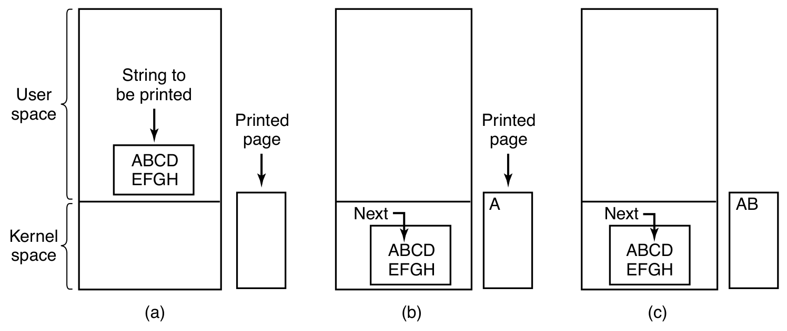
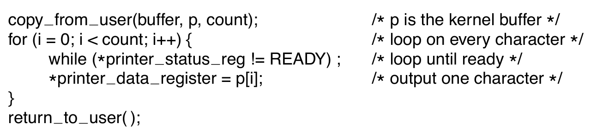
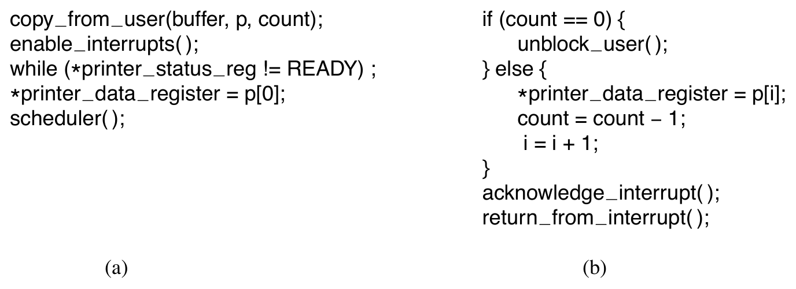
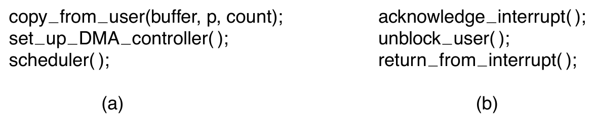

# 《现代操作系统(第 5 版)》§5.2 I/O 软件原理 —— 三种 I/O 编程方式

> 出处:[Modern Operating Systems 5th Edition, §5.2 Principles of I/O Software(含 §5.2.1–§5.2.4), 书页 352–357(PDF 381–386)](../../007.BOOKs/现代操作系统/Modern%20Operating%20Systems%205th%20Edition-PDF-01.pdf#page=381);同文电子版:[Modern Operating Systems 5th Edition-EPUB-02](../../007.BOOKs/现代操作系统/Modern%20Operating%20Systems%205th%20Edition-EPUB-02.epub) §5.2。
>
> 结构:**正文** = §5.2 总结(核心资料表 → 全貌 → 目标 → 三种编程方式对照表 → 图解 → arm64 落点 → 易错点);**附录** = §5.2 全篇翻译(原文(译文)逐段对照,插图按原书位置插入)。
>
> 引用格式:`原文(译文) <sup>[书页 N(PDF M)](链接#page=M)</sup>`。英文原文逐字摘录(连字符断行已合并),**加粗**为原书加粗术语;译名向中译本(第 3 版)§5.2 看齐:程序控制 I/O、中断驱动 I/O、使用 DMA 的 I/O、设备独立性、统一命名、轮询/忙等待。
>
> 字形说明:代码图里的下划线在 PDF 中是矢量路径(文本提取会丢),按 300 dpi 渲染图目视转录;原书一处笔误(“one at time”)逐字保留并随段注明;详见文末「审核记录」。

## 核心资料

| # | 原文摘录 | 说明 | 出处 |
|:-:|:-|:-|:-|
| 1 | "There are three fundamentally different ways that I/O can be performed."（完成 I/O 有三种本质上不同的方式。） | 三分法总纲:§5.2.2–§5.2.4 各讲一种 | [书页 354(PDF 383)](../../007.BOOKs/现代操作系统/Modern%20Operating%20Systems%205th%20Edition-PDF-01.pdf#page=383) |
| 2 | "The simplest form of I/O is to have the CPU do all the work. This method is called programmed I/O."（I/O 最简单的形式是让 CPU 包办全部工作,这种方法称为程序控制 I/O。） | ① 程序控制 I/O 的定义 | [书页 354(PDF 383)](../../007.BOOKs/现代操作系统/Modern%20Operating%20Systems%205th%20Edition-PDF-01.pdf#page=383) |
| 3 | "The essential aspect of programmed I/O … is that after outputting a character, the CPU continuously polls the device to see if it is ready to accept another one. This behavior is often called polling or busy waiting."（程序控制 I/O 的本质之点……在于:输出一个字符之后,CPU 就持续地轮询设备,看它是否准备好接收下一个字符。这种行为通常称为轮询或忙等待。） | ① 的本质:忙等轮询 | [书页 355(PDF 384)](../../007.BOOKs/现代操作系统/Modern%20Operating%20Systems%205th%20Edition-PDF-01.pdf#page=384) |
| 4 | "Programmed I/O is simple but has the disadvantage of tying up the CPU full time until all the I/O is done."（程序控制 I/O 很简单,但缺点是在全部 I/O 完成之前,CPU 一直被完全占住。） | ① 的代价 | [书页 355(PDF 384)](../../007.BOOKs/现代操作系统/Modern%20Operating%20Systems%205th%20Edition-PDF-01.pdf#page=384) |
| 5 | "The way to allow the CPU to do something else while waiting for the printer to become ready is to use interrupts."（要让 CPU 在等待打印机就绪期间去做别的事,办法是使用中断。） | ② 中断驱动 I/O 的思路 | [书页 355(PDF 384)](../../007.BOOKs/现代操作系统/Modern%20Operating%20Systems%205th%20Edition-PDF-01.pdf#page=384) |
| 6 | "At that point, the CPU calls the scheduler and some other process is run. The process that asked for the string to be printed is blocked until the entire string has printed."（这时,CPU 调用调度程序,运行别的进程。请求打印字符串的那个进程则被阻塞,直到整个字符串打印完毕。） | ② 发起之后:CPU 让出、调用者阻塞 | [书页 356(PDF 385)](../../007.BOOKs/现代操作系统/Modern%20Operating%20Systems%205th%20Edition-PDF-01.pdf#page=385) |
| 7 | "An obvious disadvantage of interrupt-driven I/O is that an interrupt occurs on every character. Interrupts take time, so this scheme wastes a certain amount of CPU time."（中断驱动 I/O 有一个明显的缺点:每输出一个字符就要发生一次中断。中断是要花时间的,所以这种方案会浪费一定的 CPU 时间。） | ② 的代价 | [书页 356(PDF 385)](../../007.BOOKs/现代操作系统/Modern%20Operating%20Systems%205th%20Edition-PDF-01.pdf#page=385) |
| 8 | "In essence, DMA is programmed I/O, only with the DMA controller doing all the work, instead of the main CPU."（实质上,DMA 就是程序控制 I/O,只不过全部工作是由 DMA 控制器而不是主 CPU 来做的。） | ③ 的定义:换人干活 | [书页 356(PDF 385)](../../007.BOOKs/现代操作系统/Modern%20Operating%20Systems%205th%20Edition-PDF-01.pdf#page=385) |
| 9 | "The big win with DMA is reducing the number of interrupts from one per character to one per buffer printed."（DMA 的大收益在于把中断次数从每个字符一次减少到每个打印的缓冲区一次。） | ③ 的收益 | [书页 356(PDF 385)](../../007.BOOKs/现代操作系统/Modern%20Operating%20Systems%205th%20Edition-PDF-01.pdf#page=385) |
| 10 | "If the DMA controller is not capable of driving the device at full speed, or the CPU usually has nothing to do anyway while waiting for the DMA interrupt, then interrupt-driven I/O or even programmed I/O may be better. Most of the time, though, DMA is worth it."（如果 DMA 控制器没能力让设备全速运行,或者 CPU 在等待 DMA 中断期间通常反正是无事可做的,那么中断驱动 I/O 甚至程序控制 I/O 可能更好。不过大多数时候,DMA 是值得的。） | ③ 的适用边界 | [书页 356(PDF 385)](../../007.BOOKs/现代操作系统/Modern%20Operating%20Systems%205th%20Edition-PDF-01.pdf#page=385) |
| 11 | "It is up to the operating system to make operations that are actually interrupt-driven look blocking to the user programs."（让实际上是中断驱动的操作在用户程序看来是阻塞式的,这是操作系统的职责。） | 与三种方式的关系:② ③ 对用户程序仍呈现阻塞语义,并行只发生在 CPU 与设备之间 | [书页 353(PDF 382)](../../007.BOOKs/现代操作系统/Modern%20Operating%20Systems%205th%20Edition-PDF-01.pdf#page=382) |

## 1. §5.2 全貌

| 小节 | 书页(PDF) | 主旨 | 图 |
|:-|:-|:-|:-|
| 5.2 Principles of I/O Software(I/O 软件原理) | 352(381) | 引言:先看目标,再看从操作系统角度看 I/O 的各种做法 | — |
| 5.2.1 Goals of the I/O Software(I/O 软件的目标) | 352–353(381–382) | 六个概念:设备独立性、统一命名、错误处理、同步 vs 异步、缓冲、可共享 vs 独占设备 | — |
| 5.2.2 Programmed I/O(程序控制 I/O) | 354–355(383–384) | CPU 全包:紧凑循环里逐字符轮询(忙等待) | 5-7、5-8 |
| 5.2.3 Interrupt-Driven I/O(中断驱动 I/O) | 355–356(384–385) | 每个字符一次中断,等待期间 CPU 去跑别的进程 | 5-9 |
| 5.2.4 I/O Using DMA(使用 DMA 的 I/O) | 356–357(385–386) | DMA 控制器接管搬数据,每个缓冲区一次中断 | 5-10 |

后面三个小节共用一个贯穿示例:用户进程要把 8 个字符的字符串 `ABCDEFGH` 打印到打印机上(图 5-7)。

## 2. §5.2.1 I/O 软件的目标(六个概念)

书中未编号,按段落计 6 项。前三项讲“怎样命名和对待设备”,后三项讲“I/O 过程中的三个问题”。

| # | 概念 | 关键原文(译文) | 出处 |
|:-:|:-|:-|:-|
| ① | 设备独立性(device independence) | "we should be able to write programs that can access any I/O device without having to specify the device in advance"（我们应当能够编写出可以访问任何 I/O 设备的程序,而不必事先指定设备） | [书页 352(PDF 381)](../../007.BOOKs/现代操作系统/Modern%20Operating%20Systems%205th%20Edition-PDF-01.pdf#page=381) |
| ② | 统一命名(uniform naming) | "The name of a file or a device should simply be a string or an integer and not depend on the device in any way."（文件或设备的名字应当只是一个字符串或一个整数,完全不以设备为转移。） | [书页 352(PDF 381)](../../007.BOOKs/现代操作系统/Modern%20Operating%20Systems%205th%20Edition-PDF-01.pdf#page=381) |
| ③ | 错误处理(error handling) | "In general, errors should be handled as close to the hardware as possible."（一般而言,错误应当尽可能在靠近硬件的地方得到处理。） | [书页 353(PDF 382)](../../007.BOOKs/现代操作系统/Modern%20Operating%20Systems%205th%20Edition-PDF-01.pdf#page=382) |
| ④ | 同步(阻塞)vs 异步(中断驱动) | "It is up to the operating system to make operations that are actually interrupt-driven look blocking to the user programs."（让实际上是中断驱动的操作在用户程序看来是阻塞式的,这是操作系统的职责。） | [书页 353(PDF 382)](../../007.BOOKs/现代操作系统/Modern%20Operating%20Systems%205th%20Edition-PDF-01.pdf#page=382) |
| ⑤ | 缓冲(buffering) | "Buffering involves considerable copying and often has a major impact on I/O performance."（缓冲涉及大量的复制,往往对 I/O 性能有重大影响。） | [书页 353(PDF 382)](../../007.BOOKs/现代操作系统/Modern%20Operating%20Systems%205th%20Edition-PDF-01.pdf#page=382) |
| ⑥ | 可共享 vs 独占设备(sharable versus dedicated devices) | "Introducing dedicated (unshared) devices also introduces a variety of problems, such as deadlocks."（引入独占(不共享)设备还会带来种种问题,例如死锁。） | [书页 353(PDF 382)](../../007.BOOKs/现代操作系统/Modern%20Operating%20Systems%205th%20Edition-PDF-01.pdf#page=382) |

与下半节的关系:第 ④ 条是理解三种方式的钥匙——物理 I/O 天然是异步的;程序控制 I/O 让 CPU 陪着设备一起等,中断驱动和 DMA 则把等待时间还给 CPU,再由操作系统把“中断驱动”包装成用户眼里的“阻塞”。

## 3. 三种 I/O 编程方式对照表

| 对比维度 | ① 程序控制 I/O(programmed I/O) | ② 中断驱动 I/O(interrupt-driven I/O) | ③ 使用 DMA 的 I/O(I/O using DMA) |
|:-|:-|:-|:-|
| 小节 / 书页(PDF) | §5.2.2 / 354–355(383–384) | §5.2.3 / 355–356(384–385) | §5.2.4 / 356–357(385–386) |
| 一句话(原文(译文)) | "The simplest form of I/O is to have the CPU do all the work."（I/O 最简单的形式是让 CPU 包办全部工作。） | "The way to allow the CPU to do something else while waiting for the printer to become ready is to use interrupts."（要让 CPU 在等待打印机就绪期间去做别的事,办法是使用中断。） | "In essence, DMA is programmed I/O, only with the DMA controller doing all the work, instead of the main CPU."（实质上,DMA 就是程序控制 I/O,只不过全部工作是由 DMA 控制器而不是主 CPU 来做的。） |
| 谁把字符写进设备的数据寄存器 | CPU(操作系统,在紧凑循环里逐字符写) | CPU(中断服务过程,每次中断写一个) | **DMA 控制器**(逐字符写,CPU 不碰数据寄存器) |
| 等待设备就绪时 CPU 在做什么 | 忙等:持续轮询状态寄存器 | 发出第 1 个字符后调用 `scheduler()` 去运行别的进程 | 设置好 DMA 控制器后调用 `scheduler()` 去运行别的进程 |
| 系统调用里做的事(图 (a)) | `copy_from_user` → 循环{等 READY → 写 1 个字符} → `return_to_user` | `copy_from_user` → `enable_interrupts` → 等 READY → 写 `p[0]` → `scheduler` | `copy_from_user` → `set_up_DMA_controller` → `scheduler` |
| 设备就绪 / 完成之后(图 (b)) | 没有这一段:CPU 还在上面的循环里 | **每个字符一次中断** → 中断服务过程:没打完就写下一个字符,打完就解除阻塞 → `acknowledge_interrupt` → `return_from_interrupt` | **每个缓冲区一次中断** → 中断服务过程:`acknowledge_interrupt` → `unblock_user` → `return_from_interrupt` |
| 中断次数(打印 N 个字符) | 0 次 | N 次(每字符一次) | 1 次(每缓冲区一次) |
| 请求打印的进程 | 直到全部打完才拿回 CPU(不阻塞,但 CPU 全程被占) | 发起后即阻塞,整串打完时被解除阻塞 | 发起后即阻塞,DMA 完成时被解除阻塞 |
| 额外硬件 | 不需要(数据寄存器 + 状态寄存器) | 中断机制(设备能发中断) | DMA 控制器 |
| 优点 | 简单 | 把字符之间的等待时间让给其他进程 | 中断从每字符一次降到每缓冲区一次 |
| 缺点(原文(译文)) | "tying up the CPU full time until all the I/O is done"（在全部 I/O 完成之前,CPU 一直被完全占住） | "Interrupts take time, so this scheme wastes a certain amount of CPU time."（中断是要花时间的,所以这种方案会浪费一定的 CPU 时间。） | "This strategy requires special hardware (the DMA controller)"（这种策略需要专门的硬件(DMA 控制器)）;"the DMA controller is usually much slower than the main CPU"（DMA 控制器通常比主 CPU 慢得多） |
| 什么时候合适(原文(译文)) | "If the time to ‘‘print’’ a character is very short (because all the printer is doing is copying the new character to an internal buffer), then busy waiting is fine. Also, in an embedded system, where the CPU has nothing else to do, busy waiting is fine."（如果“打印”一个字符的时间很短(因为打印机所做的只是把新字符复制到内部缓冲区),那么忙等待是没问题的。另外,在 CPU 无事可做的嵌入式系统里,忙等待也没问题。） | 字符之间的等待足以做一次上下文切换,可以让别的进程把这段时间用掉(对 §5.2.3 第 1 段的转述) | "If there are many characters and interrupts are slow, this can be a major improvement."（如果字符很多而中断又慢,这会是一个重大改进。）"Most of the time, though, DMA is worth it."（不过大多数时候,DMA 是值得的。） |
| 什么时候不合适(原文(译文)) | "in more complex systems, where the CPU has other work to do, busy waiting is inefficient"（在 CPU 还有其他工作要做的更复杂的系统里,忙等待是低效的） | "an interrupt occurs on every character"（每输出一个字符就要发生一次中断） | "If the DMA controller is not capable of driving the device at full speed, or the CPU usually has nothing to do anyway while waiting for the DMA interrupt, then interrupt-driven I/O or even programmed I/O may be better."（如果 DMA 控制器没能力让设备全速运行,或者 CPU 在等待 DMA 中断期间通常反正是无事可做的,那么中断驱动 I/O 甚至程序控制 I/O 可能更好。） |
| 对应图 | Fig. 5-8 | Fig. 5-9 | Fig. 5-10 |

**一句话记忆**:①②③ 改变的只有两件事——**等待期间 CPU 是否空转**(① 空转,② ③ 让出)和**谁把数据搬进设备**(① ② 是 CPU,③ 是 DMA 控制器)。

## 4. 图解

四幅图均从 PDF 页面的矢量数据按 300 dpi 渲染裁出(不含图注,未拉伸);原图文件存于 `999.IMGS`,文件名以 `MOS5-Fig5-` 开头。

### 4.1 贯穿示例:图 5-7 打印一个字符串的步骤



*Figure 5-7. Steps in printing a string.*（图 5-7:打印一个字符串的步骤。）<sup>原图出自 [PDF 383 页(书页 354)](../../007.BOOKs/现代操作系统/Modern%20Operating%20Systems%205th%20Edition-PDF-01.pdf#page=383)</sup>

- (a) 字符串还在**用户空间**的缓冲区里,要打印它,数据得先进内核——这是循环开始前的状态。
- (b) 缓冲区已被操作系统复制到**内核空间**,第一个字符 `A` 已印到纸上,“Next”指向下一个要打印的字符。
- (c) 第二个字符 `B` 也印出来了,“Next”指针后移——(b)、(c) 是程序控制 I/O 那个循环转了一圈、两圈之后的快照。

### 4.2 三幅代码图并读(图 5-8 / 5-9 / 5-10)

下面是三幅代码图并排重画的 ASCII 示意;逐字内容以其后的三幅原图和文字版为准。

```text
              ① 程序控制 I/O(图 5-8)         ② 中断驱动 I/O(图 5-9)               ③ DMA(图 5-10)
系统调用内    copy_from_user(...)              copy_from_user(...)                  copy_from_user(...)
                                               enable_interrupts()
                                               while (status != READY) ;
                                               写 p[0]                              set_up_DMA_controller()
              循环 { 等 READY; 写 1 个字符 }   scheduler()                          scheduler()
              return_to_user()

设备就绪后    (没有这一段:                    每个字符一次中断 → 中断服务过程:     整个缓冲区搬完一次中断 →
              CPU 还在上面的循环里)             count == 0 ? unblock_user()         acknowledge_interrupt()
                                                : 写 p[i]; count−−; i++            unblock_user()
                                               acknowledge_interrupt()              return_from_interrupt()
                                               return_from_interrupt()

搬数据的人    CPU(逐字符)                      CPU(逐字符,在中断服务过程里)          DMA 控制器(逐字符,CPU 不碰)
中断次数      0                                每字符 1 次                          每缓冲区 1 次
```



*Figure 5-8. Writing a string to the printer using programmed I/O.*（图 5-8:使用程序控制 I/O 向打印机写一个字符串。）<sup>原图出自 [PDF 384 页(书页 355)](../../007.BOOKs/现代操作系统/Modern%20Operating%20Systems%205th%20Edition-PDF-01.pdf#page=384)</sup>

```text
// 图 5-8 文字版(按原图目视转录)
copy_from_user(buffer, p, count);             /* p is the kernel buffer */
for (i = 0; i < count; i++) {                 /* loop on every character */
    while (*printer_status_reg != READY) ;    /* loop until ready */
    *printer_data_register = p[i];            /* output one character */
}
return_to_user( );
```



*Figure 5-9. Writing a string to the printer using interrupt-driven I/O. (a) Code executed at the time the print system call is made. (b) Interrupt service procedure for the printer.*（图 5-9:使用中断驱动 I/O 向打印机写一个字符串。(a) 发出打印系统调用时执行的代码。(b) 打印机的中断服务过程。）<sup>原图出自 [PDF 385 页(书页 356)](../../007.BOOKs/现代操作系统/Modern%20Operating%20Systems%205th%20Edition-PDF-01.pdf#page=385)</sup>

```text
// 图 5-9 文字版(按原图目视转录)
(a) 发出打印系统调用时执行              (b) 打印机的中断服务过程
copy_from_user(buffer, p, count);        if (count == 0) {
enable_interrupts( );                        unblock_user( );
while (*printer_status_reg != READY) ;    } else {
*printer_data_register = p[0];               *printer_data_register = p[i];
scheduler( );                                count = count − 1;
                                             i = i + 1;
                                         }
                                         acknowledge_interrupt( );
                                         return_from_interrupt( );
```



*Figure 5-10. Printing a string using DMA. (a) Code executed when the print system call is made. (b) Interrupt-service procedure.*（图 5-10:使用 DMA 打印一个字符串。(a) 发出打印系统调用时执行的代码。(b) 中断服务过程。）<sup>原图出自 [PDF 386 页(书页 357)](../../007.BOOKs/现代操作系统/Modern%20Operating%20Systems%205th%20Edition-PDF-01.pdf#page=386)</sup>

```text
// 图 5-10 文字版(按原图目视转录)
(a) 发出打印系统调用时执行              (b) 中断服务过程
copy_from_user(buffer, p, count);        acknowledge_interrupt( );
set_up_DMA_controller( );                unblock_user( );
scheduler( );                            return_from_interrupt( );
```

### 4.3 每一步演进到底改了什么

- **① → ②**:把“CPU 在循环里等 READY”换成“CPU 去调度别的进程,设备就绪时用中断叫醒 CPU 续写下一个字符”。代价:每个字符都要进出一次中断。
- **② → ③**:把“中断服务过程里写下一个字符”整件事交给 DMA 控制器,中断服务过程只剩收尾(应答中断、解除阻塞、返回)。代价:需要 DMA 控制器,而且它通常比主 CPU 慢。
- 三种方式里**只有 ① 没有中断**:② 和 ③ 都靠中断收尾,区别只在频率——每字符一次,还是每缓冲区一次。
- 对用户程序而言,② 和 ③ 仍然是阻塞的(`scheduler()` 之后调用者睡掉,由 `unblock_user()` 唤醒)——正是 §5.2.1 第 ④ 条所说的“把中断驱动包装成阻塞”。

## 5. arm64 落点:PL011 串口驱动(Linux 7.1.3)里的三种方式

> 源码:[Linux 7.1.3 源码根](../../000.SOURCE_CODE/003.LINUX-7.1.3/000.LINUX-7.1.3/),主文件 [drivers/tty/serial/amba-pl011.c](../../000.SOURCE_CODE/003.LINUX-7.1.3/000.LINUX-7.1.3/drivers/tty/serial/amba-pl011.c),写者睡眠一侧在 [drivers/tty/n_tty.c](../../000.SOURCE_CODE/003.LINUX-7.1.3/000.LINUX-7.1.3/drivers/tty/n_tty.c) 与 [drivers/tty/serial/serial_core.c](../../000.SOURCE_CODE/003.LINUX-7.1.3/000.LINUX-7.1.3/drivers/tty/serial/serial_core.c);行号均为 `grep -n` 实测,代码摘录与源码逐行比对过。PL011 是 ARM 平台上常见的 UART IP,同一个驱动里三种方式并存,可与书中伪码逐条对照。平台相关处一律以 arm64 为准:寄存器访问是 MMIO(`readl`/`writel`,没有 IN/OUT 指令),中断走 GICv3,DMA 多一步缓存维护。

书里的打印机有两个寄存器:数据寄存器,以及“给出状态”的第二个寄存器。PL011 与之对应的是 `REG_DR` 和 `REG_FR`(amba-pl011.c:57、:60);`REG_FR` 的 `UART01x_FR_TXFF` 位(发送 FIFO 满)相当于伪码里的 `READY` 取反。

| 书中伪码(图号) | PL011 中的对应(amba-pl011.c,行号实测) | 说明 |
|:-|:-|:-|
| `while (*printer_status_reg != READY) ;`(5-8、5-9a) | `pl011_putc`(:2704):`while (readl(port->membase + UART01x_FR) & UART01x_FR_TXFF) cpu_relax();`(:2706–2707) | 忙等:轮询 `REG_FR` 的 FIFO 满位,等出空位 |
| `*printer_data_register = p[i];`(5-8、5-9b) | `writel(c, port->membase + UART01x_DR);`(:2709);中断路径为 `pl011_write(c, uap, REG_DR);`(:1530) | 写数据寄存器,即书中说的 memory-mapped I/O |
| `return_to_user( );`(5-8) | `pl011_putc` 由 `uart_console_write(&dev->port, s, n, pl011_putc)`(:2720)逐字符回调,整个字符串发完才返回 | earlycon 控制台路径:此时不能睡眠,只能忙等 |
| `enable_interrupts( );`(5-9a) | `pl011_start_tx_pio`(:1369):先 `pl011_tx_chars(uap, false)`,还有字符没发完才把 `UART011_TXIM` 置入 `uap->im` 并写 `REG_IMSC`(:1371–1373) | 先同步发一批,发不完再开 TX 中断 |
| `scheduler( );`(5-9a、5-10a) | 驱动不直接调度:写进程在 tty 层因发送缓冲区写满而睡眠(`n_tty_write` 里的 `wait_woken(...)`,n_tty.c:2407);缓冲区腾出到阈值以下时,驱动调 `uart_write_wakeup()`(:1573、:704 → serial_core.c:113)唤醒写者 | “调用者阻塞、稍后解除阻塞”的内核实现 |
| 中断服务过程(5-9b) | `pl011_int`(:1624):读 `REG_RIS`(:1631)→ 写 `REG_ICR` 清中断(:1636)→ 命中 `UART011_TXIS` 时 `pl011_tx_chars(uap, true)`(:1648–1649) | 每次中断续发一批,上限 `fifosize >> 1`(:1540) |
| 中断登记 | `request_irq(uap->port.irq, pl011_int, IRQF_SHARED, "uart-pl011", uap);`(:1866) | 在 `pl011_allocate_irq`(:1862)里 |
| `acknowledge_interrupt( );`(5-9b、5-10b) | 设备级:写 `REG_ICR`(:1636);中断控制器级:GICv3 的 `gic_complete_ack()` 写 `ICC_EOIR1_EL1`([irq-gic-v3.c:800](../../000.SOURCE_CODE/003.LINUX-7.1.3/000.LINUX-7.1.3/drivers/irqchip/irq-gic-v3.c)) | 两级应答 |
| `set_up_DMA_controller( );`(5-10a) | `pl011_start_tx`(:1416)→ `pl011_dma_tx_start`(:767)→ `pl011_dma_tx_refill`(:620):`dma_map_single`(:662)→ `dmaengine_prep_slave_single`(DMA_MEM_TO_DEV,:670)→ `dmaengine_submit`(:688)→ `dma_dev->device_issue_pending(chan)`(:691)→ 写 `REG_DMACR` 打开 `UART011_TXDMAE`(:693–694) | 设置并启动 DMA;排上之后顺手关掉 TX 中断(:780–781) |
| DMA 完成中断(5-10b) | 回调 `pl011_dma_tx_callback`(:569):`dma_unmap_single`(:579)之后,要么再排一块(:602),要么回退到 `pl011_start_tx_pio`(:607) | 每缓冲区一次 |

三段关键代码(节选;与源码逐行一致):

```c
// drivers/tty/serial/amba-pl011.c:2704
static void pl011_putc(struct uart_port *port, unsigned char c)
{
	while (readl(port->membase + UART01x_FR) & UART01x_FR_TXFF)
		cpu_relax();
	if (port->iotype == UPIO_MEM32)
		writel(c, port->membase + UART01x_DR);
	else
		writeb(c, port->membase + UART01x_DR);
	while (readl(port->membase + UART01x_FR) & UART01x_FR_BUSY)
		cpu_relax();
}
```

```c
// drivers/tty/serial/amba-pl011.c:1369
static void pl011_start_tx_pio(struct uart_amba_port *uap)
{
	if (pl011_tx_chars(uap, false)) {
		uap->im |= UART011_TXIM;
		pl011_write(uap->im, uap, REG_IMSC);
	}
}
```

```c
// drivers/tty/serial/amba-pl011.c:1624
static irqreturn_t pl011_int(int irq, void *dev_id)
{
	struct uart_amba_port *uap = dev_id;
	unsigned int status, pass_counter = AMBA_ISR_PASS_LIMIT;
	int handled = 0;

	uart_port_lock(&uap->port);
	status = pl011_read(uap, REG_RIS) & uap->im;
	if (status) {
		do {
			check_apply_cts_event_workaround(uap);

			pl011_write(status & ~(UART011_TXIS | UART011_RTIS | UART011_RXIS),
				    uap, REG_ICR);

			if (status & (UART011_RTIS | UART011_RXIS)) {
				if (pl011_dma_rx_running(uap))
					pl011_dma_rx_irq(uap);
				else
					pl011_rx_chars(uap);
			}
			if (status & (UART011_DSRMIS | UART011_DCDMIS |
				      UART011_CTSMIS | UART011_RIMIS))
				pl011_modem_status(uap);
			if (status & UART011_TXIS)
				pl011_tx_chars(uap, true);
```

```c
// drivers/tty/serial/amba-pl011.c:683
	/* Some data to go along to the callback */
	desc->callback = pl011_dma_tx_callback;
	desc->callback_param = uap;

	/* All errors should happen at prepare time */
	dmaengine_submit(desc);

	/* Fire the DMA transaction */
	dma_dev->device_issue_pending(chan);

	uap->dmacr |= UART011_TXDMAE;
	pl011_write(uap->dmacr, uap, REG_DMACR);
	uap->dmatx.queued = true;
```

**arm64 中断入口链**(对应图 5-9(b)、5-10(b) 里“设备完工 → 中断服务过程”这一跳):设备发出 IRQ → CPU 取 IRQ 异常,进异常向量表 `kernel_ventry 1, h, 64, irq`(EL1,[entry.S:524](../../000.SOURCE_CODE/003.LINUX-7.1.3/000.LINUX-7.1.3/arch/arm64/kernel/entry.S))或 `kernel_ventry 0, t, 64, irq`(EL0,:529),宏体内 `b el1h_64_irq`(entry.S:68、:99)→ `entry_handler` 生成的 `el1h_64_irq`(entry.S:590)调 `el1h_64_irq_handler`([entry-common.c:529](../../000.SOURCE_CODE/003.LINUX-7.1.3/000.LINUX-7.1.3/arch/arm64/kernel/entry-common.c))→ `el1_interrupt(regs, handle_arch_irq)`(:531)。`handle_arch_irq` 就是 GICv3 驱动注册的 `gic_handle_irq`(`set_handle_irq(gic_handle_irq);`,irq-gic-v3.c:2045):`gic_read_iar()`(:860;默认实现 `gic_read_iar_common` 读 `ICC_IAR1_EL1`,[arch_gicv3.h:35–41](../../000.SOURCE_CODE/003.LINUX-7.1.3/000.LINUX-7.1.3/arch/arm64/include/asm/arch_gicv3.h))问 GIC 是哪个中断 → `gic_complete_ack()`(:823)写 `ICC_EOIR1_EL1`(:800)应答 → `generic_handle_domain_irq`(:825)分发到驱动登记的 `pl011_int`。

**DMA 在 arm64 上多出的一步——缓存维护**:书里的 `set_up_DMA_controller()` 只讲“让 DMA 控制器接手搬字符”。arm64 上还必须让设备看得到 CPU 刚写进缓冲区的数据:[arch/arm64/mm/dma-mapping.c:15](../../000.SOURCE_CODE/003.LINUX-7.1.3/000.LINUX-7.1.3/arch/arm64/mm/dma-mapping.c) 的 `arch_sync_dma_for_device()` 对缓冲区执行 `dcache_clean_poc_nosync(start, start + size)`(:20),把数据 clean 到一致性点(PoC);直接映射路径由 [kernel/dma/direct.c:406](../../000.SOURCE_CODE/003.LINUX-7.1.3/000.LINUX-7.1.3/kernel/dma/direct.c) 调用。DMA 控制器取数不经过 CPU 的高速缓存,所以这一步省不掉。

**书里“什么时候不用 DMA”在内核里的样子**:`pl011_dma_tx_refill` 开头有一道门槛——

```c
// drivers/tty/serial/amba-pl011.c:629
	/*
	 * Try to avoid the overhead involved in using DMA if the
	 * transaction fits in the first half of the FIFO, by using
	 * the standard interrupt handling.  This ensures that we
	 * issue a uart_write_wakeup() at the appropriate time.
	 */
	count = kfifo_len(&tport->xmit_fifo);
	if (count < (uap->fifosize >> 1)) {
		uap->dmatx.queued = false;
		return 0;
	}
```

待发字符数少于 FIFO 容量的一半时直接返回 0,让调用方改走普通中断,DMA 留给大块传输。这与书中 "If the DMA controller is not capable of driving the device at full speed, … then interrupt-driven I/O or even programmed I/O may be better." 是同一个权衡:DMA 的收益要大过它的开销才划算。

**数字对照(自算,非书中数据)**:书中打印机 100 字符/秒,每字符 10 msec。PL011 常见的 115200 波特、8N1(起始位 + 8 数据位 + 停止位 = 10 bit/字符)是 11520 字符/秒,每字符约 86.8 µs;此时中断驱动方式每秒 11,520 次中断,而 DMA 方式降到每个 `PL011_DMA_BUFFER_SIZE`(= `PAGE_SIZE`,amba-pl011.c:400)字节一次。

## 6. 易错点与记忆钩

1. **分水岭是两个问题**:等待期间 CPU 是否空转;谁把数据搬进设备。① 空转 + CPU 搬;② 不空转 + CPU 搬;③ 不空转 + DMA 搬。
2. **DMA 方式仍然有中断**。区分三种方式不能问“有没有中断”,要问“中断多频繁”。
3. **图 5-9 是粗略版**:书中自称 "A crude version of this code is shown in Fig. 5-9(b)."。按图直读,(a) 里输出 `p[0]` 之后,既没有画 `i` 的初始化,也没有把 `count` 减一——这是示意性的省略,不是可以照抄的代码。
4. **`count = count − 1` 的减号**:对 PDF 做文本提取会得到 `count = count < 1`,那是 Symbol 字体的码位伪影(0x3C 在该字体里是减号),原书印的是减号。
5. **阻塞的是调用者,并行的是 CPU 与设备**:② 和 ③ 里睡掉的是请求打印的进程,CPU 在跑别的进程。

## 附录:§5.2 全篇翻译(原文(译文))

> 小节标题、段落顺序与插图位置均照原书,共 20 段、4 幅图。每段先给英文原文(逐字摘录),紧接中文译文(置于括号内);原书加粗术语在中英文里都加粗。跨页的段落按完整段落合并,并在出处里给出页码范围;各“书页”小标题即 PDF 对应页的跳转链接。

### 5.2 Principles of I/O Software(I/O 软件原理)

#### [书页 352(PDF 381)](../../007.BOOKs/现代操作系统/Modern%20Operating%20Systems%205th%20Edition-PDF-01.pdf#page=381)

> "Let us now turn away from the I/O hardware and look at the I/O software. First we will look at its goals and then at the different ways I/O can be done from the point of view of the operating system."（现在让我们把目光从 I/O 硬件移开,来看看 I/O 软件。我们先考察它的目标,再从操作系统的角度考察完成 I/O 的各种不同方式。）<sup>[书页 352(PDF 381)](../../007.BOOKs/现代操作系统/Modern%20Operating%20Systems%205th%20Edition-PDF-01.pdf#page=381)</sup>

##### 5.2.1 Goals of the I/O Software(I/O 软件的目标)

> "A key concept in the design of I/O software is known as **device independence**. What it means is that we should be able to write programs that can access any I/O device without having to specify the device in advance. For example, a program that reads a file as input should be able to read a file on a hard disk, an SSD, or a USB stick without having to be modified for each different device. Similarly, one should be able to type a command such as sort \<input >output and have it work with input coming from any kind of storage device or the keyboard and the output going to any kind of storage device or the screen. It is up to the operating system to take care of the problems caused by the fact that these devices really are different and require very different command sequences to read or write."（I/O 软件设计中的一个关键概念称为**设备无关性**。其含义是:我们应当能够编写出可以访问任何 I/O 设备的程序,而不必事先指定设备。例如,一个读取文件作为输入的程序,应当既能读硬盘上的文件,也能读 SSD 或 U 盘上的文件,而无须针对每种不同的设备加以修改。类似地,用户应当能够键入诸如 `sort <input >output` 这样的命令,并且无论输入来自何种存储设备或键盘、输出送往何种存储设备或屏幕,它都能工作。这些设备实际上确实各不相同,读写所需的命令序列也相差极大,由此产生的问题由操作系统负责处理。）<sup>[书页 352(PDF 381)](../../007.BOOKs/现代操作系统/Modern%20Operating%20Systems%205th%20Edition-PDF-01.pdf#page=381)</sup>

> "Closely related to device independence is the goal of **uniform naming**. The name of a file or a device should simply be a string or an integer and not depend on the device in any way. In UNIX, all disks can be integrated in the file-system hierarchy in arbitrary ways so the user need not be aware of which name corresponds to which device. For example, a USB stick can be **mounted** on top of the directory */usr/ast/backup* so that copying a file to */usr/ast/backup/monday* copies the file to the USB stick. In this way, all files and devices are addressed the same way: by a path name."（与设备无关性密切相关的一个目标是**统一命名**。文件或设备的名字应当只是一个字符串或一个整数,完全不以设备为转移。在 UNIX 中,所有磁盘都可以用任意方式集成到文件系统层次结构之中,所以用户无须知道哪个名字对应哪台设备。例如,可以把一个 U 盘**挂载**到目录 `/usr/ast/backup` 之上,这样,把一个文件复制到 `/usr/ast/backup/monday`,就是把它复制到了 U 盘上。如此一来,所有文件和设备都以同一种方式寻址:路径名。）<sup>[书页 352–353(PDF 381–382)](../../007.BOOKs/现代操作系统/Modern%20Operating%20Systems%205th%20Edition-PDF-01.pdf#page=381)</sup>

*(本段跨书页 352–353。)*

#### [书页 353(PDF 382)](../../007.BOOKs/现代操作系统/Modern%20Operating%20Systems%205th%20Edition-PDF-01.pdf#page=382)

> "Another important issue for I/O software is **error handling**. In general, errors should be handled as close to the hardware as possible. If the controller discovers a read error, it should try to correct the error itself if it can. If it cannot, then the device driver should handle it, perhaps by just trying to read the block again. Many errors are transient, such as read errors caused by specks of dust on the read head of a disk, and will frequently go away if the operation is repeated. Only if the lower layers are not able to deal with the problem should the upper layers be told about it. In many cases, error recovery can be done transparently at a low level without the upper levels even knowing about the error."（I/O 软件的另一个重要问题是**错误处理**。一般而言,错误应当尽可能在靠近硬件的地方得到处理。如果控制器发现了读错误,它应当尽可能自己设法纠正。如果纠不了,再由设备驱动程序处理,也许只需把这一块重读一遍。许多错误是瞬时的,例如磁盘读头上的灰尘微粒引起的读错误,把操作重复一次往往就会消失。只有当下层解决不了问题时,才应该告诉上层。很多情况下,错误恢复可以在低层透明地完成,上层甚至根本不知道出过错。）<sup>[书页 353(PDF 382)](../../007.BOOKs/现代操作系统/Modern%20Operating%20Systems%205th%20Edition-PDF-01.pdf#page=382)</sup>

> "Still another important issue is that of **synchronous** (blocking) versus **asynchronous** (interrupt-driven) transfers. Most physical I/O is asynchronous, that is, the CPU starts the transfer and goes off to do something else until the interrupt arrives. User programs are much easier to write if the I/O operations are blocking—after a `read` system call the program is automatically suspended until the data are available in the buffer. It is up to the operating system to make operations that are actually interrupt-driven look blocking to the user programs. However, some very high-performance applications need to control all the details of the I/O, so operating systems also make asynchronous I/O available to them."（还有一个重要问题是**同步**(阻塞式)传送与**异步**(中断驱动式)传送之争。大多数物理 I/O 是异步的,也就是说,CPU 启动传送后就去干别的事,直到中断到来。如果 I/O 操作是阻塞式的,用户程序写起来要容易得多——执行 `read` 系统调用之后,程序自动被挂起,直到数据在缓冲区中就绪。让实际上是中断驱动的操作在用户程序看来是阻塞式的,这是操作系统的职责。不过,有些性能要求极高的应用需要控制 I/O 的全部细节,所以操作系统也向它们提供异步 I/O。）<sup>[书页 353(PDF 382)](../../007.BOOKs/现代操作系统/Modern%20Operating%20Systems%205th%20Edition-PDF-01.pdf#page=382)</sup>

> "Another issue for the I/O software is **buffering**. Often data that come off a device cannot be stored directly in their final destination. For example, when a packet comes in off the network, the operating system does not know where to put it until it has stored the packet somewhere and examined it to see which port it is addressed to. Also, some devices have severe real-time constraints (for example, digital audio devices), so the data must be put into an output buffer in advance to decouple the rate at which the buffer is filled from the rate at which it is emptied, in order to avoid buffer underruns. Buffering involves considerable copying and often has a major impact on I/O performance."（I/O 软件的又一个问题是**缓冲**。从设备送来的数据往往不能直接存放到它们的最终目的地。例如,一个数据包从网络到达时,操作系统要先把该包存放到某处并加以检查、弄清它是发往哪个端口的,然后才知道该把它放到哪里。另外,有些设备有严格的实时约束(例如数字音频设备),所以数据必须事先放进输出缓冲区,把缓冲区被填满的速率与被排空的速率解耦,以避免缓冲区欠载。缓冲涉及大量的复制,往往对 I/O 性能有重大影响。）<sup>[书页 353(PDF 382)](../../007.BOOKs/现代操作系统/Modern%20Operating%20Systems%205th%20Edition-PDF-01.pdf#page=382)</sup>

> "The final concept that we will mention here is sharable versus dedicated devices. Some I/O devices, such as disks and SSDs, can be used by many users at the same time. No problems are caused by multiple users having open files on the same storage devices at the same time. Other devices, such as printers, have to be dedicated to a single user until that user is finished. Then another user can have the printer. Having two or more users writing characters intermixed at random to the same page will definitely not work. Scanners are like that as well. Introducing dedicated (unshared) devices also introduces a variety of problems, such as deadlocks. Again, the operating system must be able to handle both shared and dedicated devices in a way that avoids problems."（这里要提到的最后一个概念是可共享设备与独占设备。有些 I/O 设备,如磁盘和 SSD,可以同时被许多用户使用;多个用户同时在同样的存储设备上打开文件,不会引起任何问题。另一些设备,如打印机,则必须独占给单个用户使用,直到该用户用完,然后另一个用户才能使用这台打印机。让两个或更多的用户把字符随机交错地写到同一页上,肯定是行不通的。扫描仪也是如此。引入独占(不共享)设备还会带来种种问题,例如死锁。操作系统同样必须能够既处理共享设备又处理独占设备,并且避免出问题。）<sup>[书页 353(PDF 382)](../../007.BOOKs/现代操作系统/Modern%20Operating%20Systems%205th%20Edition-PDF-01.pdf#page=382)</sup>

*(§5.2.1 至此结束;下节 §5.2.2 从书页 354 顶部开始。)*

#### [书页 354(PDF 383)](../../007.BOOKs/现代操作系统/Modern%20Operating%20Systems%205th%20Edition-PDF-01.pdf#page=383)

##### 5.2.2 Programmed I/O(程序控制 I/O)

> "There are three fundamentally different ways that I/O can be performed. In this section we will look at the first one (programmed I/O). In the next two sections we will examine the others (interrupt-driven I/O and I/O using DMA). The simplest form of I/O is to have the CPU do all the work. This method is called **programmed I/O**."（完成 I/O 有三种本质上不同的方式。本节考察第一种(程序控制 I/O),接下来两节考察另外两种(中断驱动 I/O 和使用 DMA 的 I/O)。I/O 最简单的形式是让 CPU 包办全部工作,这种方法称为**程序控制 I/O**。）<sup>[书页 354(PDF 383)](../../007.BOOKs/现代操作系统/Modern%20Operating%20Systems%205th%20Edition-PDF-01.pdf#page=383)</sup>

> "It is simplest to illustrate how programmed I/O works by means of an example. Consider a user process that wants to print the eight-character string ‘‘ABCDEFGH’’ on the printer via a serial interface. Displays on small embedded systems sometimes work this way. The software first assembles the string in a buffer in user space, as shown in Fig. 5-7(a)."（用一个例子来说明程序控制 I/O 如何工作是最简单的。考虑一个用户进程,它想通过串行接口在打印机上打印八个字符的字符串“ABCDEFGH”。小型嵌入式系统上的显示器有时就是这样工作的。软件先在用户空间的一个缓冲区中组装这个字符串,如图 5-7(a) 所示。）<sup>[书页 354(PDF 383)](../../007.BOOKs/现代操作系统/Modern%20Operating%20Systems%205th%20Edition-PDF-01.pdf#page=383)</sup>


*Figure 5-7. Steps in printing a string.*（图 5-7:打印一个字符串的步骤。）<sup>原图出自 [PDF 383 页(书页 354)](../../007.BOOKs/现代操作系统/Modern%20Operating%20Systems%205th%20Edition-PDF-01.pdf#page=383)</sup>

> "The user process then acquires the printer for writing by making a system call to open it. If the printer is currently in use by another process, this call will fail and return an error code or will block until the printer is available, depending on the operating system and the parameters of the call. Once it has the printer, the user process makes a system call telling the operating system to print the string."（接着,用户进程通过发出系统调用打开打印机,以取得对它的写权限。如果打印机当前正被另一个进程使用,这个调用会失败并返回一个错误码,或者阻塞到打印机可用为止,具体取决于操作系统和该调用的参数。一旦拿到了打印机,用户进程就发出一个系统调用,通知操作系统打印这个字符串。）<sup>[书页 354(PDF 383)](../../007.BOOKs/现代操作系统/Modern%20Operating%20Systems%205th%20Edition-PDF-01.pdf#page=383)</sup>

> "The operating system then (usually) copies the buffer with the string to an array, in kernel space, where it is more easily accessed (because the kernel may have to change the memory map to get at user space) and also safe from modification by the user process. It then checks to see if the printer is currently available. If not, it waits until it is. As soon as the printer is available, the operating system copies the first character to the printer’s data register, in this example using memory-mapped I/O. This action activates the printer. The character may not appear yet because some printers buffer a line or a page before printing anything. In Fig. 5-7(b), however, we see that the first character has been printed and that the system has marked the ‘‘B’’ as the next character to be printed."（然后,操作系统(通常)把这个装有字符串的缓冲区复制到内核空间的一个数组中,在那里访问起来更容易(因为内核可能必须改变内存映射才能访问用户空间),而且也不会被用户进程修改。接着它查看打印机当前是否可用;如果不可用,就等到它可用。打印机一可用,操作系统就把第一个字符复制到打印机的数据寄存器——本例中使用的是内存映射 I/O。这个动作激活了打印机。这个字符此时可能还没有出现,因为有些打印机要先缓冲一行或一页才开始打印。不过在图 5-7(b) 中我们看到,第一个字符已经印出,系统已把“B”标记为下一个要打印的字符。）<sup>[书页 354(PDF 383)](../../007.BOOKs/现代操作系统/Modern%20Operating%20Systems%205th%20Edition-PDF-01.pdf#page=383)</sup>

#### [书页 355(PDF 384)](../../007.BOOKs/现代操作系统/Modern%20Operating%20Systems%205th%20Edition-PDF-01.pdf#page=384)

> "As soon as it has copied the first character to the printer, the operating system checks to see if the printer is ready to accept another one. Generally, the printer has a second register, which gives its status. The act of writing to the data register causes the status to become not ready. When the printer controller has processed the current character, it indicates its availability by setting some bit in its status register or putting some value in it."（操作系统把第一个字符复制给打印机之后,立即查看打印机是否准备好接收下一个字符。一般说来,打印机还有第二个寄存器,用来给出它的状态。往数据寄存器写入这个动作会使状态变为未就绪。打印机控制器处理完当前字符后,会通过在状态寄存器中置位某个位或向其中写入某个值来表明自己可以接收了。）<sup>[书页 355(PDF 384)](../../007.BOOKs/现代操作系统/Modern%20Operating%20Systems%205th%20Edition-PDF-01.pdf#page=384)</sup>

> "At this point, the operating system waits for the printer to become ready again. When that happens, it prints the next character, as shown in Fig. 5-7(c). This loop continues until the entire string has been printed. Then control returns to the user process."（这时,操作系统等待打印机再次就绪。一旦就绪,它就打印下一个字符,如图 5-7(c) 所示。这个循环一直继续,直到整个字符串打印完毕,然后控制权返回用户进程。）<sup>[书页 355(PDF 384)](../../007.BOOKs/现代操作系统/Modern%20Operating%20Systems%205th%20Edition-PDF-01.pdf#page=384)</sup>

> "The actions followed by the operating system are briefly summarized in Fig. 5-8. First, the data are copied to the kernel. Then the operating system enters a tight loop, outputting the characters one at a time. The essential aspect of programmed I/O, clearly illustrated in this figure, is that after outputting a character, the CPU continuously polls the device to see if it is ready to accept another one. This behavior is often called **polling** or **busy waiting**."（操作系统所遵循的动作在图 5-8 中作了简要总结。首先,把数据复制到内核;然后操作系统进入一个紧凑的循环,一次输出一个字符。程序控制 I/O 的本质之点——图中清楚地说明了这一点——在于:输出一个字符之后,CPU 就持续地轮询设备,看它是否准备好接收下一个字符。这种行为通常称为**轮询**或**忙等待**。）<sup>[书页 355(PDF 384)](../../007.BOOKs/现代操作系统/Modern%20Operating%20Systems%205th%20Edition-PDF-01.pdf#page=384)</sup>


*Figure 5-8. Writing a string to the printer using programmed I/O.*（图 5-8:使用程序控制 I/O 向打印机写一个字符串。）<sup>原图出自 [PDF 384 页(书页 355)](../../007.BOOKs/现代操作系统/Modern%20Operating%20Systems%205th%20Edition-PDF-01.pdf#page=384)</sup>

```text
copy_from_user(buffer, p, count);             /* p is the kernel buffer */
for (i = 0; i < count; i++) {                 /* loop on every character */
    while (*printer_status_reg != READY) ;    /* loop until ready */
    *printer_data_register = p[i];            /* output one character */
}
return_to_user( );
```

> "Programmed I/O is simple but has the disadvantage of tying up the CPU full time until all the I/O is done. If the time to ‘‘print’’ a character is very short (because all the printer is doing is copying the new character to an internal buffer), then busy waiting is fine. Also, in an embedded system, where the CPU has nothing else to do, busy waiting is fine. However, in more complex systems, where the CPU has other work to do, busy waiting is inefficient. A better I/O method is needed."（程序控制 I/O 很简单,但缺点是在全部 I/O 完成之前,CPU 一直被完全占住。如果“打印”一个字符的时间很短(因为打印机所做的只是把新字符复制到内部缓冲区),那么忙等待是没问题的。另外,在 CPU 无事可做的嵌入式系统里,忙等待也没问题。然而,在 CPU 还有其他工作要做的更复杂的系统里,忙等待是低效的。这就需要一种更好的 I/O 方法。）<sup>[书页 355(PDF 384)](../../007.BOOKs/现代操作系统/Modern%20Operating%20Systems%205th%20Edition-PDF-01.pdf#page=384)</sup>

##### 5.2.3 Interrupt-Driven I/O(中断驱动 I/O)

> "Now let us consider the case of printing on a printer that does not buffer characters but prints each one as soon as it arrives. If the printer can print, say 100 characters/sec, each character takes 10 msec to print. This means that after every character is written to the printer’s data register, the CPU will sit in an idle loop for 10 msec waiting to be allowed to output the next character. This is more than enough time to do a context switch and run some other process for nearly all of the 10 msec that would otherwise be wasted."（现在考虑这样的情况:打印机不缓冲字符,而是每来一个字符就立即打印一个。假如打印机每秒能打印 100 个字符,那么打印每个字符需要 10 msec。这意味着,每往打印机的数据寄存器写入一个字符之后,CPU 都要在空循环里干等 10 msec,才被允许输出下一个字符。这段时间绰绰有余,足以完成一次上下文切换,并用原本会被浪费掉的 10 msec 中的几乎全部时间去运行别的进程。）<sup>[书页 355(PDF 384)](../../007.BOOKs/现代操作系统/Modern%20Operating%20Systems%205th%20Edition-PDF-01.pdf#page=384)</sup>

> "The way to allow the CPU to do something else while waiting for the printer to become ready is to use interrupts. When the system call to print the string is made, the buffer is copied to kernel space, as we showed earlier, and the first character is copied to the printer as soon as it is willing to accept a character. At that point, the CPU calls the scheduler and some other process is run. The process that asked for the string to be printed is blocked until the entire string has printed. The work done on the system call is shown in Fig. 5-9(a)."（要让 CPU 在等待打印机就绪期间去做别的事,办法是使用中断。发出打印字符串的系统调用时,缓冲区被复制到内核空间(前面已经讲过),并且一旦打印机愿意接收字符,第一个字符就被复制给打印机。这时,CPU 调用调度程序,运行别的进程。请求打印字符串的那个进程则被阻塞,直到整个字符串打印完毕。系统调用中所做的工作如图 5-9(a) 所示。）<sup>[书页 355–356(PDF 384–385)](../../007.BOOKs/现代操作系统/Modern%20Operating%20Systems%205th%20Edition-PDF-01.pdf#page=384)</sup>

*(本段跨书页 355–356。)*

#### [书页 356(PDF 385)](../../007.BOOKs/现代操作系统/Modern%20Operating%20Systems%205th%20Edition-PDF-01.pdf#page=385)


*Figure 5-9. Writing a string to the printer using interrupt-driven I/O. (a) Code executed at the time the print system call is made. (b) Interrupt service procedure for the printer.*（图 5-9:使用中断驱动 I/O 向打印机写一个字符串。(a) 发出打印系统调用时执行的代码。(b) 打印机的中断服务过程。）<sup>原图出自 [PDF 385 页(书页 356)](../../007.BOOKs/现代操作系统/Modern%20Operating%20Systems%205th%20Edition-PDF-01.pdf#page=385)</sup>

```text
(a) 发出打印系统调用时执行              (b) 打印机的中断服务过程
copy_from_user(buffer, p, count);        if (count == 0) {
enable_interrupts( );                        unblock_user( );
while (*printer_status_reg != READY) ;    } else {
*printer_data_register = p[0];               *printer_data_register = p[i];
scheduler( );                                count = count − 1;
                                             i = i + 1;
                                         }
                                         acknowledge_interrupt( );
                                         return_from_interrupt( );
```

> "When the printer has printed the character and is prepared to accept the next one, it generates an interrupt. This interrupt stops the current process and saves its state. Then the printer interrupt-service procedure is run. A crude version of this code is shown in Fig. 5-9(b). If there are no more characters to print, the interrupt handler takes some action to unblock the user. Otherwise, it outputs the next character, acknowledges the interrupt, and returns to the process that was running just before the interrupt, which continues from where it left off."（打印机打印完这个字符、准备好接收下一个字符时,它产生一次中断。这次中断停止当前进程并保存其状态,然后运行打印机中断服务过程。这段代码的一个粗略版本如图 5-9(b) 所示。如果没有字符要打印了,中断处理程序就采取某种动作解除对用户的阻塞;否则,它输出下一个字符,应答中断,然后返回到中断前正在运行的进程,该进程从自己停下的地方继续运行。）<sup>[书页 356(PDF 385)](../../007.BOOKs/现代操作系统/Modern%20Operating%20Systems%205th%20Edition-PDF-01.pdf#page=385)</sup>

##### 5.2.4 I/O Using DMA(使用 DMA 的 I/O)

> "An obvious disadvantage of interrupt-driven I/O is that an interrupt occurs on every character. Interrupts take time, so this scheme wastes a certain amount of CPU time. A solution is to use DMA. Here the idea is to let the DMA controller feed the characters to the printer one at time, without the CPU being bothered. In essence, DMA is programmed I/O, only with the DMA controller doing all the work, instead of the main CPU. This strategy requires special hardware (the DMA controller) but frees up the CPU during the I/O to do other work. An outline of the code is given in Fig. 5-10."（中断驱动 I/O 有一个明显的缺点:每输出一个字符就要发生一次中断。中断是要花时间的,所以这种方案会浪费一定的 CPU 时间。解决办法是使用 DMA。这里的思路是让 DMA 控制器把字符一个一个地送给打印机,而不去打扰 CPU。实质上,DMA 就是程序控制 I/O,只不过全部工作是由 DMA 控制器而不是主 CPU 来做的。这种策略需要专门的硬件(DMA 控制器),但把 CPU 在 I/O 期间解放出来去做其他工作。代码的概要如图 5-10 所示。）<sup>[书页 356(PDF 385)](../../007.BOOKs/现代操作系统/Modern%20Operating%20Systems%205th%20Edition-PDF-01.pdf#page=385)</sup>

*(原书此句为 “one at time”,疑漏 “a”,引文按原书逐字保留。)*

> "The big win with DMA is reducing the number of interrupts from one per character to one per buffer printed. If there are many characters and interrupts are slow, this can be a major improvement. On the other hand, the DMA controller is usually much slower than the main CPU. If the DMA controller is not capable of driving the device at full speed, or the CPU usually has nothing to do anyway while waiting for the DMA interrupt, then interrupt-driven I/O or even programmed I/O may be better. Most of the time, though, DMA is worth it."（DMA 的大收益在于把中断次数从每个字符一次减少到每个打印的缓冲区一次。如果字符很多而中断又慢,这会是一个重大改进。另一方面,DMA 控制器通常比主 CPU 慢得多。如果 DMA 控制器没能力让设备全速运行,或者 CPU 在等待 DMA 中断期间通常反正是无事可做的,那么中断驱动 I/O 甚至程序控制 I/O 可能更好。不过大多数时候,DMA 是值得的。）<sup>[书页 356(PDF 385)](../../007.BOOKs/现代操作系统/Modern%20Operating%20Systems%205th%20Edition-PDF-01.pdf#page=385)</sup>

#### [书页 357(PDF 386)](../../007.BOOKs/现代操作系统/Modern%20Operating%20Systems%205th%20Edition-PDF-01.pdf#page=386)


*Figure 5-10. Printing a string using DMA. (a) Code executed when the print system call is made. (b) Interrupt-service procedure.*（图 5-10:使用 DMA 打印一个字符串。(a) 发出打印系统调用时执行的代码。(b) 中断服务过程。）<sup>原图出自 [PDF 386 页(书页 357)](../../007.BOOKs/现代操作系统/Modern%20Operating%20Systems%205th%20Edition-PDF-01.pdf#page=386);本图排在书页 357 顶部、§5.3 标题之前,属 §5.2.4</sup>

```text
(a) 发出打印系统调用时执行              (b) 中断服务过程
copy_from_user(buffer, p, count);        acknowledge_interrupt( );
set_up_DMA_controller( );                unblock_user( );
scheduler( );                            return_from_interrupt( );
```

*(§5.2 至此结束;下节 §5.3 I/O Software Layers 从书页 357 紧接图 5-10 之后开始,不在本篇范围。)*

## 关联笔记

- [004.MOS5-第5章-Input-Output精读](004.MOS5-第5章-Input-Output精读.md) —— 同一章的通读笔记,其 §2 简要覆盖了 §5.2.1–§5.2.4;本篇是 §5.2 的逐段展开
- [002.输入输出实现方式](002.输入输出实现方式.md) —— 按“问题”组织的轮询/中断/DMA 三行表
- [007.MOS5-1.3.4-IO设备全篇翻译](007.MOS5-1.3.4-IO设备全篇翻译.md) —— 第 1 章对三种 I/O 方式的总览(第 10、11、14 段)
- [006.DMA/003.MOS5-5.1.4-DMA全篇翻译](006.DMA/003.MOS5-5.1.4-DMA全篇翻译.md) —— DMA 的硬件细节(周期窃取/突发/飞越模式、IOMMU)
- [006.DMA/001.DMA传送流程(重绘图5-4)与IOMMU地址翻译](006.DMA/001.DMA传送流程\(重绘图5-4\)与IOMMU地址翻译.md) —— 图 5-4 的逐步注解
- [023.MMIO(内存映射IO)/007.MOS5-5.1.3-MMIO全篇翻译](023.MMIO\(内存映射IO\)/007.MOS5-5.1.3-MMIO全篇翻译.md) —— §5.2.2 中 “in this example using memory-mapped I/O” 的展开
- [003.CPU如何与IO设备交互](003.CPU如何与IO设备交互.md) —— 数据寄存器 + 状态寄存器的握手
- [009.中断与异常](../009.中断与异常/README.md) —— arm64 异常入口与中断处理的专题

## 审核记录

| # | 事项 | 结论 | 依据 |
|:-:|:-|:-|:-|
| 1 | 原文笔误 “one at time”(§5.2.4 第 1 段) | PDF 与 EPUB 两处均如此,疑漏 “a”;引文逐字保留,译文按“一个一个地”处理 | [书页 356(PDF 385)](../../007.BOOKs/现代操作系统/Modern%20Operating%20Systems%205th%20Edition-PDF-01.pdf#page=385) |
| 2 | 提取伪影 `count = count < 1`(图 5-9b) | 该字符属 Symbol 字体,码位 0x3C 即减号;300 dpi 渲染图目视确认为 `count = count − 1;` | [书页 356(PDF 385)](../../007.BOOKs/现代操作系统/Modern%20Operating%20Systems%205th%20Edition-PDF-01.pdf#page=385) |
| 3 | 代码图里的下划线 | 图 5-8/5-9/5-10 中函数名与寄存器名的下划线在 PDF 里是矢量路径,pdftotext 与 PyMuPDF 都提取不到;按渲染图目视转录 | 书页 355–357(PDF 384–386) |
| 4 | 字距伪影 `sor t`(§5.2.1 第 1 段) | 提取层把 `sort` 拆成两段;EPUB 文本为 `sort <input >output`,据此修正 | [书页 352(PDF 381)](../../007.BOOKs/现代操作系统/Modern%20Operating%20Systems%205th%20Edition-PDF-01.pdf#page=381) |
| 5 | §5.2 的页码范围 | 图 5-10 位于书页 357 顶部、§5.3 标题之前,属本节;故本节范围为书页 352–357(PDF 381–386) | [书页 357(PDF 386)](../../007.BOOKs/现代操作系统/Modern%20Operating%20Systems%205th%20Edition-PDF-01.pdf#page=386) |
| 6 | §5.2.1 的条目数 | 书中未编号,本篇按段落计 6 项;[004 精读](004.MOS5-第5章-Input-Output精读.md)记作“五个设计目标”,是把“缓冲”与“共享/独占设备”并作了一条 | 书页 352–353(PDF 381–382) |
| 7 | 英文原文的核对方法 | 20 段英文由 pdftotext 提取的页面文本按起止短语切出(不靠行号),再与 EPUB(独立来源)文本逐段比对:先保留连字符与标点严格比对,再只比字母数字,全部一致 | — |
| 8 | 译名 | 以中译本(第 3 版)§5.2 为准(程序控制 I/O、中断驱动 I/O、使用 DMA 的 I/O、设备独立性、统一命名等);第 5 版相对第 3 版新增的句子为自译 | — |
| 9 | 配图 | 四幅图所在页面均无嵌入位图(纯矢量),按 300 dpi 渲染裁出,未拉伸,不含图注 | PDF 383–386 |
| 10 | 内核代码引用 | 行号为 Linux 7.1.3 源码 `grep -n` 实测,五段代码摘录已与源码逐行比对 | [amba-pl011.c](../../000.SOURCE_CODE/003.LINUX-7.1.3/000.LINUX-7.1.3/drivers/tty/serial/amba-pl011.c) |
