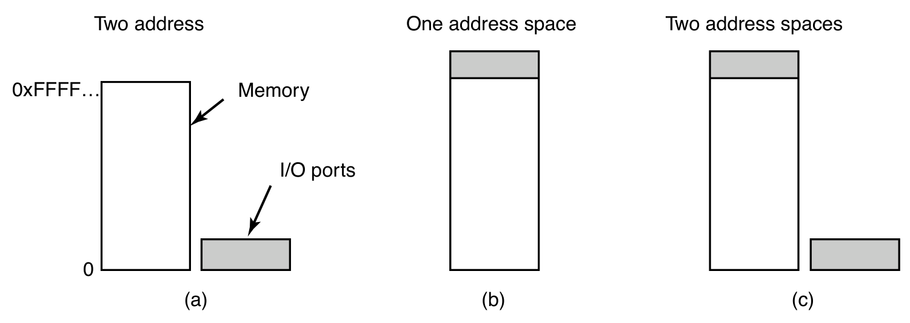
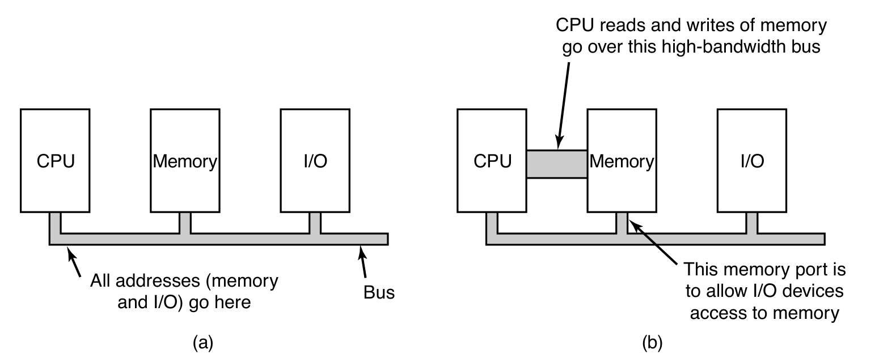

# 《现代操作系统(第 5 版)》§5.1.3 Memory-Mapped I/O 全篇翻译

> 出处:[Modern Operating Systems 5th Edition, §5.1.3 Memory-Mapped I/O, 书页 340–344(PDF 369–373)](../../../007.BOOKs/现代操作系统/Modern%20Operating%20Systems%205th%20Edition-PDF-01.pdf#page=369);同文电子版:[Modern Operating Systems 5th Edition-EPUB-02](../../../007.BOOKs/现代操作系统/Modern%20Operating%20Systems%205th%20Edition-EPUB-02.epub) §5.1.3。
>
> 格式:小节标题、段落顺序与插图位置均照原书;每段先给英文原文(逐字摘录),紧接中文对照;原书加粗术语(I/O port、I/O port space、memory-mapped I/O)在中文对照中加粗;原书以斜体单独成行的指令(IN REG,PORT、IN R0,4 等)已并入所在句子。跨页段落按完整段落合并并随段注明;汇编清单按原书位置插在第 10 段中间;各"书页"小标题即 PDF 对应页的跳转链接。
>
> 字形说明:书中的减号(1M−1、64K−1)在该 PDF 内部被错映射为"<",本文引文按书面原样写作"−";提取层偶发的字距伪影空格(如 ev en、por t)已按书面原文修正(逐字校验含同等修正)。

## 5.1.3 Memory-Mapped I/O(内存映射 I/O)

### [书页 340(PDF 369)](../../../007.BOOKs/现代操作系统/Modern%20Operating%20Systems%205th%20Edition-PDF-01.pdf#page=369)

> "Each controller has a few registers that are used for communicating with the CPU. By writing into these registers, the operating system can command the device to deliver data, accept data, switch itself on or off, or otherwise perform some action. By reading from these registers, the operating system can learn what the device’s state is, whether it is prepared to accept a new command, and so on."
>
> 每个控制器都有少量用于与 CPU 通信的寄存器。通过向这些寄存器写入内容,操作系统可以命令设备发送数据、接收数据、自行开启或关闭,或者执行其他某种操作。通过从这些寄存器读取内容,操作系统可以了解设备的状态如何、它是否准备好接受新命令,等等。

> "In addition to the control registers, many devices have a data buffer that the operating system can read and write. For example, a common way for computers to display pixels on the screen is to have a video RAM, which is basically just a data buffer, available for programs or the operating system to write into."
>
> 除控制寄存器之外,许多设备还有一个供操作系统读写的数据缓冲区。举例来说,计算机在屏幕上显示像素的一种常见方式,就是设置一块显存(video RAM)——它基本上就是一个数据缓冲区,供程序或操作系统写入。

> "The issue thus arises of how the CPU communicates with the control registers and also with the device data buffers. Two alternatives exist. In the first approach, each control register is assigned an I/O port number, an 8- or 16-bit integer. The set of all the I/O ports form the I/O port space, which is protected so that ordinary user programs cannot access it (only the operating system can). Using a special I/O instruction such as IN REG,PORT, the CPU can read in control register PORT and store the result in CPU register REG. Similarly, using OUT PORT,REG the CPU can write the contents of REG to a control register. Most early computers, including nearly all mainframes, such as the IBM 360 and all of its successors, worked this way."
>
> 于是问题随之而来:CPU 如何与控制寄存器以及设备数据缓冲区通信?存在两种方案。第一种方案为每个控制寄存器分配一个 **I/O 端口**(I/O port)编号,即一个 8 位或 16 位整数。全部 I/O 端口合起来构成 **I/O 端口空间**(I/O port space),它受到保护,普通用户程序无法访问(只有操作系统可以)。使用专用 I/O 指令,如 `IN REG,PORT,`,CPU 就能读入控制寄存器 PORT 的内容,并把结果存入 CPU 寄存器 REG。类似地,通过 `OUT PORT,REG`,CPU 可以把 REG 的内容写到一个控制寄存器。大多数早期计算机——包括几乎所有大型机,如 IBM 360 及其全部后继机型——都以这种方式工作。

*(本段跨书页 340–341;原书中 IN REG,PORT, 与 OUT PORT,REG 两行以斜体单独成行。)*

### [书页 341(PDF 370)](../../../007.BOOKs/现代操作系统/Modern%20Operating%20Systems%205th%20Edition-PDF-01.pdf#page=370)



*Figure 5-2. (a) Separate I/O and memory space. (b) Memory-mapped I/O. (c) Hybrid.*（图 5-2：(a) 独立的 I/O 与内存空间。(b) 内存映射 I/O。(c) 混合方案。）<sup>原图出自 [PDF 370 页](../../../007.BOOKs/现代操作系统/Modern%20Operating%20Systems%205th%20Edition-PDF-01.pdf#page=370);该页无嵌入位图,本图由页面矢量数据按 300 dpi 渲染裁出(不含图注)</sup>

> "In this scheme, the address spaces for memory and I/O are different, as shown in Fig. 5-2(a). The instructions IN R0,4 and MOV R0,4 are completely different in this design. The former reads the contents of I/O port 4 and puts it in R0, whereas the latter reads the contents of memory word 4 and puts it in R0. The 4s in these examples refer to different and unrelated address spaces."
>
> 在这种方案下,内存和 I/O 的地址空间是彼此不同的,如图 5-2(a) 所示。指令 `IN R0,4` 和 `MOV R0,4` 在这一设计中完全不同:前者读取 I/O 端口 4 的内容放入 R0,而后者读取内存字 4 的内容放入 R0。这两个例子中的"4"指的是互不相同、毫无关系的地址空间。

> "The second approach, introduced with the PDP-11, is to map all the control registers into the memory space, as shown in Fig. 5-2(b). Each control register is assigned a unique memory address to which no memory is assigned. This system is called memory-mapped I/O. In most systems, the assigned addresses are at or near the top of the address space. A hybrid scheme, with memory-mapped I/O data buffers and separate I/O ports for the control registers, is shown in Fig. 5-2(c). The x86 uses this architecture, with addresses 640K to 1M − 1 being reserved for device data buffers in IBM PC compatibles, in addition to I/O ports 0 to 64K − 1."
>
> 第二种方案由 PDP-11 引入:把所有控制寄存器映射进内存地址空间,如图 5-2(b) 所示。每个控制寄存器被分配一个唯一的内存地址,而这个地址没有分配任何内存。这种系统称为**内存映射 I/O**(memory-mapped I/O)。在大多数系统中,被分配的地址位于地址空间的顶端或接近顶端。还有一种混合方案——数据缓冲区采用内存映射 I/O,控制寄存器采用独立 I/O 端口——如图 5-2(c) 所示。x86 采用的正是这种架构:在 IBM PC 兼容机上,除了 0 到 64K−1 的 I/O 端口之外,640K 到 1M−1 的地址被保留用作设备数据缓冲区。

> "As an aside, assigning 360K addresses for I/O devices on the original PC was an absurdly large number and limited the amount of memory that could be put on a PC. Having 4K I/O addresses would have been plenty. But back when memory cost $1 per byte, no one thought that anyone would want to have 640 KB on a PC, let alone 900 KB or more. What the designers did not realize was how fast memory prices would tumble. Nowadays, you would be hard pressed to find a notebook computer with less than 4,000,000 KB of RAM."
>
> 顺带一提,在最初的 PC 上给 I/O 设备分配 360K 个地址,这个数字大得荒唐,它限制了 PC 能装下的内存量。其实 4K 个 I/O 地址就绰绰有余了。但在内存每字节 1 美元的年代,没有人想到会有人想在 PC 上装 640 KB 内存,更别说 900 KB 或更多了。设计者们没有料到的是内存价格会跌得这么快。如今,你很难找到一台内存少于 4,000,000 KB 的笔记本电脑。

### [书页 342(PDF 371)](../../../007.BOOKs/现代操作系统/Modern%20Operating%20Systems%205th%20Edition-PDF-01.pdf#page=371)

> "How do these schemes actually work in practice? In all cases, when the CPU wants to read a word, either from memory or from an I/O port, it puts the address it needs on the bus’ address lines and then asserts a READ signal on a bus’ control line. A second signal line is used to tell whether I/O space or memory space is needed. If it is memory space, the memory responds to the request. If it is I/O space, the I/O device responds to the request. If there is only memory space [as in Fig. 5-2(b)], every memory module and every I/O device compares the address lines to the range of addresses that it services. If the address falls in its range, it responds to the request. Since no address is ever assigned to both memory and an I/O device, there is no ambiguity and no conflict."
>
> 这些方案在实践中究竟是如何工作的?无论何种情形,CPU 想读一个字——不管来自内存还是来自 I/O 端口——它都把所需的地址放上总线地址线,然后在总线控制线上发出 READ 信号。第二条信号线用来指明需要的是 I/O 空间还是内存空间。若是内存空间,由内存响应请求;若是 I/O 空间,由 I/O 设备响应请求。如果只有内存空间[如图 5-2(b) 那样],每个内存模块和每个 I/O 设备都会把地址线与自己服务的地址范围做比较;地址若落在自己的范围之内,它就响应请求。由于没有任何地址被同时分配给内存和某个 I/O 设备,因此不存在歧义,也不存在冲突。

> "These two schemes for addressing the controllers have different strengths and weaknesses. Let us start with the advantages of memory-mapped I/O. First of all, if special I/O instructions are needed to read and write the device control registers, access to them requires the use of assembly code since there is no way to execute an IN or OUT instruction in C or C++. Calling such a procedure adds overhead to controlling I/O. In contrast, with memory-mapped I/O, device control registers are just variables in memory and can be addressed in C the same way as any other variables. Thus, with memory-mapped I/O, an I/O device driver can be written entirely in C. Without memory-mapped I/O, some assembly code is needed."
>
> 这两种控制器编址方案各有优劣。先看内存映射 I/O 的优点。首先,如果读写设备控制寄存器要用专用的 I/O 指令,那么访问它们就必须使用汇编代码,因为在 C 或 C++ 里无法执行 IN 或 OUT 指令;调用这样一个过程会给 I/O 控制增加开销。相反,在内存映射 I/O 下,设备控制寄存器就是内存里的变量,可以像任何其他变量一样用 C 寻址。因此,有了内存映射 I/O,I/O 设备驱动程序就能完全用 C 编写;而没有内存映射 I/O,就需要一些汇编代码。

> "Second, with memory-mapped I/O, no special protection mechanism is needed to keep user processes from performing I/O. All the operating system has to do is refrain from putting that portion of the address space containing the control registers in any user’s virtual address space. Even better yet, if each device has its control registers on a different page of the address space, the operating system can give a user control over specific devices but not others by simply including the desired pages in its page table. Such a scheme can allow different device drivers to be run in different user-mode address spaces, not only reducing kernel size but also keeping one driver from interfering with others. This also prevents a driver crash from taking down the entire system. Some microkernels (e.g., MINIX 3) work like this."
>
> 其次,内存映射 I/O 不需要特殊的保护机制来阻止用户进程执行 I/O。操作系统要做的全部事情,就是不把包含控制寄存器的那部分地址空间放进任何用户的虚拟地址空间。更进一步,如果每个设备的控制寄存器位于地址空间中不同的页上,操作系统只需把想要的页放进某个用户的页表,就能让该用户控制特定设备而不能控制其他设备。这样的方案可以让不同的设备驱动程序运行在不同的用户态地址空间中,不仅缩小了内核的规模,也让驱动程序之间互不干扰。这还能防止一个驱动程序崩溃拖垮整个系统。有些微内核(例如 MINIX 3)就是这样工作的。

> "Third, with memory-mapped I/O, every instruction that can reference memory can also reference control registers. For example, if there is an instruction, TEST, that tests a memory word for 0, it can also be used to test a control register for 0, which might be the signal that the device is idle and can accept a new command. The assembly language code might look like this:"
>
> 第三,内存映射 I/O 下,每一条能引用内存的指令也都能引用控制寄存器。例如,若有一条指令 TEST 能测试某个内存字是否为 0,它同样可以用来测试某个控制寄存器是否为 0——这个 0 可能正是"设备空闲、可以接受新命令"的信号。汇编代码看起来会是这样:

```asm
LOOP:   TEST PORT 4     // check if port 4 is 0
        BEQ READY       // if it is 0, go to ready
        BRANCH LOOP     // otherwise, continue testing
READY:
```

> "If memory-mapped I/O is not present, the control register must first be read into the CPU, then tested, requiring two instructions instead of just one. In the case of the loop given above, a fourth instruction has to be added, slightly slowing down the responsiveness of detecting an idle device."
>
> 如果没有内存映射 I/O,就必须先把控制寄存器读进 CPU、再作测试,需要两条指令而不是一条。就上面的循环而言,必须加上第四条指令,检测到设备空闲的响应速度因此会稍微变慢。

*(以上两段引文在原书中是同一个自然段,汇编清单按原书插在其间;本段跨书页 342–343。)*

### [书页 343(PDF 372)](../../../007.BOOKs/现代操作系统/Modern%20Operating%20Systems%205th%20Edition-PDF-01.pdf#page=372)

> "In computer design, practically everything involves trade-offs, and that is the case here, too. Memory-mapped I/O also has its disadvantages. First, most computers nowadays have some form of caching of memory words. Caching a device control register would be disastrous. Consider the assembly-code loop given above in the presence of caching. The first reference to PORT 4 would cause it to be cached. Subsequent references would just take the value from the cache and not even ask the device. Then when the device finally became ready, the software would have no way of finding out. Instead, the loop would go on forever."
>
> 在计算机设计中,几乎一切都要权衡,这里也不例外。内存映射 I/O 也有它的缺点。第一,如今大多数计算机都对内存字进行某种形式的缓存。缓存一个设备控制寄存器将是灾难性的。考虑上面那段汇编循环在存在缓存时的情形:第一次引用 PORT 4 会使它被缓存,后续引用只会从缓存取值,根本不再询问设备;等到设备最终就绪时,软件已无从得知,循环将永远转下去。

> "To prevent this situation with memory-mapped I/O, the hardware has to be able to selectively disable caching, for example, on a per-page basis. This feature adds extra complexity to both the hardware and the operating system, which has to manage the selective caching."
>
> 要在内存映射 I/O 下防止这种情况,硬件必须能够有选择地禁用缓存,例如按页禁用。这一特性给硬件和操作系统都增加了额外的复杂性——操作系统必须管理这种选择性缓存。

> "Second, if there is only one address space, then all memory modules and all I/O devices must examine all memory references to see which ones to respond to. If the computer has a single bus, as in Fig. 5-3(a), having everyone look at every address is straightforward."
>
> 第二,如果只有一个地址空间,那么所有内存模块和所有 I/O 设备都必须检查每一次内存引用,以判断哪些需要自己响应。如果计算机只有一条总线(如图 5-3(a) 那样),让每个部件查看每个地址是直截了当的。



*Figure 5-3. (a) A single-bus architecture. (b) A dual-bus memory architecture.*（图 5-3：(a) 单总线架构。(b) 双总线内存架构。）<sup>原图出自 [PDF 372 页](../../../007.BOOKs/现代操作系统/Modern%20Operating%20Systems%205th%20Edition-PDF-01.pdf#page=372);该页无嵌入位图,本图由页面矢量数据按 300 dpi 渲染裁出(不含图注)</sup>

> "However, the trend in modern personal computers is to have a dedicated high-speed memory bus, as shown in Fig. 5-3(b). The bus is tailored to optimize memory performance, with no compromises for the sake of slow I/O devices. x86 systems can have multiple buses (memory, PCIe, SCSI, and USB), as shown in Fig. 1-12."
>
> 然而,现代个人计算机的趋势是采用一条专用的高速内存总线,如图 5-3(b) 所示。这条总线为优化内存性能而量身定制,不为迁就慢速 I/O 设备作任何妥协。x86 系统可以有多条总线(内存、PCIe、SCSI 和 USB),如图 1-12 所示。

> "The trouble with having a separate memory bus on memory-mapped machines is that the I/O devices have no way of seeing memory addresses as they go by on the memory bus, so they have no way of responding to them. Again, special measures have to be taken to make memory-mapped I/O work on a system with multiple buses. One possibility is to first send all memory references to the memory. If the memory fails to respond, then the CPU tries the other buses. This design can be made to work but requires additional hardware complexity."
>
> 在内存映射的机器上设置独立内存总线的麻烦在于:I/O 设备无法看到内存总线上经过的内存地址,因此无法对它们作出响应。同样,必须采取特殊措施才能让内存映射 I/O 在多总线系统上工作。一种可能的做法是先把所有内存引用都发给内存;如果内存不响应,CPU 再去试其他总线。这种设计可以让它工作起来,但需要额外的硬件复杂性。

*(本段跨书页 343–344。)*

### [书页 344(PDF 373)](../../../007.BOOKs/现代操作系统/Modern%20Operating%20Systems%205th%20Edition-PDF-01.pdf#page=373)

> "A second possible design is to put a snooping device on the memory bus to pass all addresses presented to potentially interested I/O devices. The problem here is that I/O devices may not be able to process requests at the speed the memory can."
>
> 第二种可能的设计是在内存总线上放一个侦听(snooping)设备,把呈现出来的所有地址转发给可能感兴趣的 I/O 设备。这里的问题是:I/O 设备也许无法以内存处理请求的速度来处理请求。

> "A third possible design, and one that would well match the design sketched in Fig. 1-12, is to filter addresses in the memory controller. In that case, the memory controller chip contains range registers that are preloaded at boot time. For example, 640K to 1M − 1 could be marked as a nonmemory range. Addresses that fall within one of the ranges marked as nonmemory are forwarded to devices instead of to memory. The main disadvantage of this scheme is the need for figuring out at boot time which memory addresses are not really memory addresses. Thus each scheme has arguments for and against it, so compromises and trade-offs are inevitable, especially when backward compatibility with legacy systems is important."
>
> 第三种可能的设计——与图 1-12 所勾画的设计十分契合——是在内存控制器中过滤地址。在这种情形下,内存控制器芯片包含一些在引导时预装入的范围寄存器(range registers)。例如,可以把 640K 到 1M−1 标记为非内存范围;落在被标记为非内存的范围之内的地址,会被转发给设备而不是内存。这一方案的主要缺点是,需要在引导时弄清楚哪些内存地址并不是真正的内存地址。因此,每种方案都有赞成与反对的理由,妥协与权衡不可避免——在与遗留系统的后向兼容性很重要时尤其如此。

*(本节至此结束;下节 §5.1.4 Direct Memory Access 从书页 344 中部开始,其全篇翻译见 [006.DMA/003](../006.DMA/003.MOS5-5.1.4-DMA全篇翻译.md)。)*

## 关联笔记

- [006.MMIO的缺点-多总线路由与ARM64处理](006.MMIO的缺点-多总线路由与ARM64处理.md) —— 本节末尾两大缺点(缓存干扰/多总线路由)与三种解法的展开,及 ARM64 的落地实现
- [006.DMA/003.MOS5-5.1.4-DMA全篇翻译](../006.DMA/003.MOS5-5.1.4-DMA全篇翻译.md) —— 下一节 §5.1.4 的同规格全篇翻译
- [README](README.md)(§5.1.3 定义节选与本目录索引)
