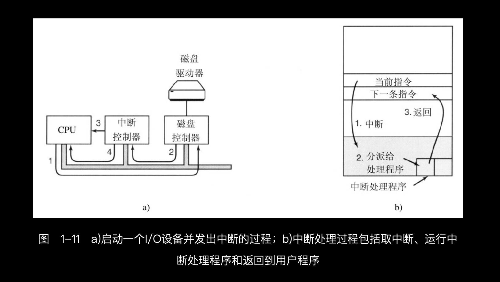

# 输入输出实现方式
> 学习:   - [007.BOOKs/现代操作系统.epub](../../007.BOOKs/现代操作系统.epub)#1.3.5 I/O设备

|实现方式|说明|备注|
|-|-|-|
|- 忙等待(busy waiting)，即 “轮询”|-|-|
|-|-|-|
|- 中断|- |- 参考: [007.BOOKs/现代操作系统.epub](../../007.BOOKs/现代操作系统.epub)#1.3.5 I/O设备|
|-|-|-|
|- 直接内存访问(DMA)|-|-|
|-|-|-|
